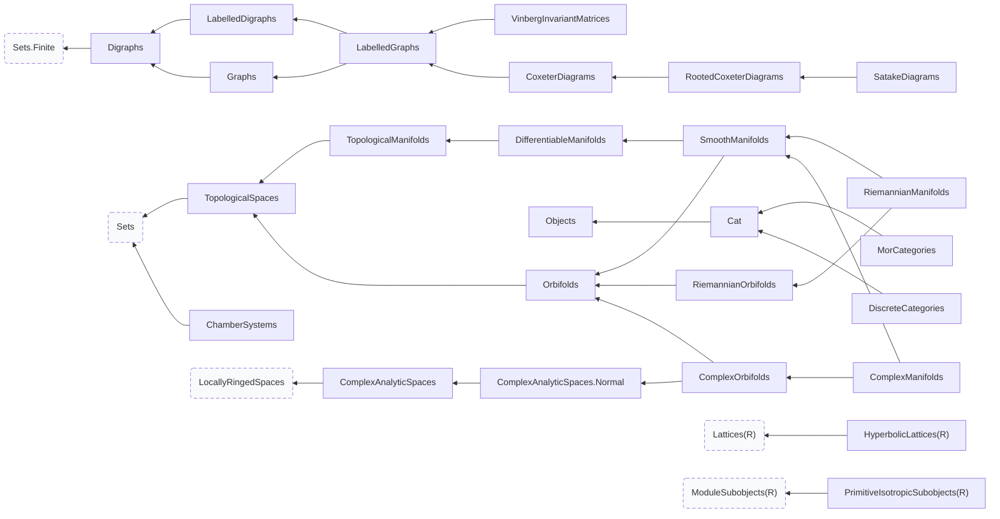
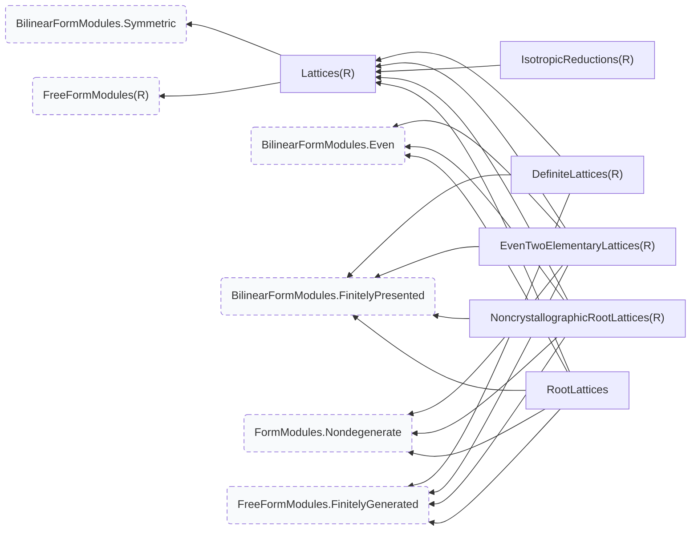
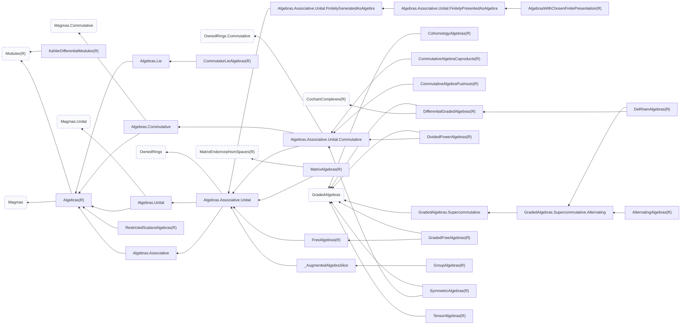
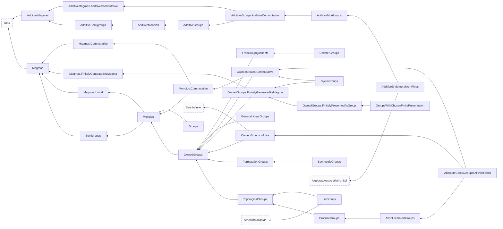
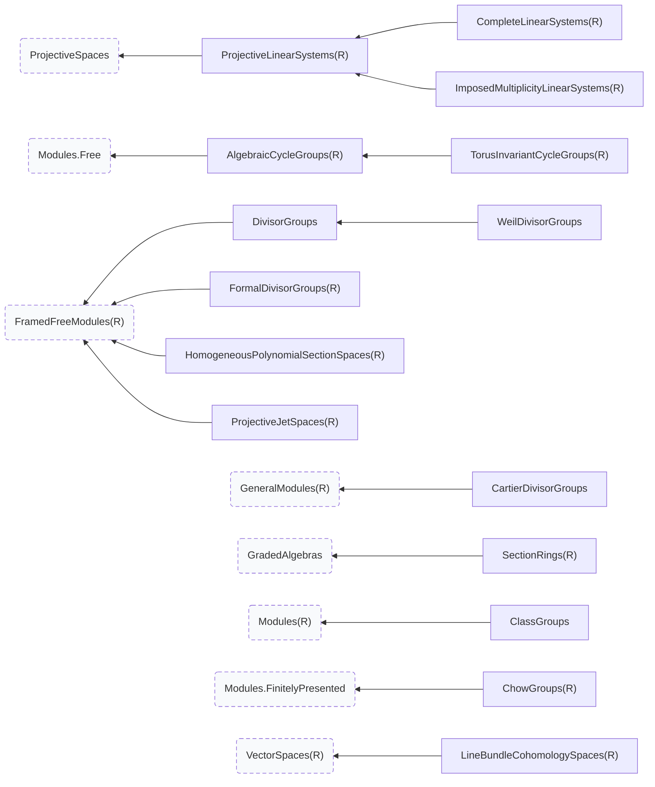
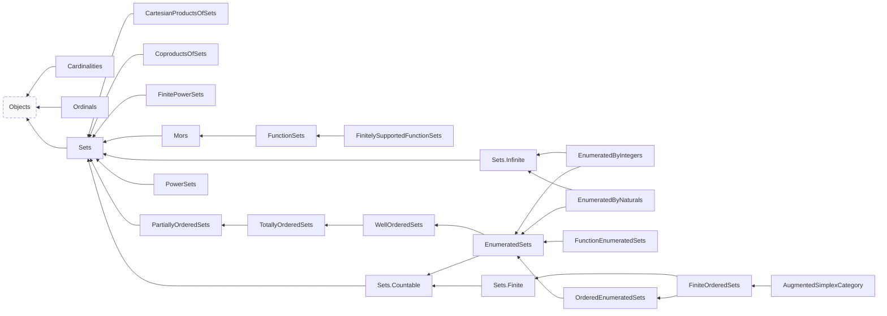
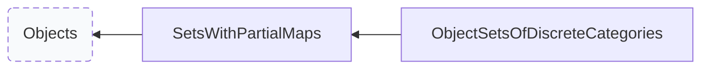

# The preamble, surveyed from a live session

This is the reference for what a session can build on: which categories exist, what sits above and below each one, which operations an object of each category answers to and where each operation is defined, which functors move between categories, and which named specimens are on hand.

Everything here was read from a running session, not from the source text.
`super_categories` is a method, the base ring is an argument, and the operations an object carries are assembled by Sage from the category graph at runtime -- so a category's place and its methods are facts only a live object can report.

```python
from dzack_research.preamble.all import *
```

## How to read an entry

A category parameterized by a ring is written `C(R)` and was probed at `R = ZZ`; the relations hold for the parameter generally, and the **probed as** line shows the object the survey actually held.

**Above** and **below** are the direct edges of the poset: `super_categories` and its inverse.
**Refines** is the transitive closure upward.

**Operations introduced here** are the ones this category *defines*. Every operation is written out once, at the category that owns it; a descendant lists it under **inherited** with a link, because that is where placement lives.
So an object of `C` answers to the union of the operations introduced by `C` and by everything in its ancestry.

Operations are split by what they act on: **objects** of the category, **elements** of those objects, and **morphisms** between them.

A category the survey could not build, or an operation whose signature would not resolve, is recorded with the error rather than dropped.

The same survey is serialized to `docs/preamble-graph.json`, which carries every operation name, so a question this prose cannot index is a `jq` away:

```bash
# which category owns discriminant_group?
jq -r '.categories | to_entries[]
      | select(.value.operations.objects[]?.name == "discriminant_group")
      | .key' docs/preamble-graph.json
```

The poset is drawn in `docs/preamble-graph.html` (pan and zoom), from `docs/preamble-graph.dot`.

|  |  |
| :--- | ---: |
| categories in the poset | 313 |
| of those, built and interrogated | 233 |
| operations, each written once at its owner | 2037 |
| functors | 4, 2 of them with a domain and codomain resolved here |
| adjunctions | 1 |

## The category poset

An edge points from a category to a category it refines.
In the drawing the arrow runs leftward and the chapters are boxed, so reading left is forgetting structure and reading right is adding it; a dashed node is a category Sage provides rather than one the preamble owns.

The top of the poset, refining nothing further: [`Objects`](#cat-objects).

The whole graph at once is [`preamble-graph.html`](preamble-graph.html); the diagrams below are its restriction to one chapter, together with any immediate supercategory that lies outside it.

## Getting from one category to another

Every functor the survey could build, indexed by where it starts.
This is the table to read when the object you have and the object you want are in different categories.

| from | functor | to |
| :--- | :--- | :--- |
| Category of discrete categories | [`ObjectSetFunctor`](#fun-objectsetfunctor) | Category of sets |
| Category of modules over commutative rings | [`ModuleBaseRingProjection`](#fun-modulebaseringprojection) | Category of commutative rings |

3 further functors take data the survey does not choose for you (a ring map, a group, a subgroup pair); they are written out in their chapters with the arguments they want.

## Abstract Category Theory & Universal Constructions

> Category of categories (Cat), Arrow and Slice categories, Limits, Colimits, Biproducts, Subobjects, and Diagram categories.



### Categories

Ordered by depth: the least structured first.

#### `Objects` {#cat-objects}

The root of the owned mathematical category graph.

```text
This category carries no mathematical supercategory. Sage's own
``Objects``/``Sets`` categories remain runtime substrate only and are not
semantic ancestors of owned categories.
```

- **not exported**: reachable only as a supercategory

- **probed as** `Category of represented mathematical objects`

- **below** [`Cardinalities`](#cat-cardinalities), [`Cat`](#cat-cat), [`DerivedCategories(R)`](#cat-derivedcategories), [`Ordinals`](#cat-ordinals), [`Sets`](#cat-sets), [`SetsWithPartialMaps`](#cat-setswithpartialmaps)

- **build an object** `Objects(x, *args, **opts)`

**Operations introduced here** (4 on objects)

*on objects*

- `ElementType(...)`

  - The owned root of every element chain: the host element runtime.

- `has_selected_resolution(owner) -> 'bool'`

  - Whether a chosen resolution relative to owner is stored.

- `selected_resolution(owner)`

  - Return the chosen resolution relative to owner.

- `selected_resolution_generating_set(owner)`

  - The set ``S`` of the chosen resolution relative to owner, realizing it only when unstated.

**Inherited operations**, defined where they are owned:

| from | objects | elements | morphisms |
| :--- | ---: | ---: | ---: |
| `SageObject` | 8 | 8 |  |
| `Parent` | 15 |  |  |
| `CategoryObject` | 14 |  |  |
| `Element` |  | 9 |  |

#### `Cat` {#cat-cat}

The represented category of categories.

```text
A category is an object of ``Cat`` by placement: the owned category bases
record ``Cat()`` as a category's category when it is built
(``OwnedCategoryObject`` in ``owned_category.py``), a fixed Mor category
records ``MorCategories()``, and ``Cat`` records itself.  The expectation
``Cat() in Cat()`` (``tests/constructions/test_categorical_constructions_construct.py``)
is that last placement; ``Cat`` is not built on the owned base, which
would ask for ``Cat()`` while ``Cat`` is under construction.
```

- **defined at** `src/dzack_research/preamble/categories/abstract_categories/cat.py:293`

- **probed as** `Cat: categories with functors as morphisms`

- **above** [`Objects`](#cat-objects)

- **below** [`DiscreteCategories`](#cat-discretecategories), [`LinearCategories(R)`](#cat-linearcategories), [`MorCategories`](#cat-morcategories)

- **refines**, transitively, in Sage's linearization order: [`Objects`](#cat-objects)

- **build an object** `Cat(x, *args, **opts)`

- **specimens** `Ord`

**Operations introduced here** (68 on objects)

*on objects*

- `ArrowCategory() -> 'Category'`

  - Return $\mathrm{Ar}(C) = [[1], C]$, the functor category out of the walking arrow.

- `Aut(obj: 'Parent') -> 'Category'`

- `AutCategory() -> 'Category'`

- `AutomorphismArrowCategory() -> 'Category'`

  - Return the full arrow subcategory on automorphisms.

- `Colimits(index_category: 'Category') -> 'Category'`

  - Return the selected-colimit construction category for this target.

- `CoproductCocones(factors) -> 'Category'`

  - Return the category of coproduct cocones on ``factors`` in this category.

- `Coproducts(index_category: 'Category') -> 'Category'`

  - Return the selected-coproduct construction category for this target.

- `Core() -> 'Category'`

  - Return the core of this category: its objects and its isomorphisms.

- `CosliceUnder(base_object: 'Parent') -> 'Category'`

  - Return the coslice $X/C$.

- `CoveredObjectCategory(base_object: 'Parent') -> 'Category'`

  - Return the category of epic quotients covered by ``base_object`` here.

- `CoveredObjects(base_object: 'Parent') -> 'Category'`

- `CoveringObjectCategory(base_object: 'Parent') -> 'Category'`

  - Return the category of epic objects covering ``base_object`` here.

- `CoveringObjects(base_object: 'Parent') -> 'Category'`

- `ElementType() -> 'type[ElementOfCategoryObject]'` <sub>read as an attribute</sub>

  - The implementation type for elements of those objects.

- `End(obj: 'Parent') -> 'Category'`

- `EndArrowCategory() -> 'Category'`

  - Return the full arrow subcategory on endomorphisms.

- `EndCategory() -> 'Category'`

- `Epi(source: 'Parent', target: 'Parent') -> 'Category'`

- `EpiCategory() -> 'Category'`

- `EpimorphismArrowCategory() -> 'Category'`

  - Return the full arrow subcategory on represented epimorphisms.

- `Iso(source: 'Parent', target: 'Parent') -> 'Category'`

- `IsoArrowCategory() -> 'Category'`

  - Return the full arrow subcategory on represented isomorphisms.

- `IsoCategory() -> 'Category'`

- `Limits(index_category: 'Category') -> 'Category'`

  - Return the selected-limit construction category for this target.

- `Mono(source: 'Parent', target: 'Parent') -> 'Category'`

- `MonoCategory() -> 'Category'`

- `MonomorphismArrowCategory() -> 'Category'`

  - Return the full arrow subcategory on represented monomorphisms.

- `Mor(codomain)` <sub>object-level</sub>

  - Functor morphisms when this category is asked as an object of Cat.

- `MorCategory() -> 'Category'`

- `ObjectType() -> 'type[ObjectOfCategory]'` <sub>read as an attribute</sub>

  - The implementation type for objects of this category.

- `ProductCones(factors) -> 'Category'`

  - Return the category of product cones on ``factors`` in this category.

- `Products(index_category: 'Category') -> 'Category'`

  - Return the selected-product construction category for this target.

- `SliceOver(base_object: 'Parent') -> 'Category'`

  - Return the slice $C/X$.

- `SubobjectCategory(base_object: 'Parent') -> 'Category'`

  - Return the category of subobjects of ``base_object`` here.

- `Subobjects(base_object: 'Parent') -> 'Category'`

- `SuperobjectCategory(base_object: 'Parent') -> 'Category'`

  - Return the category of monic superobjects of ``base_object`` here.

- `Superobjects(base_object: 'Parent') -> 'Category'`

- `WideSubcategory(arrow_category: 'Category') -> 'Category'`

  - Return the wide subcategory with the selected arrow class.

- `category_packet()`

  - Return the Mor/End/Mono/Epi/Iso/Aut packet owned by this category.

- `class_set()` <sub>cached</sub>

  - Return connected components, or iso-classes of a groupoid.

- `class_set_construction()` <sub>cached</sub>

  - Coequalize source and target on a complete selected arrow set.

- `codomain_functor()`

  - Return the codomain functor ``Ar(self) -> self``.

- `coequalizer(left_morphism: 'Morphism', right_morphism: 'Morphism') -> 'ObjectOfCategory'`

  - Return this category's represented coequalizer of a parallel pair.

- `coequalizer_construction(left_morphism: 'Morphism', right_morphism: 'Morphism')`

  - Return this category's selected coequalizer construction.

- `coequalizer_of_family(morphisms) -> 'ObjectOfCategory'`

  - Return this category's represented wide coequalizer.

- `coequalizer_of_family_construction(morphisms)`

  - Return the selected wide coequalizer with its indexed diagram and universal cocone.

- `colimit_functor(index_category: 'Category')`

  - Return the selected colimit functor ``[index_category,self] -> self``.

- `coproduct(factors)`

  - Return this category's selected binary coproduct.

- `coproduct_construction(factors)`

  - Return this category's selected coproduct construction on ``factors``.

- `coproduct_functor()`

  - Return this category's selected binary-coproduct functor.

- `diagonal_functor()`

  - Return the diagonal functor ``self -> self x self``.

- `domain_functor()`

  - Return the domain functor ``Ar(self) -> self``.

- `equalizer(left_morphism: 'Morphism', right_morphism: 'Morphism') -> 'ObjectOfCategory'`

  - Return this category's represented equalizer of a parallel pair.

- `equalizer_construction(left_morphism: 'Morphism', right_morphism: 'Morphism')`

  - Return this category's selected equalizer construction.

- `equalizer_of_family(morphisms) -> 'ObjectOfCategory'`

  - Return this category's represented wide equalizer.

- `equalizer_of_family_construction(morphisms)`

  - Return the selected wide equalizer with its indexed diagram and universal cone.

- `fiber_product(left_leg: 'Morphism', right_leg: 'Morphism') -> 'ObjectOfCategory'`

  - Return the fiber product of the cospan these two legs form.

- `inclusion_into(supercategory: 'Category')`

  - Return the canonical inclusion functor into a declared supercategory.

- `limit_functor(index_category: 'Category')`

  - Return the selected limit functor ``[index_category,self] -> self``.

- `opposite() -> 'Category'`

  - Return $C^{op}$.

- `presheaves(value_category: 'Category | None' = None) -> 'Category'`

  - Return $\mathrm{Presh}(C, D) = [C^{op}, D]$, with $D = \mathbf{Set}$ by default.

- `product_construction(factors)`

  - Return this category's selected product construction on ``factors``.

- `product_functor()`

  - Return this category's selected binary-product functor.

- `pullback_construction(left_leg: 'Morphism', right_leg: 'Morphism')`

  - Return the selected pullback cone of ``X -> Z <- Y``.

- `pushout(left_leg: 'Morphism', right_leg: 'Morphism') -> 'ObjectOfCategory'`

  - Return the pushout of the span these two legs form.

- `pushout_construction(left_leg: 'Morphism', right_leg: 'Morphism')`

  - Return the selected pushout cocone of ``X <- Z -> Y``.

- `span(left_leg: 'Morphism', right_leg: 'Morphism') -> 'ObjectOfCategory'`

  - Return the span these two legs form, as an object of this category.

- `yoneda_embedding()`

  - Return $y: C \to [C^{op}, \mathbf{Set}]$, $X \mapsto \mathrm{Mor}_C(-, X)$.

#### `ChamberSystems` {#cat-chambersystems}

Chamber systems with type-preserving adjacency-preserving morphisms.

- **defined at** `src/dzack_research/preamble/categories/chamber_systems.py:142`

- **probed as** `Category of chamber systems`

- **above** [`Sets`](#cat-sets)

- **refines**, transitively, in Sage's linearization order: [`Sets`](#cat-sets) · [`Objects`](#cat-objects)

- **build an object** `ChamberSystems(x, *args, **opts)`

**Operations introduced here** (1 on objects)

*on objects*

- `ElementType(...)`

  - Chamber systems with type-preserving adjacency-preserving morphisms.

**Inherited operations**, defined where they are owned:

| from | objects | elements | morphisms |
| :--- | ---: | ---: | ---: |
| [`Sets`](#cat-sets) | 18 |  |  |
| `SageObject` | 8 | 8 |  |
| `Parent` | 15 |  |  |
| `CategoryObject` | 14 |  |  |
| `Element` |  | 9 |  |
| [`Objects`](#cat-objects) | 3 |  |  |

#### `DiscreteCategories` {#cat-discretecategories}

The category of represented discrete categories.

- **defined at** `src/dzack_research/preamble/categories/abstract_categories/functors.py:329`

- **probed as** `Category of discrete categories`

- **above** [`Cat`](#cat-cat)

- **refines**, transitively, in Sage's linearization order: [`Cat`](#cat-cat) · [`Objects`](#cat-objects)

- **build an object** `DiscreteCategories(x, *args, **opts)`

**Operations introduced here** (1 on objects)

*on objects*

- `ElementType()`

  - The category of represented discrete categories.

**Inherited operations**, defined where they are owned:

| from | objects | elements | morphisms |
| :--- | ---: | ---: | ---: |
| [`Cat`](#cat-cat) | 68 |  |  |

#### `MorCategories` {#cat-morcategories}

The category of represented fixed-endpoint Mor categories.

```text
Its objects are the categories ``Hom_C(A,B)``, each built by the ``Of``
entry of the Mor family of its base category ``C``.
```

- **defined at** `src/dzack_research/preamble/categories/abstract_categories/mor_categories.py:1579`

- **probed as** `Category of mor categories`

- **above** [`Cat`](#cat-cat)

- **refines**, transitively, in Sage's linearization order: [`Cat`](#cat-cat) · [`Objects`](#cat-objects)

- **build an object** `MorCategories(x, *args, **opts)`

**Operations introduced here** (2 on objects)

*on objects*

- `ElementType()`

  - The category of represented fixed-endpoint Mor categories.

- `is_endomorphism_set() -> 'bool'`

  - Whether this fixed Mor is End_C(A) = Hom_C(A,A).

**Inherited operations**, defined where they are owned:

| from | objects | elements | morphisms |
| :--- | ---: | ---: | ---: |
| [`Cat`](#cat-cat) | 68 |  |  |

#### `TopologicalSpaces` {#cat-topologicalspaces}

Sets equipped with a topology, with continuous maps as morphisms.

- **defined at** `src/dzack_research/preamble/categories/topological_spaces.py:550`

- **probed as** `Category of topological spaces`

- **above** [`Sets`](#cat-sets)

- **below** [`Orbifolds`](#cat-orbifolds), [`PrimeSpectra`](#cat-primespectra), [`SheafedSpaces`](#cat-sheafedspaces), [`TopologicalManifolds`](#cat-topologicalmanifolds)

- **refines**, transitively, in Sage's linearization order: [`Sets`](#cat-sets) · [`Objects`](#cat-objects)

- **build an object** `TopologicalSpaces(x, *args, **opts)`

**Operations introduced here** (10 on objects)

*on objects*

- `ElementType(...)`

  - Sets equipped with a topology, with continuous maps as morphisms.

- `betti_number(degree)`

  - ``b_k(X) = rank H^k(X; ZZ)``, the ``k``-th Betti number.

- `continuous_map(codomain, map_)`

- `euler_characteristic()`

  - ``chi(X) = sum_k (-1)^k b_k(X)``.

- `integral_singular_cohomology(degree)`

  - ``H^degree(X; ZZ)``, the degree piece of ``singular_cohomology(ZZ)``.

- `is_open_subset(subset) -> bool`

  - Whether ``subset`` is open in this topology.

- `open_subsets()`

  - The set of open subsets defining this topology.

- `open_subsets_site()` <sub>cached</sub>

  - ``Open(X)``, the poset category of the open subsets of ``X`` ordered by inclusion.

- `singular_cohomology(coefficients)`

  - ``H^*(X; R)``, the singular cohomology algebra of this space with coefficients ``R``.

- `topology()`

  - The set of open subsets defining this topology.

**Inherited operations**, defined where they are owned:

| from | objects | elements | morphisms |
| :--- | ---: | ---: | ---: |
| [`Sets`](#cat-sets) | 18 |  |  |
| `SageObject` | 8 | 8 |  |
| `Parent` | 15 |  |  |
| `CategoryObject` | 14 |  |  |
| `Element` |  | 9 |  |
| [`Objects`](#cat-objects) | 3 |  |  |

#### `Orbifolds` {#cat-orbifolds}

Smooth orbifolds (Satake 1956; Thurston, Ch. 13).

```text
The orbifold atlas is structure on the underlying paracompact Hausdorff
space, and forgetting it is the functor to ``TopologicalSpaces()``.  A
smooth manifold is the orbifold whose charts have trivial group, so
``SmoothManifolds()`` declares this category.
```

- **defined at** `src/dzack_research/preamble/categories/orbifolds.py:22`

- **probed as** `Category of orbifolds`

- **above** [`TopologicalSpaces`](#cat-topologicalspaces)

- **below** [`ComplexOrbifolds`](#cat-complexorbifolds), [`RiemannianOrbifolds`](#cat-riemannianorbifolds), [`SmoothManifolds`](#cat-smoothmanifolds)

- **refines**, transitively, in Sage's linearization order: [`TopologicalSpaces`](#cat-topologicalspaces) · [`Sets`](#cat-sets) · [`Objects`](#cat-objects)

- **build an object** `Orbifolds(x, *args, **opts)`

**Operations introduced here** (2 on objects)

*on objects*

- `ElementType(...)`

  - Smooth orbifolds (Satake 1956; Thurston, Ch. 13).

- `orbifold_atlas()`

  - The orbifold atlas: charts ``(U~, G, phi)`` with ``G\U~`` homeomorphic to an open of ``X``.

**Inherited operations**, defined where they are owned:

| from | objects | elements | morphisms |
| :--- | ---: | ---: | ---: |
| [`Sets`](#cat-sets) | 18 |  |  |
| `SageObject` | 8 | 8 |  |
| `Parent` | 15 |  |  |
| `CategoryObject` | 14 |  |  |
| `Element` |  | 9 |  |
| [`TopologicalSpaces`](#cat-topologicalspaces) | 9 |  |  |
| [`Objects`](#cat-objects) | 3 |  |  |

#### `TopologicalManifolds` {#cat-topologicalmanifolds}

Owned finite-dimensional topological manifolds.

- **defined at** `src/dzack_research/preamble/categories/manifolds.py:392`

- **probed as** `Category of topological manifolds`

- **above** [`TopologicalSpaces`](#cat-topologicalspaces)

- **below** [`DifferentiableManifolds`](#cat-differentiablemanifolds)

- **refines**, transitively, in Sage's linearization order: [`TopologicalSpaces`](#cat-topologicalspaces) · [`Sets`](#cat-sets) · [`Objects`](#cat-objects)

- **build an object** `TopologicalManifolds(x, *args, **opts)`

**Operations introduced here** (17 on objects, 3 on elements)

*on objects*

- `ElementType(parent: sage.structure.parent.Parent, coordinates, chart_label) -> None`

  - A point of a manifold, given by its coordinates in a labelled chart.

- `atlas()`

- `base_field_type()`

- `chart(label, coordinates)`

- `chart_labels()`

- `coordinate_field()`

  - The field ``RR``: a chart of a real manifold is a homeomorphism onto an open subset of ``RR^n``.

- `differentiability_degree()`

- `dimension()`

- `is_smooth() -> bool`

- `manifold_name()`

- `manifold_structure()`

- `point(coordinates, chart_label='standard')`

- `regularity()`

- `selected_finite_chart_labels()`

  - Labels in the currently registered finite chart realization.

- `transition(source_label, target_label)`

- `transition_map(source_label, target_label, forward_expressions, inverse_expressions, source_overlap=(), target_overlap=())`

  - Record the coordinate change between the charts ``U_s`` and ``U_t`` on ``U_s \cap U_t``.

- `transitions()`

*on elements*

- `chart()`

- `coordinates()`

- `manifold()`

**Inherited operations**, defined where they are owned:

| from | objects | elements | morphisms |
| :--- | ---: | ---: | ---: |
| [`Sets`](#cat-sets) | 18 |  |  |
| `SageObject` | 8 | 8 |  |
| `Parent` | 15 |  |  |
| `CategoryObject` | 14 |  |  |
| `Element` |  | 9 |  |
| [`TopologicalSpaces`](#cat-topologicalspaces) | 9 |  |  |
| [`Objects`](#cat-objects) | 3 |  |  |

#### `DifferentiableManifolds` {#cat-differentiablemanifolds}

Owned real differentiable manifolds.

```text
The direct constructor records a finite positive ``C^k`` degree.  Smooth
manifolds form the represented subcategory below and therefore belong here
as well.
```

- **defined at** `src/dzack_research/preamble/categories/manifolds.py:731`

- **probed as** `Category of differentiable manifolds`

- **above** [`TopologicalManifolds`](#cat-topologicalmanifolds)

- **below** [`SmoothManifolds`](#cat-smoothmanifolds)

- **refines**, transitively, in Sage's linearization order: [`TopologicalManifolds`](#cat-topologicalmanifolds) · [`TopologicalSpaces`](#cat-topologicalspaces) · [`Sets`](#cat-sets) · [`Objects`](#cat-objects)

- **build an object** `DifferentiableManifolds(x, *args, **opts)`

**Operations introduced here** (1 on objects)

*on objects*

- `ElementType(parent: sage.structure.parent.Parent, coordinates, chart_label) -> None`

  - Owned real differentiable manifolds.

**Inherited operations**, defined where they are owned:

| from | objects | elements | morphisms |
| :--- | ---: | ---: | ---: |
| [`TopologicalManifolds`](#cat-topologicalmanifolds) | 16 | 3 |  |
| [`Sets`](#cat-sets) | 18 |  |  |
| `SageObject` | 8 | 8 |  |
| `Parent` | 15 |  |  |
| `CategoryObject` | 14 |  |  |
| `Element` |  | 9 |  |
| [`TopologicalSpaces`](#cat-topologicalspaces) | 9 |  |  |
| [`Objects`](#cat-objects) | 3 |  |  |

#### `Digraphs` {#cat-digraphs}

Finite directed graphs with graph homomorphisms.

- **defined at** `src/dzack_research/preamble/categories/graph_categories.py:243`

- **probed as** `Category of finite directed graphs`

- **above** [`Sets.Finite`](#cat-sets-finite)

- **below** [`Graphs`](#cat-graphs), [`LabelledDigraphs`](#cat-labelleddigraphs)

- **refines**, transitively, in Sage's linearization order: [`Sets.Finite`](#cat-sets-finite) · [`Sets.Countable`](#cat-sets-countable) · [`Sets`](#cat-sets) · [`Objects`](#cat-objects)

- **build an object** `Digraphs(x, *args, **opts)`

**Operations introduced here** (1 on objects)

*on objects*

- `ElementType(...)`

  - Finite directed graphs with graph homomorphisms.

**Inherited operations**, defined where they are owned:

| from | objects | elements | morphisms |
| :--- | ---: | ---: | ---: |
| [`Sets`](#cat-sets) | 19 |  |  |
| `SageObject` | 8 | 8 |  |
| `Parent` | 15 |  |  |
| `CategoryObject` | 14 |  |  |
| `Element` |  | 9 |  |
| [`Objects`](#cat-objects) | 3 |  |  |

#### `RiemannianOrbifolds` {#cat-riemannianorbifolds}

Orbifolds with a Riemannian metric, invariant under every chart group.

```text
The metric is a ``G``-invariant Riemannian metric on each chart ``U~``,
and the chart embeddings are isometries.  The metric is chosen data, so
this is a data subcategory of ``Orbifolds()``.  A Riemannian manifold is
a Riemannian orbifold whose charts have trivial group.  The orbit space
``Gamma\M`` of a Riemannian manifold ``M`` by a discrete group of
isometries acting properly discontinuously is a Riemannian orbifold:
the metric of ``M`` is ``Gamma``-invariant, so it is invariant under each
stabilizer ``Gamma_p`` (Thurston, Ch. 13).
```

- **defined at** `src/dzack_research/preamble/categories/orbifolds.py:50`

- **probed as** `Category of Riemannian orbifolds`

- **above** [`Orbifolds`](#cat-orbifolds)

- **below** [`RiemannianManifolds`](#cat-riemannianmanifolds)

- **refines**, transitively, in Sage's linearization order: [`Orbifolds`](#cat-orbifolds) · [`TopologicalSpaces`](#cat-topologicalspaces) · [`Sets`](#cat-sets) · [`Objects`](#cat-objects)

- **build an object** `RiemannianOrbifolds(x, *args, **opts)`

**Operations introduced here** (2 on objects)

*on objects*

- `ElementType(...)`

  - Orbifolds with a Riemannian metric, invariant under every chart group.

- `riemannian_metric()`

  - The chart-invariant metric: on ``Gamma\M``, the metric of ``M`` on each chart ``U~``.

**Inherited operations**, defined where they are owned:

| from | objects | elements | morphisms |
| :--- | ---: | ---: | ---: |
| [`Sets`](#cat-sets) | 18 |  |  |
| `SageObject` | 8 | 8 |  |
| `Parent` | 15 |  |  |
| `CategoryObject` | 14 |  |  |
| `Element` |  | 9 |  |
| [`TopologicalSpaces`](#cat-topologicalspaces) | 9 |  |  |
| [`Objects`](#cat-objects) | 3 |  |  |
| [`Orbifolds`](#cat-orbifolds) | 1 |  |  |

#### `Graphs` {#cat-graphs}

Finite undirected graphs, viewed as symmetric directed graphs.

- **defined at** `src/dzack_research/preamble/categories/graph_categories.py:279`

- **probed as** `Category of finite graphs`

- **above** [`Digraphs`](#cat-digraphs)

- **below** [`LabelledGraphs`](#cat-labelledgraphs)

- **refines**, transitively, in Sage's linearization order: [`Digraphs`](#cat-digraphs) · [`Sets.Finite`](#cat-sets-finite) · [`Sets.Countable`](#cat-sets-countable) · [`Sets`](#cat-sets) · [`Objects`](#cat-objects)

- **build an object** `Graphs(x, *args, **opts)`

**Operations introduced here** (1 on objects)

*on objects*

- `ElementType(...)`

  - Finite undirected graphs, viewed as symmetric directed graphs.

**Inherited operations**, defined where they are owned:

| from | objects | elements | morphisms |
| :--- | ---: | ---: | ---: |
| [`Sets`](#cat-sets) | 19 |  |  |
| `SageObject` | 8 | 8 |  |
| `Parent` | 15 |  |  |
| `CategoryObject` | 14 |  |  |
| `Element` |  | 9 |  |
| [`Objects`](#cat-objects) | 3 |  |  |

#### `LabelledDigraphs` {#cat-labelleddigraphs}

Finite digraphs with selected vertex and edge labels.

- **defined at** `src/dzack_research/preamble/categories/graph_categories.py:315`

- **probed as** `Category of labelled finite directed graphs`

- **above** [`Digraphs`](#cat-digraphs)

- **below** [`LabelledGraphs`](#cat-labelledgraphs)

- **refines**, transitively, in Sage's linearization order: [`Digraphs`](#cat-digraphs) · [`Sets.Finite`](#cat-sets-finite) · [`Sets.Countable`](#cat-sets-countable) · [`Sets`](#cat-sets) · [`Objects`](#cat-objects)

- **build an object** `LabelledDigraphs(x, *args, **opts)`

**Operations introduced here** (1 on objects)

*on objects*

- `ElementType(...)`

  - Finite digraphs with selected vertex and edge labels.

**Inherited operations**, defined where they are owned:

| from | objects | elements | morphisms |
| :--- | ---: | ---: | ---: |
| [`Sets`](#cat-sets) | 19 |  |  |
| `SageObject` | 8 | 8 |  |
| `Parent` | 15 |  |  |
| `CategoryObject` | 14 |  |  |
| `Element` |  | 9 |  |
| [`Objects`](#cat-objects) | 3 |  |  |

#### `ComplexAnalyticSpaces` {#cat-complexanalyticspaces}

Complex analytic spaces `(X, O_X)` with holomorphic maps (Grauert--Remmert, Ch. 1).

```text
The structure sheaf ``O_X`` is a sheaf of local ``C``-algebras: its stalk
at ``x`` is a quotient of the ring of convergent power series
``C{z_1, ..., z_n}``, a local ring.  So a complex analytic space is a
locally ringed space whose stalks are ``C``-algebras, and forgetting that
it is locally a model space is the functor to ``LocallyRingedSpaces()``.
A morphism is a morphism of locally ``C``-ringed spaces.
```

- **defined at** `src/dzack_research/preamble/categories/complex_analytic_spaces.py:21`

- **probed as** `Category of complex analytic spaces`

- **above** [`LocallyRingedSpaces`](#cat-locallyringedspaces)

- **below** [`ComplexAnalyticSpaces.Normal`](#cat-complexanalyticspaces-normal)

- **refines**, transitively, in Sage's linearization order: [`LocallyRingedSpaces`](#cat-locallyringedspaces) · [`RingedSpaces`](#cat-ringedspaces) · [`SheafedSpaces`](#cat-sheafedspaces) · [`TopologicalSpaces`](#cat-topologicalspaces) · [`Sets`](#cat-sets) · [`Objects`](#cat-objects)

- **build an object** `ComplexAnalyticSpaces(x, *args, **opts)`

**Operations introduced here** (1 on objects)

*on objects*

- `ElementType(...)`

  - Complex analytic spaces ``(X, O_X)`` with holomorphic maps (Grauert--Remmert, Ch. 1).

**Inherited operations**, defined where they are owned:

| from | objects | elements | morphisms |
| :--- | ---: | ---: | ---: |
| [`Sets`](#cat-sets) | 18 |  |  |
| `SageObject` | 8 | 8 |  |
| `Parent` | 15 |  |  |
| `CategoryObject` | 14 |  |  |
| `Element` |  | 9 |  |
| [`TopologicalSpaces`](#cat-topologicalspaces) | 9 |  |  |
| [`RingedSpaces`](#cat-ringedspaces) | 4 |  |  |
| [`Objects`](#cat-objects) | 3 |  |  |
| [`LocallyRingedSpaces`](#cat-locallyringedspaces) | 2 |  |  |
| [`SheafedSpaces`](#cat-sheafedspaces) | 1 |  |  |

#### `SmoothManifolds` {#cat-smoothmanifolds}

Owned smooth real manifolds.

```text
A smooth manifold is a ``C^k`` manifold for every ``k``, and it is the
orbifold whose charts all have trivial group (Thurston, *The Geometry and
Topology of Three-Manifolds*, Ch. 13).  Both forgetful functors send it
to the same underlying topological space.
```

- **defined at** `src/dzack_research/preamble/categories/manifolds.py:781`

- **probed as** `Category of smooth manifolds`

- **above** [`DifferentiableManifolds`](#cat-differentiablemanifolds), [`Orbifolds`](#cat-orbifolds)

- **below** [`ComplexManifolds`](#cat-complexmanifolds), [`LieGroups`](#cat-liegroups), [`RiemannianManifolds`](#cat-riemannianmanifolds)

- **refines**, transitively, in Sage's linearization order: [`DifferentiableManifolds`](#cat-differentiablemanifolds) · [`Orbifolds`](#cat-orbifolds) · [`TopologicalManifolds`](#cat-topologicalmanifolds) · [`TopologicalSpaces`](#cat-topologicalspaces) · [`Sets`](#cat-sets) · [`Objects`](#cat-objects)

- **build an object** `SmoothManifolds(x, *args, **opts)`

**Operations introduced here** (1 on objects)

*on objects*

- `ElementType(parent: sage.structure.parent.Parent, coordinates, chart_label) -> None`

  - Owned smooth real manifolds.

**Inherited operations**, defined where they are owned:

| from | objects | elements | morphisms |
| :--- | ---: | ---: | ---: |
| [`TopologicalManifolds`](#cat-topologicalmanifolds) | 16 | 3 |  |
| [`Sets`](#cat-sets) | 18 |  |  |
| `SageObject` | 8 | 8 |  |
| `Parent` | 15 |  |  |
| `CategoryObject` | 14 |  |  |
| `Element` |  | 9 |  |
| [`TopologicalSpaces`](#cat-topologicalspaces) | 9 |  |  |
| [`Objects`](#cat-objects) | 3 |  |  |
| [`Orbifolds`](#cat-orbifolds) | 1 |  |  |

#### `ComplexAnalyticSpaces.Normal` {#cat-complexanalyticspaces-normal}

Complex analytic spaces whose local rings are integrally closed domains.

- **not exported**: reachable only as a supercategory

- **probed as** `Category of normal complex analytic spaces`

- **above** [`ComplexAnalyticSpaces`](#cat-complexanalyticspaces)

- **below** [`ComplexOrbifolds`](#cat-complexorbifolds)

- **refines**, transitively, in Sage's linearization order: [`ComplexAnalyticSpaces`](#cat-complexanalyticspaces) · [`LocallyRingedSpaces`](#cat-locallyringedspaces) · [`RingedSpaces`](#cat-ringedspaces) · [`SheafedSpaces`](#cat-sheafedspaces) · [`TopologicalSpaces`](#cat-topologicalspaces) · [`Sets`](#cat-sets) · [`Objects`](#cat-objects)

- **build an object** `ComplexAnalyticSpaces.Normal(x, *args, **opts)`

Introduces no operations of its own: membership is the whole statement, and everything an object here answers to is inherited.

**Inherited operations**, defined where they are owned:

| from | objects | elements | morphisms |
| :--- | ---: | ---: | ---: |
| [`Sets`](#cat-sets) | 18 |  |  |
| `SageObject` | 8 | 8 |  |
| `Parent` | 15 |  |  |
| `CategoryObject` | 14 |  |  |
| `Element` |  | 9 |  |
| [`TopologicalSpaces`](#cat-topologicalspaces) | 9 |  |  |
| [`RingedSpaces`](#cat-ringedspaces) | 4 |  |  |
| [`Objects`](#cat-objects) | 3 |  |  |
| [`ComplexAnalyticSpaces`](#cat-complexanalyticspaces) | 2 |  |  |
| [`LocallyRingedSpaces`](#cat-locallyringedspaces) | 2 |  |  |
| [`SheafedSpaces`](#cat-sheafedspaces) | 1 |  |  |

#### `LabelledGraphs` {#cat-labelledgraphs}

Finite undirected graphs with selected vertex and edge labels.

- **defined at** `src/dzack_research/preamble/categories/graph_categories.py:371`

- **probed as** `Category of labelled finite graphs`

- **above** [`Graphs`](#cat-graphs), [`LabelledDigraphs`](#cat-labelleddigraphs)

- **below** [`CoxeterDiagrams`](#cat-coxeterdiagrams), [`VinbergInvariantMatrices`](#cat-vinberginvariantmatrices)

- **refines**, transitively, in Sage's linearization order: [`Graphs`](#cat-graphs) · [`LabelledDigraphs`](#cat-labelleddigraphs) · [`Digraphs`](#cat-digraphs) · [`Sets.Finite`](#cat-sets-finite) · [`Sets.Countable`](#cat-sets-countable) · [`Sets`](#cat-sets) · [`Objects`](#cat-objects)

- **build an object** `LabelledGraphs(x, *args, **opts)`

**Operations introduced here** (1 on objects)

*on objects*

- `ElementType(...)`

  - Finite undirected graphs with selected vertex and edge labels.

**Inherited operations**, defined where they are owned:

| from | objects | elements | morphisms |
| :--- | ---: | ---: | ---: |
| [`Sets`](#cat-sets) | 19 |  |  |
| `SageObject` | 8 | 8 |  |
| `Parent` | 15 |  |  |
| `CategoryObject` | 14 |  |  |
| `Element` |  | 9 |  |
| [`Objects`](#cat-objects) | 3 |  |  |

#### `CoxeterDiagrams` {#cat-coxeterdiagrams}

Finite Coxeter diagrams: labelled graphs encoding a symmetric angle matrix.

- **defined at** `src/dzack_research/preamble/categories/coxeter_diagrams.py:324`

- **probed as** `Category of Coxeter diagrams`

- **above** [`LabelledGraphs`](#cat-labelledgraphs)

- **below** [`RootedCoxeterDiagrams`](#cat-rootedcoxeterdiagrams)

- **refines**, transitively, in Sage's linearization order: [`LabelledGraphs`](#cat-labelledgraphs) · [`Graphs`](#cat-graphs) · [`LabelledDigraphs`](#cat-labelleddigraphs) · [`Digraphs`](#cat-digraphs) · [`Sets.Finite`](#cat-sets-finite) · [`Sets.Countable`](#cat-sets-countable) · [`Sets`](#cat-sets) · [`Objects`](#cat-objects)

- **build an object** `CoxeterDiagrams(x, *args, **opts)`

**Operations introduced here** (52 on objects)

*on objects*

- `ElementType(...)`

  - Finite Coxeter diagrams: labelled graphs encoding a symmetric angle matrix.

- `Aut()`

  - Return the group of diagram automorphisms.

- `component_scaled_cartan_types()`

  - Return the component-indexed family of the diagrams of the types of the components.

- `connected_components()`

  - Return the connected components, as induced subdiagrams.

- `coxeter_entry(left, right)`

  - Return $m_{vw}$, the order of $s_v s_w$ in the Coxeter group, as a cardinal.

- `coxeter_group()`

  - Return the Coxeter group $W$ of this diagram.

- `coxeter_matrix()`

  - Return the Coxeter matrix, the function $m\colon V\times V\to\mathrm{Card}$.

- `drawing_conventions()`

- `edge_weight(left, right)`

  - Return the Vinberg invariant of the two joined mirrors, a point of $\mathbb P^1(R)$.

- `elliptic_subdiagram_orbit_poset(*, connected=False)`

  - Return the :meth:`Aut`-orbits of elliptic subdiagrams, ordered by the order inclusion induces on orbits.

- `elliptic_subdiagram_orbits(*, connected=False)`

  - Return the orbit set of :meth:`Aut` acting on the elliptic induced subdiagrams.

- `elliptic_subdiagram_poset(*, connected=False)`

  - Return the elliptic induced subdiagrams ordered by inclusion.

- `elliptic_subdiagrams(*, connected=False)`

  - Return the elliptic induced subdiagrams.

- `equivariant_positions(automorphism)`

  - Return exact planar positions intertwining a finite diagram automorphism.

- `finitely_presented_coxeter_group()`

  - Return the same owned Coxeter group, which retains its defining presentation.

- `graph()`

  - Return the Coxeter graph: one vertex per mirror, edges labelled by the bond.

- `index_set()`

  - The vertex set $V$, the vertices of the Coxeter graph.

- `induced_subdiagram(vertices)`

  - The subdiagram induced on ``vertices``, as a subobject of this diagram.

- `induced_subdiagrams()` <sub>cached</sub>

  - The owned finite ordered set of all induced subdiagrams, one per vertex subset.

- `is_connected() -> bool`

  - Return whether this diagram has exactly one connected component.

- `is_elliptic() -> bool`

- `is_hyperbolic() -> bool`

- `is_parabolic() -> bool`

- `is_rooted() -> bool`

  - Whether this diagram was constructed with a realization by roots.

- `isomorphism_from_type_diagram()`

  - Return an isomorphism from the diagram of the type onto this diagram.

- `label()`

  - Return the name of the type of this connected elliptic diagram.

- `maximal_elliptic_subdiagrams(*, connected=False)`

  - Return the elliptic induced subdiagrams maximal for inclusion.

- `maximal_parabolic_subdiagrams(*, connected=False)`

  - Return the parabolic induced subdiagrams maximal for inclusion.

- `negative_inertia_index()`

  - Return $n_-$, the negative index of inertia of the Schlaefli form.

- `num_vertices()`

- `parabolic_subdiagram_orbit_poset(*, connected=False)`

  - Return the :meth:`Aut`-orbits of parabolic subdiagrams, ordered by the order inclusion induces on orbits.

- `parabolic_subdiagram_orbits(*, connected=False)`

  - Return the orbit set of :meth:`Aut` acting on the parabolic induced subdiagrams.

- `parabolic_subdiagram_poset(*, connected=False)`

  - Return the parabolic induced subdiagrams ordered by inclusion.

- `parabolic_subdiagrams(*, connected=False)`

  - Return the parabolic induced subdiagrams.

- `plot(**options)`

  - Draw the Coxeter graph.

- `positive_inertia_index()`

  - Return $n_+$, the positive index of inertia of the Schlaefli form.

- `preferred_positions()`

  - Return stored presentation coordinates, or a computed graph layout.

- `scaled_cartan_type()` <sub>cached</sub>

  - Return the diagram of the type of this connected elliptic diagram.

- `schlafli_tensor()`

  - Return the normalized reflection Gram tensor ``S_ii=1``.

- `schlaflian()`

  - Return $\det C$ for the Schlaefli matrix $C$ of this diagram.

- `subdiagram(vertices)`

- `subdiagram_orbit_poset(orbits)`

  - The orbit set ``orbits`` of :meth:`Aut` on induced subdiagrams, under the order inclusion induces.

- `subdiagram_orbits()`

  - The orbit set of :meth:`Aut` acting on the ranks of the induced subdiagrams.

- `subdiagram_poset()`

  - Return every induced subdiagram, ordered by inclusion of vertices.

- `tikz(**_options)`

- `tikz_picture()`

  - Return a TikZ view of this live Coxeter diagram.

- `validate_positions() -> None`

  - Check that the drawing positions place every vertex at one point of the plane.

- `vertex(position)`

- `vertex_names()`

- `vertex_weight(vertex)`

  - Return the Vinberg invariant $[4:1]$ of the mirror ``vertex`` with itself.

- `vinberg_invariant_matrix()`

  - Return the Vinberg invariant matrix of this diagram.

- `zero_inertia_index()`

  - Return $n_0$, the dimension of the radical of the Schlaefli form.

**Inherited operations**, defined where they are owned:

| from | objects | elements | morphisms |
| :--- | ---: | ---: | ---: |
| [`Sets`](#cat-sets) | 19 |  |  |
| `SageObject` | 8 | 8 |  |
| `Parent` | 15 |  |  |
| `CategoryObject` | 14 |  |  |
| `Element` |  | 9 |  |
| [`Objects`](#cat-objects) | 3 |  |  |

#### `RiemannianManifolds` {#cat-riemannianmanifolds}

Smooth real manifolds `(M, g)` with a chosen Riemannian metric `g`.

```text
The metric ``g`` is a smooth section of ``Sym^2 T^*M`` that is positive
definite on every tangent space ``T_p M`` (Helgason, *Differential
Geometry, Lie Groups, and Symmetric Spaces*, Ch. I, §9; Mathlib
``Mathlib/Topology/VectorBundle/Riemannian.lean``, ``RiemannianBundle``).
A smooth manifold admits many metrics, so the metric is chosen data and
this is a data subcategory of ``SmoothManifolds()``, its immediate
supercategory: forgetting ``g`` returns the smooth manifold ``M``.

A morphism ``(M, g) -> (N, h)`` is a smooth map ``f`` with ``f^* h = g``,
a local isometry.  The Mor category with that condition is not presented
yet; ``isometry_group()`` is the automorphism group of ``(M, g)`` in it.

A Riemannian manifold is the Riemannian orbifold whose charts have
trivial group, so ``RiemannianOrbifolds()`` is its second immediate
supercategory; both routes send ``(M, g)`` to the smooth orbifold ``M``.
```

- **defined at** `src/dzack_research/preamble/categories/manifolds.py:984`

- **probed as** `Category of Riemannian manifolds`

- **above** [`RiemannianOrbifolds`](#cat-riemannianorbifolds), [`SmoothManifolds`](#cat-smoothmanifolds)

- **refines**, transitively, in Sage's linearization order: [`SmoothManifolds`](#cat-smoothmanifolds) · [`RiemannianOrbifolds`](#cat-riemannianorbifolds) · [`DifferentiableManifolds`](#cat-differentiablemanifolds) · [`Orbifolds`](#cat-orbifolds) · [`TopologicalManifolds`](#cat-topologicalmanifolds) · [`TopologicalSpaces`](#cat-topologicalspaces) · [`Sets`](#cat-sets) · [`Objects`](#cat-objects)

- **build an object** `RiemannianManifolds(x, *args, **opts)`

**Operations introduced here** (3 on objects)

*on objects*

- `ElementType(parent: sage.structure.parent.Parent, coordinates, chart_label) -> None`

  - Smooth real manifolds ``(M, g)`` with a chosen Riemannian metric ``g``.

- `isometry_group()`

  - Return ``I(M, g)``, the group of isometries ``f: M -> M`` with ``f^* g = g``.

- `riemannian_metric()`

  - Return the chosen metric ``g``, a positive definite section of ``Sym^2 T^*M``.

**Inherited operations**, defined where they are owned:

| from | objects | elements | morphisms |
| :--- | ---: | ---: | ---: |
| [`TopologicalManifolds`](#cat-topologicalmanifolds) | 16 | 3 |  |
| [`Sets`](#cat-sets) | 18 |  |  |
| `SageObject` | 8 | 8 |  |
| `Parent` | 15 |  |  |
| `CategoryObject` | 14 |  |  |
| `Element` |  | 9 |  |
| [`TopologicalSpaces`](#cat-topologicalspaces) | 9 |  |  |
| [`Objects`](#cat-objects) | 3 |  |  |
| [`Orbifolds`](#cat-orbifolds) | 1 |  |  |
| [`RiemannianOrbifolds`](#cat-riemannianorbifolds) | 1 |  |  |

#### `VinbergInvariantMatrices` {#cat-vinberginvariantmatrices}

Symmetric matrices of Vinberg invariants on a finite set of mirrors.

```text
The entries are points ``[4 b(r,s)^2 : q(r)q(s)]`` of a projective line,
not scalars of the coefficient ring, so this is not an object of
``MatrixSpaces(R)``.  The same data is exactly the symmetric labelled graph
whose non-orthogonal pairs are edges and whose projective invariants are
vertex and edge labels; that is the immediate owned placement used here.
```

- **defined at** `src/dzack_research/preamble/categories/vinberg_invariants.py:186`

- **probed as** `Category of Vinberg invariant matrices`

- **above** [`LabelledGraphs`](#cat-labelledgraphs)

- **refines**, transitively, in Sage's linearization order: [`LabelledGraphs`](#cat-labelledgraphs) · [`Graphs`](#cat-graphs) · [`LabelledDigraphs`](#cat-labelleddigraphs) · [`Digraphs`](#cat-digraphs) · [`Sets.Finite`](#cat-sets-finite) · [`Sets.Countable`](#cat-sets-countable) · [`Sets`](#cat-sets) · [`Objects`](#cat-objects)

- **build an object** `VinbergInvariantMatrices(x, *args, **opts)`

**Operations introduced here** (30 on objects)

*on objects*

- `ElementType(...)`

  - Symmetric matrices of Vinberg invariants on a finite set of mirrors.

- `base_ring()`

- `coxeter_diagram()`

  - Return the Coxeter diagram of this invariant matrix.

- `coxeter_entry(left, right)`

  - Return the Coxeter bond $m$ between the two mirrors.

- `coxeter_matrix()`

  - Return the Coxeter matrix $m\colon V\times V\to\mathrm{Card}$ this invariant matrix determines.

- `edge_label(left, right)`

- `edges()`

- `has_edge(left, right) -> bool`

- `index_set()`

  - Return the ordered set of mirrors this matrix is indexed by.

- `is_acute_angled_hyperbolic_polytope_gram() -> bool`

  - Return whether the normals are the walls of an acute-angled hyperbolic polytope.

- `is_compact_hyperbolic() -> bool`

  - Return whether this is a Lannér diagram.

- `is_crystallographic() -> bool`

  - Return whether every bond is $2, 3, 4, 6$ or $\infty$.

- `is_directed() -> bool`

- `is_elliptic() -> bool`

  - Return whether the Schlaefli form is positive definite.

- `is_hyperbolic() -> bool`

  - Return whether the Schlaefli form has negative index of inertia one.

- `is_parabolic() -> bool`

  - Return whether the Schlaefli form is positive semidefinite of corank one.

- `is_paracompact_hyperbolic() -> bool`

  - Return whether this is a quasi-Lannér diagram.

- `is_rooted() -> bool`

  - Return whether the matrix was built from a Gram of mirror normals.

- `is_simply_laced() -> bool`

  - Return whether every bond is $2$ or $3$.

- `is_symmetric() -> bool`

- `projective_line()`

  - Return $\mathbb P^1(R)=\operatorname{Mor}_R(\operatorname{Spec}R,\mathbb P^1_R)$, where the invariants take their values.

- `root_gram_tensor()`

  - Return the Gram tensor of the mirror normals this matrix was built from.

- `submatrix(mirrors)`

  - Return the invariant matrix on the selected mirrors.

- `validate_acute_angled_hyperbolic_polytope_gram() -> None`

  - Check :meth:`is_acute_angled_hyperbolic_polytope_gram`.

- `validate_mirror_normals() -> None`

  - Check that every stated normal is the normal of a mirror.

- `vertex_label(vertex)`

- `vertices()`

- `vinberg_invariant(left, right)`

  - Return $[4b(r,s)^2 : b(r,r)b(s,s)]\in\mathbb P^1(R)$ for the two mirrors.

- `vinberg_ratio(left, right)`

  - Return the dehomogenized invariant $t=4\cos^2(\pi/m)$.

- `weighted_graph()`

  - Return the image of this invariant matrix in ``LabelledGraphs``.

**Inherited operations**, defined where they are owned:

| from | objects | elements | morphisms |
| :--- | ---: | ---: | ---: |
| [`Sets`](#cat-sets) | 19 |  |  |
| `SageObject` | 8 | 8 |  |
| `Parent` | 15 |  |  |
| `CategoryObject` | 14 |  |  |
| `Element` |  | 9 |  |
| [`Objects`](#cat-objects) | 3 |  |  |

#### `ComplexOrbifolds` {#cat-complexorbifolds}

Complex orbifolds: charts `U~` open in `C^n`, finite groups of biholomorphisms.

```text
A holomorphic chart is a smooth chart, so a complex orbifold is an
orbifold.  Its underlying space with the sheaf of ``G``-invariant
holomorphic functions on the charts is a normal complex analytic space
(H. Cartan, "Quotient d'un espace analytique par un groupe
d'automorphismes", 1957).  Both forgetful functors send a complex
orbifold to the same underlying topological space.  A complex manifold
is a complex orbifold whose charts have trivial group.
```

- **defined at** `src/dzack_research/preamble/categories/orbifolds.py:76`

- **probed as** `Category of complex orbifolds`

- **above** [`ComplexAnalyticSpaces.Normal`](#cat-complexanalyticspaces-normal), [`Orbifolds`](#cat-orbifolds)

- **below** [`ComplexManifolds`](#cat-complexmanifolds)

- **refines**, transitively, in Sage's linearization order: [`ComplexAnalyticSpaces.Normal`](#cat-complexanalyticspaces-normal) · [`ComplexAnalyticSpaces`](#cat-complexanalyticspaces) · [`LocallyRingedSpaces`](#cat-locallyringedspaces) · [`RingedSpaces`](#cat-ringedspaces) · [`SheafedSpaces`](#cat-sheafedspaces) · [`Orbifolds`](#cat-orbifolds) · [`TopologicalSpaces`](#cat-topologicalspaces) · [`Sets`](#cat-sets) · [`Objects`](#cat-objects)

- **build an object** `ComplexOrbifolds(x, *args, **opts)`

**Operations introduced here** (2 on objects)

*on objects*

- `ElementType(...)`

  - Complex orbifolds: charts ``U~`` open in ``C^n``, finite groups of biholomorphisms.

- `structure_sheaf()`

  - ``O_X``: the ``G``-invariant holomorphic functions on each chart ``U~``.

**Inherited operations**, defined where they are owned:

| from | objects | elements | morphisms |
| :--- | ---: | ---: | ---: |
| [`Sets`](#cat-sets) | 18 |  |  |
| `SageObject` | 8 | 8 |  |
| `Parent` | 15 |  |  |
| `CategoryObject` | 14 |  |  |
| `Element` |  | 9 |  |
| [`TopologicalSpaces`](#cat-topologicalspaces) | 9 |  |  |
| [`RingedSpaces`](#cat-ringedspaces) | 4 |  |  |
| [`Objects`](#cat-objects) | 3 |  |  |
| [`LocallyRingedSpaces`](#cat-locallyringedspaces) | 2 |  |  |
| [`ComplexAnalyticSpaces`](#cat-complexanalyticspaces) | 1 |  |  |
| [`Orbifolds`](#cat-orbifolds) | 1 |  |  |
| [`SheafedSpaces`](#cat-sheafedspaces) | 1 |  |  |

#### `RootedCoxeterDiagrams` {#cat-rootedcoxeterdiagrams}

Coxeter diagrams with a chosen realization of their mirrors by roots of one lattice.

```text
A family of roots \(r_v\) of a lattice determines the Coxeter matrix by
\(4\cos^2(\pi/m_{vw}) = 4b(r_v,r_w)^2/(q(r_v)q(r_w))\), and retains more:
at \(m=\infty\) the roots tell parallel mirrors from divergent ones.
The roots are a chosen datum on the diagram, so this is a data category,
not an axiom (``CAT-17``, ``CAT-29``); its objects are constructed with
their roots.  ``lean-categories`` does not yet formalize rooted diagrams;
the request is recorded in ``COMPLAINTS.md``.
```

- **not exported**: reachable only as a supercategory

- **probed as** `Category of rooted Coxeter diagrams`

- **above** [`CoxeterDiagrams`](#cat-coxeterdiagrams)

- **below** [`SatakeDiagrams`](#cat-satakediagrams)

- **refines**, transitively, in Sage's linearization order: [`CoxeterDiagrams`](#cat-coxeterdiagrams) · [`LabelledGraphs`](#cat-labelledgraphs) · [`Graphs`](#cat-graphs) · [`LabelledDigraphs`](#cat-labelleddigraphs) · [`Digraphs`](#cat-digraphs) · [`Sets.Finite`](#cat-sets-finite) · [`Sets.Countable`](#cat-sets-countable) · [`Sets`](#cat-sets) · [`Objects`](#cat-objects)

- **build an object** `RootedCoxeterDiagrams(x, *args, **opts)`

**Operations introduced here** (12 on objects)

*on objects*

- `ElementType(...)`

  - Coxeter diagrams with a chosen realization of their mirrors by roots of one lattice.

- `mirrors_are_divergent(left, right) -> bool`

- `mirrors_are_parallel(left, right) -> bool`

- `node_color(vertex)`

  - Return the archived rooted-diagram fill convention determined by root square.

- `root(vertex)`

  - Return the selected realizing root attached to ``vertex``.

- `root_gram_tensor()`

- `root_intersection_graph()`

  - Return the root Gram matrix as a labelled graph.

- `root_lattice()`

  - Return the abstract lattice presented by the root Gram.

- `root_morphism()`

  - Return the form morphism carrying each formal root to its realization.

- `root_realization()`

  - Return the lattice in which the diagram roots are realized.

- `root_scale()`

  - Return ``q(r)/2`` for a shortest root of this rooted diagram.

- `roots()`

  - The chosen roots, the owned family $v\mapsto r_v$ over the vertices.

**Inherited operations**, defined where they are owned:

| from | objects | elements | morphisms |
| :--- | ---: | ---: | ---: |
| [`CoxeterDiagrams`](#cat-coxeterdiagrams) | 51 |  |  |
| [`Sets`](#cat-sets) | 19 |  |  |
| `SageObject` | 8 | 8 |  |
| `Parent` | 15 |  |  |
| `CategoryObject` | 14 |  |  |
| `Element` |  | 9 |  |
| [`Objects`](#cat-objects) | 3 |  |  |

#### `SatakeDiagrams` {#cat-satakediagrams}

Satake diagrams: a Dynkin diagram, a set of black nodes and a diagram involution.

```text
``SatakeDiagrams()(D, X, tau)`` takes the Dynkin diagram ``D`` of a root
basis (a Coxeter diagram that retains its roots), the black nodes ``X`` among its vertices,
and a morphism ``tau`` of ``D`` to itself that the caller constructs in
``D.Mor(D)``.  The result is a Coxeter diagram built on the data of ``D``,
and :meth:`ParentMethods.dynkin_diagram` returns ``D`` itself.
```

- **defined at** `src/dzack_research/preamble/categories/satake_diagrams.py:110`

- **probed as** `Category of Satake diagrams`

- **above** [`RootedCoxeterDiagrams`](#cat-rootedcoxeterdiagrams)

- **refines**, transitively, in Sage's linearization order: [`RootedCoxeterDiagrams`](#cat-rootedcoxeterdiagrams) · [`CoxeterDiagrams`](#cat-coxeterdiagrams) · [`LabelledGraphs`](#cat-labelledgraphs) · [`Graphs`](#cat-graphs) · [`LabelledDigraphs`](#cat-labelleddigraphs) · [`Digraphs`](#cat-digraphs) · [`Sets.Finite`](#cat-sets-finite) · [`Sets.Countable`](#cat-sets-countable) · [`Sets`](#cat-sets) · [`Objects`](#cat-objects)

- **build an object** `SatakeDiagrams(x, *args, **opts)`

**Operations introduced here** (6 on objects)

*on objects*

- `ElementType(...)`

  - Satake diagrams: a Dynkin diagram, a set of black nodes and a diagram involution.

- `black_nodes()`

  - Return the black nodes $X$, a set of vertices of the Dynkin diagram.

- `dynkin_diagram()`

  - Return the Dynkin diagram this Satake diagram decorates.

- `involution()`

  - Return the diagram involution $\tau$, a morphism of the Dynkin diagram to itself.

- `is_admissible() -> bool`

  - Return whether $(X,\tau)$ is admissible (Kolb, 2014, Definition 2.3).

- `validate_admissibility() -> None`

  - Check that $(X,\tau)$ is admissible (Kolb, 2014, Definition 2.3; Araki, 1962).

**Inherited operations**, defined where they are owned:

| from | objects | elements | morphisms |
| :--- | ---: | ---: | ---: |
| [`CoxeterDiagrams`](#cat-coxeterdiagrams) | 51 |  |  |
| [`Sets`](#cat-sets) | 19 |  |  |
| `SageObject` | 8 | 8 |  |
| `Parent` | 15 |  |  |
| `CategoryObject` | 14 |  |  |
| [`RootedCoxeterDiagrams`](#cat-rootedcoxeterdiagrams) | 11 |  |  |
| `Element` |  | 9 |  |
| [`Objects`](#cat-objects) | 3 |  |  |

#### `PrimitiveIsotropicSubobjects(R)` {#cat-primitiveisotropicsubobjects}

Primitive totally isotropic subobjects of a lattice over `R`.

```text
Membership states two facts about the chosen monomorphism ``iota``: the
form of the codomain restricts to zero along it, and its cokernel is
torsion free.  Both are checked by the ambient lattice's admission method.
```

- **defined at** `src/dzack_research/preamble/categories/isotropic_parabolics.py:45`

- **probed as** `Category of primitive totally isotropic subobjects over Integer Ring`

- **above** [`ModuleSubobjects(R)`](#cat-modulesubobjects)

- **refines**, transitively, in Sage's linearization order: [`ModuleSubobjects(R)`](#cat-modulesubobjects) · [`Modules(R)`](#cat-modules) · [`ModulesOverCommutativeRings`](#cat-modulesovercommutativerings) · [`AdditiveGroups.AdditiveCommutative`](#cat-additivegroups-additivecommutative) · [`AdditiveGroups`](#cat-additivegroups) · [`AdditiveMonoids`](#cat-additivemonoids) · [`AdditiveSemigroups`](#cat-additivesemigroups) · [`AdditiveMagmas.AdditiveCommutative`](#cat-additivemagmas-additivecommutative) · [`AdditiveMagmas`](#cat-additivemagmas) · [`Sets`](#cat-sets) · [`Objects`](#cat-objects)

- **build an object** `PrimitiveIsotropicSubobjects(R)(x, *args, **opts)`

**Operations introduced here** (17 on objects)

*on objects*

- `ElementType(...)`

  - Primitive totally isotropic subobjects of a lattice over ``R``.

- `acts_trivially_on_isotropic_reduction(automorphism) -> bool`

  - Return whether ``(g - 1)(I^perp)`` lies in ``iota(I)``.

- `ambient_lattice()`

  - Return the lattice this isotropic subobject sits in.

- `eichler_transvection(orthogonal_vector)`

  - Return the Eichler transvection ``E_{f,x}`` of this isotropic line.

- `into_perpendicular()` <sub>cached</sub>

  - Return ``I -> I^perp``, the inclusion factored through its own perpendicular.

- `is_equivalent_to(other) -> bool`

  - Return whether ``O(L)`` carries this isotropic subobject to ``other``.

- `is_totally_isotropic() -> bool`

  - Return whether the codomain's form restricts to zero along the inclusion.

- `isotropic_perpendicular()` <sub>cached</sub>

  - Return ``I^perp`` as a subobject of the same lattice.

- `isotropic_quotient()` <sub>cached</sub>

  - Return the represented module ``I^perp/I``.

- `isotropic_quotient_projection()`

  - Return the projection ``I^perp ->> I^perp/I``.

- `levi_quotient_action(automorphism)`

  - Return the descent of ``g`` to ``I^perp/I`` for ``g`` in ``P_I``.

- `levi_restriction(automorphism)`

  - Return ``g|_I`` in ``GL(I)`` for ``g`` in the parabolic subgroup: the isotropic action of ``g``.

- `parabolic_subgroup()`

  - Return ``P_I = Stab_{O(L)}(I)``, the one parabolic of the isotropic reduction of ``I``.

- `stabilizes(automorphism) -> bool`

  - Return whether ``automorphism`` carries this subobject onto itself.

- `transporter_witness_to(other)`

  - Return one ``g`` in ``O(L)`` with ``g(I) = other``, or ``None``.

- `unipotent_group_generators()`

  - Return the Eichler transvections on a framing of ``f^perp``.

- `unipotent_radical()` <sub>cached</sub>

  - Return ``U_I``, the kernel of ``P_I -> GL(I) x O(I^perp/I)``.

**Inherited operations**, defined where they are owned:

| from | objects | elements | morphisms |
| :--- | ---: | ---: | ---: |
| [`Modules(R)`](#cat-modules) | 80 | 1 |  |
| [`Sets`](#cat-sets) | 18 |  |  |
| `SageObject` | 8 | 8 |  |
| `Parent` | 15 |  |  |
| `CategoryObject` | 14 |  |  |
| [`ModuleSubobjects(R)`](#cat-modulesubobjects) | 12 |  |  |
| `Element` |  | 9 |  |
| [`AdditiveMonoids`](#cat-additivemonoids) | 4 |  |  |
| [`Objects`](#cat-objects) | 3 |  |  |
| [`AdditiveGroups`](#cat-additivegroups) | 2 |  |  |

#### `ComplexManifolds` {#cat-complexmanifolds}

Finite-dimensional complex analytic manifolds with holomorphic atlases.

```text
A holomorphic map between open subsets of ``C^n`` and ``C^m`` is real
analytic, so in particular ``C^infinity``, as a map between open subsets of
``R^{2n}`` and ``R^{2m}``.  A holomorphic atlas is therefore a smooth atlas
of the underlying real manifold, of real dimension twice the complex
dimension, and a holomorphic map is smooth.  Forgetting the complex
structure is the functor to ``SmoothManifolds()``.  A complex manifold is
also the complex orbifold whose charts have trivial group, hence a
reduced, normal complex analytic space (Grauert--Remmert, *Coherent
Analytic Sheaves*, Ch. 1); both routes send it to the same smooth
orbifold.
```

- **defined at** `src/dzack_research/preamble/categories/manifolds.py:1532`

- **probed as** `Category of complex analytic manifolds`

- **above** [`ComplexOrbifolds`](#cat-complexorbifolds), [`SmoothManifolds`](#cat-smoothmanifolds)

- **refines**, transitively, in Sage's linearization order: [`ComplexOrbifolds`](#cat-complexorbifolds) · [`ComplexAnalyticSpaces.Normal`](#cat-complexanalyticspaces-normal) · [`ComplexAnalyticSpaces`](#cat-complexanalyticspaces) · [`SmoothManifolds`](#cat-smoothmanifolds) · [`LocallyRingedSpaces`](#cat-locallyringedspaces) · [`DifferentiableManifolds`](#cat-differentiablemanifolds) · [`RingedSpaces`](#cat-ringedspaces) · [`SheafedSpaces`](#cat-sheafedspaces) · [`Orbifolds`](#cat-orbifolds) · [`TopologicalManifolds`](#cat-topologicalmanifolds) · [`TopologicalSpaces`](#cat-topologicalspaces) · [`Sets`](#cat-sets) · [`Objects`](#cat-objects)

- **build an object** `ComplexManifolds(x, *args, **opts)`

**Operations introduced here** (9 on objects)

*on objects*

- `ElementType(parent: sage.structure.parent.Parent, coordinates, chart_label) -> None`

  - Finite-dimensional complex analytic manifolds with holomorphic atlases.

- `complex_dimension()`

- `coordinate_field()`

  - The field ``CC``: a holomorphic chart is a biholomorphism onto an open subset of ``CC^n``.

- `holomorphic_polynomial_map(codomain, coordinate_expressions)`

- `is_analytic() -> bool`

- `is_open_submanifold() -> bool`

  - Whether this construction retains an ambient open inclusion.

- `open_inclusion()`

  - The selected ambient open inclusion, absent for a standalone construction.

- `real_dimension()`

- `regularity()`

**Inherited operations**, defined where they are owned:

| from | objects | elements | morphisms |
| :--- | ---: | ---: | ---: |
| [`TopologicalManifolds`](#cat-topologicalmanifolds) | 16 | 3 |  |
| [`Sets`](#cat-sets) | 18 |  |  |
| `SageObject` | 8 | 8 |  |
| `Parent` | 15 |  |  |
| `CategoryObject` | 14 |  |  |
| `Element` |  | 9 |  |
| [`TopologicalSpaces`](#cat-topologicalspaces) | 9 |  |  |
| [`RingedSpaces`](#cat-ringedspaces) | 4 |  |  |
| [`Objects`](#cat-objects) | 3 |  |  |
| [`LocallyRingedSpaces`](#cat-locallyringedspaces) | 2 |  |  |
| [`ComplexAnalyticSpaces`](#cat-complexanalyticspaces) | 1 |  |  |
| [`ComplexOrbifolds`](#cat-complexorbifolds) | 1 |  |  |
| [`Orbifolds`](#cat-orbifolds) | 1 |  |  |
| [`SheafedSpaces`](#cat-sheafedspaces) | 1 |  |  |

#### `HyperbolicLattices(R)` {#cat-hyperboliclattices}

Lattices with either Lorentzian sign convention, `(n,1)` or `(1,n)`.

```text
A lattice enters this category by being handed to it:
``HyperbolicLattices(ZZ)(L)`` checks the signature and refines ``L``,
returning the same object with the reflection algorithms available on it.
```

- **defined at** `src/dzack_research/preamble/categories/hyperbolic_lattices.py:424`

- **probed as** `Category of hyperbolic lattices over Integer Ring`

- **above** [`Lattices(R)`](#cat-lattices)

- **refines**, transitively, in Sage's linearization order: [`Lattices(R)`](#cat-lattices) · [`FreeFormModules(R)`](#cat-freeformmodules) · [`BilinearFormModules.Symmetric`](#cat-bilinearformmodules-symmetric) · [`FramedFreeModules(R)`](#cat-framedfreemodules) · [`BilinearFormModules(R)`](#cat-bilinearformmodules) · [`Modules.Free`](#cat-modules-free) · [`FormModules(R)`](#cat-formmodules) · [`PairingObjects(R)`](#cat-pairingobjects) · [`Modules.Projective`](#cat-modules-projective) · [`Modules(R)`](#cat-modules) · [`ModulesOverCommutativeRings`](#cat-modulesovercommutativerings) · [`AdditiveGroups.AdditiveCommutative`](#cat-additivegroups-additivecommutative) · [`AdditiveGroups`](#cat-additivegroups) · [`AdditiveMonoids`](#cat-additivemonoids) · [`AdditiveSemigroups`](#cat-additivesemigroups) · [`AdditiveMagmas.AdditiveCommutative`](#cat-additivemagmas-additivecommutative) · [`AdditiveMagmas`](#cat-additivemagmas) · [`Sets`](#cat-sets) · [`Objects`](#cat-objects)

- **build an object** `HyperbolicLattices(R)(x, *args, **opts)`

**Operations introduced here** (18 on objects)

*on objects*

- `ElementType(...)`

  - Lattices with either Lorentzian sign convention, ``(n,1)`` or ``(1,n)``.

- `allcock_edgewalk()`

  - Return Allcock's full owned fundamental-domain report.

- `chamber_complex(controlling_vector=None, *, max_roots=None, max_decompositions=None)`

  - Return the lazy Weyl complex generated by the exact fundamental chamber.

- `coxeter_polyhedron(timelike, controlling_vector=None, *, max_roots=None, max_decompositions=None)`

  - Projectivize the exact root chamber in the component selected by ``timelike``.

- `dominant_cone(controlling_vector=None, *, max_roots=None, max_decompositions=None)`

  - Return the closed dominant cone defined by the selected simple roots.

- `edgewalk_is_reflective() -> bool`

  - Return whether $W(L)$ has finite index in $O(L)$.

- `edgewalk_simple_roots()`

  - Return the simple roots of the polyhedron the edgewalk walked.

- `fundamental_chamber(controlling_vector=None, *, max_roots=None, max_decompositions=None)`

  - Return the exact root-half-space cone cut out by Vinberg's walls.

- `hyperbolic_space(timelike)` <sub>cached</sub>

  - Return the projectivization of the positive-cone component containing ``timelike``.

- `is_cocompact(controlling_vector=None, *, max_roots=None, max_decompositions=None)`

  - Return whether $W(L)$ acts cocompactly, or the proposition ``is_cocompact(L)``.

- `is_reflective(controlling_vector=None, *, max_roots=None, max_decompositions=None)`

  - Return whether $W(L)$ has finite index in $O(L)$, or the proposition.

- `isotropic_elements_below_height(timelike, height)`

  - Return the isotropic $v\in L$ with $\lvert b(v,t)\rvert\leq h$.

- `positive_cone_component(timelike)` <sub>cached</sub>

  - Return the chosen component of ``{x:q(x)>0}`` containing ``timelike``.

- `reflection_coxeter_diagram(controlling_vector=None, *, max_roots=None, max_decompositions=None)`

  - Return the Coxeter diagram of the fundamental polyhedron.

- `reflection_group(controlling_vector=None, *, max_roots=None, max_decompositions=None)`

  - Return $W(L)\leq O(L)$, generated by the reflections in the roots.

- `vinberg_algorithm(controlling_vector=None, *, max_roots=None, max_decompositions=None)`

  - Return the roots accepted by Vinberg's algorithm.

- `vinberg_simple_roots(controlling_vector=None, *, max_roots=None, max_decompositions=None)`

  - Return the roots Vinberg's algorithm accepted.

- `weyl_group(controlling_vector=None, *, max_roots=None, max_decompositions=None)`

  - Return the reflection/Weyl subgroup $W(L)\leq O(L)$.

**Inherited operations**, defined where they are owned:

| from | objects | elements | morphisms |
| :--- | ---: | ---: | ---: |
| [`Lattices(R)`](#cat-lattices) | 204 | 22 |  |
| [`Modules(R)`](#cat-modules) | 83 | 3 |  |
| [`FormModules(R)`](#cat-formmodules) | 35 | 5 |  |
| [`Sets`](#cat-sets) | 18 |  |  |
| `SageObject` | 8 | 8 |  |
| `Parent` | 15 |  |  |
| `CategoryObject` | 14 |  |  |
| [`BilinearFormModules(R)`](#cat-bilinearformmodules) | 11 |  |  |
| `Element` |  | 9 |  |
| [`FramedFreeModules(R)`](#cat-framedfreemodules) | 6 | 3 |  |
| [`PairingObjects(R)`](#cat-pairingobjects) | 9 |  |  |
| [`AdditiveMonoids`](#cat-additivemonoids) | 4 |  |  |
| [`FreeFormModules(R)`](#cat-freeformmodules) | 4 |  |  |
| [`Objects`](#cat-objects) | 3 |  |  |
| [`AdditiveGroups`](#cat-additivegroups) | 2 |  |  |

#### `CoveringFamilies` {#cat-coveringfamilies}

Represented finite covering families in one category `C`.

```text
An object is a finite family of arrows ``u_i: U_i -> U`` of ``C`` with a
common target, together with a chosen overlap for each pair of indices:
a span ``U_i <- U_ij -> U_j`` of ``C`` whose two composites with the cover
arrows agree.  Forgetting which vertices are target/member/overlap leaves
the finite presentation functor ``J -> C`` itself, hence an object of the
slice ``Cat/C``.  Morphisms in this covering-family level are the
cover comparisons/refinements above: an index map, component maps and a
target map.  Every coverage, which selects some of these objects, builds them by
:meth:`SubcategoryMethods.family`.

Unverified specimen: the cover is literally placed over its presentation
functor, not recognized afterwards from methods on an arbitrary object::

    sage: from dzack_research.preamble.categories.sets.set_categories import Sets
    sage: C = CoveringFamilies(Sets())
    sage: cover = C.an_object()
    sage: cover in C and cover in C.presentation_category()
    True
    sage: cover.presentation().codomain() is Sets()
    True
    sage: C.Mor(cover, cover).identity().domain() is cover
    True

    sage: from dzack_research.preamble.categories.sets.set_categories import Sets
    sage: from dzack_research.preamble.categories.sets.finite_ordered_sets import finite_ordered_set
    sage: points = finite_ordered_set(("a", "b"))
    sage: identity = Sets().Mor(points, points).identity()
    sage: covers = CoveringFamilies(Sets())
    sage: cover = covers.family(points, (identity,), {})
    sage: cover.presentation().codomain() is Sets()
    True
    sage: cover in covers.presentation_category()
    True
```

- **defined at** `src/dzack_research/preamble/categories/abstract_categories/presheaves.py:705`

- **not placed**: `CoveringFamilies(site_category: 'Category')` annotates no parameter, so the survey has nothing to construct it from (`LEX-12`)

**Operations introduced here** (18 on objects)

*on objects*

- `cech_coverage() -> 'Category'` <sub>cached</sub>

  - The coverage selected by this cover's finite Čech family.

- `cech_covering_family()` <sub>cached</sub>

  - The member arrows as the selected cover of :meth:`cech_site`.

- `cech_site()` <sub>cached</sub>

  - The labelled finite incidence site of this covering family.

- `coverage() -> 'Category'`

  - The coverage this family was built in: the category of covering families selecting it.

- `covered_object()`

- `covering_family_category() -> 'Category'`

- `index_set()`

- `member(index) -> 'Morphism'`

- `members() -> 'IndexedFamily'`

- `overlap_commutation_decision(left_index, right_index)`

- `overlap_span(left_index, right_index)`

  - The overlap span ``U_i <- U_ij -> U_j`` of two members, in either order.

- `overlaps() -> 'IndexedFamily'`

- `overlaps_commutation_decision()`

- `pair_index_set()`

- `presentation() -> 'Functor'`

  - The finite diagram ``J -> C`` carrying this cover presentation.

- `site_category() -> 'Category'`

- `target()`

- `validate_overlaps()`

#### `DescentDataOnCover` {#cat-descentdataoncover}

Represented descent data relative to one covering family.

```text
This is the placement common to concrete descent theories: modules,
algebras, or objects of another represented fibre theory may carry
different local data and different Mor constructions, but they are all
descent data on the same cover.  The concrete theory remains responsible
for its transition maps, cocycle law, and morphisms; this category records
the cover-relative mathematical placement instead of rediscovering it by
inspecting the implementation class afterwards.

The root ``Objects()`` declaration below is deliberate.  A descent datum
in the sense of Definition 31.3 of ``mathematical-theory-foundations.md``
is relative to a fibred category.  Module and algebra descent therefore
have no stronger *same-object* common parent: forgetting to the family of
local objects or to its Čech diagram changes the object and is a functor,
not a supercategory declaration (``CAT-16``).  The cover itself has a
genuine in-place presentation parent, ``Cat/C``, supplied by
:class:`CoveringFamilies`; the fibre theory remains with each concrete
descent category.
```

- **defined at** `src/dzack_research/preamble/categories/abstract_categories/presheaves.py:1101`

- **not placed**: `DescentDataOnCover(coverage: 'Category', covering_family)` annotates no parameter, so the survey has nothing to construct it from (`LEX-12`)

#### `DirectSumObjects` {#cat-directsumobjects}

Objects of `C` carrying a selected ordered family of direct summands.

```text
The direct-sum object retains its ordinary module placement and the
source and target of every selected biproduct structure arrow::

    sage: from dzack_research.preamble.all import ZZ, Modules
    sage: C = Modules(ZZ)
    sage: D = DirectSumObjects(C)
    sage: X = D.an_object()
    sage: X in D and X in C and X.number_of_summands() == 2
    True
    sage: all(X.injection(i).codomain() is X and X.projection(i).domain() is X for i in X.summand_index_set())
    True
```

- **defined at** `src/dzack_research/preamble/categories/abstract_categories/direct_sum_objects.py:29`

- **not placed**: `DirectSumObjects(base_category: sage.categories.category.Category)` annotates no parameter, so the survey has nothing to construct it from (`LEX-12`)

- **below** [`BiproductModules(R)`](#cat-biproductmodules)

**Operations introduced here** (4 on objects)

*on objects*

- `number_of_summands() -> dzack_research.preamble.categories.sets.cardinals.Cardinalities.parent_class`

- `summand(label: ~LabelT) -> ObjectOfCategory`

- `summand_index_set() -> dzack_research.preamble.categories.sets.set_categories.Sets.parent_class`

- `summands() -> dzack_research.preamble.categories.sets.indexed_families.IndexedFamily`

#### `DirectedSystem` {#cat-directedsystem}

A diagram category whose index category represents a directed order.

- **defined at** `src/dzack_research/preamble/categories/abstract_categories/products.py:108`

- **not placed**: `DirectedSystem(index_category: 'Category', target_category: 'Category')` annotates no parameter, so the survey has nothing to construct it from (`LEX-12`)

#### `DiscreteCategory` {#cat-discretecategory}

The discrete category on one set.

```text
Unverified specimens retain unhashable labels and distinguish two equal
underlying sets supplied as different objects::

    sage: from dzack_research.preamble.categories.sets.finite_ordered_sets import finite_ordered_set
    sage: labels = finite_ordered_set(([0], [1]))
    sage: category = DiscreteCategory(labels)
    sage: category([0]) is category([0])
    True
    sage: category.objects().value([0]) is category([0])
    True
    sage: category.Mor(category([0]), category([1])).cardinality() == cardinal(0)
    True
    sage: identity = category.identity(category([0]))
    sage: identity * identity == identity
    True
    sage: other_labels = finite_ordered_set(([0], [1]))
    sage: DiscreteCategory(other_labels).object_set() is other_labels
    True
    sage: DiscreteCategory(other_labels) is not category
    True
```

- **defined at** `src/dzack_research/preamble/categories/abstract_categories/functors.py:137`

- **not placed**: `DiscreteCategory(object_set: 'Parent')` annotates no parameter, so the survey has nothing to construct it from (`LEX-12`)

**Operations introduced here** (3 on objects)

*on objects*

- `Mor(codomain)` <sub>object-level</sub>

  - Return the Mor in this discrete category to ``codomain``.

- `discrete_category() -> 'DiscreteCategory'`

- `value()`

#### `HyperbolicPolyhedra` {#cat-hyperbolicpolyhedra}

Projectivized rational polyhedral cones in a chosen hyperbolic space.

```text
An object is the subset of the rational points of ``HH(C^+)`` lying on
the rays of a rational polyhedral cone in the closure of ``C^+``, with
its inclusion.
```

- **defined at** `src/dzack_research/preamble/categories/hyperbolic_geometry.py:584`

- **not placed**: `HyperbolicPolyhedra(parameter: 'Parent')` annotates no parameter, so the survey has nothing to construct it from (`LEX-12`)

**Operations introduced here** (8 on objects)

*on objects*

- `cone()`

- `coxeter_diagram()`

- `hyperbolic_space()`

- `ideal_vertices()`

- `is_compact() -> bool`

- `ordinary_vertices()`

- `wall_roots()`

- `weyl_group()`

#### `HyperbolicRationalPoints` {#cat-hyperbolicrationalpoints}

The rays of positive rational vectors of a chosen positive-cone component.

```text
A point is the ray ``RR_{>0} v`` of a vector ``v`` of ``L`` with
``q(v) > 0`` in ``C^+``, represented by its primitive lattice vector; it
meets the hyperboloid of ``HH(C^+)`` in ``v / sqrt(q(v))``.
```

- **defined at** `src/dzack_research/preamble/categories/hyperbolic_geometry.py:478`

- **not placed**: `HyperbolicRationalPoints(parameter: 'Parent')` annotates no parameter, so the survey has nothing to construct it from (`LEX-12`)

**Operations introduced here** (5 on objects, 1 on elements)

*on objects*

- `hyperbolic_space()`

  - Return ``HH(C^+)``, the hyperbolic space whose rational points these are.

- `is_parent_of(datum) -> bool`

- `lattice()`

- `positive_cone_component()`

- `rational_point(vector)`

*on elements*

- `representative()`

  - Return the primitive lattice vector on the ray, pairing positively with the timelike vector.

#### `HyperbolicSpaces` {#cat-hyperbolicspaces}

Hyperbolic spaces of dimension `n`.

```text
An object is a complete simply connected Riemannian ``n``-manifold of
constant sectional curvature ``-1``.  Any two are isometric (the
Killing--Hopf theorem), so the family is parameterized by the dimension
``n >= 1`` alone.  Each hyperboloid model ``HH(C^+)`` is an object: for a
lattice ``L`` of signature ``(1, n)`` and a chosen component ``C^+`` of
``{x in L_RR : q(x) > 0}``, ``HH(C^+)`` is ``{x in C^+ : q(x) = 1}`` with
the metric ``-b`` on each tangent space ``x^perp``.  It is
``SO_0(1, n)/SO(n)``, a Riemannian globally symmetric space of the
noncompact type (Helgason, Ch. X, §6, Table V, type BDI with ``q = 1``),
and ``RiemannianManifolds().GloballySymmetric()`` is the immediate
supercategory.  The rays of positive rational vectors are its rational
points, the separate object ``rational_points()``.
```

- **defined at** `src/dzack_research/preamble/categories/hyperbolic_geometry.py:292`

- **not placed**: `HyperbolicSpaces(parameter: 'Parent')` annotates no parameter, so the survey has nothing to construct it from (`LEX-12`)

**Operations introduced here** (8 on objects)

*on objects*

- `ideal_point(vector)`

  - Return the point at infinity on the ray of the isotropic ``vector``.

- `isometric_action(group)`

  - Return the ``Gamma``-space ``(HH(C^+), rho)`` of a group ``Gamma`` of isometries of ``L``.

- `lattice()`

- `positive_cone_component()`

- `projectivize_cone(cone)`

  - Return the hyperbolic polyhedron of rational points on the rays of ``cone``.

- `rational_point(vector)`

  - Return the rational point on the ray of ``vector``, a positive vector of the component.

- `rational_points()` <sub>cached</sub>

  - Return the topological space of rays of positive rational vectors of the component.

- `riemannian_metric()`

  - Return the metric ``-b`` restricted to each tangent space ``x^perp`` of the hyperboloid.

#### `InverseSystem` {#cat-inversesystem}

The diagram category `[J^op,C]` for inverse systems indexed by `J`.

- **defined at** `src/dzack_research/preamble/categories/abstract_categories/products.py:112`

- **not placed**: `InverseSystem(index_category: 'Category', target_category: 'Category')` annotates no parameter, so the survey has nothing to construct it from (`LEX-12`)

#### `LatticeMor` {#cat-latticemor}

A represented Mor object which is both a Sage Mor and a category.

```text
This mixed runtime parent deliberately retains Sage's raw ``Category`` base.
Its ``Parent.category()`` records the Mor object's enrichment placement;
replacing that parent role by ``OwnedCategoryObject`` would instead force
``category()`` to be ``Cat()`` and erase the represented Mor object structure.
Pure category objects in this module use :class:`OwnedCategoryBase`; this
one is the boundary where the two runtime roles genuinely coincide.

This is the live counterpart of the archived owned Mor-category base.  It
keeps Sage's hard requirement that every ``Morphism`` be parented by an
actual ``Mor``, while also making that same parent the discrete category
``Hom_C(A,B)``.  Concrete categories subclass this and add enrichment to
the *same object*.

Host initialization protocol.  This class is the root of the Mor-object
chain: it alone names the host bases ``Homset`` and ``Category``, so it
alone runs their non-cooperative initialization, once, in ``__init__``.
Subclasses construct through ``CategoricalMor.__init__`` and never call a
host initializer themselves.

- ``Category``: ``_init_mor_category_class`` replaces Sage's
  ``Category.__init__``.  The invariant: the runtime class is a function
  of the concrete type alone.
- ``Homset``: Sage's ``Homset.__init__`` stores the endpoints and runs
  ``Parent.__init__`` once in ``Sets().Homsets()`` or
  ``Sets().Endsets()``.  ``_init_category_`` records the caller's
  placement, ``_mor_placement``, joined with that category.  The
  invariant: ``category()`` is the placement and ``homset_category()``
  is ``Sets()``.

Construction calls ``validate_placement`` once with ``check=False``
(``OWN-22``).
```

- **defined at** `src/dzack_research/preamble/categories/lattice_morphisms.py:1609`

- **not placed**: `LatticeMor(mor_family, domain, codomain)` annotates no parameter, so the survey has nothing to construct it from (`LEX-12`)

#### `OpenCoveringFamilies` {#cat-opencoveringfamilies}

Open covers `{U_i -> U}` in the site `Open(X)` of a topological space `X`.

```text
The site is the poset category of the open subsets of ``X`` ordered by
inclusion, and a family of opens covers ``U`` when its union is ``U``.
``Sh(X, D)`` is the full subcategory of ``[Open(X)^op, D]`` of the
presheaves satisfying descent for these covers (Mathlib,
``Mathlib/Topology/Sheaves/Sheaf.lean``, ``TopCat.Sheaf C X``).  The
whole space ``X`` is the terminal object of ``Open(X)``.
```

- **defined at** `src/dzack_research/preamble/categories/abstract_categories/presheaves.py:1023`

- **not placed**: `OpenCoveringFamilies(space: 'Parent')` annotates no parameter, so the survey has nothing to construct it from (`LEX-12`)

#### `PosetCategory` {#cat-posetcategory}

The thin category attached to an owned partially ordered set `P`.

```text
Objects are the points of ``P`` and there is one arrow ``p -> q`` exactly
when ``p <= q``.  The object family is lazy, so an infinite poset remains
an infinite represented indexing category rather than an eagerly traversed
sequence.  ``le`` may be supplied when the owned set carries its order only
by construction rather than by element comparison.
```

- **defined at** `src/dzack_research/preamble/categories/abstract_categories/products.py:189`

- **not placed**: `PosetCategory(ordered_set, le=None)` annotates no parameter, so the survey has nothing to construct it from (`LEX-12`)

**Operations introduced here** (1 on objects)

*on objects*

- `value()`

#### `PositiveConeComponents` {#cat-positiveconecomponents}

Chosen components of `{x : q(x)>0}` for lattices of signature `(1,n)`.

- **defined at** `src/dzack_research/preamble/categories/hyperbolic_geometry.py:142`

- **not placed**: `PositiveConeComponents(lattice)` annotates no parameter, so the survey has nothing to construct it from (`LEX-12`)

**Operations introduced here** (7 on objects)

*on objects*

- `ambient_space()`

- `closure_contains(vector) -> bool`

- `contains(vector) -> bool`

- `lattice()`

- `opposite()`

- `projectivization()` <sub>cached</sub>

- `timelike_vector()`

#### `Resolutions` {#cat-resolutions}

The category of chosen n-truncated resolutions with levels in P.

```text
``augmentation_family`` states the represented covering arrows used by
the bare degree-zero constructor. It defaults to categorical
epimorphisms of the base. A theory may instead supply a stronger exact
family, such as epimorphisms of the underlying sets for algebra
generation. The supplied projective class is projective relative to
those covering arrows; this is part of the resolution datum, not a
theorem inferred from an arbitrary category's name.
```

- **defined at** `src/dzack_research/preamble/categories/abstract_categories/resolutions.py:345`

- **not placed**: `Resolutions(base_category: 'Category', projective_class: 'Category', truncation=0, level_category=None, augmentation_family=None)` annotates no parameter, so the survey has nothing to construct it from (`LEX-12`)

**Operations introduced here** (23 on objects)

*on objects*

- `augmentation()`

- `base_category() -> 'Category'`

- `degeneracy(degree: 'int', index: 'int')`

- `face(degree: 'int', index: 'int')`

- `generating_set()`

  - Return the selected generator labels carried by degree-zero data.

- `generator(label)`

- `generator_count()`

- `generator_morphism()`

  - Return the selected map from generator labels to the target.

- `generators(*, name)` <sub>cached</sub>

- `is_acyclic_through_truncation() -> 'bool'`

  - The exactness asserted by these partial resolution data.

- `length()`

  - Return the resolution length, independently of truncation.

- `level(degree: 'int')`

- `level_category() -> 'Category'`

- `model() -> 'str'`

- `projective_class() -> 'Category'`

- `relation_source()`

- `relations()`

- `resolution_category() -> 'Category'`

- `resolution_length()`

  - Return the resolution length, independently of truncation.

- `resolved_object()`

- `target()`

- `term(degree: 'int')`

- `truncation()`

#### `Sheaves` {#cat-sheaves}

The full subcategory `Sh(C,D)` of presheaves satisfying descent.

```text
An object is a presheaf ``F: C^op -> D`` built with a descent datum for
the coverage: an object of the presheaf category ``[C^op, D]``, threaded
through that category's construction on the functor, with the descent
datum as the one datum this level adds.  Its morphisms are the natural
transformations of the presheaf category.
```

- **defined at** `src/dzack_research/preamble/categories/abstract_categories/presheaves.py:1602`

- **not placed**: `Sheaves(coverage: 'Category', value_category: 'Category')` annotates no parameter, so the survey has nothing to construct it from (`LEX-12`)

**Operations introduced here** (3 on objects)

*on objects*

- `descent_data() -> 'DescentData'`

- `global_sections() -> 'Parent'`

  - ``Gamma(F)``, the limit of ``F: C^op -> D``, an object of ``D``.

- `sections(site_object: 'Parent') -> 'Parent'`

  - ``Gamma(U, F) = F(U)``, an object of the value category ``D``.

#### `SubobjectMor` {#cat-subobjectmor}

A represented Mor object which is both a Sage Mor and a category.

```text
This mixed runtime parent deliberately retains Sage's raw ``Category`` base.
Its ``Parent.category()`` records the Mor object's enrichment placement;
replacing that parent role by ``OwnedCategoryObject`` would instead force
``category()`` to be ``Cat()`` and erase the represented Mor object structure.
Pure category objects in this module use :class:`OwnedCategoryBase`; this
one is the boundary where the two runtime roles genuinely coincide.

This is the live counterpart of the archived owned Mor-category base.  It
keeps Sage's hard requirement that every ``Morphism`` be parented by an
actual ``Mor``, while also making that same parent the discrete category
``Hom_C(A,B)``.  Concrete categories subclass this and add enrichment to
the *same object*.

Host initialization protocol.  This class is the root of the Mor-object
chain: it alone names the host bases ``Homset`` and ``Category``, so it
alone runs their non-cooperative initialization, once, in ``__init__``.
Subclasses construct through ``CategoricalMor.__init__`` and never call a
host initializer themselves.

- ``Category``: ``_init_mor_category_class`` replaces Sage's
  ``Category.__init__``.  The invariant: the runtime class is a function
  of the concrete type alone.
- ``Homset``: Sage's ``Homset.__init__`` stores the endpoints and runs
  ``Parent.__init__`` once in ``Sets().Homsets()`` or
  ``Sets().Endsets()``.  ``_init_category_`` records the caller's
  placement, ``_mor_placement``, joined with that category.  The
  invariant: ``category()`` is the placement and ``homset_category()``
  is ``Sets()``.

Construction calls ``validate_placement`` once with ``check=False``
(``OWN-22``).
```

- **defined at** `src/dzack_research/preamble/categories/abstract_categories/arrow_categories.py:1504`

- **not placed**: `SubobjectMor(family: 'MorCategoryConstruction', domain: 'Parent', codomain: 'Parent')` annotates no parameter, so the survey has nothing to construct it from (`LEX-12`)

#### `TopologicalSpaceCoslices` {#cat-topologicalspacecoslices}

`X/Top`: topological spaces `B` with a chosen continuous map `i: X -> B`.

```text
For ``X`` the one-point space this is the category ``*/Top`` of pointed
spaces: an object is a space ``B`` with the base point ``b = i(*)``, and a
morphism is a continuous map preserving base points (Hatcher, *Algebraic
Topology*, §4.1).  ``CosliceUnder(X)`` on ``TopologicalSpaces()`` selects
this class through the ``Coslices`` declaration of that category.
```

- **defined at** `src/dzack_research/preamble/categories/pointed_topological_spaces.py:8`

- **not placed**: `TopologicalSpaceCoslices(base_category: 'Category', base_object: 'Parent')` annotates no parameter, so the survey has nothing to construct it from (`LEX-12`)

**Operations introduced here** (6 on objects)

*on objects*

- `base_point()`

  - ``b = i(*)``, the image of the point of the one-point space under the chosen arrow ``i: * -> B``.

- `fundamental_group()`

  - ``pi_1(B, b)``, an object of ``Groups``: the degree-0 part of :meth:`homotopy_lie_algebra` as a group.

- `homotopy_groups()`

  - ``pi_*(B, b)``: the value of ``homotopy_groups_functor()`` at this pointed space.

- `homotopy_lie_algebra()` <sub>cached</sub>

  - ``pi_*(B, b)`` under the Whitehead product, an object of ``GradedLieAlgebras(ZZ)``.

- `rational_homotopy_lie_algebra()`

  - ``pi_{*+1}(B, b) tensor QQ`` under the Whitehead product, an object of ``GradedLieAlgebras(QQ)``.

- `whitehead_product(alpha, beta)`

  - ``[alpha, beta]_W in pi_{p+q-1}(B, b)`` for ``alpha in pi_p``, ``beta in pi_q``, ``p, q >= 1``.

#### `TopologicalSpaceMor` {#cat-topologicalspacemor}

`Mor_Top(X, Y)`: the subset of `Mor_Set(X, Y)` of the continuous maps.

```text
The forgetful functor ``U: Top -> Set`` is faithful and is the identity on
objects, since ``X`` is an object of ``Sets()`` through its construction.
A continuous map ``X -> Y`` is therefore a set map ``X -> Y`` with a
property: the preimage of each open set of ``Y`` is open in ``X``.  The
supercategory of this Mor is ``Mor_Set(X, Y)``
(``CategoricalMor.super_categories``), and a set map lies in this Mor
exactly when it is continuous (``CON-17``).
```

- **defined at** `src/dzack_research/preamble/categories/topological_spaces.py:424`

- **not placed**: `TopologicalSpaceMor(family, domain, codomain)` annotates no parameter, so the survey has nothing to construct it from (`LEX-12`)

**Operations introduced here** (2 on elements)

*on elements*

- `underlying_set_morphism()`

- `validate_continuity() -> None`

  - Raise ``ValueError`` unless the preimage of each open set of ``Y`` is open in ``X`` (``OWN-22``).

#### `TrivialCoveringFamilies` {#cat-trivialcoveringfamilies}

Singleton identity covers, the trivial coverage on `C`.

- **defined at** `src/dzack_research/preamble/categories/abstract_categories/presheaves.py:984`

- **not placed**: `TrivialCoveringFamilies(site_category: 'Category')` annotates no parameter, so the survey has nothing to construct it from (`LEX-12`)

### Functors and adjunctions

#### `ObjectSetFunctor` {#fun-objectsetfunctor}

Take the object set of a represented discrete category.

- **defined at** `src/dzack_research/preamble/categories/abstract_categories/functors.py:381`

- **acts** Category of discrete categories → Category of sets

- **built by** `ObjectSetFunctor()`

### Objects

#### `CategoryObject` <sub>OBJECT</sub>

A category regarded as a Mor endpoint, retaining its placement in `Cat`.

```text
The private computation class (``OWN-06``) of the objects that
:meth:`Cat.object` constructs through ``_object_of``; its datum is the
represented category.  A category is an object, so its host runtime is
the root of the owned chain.  ``Cat`` cannot declare the owned
``Objects`` (see :meth:`Cat.super_categories`), so this class names that
root.  Constructed this way, the endpoint records its defining
construction, so a level that adds structure to a category (the slice
``Cat/C`` adds a functor to ``C``) constructs on the data of that exact
category (``OWN-16``).

The endpoint represents that exact category; it does not select another
fixed Mor.
```

- **defined at** `src/dzack_research/preamble/categories/abstract_categories/cat.py:45`

- **built by** `CategoryObject(category_of_categories: 'Cat', represented_category: 'Category', **rest)`

**Operations**

- `category_of_categories() -> 'Cat'`

- `represented_category() -> 'Category'`

### Morphisms and homsets

#### `CategoricalIsomorphism` <sub>MORPHISM</sub>

An isomorphism represented by mutually inverse arrows.

```text
The defining datum is the forward arrow ``f: X -> Y``; the inverse
``f^{-1}: Y -> X`` is determined by it.  It is supplied as a zero-argument
computation, asked on the first request and cached (``OWN-22``): a known
inverse is the constant computation, and a composite ``g f`` supplies
``f^{-1} g^{-1}`` without composing it at construction.
```

- **defined at** `src/dzack_research/preamble/categories/abstract_categories/mor_categories.py:1368`

- **built by** `CategoricalIsomorphism(parent: 'Parent', forward: 'Morphism', inverse_computation: 'Callable[[], Morphism]', *, verify: 'bool' = False)`

**Operations**

- `forward() -> 'Morphism'`

- `inverse() -> 'CategoricalIsomorphism'`

  - The inverse isomorphism ``Y -> X``, an element of the core Mor from the codomain.

- `inverse_pair_decision()`

- `left_inverse_decision()`

- `right_inverse_decision()`

- `validate_inverse_pair()`

#### `CategoryFunctorMorphism` <sub>MORPHISM</sub>

A live functor regarded as a morphism in `Cat`.

- **defined at** `src/dzack_research/preamble/categories/abstract_categories/cat.py:82`

- **built by** `CategoryFunctorMorphism(parent: 'CategoryFunctorMor', functor: 'Functor')`

**Operations**

- `functor() -> 'Functor'`

#### `CommutativeSquare` <sub>MORPHISM</sub>

A morphism of `Ar(C)`: a natural transformation between two arrows.

```text
For arrows ``f: A -> B`` and ``g: A' -> B'`` of ``C``, read as functors out
of the walking arrow, the components at ``0`` and ``1`` are the left edge
``A -> A'`` and the right edge ``B -> B'``, and naturality at ``0 -> 1`` is
the square ``g left = right f``.
```

- **defined at** `src/dzack_research/preamble/categories/abstract_categories/arrow_categories.py:116`

- **built by** `CommutativeSquare(parent: 'NaturalTransformationMor', transformation: 'NaturalTransformation')`

**Operations**

- `commutativity_decision()` <sub>cached</sub>

  - The square's defining equations, without forcing an undecided equality.

- `components()`

  - The two natural-transformation components in their owned product.

- `left() -> 'Morphism'`

  - The component at ``0``: the edge between the sources.

- `right() -> 'Morphism'`

  - The component at ``1``: the edge between the targets.

- `validate_commutativity() -> 'None'`

  - Check the retained square law when requested (``OWN-22``).

#### `LatticeEmbedding` <sub>MORPHISM</sub>

Compatibility shell for private lattice-embedding realizations.

- **defined at** `src/dzack_research/preamble/categories/lattice_morphisms.py:724`

- **built by** `LatticeEmbedding(parent, images, *, elementwise=False)`

#### `LatticeIsometry` <sub>MORPHISM</sub>

Compatibility shell for private lattice-isometry realizations.

- **defined at** `src/dzack_research/preamble/categories/lattice_morphisms.py:1605`

- **built by** `LatticeIsometry(parent, images, *, inverse_computation=None)`

#### `LatticeMorphism` <sub>MORPHISM</sub>

Compatibility shell for private lattice-arrow realizations not yet graph-generated.

- **defined at** `src/dzack_research/preamble/categories/lattice_morphisms.py:403`

- **built by** `LatticeMorphism(parent, images, *, elementwise=False)`

#### `NaturalTransformationMorphism` <sub>MORPHISM</sub>

A natural transformation as a morphism in a functor category.

- **defined at** `src/dzack_research/preamble/categories/abstract_categories/cat.py:1265`

- **built by** `NaturalTransformationMorphism(parent: 'NaturalTransformationMor', transformation: 'NaturalTransformation')`

**Operations**

- `component(obj: 'Parent') -> 'Morphism'`

- `naturality_source_composite(morphism: 'Map') -> 'Morphism'`

- `naturality_square(morphism: 'Map')`

- `naturality_target_composite(morphism: 'Map') -> 'Morphism'`

- `transformation() -> 'NaturalTransformation'`

#### `OppositeMorphism` <sub>MORPHISM</sub>

An arrow of `C^op` represented by the reverse arrow in `C`.

- **defined at** `src/dzack_research/preamble/categories/abstract_categories/category_constructions.py:29`

- **built by** `OppositeMorphism(parent: 'OppositeMor', underlying_arrow: 'Morphism')`

**Operations**

- `underlying_arrow() -> 'Morphism'`

#### `ProductMorphism` <sub>MORPHISM</sub>

A pair of morphisms in a product category.

- **defined at** `src/dzack_research/preamble/categories/abstract_categories/category_constructions.py:213`

- **built by** `ProductMorphism(parent: 'ProductMor', first: 'Morphism', second: 'Morphism')`

**Operations**

- `first() -> 'Morphism'`

- `second() -> 'Morphism'`

#### `ResolutionMorphism` <sub>MORPHISM</sub>

A map of chosen truncated resolutions.

- **defined at** `src/dzack_research/preamble/categories/abstract_categories/resolutions.py:82`

- **built by** `ResolutionMorphism(parent, components, *, target_morphism=None)`

**Operations**

- `base_morphism()`

- `component(degree: 'int')`

- `target_morphism()`

#### `SubobjectMorphism` <sub>MORPHISM</sub>

A factor map with its retained commuting triangle of subobjects.

```text
Monic cancellation proves uniqueness only under the two actual triangle
laws.  Undecided laws remain on their selected slice squares, rather than
turning every same-parent factor datum into an established unique map.
```

- **defined at** `src/dzack_research/preamble/categories/abstract_categories/arrow_categories.py:1399`

- **built by** `SubobjectMorphism(parent: 'SubobjectMor', factor_morphism: 'Morphism', *, verify: 'bool' = False, _slice_square=None)`

**Operations**

- `commutativity_decision()`

  - Return the actual slice square's triangle law, preserving unknowns.

- `factor_morphism() -> 'Morphism'`

- `validate_commutativity(*, check=True)`

  - Use the square owner's validator on the retained triangle datum.

### Supporting classes

#### `ContinuousMap` <sub>CLASS</sub>

A continuous map, retaining its underlying set morphism.

- **defined at** `src/dzack_research/preamble/categories/topological_spaces.py:373`

- **built by** `ContinuousMap(parent, set_morphism)`

**Operations**

- `underlying_set_morphism()`

- `validate_continuity() -> None`

  - Raise ``ValueError`` unless the preimage of each open set of ``Y`` is open in ``X`` (``OWN-22``).

#### `DescentData` <sub>CLASS</sub>

Chosen equalizer-comparison data for every family of one coverage.

```text
``inverse_for`` is proof data, not a predicate.  Given the canonical
:class:`DescentEqualizer` for a represented cover it returns the inverse
arrow to the canonical comparison.  The two inverse identities are then
checked by :class:`CategoricalIsomorphism` when that cover is requested.
Thus an unbounded coverage is represented by a rule for all of its covers,
rather than by pretending they can be enumerated.

This is selected proof/construction data carried by a sheaf object.  The
sheaf itself is constructed by :class:`Sheaves`; no category of these
retained records is introduced.

Unverified separating specimen: the same presheaf fails descent for a
two-member cover but has canonical descent data for the trivial coverage::

    sage: from dzack_research.preamble.categories.abstract_categories.products import PosetCategory
    sage: from dzack_research.preamble.categories.sets.finite_ordered_sets import finite_ordered_set
    sage: from dzack_research.preamble.categories.sets.set_categories import Sets
    sage: labels = finite_ordered_set(("U", "U0", "U1", "U01"))
    sage: relations = {("U0", "U"), ("U1", "U"), ("U01", "U0"), ("U01", "U1"), ("U01", "U")}
    sage: site = PosetCategory(labels, le=lambda left, right: left == right or (left, right) in relations)
    sage: families = CoveringFamilies(site)
    sage: cover = families.family(
    ....:     site("U"),
    ....:     (
    ....:         site.Mor(site("U0"), site("U")).unique(),
    ....:         site.Mor(site("U1"), site("U")).unique(),
    ....:     ),
    ....:     {(0, 1): (
    ....:         site("U01"),
    ....:         site.Mor(site("U01"), site("U0")).unique(),
    ....:         site.Mor(site("U01"), site("U1")).unique(),
    ....:     )},
    ....: )
    sage: coverage = Coverage(site, families)
    sage: coverage is families
    True
    sage: two = finite_ordered_set((0, 1)); one = finite_ordered_set((0,))
    sage: class FailingPresheaf(Functor):
    ....:     def __init__(self):
    ....:         super().__init__(site.opposite(), Sets())
    ....:     def _apply_object(self, obj):
    ....:         return two if obj.underlying_object() is site("U") else one
    ....:     def _apply_morphism(self, arrow):
    ....:         source, target = self(arrow.domain()), self(arrow.codomain())
    ....:         if source is target:
    ....:             return Sets().Mor(source, target).identity()
    ....:         return Sets().Mor(source, target)(lambda _point: target(0))
    sage: presheaf = FailingPresheaf()
    sage: bad = DescentData(
    ....:     coverage,
    ....:     presheaf,
    ....:     lambda equalizer: Sets().Mor(equalizer.equalizer_object(), two)(lambda _point: two(0)),
    ....: )
    sage: bad.comparison(cover)
    Traceback (most recent call last):
    ...
    ValueError: the supplied maps do not establish a left inverse
    sage: trivial = DescentData.trivial(presheaf)
    sage: identity_cover = trivial.coverage().family(site("U"))
    sage: trivial.comparison(identity_cover).isomorphism().domain() is two
    True
```

- **defined at** `src/dzack_research/preamble/categories/abstract_categories/presheaves.py:1414`

- **built by** `DescentData(coverage: 'Category', presheaf, inverse_for: 'Callable[[DescentEqualizer], Morphism | DescentEqualizerComparison]', *, equalizer_for=None)`

**Operations**

- `comparison(covering_family: 'Parent') -> 'DescentEqualizerComparison'` <sub>cached</sub>

- `coverage() -> 'Category'`

- `presheaf() -> 'Functor'`

- `trivial(presheaf)`

  - Return the canonical descent data for the trivial coverage.

- `value_category() -> 'Category'`

#### `DescentEqualizer` <sub>CLASS</sub>

The canonical Čech equalizer comparison for one presheaf and cover.

```text
This is a retained construction record, not a second public category of
equalizer outputs: the products and equalizer are selected universal
constructions of the value category, and the comparison is an owned
morphism between their owned objects.
```

- **defined at** `src/dzack_research/preamble/categories/abstract_categories/presheaves.py:1207`

- **built by** `DescentEqualizer(coverage: 'Category', presheaf, covering_family: 'Parent', *, equalizer_selector=None)`

**Operations**

- `canonical_map() -> 'Morphism'`

- `comparison(inverse: 'Morphism') -> 'CategoricalIsomorphism'`

- `cover()`

- `coverage() -> 'Category'`

- `covering_family()`

- `equalizer_construction()`

- `equalizer_object() -> 'ObjectOfCategory'`

- `local_product_construction()`

- `matching_product_construction()`

- `parallel_maps()`

- `presheaf() -> 'Functor'`

- `restriction_to_product() -> 'Morphism'`

- `value_category() -> 'Category'`

#### `DescentEqualizerComparison` <sub>CLASS</sub>

An actual isomorphism from `F(U)` to its selected descent equalizer.

```text
The record retains the Čech construction beside the already-owned
:class:`CategoricalIsomorphism`; it does not classify a new kind of object.
```

- **defined at** `src/dzack_research/preamble/categories/abstract_categories/presheaves.py:1388`

- **built by** `DescentEqualizerComparison(equalizer: 'DescentEqualizer', inverse: 'Morphism')`

**Operations**

- `comparison() -> 'CategoricalIsomorphism'`

- `covering_family()`

- `descent_equalizer() -> 'DescentEqualizer'`

- `isomorphism() -> 'CategoricalIsomorphism'`

- `presheaf() -> 'Functor'`

#### `FiniteCommensurabilityQuotient` <sub>CLASS</sub>

The finite module `F_M=M/dM` controlling a commensurability class.

```text
The selected reference lattice is a monomorphism ``M -> Res(V)``.  Its
actual stabilizer ``G_M={g in G:g(M)=M}`` acts on ``M`` and hence on
``M/dM``; no hypothesis that all of ``G`` preserves ``M`` is smuggled into
the construction.  The action is retained as an actual functor
``B G_M -> ZZ-Mod``; no finite image is guessed or enumerated here.

For an intermediate lattice ``dM <= L <= M``, :meth:`intermediate_image`
returns the actual subobject ``S_L=L/dM <= F_M``.  This supplies the finite
quotient and action needed by the external integralization theorem while
keeping the later lift back into ``G`` as a separate obligation.
```

- **defined at** `src/dzack_research/preamble/categories/rational_integral_stabilizers.py:543`

- **built by** `FiniteCommensurabilityQuotient(rational_group, reference_inclusion, modulus)`

**Operations**

- `action_functor()` <sub>cached</sub>

  - Return the genuine action functor ``B G_M -> ZZ-Mod`` on ``F_M``.

- `ambient_restricted_space()`

- `intermediate_image(lattice_inclusion)`

  - Return ``L/dM`` for a represented intermediate lattice ``dM <= L <= M``.

- `intermediate_image_or_none(lattice_inclusion)`

  - Return ``S_L=L/dM`` inside ``F_M`` for ``dM <= L <= M``.

- `modulus()`

- `quotient_automorphism(automorphism)` <sub>cached</sub>

  - Return the induced automorphism of ``F_M``.

- `quotient_module()` <sub>cached</sub>

  - Return ``F_M=M/dM`` as the actual cokernel of multiplication by ``d``.

- `quotient_projection()` <sub>cached</sub>

  - Return the quotient morphism ``M -> M/dM``.

- `rational_group()`

- `reference_inclusion()`

- `reference_lattice()`

- `reference_stabilizer()` <sub>cached</sub>

  - Return ``G_M={g in G:g(M)=M}``, the group acting on ``M/dM``.

- `restricted_automorphism(automorphism)`

  - Restrict one ``g in G`` to the stable reference lattice ``M``.

- `scaling_morphism()` <sub>cached</sub>

  - Return multiplication by ``d`` on ``M``.

#### `FlagType` <sub>CLASS</sub>

The strictly increasing ranks of the terms of a nonempty flag.

- **defined at** `src/dzack_research/preamble/categories/isotropic_orbits.py:346`

- **built by** `FlagType(dimensions: tuple[int, ...])`

**Operations**

- `block_sizes() -> tuple[int, ...]` <sub>read as an attribute</sub>

  - Return the successive rank increments of the flag.

#### `IntegralStructureAction` <sub>CLASS</sub>

The action of a rational isometry group on one selected integral lattice.

```text
The defining datum is the pair ``(G, i: L -> Res(V))``.  Stabilizers,
transporters, and the associated coset decompositions are operations of
that action. Under a justified stable containing bound, the least invariant
module ``M`` supplies the finite residue quotient ``M/dM``.
```

- **defined at** `src/dzack_research/preamble/categories/rational_integral_stabilizers.py:255`

- **built by** `IntegralStructureAction(rational_group, lattice_inclusion)`

**Operations**

- `ambient_action_functor()` <sub>cached</sub>

- `double_cosets(subgroup)`

  - Return ``subgroup \\ G / G_L`` with all three sides retained.

- `finite_module()`

- `finite_projection()`

- `finite_quotient(modulus)`

  - Return the finite commensurability quotient ``L/modulus*L``.

- `finite_quotient_action()` <sub>cached</sub>

- `finite_representation()` <sub>cached</sub>

- `intermediate_image(lattice_inclusion)`

- `invariant_module()`

  - Return the least represented stable module ``M`` containing the selected lattice.

- `invariant_module_construction()` <sub>cached</sub>

- `invariant_overlattice()`

  - Return the least represented stable module ``M`` containing the selected lattice.

- `lattice_inclusion()`

- `lattice_stabilizer()`

  - Return ``{g in G : g(L)=L}`` for the selected lattice ``L``.

- `quotient_automorphism(automorphism)`

- `quotient_exponent()` <sub>cached</sub>

- `rational_group()`

- `residue_action_functor()` <sub>cached</sub>

- `right_cosets()`

  - Return ``G/G_L`` with the selected lattice stabilizer on the right.

- `selected_submodule()` <sub>cached</sub>

- `stabilizer()`

  - Return ``{g in G : g(L)=L}`` for the selected lattice ``L``.

- `stable_containing_bound()`

- `transporter(target_inclusion)`

  - Return one ``g in G`` with ``g(L_1)=L_2``, or ``None``.

- `validate_stable_containing_bound()`

  - Check the supplied finite containing module and its generator stability.

- `with_stable_containing_bound(containing_inclusion, *, check=False)`

  - Return this action with a justified finite stable module containing ``L`` retained.

#### `IsometryPrimitiveExtension` <sub>CLASS</sub>

The primitive extension `L^f + (L^f)^perp -> L` cut out by `f`.

```text
Every field below is an owned object: the two primitive sublattices with
their inclusions, the finite index of their orthogonal sum, and the glue
anti-isometry presenting the extension.
```

- **defined at** `src/dzack_research/preamble/categories/lattice_centralizers.py:763`

- **built by** `IsometryPrimitiveExtension(isometry)`

**Operations**

- `acts_as_negation_on_coinvariants() -> bool`

  - Return whether ``f`` restricts to ``-1`` on ``(L^f)^perp``.

- `centralizer_discriminant_image()`

  - Return ``rho_L(O(L,f)) <= O(A_L)``, the finite image of the centralizer.

- `centralizer_element(invariant_part, coinvariant_part)`

  - Assemble ``g`` in ``O(L,f)`` from a compatible pair of restrictions.

- `centralizer_group()`

  - Return ``O(L,f) = Z_{O(L)}(f)`` as a predicate subgroup of ``O(L)``.

- `coinvariant_extension_subgroup()` <sub>cached</sub>

  - Return the coinvariant restriction image in the full-glue involution case.

- `coinvariant_isotropic_equivalence_witness(left, right, *, flag=False)`

  - Return an ambient centralizer element carrying ``left`` to ``right``.

- `coinvariant_isotropic_orbit_representatives(rank, *, flag=False)`

  - Return anti-invariant isotropic orbits under the ambient centralizer image.

- `coinvariant_restriction(automorphism)`

  - Return ``g|_{(L^f)^perp}`` in ``O((L^f)^perp)`` for ``g`` in the centralizer.

- `equivariant_vector_orbit_decomposition(square)`

  - Return the exact decorated-vector orbit package for this isometry.

- `equivariant_vector_orbit_representatives(square)`

  - Return ``O(L,f)``-orbit representatives of the vectors of ``square``.

- `glue()` <sub>cached</sub>

  - Return the Nikulin anti-isometry ``H_+ -> H_-(-1)`` of this extension.

- `glue_graph()`

  - Return the graph of ``gamma`` inside ``A_{L^f} x A_{(L^f)^perp}(-1)``.

- `gluing_subgroup()`

  - Return ``H_+ = L/(L^f + (L^f)^perp)`` seen inside ``A_{L^f}``.

- `index()` <sub>cached</sub>

  - Return ``[L : L^f + (L^f)^perp]``, the order of the glue subgroup.

- `invariant_inclusion()`

  - Return the retained primitive inclusion of the invariant lattice.

- `invariant_restriction(automorphism)`

  - Return ``g|_{L^f}`` in ``O(L^f)`` for ``g`` in the centralizer.

- `lift_coinvariant_extension_element(coinvariant_part)`

  - Lift ``g_-`` from the anti-invariant extension group to ``O(L,f)``.

- `orthogonal_complement_inclusion()`

  - Return the retained primitive inclusion of the orthogonal complement.

- `orthogonal_sum_inclusion()` <sub>cached</sub>

  - Return the finite-index inclusion ``L^f + (L^f)^perp -> L``.

- `pair_preserves_glue_graph(invariant_part, coinvariant_part) -> bool`

  - Return whether ``(g_+, g_-)`` carries the graph of ``gamma`` onto itself.

#### `IsotropicFlag` <sub>CLASS</sub>

A primitive totally isotropic flag, recorded by its nested lattice subobjects.

- **defined at** `src/dzack_research/preamble/categories/isotropic_orbits.py:384`

- **built by** `IsotropicFlag(lattice, basis)`

**Operations**

- `basis()`

  - Return the ordered isotropic basis defining the flag.

- `flag_length()`

  - Return how many terms this flag has.

- `flag_type() -> dzack_research.preamble.categories.isotropic_orbits.FlagType`

  - Return the ranks of the nested primitive isotropic terms.

- `isotropic_basis()`

- `lattice()`

- `rank()`

  - Return the rank of the top isotropic sublattice.

- `terms()`

- `top()`

#### `VectorPrimitiveExtension` <sub>CLASS</sub>

Nikulin's primitive extension cut out by one anisotropic primitive vector.

```text
For ``w in L`` this records

``M = Zw ⊥ w^perp -> L``

together with its finite index, the two discriminant inclusions into
``A_M``, the gluing subgroup ``H=L/M <= A_M``, and representatives of
``A_L`` in ``H^perp``.
```

- **defined at** `src/dzack_research/preamble/categories/vector_orbits.py:28`

- **built by** `VectorPrimitiveExtension(lattice, element)`

**Operations**

- `class_of_representative(element)`

  - Return the class of ``A_L`` represented by an element of ``H^perp``.

- `complement_is_definite() -> bool`

  - Return whether the orthogonal complement is definite.

- `representative_of(discriminant_class)`

  - Return the selected representative in ``A_M`` of a class of ``A_L``.

### Functions

#### `Coverage` <sub>FUNCTION</sub>

The coverage on `site_category` whose covers are the objects of `covering_families`.

```text
A coverage selects the families that cover each object.  Represented,
that selection is a subcategory of ``CoveringFamilies(site_category)``,
whose objects are built in it, so the coverage is that subcategory and
no family is admitted by an after-the-fact predicate or registry.
```

- **defined at** `src/dzack_research/preamble/categories/abstract_categories/presheaves.py:1085`

- **built by** `Coverage(site_category: 'Category', covering_families: 'Category') -> 'Category'`

#### `reflection_cosines` <sub>FUNCTION</sub>

Return \(X_{\mathrm{ref}}=\{\cos(\pi/n) : n\in\mathbb Z_{\geq 1}\}\).

```text
The values a Coxeter bond can take as a cosine, as an owned set: countably
infinite, enumerated by \(n\), and with exact membership through
:func:`_reflection_cosine_index`.  Position \(k\) of the enumeration
carries \(n=k+1\): the index set is \(\omega\) and the cosines start at
\(n=1\).

Membership is decided in \(\overline{\mathbb Q}\) and never by rounding,
so \(1/2\) and \((1+\sqrt 5)/4\) belong, being \(\cos(\pi/3)\) and
\(\cos(\pi/5)\), while \(1/3\) does not.
```

- **defined at** `src/dzack_research/preamble/categories/vinberg_invariants.py:142`

- **built by** `reflection_cosines()`

#### `signature_pair` <sub>FUNCTION</sub>

Return \((p,q)\) as an object of :func:`signature_pairs`.

- **defined at** `src/dzack_research/preamble/categories/_lattice.py:1323`

- **built by** `signature_pair(positive, negative)`

#### `signature_pairs` <sub>FUNCTION</sub>

Return \(\mathbf{Card}\times\mathbf{Card}\), where a signature pair lives.

```text
An index of inertia can be infinite -- \(\mathbb Z^{(\mathbb N)}\) with
its standard form has \((p,q)=(\aleph_0,0)\) -- so each entry is a
cardinal and the pair is an object of the product category.
```

- **defined at** `src/dzack_research/preamble/categories/_lattice.py:1312`

- **built by** `signature_pairs()`

#### `trivial_coverage` <sub>FUNCTION</sub>

Return the trivial coverage consisting only of identity singleton covers.

- **defined at** `src/dzack_research/preamble/categories/abstract_categories/presheaves.py:1161`

- **built by** `trivial_coverage(site_category: 'Category') -> 'Category'`

## Functors & Adjunctions

> Functorial constructions, Adjunctions, Base change, Free/Forgetful, Cohomology, De Rham, Group actions, and Induction.

### Functors and adjunctions

#### `Adjunction` {#fun-adjunction}

Construction/proof data for an adjunction `F ⊣ U`.

```text
Unlike a functor or a natural transformation, the current category tree
has no category whose objects are adjunction presentations.  This retained
record therefore does not pretend to be a Sage mathematical object: its
constituent functors and its unit/counit are placed at their actual owners.

The defining datum is the unit-counit presentation (Mathlib,
``CategoryTheory.Adjunction.CoreUnitCounit``): functors
``F: C -> D`` and ``U: D -> C`` with natural transformations
``eta: 1_C => UF`` and ``epsilon: FU => 1_D`` satisfying the triangle
identities ``U(epsilon) o eta_U = 1_U`` and ``epsilon_F o F(eta) = 1_F``.
A subclass supplies exactly this datum through the private component
formulas :meth:`_unit_component` and :meth:`_counit_component`.  Construction
fixes those formulas in one :class:`_UnitCounitPresentation`; subclasses
cannot replace any of the public equivalent-data interfaces independently.

Everything else is derived from it and is not supplied again: the natural
Mor object bijection ``Phi: Hom_D(F(A), B) -> Hom_C(A, U(B))``, with
``Phi(f) = U(f) o eta_A`` and ``Phi^{-1}(g) = epsilon_B o F(g)``, and the
unit and counit as natural transformations.  The triangle identities are
theorems about the supplied datum, established where it is constructed,
not re-checked here.
```

- **defined at** `src/dzack_research/preamble/categories/functors/core.py:749`

- **built by** `Adjunction(left_adjoint: 'Functor', right_adjoint: 'Functor')`

- **not resolved here**: parameterized by data the survey does not choose for you

**Operations**

- `counit(obj: 'Parent') -> 'Morphism'`

  - Return the counit component ``epsilon_B: F(U(B)) -> B`` from the selected presentation.

- `counit_transformation()`

  - The counit ``epsilon: FU => 1_D`` as a natural transformation, from :meth:`counit`.

- `left_adjoint() -> 'Functor'`

- `mor_set_isomorphism_forward(morphism: 'Morphism', source: 'Parent') -> 'Morphism'`

  - Transpose ``f:F(A)->B`` to ``U(f) after eta_A`` for the stated ``A``.

- `mor_set_isomorphism_inverse(morphism: 'Morphism', codomain: 'Parent') -> 'Morphism'`

  - Transpose ``g:A->U(B)`` to ``epsilon_B after F(g)`` for the stated ``B``.

- `right_adjoint() -> 'Functor'`

- `then(second: "'Adjunction'") -> "'Adjunction'"`

  - Compose this adjunction with ``second``.

- `unit(obj: 'Parent') -> 'Morphism'`

  - Return the unit component ``eta_A: A -> U(F(A))`` from the selected presentation.

- `unit_transformation()`

  - The unit ``eta: 1_C => UF`` as a natural transformation, from :meth:`unit`.

#### `Functor` {#fun-functor}

Construction data for a functor with explicit object and arrow actions.

```text
The mathematical object is ``self.object()`` in the existing functor
category ``[C,D]``.  This class is the retained action engine used by that
object and by the corresponding arrow of ``Cat``; it is not a second
uncategorized functor object.

Unverified specimen: a proposed identity on underlying sets is not a
functor to the category of injections when applied to a noninjective map::

    sage: from dzack_research.preamble.categories.sets.set_categories import Sets
    sage: from dzack_research.preamble.categories.sets.finite_ordered_sets import finite_ordered_set
    sage: injections = Sets().WideSubcategory(Sets().MonomorphismArrowCategory())
    sage: class ProposedInclusion(Functor):
    ....:     def __init__(self):
    ....:         super().__init__(Sets(), injections)
    ....:     def _apply_object(self, obj):
    ....:         return obj
    ....:     def _apply_morphism(self, arrow):
    ....:         return arrow
    sage: points = finite_ordered_set(("a", "b"))
    sage: maps = Sets().Mor(points, points)
    sage: swap = maps(lambda point: {"a": "b", "b": "a"}[point])
    sage: proposed = ProposedInclusion()
    sage: proposed(swap) is swap
    True
    sage: proposed(maps(lambda point: "a"))
    Traceback (most recent call last):
    ...
    TypeError: the image is not a morphism of the functor's codomain
```

- **defined at** `src/dzack_research/preamble/categories/functors/core.py:47`

- **built by** `Functor(domain: 'Category', codomain: 'Category')`

- **not resolved here**: parameterized by data the survey does not choose for you

**Operations**

- `Cocones()`

  - Return the category of cocones under this diagram.

- `Cones()`

  - Return the category of cones over this diagram.

- `CoproductCocones()`

  - Return the category of coproduct cocones under this discrete diagram.

- `Image()` <sub>cached</sub>

  - Return the category of functor outputs with an explicit chosen preimage.

- `ProductCones()`

  - Return the category of product cones over this discrete diagram.

- `Spans()`

  - Return the span category carried by this discrete diagram.

- `adopt_object_image(preimage: 'ObjectOfCategory', image: 'ObjectOfCategory') -> 'ObjectOfCategory'`

  - Use the stated exact object as this functor instance's forward image of ``preimage``.

- `algebras()` <sub>cached</sub>

  - Return the category of algebras ``T(X) -> X`` of this endofunctor.

- `arrow()`

  - Return this same functor as the corresponding morphism in ``Cat``.

- `category_of_elements()` <sub>cached</sub>

  - Return the category of elements ``int F`` of this functor to ``Sets``.

- `codomain() -> 'Category'`

- `domain() -> 'Category'`

- `factors()`

- `functor_category()`

  - Return the represented functor category containing this functor.

- `induced_aut_functor(obj: 'Parent', *, on_two_morphism: 'Callable[[Morphism], Morphism] | None' = None)`

  - Lift to ``Aut(obj)`` with the same 2-arrow datum as ``induced_mor_functor``.

- `induced_end_functor(obj: 'Parent', *, on_two_morphism: 'Callable[[Morphism], Morphism] | None' = None)`

  - Lift to ``End(obj)`` with the same 2-arrow datum as ``induced_mor_functor``.

- `induced_mor_functor(domain_object: 'Parent', codomain_object: 'Parent', *, on_two_morphism: 'Callable[[Morphism], Morphism] | None' = None)`

  - Lift this functor to one Mor category with the specified 2-arrow action.

- `is_faithful() -> 'bool | Predicate'`

  - Return the declared faithfulness decision.

- `map_isomorphism(isomorphism)`

  - The isomorphism F(f), with inverse F(f^{-1}) (Mathlib Functor.mapIso).

- `morphism_image(morphism: 'Map') -> 'Map'`

  - The image ``F(f): F(A) -> F(B)`` of an arrow ``f: A -> B`` of the domain.

- `natural_isomorphism_to(target: 'Functor', components: 'Callable[[Parent], Morphism]', inverse_components: 'Callable[[Parent], Morphism]')`

  - Return the selected natural isomorphism ``self ≅ target``.

- `natural_transformations_to(target: 'Functor')`

  - Return the Mor of natural transformations ``self ⇒ target``.

- `object()`

  - Return this datum as the object of its functor category ``[C,D]``.

- `object_image(obj: 'ObjectOfCategory') -> 'ObjectOfCategory'`

- `on_morphism(morphism: 'Map') -> 'Map'`

- `on_object(obj: 'ObjectOfCategory') -> 'ObjectOfCategory'`

- `restrict(indexing_functor: 'Functor') -> 'Functor'`

  - Return this diagram precomposed by ``indexing_functor``.

- `then(other: 'Functor') -> 'Functor'`

  - Return ``other ∘ self``, retaining the nonidentity factor when possible.

#### `IdentityFunctor` {#fun-identityfunctor}

Construction data for a functor with explicit object and arrow actions.

```text
The mathematical object is ``self.object()`` in the existing functor
category ``[C,D]``.  This class is the retained action engine used by that
object and by the corresponding arrow of ``Cat``; it is not a second
uncategorized functor object.

Unverified specimen: a proposed identity on underlying sets is not a
functor to the category of injections when applied to a noninjective map::

    sage: from dzack_research.preamble.categories.sets.set_categories import Sets
    sage: from dzack_research.preamble.categories.sets.finite_ordered_sets import finite_ordered_set
    sage: injections = Sets().WideSubcategory(Sets().MonomorphismArrowCategory())
    sage: class ProposedInclusion(Functor):
    ....:     def __init__(self):
    ....:         super().__init__(Sets(), injections)
    ....:     def _apply_object(self, obj):
    ....:         return obj
    ....:     def _apply_morphism(self, arrow):
    ....:         return arrow
    sage: points = finite_ordered_set(("a", "b"))
    sage: maps = Sets().Mor(points, points)
    sage: swap = maps(lambda point: {"a": "b", "b": "a"}[point])
    sage: proposed = ProposedInclusion()
    sage: proposed(swap) is swap
    True
    sage: proposed(maps(lambda point: "a"))
    Traceback (most recent call last):
    ...
    TypeError: the image is not a morphism of the functor's codomain
```

- **defined at** `src/dzack_research/preamble/categories/functors/core.py:439`

- **built by** `IdentityFunctor(category: 'Category')`

- **not resolved here**: parameterized by data the survey does not choose for you

**Operations**

- `factors()`

- `is_faithful() -> 'bool'`

  - Return the declared faithfulness decision.

### Supporting classes

#### `NaturalTransformation` <sub>CLASS</sub>

Construction data for a natural transformation `source => target`.

```text
The datum is the family of components ``eta_X: F(X) -> G(X)`` indexed by
the objects of the common domain.  Naturality is the equation
``G(f) eta_A = eta_B F(f)`` for every ``f: A -> B``; it is a property of
the family that its constructor states, not a check performed per arrow.
```

- **defined at** `src/dzack_research/preamble/categories/functors/core.py:554`

- **built by** `NaturalTransformation(source: 'Functor', target: 'Functor', component: 'Callable[[Parent], Morphism]')`

**Operations**

- `component(obj: 'Parent') -> 'Morphism'` <sub>cached</sub>

  - The component ``eta_X``, an arrow of ``Hom_D(F(X), G(X))``.

- `morphism()`

  - Return this datum as the arrow ``F => G`` of the functor category.

- `naturality_source_composite(morphism: 'Map') -> 'Morphism'`

  - Return ``eta_B o F(f)`` for this transformation ``eta:F=>G``.

- `naturality_square(morphism: 'Map')`

  - Return the two paths of the naturality square at ``f: A -> B``.

- `naturality_target_composite(morphism: 'Map') -> 'Morphism'`

  - Return ``G(f) o eta_A`` for this transformation ``eta:F=>G``.

- `source() -> 'Functor'`

- `target() -> 'Functor'`

## Lattices, Quadratic Forms & Invariants

> Free modules with quadratic forms, Genus, Definite/Root/Rational lattices, Isometries, Embeddings, Orbits, and Diagrams.



### Categories

Ordered by depth: the least structured first.

#### `Lattices(R)` {#cat-lattices}

The category of lattices over a base ring, and the constructor for its objects.

```text
Sage's ``IntegralLattice`` factory constructs finite nondegenerate
integral forms but does not provide the mathematical category used here.
``Lattices(R)`` owns the broader category of free `R`-modules with an
`R`-valued symmetric form; finite rank and nondegeneracy are refinements,
not hidden constructor assumptions.      Named descriptors (``U``, a finite
simply-laced Cartan type, a Euclidean rank) are owned Gram tensors.

Sage's meet/join lattices are :class:`LatticePosets`, a different
mathematical object.

EXAMPLES::

    sage: from dzack_research.preamble.categories.lattices import Lattices
    sage: Lattices(ZZ)
    Lattices(ZZ)
    sage: Lattices(ZZ).super_categories()
    [Category of framed free modules,
     Category of modules with a symmetric bilinear form,
     Category of formed modules]

    sage: C = Lattices(ZZ)
    sage: L = C("U")
    sage: L
    Integral lattice of rank 2 and signature (1, 1)
    sage: L in C
    True
    sage: C("A2")
    Integral lattice of rank 2 and signature (0, 2)
    sage: latex(L)
    \begin{gathered}
    L \in \mathrm{Lattices}(\mathbb{Z}), \quad \mathrm{rk}(L) = 2, \quad \mathrm{sig}(L) = (1, 1), \quad \mathrm{disc}(L) = 1 \\
    L = U \\
    G_L = \left(\begin{array}{rr}
    \cdot & 1 \\
    1 & \cdot
    \end{array}\right) \\
    \end{gathered}
    sage: latex(Lattices(ZZ))
    \mathrm{Lattices}(\mathbb{Z}) \in \mathrm{Cat}
```

- **defined at** `src/dzack_research/preamble/categories/lattices.py:1442`

- **probed as** `Lattices(Integer Ring)`

- **above** [`BilinearFormModules.Symmetric`](#cat-bilinearformmodules-symmetric), [`FreeFormModules(R)`](#cat-freeformmodules)

- **below** [`DefiniteLattices(R)`](#cat-definitelattices), [`EvenTwoElementaryLattices(R)`](#cat-eventwoelementarylattices), [`HyperbolicLattices(R)`](#cat-hyperboliclattices), [`IsotropicReductions(R)`](#cat-isotropicreductions), [`NoncrystallographicRootLattices(R)`](#cat-noncrystallographicrootlattices), [`RootLattices`](#cat-rootlattices)

- **refines**, transitively, in Sage's linearization order: [`FreeFormModules(R)`](#cat-freeformmodules) · [`BilinearFormModules.Symmetric`](#cat-bilinearformmodules-symmetric) · [`FramedFreeModules(R)`](#cat-framedfreemodules) · [`BilinearFormModules(R)`](#cat-bilinearformmodules) · [`Modules.Free`](#cat-modules-free) · [`FormModules(R)`](#cat-formmodules) · [`PairingObjects(R)`](#cat-pairingobjects) · [`Modules.Projective`](#cat-modules-projective) · [`Modules(R)`](#cat-modules) · [`ModulesOverCommutativeRings`](#cat-modulesovercommutativerings) · [`AdditiveGroups.AdditiveCommutative`](#cat-additivegroups-additivecommutative) · [`AdditiveGroups`](#cat-additivegroups) · [`AdditiveMonoids`](#cat-additivemonoids) · [`AdditiveSemigroups`](#cat-additivesemigroups) · [`AdditiveMagmas.AdditiveCommutative`](#cat-additivemagmas-additivecommutative) · [`AdditiveMagmas`](#cat-additivemagmas) · [`Sets`](#cat-sets) · [`Objects`](#cat-objects)

- **build an object** `Lattices(R)(data: 'object', *args: 'object', **options: 'object') -> 'Lattices.ParentMethods'`

**Operations introduced here** (205 on objects, 22 on elements)

*on objects*

- `ElementType(...)`

  - Operations generic to every lattice element.

- `Aut()` <sub>object-level</sub>

  - Return ``Isom(L,L)``, the orthogonal automorphism Mor.

- `BKZ(block_size=20)`

  - Return the same formed lattice in a BKZ-reduced framing.

- `Emb(codomain)`

  - Return the set of form-preserving embeddings into ``codomain``.

- `HKZ()`

  - Return the full-block BKZ (HKZ) reframing.

- `I_perp_mod_I(vectors)`

  - Return ``I^perp/I`` for the primitive isotropic span of ``vectors``.

- `Isom(codomain)`

  - Return the set of isometries to ``codomain``.

- `LLL()`

  - Return the same formed lattice in an LLL-reduced framing.

- `O()`

  - Return ``O(L,b)=Aut(L,b)`` as the owned isometry group.

- `O_component()`

  - Return the subgroup preserving the selected positive-cone component.

- `O_plus()` <sub>cached</sub>

  - Return $O^+(L)=O(L)\cap\ker\mathrm{sn}_{\mathbb R}$ (Gritsenko--Hulek--Sankaran, arXiv:0810.1614, §1).

- `SO(*args, **kwargs)`

- `affine_line_fibre(base, direction)` <sub>cached</sub>

  - Retain all rational parameters whose affine-line point belongs to this lattice.

- `affine_line_points(base, direction)`

  - Return ``(p,s)`` presenting the integral points ``p + ZZ*s``, or ``None``.

- `ambient_lattice()`

  - Return the ambient lattice of a represented lattice subobject.

- `approximate_closest_vector(target)`

- `are_in_one_stable_orbit(left, right) -> 'bool'`

  - Decide whether two primitive vectors share one ``ker(rho_L)`` orbit.

- `babai(target)`

- `bad_reduction_primes()`

  - Return the primes of bad reduction of the quadric ``Q(x) = n``: the primes dividing ``2 det(L)``.

- `base_change(ring_map) -> 'Lattices.ParentMethods'` <sub>cached</sub>

  - Return $L\otimes_R S$ along ``ring_map`` $\varphi\colon R\to S$, a lattice over $S$.

- `base_ring() -> '_OwnedRingParent'`

- `basis_vector(position)`

  - Return the selected lattice basis vector at integer ``position``.

- `bilinear_orthogonal_group()`

  - Return ``O(L,b)``; explicit name for the lattice pairing.

- `binary_fixed_norm_representatives(square, acting_group=None)`

  - Return the orbit set ``X/G`` of the square fibre ``X = q^{-1}(square)``.

- `bkz_reduction(block_size=20)`

- `center_density()`

- `close_vectors(target, square_bound)`

  - Return the lattice vectors within the stated quadratic bound of ``target``.

- `closest_vector(target)`

- `component_character()` <sub>cached</sub>

  - Return $\chi_\Omega\colon O(L)\to C_2$, the character of the positive cone.

- `contact_polytope()`

- `conway_sloane_genus_symbol()`

  - Return the canonical Conway--Sloane genus-symbol string of an integral lattice.

- `correlation()`

- `correlation_morphism()` <sub>cached</sub>

  - Return ``L -> L^#``, ``v |-> b(v,-)``, whose selected-basis matrix is ``G``.

- `covering_discriminant_classes(square)`

  - Return discriminant classes covering primitive vectors of ``square``.

- `covering_radius()`

- `cusps(rank=1)`

  - Return the ``O(L)``-orbits of primitive isotropic rank-``rank`` subobjects.

- `decomposition()` <sub>cached</sub>

  - Return the represented direct-sum decomposition, or ``None`` when this lattice was not built as one.

- `decomposition_names()`

  - Return the registered name of each indecomposable summand.

- `definite_complement_extensions(left, right)`

  - Return all isometries ``g`` with ``g(left)=right`` in the definite-complement regime.

- `definiteness()`

  - Return the sign type of this finite-rank real quadratic lattice.

- `delta()`

  - Return Nikulin's ``delta`` for an even 2-elementary lattice.

- `determinant()`

  - Return the determinant of a finite-rank lattice form.

- `discriminant()`

  - Return $d_\pm(b)=(-1)^{n(n-1)/2}\det G$, the signed determinant.

- `discriminant_bilinear_form()` <sub>cached</sub>

  - Return ``A_L`` with its descended ``K/R``-valued bilinear form.

- `discriminant_character_discriminant()`

  - Return the discriminant ``d`` of the field ``Q(sqrt(D))``, ``D = (-1)^m det(L)`` in rank ``2m``.

- `discriminant_class(dual_lattice_element)`

  - Project an element of ``L^#`` to its discriminant class.

- `discriminant_group()` <sub>cached</sub>

  - Return the ``ZZ`` discriminant group with every form supported by ``L``.

- `discriminant_image()` <sub>cached</sub>

  - Return the computed image of ``rho_L`` when ``O(L)`` generators are known.

- `discriminant_length()`

  - Return the minimal number of generators of ``A_L`` over ``ZZ``.

- `discriminant_module()` <sub>cached</sub>

  - Return ``A_L = coker(L -> L^#)`` with the selected dual-basis presentation.

- `discriminant_orbit_series(bound=4)`

  - Return the bounded discriminant-form orbit series used under the Eichler ``U^2`` hypothesis.

- `discriminant_projection()`

  - Return the quotient morphism ``L^# -> A_L``.

- `discriminant_quadratic_form()` <sub>cached</sub>

  - Return ``A_L`` with its ``K/2R``-valued quadratic form when ``L`` is even.

- `discriminant_reduction_sequence()` <sub>cached</sub>

  - Return $1\to\tilde O(L)\to O(L)\xrightarrow{f}O(A_L)\to C_L\to 1$.

- `discriminant_representation()` <sub>cached</sub>

  - Return ``rho_L:O(L)->O(A_L)`` by functoriality of discriminants.

- `discriminant_representation_is_surjective() -> 'bool'` <sub>cached</sub>

  - Return whether the computed discriminant image equals ``O(A_L)``.

- `discriminant_sequence_data()`

  - Return the finite discriminant-action/coset data used by catalogue certification.

- `div(element)`

  - Return the divisibility ``gcd{b(element,x): x in L}`` over ``ZZ``.

- `divided_discriminant_class(element)`

  - Return the class represented by ``correlation(element)/div(element)``.

- `divisibility_ideal(element)`

  - Return the ideal $b(v, L) = \{b(v,x) : x\in L\}$ of the base ring.

- `divisible_sublattice(divisor)`

  - Return ``{v in L : b(v,L) subset divisor*R}`` with both pullback maps.

- `dual_basis()`

  - Return the selected basis of ``L^#`` dual to the selected basis of ``L``.

- `dual_lattice()` <sub>cached</sub>

  - Return the metric dual ``L^#`` in the rational span of L.

- `dual_lattice_to_linear_dual()` <sub>cached</sub>

  - Return ``L^# -> L^*`` induced by ``x |-> b(x,-)``.

- `eichler_criterion_applies() -> 'bool'`

  - Return whether Eichler's criterion classifies primitive-vector orbits here.

- `eichler_transvection(isotropic, orthogonal)`

  - Return the Eichler transvection $t(e,a)\in O(L)$.

- `embed_in_even_unimodular(positive, negative)`

  - Return one primitive embedding into an even unimodular lattice.

- `embeds_in_even_unimodular(positive, negative) -> 'bool'`

  - Decide primitive embeddability into an even unimodular ``II_{p,q}``.

- `even_overlattice_inclusions()`

  - Return all even overlattice inclusions ``L -> L'``.

- `first_close_vector_shell(target, square_bound, max_multiplier)`

  - Return the first nonempty scaled shell with ``1 <= m <= M``.

- `first_close_vector_sphere(target, square_bound, max_multiplier)`

  - Return the first nonempty scaled sphere with ``1 <= m <= M``.

- `gaussian_heuristic(*, exact_form=False)`

- `generator_pairings(element)`

  - Return the pairings of ``element`` against the selected generators.

- `genus()` <sub>cached</sub>

  - Return the genus of this lattice, the finite set of isometry classes locally isometric to it.

- `genus_class_number()`

  - Return the class number of this lattice, the number of isometry classes in its genus [PS24, Def.
    1.10.5].

- `get_isotropic_type(element) -> 'str'`

  - Classify a primitive isotropic vector in an even 2-elementary lattice.

- `glue_map(first, second)`

  - Return the glue anti-isometry presenting a primitive extension.

- `gluing_route_discriminant_classes(left, right)`

  - Return admissible ``O(A_L)`` classes from the primitive-extension gluing route.

- `gram_matrix(basis=None)`

  - Return the finite coordinate matrix of the selected form.

- `gram_tensor()`

  - Return the Gram tensor of the form: type $(0,2)$, not a matrix.

- `hadamard_ratio()`

- `hermite_invariant()`

- `hkz_reduction()`

- `hyperbolic_plane_power_if_even_unimodular()`

  - Return ``n`` when this lattice is the even unimodular lattice of signature ``(n,n)``.

- `hyperbolic_plane_summand_count()`

  - Return the number of represented indecomposable hyperbolic-plane summands.

- `identity_morphism()`

  - Return ``id_L`` in the lattice endomorphism Mor.

- `indecomposable_name()`

- `indecomposable_summands()`

  - Return the family of indecomposable summands, in order.

- `integral_hyperbolic_index()`

  - Return the largest ``n`` for which ``L`` is isometric to ``U^n + L'``.

- `integral_isometry(morphism, *, source=None)`

  - Descend a rational isometry onto this integral lattice.

- `integral_overlattice_inclusions()`

  - Return all integral overlattice inclusions ``L -> L'``.

- `integral_structure(vectors: 'IndexedFamily')`

  - The ``ZZ``-lattice spanned by a finite family of vectors of this ``QQ``-space, as ``L -> Res(V)``.

- `is_coeven() -> 'bool'`

  - Return whether the discriminant quadratic form is integer-valued.

- `is_coodd() -> 'bool'`

  - Return the negation of :meth:`is_coeven`.

- `is_decomposable()`

- `is_definite() -> 'bool'`

- `is_elliptic() -> 'bool'`

  - Return whether this finite-rank lattice is negative definite.

- `is_even() -> 'bool | Predicate'`

  - Return whether ``b(x,x)`` lies in ``2R`` for every lattice vector.

- `is_isometric(other)`

  - Return whether ``self`` and ``other`` are isometric when decidable.

- `is_isometric_to(other)`

  - Return the verified boolean isometry decision.

- `is_isotropic() -> 'bool'`

  - Return whether $L_K$ contains a nonzero isotropic vector.

- `is_locally_isometric(other, prime) -> 'bool'`

  - Return whether ``self`` and ``other`` are isometric over ``ZZ_p``.

- `is_modular(scale)`

  - Return whether this lattice is isometric to $L^*(k)$ for ``scale`` $k$.

- `is_negative_definite() -> 'bool'`

- `is_p_elementary(prime) -> 'bool'`

  - Return whether ``A_L`` is an elementary abelian ``prime``-group.

- `is_parabolic() -> 'bool'`

  - Return whether the form has signature ``(0,n-1,1)``.

- `is_positive_definite() -> 'bool'`

- `is_regular(*, max_value=None)`

  - Return whether this definite lattice represents every value its genus represents.

- `is_similar(other, scale)`

  - Return whether a similarity of the stated scale exists.

- `is_spinor_regular(*, max_value=None)`

  - Return whether this definite lattice represents every value its spinor genus represents.

- `is_totally_isotropic() -> 'bool'`

  - Return whether the form vanishes identically: $\operatorname{rad}(L)=L$.

- `is_unimodular() -> 'bool | Predicate'`

  - Decide whether the selected Gram pairing induces ``L ≅ L^∨``.

- `is_voronoi_perfect() -> 'bool'`

  - Return whether the rank-one tensors of the minimal shell span ``Sym^2(L_Q)``.

- `isometry_to(other)`

  - Return an explicit isometry ``self -> other`` when one is constructible.

- `isotropic_flag(*basis)`

- `isotropic_flag_locus(ranks)`

  - Return nested represented isotropic sublattices with the stated ranks.

- `isotropic_flag_orbit_representatives(rank=2)`

- `isotropic_line_orbit_representatives()`

- `isotropic_plane_orbit_representatives()`

- `isotropic_reduction()` <sub>cached</sub>

  - Return ``S^perp/S`` when this lattice is represented as a subobject.

- `isotropic_sublattice_locus(rank)`

  - Return represented totally isotropic rank-``rank`` sublattices.

- `isotropic_vector() -> 'Lattices.ElementMethods'`

  - Return a nonzero isotropic vector; raise ``ValueError`` if none exists.

- `kissing_number()`

- `lattice_basis()`

  - Return the selected lattice basis as actual lattice elements.

- `lattice_category()`

  - Return the base-ring lattice category owning this object.

- `level()`

  - Return the level of a finite nondegenerate integral lattice.

- `linear_dual()`

  - Return the exact algebraic dual ``Hom_R(L,R)``.

- `lll_reduction()`

- `local_modification(prime, *discriminant_classes)`

  - Return the isotropic ``p``-primary overlattice modification.

- `lorentzian_reduction_complex(marked_vectors=None)`

  - Return the completed Lorentzian perfect-domain traversal of this lattice.

- `maximal_overlattice()`

  - Return one maximal integral/even overlattice inclusion of ``L``.

- `metric_dual()`

  - Return the metric dual ``L^#``; explicit synonym for ``dual_lattice``.

- `metric_map()`

  - Return ``L -> L.linear_dual()``, ``v |-> b(v,-)``.

- `minimum()` <sub>cached</sub>

- `modular_scale()`

  - Return the positive $k$ with $L\cong L^*(k)$, or ``None`` when there is none.

- `norm_two_root_types() -> 'str'` <sub>cached</sub>

  - Return the type of the root system $\{v\in L : |b(v,v)| = 2\}$ of an even definite lattice over ``ZZ``.

- `number_field_vinberg(real_embedding)`

  - Retain the selected real place for number-field Vinberg enumeration.

- `orthogonal_complement(sublattice=None)`

  - Return an orthogonal lattice subobject.

- `orthogonal_decomposition(embeddings)`

  - Return ``self -> direct_sum(S_i)`` for chosen orthogonal embeddings.

- `orthogonal_group()`

  - Return ``O(L,b)=Aut(L,b)`` as the owned isometry group.

- `orthogonal_group_base_change(ring_map)`

  - Return $O(L)\to O(L\otimes_R S)$, $g\mapsto g\otimes S$, along ``ring_map``.

- `overlattice(*discriminant_classes)`

  - Return the inclusion ``L -> L'`` generated by discriminant classes.

- `packing_density()`

- `packing_radius()`

- `perp(sublattice=None)`

  - Synonym for :meth:`orthogonal_complement`.

- `positive_cone_subgroup()`

  - Return the positive-cone-preserving subgroup in signature ``(1,n)``.

- `possible_root_lengths()` <sub>cached</sub>

  - Return the possible absolute self-pairings of reflective roots.

- `primitive_dual(element)`

  - Return ``correlation(element)/div(element)`` in ``L^#``.

- `primitive_isotropic_sublattices(rank=1)`

  - Return primitive totally isotropic rank-``rank`` subobjects of this lattice.

- `primitive_isotropic_subobject(*basis)` <sub>cached</sub>

  - Return the primitive totally isotropic sublattice spanned by ``basis``.

- `primitive_isotropic_vectors()` <sub>cached</sub>

  - Return the exact locus of nonzero primitive isotropic vectors.

- `primitive_orbit_series(bound=4)`

  - Return the bounded primitive-vector orbit series for the standard orthogonal subgroups.

- `primitive_sublattice_from(vectors)`

  - Return the saturated lattice subobject generated by ``vectors``.

- `quadratic_hypersurface_zeta_factorization(*, cone)`

  - Return the partial zeta factorization of the affine quadric level.

- `quadratic_orthogonal_group()`

  - Return ``O(L,q)`` for ``q(x)=b(x,x)``.

- `radical()`

  - Return ``rad(L)=id_L(L)^perp`` as a subobject of ``L``.

- `radical_quotient()`

  - Return the nondegenerate quotient ``L/rad(L)``.

- `rank()`

  - Return the lattice rank.

- `rational_polyhedral_cone(halfspace_covectors, *, equation_covectors=(), wall_roots=None, complete=None)`

  - Return the exact rational polyhedral cone cut out in this lattice.

- `reduction_cell(inequalities, *, equations=())`

  - Return the homogeneous rational cell ``{x : a(x) >= 0, e(x) = 0}`` in this lattice.

- `reduction_complex_exploration(cells, adjacencies, *, complete=False)`

  - Return the selected finite exact reduction-complex exploration.

- `reduction_cycle(bound, start)`

  - Return the binary period automorph and bounded vectors, or ``None``.

- `reflection(root)`

  - Return the integral orthogonal reflection in ``root``.

- `reflective_root_locus()`

  - Primitive nonisotropic vectors with integral reflections.

- `reflective_root_system_components()` <sub>cached</sub>

  - Return the irreducible components of the reflective root system.

- `representation_vector(value) -> 'Lattices.ElementMethods'`

  - Return a nonzero ``x`` in this lattice with ``b(x, x) = value``; raise ``ValueError`` if none exists.

- `represents(value) -> 'bool | Predicate'`

  - Return whether some nonzero ``x`` in this lattice has ``b(x, x) = value``.

- `root_module_generating_set()` <sub>cached</sub>

  - Return a set of roots of $L$ that generates $L$ as a module.

- `root_sublattice()` <sub>cached</sub>

- `roots()` <sub>cached</sub>

- `roots_of_square(square)` <sub>cached</sub>

- `saturation()`

  - Return the primitive closure as a lattice subobject of the same ambient lattice.

- `scaled_close_vector_shells(target, square_bound, max_multiplier)`

  - The bounded family ``m |-> close_vectors(m*t,m^2*b)``.

- `shortest_vectors()` <sub>cached</sub>

- `similarity(scale, images=None, codomain=None)`

  - Return an explicit similarity as an isometry from ``L(scale)``.

- `similarity_mor(other, scale)`

  - Return similarities of scale ``scale`` as ``Isom(L(scale),other)``.

- `special_orthogonal_group()` <sub>cached</sub>

  - Return ``SO(L)=ker(det:O(L)->{+-1})`` as a predicate subgroup.

- `spinor_genus_class_numbers()`

  - Return class numbers of the improper spinor genera, with that of ``self`` first.

- `spinor_genus_count()`

  - Return the number of improper spinor genera in the integral genus.

- `spinor_kernel(field_map=None, form_multiplier=None)`

  - Return $O_{\mathrm{sn}_{K'}}(L)=O(L)\cap\ker\mathrm{sn}_{K'}$ for :meth:`spinor_norm`.

- `spinor_norm(field_map=None, form_multiplier=None)`

  - Return the spinor norm $g\mapsto\mathrm{sn}_{K'}(g\otimes K')$ on $O(L)$.

- `spinor_norm_sequence(form_multiplier=None)` <sub>cached</sub>

  - Return $1\to K_{\mathrm{sn}_K}\to O(L_K)\xrightarrow{\mathrm{sn}_K}K^\times/(K^\times)^2\to C_{\mathrm{sn}_K}\to 1$.

- `spinorial_kernel()` <sub>cached</sub>

  - Return the spinorial kernel $O'(L)=SO(L)\cap\ker\mathrm{sn}_{\mathbb Q}$.

- `splits_two_hyperbolic_planes() -> 'bool'`

  - Return whether the represented decomposition splits at least two copies of ``U``.

- `stable_complement_root_reflections(element)`

  - Return stable reflections in root-orbit representatives of ``element^perp``.

- `stable_orthogonal_group()` <sub>cached</sub>

  - Return $\tilde O(L)=\ker(O(L)\to O(A_L))$, the stable orthogonal group.

- `sublattice_from(vectors, *, saturate=False)`

  - Return the lattice subobject spanned by ``vectors``.

- `subobject_on(module_generating_set)`

  - Return the span with the restricted lattice form.

- `successive_minima()`

- `theta_series(precision=20, variable='q')`

- `theta_series_cuspidal_component(precision=20, variable='q')`

  - Return ``theta_L - theta_gen(L)``, the cuspidal component of the theta series of this definite integral lattice.

- `tits_building_incidence()`

  - Return finite line/plane incidence in the ``O(L)`` quotient building.

- `twist(scalar)`

  - Keep the module and rescale its form by ``scalar``.

- `two_hyperbolic_plane_splitting() -> 'LatticeIsometryMethods | None'`

  - Return a selected isometry ``U + U + K -> self``.

- `two_u_eichler_model()`

  - Return the represented ``U + U + self`` Eichler model.

- `two_u_eichler_model_from_represented_biproduct()`

  - Wrap this existing represented ``U + U + K`` biproduct as an Eichler model.

- `vector_locus(norm, primitive=False)`

  - Return vectors of square ``norm``, optionally restricted to primitive vectors.

- `vector_primitive_extension(element)`

  - Return the primitive-extension/gluing datum cut out by ``element``.

- `vectors_of_square(square)` <sub>cached</sub>

  - Return the complete square fibre with its lattice inclusion.

- `vectors_of_square_and_divisibility(square, divisibility)` <sub>cached</sub>

- `voronoi_cell(bound=None)`

  - Return the Voronoi cell of this definite lattice, a convex polytope in ``L tensor QQ``.

- `voronoi_facets()`

  - Return the facets of the Voronoi cell, indexed by their relevant vectors.

- `voronoi_relevant_vectors()`

  - Return the Voronoi-relevant vectors, the normals of the facets of the cell.

- `with_isometry(isometry)`

  - Return the infinite-cyclic action on this lattice generated by ``isometry``.

- `witt_index()` <sub>cached</sub>

  - Return the Witt index of $L_K=L\otimes_R K$, $K=\operatorname{Frac}(R)$.

*on elements*

- `bezout_partner() -> 'Lattices.ElementMethods'`

  - Return an integral ``h`` with ``b(self,h) = self.div()``.

- `discriminant_class()`

  - Return ``[v/div(v)]`` in the discriminant module for primitive ``v``.

- `div()`

  - Return the positive integer generator of ``b(v,L)`` over ``ZZ``.

- `divided_discriminant_class()`

- `divisibility_ideal()`

- `divisor()`

  - Return the positive generator of ``b(v,L)`` over ``ZZ``.

- `e_perp_mod_e()`

  - Return ``v^perp/Rv``; archived synonym for :meth:`isotropic_reduction`.

- `hyperbolic_partner() -> 'Lattices.ElementMethods'`

  - Return an integral isotropic partner with pairing ``self.div()``.

- `hyperbolic_partner_locus()`

  - Restrict the square-zero locus to the pairing's affine fibre.

- `is_integral_reflection_vector() -> 'bool'`

  - Return whether ``s_r(x) = x - 2 b(x, r)/b(r, r) r`` maps the lattice into itself.

- `is_primitive() -> 'bool'`

  - Return whether $Rv\hookrightarrow L$ has torsion-free cokernel.

- `is_root() -> 'bool'`

  - Return whether this vector lies in ``R(L) = {v : v primitive, s_v in O(L)}``.

- `isotropic_quotient()`

  - Return the formed module $v^\perp/Rv$, retaining torsion.

- `isotropic_reduction()`

  - Return $v^\perp/Rv$ as a lattice for a primitive isotropic vector.

- `norm()`

  - Return the form norm ``b(v,v)``.

- `orthogonal_complement()`

  - Return $v^\perp\hookrightarrow L$ as a subobject of the lattice.

- `perp()`

  - Synonym for :meth:`orthogonal_complement`.

- `primitive_dual()`

  - Return ``v/div(v)`` under the metric embedding ``L -> L^#``.

- `primitive_dual_in_discriminant_bilinear_form()`

  - Return the class of ``v/div(v)`` in the discriminant bilinear form.

- `primitive_dual_in_discriminant_quadratic_form()`

  - Return the class of ``v/div(v)`` in the discriminant quadratic form.

- `sublattice()`

  - Return $Rv\hookrightarrow L$: the rank-one subobject spanned by this vector, with its inclusion.

- `to_covector()`

  - Return $b(v,-)\in\operatorname{Hom}_R(L,R)$, the image of $v$ under the algebraic correlation.

**Inherited operations**, defined where they are owned:

| from | objects | elements | morphisms |
| :--- | ---: | ---: | ---: |
| [`Modules(R)`](#cat-modules) | 83 | 3 |  |
| [`FormModules(R)`](#cat-formmodules) | 35 | 5 |  |
| [`Sets`](#cat-sets) | 18 |  |  |
| `SageObject` | 8 | 8 |  |
| `Parent` | 15 |  |  |
| `CategoryObject` | 14 |  |  |
| [`BilinearFormModules(R)`](#cat-bilinearformmodules) | 11 |  |  |
| `Element` |  | 9 |  |
| [`FramedFreeModules(R)`](#cat-framedfreemodules) | 6 | 3 |  |
| [`PairingObjects(R)`](#cat-pairingobjects) | 9 |  |  |
| [`AdditiveMonoids`](#cat-additivemonoids) | 4 |  |  |
| [`FreeFormModules(R)`](#cat-freeformmodules) | 4 |  |  |
| [`Objects`](#cat-objects) | 3 |  |  |
| [`AdditiveGroups`](#cat-additivegroups) | 2 |  |  |

#### `IsotropicReductions(R)` {#cat-isotropicreductions}

Lattices \(K_I=I^\perp/I\) built from a totally isotropic \(\iota:I\hookrightarrow L\).

```text
An object is the quotient lattice itself, together with the data that
built it: the embedding \(\iota\), the complement \(I^\perp\), the
inclusion \(I\hookrightarrow I^\perp\) and the chosen lifts of the
framing of \(K_I\) into \(I^\perp\).  The parabolic subgroup
\(P_I=\operatorname{Stab}_{O(L)}(I)\) acts on \(K_I\) through its Levi
quotient; the kernel of that action together with the restriction to
\(I\) is the unipotent radical.
```

- **defined at** `src/dzack_research/preamble/categories/lattices.py:7341`

- **probed as** `Category of isotropic reductions over Integer Ring`

- **above** [`Lattices(R)`](#cat-lattices)

- **refines**, transitively, in Sage's linearization order: [`Lattices(R)`](#cat-lattices) · [`FreeFormModules(R)`](#cat-freeformmodules) · [`BilinearFormModules.Symmetric`](#cat-bilinearformmodules-symmetric) · [`FramedFreeModules(R)`](#cat-framedfreemodules) · [`BilinearFormModules(R)`](#cat-bilinearformmodules) · [`Modules.Free`](#cat-modules-free) · [`FormModules(R)`](#cat-formmodules) · [`PairingObjects(R)`](#cat-pairingobjects) · [`Modules.Projective`](#cat-modules-projective) · [`Modules(R)`](#cat-modules) · [`ModulesOverCommutativeRings`](#cat-modulesovercommutativerings) · [`AdditiveGroups.AdditiveCommutative`](#cat-additivegroups-additivecommutative) · [`AdditiveGroups`](#cat-additivegroups) · [`AdditiveMonoids`](#cat-additivemonoids) · [`AdditiveSemigroups`](#cat-additivesemigroups) · [`AdditiveMagmas.AdditiveCommutative`](#cat-additivemagmas-additivecommutative) · [`AdditiveMagmas`](#cat-additivemagmas) · [`Sets`](#cat-sets) · [`Objects`](#cat-objects)

- **build an object** `IsotropicReductions(R)(x, *args, **opts)`

**Operations introduced here** (29 on objects)

*on objects*

- `ElementType(...)`

  - Lattices $K_I=I^\perp/I$ built from a totally isotropic $\iota:I\hookrightarrow L$.

- `coordinate_frame()`

  - Return the chosen lifts of the framing of $K_I$ into $I^\perp$.

- `inclusion()`

  - Return $I\hookrightarrow I^\perp$, the inclusion defining the quotient.

- `integral_hyperbolic_splitting()` <sub>cached</sub>

  - Return ``L -> U orthogonal_sum (I^perp/I)`` for a unit cusp.

- `isotropic_embedding()`

  - Return $\iota:I\hookrightarrow L$, the embedding this reduces.

- `isotropic_inclusion()`

  - Return $I\hookrightarrow I^\perp$.

- `isotropic_sublattice()`

  - Return $I$, the totally isotropic sublattice.

- `levi_action()` <sub>cached</sub>

  - Return $\rho:P_I\to O(K_I)$, $g\mapsto\bar g$, the action on $I^\perp/I$.

- `levi_image()`

  - Return $\operatorname{im}(P_I\to O(K_I))$, the image of :meth:`levi_action`.

- `levi_image_generators()`

  - Return the generators of :meth:`levi_image`: the images of the selected generators of $P_I$.

- `levi_lift(isometry)`

  - Return a lift of ``isometry`` to $P_I$ when it lies in :meth:`levi_image`, else ``None``.

- `lift_isometry(isometry)`

  - Return $g\in P_I$ with $\bar g=$ ``isometry``, when $L$ splits along the lifts.

- `orthogonal_complement()`

  - Return $I^\perp\hookrightarrow L$ as a subobject of the lattice.

- `parabolic_levi_exact_sequence()` <sub>cached</sub>

  - Return ``1 -> U_I -> P_I^1 -> M_I^1 -> 1`` in the represented rank-one regime.

- `parabolic_subgroup()` <sub>cached</sub>

  - Return $P_I=\operatorname{Stab}_{O(L)}(I)$, the setwise stabilizer of $I$.

- `perpendicular_restriction()` <sub>cached</sub>

  - Return ``r:P_I -> O(I^perp)``, restriction to the full perpendicular.

- `pointwise_levi_image()` <sub>cached</sub>

  - Return the image of ``P_I^1`` in ``O(K_I)`` for a rank-one reduction.

- `pointwise_levi_lift(isometry)`

  - Return a lift in ``P_I^1`` exactly when ``isometry`` lies in its Levi image.

- `pointwise_parabolic_subgroup()` <sub>cached</sub>

  - Return ``P_I^1``, the subgroup fixing the isotropic sublattice pointwise.

- `pointwise_perpendicular_isometry(parameter)`

  - Evaluate one integral kernel parameter as an isometry of the ambient lattice.

- `pointwise_perpendicular_kernel()` <sub>cached</sub>

  - Return ``ker(P_I -> O(I^perp))`` with effective integral generators.

- `pointwise_perpendicular_parameter_module()`

  - Return the complete integral parameter module for ``ker(r)``.

- `projection()` <sub>cached</sub>

  - Return the quotient morphism $\pi:I^\perp\twoheadrightarrow K_I$.

- `quotient_lattice()`

  - Return $K_I=I^\perp/I$, which is this lattice.

- `rational_lifts(target, isometry)`

  - The kernel-group torsor of rational lifts of a marked-line reduction map.

- `rational_witt_decomposition()` <sub>cached</sub>

  - Return the exact rational Witt decomposition for a rank-one isotropic line.

- `reduction_lifts()`

  - Archived name for :meth:`coordinate_frame`.

- `unipotent_kernel()` <sub>cached</sub>

  - Return $U_I=\ker(P_I\to GL(I)\times O(K_I))$, the unipotent radical.

- `with_coordinate_frame(coordinate_frame)`

  - Return this reduction with another lift frame of the same quotient generators.

**Inherited operations**, defined where they are owned:

| from | objects | elements | morphisms |
| :--- | ---: | ---: | ---: |
| [`Lattices(R)`](#cat-lattices) | 204 | 22 |  |
| [`Modules(R)`](#cat-modules) | 83 | 3 |  |
| [`FormModules(R)`](#cat-formmodules) | 35 | 5 |  |
| [`Sets`](#cat-sets) | 18 |  |  |
| `SageObject` | 8 | 8 |  |
| `Parent` | 15 |  |  |
| `CategoryObject` | 14 |  |  |
| [`BilinearFormModules(R)`](#cat-bilinearformmodules) | 11 |  |  |
| `Element` |  | 9 |  |
| [`FramedFreeModules(R)`](#cat-framedfreemodules) | 6 | 3 |  |
| [`PairingObjects(R)`](#cat-pairingobjects) | 9 |  |  |
| [`AdditiveMonoids`](#cat-additivemonoids) | 4 |  |  |
| [`FreeFormModules(R)`](#cat-freeformmodules) | 4 |  |  |
| [`Objects`](#cat-objects) | 3 |  |  |
| [`AdditiveGroups`](#cat-additivegroups) | 2 |  |  |

#### `DefiniteLattices(R)` {#cat-definitelattices}

Finite-rank definite lattices.

```text
Over ``ZZ`` their reflective roots are finite in number and enumerated
shell by shell.  Over ``QQ`` a definite space of rank at least 2 has
infinite square fibres (``x^2 + y^2 = 1`` has ``(3/5, 4/5)``), so finiteness
of the roots is not a consequence of definiteness alone.
```

- **defined at** `src/dzack_research/preamble/categories/lattices.py:6850`

- **probed as** `Category of definite lattices`

- **above** [`BilinearFormModules.FinitelyPresented`](#cat-bilinearformmodules-finitelypresented), [`FreeFormModules.FinitelyGenerated`](#cat-freeformmodules-finitelygenerated), [`Lattices(R)`](#cat-lattices)

- **refines**, transitively, in Sage's linearization order: [`Lattices(R)`](#cat-lattices) · [`FreeFormModules.FinitelyGenerated`](#cat-freeformmodules-finitelygenerated) · [`BilinearFormModules.FinitelyPresented`](#cat-bilinearformmodules-finitelypresented) · [`FramedFreeModules.FinitelyGenerated`](#cat-framedfreemodules-finitelygenerated) · [`FreeFormModules(R)`](#cat-freeformmodules) · [`BilinearFormModules.Symmetric`](#cat-bilinearformmodules-symmetric) · [`FramedFreeModules(R)`](#cat-framedfreemodules) · [`FormModules.FinitelyPresented`](#cat-formmodules-finitelypresented) · [`ModulesWithChosenFinitePresentation(R)`](#cat-moduleswithchosenfinitepresentation) · [`BilinearFormModules(R)`](#cat-bilinearformmodules) · [`Modules.Free`](#cat-modules-free) · [`FormModules(R)`](#cat-formmodules) · [`Modules.FinitelyPresented`](#cat-modules-finitelypresented) · [`PairingObjects(R)`](#cat-pairingobjects) · [`Modules.Projective`](#cat-modules-projective) · [`Modules.FinitelyGenerated`](#cat-modules-finitelygenerated) · [`Modules(R)`](#cat-modules) · [`ModulesOverCommutativeRings`](#cat-modulesovercommutativerings) · [`AdditiveGroups.AdditiveCommutative`](#cat-additivegroups-additivecommutative) · [`AdditiveGroups`](#cat-additivegroups) · [`AdditiveMonoids`](#cat-additivemonoids) · [`AdditiveSemigroups`](#cat-additivesemigroups) · [`AdditiveMagmas.AdditiveCommutative`](#cat-additivemagmas-additivecommutative) · [`AdditiveMagmas`](#cat-additivemagmas) · [`Sets`](#cat-sets) · [`Objects`](#cat-objects)

- **build an object** `DefiniteLattices(R)(x, *args, **opts)`

**Operations introduced here** (2 on objects)

*on objects*

- `ElementType(...)`

  - Finite-rank definite lattices.

- `reflective_roots()` <sub>cached</sub>

  - All primitive reflective roots of this definite lattice.

**Inherited operations**, defined where they are owned:

| from | objects | elements | morphisms |
| :--- | ---: | ---: | ---: |
| [`Lattices(R)`](#cat-lattices) | 204 | 22 |  |
| [`Modules(R)`](#cat-modules) | 95 | 3 |  |
| [`FormModules(R)`](#cat-formmodules) | 36 | 5 |  |
| [`FramedFreeModules(R)`](#cat-framedfreemodules) | 18 | 3 |  |
| [`Sets`](#cat-sets) | 18 |  |  |
| `SageObject` | 8 | 8 |  |
| `Parent` | 15 |  |  |
| `CategoryObject` | 14 |  |  |
| [`BilinearFormModules(R)`](#cat-bilinearformmodules) | 11 |  |  |
| [`ModulesWithChosenFinitePresentation(R)`](#cat-moduleswithchosenfinitepresentation) | 11 |  |  |
| [`FreeFormModules(R)`](#cat-freeformmodules) | 10 |  |  |
| `Element` |  | 9 |  |
| [`PairingObjects(R)`](#cat-pairingobjects) | 9 |  |  |
| [`AdditiveMonoids`](#cat-additivemonoids) | 4 |  |  |
| [`Objects`](#cat-objects) | 3 |  |  |
| [`AdditiveGroups`](#cat-additivegroups) | 2 |  |  |

#### `EvenTwoElementaryLattices(R)` {#cat-eventwoelementarylattices}

Nondegenerate even integral lattices with 2-elementary discriminant group.

```text
This is a refinement of lattices, not a property of arbitrary even forms.
```

- **defined at** `src/dzack_research/preamble/categories/lattices.py:6891`

- **probed as** `Category of even two elementary lattices`

- **above** [`BilinearFormModules.Even`](#cat-bilinearformmodules-even), [`BilinearFormModules.FinitelyPresented`](#cat-bilinearformmodules-finitelypresented), [`FormModules.Nondegenerate`](#cat-formmodules-nondegenerate), [`FreeFormModules.FinitelyGenerated`](#cat-freeformmodules-finitelygenerated), [`Lattices(R)`](#cat-lattices)

- **refines**, transitively, in Sage's linearization order: [`Lattices(R)`](#cat-lattices) · [`FreeFormModules.FinitelyGenerated`](#cat-freeformmodules-finitelygenerated) · [`BilinearFormModules.FinitelyPresented`](#cat-bilinearformmodules-finitelypresented) · [`FramedFreeModules.FinitelyGenerated`](#cat-framedfreemodules-finitelygenerated) · [`FreeFormModules(R)`](#cat-freeformmodules) · [`BilinearFormModules.Symmetric`](#cat-bilinearformmodules-symmetric) · [`BilinearFormModules.Even`](#cat-bilinearformmodules-even) · [`FramedFreeModules(R)`](#cat-framedfreemodules) · [`FormModules.FinitelyPresented`](#cat-formmodules-finitelypresented) · [`ModulesWithChosenFinitePresentation(R)`](#cat-moduleswithchosenfinitepresentation) · [`FormModules.Nondegenerate`](#cat-formmodules-nondegenerate) · [`BilinearFormModules(R)`](#cat-bilinearformmodules) · [`Modules.Free`](#cat-modules-free) · [`FormModules(R)`](#cat-formmodules) · [`Modules.FinitelyPresented`](#cat-modules-finitelypresented) · [`PairingObjects(R)`](#cat-pairingobjects) · [`Modules.Projective`](#cat-modules-projective) · [`Modules.FinitelyGenerated`](#cat-modules-finitelygenerated) · [`Modules(R)`](#cat-modules) · [`ModulesOverCommutativeRings`](#cat-modulesovercommutativerings) · [`AdditiveGroups.AdditiveCommutative`](#cat-additivegroups-additivecommutative) · [`AdditiveGroups`](#cat-additivegroups) · [`AdditiveMonoids`](#cat-additivemonoids) · [`AdditiveSemigroups`](#cat-additivesemigroups) · [`AdditiveMagmas.AdditiveCommutative`](#cat-additivemagmas-additivecommutative) · [`AdditiveMagmas`](#cat-additivemagmas) · [`Sets`](#cat-sets) · [`Objects`](#cat-objects)

- **build an object** `EvenTwoElementaryLattices(R)(x, *args, **opts)`

**Operations introduced here** (2 on objects)

*on objects*

- `ElementType(...)`

  - Nondegenerate even integral lattices with 2-elementary discriminant group.

- `two_elementary_invariants()`

  - Return Nikulin's $(r,a,\delta)$ for an even 2-elementary lattice.

**Inherited operations**, defined where they are owned:

| from | objects | elements | morphisms |
| :--- | ---: | ---: | ---: |
| [`Lattices(R)`](#cat-lattices) | 204 | 22 |  |
| [`Modules(R)`](#cat-modules) | 95 | 3 |  |
| [`FormModules(R)`](#cat-formmodules) | 36 | 5 |  |
| [`FramedFreeModules(R)`](#cat-framedfreemodules) | 18 | 3 |  |
| [`Sets`](#cat-sets) | 18 |  |  |
| `SageObject` | 8 | 8 |  |
| `Parent` | 15 |  |  |
| `CategoryObject` | 14 |  |  |
| [`BilinearFormModules(R)`](#cat-bilinearformmodules) | 11 |  |  |
| [`ModulesWithChosenFinitePresentation(R)`](#cat-moduleswithchosenfinitepresentation) | 11 |  |  |
| [`FreeFormModules(R)`](#cat-freeformmodules) | 10 |  |  |
| `Element` |  | 9 |  |
| [`PairingObjects(R)`](#cat-pairingobjects) | 9 |  |  |
| [`AdditiveMonoids`](#cat-additivemonoids) | 4 |  |  |
| [`Objects`](#cat-objects) | 3 |  |  |
| [`AdditiveGroups`](#cat-additivegroups) | 2 |  |  |

#### `NoncrystallographicRootLattices(R)` {#cat-noncrystallographicrootlattices}

Finite noncrystallographic root lattices over their exact coefficient order.

- **defined at** `src/dzack_research/preamble/categories/lattices.py:8239`

- **probed as** `Category of noncrystallographic root lattices over Integer Ring`

- **above** [`BilinearFormModules.Even`](#cat-bilinearformmodules-even), [`BilinearFormModules.FinitelyPresented`](#cat-bilinearformmodules-finitelypresented), [`FormModules.Nondegenerate`](#cat-formmodules-nondegenerate), [`FreeFormModules.FinitelyGenerated`](#cat-freeformmodules-finitelygenerated), [`Lattices(R)`](#cat-lattices)

- **refines**, transitively, in Sage's linearization order: [`Lattices(R)`](#cat-lattices) · [`FreeFormModules.FinitelyGenerated`](#cat-freeformmodules-finitelygenerated) · [`BilinearFormModules.FinitelyPresented`](#cat-bilinearformmodules-finitelypresented) · [`FramedFreeModules.FinitelyGenerated`](#cat-framedfreemodules-finitelygenerated) · [`FreeFormModules(R)`](#cat-freeformmodules) · [`BilinearFormModules.Symmetric`](#cat-bilinearformmodules-symmetric) · [`BilinearFormModules.Even`](#cat-bilinearformmodules-even) · [`FramedFreeModules(R)`](#cat-framedfreemodules) · [`FormModules.FinitelyPresented`](#cat-formmodules-finitelypresented) · [`ModulesWithChosenFinitePresentation(R)`](#cat-moduleswithchosenfinitepresentation) · [`FormModules.Nondegenerate`](#cat-formmodules-nondegenerate) · [`BilinearFormModules(R)`](#cat-bilinearformmodules) · [`Modules.Free`](#cat-modules-free) · [`FormModules(R)`](#cat-formmodules) · [`Modules.FinitelyPresented`](#cat-modules-finitelypresented) · [`PairingObjects(R)`](#cat-pairingobjects) · [`Modules.Projective`](#cat-modules-projective) · [`Modules.FinitelyGenerated`](#cat-modules-finitelygenerated) · [`Modules(R)`](#cat-modules) · [`ModulesOverCommutativeRings`](#cat-modulesovercommutativerings) · [`AdditiveGroups.AdditiveCommutative`](#cat-additivegroups-additivecommutative) · [`AdditiveGroups`](#cat-additivegroups) · [`AdditiveMonoids`](#cat-additivemonoids) · [`AdditiveSemigroups`](#cat-additivesemigroups) · [`AdditiveMagmas.AdditiveCommutative`](#cat-additivemagmas-additivecommutative) · [`AdditiveMagmas`](#cat-additivemagmas) · [`Sets`](#cat-sets) · [`Objects`](#cat-objects)

- **build an object** `NoncrystallographicRootLattices(R)(x, *args, **opts)`

**Operations introduced here** (6 on objects)

*on objects*

- `ElementType(...)`

  - Finite noncrystallographic root lattices over their exact coefficient order.

- `coxeter_number()`

- `coxeter_type()`

- `roots()` <sub>cached</sub>

  - Return the finite H-root system from its Coxeter reflection group.

- `simple_reflections()`

- `simple_roots()`

**Inherited operations**, defined where they are owned:

| from | objects | elements | morphisms |
| :--- | ---: | ---: | ---: |
| [`Lattices(R)`](#cat-lattices) | 204 | 22 |  |
| [`Modules(R)`](#cat-modules) | 95 | 3 |  |
| [`FormModules(R)`](#cat-formmodules) | 36 | 5 |  |
| [`FramedFreeModules(R)`](#cat-framedfreemodules) | 18 | 3 |  |
| [`Sets`](#cat-sets) | 18 |  |  |
| `SageObject` | 8 | 8 |  |
| `Parent` | 15 |  |  |
| `CategoryObject` | 14 |  |  |
| [`BilinearFormModules(R)`](#cat-bilinearformmodules) | 11 |  |  |
| [`ModulesWithChosenFinitePresentation(R)`](#cat-moduleswithchosenfinitepresentation) | 11 |  |  |
| [`FreeFormModules(R)`](#cat-freeformmodules) | 10 |  |  |
| `Element` |  | 9 |  |
| [`PairingObjects(R)`](#cat-pairingobjects) | 9 |  |  |
| [`AdditiveMonoids`](#cat-additivemonoids) | 4 |  |  |
| [`Objects`](#cat-objects) | 3 |  |  |
| [`AdditiveGroups`](#cat-additivegroups) | 2 |  |  |

#### `RootLattices` {#cat-rootlattices}

Negative-definite ADE root lattices with a chosen simple-root framing.

- **defined at** `src/dzack_research/preamble/categories/lattices.py:8312`

- **probed as** `Category of root lattices`

- **above** [`BilinearFormModules.Even`](#cat-bilinearformmodules-even), [`BilinearFormModules.FinitelyPresented`](#cat-bilinearformmodules-finitelypresented), [`FormModules.Nondegenerate`](#cat-formmodules-nondegenerate), [`FreeFormModules.FinitelyGenerated`](#cat-freeformmodules-finitelygenerated), [`Lattices(R)`](#cat-lattices)

- **refines**, transitively, in Sage's linearization order: [`Lattices(R)`](#cat-lattices) · [`FreeFormModules.FinitelyGenerated`](#cat-freeformmodules-finitelygenerated) · [`BilinearFormModules.FinitelyPresented`](#cat-bilinearformmodules-finitelypresented) · [`FramedFreeModules.FinitelyGenerated`](#cat-framedfreemodules-finitelygenerated) · [`FreeFormModules(R)`](#cat-freeformmodules) · [`BilinearFormModules.Symmetric`](#cat-bilinearformmodules-symmetric) · [`BilinearFormModules.Even`](#cat-bilinearformmodules-even) · [`FramedFreeModules(R)`](#cat-framedfreemodules) · [`FormModules.FinitelyPresented`](#cat-formmodules-finitelypresented) · [`ModulesWithChosenFinitePresentation(R)`](#cat-moduleswithchosenfinitepresentation) · [`FormModules.Nondegenerate`](#cat-formmodules-nondegenerate) · [`BilinearFormModules(R)`](#cat-bilinearformmodules) · [`Modules.Free`](#cat-modules-free) · [`FormModules(R)`](#cat-formmodules) · [`Modules.FinitelyPresented`](#cat-modules-finitelypresented) · [`PairingObjects(R)`](#cat-pairingobjects) · [`Modules.Projective`](#cat-modules-projective) · [`Modules.FinitelyGenerated`](#cat-modules-finitelygenerated) · [`Modules(R)`](#cat-modules) · [`ModulesOverCommutativeRings`](#cat-modulesovercommutativerings) · [`AdditiveGroups.AdditiveCommutative`](#cat-additivegroups-additivecommutative) · [`AdditiveGroups`](#cat-additivegroups) · [`AdditiveMonoids`](#cat-additivemonoids) · [`AdditiveSemigroups`](#cat-additivesemigroups) · [`AdditiveMagmas.AdditiveCommutative`](#cat-additivemagmas-additivecommutative) · [`AdditiveMagmas`](#cat-additivemagmas) · [`Sets`](#cat-sets) · [`Objects`](#cat-objects)

- **build an object** `RootLattices(x, *args, **opts)`

**Operations introduced here** (8 on objects, 4 on elements)

*on objects*

- `ElementType(...)`

  - Operations generic to every lattice element.

- `coxeter_number()`

- `dynkin_diagram()` <sub>cached</sub>

  - Return the Dynkin diagram of the simple roots.

- `fundamental_weights()`

  - Return the weights dual to the simple coroots.

- `highest_root()`

  - Return the highest root in the selected simple-root framing.

- `root_system_type_name()`

  - Return the name of the type of the root system of the simple roots, as ``A2`` or ``A2xA1``.

- `simple_reflections()`

- `simple_roots()`

  - Return the selected framing, which is the chosen simple system.

*on elements*

- `coroot()`

  - Return ``alpha^vee = 2*b(alpha,-)/b(alpha,alpha)`` in ``L^#``.

- `height()`

- `is_negative_root() -> 'bool'`

- `is_positive_root() -> 'bool'`

**Inherited operations**, defined where they are owned:

| from | objects | elements | morphisms |
| :--- | ---: | ---: | ---: |
| [`Lattices(R)`](#cat-lattices) | 204 | 22 |  |
| [`Modules(R)`](#cat-modules) | 95 | 3 |  |
| [`FormModules(R)`](#cat-formmodules) | 36 | 5 |  |
| [`FramedFreeModules(R)`](#cat-framedfreemodules) | 18 | 3 |  |
| [`Sets`](#cat-sets) | 18 |  |  |
| `SageObject` | 8 | 8 |  |
| `Parent` | 15 |  |  |
| `CategoryObject` | 14 |  |  |
| [`BilinearFormModules(R)`](#cat-bilinearformmodules) | 11 |  |  |
| [`ModulesWithChosenFinitePresentation(R)`](#cat-moduleswithchosenfinitepresentation) | 11 |  |  |
| [`FreeFormModules(R)`](#cat-freeformmodules) | 10 |  |  |
| `Element` |  | 9 |  |
| [`PairingObjects(R)`](#cat-pairingobjects) | 9 |  |  |
| [`AdditiveMonoids`](#cat-additivemonoids) | 4 |  |  |
| [`Objects`](#cat-objects) | 3 |  |  |
| [`AdditiveGroups`](#cat-additivegroups) | 2 |  |  |

### Supporting classes

#### `NotPrimitiveError` <sub>CLASS</sub>

Raised when an operation requiring a primitive lattice vector is given a nonprimitive one.

- **defined at** `src/dzack_research/preamble/categories/lattices.py:488`

- **built by** `NotPrimitiveError(...)`

### Functions

#### `EvenLattices` <sub>FUNCTION</sub>

`Lattices(R).Even()`, under the name the session catalogue uses.

- **defined at** `src/dzack_research/preamble/categories/lattices.py:6945`

- **built by** `EvenLattices(base_ring)`

#### `FiniteRankLattices` <sub>FUNCTION</sub>

`Lattices(R).FinitelyGenerated()`, under the name the session catalogue uses.

- **defined at** `src/dzack_research/preamble/categories/lattices.py:6935`

- **built by** `FiniteRankLattices(base_ring)`

#### `NondegenerateLattices` <sub>FUNCTION</sub>

`Lattices(R).Nondegenerate()`, under the name the session catalogue uses.

- **defined at** `src/dzack_research/preamble/categories/lattices.py:6940`

- **built by** `NondegenerateLattices(base_ring)`

#### `nikulin_invariants` <sub>FUNCTION</sub>

Return \((r,a,\delta)\) as a point of \(\mathbb N^3\).

- **defined at** `src/dzack_research/preamble/categories/lattices.py:217`

- **built by** `nikulin_invariants(rank, discriminant_length, delta)`

## Modules, Complexes & Homological Algebra

> Framed free modules, Finitely presented modules, Formed modules, Group modules, Cochain complexes, Connections, and DG modules.

This chapter holds 55 categories, too many to draw legibly here; see [the interactive graph](preamble-graph.html).

### Categories

Ordered by depth: the least structured first.

#### `DerivedCategories(R)` {#cat-derivedcategories}

The derived category \(D(R)\) of the abelian category of \(R\)-modules.

```text
\(D(R) = \mathrm{Ch}(R)[W^{-1}]\) is the localization of the category
\(\mathrm{Ch}(R)\) of \(\mathbb{Z}\)-graded cochain complexes of
\(R\)-modules at the class \(W\) of quasi-isomorphisms, the cochain maps
\(f\) for which every \(H^n(f)\) is an isomorphism (Stacks Project, Tag
05RU, Definition 13.11.3).  It comes with the localization functor
\(Q : \mathrm{Ch}(R) \to D(R)\), which is the identity on objects, sends
every quasi-isomorphism to an isomorphism, and is initial among functors
out of \(\mathrm{Ch}(R)\) with that property.  Mathlib states this as
``DerivedCategory C`` with
``DerivedCategory.Q : CochainComplex C ℤ ⥤ DerivedCategory C`` and the
instance ``Q.IsLocalization`` for the quasi-isomorphisms
(``Mathlib/Algebra/Homology/DerivedCategory/Basic.lean``).

The cohomology functors \(H^n : \mathrm{Ch}(R) \to \mathrm{Mod}_R\)
invert quasi-isomorphisms, so each factors uniquely as
\(H^n = H^n_D \circ Q\).

\(D(R)\) is an \(R\)-linear triangulated category (Stacks Project, Tag
0145, Definition 13.3.2; Mathlib ``DerivedCategory.instPretriangulated``
and ``IsTriangulated``), so as an object of ``Cat`` it is placed in
``TriangulatedCategories(R)``: that is ``category()``, a statement about
\(D(R)\) itself.  ``super_categories`` states what every *object* of
\(D(R)\) is.  An object of \(D(R)\) is a cochain complex, but a morphism
of \(D(R)\) is a roof \(X \xleftarrow{s} X' \to Y\) with \(s\) a
quasi-isomorphism, not a cochain map, so \(D(R)\) is not a subcategory of
``CochainComplexes(R)``, and no structure of an object of \(D(R)\) can
be forgotten in place to reach another category: the declaration is the
root.
```

- **defined at** `src/dzack_research/preamble/categories/modules/derived_categories.py:20`

- **probed as** `Category of objects of the derived category over Integer Ring`

- **above** [`Objects`](#cat-objects)

- **refines**, transitively, in Sage's linearization order: [`Objects`](#cat-objects)

- **build an object** `DerivedCategories(R)(x, *args, **opts)`

**Operations introduced here** (4 on objects)

*on objects*

- `ElementType(...)`

  - The derived category $D(R)$ of the abelian category of $R$-modules.

- `cohomology(degree)`

  - ``H^degree(K)`` of an object $K$ of $D(R)$, an object of ``Modules(R)``.

- `graded_cohomology()`

  - $\bigoplus_n H^n(K)$, an object of ``GradedModules(R)`` with $H^n(K)$ in degree $n$.

- `representing_complex()`

  - The cochain complex $C$ with $Q(C)$ this object.

**Inherited operations**, defined where they are owned:

| from | objects | elements | morphisms |
| :--- | ---: | ---: | ---: |
| `SageObject` | 8 | 8 |  |
| `Parent` | 15 |  |  |
| `CategoryObject` | 14 |  |  |
| `Element` |  | 9 |  |
| [`Objects`](#cat-objects) | 3 |  |  |

#### `LinearCategories(R)` {#cat-linearcategories}

The category of \(R\)-linear categories and \(R\)-linear functors.

```text
An \(R\)-linear category is a category \(\mathcal{C}\) with an
\(R\)-module structure on every \(\operatorname{Mor}_{\mathcal{C}}(X, Y)\)
for which composition is \(R\)-bilinear.  Mathlib states it as
``CategoryTheory.Linear R C`` over ``Preadditive C``
(``Mathlib/CategoryTheory/Linear/Basic.lean``).  Over \(\mathbb{Z}\) the
linear structure is the enrichment in abelian groups, so
``LinearCategories(ZZ)`` is the category of preadditive categories of
``lean-categories`` FOUNDATIONS Definition 14.1.

Forgetting the linear structure in place leaves a category, which is the
declaration.  The preadditive category underlying an \(R\)-linear category
is its restriction of scalars along \(\mathbb{Z} \to R\), a change of base
and so a functor, never a supercategory (``CAT-16``).
```

- **defined at** `src/dzack_research/preamble/categories/modules/linear_categories.py:16`

- **probed as** `Category of linear categories over Integer Ring`

- **above** [`Cat`](#cat-cat)

- **below** [`LinearCategories.Additive`](#cat-linearcategories-additive)

- **refines**, transitively, in Sage's linearization order: [`Cat`](#cat-cat) · [`Objects`](#cat-objects)

- **build an object** `LinearCategories(R)(x, *args, **opts)`

**Operations introduced here** (1 on objects)

*on objects*

- `ElementType()`

  - The category of $R$-linear categories and $R$-linear functors.

**Inherited operations**, defined where they are owned:

| from | objects | elements | morphisms |
| :--- | ---: | ---: | ---: |
| [`Cat`](#cat-cat) | 68 |  |  |

#### `LinearCategories.Additive` {#cat-linearcategories-additive}

The additive \(R\)-linear categories: those with finite biproducts.

```text
``lean-categories`` FOUNDATIONS Definition 14.1 states additivity as a
property relative to the chosen preadditive structure; Mathlib states
it as ``HasFiniteBiproducts C`` over ``Preadditive C``.
```

- **not exported**: reachable only as a supercategory

- **probed as** `Category of additive linear categories over Integer Ring`

- **above** [`LinearCategories(R)`](#cat-linearcategories)

- **below** [`TriangulatedCategories(R)`](#cat-triangulatedcategories)

- **refines**, transitively, in Sage's linearization order: [`LinearCategories(R)`](#cat-linearcategories) · [`Cat`](#cat-cat) · [`Objects`](#cat-objects)

- **build an object** `LinearCategories.Additive(x, *args, **opts)`

Introduces no operations of its own: membership is the whole statement, and everything an object here answers to is inherited.

**Inherited operations**, defined where they are owned:

| from | objects | elements | morphisms |
| :--- | ---: | ---: | ---: |
| [`Cat`](#cat-cat) | 68 |  |  |
| [`LinearCategories(R)`](#cat-linearcategories) | 1 |  |  |

#### `TriangulatedCategories(R)` {#cat-triangulatedcategories}

The category of \(R\)-linear triangulated categories and exact functors.

```text
A triangulated category is a triple \((\mathcal{D}, [1], T)\) with
\(\mathcal{D}\) an additive category, \([1] : \mathcal{D} \to \mathcal{D}\)
an additive auto-equivalence, and \(T\) a class of triangles
\(X \to Y \to Z \to X[1]\), the distinguished triangles, subject to
TR1--TR4 (Stacks Project, Tag 0145, Definition 13.3.2).  It is
\(R\)-linear when \(\mathcal{D}\) is \(R\)-linear and \([1]\) is
\(R\)-linear.  Mathlib states the structure as ``Pretriangulated C`` with
``IsTriangulated C`` (``Mathlib/CategoryTheory/Triangulated/``), together
with ``Linear R C``.  The derived category \(D(R)\) of
\(R\)-modules is one (Stacks Project, Tag 05RU, Definition 13.11.3).

The shift and the distinguished triangles are chosen structure on an
additive \(R\)-linear category; forgetting them in place leaves the
additive \(R\)-linear category, which is the declaration.  The
1-morphisms are the exact functors: \(R\)-linear functors commuting with
the shift and carrying distinguished triangles to distinguished
triangles (Mathlib ``Functor.IsTriangulated``).  ``lean-categories``
FOUNDATIONS Remark 65.2 states that for categories of triangulated categories this
class of 1-morphisms is part of the definition.
```

- **defined at** `src/dzack_research/preamble/categories/modules/linear_categories.py:56`

- **probed as** `Category of triangulated linear categories over Integer Ring`

- **above** [`LinearCategories.Additive`](#cat-linearcategories-additive)

- **refines**, transitively, in Sage's linearization order: [`LinearCategories.Additive`](#cat-linearcategories-additive) · [`LinearCategories(R)`](#cat-linearcategories) · [`Cat`](#cat-cat) · [`Objects`](#cat-objects)

- **build an object** `TriangulatedCategories(R)(x, *args, **opts)`

**Operations introduced here** (1 on objects)

*on objects*

- `ElementType()`

  - The category of $R$-linear triangulated categories and exact functors.

**Inherited operations**, defined where they are owned:

| from | objects | elements | morphisms |
| :--- | ---: | ---: | ---: |
| [`Cat`](#cat-cat) | 68 |  |  |

#### `ModulesOverCommutativeRings` {#cat-modulesovercommutativerings}

The Grothendieck category of `R |-> Modules(R)` on commutative rings.

```text
Objects are modules ``M`` together with their commutative scalar ring
``R = M.base_ring()``.  An arrow ``M/R -> N/S`` lies over a ring map
``sigma : R -> S`` and retains the compatible additive map as the
``R``-linear arrow ``M -> Res_sigma(N)``.  Scalar extension and restriction
give the cocartesian/cartesian transports of the represented fibration.
```

- **defined at** `src/dzack_research/preamble/categories/modules/fibered_modules.py:338`

- **probed as** `Category of modules over commutative rings`

- **above** [`AdditiveGroups.AdditiveCommutative`](#cat-additivegroups-additivecommutative)

- **below** [`Modules(R)`](#cat-modules)

- **refines**, transitively, in Sage's linearization order: [`AdditiveGroups.AdditiveCommutative`](#cat-additivegroups-additivecommutative) · [`AdditiveGroups`](#cat-additivegroups) · [`AdditiveMonoids`](#cat-additivemonoids) · [`AdditiveSemigroups`](#cat-additivesemigroups) · [`AdditiveMagmas.AdditiveCommutative`](#cat-additivemagmas-additivecommutative) · [`AdditiveMagmas`](#cat-additivemagmas) · [`Sets`](#cat-sets) · [`Objects`](#cat-objects)

- **build an object** `ModulesOverCommutativeRings(x, *args, **opts)`

**Operations introduced here** (1 on objects)

*on objects*

- `ElementType(...)`

  - The Grothendieck category of ``R |-> Modules(R)`` on commutative rings.

**Inherited operations**, defined where they are owned:

| from | objects | elements | morphisms |
| :--- | ---: | ---: | ---: |
| [`Sets`](#cat-sets) | 18 |  |  |
| `SageObject` | 8 | 8 |  |
| `Parent` | 15 |  |  |
| `CategoryObject` | 14 |  |  |
| `Element` |  | 9 |  |
| [`AdditiveMonoids`](#cat-additivemonoids) | 4 |  |  |
| [`Objects`](#cat-objects) | 3 |  |  |
| [`AdditiveGroups`](#cat-additivegroups) | 2 |  |  |

#### `Modules(R)` {#cat-modules}

Modules over a ring, on the owned additive and scalar spines.

- **defined at** `src/dzack_research/preamble/categories/modules/pure/modules.py:241`

- **probed as** `Category of modules over Integer Ring`

- **above** [`ModulesOverCommutativeRings`](#cat-modulesovercommutativerings)

- **below** [`Algebras(R)`](#cat-algebras), [`ClassGroups`](#cat-classgroups), [`CohomologyModules(R)`](#cat-cohomologymodules), [`DividedPowerModules`](#cat-dividedpowermodules), [`FilteredModules(R)`](#cat-filteredmodules), [`FormModules(R)`](#cat-formmodules), [`FractionFieldQuotients(R)`](#cat-fractionfieldquotients), [`FractionalIdeals(R)`](#cat-fractionalideals), [`GeneralModules(R)`](#cat-generalmodules), [`KahlerDifferentialModules(R)`](#cat-kahlerdifferentialmodules), [`LinearMorModules(R)`](#cat-linearmormodules), [`LocalizedModules(R)`](#cat-localizedmodules), [`ModuleSubobjects(R)`](#cat-modulesubobjects), [`Modules.FinitelyGenerated`](#cat-modules-finitelygenerated), [`Modules.Projective`](#cat-modules-projective), [`Modules.Torsion`](#cat-modules-torsion), [`ModulesOverIntegralDomains(R)`](#cat-modulesoverintegraldomains), [`PairingObjects(R)`](#cat-pairingobjects), [`RestrictedScalarsModules(R)`](#cat-restrictedscalarsmodules), [`TensorProductModules(R)`](#cat-tensorproductmodules), [`VectorSpaces(R)`](#cat-vectorspaces)

- **refines**, transitively, in Sage's linearization order: [`ModulesOverCommutativeRings`](#cat-modulesovercommutativerings) · [`AdditiveGroups.AdditiveCommutative`](#cat-additivegroups-additivecommutative) · [`AdditiveGroups`](#cat-additivegroups) · [`AdditiveMonoids`](#cat-additivemonoids) · [`AdditiveSemigroups`](#cat-additivesemigroups) · [`AdditiveMagmas.AdditiveCommutative`](#cat-additivemagmas-additivecommutative) · [`AdditiveMagmas`](#cat-additivemagmas) · [`Sets`](#cat-sets) · [`Objects`](#cat-objects)

- **build an object** `Modules(R)(x, *args, **opts)`

**Operations introduced here** (81 on objects, 1 on elements)

*on objects*

- `ElementType(...)`

  - The owned root of every element chain: the host element runtime.

- `Aut()` <sub>object-level</sub>

  - Return ``Aut_R(M)``, the automorphisms of this module.

- `End()` <sub>object-level</sub>

  - Return ``End_R(M)``, the endomorphism ring of this module.

- `Mono(codomain)` <sub>object-level</sub>

  - Return the declared injective linear maps into ``codomain``.

- `annihilator()`

  - Return ``Ann_R(M)=ker(rho_M: R -> End_Ab(U(M)))``.

- `base_change(ring_map)`

  - Return ``f_! M = S tensor_R M`` along ``ring_map = f : R -> S``.

- `base_ring()`

  - Return the ring acting on this module.

- `bilinear_forms(value_module)`

  - Return the module Hom of bilinear maps ``self x self -> value_module``.

- `bilinear_hom_space(value_module)`

  - Return ``Hom_R(self \otimes_R self, W)``, with ``W`` an R-module.

- `condition_submodule(predicate)`

  - Return the submodule ``{x in M : P(x)}`` of this module, with its inclusion.

- `connections()`

  - Return the space of algebraic connections on this module.

- `divided_power_algebra()`

  - Return the divided-power algebra ``Gamma_R(self)``.

- `divided_power_element(degree, element)`

  - Return ``gamma_degree(element)`` in ``Gamma^degree(self)``.

- `divided_power_invariant_inclusion(degree)`

  - Return ``Gamma^degree(self) -> self^tensor degree`` by orbit sum.

- `divided_power_module(degree)`

  - Return the divided-power module ``Gamma^degree(self)``.

- `divided_power_product(left_degree, left, right_degree, right)`

  - Multiply homogeneous divided powers of ``self``.

- `divided_square()`

  - Return ``Gamma^2_R(self)``, the universal target for quadratic maps.

- `divided_square_invariant_inclusion()`

  - Return the degree-two divided-power invariant inclusion.

- `divided_to_symmetric()`

  - Return ``Gamma(self) -> Sym(self)`` when the factorials are invertible.

- `dual_module()`

  - Return the linear dual ``Hom_R(M, R)`` over a commutative ring.

- `equip_bilinear_form(form)`

  - Equip this module with ``b`` already constructed in its bilinear Hom.

- `equip_quadratic_form(value_module, datum)`

  - Return this module construction equipped with the selected quadratic form.

- `exterior_algebra()`

  - Return the exterior algebra ``Lambda_R(self)``.

- `exterior_power(degree)`

  - Return ``Lambda^degree(self)``.

- `exterior_power_product(left_degree, left, right_degree, right)`

  - Multiply homogeneous exterior powers of ``self`` by the wedge product.

- `framing_morphism()` <sub>cached</sub>

  - Return the selected degree-zero augmentation.

- `framing_object()`

  - Return the selected module augmentation as an arrow object.

- `framing_source()`

  - Return the free degree-zero term of the selected module resolution.

- `function_module(domain)`

  - Return ``B^A``: the ``R``-module of all maps ``domain -> self``, pointwise.

- `general_linear_group()`

  - ``GL(M) = Aut_R(M)``: the automorphism group of the underlying module, one object with ``Modules(R).Aut(M)``.

- `has_selected_module_resolution() -> 'bool'`

- `inject_variables(scope=None, verbose=True)`

- `is_finitely_generated()`

- `is_finitely_presented()`

- `is_flat() -> 'bool | Predicate'`

  - Decide flatness in the field and PID regimes.

- `is_framed_module() -> 'bool'`

  - Whether this module was constructed with chosen generators, a degree-zero resolution.

- `is_free()`

- `is_module() -> 'bool'`

- `is_projective()`

- `is_torsion()`

- `is_torsion_free()`

- `linear_combination(coefficients)`

  - Return the linear combination of the selected module generators.

- `localization(*datum)`

  - Return ``S^{-1}M`` by scalar extension to ``S^{-1}R``.

- `localization_at_prime(prime)`

  - Return the localized module ``M_p`` at a represented prime.

- `localize(*datum)`

  - Return ``S^{-1}M`` by scalar extension to ``S^{-1}R``.

- `localize_at_prime(prime)`

  - Return the localized module ``M_p`` at a represented prime.

- `mixed_tensor_algebra()`

  - Return ``T(self) tensor T(self^*)`` with finite bidegree support.

- `module_category()`

- `module_generating_set()`

- `module_generator(label)`

- `module_generator_morphism()`

- `module_generators()`

- `module_rank()`

  - Return ``rank_R(M)`` (Mathlib ``Module.rank``), a cardinal.

- `number_of_module_generators()`

- `pairings_with(right_module, value_module)`

  - Return bilinear pairings ``self x right_module -> value_module``.

- `projectivity_decision()`

  - Decide projectivity from this module's data, never from its placement.

- `projectivization()` <sub>cached</sub>

  - Return ``P(M) = Proj_R(Sym_R(M)) -> Spec R``, Grothendieck's projectivization.

- `quadratic_forms(value_module)`

  - Return quadratic forms ``self -> value_module`` through ``Gamma^2(self)``.

- `quadratic_map(value_module, function)`

  - Return the quadratic map classified by ``function``.

- `quadratic_map_from_morphism(morphism)`

  - Recover the quadratic map classified by a map out of ``Gamma^2(self)``.

- `restrict_scalars(ring_map)` <sub>cached</sub>

  - Read this module over the domain of ``ring_map``.

- `scalar_action()`

- `scalar_multiple(scalar, element)`

  - Return ``r*m = rho_M(r)(m)``.

- `selected_module_resolution()`

- `sub_framing_morphism(codomain)`

  - Return the free module functor applied to the inclusion of framings.

- `symmetric_algebra()`

  - Return the symmetric algebra ``Sym_R(self)``.

- `symmetric_power(degree)`

  - Return ``Sym^degree(self)``.

- `symmetric_to_divided()`

  - Return the canonical comparison ``Sym(self) -> Gamma(self)``.

- `tensor_algebra()`

  - Return the tensor algebra ``T_R(self)``.

- `tensor_power(degree)`

  - Return ``self^{tensor degree}``.

- `tensor_power_permutation(degree, positions)`

  - Return the endomorphism permuting the factors of ``self^tensor degree``.

- `tensor_power_polarization(degree)`

  - Return ``self^tensor degree -> Gamma^degree(self)`` by polarization.

- `tensor_product(other)`

  - Return this module tensored with ``other`` over the common base ring.

- `tensor_square_polarization()`

  - Return the degree-two tensor polarization map.

- `tensor_to_alternating()`

  - Return the canonical quotient ``T(self) -> Lambda(self)``.

- `tensor_to_symmetric()`

  - Return the canonical quotient ``T(self) -> Sym(self)``.

- `twist_scalar_action(ring_endomorphism)`

  - Twist this module's scalar action along an endomorphism ``R -> R``.

- `underlying_additive_group()`

  - Return the additive group on which this module's scalars act.

- `unformed_module()`

  - Return the module this module is built on.

- `vector_space()`

  - Return ``M tensor_R Frac(R)`` along the canonical fraction-field map.

- `zero_subobject()` <sub>cached</sub>

  - The zero module with its unique monomorphism into this module.

*on elements*

- `order_ideal()`

  - Return ``O_M(v) = {phi(v) : phi in Hom_R(M,R)}``.

**Inherited operations**, defined where they are owned:

| from | objects | elements | morphisms |
| :--- | ---: | ---: | ---: |
| [`Sets`](#cat-sets) | 18 |  |  |
| `SageObject` | 8 | 8 |  |
| `Parent` | 15 |  |  |
| `CategoryObject` | 14 |  |  |
| `Element` |  | 9 |  |
| [`AdditiveMonoids`](#cat-additivemonoids) | 4 |  |  |
| [`Objects`](#cat-objects) | 3 |  |  |
| [`AdditiveGroups`](#cat-additivegroups) | 2 |  |  |

#### `CohomologyModules(R)` {#cat-cohomologymodules}

Cohomology modules `H^p(C)` retaining a represented cycle quotient.

```text
The retained data are cochain maps ``r : C -> C'`` and ``s : C' -> C``,
mutually inverse up to homotopy, and the quotient ``Z^p(C') / B^p(C')``
of the cycles of ``C'`` by its boundaries.  Homotopic cochain maps
induce the same map on cohomology, so ``H^p(r)`` and ``H^p(s)`` are
inverse isomorphisms ``H^p(C) ≅ H^p(C')``: a cocycle ``z`` of ``C`` has
the class of ``r(z)``, and a class has the representative ``s(z')`` of
a representative ``z'`` in ``C'``.  The cycle quotient of ``C`` itself is
the case ``C' = C`` with ``r = s`` the identity.
```

- **defined at** `src/dzack_research/preamble/categories/modules/cochain_complexes.py:183`

- **probed as** `Category of cohomology modules over Integer Ring`

- **above** [`Modules(R)`](#cat-modules)

- **refines**, transitively, in Sage's linearization order: [`Modules(R)`](#cat-modules) · [`ModulesOverCommutativeRings`](#cat-modulesovercommutativerings) · [`AdditiveGroups.AdditiveCommutative`](#cat-additivegroups-additivecommutative) · [`AdditiveGroups`](#cat-additivegroups) · [`AdditiveMonoids`](#cat-additivemonoids) · [`AdditiveSemigroups`](#cat-additivesemigroups) · [`AdditiveMagmas.AdditiveCommutative`](#cat-additivemagmas-additivecommutative) · [`AdditiveMagmas`](#cat-additivemagmas) · [`Sets`](#cat-sets) · [`Objects`](#cat-objects)

- **build an object** `CohomologyModules(R)(x, *args, **opts)`

**Operations introduced here** (6 on objects)

*on objects*

- `ElementType(...)`

  - Cohomology modules ``H^p(C)`` retaining a represented cycle quotient.

- `class_of_cycle(cycle)`

  - Return the class of ``r(z)`` for a closed element ``z`` of ``C^p``.

- `cochain_complex()`

- `cohomological_degree()`

- `cycle_representative(cohomology_class)`

  - Return the selected closed representative ``s(z')`` in ``C^p``.

- `degree()`

**Inherited operations**, defined where they are owned:

| from | objects | elements | morphisms |
| :--- | ---: | ---: | ---: |
| [`Modules(R)`](#cat-modules) | 80 | 1 |  |
| [`Sets`](#cat-sets) | 18 |  |  |
| `SageObject` | 8 | 8 |  |
| `Parent` | 15 |  |  |
| `CategoryObject` | 14 |  |  |
| `Element` |  | 9 |  |
| [`AdditiveMonoids`](#cat-additivemonoids) | 4 |  |  |
| [`Objects`](#cat-objects) | 3 |  |  |
| [`AdditiveGroups`](#cat-additivegroups) | 2 |  |  |

#### `DividedPowerModules` {#cat-dividedpowermodules}

- **not exported**: reachable only as a supercategory

- **probed as** `Category of divided powers of modules over Integer Ring`

- **above** [`Modules(R)`](#cat-modules)

- **below** [`DividedSquareModules(R)`](#cat-dividedsquaremodules)

- **refines**, transitively, in Sage's linearization order: [`Modules(R)`](#cat-modules) · [`ModulesOverCommutativeRings`](#cat-modulesovercommutativerings) · [`AdditiveGroups.AdditiveCommutative`](#cat-additivegroups-additivecommutative) · [`AdditiveGroups`](#cat-additivegroups) · [`AdditiveMonoids`](#cat-additivemonoids) · [`AdditiveSemigroups`](#cat-additivesemigroups) · [`AdditiveMagmas.AdditiveCommutative`](#cat-additivemagmas-additivecommutative) · [`AdditiveMagmas`](#cat-additivemagmas) · [`Sets`](#cat-sets) · [`Objects`](#cat-objects)

- **build an object** `DividedPowerModules(x, *args, **opts)`

**Operations introduced here** (2 on objects)

*on objects*

- `ElementType(...)`

  - The owned root of every element chain: the host element runtime.

- `ambient_power_algebra()` <sub>cached</sub>

**Inherited operations**, defined where they are owned:

| from | objects | elements | morphisms |
| :--- | ---: | ---: | ---: |
| [`Modules(R)`](#cat-modules) | 80 | 1 |  |
| [`Sets`](#cat-sets) | 18 |  |  |
| `SageObject` | 8 | 8 |  |
| `Parent` | 15 |  |  |
| `CategoryObject` | 14 |  |  |
| `Element` |  | 9 |  |
| [`AdditiveMonoids`](#cat-additivemonoids) | 4 |  |  |
| `_PowerModuleParentMethods` | 4 |  |  |
| [`Objects`](#cat-objects) | 3 |  |  |
| [`AdditiveGroups`](#cat-additivegroups) | 2 |  |  |

#### `FilteredModules(R)` {#cat-filteredmodules}

Modules over `R` with a finite decreasing filtration by submodules.

```text
An object is ``(M, F^•)`` with ``F^p M`` a submodule of ``M``,
``F^{p+1} M subseteq F^p M``, ``F^p M = M`` for ``p << 0`` and
``F^p M = 0`` for ``p >> 0``.  An increasing filtration ``W_•`` is the
decreasing filtration ``W^{-n} := W_n`` (Deligne II (1.1.2)).  A morphism
is an ``R``-linear map ``f`` with ``f(F^p M) subseteq F^p N``.
```

- **defined at** `src/dzack_research/preamble/categories/modules/hodge_structures.py:57`

- **probed as** `Category of filtered modules over Integer Ring`

- **above** [`Modules(R)`](#cat-modules)

- **refines**, transitively, in Sage's linearization order: [`Modules(R)`](#cat-modules) · [`ModulesOverCommutativeRings`](#cat-modulesovercommutativerings) · [`AdditiveGroups.AdditiveCommutative`](#cat-additivegroups-additivecommutative) · [`AdditiveGroups`](#cat-additivegroups) · [`AdditiveMonoids`](#cat-additivemonoids) · [`AdditiveSemigroups`](#cat-additivesemigroups) · [`AdditiveMagmas.AdditiveCommutative`](#cat-additivemagmas-additivecommutative) · [`AdditiveMagmas`](#cat-additivemagmas) · [`Sets`](#cat-sets) · [`Objects`](#cat-objects)

- **build an object** `FilteredModules(R)(x, *args, **opts)`

**Operations introduced here** (3 on objects)

*on objects*

- `ElementType(...)`

  - Modules over ``R`` with a finite decreasing filtration by submodules.

- `filtration_stage(p)`

  - The inclusion ``F^p M -> M``, an arrow of ``Modules(R)``.

- `graded_piece(p)`

  - ``Gr_F^p M = F^p M / F^{p+1} M``, an object of ``Modules(R)``.

**Inherited operations**, defined where they are owned:

| from | objects | elements | morphisms |
| :--- | ---: | ---: | ---: |
| [`Modules(R)`](#cat-modules) | 80 | 1 |  |
| [`Sets`](#cat-sets) | 18 |  |  |
| `SageObject` | 8 | 8 |  |
| `Parent` | 15 |  |  |
| `CategoryObject` | 14 |  |  |
| `Element` |  | 9 |  |
| [`AdditiveMonoids`](#cat-additivemonoids) | 4 |  |  |
| [`Objects`](#cat-objects) | 3 |  |  |
| [`AdditiveGroups`](#cat-additivegroups) | 2 |  |  |

#### `FractionFieldQuotients(R)` {#cat-fractionfieldquotients}

Modules `Frac(R) / a` for a fractional ideal `a` of `R`.

```text
Sage's :class:`QmodnZ` remains the native engine for ``R = ZZ``.  Over a
general domain an element is represented by a chosen lift in ``Frac(R)``;
equality is the defining quotient relation ``x-y in aR``.
```

- **defined at** `src/dzack_research/preamble/categories/modules/framed/fraction_field_quotients.py:41`

- **probed as** `Category of fraction-field quotients over Integer Ring`

- **above** [`Modules(R)`](#cat-modules)

- **refines**, transitively, in Sage's linearization order: [`Modules(R)`](#cat-modules) · [`ModulesOverCommutativeRings`](#cat-modulesovercommutativerings) · [`AdditiveGroups.AdditiveCommutative`](#cat-additivegroups-additivecommutative) · [`AdditiveGroups`](#cat-additivegroups) · [`AdditiveMonoids`](#cat-additivemonoids) · [`AdditiveSemigroups`](#cat-additivesemigroups) · [`AdditiveMagmas.AdditiveCommutative`](#cat-additivemagmas-additivecommutative) · [`AdditiveMagmas`](#cat-additivemagmas) · [`Sets`](#cat-sets) · [`Objects`](#cat-objects)

- **build an object** `FractionFieldQuotients(R)(x, *args, **opts)`

**Operations introduced here** (10 on objects, 2 on elements)

*on objects*

- `ElementType(parent, backend_element) -> None`

  - What a class in $\operatorname{Frac}(R)/R$ is.

- `an_element()`

- `base_ring()`

- `divisibility_chain(index)`

  - Return the chosen cofinal divisibility chain element ``d_index``.

- `fraction_field()`

- `lift(element)`

  - Return the selected representative of ``element`` in the fraction field.

- `modulus()`

  - Return a generator of the fractional ideal being quotiented out.

- `projection_from_fraction_field()`

  - Return the quotient map ``Frac(R) -> Frac(R) / a`` as an owned set map.

- `subobject_on(module_generators)`

  - Return the cyclic submodule generated by finitely many classes.

- `zero()`

*on elements*

- `additive_order()`

  - ModuleElement.additive_order(self)

- `lift()`

  - Return this class's representative in $K$ under the chosen section.

**Inherited operations**, defined where they are owned:

| from | objects | elements | morphisms |
| :--- | ---: | ---: | ---: |
| [`Modules(R)`](#cat-modules) | 80 | 1 |  |
| [`Sets`](#cat-sets) | 18 |  |  |
| `SageObject` | 8 | 8 |  |
| `Parent` | 15 |  |  |
| `CategoryObject` | 14 |  |  |
| `Element` |  | 9 |  |
| [`AdditiveMonoids`](#cat-additivemonoids) | 4 |  |  |
| [`Objects`](#cat-objects) | 3 |  |  |
| [`AdditiveGroups`](#cat-additivegroups) | 2 |  |  |
| `ModuleElement` |  | 2 |  |

#### `GeneralModules(R)` {#cat-generalmodules}

Modules presented by an abelian group and a ring morphism `rho : R -> End(A)`.

- **defined at** `src/dzack_research/preamble/categories/modules/general_modules.py:51`

- **probed as** `Category of general modules over Integer Ring`

- **above** [`Modules(R)`](#cat-modules)

- **below** [`CartierDivisorGroups`](#cat-cartierdivisorgroups)

- **refines**, transitively, in Sage's linearization order: [`Modules(R)`](#cat-modules) · [`ModulesOverCommutativeRings`](#cat-modulesovercommutativerings) · [`AdditiveGroups.AdditiveCommutative`](#cat-additivegroups-additivecommutative) · [`AdditiveGroups`](#cat-additivegroups) · [`AdditiveMonoids`](#cat-additivemonoids) · [`AdditiveSemigroups`](#cat-additivesemigroups) · [`AdditiveMagmas.AdditiveCommutative`](#cat-additivemagmas-additivecommutative) · [`AdditiveMagmas`](#cat-additivemagmas) · [`Sets`](#cat-sets) · [`Objects`](#cat-objects)

- **build an object** `GeneralModules(R)(x, *args, **opts)`

**Operations introduced here** (7 on objects, 2 on elements)

*on objects*

- `ElementType(parent, value) -> None`

  - One element of the module, which is one element of the underlying set.

- `an_element()`

  - The zero element, which every module contains.

- `module_laws_decision()`

  - Return the admission decision for the stated module laws.

- `scalar_action_input()`

  - Return the supplied ``rho`` when the module was given one.

- `underlying_additive_group()`

- `underlying_set()`

  - Return the set this module is built on.

- `zero()`

*on elements*

- `underlying_element()`

  - Return this element read in the underlying set.

- `value()`

  - Return this element read in the underlying set.

**Inherited operations**, defined where they are owned:

| from | objects | elements | morphisms |
| :--- | ---: | ---: | ---: |
| [`Modules(R)`](#cat-modules) | 80 | 1 |  |
| [`Sets`](#cat-sets) | 18 |  |  |
| `SageObject` | 8 | 8 |  |
| `Parent` | 15 |  |  |
| `CategoryObject` | 14 |  |  |
| `Element` |  | 9 |  |
| [`AdditiveMonoids`](#cat-additivemonoids) | 4 |  |  |
| [`Objects`](#cat-objects) | 3 |  |  |
| [`AdditiveGroups`](#cat-additivegroups) | 2 |  |  |
| `ModuleElement` |  | 2 |  |

#### `LinearMorModules(R)` {#cat-linearmormodules}

Represented Mor parents closed under pointwise `R`-linear operations.

- **defined at** `src/dzack_research/preamble/categories/modules/pure/modules.py:3127`

- **probed as** `Category of linear Mor modules over Integer Ring`

- **above** [`Modules(R)`](#cat-modules)

- **below** [`InternalMorModules(R)`](#cat-internalmormodules)

- **refines**, transitively, in Sage's linearization order: [`Modules(R)`](#cat-modules) · [`ModulesOverCommutativeRings`](#cat-modulesovercommutativerings) · [`AdditiveGroups.AdditiveCommutative`](#cat-additivegroups-additivecommutative) · [`AdditiveGroups`](#cat-additivegroups) · [`AdditiveMonoids`](#cat-additivemonoids) · [`AdditiveSemigroups`](#cat-additivesemigroups) · [`AdditiveMagmas.AdditiveCommutative`](#cat-additivemagmas-additivecommutative) · [`AdditiveMagmas`](#cat-additivemagmas) · [`Sets`](#cat-sets) · [`Objects`](#cat-objects)

- **build an object** `LinearMorModules(R)(x, *args, **opts)`

**Operations introduced here** (9 on objects)

*on objects*

- `ElementType(...)`

  - Represented Mor parents closed under pointwise ``R``-linear operations.

- `as_morphism(element)`

- `automorphism_action(source_action, target_action)`

  - The action on Hom(M,N) induced by supplied actions on M and N.

- `base_ring()`

  - The commutative scalar ring retained by this Mor's enrichment.

- `evaluation(map_element, source_element)`

- `from_morphism(morphism)`

- `scalar_multiple(scalar, morphism)`

  - The pointwise action ``(r f)(m) = r f(m)`` of the Mor representation, not the generic module action.

- `source_module()`

- `target_module()`

**Inherited operations**, defined where they are owned:

| from | objects | elements | morphisms |
| :--- | ---: | ---: | ---: |
| [`Modules(R)`](#cat-modules) | 80 | 1 |  |
| [`Sets`](#cat-sets) | 18 |  |  |
| `SageObject` | 8 | 8 |  |
| `Parent` | 15 |  |  |
| `CategoryObject` | 14 |  |  |
| `Element` |  | 9 |  |
| [`AdditiveMonoids`](#cat-additivemonoids) | 4 |  |  |
| [`Objects`](#cat-objects) | 3 |  |  |
| [`AdditiveGroups`](#cat-additivegroups) | 2 |  |  |

#### `LocalizedModules(R)` {#cat-localizedmodules}

Modules represented as `S^{-1}M` for a chosen localization `S^{-1}R`.

- **defined at** `src/dzack_research/preamble/categories/modules/localizations.py:29`

- **probed as** `Category of localized modules`

- **above** [`Modules(R)`](#cat-modules)

- **refines**, transitively, in Sage's linearization order: [`Modules(R)`](#cat-modules) · [`ModulesOverCommutativeRings`](#cat-modulesovercommutativerings) · [`AdditiveGroups.AdditiveCommutative`](#cat-additivegroups-additivecommutative) · [`AdditiveGroups`](#cat-additivegroups) · [`AdditiveMonoids`](#cat-additivemonoids) · [`AdditiveSemigroups`](#cat-additivesemigroups) · [`AdditiveMagmas.AdditiveCommutative`](#cat-additivemagmas-additivecommutative) · [`AdditiveMagmas`](#cat-additivemagmas) · [`Sets`](#cat-sets) · [`Objects`](#cat-objects)

- **build an object** `LocalizedModules(R)(x, *args, **opts)`

**Operations introduced here** (15 on objects, 3 on elements)

*on objects*

- `ElementType(parent, numerator, denominator) -> None`

  - A represented fraction ``m/s`` in ``S^{-1}M``.

- `base()`

- `base_ring()`

- `fraction(numerator, denominator=None)`

  - Return the fraction ``m/s`` of ``m`` in ``M`` and ``s`` in ``S``.

- `inverted_elements()`

  - Return the chosen generators of the submonoid ``S`` inverted here.

- `is_zero()`

  - Decide whether ``S^{-1}M = 0``.

- `localization_functor()`

- `localization_prime_point()`

  - Return the point of ``Spec(R)`` whose local ring this localizes at.

- `localization_ring()`

- `localization_submonoid()`

- `localization_unit()`

- `numerator_module()`

  - The module the numerators of these fractions lie in: the ``M`` this is ``S^{-1}M`` of.

- `restriction_to(target_ring)`

  - Return ``S^{-1}M -> T^{-1}M`` over the ring restriction ``S^{-1}R -> T^{-1}R``.

- `source_ring()`

- `zero()`

*on elements*

- `denominator()`

- `equality_status(other)`

  - Return ``True``, ``False``, or the proposition ``equal(x, y)`` for fraction equality.

- `numerator()`

**Inherited operations**, defined where they are owned:

| from | objects | elements | morphisms |
| :--- | ---: | ---: | ---: |
| [`Modules(R)`](#cat-modules) | 80 | 1 |  |
| [`Sets`](#cat-sets) | 18 |  |  |
| `SageObject` | 8 | 8 |  |
| `Parent` | 15 |  |  |
| `CategoryObject` | 14 |  |  |
| `Element` |  | 9 |  |
| [`AdditiveMonoids`](#cat-additivemonoids) | 4 |  |  |
| [`Objects`](#cat-objects) | 3 |  |  |
| [`AdditiveGroups`](#cat-additivegroups) | 2 |  |  |
| `ModuleElement` |  | 2 |  |

#### `ModuleSubobjects(R)` {#cat-modulesubobjects}

Modules carrying a chosen monomorphism into another module.

- **defined at** `src/dzack_research/preamble/categories/modules/pure/modules.py:3374`

- **probed as** `Category of module subobjects over Integer Ring`

- **above** [`Modules(R)`](#cat-modules)

- **below** [`CommutativeIdeals(R)`](#cat-commutativeideals), [`FractionalIdeals(R)`](#cat-fractionalideals), [`PrimitiveIsotropicSubobjects(R)`](#cat-primitiveisotropicsubobjects)

- **refines**, transitively, in Sage's linearization order: [`Modules(R)`](#cat-modules) · [`ModulesOverCommutativeRings`](#cat-modulesovercommutativerings) · [`AdditiveGroups.AdditiveCommutative`](#cat-additivegroups-additivecommutative) · [`AdditiveGroups`](#cat-additivegroups) · [`AdditiveMonoids`](#cat-additivemonoids) · [`AdditiveSemigroups`](#cat-additivesemigroups) · [`AdditiveMagmas.AdditiveCommutative`](#cat-additivemagmas-additivecommutative) · [`AdditiveMagmas`](#cat-additivemagmas) · [`Sets`](#cat-sets) · [`Objects`](#cat-objects)

- **build an object** `ModuleSubobjects(R)(x, *args, **opts)`

**Operations introduced here** (13 on objects)

*on objects*

- `ElementType(...)`

  - Modules carrying a chosen monomorphism into another module.

- `ambient_module()`

  - Return the ambient module, i.e. the codomain of the inclusion.

- `embedded_module_generators()`

  - Return the indexed family of selected generator images.

- `inclusion()` <sub>cached</sub>

  - Return the chosen monomorphism represented by constructor data.

- `index()`

- `intersection(other)`

  - Return the meet as the image of the kernel of ``(i,-j)``.

- `is_contained_in(other) -> 'bool'`

  - Whether this submodule lies in the submodule ``other`` of the same ambient module.

- `is_primitive() -> 'bool'`

  - Return whether the cokernel of the inclusion is torsion-free.

- `is_saturated() -> 'bool'`

  - Return whether the cokernel of the inclusion is torsion-free.

- `module_subobject_construction()`

  - Return the selected construction defining this module subobject.

- `orthogonal_complement()`

  - Return the orthogonal complement by deferring to the inclusion.

- `saturation()`

  - Return the primitive closure by deferring to the inclusion.

- `sum(other)`

  - Return the join of two subobjects of the same codomain.

**Inherited operations**, defined where they are owned:

| from | objects | elements | morphisms |
| :--- | ---: | ---: | ---: |
| [`Modules(R)`](#cat-modules) | 80 | 1 |  |
| [`Sets`](#cat-sets) | 18 |  |  |
| `SageObject` | 8 | 8 |  |
| `Parent` | 15 |  |  |
| `CategoryObject` | 14 |  |  |
| `Element` |  | 9 |  |
| [`AdditiveMonoids`](#cat-additivemonoids) | 4 |  |  |
| [`Objects`](#cat-objects) | 3 |  |  |
| [`AdditiveGroups`](#cat-additivegroups) | 2 |  |  |

#### `Modules.FinitelyGenerated` {#cat-modules-finitelygenerated}

Modules admitting a finite generating set.

- **not exported**: reachable only as a supercategory

- **probed as** `Category of finitely generated modules over Integer Ring`

- **above** [`Modules(R)`](#cat-modules)

- **below** [`MixedHodgeStructures(R)`](#cat-mixedhodgestructures), [`Modules.FinitelyPresented`](#cat-modules-finitelypresented), [`NondegenerateGenericFibreFormModules(R)`](#cat-nondegenerategenericfibreformmodules), [`Orders`](#cat-orders), [`OwnedOrders`](#cat-ownedorders)

- **refines**, transitively, in Sage's linearization order: [`Modules(R)`](#cat-modules) · [`ModulesOverCommutativeRings`](#cat-modulesovercommutativerings) · [`AdditiveGroups.AdditiveCommutative`](#cat-additivegroups-additivecommutative) · [`AdditiveGroups`](#cat-additivegroups) · [`AdditiveMonoids`](#cat-additivemonoids) · [`AdditiveSemigroups`](#cat-additivesemigroups) · [`AdditiveMagmas.AdditiveCommutative`](#cat-additivemagmas-additivecommutative) · [`AdditiveMagmas`](#cat-additivemagmas) · [`Sets`](#cat-sets) · [`Objects`](#cat-objects)

- **build an object** `Modules.FinitelyGenerated(x, *args, **opts)`

Introduces no operations of its own: membership is the whole statement, and everything an object here answers to is inherited.

**Inherited operations**, defined where they are owned:

| from | objects | elements | morphisms |
| :--- | ---: | ---: | ---: |
| [`Modules(R)`](#cat-modules) | 90 | 1 |  |
| [`Sets`](#cat-sets) | 18 |  |  |
| `SageObject` | 8 | 8 |  |
| `Parent` | 15 |  |  |
| `CategoryObject` | 14 |  |  |
| `Element` |  | 9 |  |
| [`AdditiveMonoids`](#cat-additivemonoids) | 4 |  |  |
| [`Objects`](#cat-objects) | 3 |  |  |
| [`AdditiveGroups`](#cat-additivegroups) | 2 |  |  |

#### `Modules.Projective` {#cat-modules-projective}

Direct summands of free modules.

- **not exported**: reachable only as a supercategory

- **probed as** `Category of projective modules over Integer Ring`

- **above** [`Modules(R)`](#cat-modules)

- **below** [`Modules.Free`](#cat-modules-free)

- **refines**, transitively, in Sage's linearization order: [`Modules(R)`](#cat-modules) · [`ModulesOverCommutativeRings`](#cat-modulesovercommutativerings) · [`AdditiveGroups.AdditiveCommutative`](#cat-additivegroups-additivecommutative) · [`AdditiveGroups`](#cat-additivegroups) · [`AdditiveMonoids`](#cat-additivemonoids) · [`AdditiveSemigroups`](#cat-additivesemigroups) · [`AdditiveMagmas.AdditiveCommutative`](#cat-additivemagmas-additivecommutative) · [`AdditiveMagmas`](#cat-additivemagmas) · [`Sets`](#cat-sets) · [`Objects`](#cat-objects)

- **build an object** `Modules.Projective(x, *args, **opts)`

Introduces no operations of its own: membership is the whole statement, and everything an object here answers to is inherited.

**Inherited operations**, defined where they are owned:

| from | objects | elements | morphisms |
| :--- | ---: | ---: | ---: |
| [`Modules(R)`](#cat-modules) | 84 | 1 |  |
| [`Sets`](#cat-sets) | 18 |  |  |
| `SageObject` | 8 | 8 |  |
| `Parent` | 15 |  |  |
| `CategoryObject` | 14 |  |  |
| `Element` |  | 9 |  |
| [`AdditiveMonoids`](#cat-additivemonoids) | 4 |  |  |
| [`Objects`](#cat-objects) | 3 |  |  |
| [`AdditiveGroups`](#cat-additivegroups) | 2 |  |  |

#### `Modules.Torsion` {#cat-modules-torsion}

Modules whose generic fibre vanishes.

- **not exported**: reachable only as a supercategory

- **probed as** `Category of torsion modules over Integer Ring`

- **above** [`Modules(R)`](#cat-modules)

- **below** [`Modules.FinitelyPresented.Torsion`](#cat-modules-finitelypresented-torsion)

- **refines**, transitively, in Sage's linearization order: [`Modules(R)`](#cat-modules) · [`ModulesOverCommutativeRings`](#cat-modulesovercommutativerings) · [`AdditiveGroups.AdditiveCommutative`](#cat-additivegroups-additivecommutative) · [`AdditiveGroups`](#cat-additivegroups) · [`AdditiveMonoids`](#cat-additivemonoids) · [`AdditiveSemigroups`](#cat-additivesemigroups) · [`AdditiveMagmas.AdditiveCommutative`](#cat-additivemagmas-additivecommutative) · [`AdditiveMagmas`](#cat-additivemagmas) · [`Sets`](#cat-sets) · [`Objects`](#cat-objects)

- **build an object** `Modules.Torsion(x, *args, **opts)`

Introduces no operations of its own: membership is the whole statement, and everything an object here answers to is inherited.

**Inherited operations**, defined where they are owned:

| from | objects | elements | morphisms |
| :--- | ---: | ---: | ---: |
| [`Modules(R)`](#cat-modules) | 81 | 1 |  |
| [`Sets`](#cat-sets) | 18 |  |  |
| `SageObject` | 8 | 8 |  |
| `Parent` | 15 |  |  |
| `CategoryObject` | 14 |  |  |
| `Element` |  | 9 |  |
| [`AdditiveMonoids`](#cat-additivemonoids) | 4 |  |  |
| [`Objects`](#cat-objects) | 3 |  |  |
| [`AdditiveGroups`](#cat-additivegroups) | 2 |  |  |

#### `ModulesOverIntegralDomains(R)` {#cat-modulesoverintegraldomains}

Modules over an integral domain, with their canonical generic fibre.

- **defined at** `src/dzack_research/preamble/categories/modules/pure/modules.py:3085`

- **probed as** `Category of modules over integral domains`

- **above** [`Modules(R)`](#cat-modules)

- **refines**, transitively, in Sage's linearization order: [`Modules(R)`](#cat-modules) · [`ModulesOverCommutativeRings`](#cat-modulesovercommutativerings) · [`AdditiveGroups.AdditiveCommutative`](#cat-additivegroups-additivecommutative) · [`AdditiveGroups`](#cat-additivegroups) · [`AdditiveMonoids`](#cat-additivemonoids) · [`AdditiveSemigroups`](#cat-additivesemigroups) · [`AdditiveMagmas.AdditiveCommutative`](#cat-additivemagmas-additivecommutative) · [`AdditiveMagmas`](#cat-additivemagmas) · [`Sets`](#cat-sets) · [`Objects`](#cat-objects)

- **build an object** `ModulesOverIntegralDomains(R)(x, *args, **opts)`

**Operations introduced here** (3 on objects)

*on objects*

- `ElementType(...)`

  - Modules over an integral domain, with their canonical generic fibre.

- `generic_fibre_map()` <sub>cached</sub>

  - The unit ``M -> Frac(R) tensor_R M`` of fraction-field extension.

- `torsion_submodule()`

  - The kernel of ``M -> Frac(R) tensor_R M``.

**Inherited operations**, defined where they are owned:

| from | objects | elements | morphisms |
| :--- | ---: | ---: | ---: |
| [`Modules(R)`](#cat-modules) | 80 | 1 |  |
| [`Sets`](#cat-sets) | 18 |  |  |
| `SageObject` | 8 | 8 |  |
| `Parent` | 15 |  |  |
| `CategoryObject` | 14 |  |  |
| `Element` |  | 9 |  |
| [`AdditiveMonoids`](#cat-additivemonoids) | 4 |  |  |
| [`Objects`](#cat-objects) | 3 |  |  |
| [`AdditiveGroups`](#cat-additivegroups) | 2 |  |  |

#### `PairingObjects(R)` {#cat-pairingobjects}

Module objects carrying one represented pairing `X tensor_R Y -> W`.

- **defined at** `src/dzack_research/preamble/categories/modules/framed/formed/form_modules.py:1065`

- **probed as** `Category of pairing-bearing module objects over Integer Ring`

- **above** [`Modules(R)`](#cat-modules)

- **below** [`FormModules(R)`](#cat-formmodules)

- **refines**, transitively, in Sage's linearization order: [`Modules(R)`](#cat-modules) · [`ModulesOverCommutativeRings`](#cat-modulesovercommutativerings) · [`AdditiveGroups.AdditiveCommutative`](#cat-additivegroups-additivecommutative) · [`AdditiveGroups`](#cat-additivegroups) · [`AdditiveMonoids`](#cat-additivemonoids) · [`AdditiveSemigroups`](#cat-additivesemigroups) · [`AdditiveMagmas.AdditiveCommutative`](#cat-additivemagmas-additivecommutative) · [`AdditiveMagmas`](#cat-additivemagmas) · [`Sets`](#cat-sets) · [`Objects`](#cat-objects)

- **build an object** `PairingObjects(R)(x, *args, **opts)`

**Operations introduced here** (10 on objects)

*on objects*

- `ElementType(...)`

  - Module objects carrying one represented pairing ``X tensor_R Y -> W``.

- `is_base_ring_valued() -> bool`

  - Decide whether the selected finite pairing tensor has entries in the base ring.

- `left_curry()` <sub>cached</sub>

  - Return ``X -> Hom_R(Y,W)``, ``x |-> (y |-> b(x,y))``.

- `left_module()`

  - Return the left module of the selected pairing.

- `left_radical()` <sub>cached</sub>

  - Return ``ker(X -> Hom_R(Y,W))`` for the selected pairing.

- `pairing(left, right)`

  - Evaluate this object's selected pairing on ``(left,right)``.

- `right_curry()` <sub>cached</sub>

  - Return ``Y -> Hom_R(X,W)``, ``y |-> (x |-> b(x,y))``.

- `right_module()`

  - Return the right module of the selected pairing.

- `right_radical()` <sub>cached</sub>

  - Return ``ker(Y -> Hom_R(X,W))`` for the selected pairing.

- `value_module()`

  - Return the value module of the selected pairing.

**Inherited operations**, defined where they are owned:

| from | objects | elements | morphisms |
| :--- | ---: | ---: | ---: |
| [`Modules(R)`](#cat-modules) | 80 | 1 |  |
| [`Sets`](#cat-sets) | 18 |  |  |
| `SageObject` | 8 | 8 |  |
| `Parent` | 15 |  |  |
| `CategoryObject` | 14 |  |  |
| `Element` |  | 9 |  |
| [`AdditiveMonoids`](#cat-additivemonoids) | 4 |  |  |
| [`Objects`](#cat-objects) | 3 |  |  |
| [`AdditiveGroups`](#cat-additivegroups) | 2 |  |  |

#### `RestrictedScalarsModules(R)` {#cat-restrictedscalarsmodules}

Modules `Res_f(M)`: an `S`-module `M` read over `R` along `f: R -> S`.

```text
The datum is the pair ``(M, f)``.  The underlying additive group is that
of ``M`` and ``r`` acts as ``f(r)``.  When ``Res_f(S)`` is finite free
over ``R`` on ``(s_i)`` and ``M`` is finitely framed over ``S`` on
``(m_j)``, the products ``s_i m_j`` frame ``Res_f(M)``, and a chosen
finite presentation of ``M`` induces one of ``Res_f(M)``.  The basis
``(s_i)`` is selected by ``S`` along ``f`` and retained as
``scalar_basis``. Independently, a finite presentation of ``M`` over a
polynomial quotient may supply its dimension and a finite basis over the
coefficient field even when ``S`` itself is infinite dimensional. These
data belong to the actual pair ``(M, f)`` and are retained as
``restriction_data``.
```

- **defined at** `src/dzack_research/preamble/categories/modules/pure/modules.py:4298`

- **probed as** `Category of restricted-scalars modules over Integer Ring`

- **above** [`Modules(R)`](#cat-modules)

- **refines**, transitively, in Sage's linearization order: [`Modules(R)`](#cat-modules) · [`ModulesOverCommutativeRings`](#cat-modulesovercommutativerings) · [`AdditiveGroups.AdditiveCommutative`](#cat-additivegroups-additivecommutative) · [`AdditiveGroups`](#cat-additivegroups) · [`AdditiveMonoids`](#cat-additivemonoids) · [`AdditiveSemigroups`](#cat-additivesemigroups) · [`AdditiveMagmas.AdditiveCommutative`](#cat-additivemagmas-additivecommutative) · [`AdditiveMagmas`](#cat-additivemagmas) · [`Sets`](#cat-sets) · [`Objects`](#cat-objects)

- **build an object** `RestrictedScalarsModules(R)(x, *args, **opts)`

**Operations introduced here** (11 on objects, 1 on elements)

*on objects*

- `ElementType(parent, underlying_element) -> 'None'`

  - An element of ``Res_f(M)``, which is an element of ``M`` read over ``R``.

- `an_element()`

- `extension_ring()`

- `is_zero() -> 'bool'`

  - Return whether the unchanged underlying additive group is zero.

- `module_over_extension()`

  - Return the original ``S``-module before restriction of scalars.

- `ring_map()`

  - Return the selected scalar map ``R -> S``.

- `scalar_multiple(scalar, element)`

- `subobject_on(module_generators) -> "'ModuleSubobjects.ParentMethods'"`

  - Return the finite span over the restricted base ring, with its inclusion.

- `underlying_additive_group()`

  - Return the unchanged additive group of the extension-ring module.

- `wrap(underlying_element)`

  - Read an element of ``M`` as the same element of ``Res_f(M)``.

- `zero()`

*on elements*

- `underlying_element()`

  - Return this element read in ``M``.

**Inherited operations**, defined where they are owned:

| from | objects | elements | morphisms |
| :--- | ---: | ---: | ---: |
| [`Modules(R)`](#cat-modules) | 80 | 1 |  |
| [`Sets`](#cat-sets) | 18 |  |  |
| `SageObject` | 8 | 8 |  |
| `Parent` | 15 |  |  |
| `CategoryObject` | 14 |  |  |
| `Element` |  | 9 |  |
| [`AdditiveMonoids`](#cat-additivemonoids) | 4 |  |  |
| [`Objects`](#cat-objects) | 3 |  |  |
| [`AdditiveGroups`](#cat-additivegroups) | 2 |  |  |
| `ModuleElement` |  | 2 |  |

#### `TensorProductModules(R)` {#cat-tensorproductmodules}

Modules carrying a selected tensor-product universal object.

- **defined at** `src/dzack_research/preamble/categories/modules/pure/modules.py:4964`

- **probed as** `Category of chosen tensor-product modules over Integer Ring`

- **above** [`Modules(R)`](#cat-modules)

- **refines**, transitively, in Sage's linearization order: [`Modules(R)`](#cat-modules) · [`ModulesOverCommutativeRings`](#cat-modulesovercommutativerings) · [`AdditiveGroups.AdditiveCommutative`](#cat-additivegroups-additivecommutative) · [`AdditiveGroups`](#cat-additivegroups) · [`AdditiveMonoids`](#cat-additivemonoids) · [`AdditiveSemigroups`](#cat-additivesemigroups) · [`AdditiveMagmas.AdditiveCommutative`](#cat-additivemagmas-additivecommutative) · [`AdditiveMagmas`](#cat-additivemagmas) · [`Sets`](#cat-sets) · [`Objects`](#cat-objects)

- **build an object** `TensorProductModules(R)(x, *args, **opts)`

**Operations introduced here** (6 on objects)

*on objects*

- `ElementType(...)`

  - Modules carrying a selected tensor-product universal object.

- `from_bilinear_map(codomain, bilinear)`

  - Classify a stated R-bilinear evaluation without inferring its law from framing values.

- `pure_tensor(left_element, right_element)`

  - Return the universal pure tensor of two elements.

- `tensor_factor(index)`

- `tensor_factors()`

  - Return the family of factors, indexed by the product's own index set.

- `universal_bilinear_map()`

**Inherited operations**, defined where they are owned:

| from | objects | elements | morphisms |
| :--- | ---: | ---: | ---: |
| [`Modules(R)`](#cat-modules) | 80 | 1 |  |
| [`Sets`](#cat-sets) | 18 |  |  |
| `SageObject` | 8 | 8 |  |
| `Parent` | 15 |  |  |
| `CategoryObject` | 14 |  |  |
| `Element` |  | 9 |  |
| [`AdditiveMonoids`](#cat-additivemonoids) | 4 |  |  |
| [`Objects`](#cat-objects) | 3 |  |  |
| [`AdditiveGroups`](#cat-additivegroups) | 2 |  |  |

#### `VectorSpaces(R)` {#cat-vectorspaces}

Vector spaces over a field.

- **defined at** `src/dzack_research/preamble/categories/modules/pure/modules.py:3551`

- **probed as** `Category of vector spaces over Integer Ring`

- **above** [`Modules(R)`](#cat-modules)

- **below** [`LineBundleCohomologySpaces(R)`](#cat-linebundlecohomologyspaces)

- **refines**, transitively, in Sage's linearization order: [`Modules(R)`](#cat-modules) · [`ModulesOverCommutativeRings`](#cat-modulesovercommutativerings) · [`AdditiveGroups.AdditiveCommutative`](#cat-additivegroups-additivecommutative) · [`AdditiveGroups`](#cat-additivegroups) · [`AdditiveMonoids`](#cat-additivemonoids) · [`AdditiveSemigroups`](#cat-additivesemigroups) · [`AdditiveMagmas.AdditiveCommutative`](#cat-additivemagmas-additivecommutative) · [`AdditiveMagmas`](#cat-additivemagmas) · [`Sets`](#cat-sets) · [`Objects`](#cat-objects)

- **build an object** `VectorSpaces(R)(x, *args, **opts)`

**Operations introduced here** (3 on objects)

*on objects*

- `ElementType(...)`

  - Vector spaces over a field.

- `basis_generator_labels()`

  - Return selected framing labels whose classes form a basis.

- `dimension()`

  - Return the dimension from this vector space's represented basis.

**Inherited operations**, defined where they are owned:

| from | objects | elements | morphisms |
| :--- | ---: | ---: | ---: |
| [`Modules(R)`](#cat-modules) | 80 | 1 |  |
| [`Sets`](#cat-sets) | 18 |  |  |
| `SageObject` | 8 | 8 |  |
| `Parent` | 15 |  |  |
| `CategoryObject` | 14 |  |  |
| `Element` |  | 9 |  |
| [`AdditiveMonoids`](#cat-additivemonoids) | 4 |  |  |
| [`Objects`](#cat-objects) | 3 |  |  |
| [`AdditiveGroups`](#cat-additivegroups) | 2 |  |  |

#### `BiproductModules(R)` {#cat-biproductmodules}

A category over a ring, normalized to the session's owned ring.

- **defined at** `src/dzack_research/preamble/categories/modules/pure/modules.py:5483`

- **probed as** `Category of chosen module biproducts over Integer Ring`

- **above** [`DirectSumObjects`](#cat-directsumobjects)

- **refines**, transitively, in Sage's linearization order: [`DirectSumObjects`](#cat-directsumobjects) · [`Modules(R)`](#cat-modules) · [`ModulesOverCommutativeRings`](#cat-modulesovercommutativerings) · [`AdditiveGroups.AdditiveCommutative`](#cat-additivegroups-additivecommutative) · [`AdditiveGroups`](#cat-additivegroups) · [`AdditiveMonoids`](#cat-additivemonoids) · [`AdditiveSemigroups`](#cat-additivesemigroups) · [`AdditiveMagmas.AdditiveCommutative`](#cat-additivemagmas-additivecommutative) · [`AdditiveMagmas`](#cat-additivemagmas) · [`Sets`](#cat-sets) · [`Objects`](#cat-objects)

- **build an object** `BiproductModules(R)(x, *args, **opts)`

**Operations introduced here** (15 on objects)

*on objects*

- `ElementType(...)`

  - The owned root of every element chain: the host element runtime.

- `biproduct_factor(index)`

- `biproduct_factors()`

- `from_coproduct_cocone(legs)`

  - The unique map $\bigoplus_i M_i \to X$ with the stated legs.

- `from_product_cone(legs)`

  - The unique map $X \to \prod_i M_i$ with the stated legs.

- `from_summands(left_map, right_map)`

  - Return the unique map ``self -> X`` extending both summand maps.

- `injection(index)`

  - Return $\iota_i : M_i \to \bigoplus_{j \in I} M_j$.

- `left_inclusion()`

  - Return the injection at the first selected factor.

- `left_injection()`

  - Return the injection at the first selected factor.

- `left_projection()`

  - Return the projection onto the first selected factor.

- `projection(index)`

  - Return $\pi_i : \bigoplus_{j \in I} M_j \to M_i$.

- `right_inclusion()`

  - Return the injection at the second selected factor.

- `right_injection()`

  - Return the injection at the second selected factor.

- `right_projection()`

  - Return the projection onto the second selected factor.

- `to_product(left_map, right_map)`

  - Return the unique map ``X -> self`` with the specified projections.

**Inherited operations**, defined where they are owned:

| from | objects | elements | morphisms |
| :--- | ---: | ---: | ---: |
| [`Modules(R)`](#cat-modules) | 80 | 1 |  |
| [`Sets`](#cat-sets) | 18 |  |  |
| `SageObject` | 8 | 8 |  |
| `Parent` | 15 |  |  |
| `CategoryObject` | 14 |  |  |
| `Element` |  | 9 |  |
| [`AdditiveMonoids`](#cat-additivemonoids) | 4 |  |  |
| [`DirectSumObjects`](#cat-directsumobjects) | 4 |  |  |
| [`Objects`](#cat-objects) | 3 |  |  |
| [`AdditiveGroups`](#cat-additivegroups) | 2 |  |  |

#### `CochainComplexes(R)` {#cat-cochaincomplexes}

A category over a ring, normalized to the session's owned ring.

- **defined at** `src/dzack_research/preamble/categories/modules/cochain_complexes.py:49`

- **probed as** `Category of cochain complexes over Integer Ring`

- **above** [`GradedModules`](#cat-gradedmodules)

- **below** [`DifferentialGradedAlgebras(R)`](#cat-differentialgradedalgebras)

- **refines**, transitively, in Sage's linearization order: [`GradedModules`](#cat-gradedmodules) · [`Modules(R)`](#cat-modules) · [`ModulesOverCommutativeRings`](#cat-modulesovercommutativerings) · [`AdditiveGroups.AdditiveCommutative`](#cat-additivegroups-additivecommutative) · [`AdditiveGroups`](#cat-additivegroups) · [`AdditiveMonoids`](#cat-additivemonoids) · [`AdditiveSemigroups`](#cat-additivesemigroups) · [`AdditiveMagmas.AdditiveCommutative`](#cat-additivemagmas-additivecommutative) · [`AdditiveMagmas`](#cat-additivemagmas) · [`Sets`](#cat-sets) · [`Objects`](#cat-objects)

- **build an object** `CochainComplexes(R)(x, *args, **opts)`

**Operations introduced here** (6 on objects)

*on objects*

- `ElementType(...)`

  - The owned root of every element chain: the host element runtime.

- `boundaries(degree)`

  - Return ``im(d^(degree-1))`` as a subobject of ``C^degree``.

- `cohomology(degree)`

- `cycles(degree)`

  - Return ``ker(d^degree)`` as a subobject of ``C^degree``.

- `d(element)`

- `differential()` <sub>cached</sub>

**Inherited operations**, defined where they are owned:

| from | objects | elements | morphisms |
| :--- | ---: | ---: | ---: |
| [`Modules(R)`](#cat-modules) | 80 | 1 |  |
| [`Sets`](#cat-sets) | 18 |  |  |
| `SageObject` | 8 | 8 |  |
| [`GradedModules`](#cat-gradedmodules) | 12 | 3 |  |
| `Parent` | 15 |  |  |
| `CategoryObject` | 14 |  |  |
| `Element` |  | 9 |  |
| [`AdditiveMonoids`](#cat-additivemonoids) | 4 |  |  |
| [`Objects`](#cat-objects) | 3 |  |  |
| [`AdditiveGroups`](#cat-additivegroups) | 2 |  |  |

#### `DividedSquareModules(R)` {#cat-dividedsquaremodules}

Degree-two divided powers, classifying quadratic maps.

- **defined at** `src/dzack_research/preamble/categories/modules/powers.py:594`

- **probed as** `Category of divided-square modules over Integer Ring`

- **above** [`DividedPowerModules`](#cat-dividedpowermodules)

- **refines**, transitively, in Sage's linearization order: [`DividedPowerModules`](#cat-dividedpowermodules) · [`Modules(R)`](#cat-modules) · [`ModulesOverCommutativeRings`](#cat-modulesovercommutativerings) · [`AdditiveGroups.AdditiveCommutative`](#cat-additivegroups-additivecommutative) · [`AdditiveGroups`](#cat-additivegroups) · [`AdditiveMonoids`](#cat-additivemonoids) · [`AdditiveSemigroups`](#cat-additivesemigroups) · [`AdditiveMagmas.AdditiveCommutative`](#cat-additivemagmas-additivecommutative) · [`AdditiveMagmas`](#cat-additivemagmas) · [`Sets`](#cat-sets) · [`Objects`](#cat-objects)

- **build an object** `DividedSquareModules(R)(x, *args, **opts)`

**Operations introduced here** (5 on objects)

*on objects*

- `ElementType(...)`

  - Degree-two divided powers, classifying quadratic maps.

- `divided_square_source()`

- `from_quadratic(quadratic, codomain)`

  - Factor a quadratic map uniquely through the divided square.

- `polar(left, right)`

  - Return ``gamma_2(x+y)-gamma_2(x)-gamma_2(y)``.

- `quadratic(element)`

  - Return the universal quadratic value ``gamma_2(element)``.

**Inherited operations**, defined where they are owned:

| from | objects | elements | morphisms |
| :--- | ---: | ---: | ---: |
| [`Modules(R)`](#cat-modules) | 80 | 1 |  |
| [`Sets`](#cat-sets) | 18 |  |  |
| `SageObject` | 8 | 8 |  |
| `Parent` | 15 |  |  |
| `CategoryObject` | 14 |  |  |
| `Element` |  | 9 |  |
| [`AdditiveMonoids`](#cat-additivemonoids) | 4 |  |  |
| `_PowerModuleParentMethods` | 4 |  |  |
| [`Objects`](#cat-objects) | 3 |  |  |
| [`AdditiveGroups`](#cat-additivegroups) | 2 |  |  |
| [`DividedPowerModules`](#cat-dividedpowermodules) | 1 |  |  |

#### `FormModules(R)` {#cat-formmodules}

Modules over `R` equipped with a form.

```text
``FormModules(R)(b)`` for a form ``b`` stated on ``M`` is the one entry:
the formed module is built on the data of ``M``, retains ``M`` as its
datum and answers ``unformed_module()`` with it, and elements pass
between the two by coercion, ``F(m)`` and ``M(f)``.
```

- **defined at** `src/dzack_research/preamble/categories/modules/framed/formed/form_modules.py:1396`

- **probed as** `Category of form modules over Integer Ring`

- **above** [`Modules(R)`](#cat-modules), [`PairingObjects(R)`](#cat-pairingobjects)

- **below** [`BilinearFormModules(R)`](#cat-bilinearformmodules), [`FormModules.FinitelyPresented`](#cat-formmodules-finitelypresented), [`FormModules.Nondegenerate`](#cat-formmodules-nondegenerate), [`FreeFormModules(R)`](#cat-freeformmodules), [`QuadraticFormModules(R)`](#cat-quadraticformmodules)

- **refines**, transitively, in Sage's linearization order: [`PairingObjects(R)`](#cat-pairingobjects) · [`Modules(R)`](#cat-modules) · [`ModulesOverCommutativeRings`](#cat-modulesovercommutativerings) · [`AdditiveGroups.AdditiveCommutative`](#cat-additivegroups-additivecommutative) · [`AdditiveGroups`](#cat-additivegroups) · [`AdditiveMonoids`](#cat-additivemonoids) · [`AdditiveSemigroups`](#cat-additivesemigroups) · [`AdditiveMagmas.AdditiveCommutative`](#cat-additivemagmas-additivecommutative) · [`AdditiveMagmas`](#cat-additivemagmas) · [`Sets`](#cat-sets) · [`Objects`](#cat-objects)

- **build an object** `FormModules(R)(x, *args, **opts)`

**Operations introduced here** (36 on objects, 5 on elements)

*on objects*

- `ElementType(...)`

  - The owned root of every element chain: the host element runtime.

- `Mono(codomain)` <sub>object-level</sub>

  - Return the form-preserving monomorphisms into ``codomain``.

- `O()` <sub>cached</sub>

  - Return the module automorphisms preserving this form with identity value map.

- `algebraic_correlation_morphism()`

  - Return ``b^flat : M -> Hom_R(M,R)`` for this scalar-valued polar pairing.

- `b(left, right)`

  - Evaluate the (polar) bilinear form on two elements of this module.

- `base_change(ring_map)`

  - Extend the form through its source-retaining scalar-change construction.

- `correlation_isomorphism()`

  - Return the perfect scalar polar correlation and its inverse.

- `definiteness()`

  - Return the sign type at finite rank from the exact inertia pair.

- `fibered_formed_mor(codomain, ring_map)`

  - Return formed morphisms from this module to ``codomain`` over ``ring_map``.

- `form()`

  - Return the selected form datum, stated on the unformed module.

- `formed_mor(module_morphism, value_morphism)`

  - Construct the general fixed-fiber formed morphism ``(f,h)``.

- `gram_tensor()`

  - Return the scalar Gram as its intrinsic type-``(0,2)`` tensor.

- `hodge_discriminant(volume)`

  - Return the determinant of ``b`` divided by the squared volume.

- `hodge_star(volume, degree)`

  - Return ``PD_volume o Lambda^degree(b^flat)^(-1)`` on forms.

- `hodge_star_over_fraction_field(volume, degree)`

  - Return the covariant Hodge isomorphism after scalar extension.

- `ideal_dual(modulus)` <sub>cached</sub>

  - Return the rational vectors whose polar pairings lie in the principal ideal ``(modulus)``.

- `is_nondegenerate() -> bool`

  - Return whether both radicals of this form are zero.

- `is_unimodular()`

  - Whether the polar correlation is an isomorphism.

- `lower_index(tensor, slot=0)`

  - Lower one upper tensor index using this formed module.

- `multivector_hodge_star(volume, degree)`

  - Return ``PD_volume^(-1) o Lambda^degree(b^flat)`` on vectors.

- `negative_vector()`

  - Return a negative-norm vector, or ``None`` if none exists.

- `norm(element)`

  - Return ``q(x)`` for a quadratic form, else ``b(x, x)``.

- `orthogonal_group()` <sub>cached</sub>

  - Return the module automorphisms preserving this form with identity value map.

- `positive_vector()`

  - Return a positive-norm vector, or ``None`` if none exists.

- `pullback_form(morphism)`

  - Pull back this formed module's form along a map into this module.

- `q(element)`

  - Return the selected quadratic/norm value of ``element``.

- `raise_index(tensor, slot=0)`

  - Raise one lower tensor index using this formed module.

- `scale_submodule()` <sub>cached</sub>

  - Return the span of values of the retained defining form.

- `signature()`

  - Return the inertia pair of this selected norm.

- `signature_pair()`

  - Return cardinal inertia of the selected norm in its chosen ordering.

- `square_fibre(square)` <sub>cached</sub>

  - The fibre of the selected norm ``v |-> q(v)`` at ``square``.

- `square_fibre_action(square, *, orbit_relation=None)`

  - The identity-value isometry action on the complete norm fibre.

- `twist(scalar)`

  - This module with the form scaled by ``scalar``: Gram tensor ``m G`` when it has one.

- `unformed_module()`

  - Return the module the form was stated on: the datum this module is built on.

- `validate_form_placement()`

  - Check the declared form properties against the defining pairing.

- `vector_of_sign(sign)`

  - Return a vector whose selected norm has sign ``-1`` or ``1``, or ``None``.

*on elements*

- `b(other)` <sub>cached</sub>

  - Return the polar bilinear value ``b(self, other)``.

- `is_isotropic() -> bool`

  - Return whether this element has zero represented norm.

- `is_orthogonal_to(other) -> bool`

  - Return whether the polar/bilinear value ``b(self, other)`` is zero.

- `q()` <sub>cached</sub>

  - Return the represented quadratic/norm value of this element.

- `represents(value) -> bool`

  - Return whether this element has represented norm ``value``.

**Inherited operations**, defined where they are owned:

| from | objects | elements | morphisms |
| :--- | ---: | ---: | ---: |
| [`Modules(R)`](#cat-modules) | 80 | 1 |  |
| [`Sets`](#cat-sets) | 18 |  |  |
| `SageObject` | 8 | 8 |  |
| `Parent` | 15 |  |  |
| `CategoryObject` | 14 |  |  |
| `Element` |  | 9 |  |
| [`PairingObjects(R)`](#cat-pairingobjects) | 9 |  |  |
| [`AdditiveMonoids`](#cat-additivemonoids) | 4 |  |  |
| [`Objects`](#cat-objects) | 3 |  |  |
| [`AdditiveGroups`](#cat-additivegroups) | 2 |  |  |

#### `FractionalIdeals(R)` {#cat-fractionalideals}

Fractional ideals of an integral domain, as modules in its fraction field.

- **defined at** `src/dzack_research/preamble/categories/modules/fractional_ideals.py:44`

- **probed as** `Category of fractional ideals over Integer Ring`

- **above** [`ModuleSubobjects(R)`](#cat-modulesubobjects), [`Modules(R)`](#cat-modules)

- **refines**, transitively, in Sage's linearization order: [`ModuleSubobjects(R)`](#cat-modulesubobjects) · [`Modules(R)`](#cat-modules) · [`ModulesOverCommutativeRings`](#cat-modulesovercommutativerings) · [`AdditiveGroups.AdditiveCommutative`](#cat-additivegroups-additivecommutative) · [`AdditiveGroups`](#cat-additivegroups) · [`AdditiveMonoids`](#cat-additivemonoids) · [`AdditiveSemigroups`](#cat-additivesemigroups) · [`AdditiveMagmas.AdditiveCommutative`](#cat-additivemagmas-additivecommutative) · [`AdditiveMagmas`](#cat-additivemagmas) · [`Sets`](#cat-sets) · [`Objects`](#cat-objects)

- **build an object** `FractionalIdeals(R)(x, *args, **opts)`

**Operations introduced here** (13 on objects)

*on objects*

- `ElementType(parent, value) -> None`

  - File: /home/sage/sage/src/sage/structure/element.pyx (starting at line 2367)

- `an_element()`

- `fraction_field()`

- `ideal_generators()`

  - Return the selected generators of this fractional ideal.

- `intersection(other)`

  - Return ``I intersect J`` inside the common fraction field.

- `inverse()`

  - Return ``I^{-1}={x in K : xI subseteq R}`` for an invertible ideal.

- `is_principal() -> bool`

- `principal_generator()`

  - Return ``a`` with ``I=aR`` when this ideal is principal.

- `projectivity_decision() -> bool`

- `ring()`

  - Return the coefficient ring ``R`` of this fractional ideal.

- `scalar_multiple(scalar, element)`

- `sum(other)`

  - Return ``I+J`` inside the common fraction field.

- `zero()`

**Inherited operations**, defined where they are owned:

| from | objects | elements | morphisms |
| :--- | ---: | ---: | ---: |
| [`Modules(R)`](#cat-modules) | 80 | 1 |  |
| [`Sets`](#cat-sets) | 18 |  |  |
| `SageObject` | 8 | 8 |  |
| `Parent` | 15 |  |  |
| `CategoryObject` | 14 |  |  |
| [`ModuleSubobjects(R)`](#cat-modulesubobjects) | 12 |  |  |
| `Element` |  | 9 |  |
| [`AdditiveMonoids`](#cat-additivemonoids) | 4 |  |  |
| [`Objects`](#cat-objects) | 3 |  |  |
| [`AdditiveGroups`](#cat-additivegroups) | 2 |  |  |
| `ModuleElement` |  | 2 |  |

#### `IntegerGradedModules(R)` {#cat-integergradedmodules}

Modules graded by the totally ordered additive group of integers.

- **defined at** `src/dzack_research/preamble/categories/modules/graded_modules.py:677`

- **probed as** `Category of integer graded modules`

- **above** [`GradedModules`](#cat-gradedmodules)

- **refines**, transitively, in Sage's linearization order: [`GradedModules`](#cat-gradedmodules) · [`Modules(R)`](#cat-modules) · [`ModulesOverCommutativeRings`](#cat-modulesovercommutativerings) · [`AdditiveGroups.AdditiveCommutative`](#cat-additivegroups-additivecommutative) · [`AdditiveGroups`](#cat-additivegroups) · [`AdditiveMonoids`](#cat-additivemonoids) · [`AdditiveSemigroups`](#cat-additivesemigroups) · [`AdditiveMagmas.AdditiveCommutative`](#cat-additivemagmas-additivecommutative) · [`AdditiveMagmas`](#cat-additivemagmas) · [`Sets`](#cat-sets) · [`Objects`](#cat-objects)

- **build an object** `IntegerGradedModules(R)(x, *args, **opts)`

**Operations introduced here** (1 on objects, 1 on elements)

*on objects*

- `ElementType(...)`

  - The owned root of every element chain: the host element runtime.

*on elements*

- `degree()`

  - Maximum of the integer degrees of the finite homogeneous support.

**Inherited operations**, defined where they are owned:

| from | objects | elements | morphisms |
| :--- | ---: | ---: | ---: |
| [`Modules(R)`](#cat-modules) | 80 | 1 |  |
| [`Sets`](#cat-sets) | 18 |  |  |
| `SageObject` | 8 | 8 |  |
| [`GradedModules`](#cat-gradedmodules) | 12 | 3 |  |
| `Parent` | 15 |  |  |
| `CategoryObject` | 14 |  |  |
| `Element` |  | 9 |  |
| [`AdditiveMonoids`](#cat-additivemonoids) | 4 |  |  |
| [`Objects`](#cat-objects) | 3 |  |  |
| [`AdditiveGroups`](#cat-additivegroups) | 2 |  |  |

#### `InternalMorModules(R)` {#cat-internalmormodules}

The canonical full enriched Mor modules `Hom_R(M,N)`.

- **defined at** `src/dzack_research/preamble/categories/modules/pure/modules.py:3223`

- **probed as** `Category of internal Mor modules over Integer Ring`

- **above** [`LinearMorModules(R)`](#cat-linearmormodules)

- **below** [`MatrixSpaces(R)`](#cat-matrixspaces)

- **refines**, transitively, in Sage's linearization order: [`LinearMorModules(R)`](#cat-linearmormodules) · [`Modules(R)`](#cat-modules) · [`ModulesOverCommutativeRings`](#cat-modulesovercommutativerings) · [`AdditiveGroups.AdditiveCommutative`](#cat-additivegroups-additivecommutative) · [`AdditiveGroups`](#cat-additivegroups) · [`AdditiveMonoids`](#cat-additivemonoids) · [`AdditiveSemigroups`](#cat-additivesemigroups) · [`AdditiveMagmas.AdditiveCommutative`](#cat-additivemagmas-additivecommutative) · [`AdditiveMagmas`](#cat-additivemagmas) · [`Sets`](#cat-sets) · [`Objects`](#cat-objects)

- **build an object** `InternalMorModules(R)(x, *args, **opts)`

**Operations introduced here** (2 on objects)

*on objects*

- `ElementType(...)`

  - The canonical full enriched Mor modules ``Hom_R(M,N)``.

- `inclusion_into_generator_maps()`

  - The inclusion of the presented model of ``Hom(M, N)`` into ``N^{gens(M)}``.

**Inherited operations**, defined where they are owned:

| from | objects | elements | morphisms |
| :--- | ---: | ---: | ---: |
| [`Modules(R)`](#cat-modules) | 80 | 1 |  |
| [`Sets`](#cat-sets) | 18 |  |  |
| `SageObject` | 8 | 8 |  |
| `Parent` | 15 |  |  |
| `CategoryObject` | 14 |  |  |
| `Element` |  | 9 |  |
| [`LinearMorModules(R)`](#cat-linearmormodules) | 8 |  |  |
| [`AdditiveMonoids`](#cat-additivemonoids) | 4 |  |  |
| [`Objects`](#cat-objects) | 3 |  |  |
| [`AdditiveGroups`](#cat-additivegroups) | 2 |  |  |

#### `MixedHodgeStructures(R)` {#cat-mixedhodgestructures}

Mixed Hodge structures over `R` (Deligne II (2.3.1)).

```text
The underlying ``R``-module ``V`` is finitely generated, so the
supercategory is ``Modules(R).FinitelyGenerated()``.  The filtrations live
on ``V tensor QQ`` and ``V tensor CC``, not on ``V``, so
:class:`FilteredModules` is not a supercategory; each filtration is a
value in ``FilteredModules`` of the extended base.
```

- **defined at** `src/dzack_research/preamble/categories/modules/hodge_structures.py:234`

- **probed as** `Category of mixed Hodge structures over Integer Ring`

- **above** [`Modules.FinitelyGenerated`](#cat-modules-finitelygenerated)

- **refines**, transitively, in Sage's linearization order: [`Modules.FinitelyGenerated`](#cat-modules-finitelygenerated) · [`Modules(R)`](#cat-modules) · [`ModulesOverCommutativeRings`](#cat-modulesovercommutativerings) · [`AdditiveGroups.AdditiveCommutative`](#cat-additivegroups-additivecommutative) · [`AdditiveGroups`](#cat-additivegroups) · [`AdditiveMonoids`](#cat-additivemonoids) · [`AdditiveSemigroups`](#cat-additivesemigroups) · [`AdditiveMagmas.AdditiveCommutative`](#cat-additivemagmas-additivecommutative) · [`AdditiveMagmas`](#cat-additivemagmas) · [`Sets`](#cat-sets) · [`Objects`](#cat-objects)

- **build an object** `MixedHodgeStructures(R)(x, *args, **opts)`

**Operations introduced here** (13 on objects)

*on objects*

- `ElementType(...)`

  - Mixed Hodge structures over ``R`` (Deligne II (2.3.1)).

- `Mor(codomain, category=None)`

  - The ``R``-linear maps whose scalar extensions preserve ``W`` and ``F``.

- `dual_hodge_structure()`

  - ``V^vee = Hom_R(V, R)`` with ``W_k(V^vee) = (V / W_{-k-1})^vee``.

- `hodge_filtration()`

  - ``F`` on ``V tensor CC``, an object of ``FilteredModules(CC)``.

- `hodge_number(p, q)`

  - ``h^{p,q} = dim_CC Gr_F^p Gr^W_{p+q} (V tensor CC)``, a natural number.

- `is_hodge_tate() -> bool`

  - ``h^{p,q} = 0`` for ``p != q``: each ``Gr^W_{2p}`` is a sum of copies of ``R(-p)``.

- `is_pure() -> bool`

  - ``Gr^W_m V = 0`` for every weight ``m`` but at most one.

- `tate_twist(n)`

  - ``V(n) = V tensor R(n)``: weights drop by ``2n`` and ``h^{p,q}(V(n)) = h^{p+n,q+n}(V)``.

- `tensor_product(other)`

  - ``V tensor_R V'`` with the convolution filtrations.

- `weight_filtration()`

  - ``W`` on ``V tensor QQ``, an object of ``FilteredModules(R tensor QQ)``.

- `weight_graded_piece(weight)`

  - ``Gr^W_n V``, an object of ``HodgeStructures(R, n)``.

- `weight_of_module_generator(label)`

  - The weight ``n`` of the summand ``Gr^W_n`` that the basis vector ``label`` spans in.

- `weight_support()`

  - The finite set of ``n`` with ``Gr^W_n V != 0``.

**Inherited operations**, defined where they are owned:

| from | objects | elements | morphisms |
| :--- | ---: | ---: | ---: |
| [`Modules(R)`](#cat-modules) | 89 | 1 |  |
| [`Sets`](#cat-sets) | 18 |  |  |
| `SageObject` | 8 | 8 |  |
| `Parent` | 15 |  |  |
| `CategoryObject` | 14 |  |  |
| `Element` |  | 9 |  |
| [`AdditiveMonoids`](#cat-additivemonoids) | 4 |  |  |
| [`Objects`](#cat-objects) | 3 |  |  |
| [`AdditiveGroups`](#cat-additivegroups) | 2 |  |  |

#### `Modules.FinitelyPresented` {#cat-modules-finitelypresented}

Modules admitting a finite presentation.

- **not exported**: reachable only as a supercategory

- **probed as** `Category of finitely presented finitely generated modules over Integer Ring`

- **above** [`Modules.FinitelyGenerated`](#cat-modules-finitelygenerated)

- **below** [`ChowGroups(R)`](#cat-chowgroups), [`FormModules.FinitelyPresented`](#cat-formmodules-finitelypresented), [`Modules.FinitelyPresented.Torsion`](#cat-modules-finitelypresented-torsion), [`ModulesWithChosenFinitePresentation(R)`](#cat-moduleswithchosenfinitepresentation)

- **refines**, transitively, in Sage's linearization order: [`Modules.FinitelyGenerated`](#cat-modules-finitelygenerated) · [`Modules(R)`](#cat-modules) · [`ModulesOverCommutativeRings`](#cat-modulesovercommutativerings) · [`AdditiveGroups.AdditiveCommutative`](#cat-additivegroups-additivecommutative) · [`AdditiveGroups`](#cat-additivegroups) · [`AdditiveMonoids`](#cat-additivemonoids) · [`AdditiveSemigroups`](#cat-additivesemigroups) · [`AdditiveMagmas.AdditiveCommutative`](#cat-additivemagmas-additivecommutative) · [`AdditiveMagmas`](#cat-additivemagmas) · [`Sets`](#cat-sets) · [`Objects`](#cat-objects)

- **build an object** `Modules.FinitelyPresented(x, *args, **opts)`

Introduces no operations of its own: membership is the whole statement, and everything an object here answers to is inherited.

**Inherited operations**, defined where they are owned:

| from | objects | elements | morphisms |
| :--- | ---: | ---: | ---: |
| [`Modules(R)`](#cat-modules) | 93 | 1 |  |
| [`Sets`](#cat-sets) | 18 |  |  |
| `SageObject` | 8 | 8 |  |
| `Parent` | 15 |  |  |
| `CategoryObject` | 14 |  |  |
| `Element` |  | 9 |  |
| [`AdditiveMonoids`](#cat-additivemonoids) | 4 |  |  |
| [`Objects`](#cat-objects) | 3 |  |  |
| [`AdditiveGroups`](#cat-additivegroups) | 2 |  |  |

#### `Modules.Free` {#cat-modules-free}

Modules admitting a basis.

- **not exported**: reachable only as a supercategory

- **probed as** `Category of free projective modules over Integer Ring`

- **above** [`Modules.Projective`](#cat-modules-projective)

- **below** [`AlgebraicCycleGroups(R)`](#cat-algebraiccyclegroups), [`FramedFreeModules(R)`](#cat-framedfreemodules)

- **refines**, transitively, in Sage's linearization order: [`Modules.Projective`](#cat-modules-projective) · [`Modules(R)`](#cat-modules) · [`ModulesOverCommutativeRings`](#cat-modulesovercommutativerings) · [`AdditiveGroups.AdditiveCommutative`](#cat-additivegroups-additivecommutative) · [`AdditiveGroups`](#cat-additivegroups) · [`AdditiveMonoids`](#cat-additivemonoids) · [`AdditiveSemigroups`](#cat-additivesemigroups) · [`AdditiveMagmas.AdditiveCommutative`](#cat-additivemagmas-additivecommutative) · [`AdditiveMagmas`](#cat-additivemagmas) · [`Sets`](#cat-sets) · [`Objects`](#cat-objects)

- **build an object** `Modules.Free(x, *args, **opts)`

Introduces no operations of its own: membership is the whole statement, and everything an object here answers to is inherited.

**Inherited operations**, defined where they are owned:

| from | objects | elements | morphisms |
| :--- | ---: | ---: | ---: |
| [`Modules(R)`](#cat-modules) | 84 | 3 |  |
| [`Sets`](#cat-sets) | 18 |  |  |
| `SageObject` | 8 | 8 |  |
| `Parent` | 15 |  |  |
| `CategoryObject` | 14 |  |  |
| `Element` |  | 9 |  |
| [`AdditiveMonoids`](#cat-additivemonoids) | 4 |  |  |
| [`Objects`](#cat-objects) | 3 |  |  |
| [`AdditiveGroups`](#cat-additivegroups) | 2 |  |  |

#### `BilinearFormModules(R)` {#cat-bilinearformmodules}

A category over a ring, normalized to the session's owned ring.

- **defined at** `src/dzack_research/preamble/categories/modules/framed/formed/form_modules.py:2314`

- **probed as** `Category of modules with a bilinear form over Integer Ring`

- **above** [`FormModules(R)`](#cat-formmodules)

- **below** [`BilinearFormModules.Even`](#cat-bilinearformmodules-even), [`BilinearFormModules.FinitelyPresented`](#cat-bilinearformmodules-finitelypresented), [`BilinearFormModules.Symmetric`](#cat-bilinearformmodules-symmetric)

- **refines**, transitively, in Sage's linearization order: [`FormModules(R)`](#cat-formmodules) · [`PairingObjects(R)`](#cat-pairingobjects) · [`Modules(R)`](#cat-modules) · [`ModulesOverCommutativeRings`](#cat-modulesovercommutativerings) · [`AdditiveGroups.AdditiveCommutative`](#cat-additivegroups-additivecommutative) · [`AdditiveGroups`](#cat-additivegroups) · [`AdditiveMonoids`](#cat-additivemonoids) · [`AdditiveSemigroups`](#cat-additivesemigroups) · [`AdditiveMagmas.AdditiveCommutative`](#cat-additivemagmas-additivecommutative) · [`AdditiveMagmas`](#cat-additivemagmas) · [`Sets`](#cat-sets) · [`Objects`](#cat-objects)

- **build an object** `BilinearFormModules(R)(x, *args, **opts)`

**Operations introduced here** (3 on objects)

*on objects*

- `ElementType(...)`

  - The owned root of every element chain: the host element runtime.

- `is_even()`

  - Whether ``b(x,x)`` lies in ``2W`` for every ``x``.

- `is_symmetric()`

  - Whether ``b(x,y)=b(y,x)`` for all ``x,y``.

**Inherited operations**, defined where they are owned:

| from | objects | elements | morphisms |
| :--- | ---: | ---: | ---: |
| [`Modules(R)`](#cat-modules) | 80 | 1 |  |
| [`FormModules(R)`](#cat-formmodules) | 35 | 5 |  |
| [`Sets`](#cat-sets) | 18 |  |  |
| `SageObject` | 8 | 8 |  |
| `Parent` | 15 |  |  |
| `CategoryObject` | 14 |  |  |
| `Element` |  | 9 |  |
| [`PairingObjects(R)`](#cat-pairingobjects) | 9 |  |  |
| [`AdditiveMonoids`](#cat-additivemonoids) | 4 |  |  |
| [`Objects`](#cat-objects) | 3 |  |  |
| [`AdditiveGroups`](#cat-additivegroups) | 2 |  |  |

#### `FormModules.Nondegenerate` {#cat-formmodules-nondegenerate}

Form modules whose left and right radicals are zero.

- **not exported**: reachable only as a supercategory

- **probed as** `Category of nondegenerate form modules over Integer Ring`

- **above** [`FormModules(R)`](#cat-formmodules)

- **below** [`EvenTwoElementaryLattices(R)`](#cat-eventwoelementarylattices), [`NoncrystallographicRootLattices(R)`](#cat-noncrystallographicrootlattices), [`NondegenerateGenericFibreFormModules(R)`](#cat-nondegenerategenericfibreformmodules), [`RootLattices`](#cat-rootlattices)

- **refines**, transitively, in Sage's linearization order: [`FormModules(R)`](#cat-formmodules) · [`PairingObjects(R)`](#cat-pairingobjects) · [`Modules(R)`](#cat-modules) · [`ModulesOverCommutativeRings`](#cat-modulesovercommutativerings) · [`AdditiveGroups.AdditiveCommutative`](#cat-additivegroups-additivecommutative) · [`AdditiveGroups`](#cat-additivegroups) · [`AdditiveMonoids`](#cat-additivemonoids) · [`AdditiveSemigroups`](#cat-additivesemigroups) · [`AdditiveMagmas.AdditiveCommutative`](#cat-additivemagmas-additivecommutative) · [`AdditiveMagmas`](#cat-additivemagmas) · [`Sets`](#cat-sets) · [`Objects`](#cat-objects)

- **build an object** `FormModules.Nondegenerate(x, *args, **opts)`

Introduces no operations of its own: membership is the whole statement, and everything an object here answers to is inherited.

**Inherited operations**, defined where they are owned:

| from | objects | elements | morphisms |
| :--- | ---: | ---: | ---: |
| [`Modules(R)`](#cat-modules) | 80 | 1 |  |
| [`FormModules(R)`](#cat-formmodules) | 36 | 5 |  |
| [`Sets`](#cat-sets) | 18 |  |  |
| `SageObject` | 8 | 8 |  |
| `Parent` | 15 |  |  |
| `CategoryObject` | 14 |  |  |
| `Element` |  | 9 |  |
| [`PairingObjects(R)`](#cat-pairingobjects) | 9 |  |  |
| [`AdditiveMonoids`](#cat-additivemonoids) | 4 |  |  |
| [`Objects`](#cat-objects) | 3 |  |  |
| [`AdditiveGroups`](#cat-additivegroups) | 2 |  |  |

#### `FramedFreeModules(R)` {#cat-framedfreemodules}

Free modules equipped with the canonical basis map.

- **defined at** `src/dzack_research/preamble/categories/modules/framed/framed_free_modules.py:372`

- **probed as** `Category of framed free modules over Integer Ring`

- **above** [`Modules.Free`](#cat-modules-free)

- **below** [`DivisorGroups`](#cat-divisorgroups), [`FormalDivisorGroups(R)`](#cat-formaldivisorgroups), [`FramedFreeModules.FinitelyGenerated`](#cat-framedfreemodules-finitelygenerated), [`FreeFormModules(R)`](#cat-freeformmodules), [`HomogeneousPolynomialSectionSpaces(R)`](#cat-homogeneouspolynomialsectionspaces), [`ProjectiveJetSpaces(R)`](#cat-projectivejetspaces)

- **refines**, transitively, in Sage's linearization order: [`Modules.Free`](#cat-modules-free) · [`Modules.Projective`](#cat-modules-projective) · [`Modules(R)`](#cat-modules) · [`ModulesOverCommutativeRings`](#cat-modulesovercommutativerings) · [`AdditiveGroups.AdditiveCommutative`](#cat-additivegroups-additivecommutative) · [`AdditiveGroups`](#cat-additivegroups) · [`AdditiveMonoids`](#cat-additivemonoids) · [`AdditiveSemigroups`](#cat-additivesemigroups) · [`AdditiveMagmas.AdditiveCommutative`](#cat-additivemagmas-additivecommutative) · [`AdditiveMagmas`](#cat-additivemagmas) · [`Sets`](#cat-sets) · [`Objects`](#cat-objects)

- **build an object** `FramedFreeModules(R)(x, *args, **opts)`

**Operations introduced here** (7 on objects, 3 on elements)

*on objects*

- `ElementType(...)`

  - The owned root of every element chain: the host element runtime.

- `base_change(ring_map, *, _extra_construction_data=None)` <sub>cached</sub>

  - Return ``S tensor_R M`` along the specified ring map ``R -> S``.

- `diagonal_gram(exceptions, default=1)`

  - Return the diagonal type-``(0,2)`` tensor in this selected basis.

- `module_rank()`

  - Return the cardinality of the module generating set.

- `subobject_on(module_generating_set)`

  - Return the submodule spanned by the specified elements.

- `vector_space()` <sub>cached</sub>

  - Return ``M tensor_R Frac(R)`` along the canonical fraction-field map.

- `whole_subobject()`

  - Return this free module as the full subobject of itself.

*on elements*

- `order_ideal()`

  - Compute the module order ideal using the chosen free basis.

- `primitive_part() -> 'FramedFreeModules.ElementMethods'`

  - Return ``v/content(v)`` for a nonzero vector over ``ZZ``.

- `to_vector() -> 'FramedFreeModules.ElementMethods'`

  - The coordinates of this element in the chosen basis ``I``.

**Inherited operations**, defined where they are owned:

| from | objects | elements | morphisms |
| :--- | ---: | ---: | ---: |
| [`Modules(R)`](#cat-modules) | 83 | 3 |  |
| [`Sets`](#cat-sets) | 18 |  |  |
| `SageObject` | 8 | 8 |  |
| `Parent` | 15 |  |  |
| `CategoryObject` | 14 |  |  |
| `Element` |  | 9 |  |
| [`AdditiveMonoids`](#cat-additivemonoids) | 4 |  |  |
| [`Objects`](#cat-objects) | 3 |  |  |
| [`AdditiveGroups`](#cat-additivegroups) | 2 |  |  |

#### `ModulesWithChosenFinitePresentation(R)` {#cat-moduleswithchosenfinitepresentation}

Finitely presented modules carrying one selected finite presentation.

```text
The selected presentation refines the generic finitely presented module
category over precisely the same scalar ring::

    sage: from dzack_research.preamble.all import ZZ, Modules
    sage: P = ModulesWithChosenFinitePresentation(ZZ)
    sage: P.super_categories()[0] is Modules(ZZ).FinitelyPresented()
    True
    sage: M = P.an_object()
    sage: M in P and M in Modules(ZZ).FinitelyPresented()
    True
```

- **defined at** `src/dzack_research/preamble/categories/modules/pure/modules.py:3611`

- **probed as** `Category of modules with a chosen finite presentation over Integer Ring`

- **above** [`Modules.FinitelyPresented`](#cat-modules-finitelypresented)

- **below** [`FramedFreeModules.FinitelyGenerated`](#cat-framedfreemodules-finitelygenerated)

- **refines**, transitively, in Sage's linearization order: [`Modules.FinitelyPresented`](#cat-modules-finitelypresented) · [`Modules.FinitelyGenerated`](#cat-modules-finitelygenerated) · [`Modules(R)`](#cat-modules) · [`ModulesOverCommutativeRings`](#cat-modulesovercommutativerings) · [`AdditiveGroups.AdditiveCommutative`](#cat-additivegroups-additivecommutative) · [`AdditiveGroups`](#cat-additivegroups) · [`AdditiveMonoids`](#cat-additivemonoids) · [`AdditiveSemigroups`](#cat-additivesemigroups) · [`AdditiveMagmas.AdditiveCommutative`](#cat-additivemagmas-additivecommutative) · [`AdditiveMagmas`](#cat-additivemagmas) · [`Sets`](#cat-sets) · [`Objects`](#cat-objects)

- **build an object** `ModulesWithChosenFinitePresentation(R)(morphism, category=None, **construction_data)`

**Operations introduced here** (12 on objects)

*on objects*

- `ElementType(...)`

  - Finitely presented modules carrying one selected finite presentation.

- `adic_completion(ideal, *, precision=20)`

  - Return ``M tensor_R R_hat`` along the represented ``I``-adic completion.

- `adic_module_projection(completion, exponent)` <sub>cached</sub>

  - Return ``M_hat -> Res(M/I^exponent M)`` over ``R_hat``.

- `adic_module_transition_map(completion, higher_exponent, lower_exponent)` <sub>cached</sub>

  - Return ``M/I^higher M -> Res(M/I^lower M)`` for one selected completion.

- `adic_module_truncation(completion, exponent)` <sub>cached</sub>

  - Return ``M tensor_R R/I^exponent`` from the same selected presentation.

- `base_change(ring_map, *, _extra_construction_data=None)`

  - Transport the selected finite presentation along ``R -> S``.

- `base_change_to_completion(completion)`

  - Return ``M tensor_R R_hat`` for one already selected completion.

- `completion_unit(completion)`

  - Return the canonical ``R``-linear map ``M -> Res_R(M_hat)`` for one selected completion.

- `invariant_factor_form()` <sub>cached</sub>

  - Return ``self -> M_if`` with only non-unit invariant factors.

- `presentation()`

  - Return the selected relation morphism ``F_1 -> F_0``.

- `presentation_object()` <sub>cached</sub>

  - Return this module's selected presentation as an arrow object.

- `tensor_mor_adjunction()` <sub>cached</sub>

  - Return ``- tensor self ⊣ Hom_R(self,-)`` on chosen finite presentations.

**Inherited operations**, defined where they are owned:

| from | objects | elements | morphisms |
| :--- | ---: | ---: | ---: |
| [`Modules(R)`](#cat-modules) | 92 | 1 |  |
| [`Sets`](#cat-sets) | 18 |  |  |
| `SageObject` | 8 | 8 |  |
| `Parent` | 15 |  |  |
| `CategoryObject` | 14 |  |  |
| `Element` |  | 9 |  |
| [`AdditiveMonoids`](#cat-additivemonoids) | 4 |  |  |
| [`Objects`](#cat-objects) | 3 |  |  |
| [`AdditiveGroups`](#cat-additivegroups) | 2 |  |  |

#### `QuadraticFormModules(R)` {#cat-quadraticformmodules}

A category over a ring, normalized to the session's owned ring.

- **defined at** `src/dzack_research/preamble/categories/modules/framed/formed/form_modules.py:2781`

- **probed as** `Category of modules with a quadratic form over Integer Ring`

- **above** [`FormModules(R)`](#cat-formmodules)

- **below** [`QuadraticFormModules.FinitelyPresented`](#cat-quadraticformmodules-finitelypresented)

- **refines**, transitively, in Sage's linearization order: [`FormModules(R)`](#cat-formmodules) · [`PairingObjects(R)`](#cat-pairingobjects) · [`Modules(R)`](#cat-modules) · [`ModulesOverCommutativeRings`](#cat-modulesovercommutativerings) · [`AdditiveGroups.AdditiveCommutative`](#cat-additivegroups-additivecommutative) · [`AdditiveGroups`](#cat-additivegroups) · [`AdditiveMonoids`](#cat-additivemonoids) · [`AdditiveSemigroups`](#cat-additivesemigroups) · [`AdditiveMagmas.AdditiveCommutative`](#cat-additivemagmas-additivecommutative) · [`AdditiveMagmas`](#cat-additivemagmas) · [`Sets`](#cat-sets) · [`Objects`](#cat-objects)

- **build an object** `QuadraticFormModules(R)(x, *args, **opts)`

**Operations introduced here** (2 on objects)

*on objects*

- `ElementType(...)`

  - The owned root of every element chain: the host element runtime.

- `associated_bilinear_module()`

  - Return the bilinear module polarized from this quadratic form.

**Inherited operations**, defined where they are owned:

| from | objects | elements | morphisms |
| :--- | ---: | ---: | ---: |
| [`Modules(R)`](#cat-modules) | 80 | 1 |  |
| [`FormModules(R)`](#cat-formmodules) | 35 | 5 |  |
| [`Sets`](#cat-sets) | 18 |  |  |
| `SageObject` | 8 | 8 |  |
| `Parent` | 15 |  |  |
| `CategoryObject` | 14 |  |  |
| `Element` |  | 9 |  |
| [`PairingObjects(R)`](#cat-pairingobjects) | 9 |  |  |
| [`AdditiveMonoids`](#cat-additivemonoids) | 4 |  |  |
| [`Objects`](#cat-objects) | 3 |  |  |
| [`AdditiveGroups`](#cat-additivegroups) | 2 |  |  |

#### `BilinearFormModules.Even` {#cat-bilinearformmodules-even}

Modules with a bilinear form satisfying `b(x, x) in 2W` for every `x`.

- **not exported**: reachable only as a supercategory

- **probed as** `Category of even modules with a bilinear form over Integer Ring`

- **above** [`BilinearFormModules(R)`](#cat-bilinearformmodules)

- **below** [`EvenTwoElementaryLattices(R)`](#cat-eventwoelementarylattices), [`NoncrystallographicRootLattices(R)`](#cat-noncrystallographicrootlattices), [`RootLattices`](#cat-rootlattices)

- **refines**, transitively, in Sage's linearization order: [`BilinearFormModules(R)`](#cat-bilinearformmodules) · [`FormModules(R)`](#cat-formmodules) · [`PairingObjects(R)`](#cat-pairingobjects) · [`Modules(R)`](#cat-modules) · [`ModulesOverCommutativeRings`](#cat-modulesovercommutativerings) · [`AdditiveGroups.AdditiveCommutative`](#cat-additivegroups-additivecommutative) · [`AdditiveGroups`](#cat-additivegroups) · [`AdditiveMonoids`](#cat-additivemonoids) · [`AdditiveSemigroups`](#cat-additivesemigroups) · [`AdditiveMagmas.AdditiveCommutative`](#cat-additivemagmas-additivecommutative) · [`AdditiveMagmas`](#cat-additivemagmas) · [`Sets`](#cat-sets) · [`Objects`](#cat-objects)

- **build an object** `BilinearFormModules.Even(x, *args, **opts)`

Introduces no operations of its own: membership is the whole statement, and everything an object here answers to is inherited.

**Inherited operations**, defined where they are owned:

| from | objects | elements | morphisms |
| :--- | ---: | ---: | ---: |
| [`Modules(R)`](#cat-modules) | 80 | 1 |  |
| [`FormModules(R)`](#cat-formmodules) | 35 | 5 |  |
| [`Sets`](#cat-sets) | 18 |  |  |
| `SageObject` | 8 | 8 |  |
| `Parent` | 15 |  |  |
| `CategoryObject` | 14 |  |  |
| `Element` |  | 9 |  |
| [`PairingObjects(R)`](#cat-pairingobjects) | 9 |  |  |
| [`AdditiveMonoids`](#cat-additivemonoids) | 4 |  |  |
| [`BilinearFormModules(R)`](#cat-bilinearformmodules) | 3 |  |  |
| [`Objects`](#cat-objects) | 3 |  |  |
| [`AdditiveGroups`](#cat-additivegroups) | 2 |  |  |

#### `BilinearFormModules.Symmetric` {#cat-bilinearformmodules-symmetric}

Modules with a symmetric bilinear form.

- **not exported**: reachable only as a supercategory

- **probed as** `Category of symmetric modules with a bilinear form over Integer Ring`

- **above** [`BilinearFormModules(R)`](#cat-bilinearformmodules)

- **below** [`Lattices(R)`](#cat-lattices)

- **refines**, transitively, in Sage's linearization order: [`BilinearFormModules(R)`](#cat-bilinearformmodules) · [`FormModules(R)`](#cat-formmodules) · [`PairingObjects(R)`](#cat-pairingobjects) · [`Modules(R)`](#cat-modules) · [`ModulesOverCommutativeRings`](#cat-modulesovercommutativerings) · [`AdditiveGroups.AdditiveCommutative`](#cat-additivegroups-additivecommutative) · [`AdditiveGroups`](#cat-additivegroups) · [`AdditiveMonoids`](#cat-additivemonoids) · [`AdditiveSemigroups`](#cat-additivesemigroups) · [`AdditiveMagmas.AdditiveCommutative`](#cat-additivemagmas-additivecommutative) · [`AdditiveMagmas`](#cat-additivemagmas) · [`Sets`](#cat-sets) · [`Objects`](#cat-objects)

- **build an object** `BilinearFormModules.Symmetric(x, *args, **opts)`

Introduces no operations of its own: membership is the whole statement, and everything an object here answers to is inherited.

**Inherited operations**, defined where they are owned:

| from | objects | elements | morphisms |
| :--- | ---: | ---: | ---: |
| [`Modules(R)`](#cat-modules) | 80 | 1 |  |
| [`FormModules(R)`](#cat-formmodules) | 35 | 5 |  |
| [`Sets`](#cat-sets) | 18 |  |  |
| `SageObject` | 8 | 8 |  |
| `Parent` | 15 |  |  |
| `CategoryObject` | 14 |  |  |
| [`BilinearFormModules(R)`](#cat-bilinearformmodules) | 12 |  |  |
| `Element` |  | 9 |  |
| [`PairingObjects(R)`](#cat-pairingobjects) | 9 |  |  |
| [`AdditiveMonoids`](#cat-additivemonoids) | 4 |  |  |
| [`Objects`](#cat-objects) | 3 |  |  |
| [`AdditiveGroups`](#cat-additivegroups) | 2 |  |  |

#### `Modules.FinitelyPresented.Torsion` {#cat-modules-finitelypresented-torsion}

Finitely presented torsion modules over a PID.

- **not exported**: reachable only as a supercategory

- **probed as** `Category of finitely presented finitely generated torsion modules over Integer Ring`

- **above** [`Modules.FinitelyPresented`](#cat-modules-finitelypresented), [`Modules.Torsion`](#cat-modules-torsion)

- **below** [`DiscriminantModules(R)`](#cat-discriminantmodules), [`FormModules.FinitelyPresented.Torsion`](#cat-formmodules-finitelypresented-torsion)

- **refines**, transitively, in Sage's linearization order: [`Modules.FinitelyPresented`](#cat-modules-finitelypresented) · [`Modules.Torsion`](#cat-modules-torsion) · [`Modules.FinitelyGenerated`](#cat-modules-finitelygenerated) · [`Modules(R)`](#cat-modules) · [`ModulesOverCommutativeRings`](#cat-modulesovercommutativerings) · [`AdditiveGroups.AdditiveCommutative`](#cat-additivegroups-additivecommutative) · [`AdditiveGroups`](#cat-additivegroups) · [`AdditiveMonoids`](#cat-additivemonoids) · [`AdditiveSemigroups`](#cat-additivesemigroups) · [`AdditiveMagmas.AdditiveCommutative`](#cat-additivemagmas-additivecommutative) · [`AdditiveMagmas`](#cat-additivemagmas) · [`Sets`](#cat-sets) · [`Objects`](#cat-objects)

- **build an object** `Modules.FinitelyPresented.Torsion(x, *args, **opts)`

Introduces no operations of its own: membership is the whole statement, and everything an object here answers to is inherited.

**Inherited operations**, defined where they are owned:

| from | objects | elements | morphisms |
| :--- | ---: | ---: | ---: |
| [`Modules(R)`](#cat-modules) | 95 | 1 |  |
| [`Sets`](#cat-sets) | 18 |  |  |
| `SageObject` | 8 | 8 |  |
| `Parent` | 15 |  |  |
| `CategoryObject` | 14 |  |  |
| `Element` |  | 9 |  |
| [`AdditiveMonoids`](#cat-additivemonoids) | 4 |  |  |
| [`Objects`](#cat-objects) | 3 |  |  |
| [`AdditiveGroups`](#cat-additivegroups) | 2 |  |  |

#### `DiscriminantModules(R)` {#cat-discriminantmodules}

Cokernels `A_L = coker(L -> L^#)` of nondegenerate finite lattices.

- **defined at** `src/dzack_research/preamble/categories/modules/framed/formed/discriminant_modules.py:41`

- **probed as** `Category of discriminant modules over Integer Ring`

- **above** [`Modules.FinitelyPresented.Torsion`](#cat-modules-finitelypresented-torsion)

- **below** [`DiscriminantBilinearModules(R)`](#cat-discriminantbilinearmodules)

- **refines**, transitively, in Sage's linearization order: [`Modules.FinitelyPresented.Torsion`](#cat-modules-finitelypresented-torsion) · [`Modules.FinitelyPresented`](#cat-modules-finitelypresented) · [`Modules.Torsion`](#cat-modules-torsion) · [`Modules.FinitelyGenerated`](#cat-modules-finitelygenerated) · [`Modules(R)`](#cat-modules) · [`ModulesOverCommutativeRings`](#cat-modulesovercommutativerings) · [`AdditiveGroups.AdditiveCommutative`](#cat-additivegroups-additivecommutative) · [`AdditiveGroups`](#cat-additivegroups) · [`AdditiveMonoids`](#cat-additivemonoids) · [`AdditiveSemigroups`](#cat-additivesemigroups) · [`AdditiveMagmas.AdditiveCommutative`](#cat-additivemagmas-additivecommutative) · [`AdditiveMagmas`](#cat-additivemagmas) · [`Sets`](#cat-sets) · [`Objects`](#cat-objects)

- **build an object** `DiscriminantModules(R)(x, *args, **opts)`

**Operations introduced here** (12 on objects)

*on objects*

- `ElementType(...)`

  - Cokernels ``A_L = coker(L -> L^#)`` of nondegenerate finite lattices.

- `correlation()`

  - Return ``L -> L^#``, the presentation defining the discriminant quotient.

- `cover()`

  - Return the metric dual lattice whose quotient gives this discriminant module.

- `discriminant_class(dual_lattice_element)`

  - Return the class of an element of ``L^#`` in ``A_L``.

- `dual_lattice()`

  - Return the selected metric dual ``L^#`` covering this quotient.

- `dual_lattice_lift(element)`

  - Return a representative of ``element`` in the selected metric dual ``L^#``.

- `primary_components()`

  - Return the family $p\mapsto A_p$ over the primes dividing $|A|$.

- `primary_part(prime)`

  - Return the ``prime``-primary subgroup ``A_prime <= A``.

- `projection()` <sub>cached</sub>

  - Return the quotient map ``L^# -> A_L`` on the selected dual basis.

- `source_lattice()`

- `subgroup_on(generators)`

  - Return the finite subgroup generated by ``generators`` with its inclusion.

- `subgroups()` <sub>cached</sub>

  - Return all finite subgroups, exhaustively, for the represented finite module.

**Inherited operations**, defined where they are owned:

| from | objects | elements | morphisms |
| :--- | ---: | ---: | ---: |
| [`Modules(R)`](#cat-modules) | 94 | 1 |  |
| [`Sets`](#cat-sets) | 18 |  |  |
| `SageObject` | 8 | 8 |  |
| `Parent` | 15 |  |  |
| `CategoryObject` | 14 |  |  |
| `Element` |  | 9 |  |
| [`AdditiveMonoids`](#cat-additivemonoids) | 4 |  |  |
| [`Objects`](#cat-objects) | 3 |  |  |
| [`AdditiveGroups`](#cat-additivegroups) | 2 |  |  |

#### `FormModules.FinitelyPresented` {#cat-formmodules-finitelypresented}

Form modules admitting a finite presentation.

- **not exported**: reachable only as a supercategory

- **probed as** `Category of finitely presented finitely generated form modules over Integer Ring`

- **above** [`FormModules(R)`](#cat-formmodules), [`Modules.FinitelyPresented`](#cat-modules-finitelypresented)

- **below** [`BilinearFormModules.FinitelyPresented`](#cat-bilinearformmodules-finitelypresented), [`FormModules.FinitelyPresented.Torsion`](#cat-formmodules-finitelypresented-torsion), [`FreeFormModules.FinitelyGenerated`](#cat-freeformmodules-finitelygenerated), [`QuadraticFormModules.FinitelyPresented`](#cat-quadraticformmodules-finitelypresented)

- **refines**, transitively, in Sage's linearization order: [`FormModules(R)`](#cat-formmodules) · [`Modules.FinitelyPresented`](#cat-modules-finitelypresented) · [`PairingObjects(R)`](#cat-pairingobjects) · [`Modules.FinitelyGenerated`](#cat-modules-finitelygenerated) · [`Modules(R)`](#cat-modules) · [`ModulesOverCommutativeRings`](#cat-modulesovercommutativerings) · [`AdditiveGroups.AdditiveCommutative`](#cat-additivegroups-additivecommutative) · [`AdditiveGroups`](#cat-additivegroups) · [`AdditiveMonoids`](#cat-additivemonoids) · [`AdditiveSemigroups`](#cat-additivesemigroups) · [`AdditiveMagmas.AdditiveCommutative`](#cat-additivemagmas-additivecommutative) · [`AdditiveMagmas`](#cat-additivemagmas) · [`Sets`](#cat-sets) · [`Objects`](#cat-objects)

- **build an object** `FormModules.FinitelyPresented(x, *args, **opts)`

Introduces no operations of its own: membership is the whole statement, and everything an object here answers to is inherited.

**Inherited operations**, defined where they are owned:

| from | objects | elements | morphisms |
| :--- | ---: | ---: | ---: |
| [`Modules(R)`](#cat-modules) | 92 | 1 |  |
| [`FormModules(R)`](#cat-formmodules) | 37 | 5 |  |
| [`Sets`](#cat-sets) | 18 |  |  |
| `SageObject` | 8 | 8 |  |
| `Parent` | 15 |  |  |
| `CategoryObject` | 14 |  |  |
| `Element` |  | 9 |  |
| [`PairingObjects(R)`](#cat-pairingobjects) | 9 |  |  |
| [`AdditiveMonoids`](#cat-additivemonoids) | 4 |  |  |
| [`Objects`](#cat-objects) | 3 |  |  |
| [`AdditiveGroups`](#cat-additivegroups) | 2 |  |  |

#### `NondegenerateGenericFibreFormModules(R)` {#cat-nondegenerategenericfibreformmodules}

Finite nondegenerate formed modules over an integral domain.

```text
Their scalar extensions to the fraction field have invertible Gram forms.
```

- **defined at** `src/dzack_research/preamble/categories/modules/framed/formed/form_modules.py:2245`

- **probed as** `Category of nondegenerate generic fibre form modules`

- **above** [`FormModules.Nondegenerate`](#cat-formmodules-nondegenerate), [`Modules.FinitelyGenerated`](#cat-modules-finitelygenerated)

- **refines**, transitively, in Sage's linearization order: [`FormModules.Nondegenerate`](#cat-formmodules-nondegenerate) · [`FormModules(R)`](#cat-formmodules) · [`PairingObjects(R)`](#cat-pairingobjects) · [`Modules.FinitelyGenerated`](#cat-modules-finitelygenerated) · [`Modules(R)`](#cat-modules) · [`ModulesOverCommutativeRings`](#cat-modulesovercommutativerings) · [`AdditiveGroups.AdditiveCommutative`](#cat-additivegroups-additivecommutative) · [`AdditiveGroups`](#cat-additivegroups) · [`AdditiveMonoids`](#cat-additivemonoids) · [`AdditiveSemigroups`](#cat-additivesemigroups) · [`AdditiveMagmas.AdditiveCommutative`](#cat-additivemagmas-additivecommutative) · [`AdditiveMagmas`](#cat-additivemagmas) · [`Sets`](#cat-sets) · [`Objects`](#cat-objects)

- **build an object** `NondegenerateGenericFibreFormModules(R)(x, *args, **opts)`

**Operations introduced here** (2 on objects)

*on objects*

- `ElementType(...)`

  - Finite nondegenerate formed modules over an integral domain.

- `raise_index_over_fraction_field(tensor, slot=0)`

  - Raise a covariant index over the fraction field of the base domain.

**Inherited operations**, defined where they are owned:

| from | objects | elements | morphisms |
| :--- | ---: | ---: | ---: |
| [`Modules(R)`](#cat-modules) | 89 | 1 |  |
| [`FormModules(R)`](#cat-formmodules) | 35 | 5 |  |
| [`Sets`](#cat-sets) | 18 |  |  |
| `SageObject` | 8 | 8 |  |
| `Parent` | 15 |  |  |
| `CategoryObject` | 14 |  |  |
| `Element` |  | 9 |  |
| [`PairingObjects(R)`](#cat-pairingobjects) | 9 |  |  |
| [`AdditiveMonoids`](#cat-additivemonoids) | 4 |  |  |
| [`Objects`](#cat-objects) | 3 |  |  |
| [`AdditiveGroups`](#cat-additivegroups) | 2 |  |  |

#### `FreeFormModules(R)` {#cat-freeformmodules}

A category over a ring, normalized to the session's owned ring.

- **defined at** `src/dzack_research/preamble/categories/modules/framed/formed/form_modules.py:3223`

- **probed as** `Category of free form modules over Integer Ring`

- **above** [`FormModules(R)`](#cat-formmodules), [`FramedFreeModules(R)`](#cat-framedfreemodules)

- **below** [`FreeFormModules.FinitelyGenerated`](#cat-freeformmodules-finitelygenerated), [`Lattices(R)`](#cat-lattices)

- **refines**, transitively, in Sage's linearization order: [`FramedFreeModules(R)`](#cat-framedfreemodules) · [`Modules.Free`](#cat-modules-free) · [`FormModules(R)`](#cat-formmodules) · [`PairingObjects(R)`](#cat-pairingobjects) · [`Modules.Projective`](#cat-modules-projective) · [`Modules(R)`](#cat-modules) · [`ModulesOverCommutativeRings`](#cat-modulesovercommutativerings) · [`AdditiveGroups.AdditiveCommutative`](#cat-additivegroups-additivecommutative) · [`AdditiveGroups`](#cat-additivegroups) · [`AdditiveMonoids`](#cat-additivemonoids) · [`AdditiveSemigroups`](#cat-additivesemigroups) · [`AdditiveMagmas.AdditiveCommutative`](#cat-additivemagmas-additivecommutative) · [`AdditiveMagmas`](#cat-additivemagmas) · [`Sets`](#cat-sets) · [`Objects`](#cat-objects)

- **build an object** `FreeFormModules(R)(x, *args, **opts)`

**Operations introduced here** (5 on objects)

*on objects*

- `ElementType(...)`

  - The owned root of every element chain: the host element runtime.

- `base_change(ring_map)`

- `correlation_morphism()` <sub>cached</sub>

  - Return the algebraic correlation ``M -> Hom_R(M,R)``.

- `is_unimodular() -> bool`

  - Return whether the algebraic correlation is an isomorphism.

- `subobject_on(module_generating_set)`

  - Return the span equipped with the pulled-back form.

**Inherited operations**, defined where they are owned:

| from | objects | elements | morphisms |
| :--- | ---: | ---: | ---: |
| [`Modules(R)`](#cat-modules) | 83 | 3 |  |
| [`FormModules(R)`](#cat-formmodules) | 35 | 5 |  |
| [`Sets`](#cat-sets) | 18 |  |  |
| `SageObject` | 8 | 8 |  |
| `Parent` | 15 |  |  |
| `CategoryObject` | 14 |  |  |
| `Element` |  | 9 |  |
| [`FramedFreeModules(R)`](#cat-framedfreemodules) | 6 | 3 |  |
| [`PairingObjects(R)`](#cat-pairingobjects) | 9 |  |  |
| [`AdditiveMonoids`](#cat-additivemonoids) | 4 |  |  |
| [`Objects`](#cat-objects) | 3 |  |  |
| [`AdditiveGroups`](#cat-additivegroups) | 2 |  |  |

#### `BilinearFormModules.FinitelyPresented` {#cat-bilinearformmodules-finitelypresented}

Finitely presented modules with a bilinear form.

- **not exported**: reachable only as a supercategory

- **probed as** `Category of finitely presented finitely generated modules with a bilinear form over Integer Ring`

- **above** [`BilinearFormModules(R)`](#cat-bilinearformmodules), [`FormModules.FinitelyPresented`](#cat-formmodules-finitelypresented)

- **below** [`BilinearFormModules.FinitelyPresented.Torsion`](#cat-bilinearformmodules-finitelypresented-torsion), [`DefiniteLattices(R)`](#cat-definitelattices), [`EvenTwoElementaryLattices(R)`](#cat-eventwoelementarylattices), [`NoncrystallographicRootLattices(R)`](#cat-noncrystallographicrootlattices), [`RootLattices`](#cat-rootlattices)

- **refines**, transitively, in Sage's linearization order: [`FormModules.FinitelyPresented`](#cat-formmodules-finitelypresented) · [`BilinearFormModules(R)`](#cat-bilinearformmodules) · [`FormModules(R)`](#cat-formmodules) · [`Modules.FinitelyPresented`](#cat-modules-finitelypresented) · [`PairingObjects(R)`](#cat-pairingobjects) · [`Modules.FinitelyGenerated`](#cat-modules-finitelygenerated) · [`Modules(R)`](#cat-modules) · [`ModulesOverCommutativeRings`](#cat-modulesovercommutativerings) · [`AdditiveGroups.AdditiveCommutative`](#cat-additivegroups-additivecommutative) · [`AdditiveGroups`](#cat-additivegroups) · [`AdditiveMonoids`](#cat-additivemonoids) · [`AdditiveSemigroups`](#cat-additivesemigroups) · [`AdditiveMagmas.AdditiveCommutative`](#cat-additivemagmas-additivecommutative) · [`AdditiveMagmas`](#cat-additivemagmas) · [`Sets`](#cat-sets) · [`Objects`](#cat-objects)

- **build an object** `BilinearFormModules.FinitelyPresented(x, *args, **opts)`

Introduces no operations of its own: membership is the whole statement, and everything an object here answers to is inherited.

**Inherited operations**, defined where they are owned:

| from | objects | elements | morphisms |
| :--- | ---: | ---: | ---: |
| [`Modules(R)`](#cat-modules) | 92 | 1 |  |
| [`FormModules(R)`](#cat-formmodules) | 36 | 5 |  |
| [`Sets`](#cat-sets) | 18 |  |  |
| `SageObject` | 8 | 8 |  |
| `Parent` | 15 |  |  |
| `CategoryObject` | 14 |  |  |
| `Element` |  | 9 |  |
| [`PairingObjects(R)`](#cat-pairingobjects) | 9 |  |  |
| [`AdditiveMonoids`](#cat-additivemonoids) | 4 |  |  |
| [`BilinearFormModules(R)`](#cat-bilinearformmodules) | 3 |  |  |
| [`Objects`](#cat-objects) | 3 |  |  |
| [`AdditiveGroups`](#cat-additivegroups) | 2 |  |  |

#### `FramedFreeModules.FinitelyGenerated` {#cat-framedfreemodules-finitelygenerated}

Free modules framed by a finite basis.

- **not exported**: reachable only as a supercategory

- **probed as** `Category of finitely generated framed free modules over Integer Ring`

- **above** [`FramedFreeModules(R)`](#cat-framedfreemodules), [`ModulesWithChosenFinitePresentation(R)`](#cat-moduleswithchosenfinitepresentation)

- **below** [`FreeFormModules.FinitelyGenerated`](#cat-freeformmodules-finitelygenerated), [`MatrixSpaces(R)`](#cat-matrixspaces)

- **refines**, transitively, in Sage's linearization order: [`FramedFreeModules(R)`](#cat-framedfreemodules) · [`ModulesWithChosenFinitePresentation(R)`](#cat-moduleswithchosenfinitepresentation) · [`Modules.Free`](#cat-modules-free) · [`Modules.FinitelyPresented`](#cat-modules-finitelypresented) · [`Modules.Projective`](#cat-modules-projective) · [`Modules.FinitelyGenerated`](#cat-modules-finitelygenerated) · [`Modules(R)`](#cat-modules) · [`ModulesOverCommutativeRings`](#cat-modulesovercommutativerings) · [`AdditiveGroups.AdditiveCommutative`](#cat-additivegroups-additivecommutative) · [`AdditiveGroups`](#cat-additivegroups) · [`AdditiveMonoids`](#cat-additivemonoids) · [`AdditiveSemigroups`](#cat-additivesemigroups) · [`AdditiveMagmas.AdditiveCommutative`](#cat-additivemagmas-additivecommutative) · [`AdditiveMagmas`](#cat-additivemagmas) · [`Sets`](#cat-sets) · [`Objects`](#cat-objects)

- **build an object** `FramedFreeModules.FinitelyGenerated(x, *args, **opts)`

- **specimens** `AA`, `CDF`, `QQ`, `RDF`, `RR`

Introduces no operations of its own: membership is the whole statement, and everything an object here answers to is inherited.

**Inherited operations**, defined where they are owned:

| from | objects | elements | morphisms |
| :--- | ---: | ---: | ---: |
| [`Modules(R)`](#cat-modules) | 95 | 3 |  |
| [`FramedFreeModules(R)`](#cat-framedfreemodules) | 19 | 3 |  |
| [`Sets`](#cat-sets) | 18 |  |  |
| `SageObject` | 8 | 8 |  |
| `Parent` | 15 |  |  |
| `CategoryObject` | 14 |  |  |
| [`ModulesWithChosenFinitePresentation(R)`](#cat-moduleswithchosenfinitepresentation) | 11 |  |  |
| `Element` |  | 9 |  |
| [`AdditiveMonoids`](#cat-additivemonoids) | 4 |  |  |
| [`Objects`](#cat-objects) | 3 |  |  |
| [`AdditiveGroups`](#cat-additivegroups) | 2 |  |  |

#### `QuadraticFormModules.FinitelyPresented` {#cat-quadraticformmodules-finitelypresented}

Finitely presented modules with a quadratic form.

- **not exported**: reachable only as a supercategory

- **probed as** `Category of finitely presented finitely generated modules with a quadratic form over Integer Ring`

- **above** [`FormModules.FinitelyPresented`](#cat-formmodules-finitelypresented), [`QuadraticFormModules(R)`](#cat-quadraticformmodules)

- **below** [`QuadraticFormModules.FinitelyPresented.Torsion`](#cat-quadraticformmodules-finitelypresented-torsion)

- **refines**, transitively, in Sage's linearization order: [`FormModules.FinitelyPresented`](#cat-formmodules-finitelypresented) · [`QuadraticFormModules(R)`](#cat-quadraticformmodules) · [`FormModules(R)`](#cat-formmodules) · [`Modules.FinitelyPresented`](#cat-modules-finitelypresented) · [`PairingObjects(R)`](#cat-pairingobjects) · [`Modules.FinitelyGenerated`](#cat-modules-finitelygenerated) · [`Modules(R)`](#cat-modules) · [`ModulesOverCommutativeRings`](#cat-modulesovercommutativerings) · [`AdditiveGroups.AdditiveCommutative`](#cat-additivegroups-additivecommutative) · [`AdditiveGroups`](#cat-additivegroups) · [`AdditiveMonoids`](#cat-additivemonoids) · [`AdditiveSemigroups`](#cat-additivesemigroups) · [`AdditiveMagmas.AdditiveCommutative`](#cat-additivemagmas-additivecommutative) · [`AdditiveMagmas`](#cat-additivemagmas) · [`Sets`](#cat-sets) · [`Objects`](#cat-objects)

- **build an object** `QuadraticFormModules.FinitelyPresented(x, *args, **opts)`

Introduces no operations of its own: membership is the whole statement, and everything an object here answers to is inherited.

**Inherited operations**, defined where they are owned:

| from | objects | elements | morphisms |
| :--- | ---: | ---: | ---: |
| [`Modules(R)`](#cat-modules) | 92 | 1 |  |
| [`FormModules(R)`](#cat-formmodules) | 36 | 5 |  |
| [`Sets`](#cat-sets) | 18 |  |  |
| `SageObject` | 8 | 8 |  |
| `Parent` | 15 |  |  |
| `CategoryObject` | 14 |  |  |
| `Element` |  | 9 |  |
| [`PairingObjects(R)`](#cat-pairingobjects) | 9 |  |  |
| [`AdditiveMonoids`](#cat-additivemonoids) | 4 |  |  |
| [`Objects`](#cat-objects) | 3 |  |  |
| [`AdditiveGroups`](#cat-additivegroups) | 2 |  |  |
| [`QuadraticFormModules(R)`](#cat-quadraticformmodules) | 2 |  |  |

#### `FormModules.FinitelyPresented.Torsion` {#cat-formmodules-finitelypresented-torsion}

Finitely presented torsion modules carrying a bilinear or quadratic form.

- **not exported**: reachable only as a supercategory

- **probed as** `Category of finitely presented finitely generated torsion form modules over Integer Ring`

- **above** [`FormModules.FinitelyPresented`](#cat-formmodules-finitelypresented), [`Modules.FinitelyPresented.Torsion`](#cat-modules-finitelypresented-torsion)

- **below** [`BilinearFormModules.FinitelyPresented.Torsion`](#cat-bilinearformmodules-finitelypresented-torsion), [`QuadraticFormModules.FinitelyPresented.Torsion`](#cat-quadraticformmodules-finitelypresented-torsion)

- **refines**, transitively, in Sage's linearization order: [`Modules.FinitelyPresented.Torsion`](#cat-modules-finitelypresented-torsion) · [`FormModules.FinitelyPresented`](#cat-formmodules-finitelypresented) · [`FormModules(R)`](#cat-formmodules) · [`Modules.FinitelyPresented`](#cat-modules-finitelypresented) · [`Modules.Torsion`](#cat-modules-torsion) · [`PairingObjects(R)`](#cat-pairingobjects) · [`Modules.FinitelyGenerated`](#cat-modules-finitelygenerated) · [`Modules(R)`](#cat-modules) · [`ModulesOverCommutativeRings`](#cat-modulesovercommutativerings) · [`AdditiveGroups.AdditiveCommutative`](#cat-additivegroups-additivecommutative) · [`AdditiveGroups`](#cat-additivegroups) · [`AdditiveMonoids`](#cat-additivemonoids) · [`AdditiveSemigroups`](#cat-additivesemigroups) · [`AdditiveMagmas.AdditiveCommutative`](#cat-additivemagmas-additivecommutative) · [`AdditiveMagmas`](#cat-additivemagmas) · [`Sets`](#cat-sets) · [`Objects`](#cat-objects)

- **build an object** `FormModules.FinitelyPresented.Torsion(x, *args, **opts)`

Introduces no operations of its own: membership is the whole statement, and everything an object here answers to is inherited.

**Inherited operations**, defined where they are owned:

| from | objects | elements | morphisms |
| :--- | ---: | ---: | ---: |
| [`Modules(R)`](#cat-modules) | 94 | 1 |  |
| [`FormModules(R)`](#cat-formmodules) | 73 | 5 |  |
| [`Sets`](#cat-sets) | 18 |  |  |
| `SageObject` | 8 | 8 |  |
| `Parent` | 15 |  |  |
| `CategoryObject` | 14 |  |  |
| `Element` |  | 9 |  |
| [`PairingObjects(R)`](#cat-pairingobjects) | 9 |  |  |
| [`AdditiveMonoids`](#cat-additivemonoids) | 4 |  |  |
| [`Objects`](#cat-objects) | 3 |  |  |
| [`AdditiveGroups`](#cat-additivegroups) | 2 |  |  |

#### `MatrixSpaces(R)` {#cat-matrixspaces}

Mor objects between finitely generated framed free `R`-modules.

```text
Over noncommutative ``R`` the Hom is central-linear, not a left
``R``-module. For ``R=M_2(ZZ)`` the center itself is a represented
commutative subring and determines that scalar placement.

EXAMPLES::

    sage: from dzack_research.preamble.categories.algebras.algebras import MatrixAlgebras
    sage: R = MatrixAlgebras(ZZ).an_object()
    sage: MatrixSpaces(R).super_categories()[0].base_ring() is R.ring_center()
    True
```

- **defined at** `src/dzack_research/preamble/categories/modules/pure/modules.py:5751`

- **probed as** `Category of matrix Mor objects over Integer Ring`

- **above** [`FramedFreeModules.FinitelyGenerated`](#cat-framedfreemodules-finitelygenerated), [`InternalMorModules(R)`](#cat-internalmormodules)

- **below** [`MatrixEndomorphismSpaces(R)`](#cat-matrixendomorphismspaces)

- **refines**, transitively, in Sage's linearization order: [`FramedFreeModules.FinitelyGenerated`](#cat-framedfreemodules-finitelygenerated) · [`FramedFreeModules(R)`](#cat-framedfreemodules) · [`ModulesWithChosenFinitePresentation(R)`](#cat-moduleswithchosenfinitepresentation) · [`Modules.Free`](#cat-modules-free) · [`InternalMorModules(R)`](#cat-internalmormodules) · [`Modules.FinitelyPresented`](#cat-modules-finitelypresented) · [`Modules.Projective`](#cat-modules-projective) · [`LinearMorModules(R)`](#cat-linearmormodules) · [`Modules.FinitelyGenerated`](#cat-modules-finitelygenerated) · [`Modules(R)`](#cat-modules) · [`ModulesOverCommutativeRings`](#cat-modulesovercommutativerings) · [`AdditiveGroups.AdditiveCommutative`](#cat-additivegroups-additivecommutative) · [`AdditiveGroups`](#cat-additivegroups) · [`AdditiveMonoids`](#cat-additivemonoids) · [`AdditiveSemigroups`](#cat-additivesemigroups) · [`AdditiveMagmas.AdditiveCommutative`](#cat-additivemagmas-additivecommutative) · [`AdditiveMagmas`](#cat-additivemagmas) · [`Sets`](#cat-sets) · [`Objects`](#cat-objects)

- **build an object** `MatrixSpaces(R)(x, *args, **opts)`

**Operations introduced here** (11 on objects, 22 on elements)

*on objects*

- `ElementType(...)`

  - The owned root of every element chain: the host element runtime.

- `column_index_set()`

- `from_flat_entries(entries)`

- `from_rows(rows)`

  - Construct the matrix morphism with the stated row entries.

- `from_tensor(coordinate_tensor)`

  - Read a compatible type-``(1,1)`` tensor as this linear map.

- `matrix_shape()`

- `matrix_unit(row_label, column_label)`

- `ncols()`

- `nrows()`

- `projectivity_decision()`

  - Decide projectivity of ``Hom_R(F_R(S), F_R(T))`` from its endpoints.

- `row_index_set()`

*on elements*

- `T()`

- `change_ring(ring)`

  - Return the same finite coordinate matrix over ``ring``.

- `column(column_label)`

- `columns()`

- `det()`

- `determinant()`

- `invariant_factors()`

- `inverse()`

  - Return the inverse matrix morphism with reversed endpoints.

- `matrix()`

  - Return the canonical matrix Mor in the selected finite framings.

- `matrix_entry(row_label, column_label)`

- `matrix_rank()`

- `matrix_shape()`

- `multiplicative_order()`

  - Return the exact multiplicative order of this square matrix when finite.

- `ncols()`

- `nrows()`

- `row(row_label)`

- `rows()`

- `smith_form()` <sub>cached</sub>

  - Return the named product ``(D,U,V)`` from invariant-factor presentation normalization.

- `smith_normal_form()`

- `solve_right(target)`

  - Return ``x`` in the domain with ``self(x)=target``.

- `symmetrized_right_multiplication()`

  - Return the linear map ``X |-> X*A + (X*A).transpose()``.

- `transpose()`

**Inherited operations**, defined where they are owned:

| from | objects | elements | morphisms |
| :--- | ---: | ---: | ---: |
| [`Modules(R)`](#cat-modules) | 95 | 3 |  |
| [`FramedFreeModules(R)`](#cat-framedfreemodules) | 18 | 3 |  |
| [`Sets`](#cat-sets) | 18 |  |  |
| `SageObject` | 8 | 8 |  |
| `Parent` | 15 |  |  |
| `CategoryObject` | 14 |  |  |
| [`ModulesWithChosenFinitePresentation(R)`](#cat-moduleswithchosenfinitepresentation) | 11 |  |  |
| `Element` |  | 9 |  |
| [`LinearMorModules(R)`](#cat-linearmormodules) | 8 |  |  |
| [`AdditiveMonoids`](#cat-additivemonoids) | 4 |  |  |
| [`Objects`](#cat-objects) | 3 |  |  |
| [`AdditiveGroups`](#cat-additivegroups) | 2 |  |  |
| [`InternalMorModules(R)`](#cat-internalmormodules) | 1 |  |  |

#### `BilinearFormModules.FinitelyPresented.Torsion` {#cat-bilinearformmodules-finitelypresented-torsion}

Finitely presented torsion modules with a bilinear form.

- **not exported**: reachable only as a supercategory

- **probed as** `Category of finitely presented finitely generated torsion modules with a bilinear form over Integer Ring`

- **above** [`BilinearFormModules.FinitelyPresented`](#cat-bilinearformmodules-finitelypresented), [`FormModules.FinitelyPresented.Torsion`](#cat-formmodules-finitelypresented-torsion)

- **below** [`DiscriminantBilinearModules(R)`](#cat-discriminantbilinearmodules)

- **refines**, transitively, in Sage's linearization order: [`BilinearFormModules.FinitelyPresented`](#cat-bilinearformmodules-finitelypresented) · [`FormModules.FinitelyPresented.Torsion`](#cat-formmodules-finitelypresented-torsion) · [`Modules.FinitelyPresented.Torsion`](#cat-modules-finitelypresented-torsion) · [`FormModules.FinitelyPresented`](#cat-formmodules-finitelypresented) · [`BilinearFormModules(R)`](#cat-bilinearformmodules) · [`FormModules(R)`](#cat-formmodules) · [`Modules.FinitelyPresented`](#cat-modules-finitelypresented) · [`Modules.Torsion`](#cat-modules-torsion) · [`PairingObjects(R)`](#cat-pairingobjects) · [`Modules.FinitelyGenerated`](#cat-modules-finitelygenerated) · [`Modules(R)`](#cat-modules) · [`ModulesOverCommutativeRings`](#cat-modulesovercommutativerings) · [`AdditiveGroups.AdditiveCommutative`](#cat-additivegroups-additivecommutative) · [`AdditiveGroups`](#cat-additivegroups) · [`AdditiveMonoids`](#cat-additivemonoids) · [`AdditiveSemigroups`](#cat-additivesemigroups) · [`AdditiveMagmas.AdditiveCommutative`](#cat-additivemagmas-additivecommutative) · [`AdditiveMagmas`](#cat-additivemagmas) · [`Sets`](#cat-sets) · [`Objects`](#cat-objects)

- **build an object** `BilinearFormModules.FinitelyPresented.Torsion(x, *args, **opts)`

Introduces no operations of its own: membership is the whole statement, and everything an object here answers to is inherited.

**Inherited operations**, defined where they are owned:

| from | objects | elements | morphisms |
| :--- | ---: | ---: | ---: |
| [`Modules(R)`](#cat-modules) | 94 | 1 |  |
| [`FormModules(R)`](#cat-formmodules) | 72 | 5 |  |
| [`Sets`](#cat-sets) | 18 |  |  |
| `SageObject` | 8 | 8 |  |
| `Parent` | 15 |  |  |
| `CategoryObject` | 14 |  |  |
| `Element` |  | 9 |  |
| [`PairingObjects(R)`](#cat-pairingobjects) | 9 |  |  |
| [`BilinearFormModules(R)`](#cat-bilinearformmodules) | 5 |  |  |
| [`AdditiveMonoids`](#cat-additivemonoids) | 4 |  |  |
| [`Objects`](#cat-objects) | 3 |  |  |
| [`AdditiveGroups`](#cat-additivegroups) | 2 |  |  |

#### `QuadraticFormModules.FinitelyPresented.Torsion` {#cat-quadraticformmodules-finitelypresented-torsion}

Finitely presented torsion modules with a quadratic form.

- **not exported**: reachable only as a supercategory

- **probed as** `Category of finitely presented finitely generated torsion modules with a quadratic form over Integer Ring`

- **above** [`FormModules.FinitelyPresented.Torsion`](#cat-formmodules-finitelypresented-torsion), [`QuadraticFormModules.FinitelyPresented`](#cat-quadraticformmodules-finitelypresented)

- **below** [`DiscriminantQuadraticModules(R)`](#cat-discriminantquadraticmodules)

- **refines**, transitively, in Sage's linearization order: [`FormModules.FinitelyPresented.Torsion`](#cat-formmodules-finitelypresented-torsion) · [`QuadraticFormModules.FinitelyPresented`](#cat-quadraticformmodules-finitelypresented) · [`Modules.FinitelyPresented.Torsion`](#cat-modules-finitelypresented-torsion) · [`FormModules.FinitelyPresented`](#cat-formmodules-finitelypresented) · [`QuadraticFormModules(R)`](#cat-quadraticformmodules) · [`FormModules(R)`](#cat-formmodules) · [`Modules.FinitelyPresented`](#cat-modules-finitelypresented) · [`Modules.Torsion`](#cat-modules-torsion) · [`PairingObjects(R)`](#cat-pairingobjects) · [`Modules.FinitelyGenerated`](#cat-modules-finitelygenerated) · [`Modules(R)`](#cat-modules) · [`ModulesOverCommutativeRings`](#cat-modulesovercommutativerings) · [`AdditiveGroups.AdditiveCommutative`](#cat-additivegroups-additivecommutative) · [`AdditiveGroups`](#cat-additivegroups) · [`AdditiveMonoids`](#cat-additivemonoids) · [`AdditiveSemigroups`](#cat-additivesemigroups) · [`AdditiveMagmas.AdditiveCommutative`](#cat-additivemagmas-additivecommutative) · [`AdditiveMagmas`](#cat-additivemagmas) · [`Sets`](#cat-sets) · [`Objects`](#cat-objects)

- **build an object** `QuadraticFormModules.FinitelyPresented.Torsion(x, *args, **opts)`

Introduces no operations of its own: membership is the whole statement, and everything an object here answers to is inherited.

**Inherited operations**, defined where they are owned:

| from | objects | elements | morphisms |
| :--- | ---: | ---: | ---: |
| [`Modules(R)`](#cat-modules) | 94 | 1 |  |
| [`FormModules(R)`](#cat-formmodules) | 72 | 5 |  |
| [`QuadraticFormModules(R)`](#cat-quadraticformmodules) | 46 |  |  |
| [`Sets`](#cat-sets) | 18 |  |  |
| `SageObject` | 8 | 8 |  |
| `Parent` | 15 |  |  |
| `CategoryObject` | 14 |  |  |
| `Element` |  | 9 |  |
| [`PairingObjects(R)`](#cat-pairingobjects) | 9 |  |  |
| [`AdditiveMonoids`](#cat-additivemonoids) | 4 |  |  |
| [`Objects`](#cat-objects) | 3 |  |  |
| [`AdditiveGroups`](#cat-additivegroups) | 2 |  |  |

#### `FreeFormModules.FinitelyGenerated` {#cat-freeformmodules-finitelygenerated}

Form modules framed by a finite basis.

- **not exported**: reachable only as a supercategory

- **probed as** `Category of finitely generated free form modules over Integer Ring`

- **above** [`FormModules.FinitelyPresented`](#cat-formmodules-finitelypresented), [`FramedFreeModules.FinitelyGenerated`](#cat-framedfreemodules-finitelygenerated), [`FreeFormModules(R)`](#cat-freeformmodules)

- **below** [`DefiniteLattices(R)`](#cat-definitelattices), [`EvenTwoElementaryLattices(R)`](#cat-eventwoelementarylattices), [`NoncrystallographicRootLattices(R)`](#cat-noncrystallographicrootlattices), [`RootLattices`](#cat-rootlattices)

- **refines**, transitively, in Sage's linearization order: [`FramedFreeModules.FinitelyGenerated`](#cat-framedfreemodules-finitelygenerated) · [`FreeFormModules(R)`](#cat-freeformmodules) · [`FramedFreeModules(R)`](#cat-framedfreemodules) · [`FormModules.FinitelyPresented`](#cat-formmodules-finitelypresented) · [`ModulesWithChosenFinitePresentation(R)`](#cat-moduleswithchosenfinitepresentation) · [`Modules.Free`](#cat-modules-free) · [`FormModules(R)`](#cat-formmodules) · [`Modules.FinitelyPresented`](#cat-modules-finitelypresented) · [`PairingObjects(R)`](#cat-pairingobjects) · [`Modules.Projective`](#cat-modules-projective) · [`Modules.FinitelyGenerated`](#cat-modules-finitelygenerated) · [`Modules(R)`](#cat-modules) · [`ModulesOverCommutativeRings`](#cat-modulesovercommutativerings) · [`AdditiveGroups.AdditiveCommutative`](#cat-additivegroups-additivecommutative) · [`AdditiveGroups`](#cat-additivegroups) · [`AdditiveMonoids`](#cat-additivemonoids) · [`AdditiveSemigroups`](#cat-additivesemigroups) · [`AdditiveMagmas.AdditiveCommutative`](#cat-additivemagmas-additivecommutative) · [`AdditiveMagmas`](#cat-additivemagmas) · [`Sets`](#cat-sets) · [`Objects`](#cat-objects)

- **build an object** `FreeFormModules.FinitelyGenerated(x, *args, **opts)`

Introduces no operations of its own: membership is the whole statement, and everything an object here answers to is inherited.

**Inherited operations**, defined where they are owned:

| from | objects | elements | morphisms |
| :--- | ---: | ---: | ---: |
| [`Modules(R)`](#cat-modules) | 95 | 3 |  |
| [`FormModules(R)`](#cat-formmodules) | 36 | 5 |  |
| [`FramedFreeModules(R)`](#cat-framedfreemodules) | 18 | 3 |  |
| [`Sets`](#cat-sets) | 18 |  |  |
| `SageObject` | 8 | 8 |  |
| `Parent` | 15 |  |  |
| `CategoryObject` | 14 |  |  |
| [`FreeFormModules(R)`](#cat-freeformmodules) | 11 |  |  |
| [`ModulesWithChosenFinitePresentation(R)`](#cat-moduleswithchosenfinitepresentation) | 11 |  |  |
| `Element` |  | 9 |  |
| [`PairingObjects(R)`](#cat-pairingobjects) | 9 |  |  |
| [`AdditiveMonoids`](#cat-additivemonoids) | 4 |  |  |
| [`Objects`](#cat-objects) | 3 |  |  |
| [`AdditiveGroups`](#cat-additivegroups) | 2 |  |  |

#### `DiscriminantBilinearModules(R)` {#cat-discriminantbilinearmodules}

Discriminant modules with `K/R`-valued bilinear form.

- **defined at** `src/dzack_research/preamble/categories/modules/framed/formed/discriminant_modules.py:161`

- **probed as** `Category of discriminant bilinear modules over Integer Ring`

- **above** [`BilinearFormModules.FinitelyPresented.Torsion`](#cat-bilinearformmodules-finitelypresented-torsion), [`DiscriminantModules(R)`](#cat-discriminantmodules)

- **below** [`DiscriminantQuadraticModules(R)`](#cat-discriminantquadraticmodules)

- **refines**, transitively, in Sage's linearization order: [`BilinearFormModules.FinitelyPresented.Torsion`](#cat-bilinearformmodules-finitelypresented-torsion) · [`BilinearFormModules.FinitelyPresented`](#cat-bilinearformmodules-finitelypresented) · [`DiscriminantModules(R)`](#cat-discriminantmodules) · [`FormModules.FinitelyPresented.Torsion`](#cat-formmodules-finitelypresented-torsion) · [`Modules.FinitelyPresented.Torsion`](#cat-modules-finitelypresented-torsion) · [`FormModules.FinitelyPresented`](#cat-formmodules-finitelypresented) · [`BilinearFormModules(R)`](#cat-bilinearformmodules) · [`FormModules(R)`](#cat-formmodules) · [`Modules.FinitelyPresented`](#cat-modules-finitelypresented) · [`Modules.Torsion`](#cat-modules-torsion) · [`PairingObjects(R)`](#cat-pairingobjects) · [`Modules.FinitelyGenerated`](#cat-modules-finitelygenerated) · [`Modules(R)`](#cat-modules) · [`ModulesOverCommutativeRings`](#cat-modulesovercommutativerings) · [`AdditiveGroups.AdditiveCommutative`](#cat-additivegroups-additivecommutative) · [`AdditiveGroups`](#cat-additivegroups) · [`AdditiveMonoids`](#cat-additivemonoids) · [`AdditiveSemigroups`](#cat-additivesemigroups) · [`AdditiveMagmas.AdditiveCommutative`](#cat-additivemagmas-additivecommutative) · [`AdditiveMagmas`](#cat-additivemagmas) · [`Sets`](#cat-sets) · [`Objects`](#cat-objects)

- **build an object** `DiscriminantBilinearModules(R)(x, *args, **opts)`

**Operations introduced here** (13 on objects)

*on objects*

- `ElementType(...)`

  - Discriminant modules with ``K/R``-valued bilinear form.

- `b(left, right)`

- `bilinear_value_module()`

- `discriminant_form_of_overlattice(subgroup)`

  - Return the Nikulin subquotient ``H^perp/H`` for the glued lattice.

- `is_metabolic() -> bool`

- `isotropic_subgroups()` <sub>cached</sub>

  - Return all subgroups on which the bilinear form vanishes.

- `lagrangian_subgroups()` <sub>cached</sub>

  - Return totally isotropic ``H`` with ``|H|^2=|A|``.

- `maximal_isotropic_subgroups()` <sub>cached</sub>

  - Return the isotropic subgroups maximal under inclusion.

- `metabolizer()`

  - Return one Lagrangian subgroup, refusing a nonmetabolic form.

- `orthogonal_quotient(subgroup)`

  - Return ``H^perp/H`` with its descended bilinear form.

- `orthogonal_subgroup(subgroup)`

  - Return ``H^perp`` for a subgroup ``H <= A``.

- `overlattice_from_isotropic_subobject(subgroup)`

  - Return ``L -> L'`` for bilinear-isotropic glue ``H <= A_L``.

- `pontryagin_dual_identification()`

  - Return ``A -> Hom(A,QQ/ZZ)``, ``x |-> b(x,-)``.

**Inherited operations**, defined where they are owned:

| from | objects | elements | morphisms |
| :--- | ---: | ---: | ---: |
| [`Modules(R)`](#cat-modules) | 94 | 1 |  |
| [`FormModules(R)`](#cat-formmodules) | 72 | 5 |  |
| [`Sets`](#cat-sets) | 18 |  |  |
| `SageObject` | 8 | 8 |  |
| `Parent` | 15 |  |  |
| `CategoryObject` | 14 |  |  |
| [`DiscriminantModules(R)`](#cat-discriminantmodules) | 11 |  |  |
| `Element` |  | 9 |  |
| [`PairingObjects(R)`](#cat-pairingobjects) | 9 |  |  |
| [`AdditiveMonoids`](#cat-additivemonoids) | 4 |  |  |
| [`BilinearFormModules(R)`](#cat-bilinearformmodules) | 4 |  |  |
| [`Objects`](#cat-objects) | 3 |  |  |
| [`AdditiveGroups`](#cat-additivegroups) | 2 |  |  |

#### `DiscriminantQuadraticModules(R)` {#cat-discriminantquadraticmodules}

Even-lattice discriminant modules with quadratic form in `K/2R`.

- **defined at** `src/dzack_research/preamble/categories/modules/framed/formed/discriminant_modules.py:323`

- **probed as** `Category of discriminant quadratic modules over Integer Ring`

- **above** [`DiscriminantBilinearModules(R)`](#cat-discriminantbilinearmodules), [`QuadraticFormModules.FinitelyPresented.Torsion`](#cat-quadraticformmodules-finitelypresented-torsion)

- **refines**, transitively, in Sage's linearization order: [`DiscriminantBilinearModules(R)`](#cat-discriminantbilinearmodules) · [`BilinearFormModules.FinitelyPresented.Torsion`](#cat-bilinearformmodules-finitelypresented-torsion) · [`QuadraticFormModules.FinitelyPresented.Torsion`](#cat-quadraticformmodules-finitelypresented-torsion) · [`BilinearFormModules.FinitelyPresented`](#cat-bilinearformmodules-finitelypresented) · [`DiscriminantModules(R)`](#cat-discriminantmodules) · [`FormModules.FinitelyPresented.Torsion`](#cat-formmodules-finitelypresented-torsion) · [`QuadraticFormModules.FinitelyPresented`](#cat-quadraticformmodules-finitelypresented) · [`Modules.FinitelyPresented.Torsion`](#cat-modules-finitelypresented-torsion) · [`FormModules.FinitelyPresented`](#cat-formmodules-finitelypresented) · [`QuadraticFormModules(R)`](#cat-quadraticformmodules) · [`BilinearFormModules(R)`](#cat-bilinearformmodules) · [`FormModules(R)`](#cat-formmodules) · [`Modules.FinitelyPresented`](#cat-modules-finitelypresented) · [`Modules.Torsion`](#cat-modules-torsion) · [`PairingObjects(R)`](#cat-pairingobjects) · [`Modules.FinitelyGenerated`](#cat-modules-finitelygenerated) · [`Modules(R)`](#cat-modules) · [`ModulesOverCommutativeRings`](#cat-modulesovercommutativerings) · [`AdditiveGroups.AdditiveCommutative`](#cat-additivegroups-additivecommutative) · [`AdditiveGroups`](#cat-additivegroups) · [`AdditiveMonoids`](#cat-additivemonoids) · [`AdditiveSemigroups`](#cat-additivesemigroups) · [`AdditiveMagmas.AdditiveCommutative`](#cat-additivemagmas-additivecommutative) · [`AdditiveMagmas`](#cat-additivemagmas) · [`Sets`](#cat-sets) · [`Objects`](#cat-objects)

- **build an object** `DiscriminantQuadraticModules(R)(x, *args, **opts)`

**Operations introduced here** (12 on objects, 2 on elements)

*on objects*

- `ElementType(...)`

  - The owned root of every element chain: the host element runtime.

- `associated_bilinear_form()` <sub>cached</sub>

  - Return the ``QQ/ZZ``-valued polarization as a distinct object.

- `associated_quadratic_form()`

  - Return the canonical quadratic refinement of this even-lattice discriminant module.

- `discriminant_form_of_overlattice(subgroup)`

  - Return ``H^perp/H``, the discriminant form of the glued overlattice.

- `is_metabolic() -> bool`

- `isotropic_subgroups()` <sub>cached</sub>

  - Return all subgroups on which ``q`` vanishes identically.

- `lagrangian_subgroups()` <sub>cached</sub>

  - Return isotropic ``H`` with ``|H|^2=|A|``.

- `maximal_isotropic_subgroups()` <sub>cached</sub>

  - Return the quadratic-isotropic subgroups maximal under inclusion.

- `metabolizer()`

  - Return one Lagrangian subgroup, refusing a nonmetabolic form.

- `orthogonal_quotient(subgroup)`

  - Return ``H^perp/H`` with its descended quadratic form.

- `overlattice_from_isotropic_subobject(subgroup)`

  - Return ``L -> L'`` for q-isotropic glue ``H <= A_L``.

- `quadratic_value_module()`

*on elements*

- `additive_order()`

  - Return the additive order of a discriminant class.

- `is_characteristic() -> bool`

  - Return whether this class is characteristic for the quadratic form.

**Inherited operations**, defined where they are owned:

| from | objects | elements | morphisms |
| :--- | ---: | ---: | ---: |
| [`Modules(R)`](#cat-modules) | 94 | 1 |  |
| [`FormModules(R)`](#cat-formmodules) | 72 | 5 |  |
| [`QuadraticFormModules(R)`](#cat-quadraticformmodules) | 45 |  |  |
| [`Sets`](#cat-sets) | 18 |  |  |
| `SageObject` | 8 | 8 |  |
| `Parent` | 15 |  |  |
| `CategoryObject` | 14 |  |  |
| [`DiscriminantBilinearModules(R)`](#cat-discriminantbilinearmodules) | 12 |  |  |
| [`DiscriminantModules(R)`](#cat-discriminantmodules) | 11 |  |  |
| `Element` |  | 9 |  |
| [`PairingObjects(R)`](#cat-pairingobjects) | 9 |  |  |
| [`AdditiveMonoids`](#cat-additivemonoids) | 4 |  |  |
| [`BilinearFormModules(R)`](#cat-bilinearformmodules) | 4 |  |  |
| [`Objects`](#cat-objects) | 3 |  |  |
| [`AdditiveGroups`](#cat-additivegroups) | 2 |  |  |

#### `MatrixEndomorphismSpaces(R)` {#cat-matrixendomorphismspaces}

The matrix realization of `End_R(F)` as an algebra over `Z(R)`.

```text
EXAMPLES::

    sage: from dzack_research.preamble.categories.algebras.algebras import MatrixAlgebras
    sage: from dzack_research.preamble.categories.group.additive_mors import AdditiveEndomorphismRings
    sage: R = MatrixAlgebras(ZZ).an_object()
    sage: MatrixEndomorphismSpaces(R).super_categories()[1] is AdditiveEndomorphismRings(R.ring_center())
    True
    sage: E = MatrixEndomorphismSpaces(R).an_object()
    sage: E in MatrixEndomorphismSpaces(R) and E in MatrixSpaces(R)
    True
    sage: E.domain().base_ring() is R and E.domain() is E.codomain()
    True
```

- **defined at** `src/dzack_research/preamble/categories/modules/pure/modules.py:6259`

- **probed as** `Category of matrix endomorphism objects over Integer Ring`

- **above** [`AdditiveEndomorphismRings`](#cat-additiveendomorphismrings), [`MatrixSpaces(R)`](#cat-matrixspaces)

- **below** [`MatrixAlgebras(R)`](#cat-matrixalgebras)

- **refines**, transitively, in Sage's linearization order: [`AdditiveEndomorphismRings`](#cat-additiveendomorphismrings) · [`Algebras.Associative.Unital`](#cat-algebras-associative-unital) · [`OwnedRings`](#cat-ownedrings) · [`OwnedSemirings`](#cat-ownedsemirings) · [`Monoids`](#cat-monoids) · [`OwnedRngs`](#cat-ownedrngs) · [`OwnedNonUnitalSemirings`](#cat-ownednonunitalsemirings) · [`Semigroups`](#cat-semigroups) · [`Algebras.Unital`](#cat-algebras-unital) · [`Algebras.Associative`](#cat-algebras-associative) · [`Algebras(R)`](#cat-algebras) · [`Magmas.Unital`](#cat-magmas-unital) · [`Magmas`](#cat-magmas) · [`MatrixSpaces(R)`](#cat-matrixspaces) · [`FramedFreeModules.FinitelyGenerated`](#cat-framedfreemodules-finitelygenerated) · [`FramedFreeModules(R)`](#cat-framedfreemodules) · [`ModulesWithChosenFinitePresentation(R)`](#cat-moduleswithchosenfinitepresentation) · [`Modules.Free`](#cat-modules-free) · [`InternalMorModules(R)`](#cat-internalmormodules) · [`Modules.FinitelyPresented`](#cat-modules-finitelypresented) · [`Modules.Projective`](#cat-modules-projective) · [`LinearMorModules(R)`](#cat-linearmormodules) · [`Modules.FinitelyGenerated`](#cat-modules-finitelygenerated) · [`Modules(R)`](#cat-modules) · [`AdditiveMorGroups`](#cat-additivemorgroups) · [`ModulesOverCommutativeRings`](#cat-modulesovercommutativerings) · [`AdditiveGroups.AdditiveCommutative`](#cat-additivegroups-additivecommutative) · [`AdditiveGroups`](#cat-additivegroups) · [`AdditiveMonoids`](#cat-additivemonoids) · [`AdditiveSemigroups`](#cat-additivesemigroups) · [`AdditiveMagmas.AdditiveCommutative`](#cat-additivemagmas-additivecommutative) · [`AdditiveMagmas`](#cat-additivemagmas) · [`Sets`](#cat-sets) · [`Objects`](#cat-objects)

- **build an object** `MatrixEndomorphismSpaces(R)(x, *args, **opts)`

**Operations introduced here** (3 on objects, 1 on elements)

*on objects*

- `ElementType(...)`

  - The owned root of every element chain: the host element runtime.

- `diagonal(entries)`

- `identity_matrix()`

*on elements*

- `trace()`

**Inherited operations**, defined where they are owned:

| from | objects | elements | morphisms |
| :--- | ---: | ---: | ---: |
| [`Modules(R)`](#cat-modules) | 95 | 3 |  |
| [`Algebras(R)`](#cat-algebras) | 38 |  |  |
| [`MatrixSpaces(R)`](#cat-matrixspaces) | 10 | 22 |  |
| [`FramedFreeModules(R)`](#cat-framedfreemodules) | 18 | 3 |  |
| [`OwnedRings`](#cat-ownedrings) | 21 |  |  |
| [`Sets`](#cat-sets) | 18 |  |  |
| `SageObject` | 8 | 8 |  |
| `Parent` | 15 |  |  |
| `CategoryObject` | 14 |  |  |
| [`ModulesWithChosenFinitePresentation(R)`](#cat-moduleswithchosenfinitepresentation) | 11 |  |  |
| [`Magmas`](#cat-magmas) | 6 | 4 |  |
| `Element` |  | 9 |  |
| [`LinearMorModules(R)`](#cat-linearmormodules) | 8 |  |  |
| [`Monoids`](#cat-monoids) | 3 | 2 |  |
| [`AdditiveMonoids`](#cat-additivemonoids) | 4 |  |  |
| [`Objects`](#cat-objects) | 3 |  |  |
| [`AdditiveGroups`](#cat-additivegroups) | 2 |  |  |
| [`AdditiveMorGroups`](#cat-additivemorgroups) | 2 |  |  |
| [`OwnedSemirings`](#cat-ownedsemirings) | 2 |  |  |
| [`InternalMorModules(R)`](#cat-internalmormodules) | 1 |  |  |
| [`OwnedNonUnitalSemirings`](#cat-ownednonunitalsemirings) | 1 |  |  |
| [`OwnedRngs`](#cat-ownedrngs) | 1 |  |  |

#### `BrauerCharacterRepresentations(R)` {#cat-brauercharacterrepresentations}

Finite free modular group representations over a positive-characteristic field.

- **defined at** `src/dzack_research/preamble/categories/modules/group_modules/group_modules.py:1744`

- **could not be built**: AttributeError: 'BrauerCharacterRepresentations' object has no attribute 'subcategory_class'

**Operations introduced here** (1 on objects)

*on objects*

- `brauer_character()`

  - Return the Brauer character of a finite-dimensional modular representation.

#### `CochainMor` {#cat-cochainmor}

A represented Mor object which is both a Sage Mor and a category.

```text
This mixed runtime parent deliberately retains Sage's raw ``Category`` base.
Its ``Parent.category()`` records the Mor object's enrichment placement;
replacing that parent role by ``OwnedCategoryObject`` would instead force
``category()`` to be ``Cat()`` and erase the represented Mor object structure.
Pure category objects in this module use :class:`OwnedCategoryBase`; this
one is the boundary where the two runtime roles genuinely coincide.

This is the live counterpart of the archived owned Mor-category base.  It
keeps Sage's hard requirement that every ``Morphism`` be parented by an
actual ``Mor``, while also making that same parent the discrete category
``Hom_C(A,B)``.  Concrete categories subclass this and add enrichment to
the *same object*.

Host initialization protocol.  This class is the root of the Mor-object
chain: it alone names the host bases ``Homset`` and ``Category``, so it
alone runs their non-cooperative initialization, once, in ``__init__``.
Subclasses construct through ``CategoricalMor.__init__`` and never call a
host initializer themselves.

- ``Category``: ``_init_mor_category_class`` replaces Sage's
  ``Category.__init__``.  The invariant: the runtime class is a function
  of the concrete type alone.
- ``Homset``: Sage's ``Homset.__init__`` stores the endpoints and runs
  ``Parent.__init__`` once in ``Sets().Homsets()`` or
  ``Sets().Endsets()``.  ``_init_category_`` records the caller's
  placement, ``_mor_placement``, joined with that category.  The
  invariant: ``category()`` is the placement and ``homset_category()``
  is ``Sets()``.

Construction calls ``validate_placement`` once with ``check=False``
(``OWN-22``).
```

- **defined at** `src/dzack_research/preamble/categories/modules/cochain_complexes.py:706`

- **not placed**: `CochainMor(mor_family, domain, codomain)` annotates no parameter, so the survey has nothing to construct it from (`LEX-12`)

**Operations introduced here** (3 on elements)

*on elements*

- `cochain_degree_decision(degree)`

  - Decide ``d f^p = f^(p+1) d`` when degree ``p`` is finitely determined.

- `cochain_map_decision()`

  - Return the represented decision that all component squares commute.

- `validate_cochain_map()`

  - Diagnose a proved failure of the cochain-map equations without forcing unknown ones.

#### `ConnectionMor` {#cat-connectionmor}

A restricted Mor category that also carries independent enrichment.

```text
Its elements may be structured witnesses (for example derivations) whose
actual categorical arrows live in :meth:`arrow_set`.  Unlike
:class:`CategoricalMor`, this parent is therefore not itself a Mor
and cannot become a second Mor for the same fixed endpoints.

The owned category base already makes it a parent; what this level adds
is the category its *elements* form (a set, a module, a group).  The
class is fixed from that category before the object exists, so the
owned levels of the category consume their construction data (the
scalar ring of a module, the inclusion of a subobject) in the same
cooperative ``__init__`` chain as this one, and the category is then
recorded on the parent with no second class rewrite.
```

- **defined at** `src/dzack_research/preamble/categories/modules/connections.py:893`

- **not placed**: `ConnectionMor(family, domain, codomain, *, category)` annotates no parameter, so the survey has nothing to construct it from (`LEX-12`)

#### `ConnectionSpace` {#cat-connectionspace}

A restricted Mor category that also carries independent enrichment.

```text
Its elements may be structured witnesses (for example derivations) whose
actual categorical arrows live in :meth:`arrow_set`.  Unlike
:class:`CategoricalMor`, this parent is therefore not itself a Mor
and cannot become a second Mor for the same fixed endpoints.

The owned category base already makes it a parent; what this level adds
is the category its *elements* form (a set, a module, a group).  The
class is fixed from that category before the object exists, so the
owned levels of the category consume their construction data (the
scalar ring of a module, the inclusion of a subobject) in the same
cooperative ``__init__`` chain as this one, and the category is then
recorded on the parent with no second class rewrite.
```

- **defined at** `src/dzack_research/preamble/categories/modules/connections.py:598`

- **not placed**: `ConnectionSpace(family, domain, codomain, *, category)` annotates no parameter, so the survey has nothing to construct it from (`LEX-12`)

#### `DifferentialGradedModules` {#cat-differentialgradedmodules}

Right differential graded modules over one selected DGA `(A,d)`.

- **defined at** `src/dzack_research/preamble/categories/modules/dg_modules.py:56`

- **not placed**: `DifferentialGradedModules(parameter: 'Parent')` annotates no parameter, so the survey has nothing to construct it from (`LEX-12`)

**Operations introduced here** (6 on objects)

*on objects*

- `dg_module_leibniz_decision()`

  - Return the retained law ``d(ma)=d(m)a+(-1)^|m| m d(a)``.

- `dga()`

- `differential_component(degree)`

- `is_differential_graded_module() -> bool`

- `unformed_module()`

- `validate_dg_module_leibniz()`

  - Reject only a proved failure of the DG-module Leibniz law.

#### `FiberedFormedModuleMor` {#cat-fiberedformedmodulemor}

A represented Mor object which is both a Sage Mor and a category.

```text
This mixed runtime parent deliberately retains Sage's raw ``Category`` base.
Its ``Parent.category()`` records the Mor object's enrichment placement;
replacing that parent role by ``OwnedCategoryObject`` would instead force
``category()`` to be ``Cat()`` and erase the represented Mor object structure.
Pure category objects in this module use :class:`OwnedCategoryBase`; this
one is the boundary where the two runtime roles genuinely coincide.

This is the live counterpart of the archived owned Mor-category base.  It
keeps Sage's hard requirement that every ``Morphism`` be parented by an
actual ``Mor``, while also making that same parent the discrete category
``Hom_C(A,B)``.  Concrete categories subclass this and add enrichment to
the *same object*.

Host initialization protocol.  This class is the root of the Mor-object
chain: it alone names the host bases ``Homset`` and ``Category``, so it
alone runs their non-cooperative initialization, once, in ``__init__``.
Subclasses construct through ``CategoricalMor.__init__`` and never call a
host initializer themselves.

- ``Category``: ``_init_mor_category_class`` replaces Sage's
  ``Category.__init__``.  The invariant: the runtime class is a function
  of the concrete type alone.
- ``Homset``: Sage's ``Homset.__init__`` stores the endpoints and runs
  ``Parent.__init__`` once in ``Sets().Homsets()`` or
  ``Sets().Endsets()``.  ``_init_category_`` records the caller's
  placement, ``_mor_placement``, joined with that category.  The
  invariant: ``category()`` is the placement and ``homset_category()``
  is ``Sets()``.

Construction calls ``validate_placement`` once with ``check=False``
(``OWN-22``).
```

- **defined at** `src/dzack_research/preamble/categories/modules/framed/formed/form_modules.py:968`

- **not placed**: `FiberedFormedModuleMor(domain, codomain, ring_map)` annotates no parameter, so the survey has nothing to construct it from (`LEX-12`)

**Operations introduced here** (6 on elements)

*on elements*

- `base_changed_domain()`

- `map_value(value)`

- `preserves_forms() -> bool | dzack_research.preamble.logic.Sets.element_class[_PropositionElement]`

  - Return whether ``h(b(x,y)) = b'(f(x),f(y))`` on generators of the scalar extension.

- `ring_map()`

- `validate_form_preservation()`

  - Reject a false scalar-extended square; retain its computation frontier.

- `value_morphism()`

#### `FiniteFreeGroupRepresentations(R)` {#cat-finitefreegrouprepresentations}

Group-algebra modules finite free over their coefficient field or ring.

- **defined at** `src/dzack_research/preamble/categories/modules/group_modules/group_modules.py:1679`

- **could not be built**: AttributeError: 'FiniteFreeGroupRepresentations' object has no attribute 'subcategory_class'

#### `FinitelyGeneratedModules` {#cat-finitelygeneratedmodules}

Modules admitting a finite generating set.

- **defined at** `src/dzack_research/preamble/categories/modules/pure/modules.py:2570`

- **not placed**: `FinitelyGeneratedModules(base_category: 'SageCategory')` annotates no parameter, so the survey has nothing to construct it from (`LEX-12`)

**Operations introduced here** (9 on objects)

*on objects*

- `fiber(point)` <sub>cached</sub>

  - Return ``M(p)=M tensor_R kappa(p)`` at ``p in Spec(R)``.

- `fiber_dimension(point)`

  - Return ``dim_{kappa(p)} M(p)`` when the finite fiber is represented.

- `generic_rank()`

  - Return ``dim_K(M tensor_R K)`` for an integral-domain base ``R``.

- `local_minimal_generators(point)`

  - Return a selected minimal generating set of ``M_p`` when represented.

- `local_number_of_generators(point)`

  - Return the minimal number of generators of ``M_p`` by Nakayama.

- `minimal_number_of_generators()`

  - Return ``dim_k(M/mM)`` for a finite module over a local ring.

- `rank_at(point)`

  - Return the local fiber rank ``dim_{kappa(p)} M(p)``.

- `rank_function()`

  - Return ``r_M : Spec(R) -> NN``, ``p |-> dim_{kappa(p)} M(p)``.

- `residue_module()`

  - Return ``M/mM = M tensor_R k`` for a represented local base ring.

#### `FinitelyPresentedModules` {#cat-finitelypresentedmodules}

Modules admitting a finite presentation.

- **defined at** `src/dzack_research/preamble/categories/modules/pure/modules.py:2688`

- **not placed**: `FinitelyPresentedModules(base_category: 'SageCategory')` annotates no parameter, so the survey has nothing to construct it from (`LEX-12`)

**Operations introduced here** (3 on objects)

*on objects*

- `ext(other, degree=0)`

  - Return ``Ext^degree(self, other)`` from the selected free resolution.

- `projective_dimension()`

  - Return the projective dimension in the regimes where it is decided exactly.

- `tor(other, degree=0)`

  - Return ``Tor_degree(self, other)`` from the selected free resolution.

#### `FinitelyPresentedTorsionModules` {#cat-finitelypresentedtorsionmodules}

Finitely presented torsion modules over a PID.

- **defined at** `src/dzack_research/preamble/categories/modules/pure/modules.py:2767`

- **not placed**: `FinitelyPresentedTorsionModules(base_category: 'SageCategory')` annotates no parameter, so the survey has nothing to construct it from (`LEX-12`)

**Operations introduced here** (2 on objects)

*on objects*

- `elements()` <sub>cached</sub>

  - Return all elements through the private finite Smith workspace.

- `invariants()`

  - Return the invariant factors of this finite presented torsion module.

#### `FormedModuleMor` {#cat-formedmodulemor}

A represented Mor object which is both a Sage Mor and a category.

```text
This mixed runtime parent deliberately retains Sage's raw ``Category`` base.
Its ``Parent.category()`` records the Mor object's enrichment placement;
replacing that parent role by ``OwnedCategoryObject`` would instead force
``category()`` to be ``Cat()`` and erase the represented Mor object structure.
Pure category objects in this module use :class:`OwnedCategoryBase`; this
one is the boundary where the two runtime roles genuinely coincide.

This is the live counterpart of the archived owned Mor-category base.  It
keeps Sage's hard requirement that every ``Morphism`` be parented by an
actual ``Mor``, while also making that same parent the discrete category
``Hom_C(A,B)``.  Concrete categories subclass this and add enrichment to
the *same object*.

Host initialization protocol.  This class is the root of the Mor-object
chain: it alone names the host bases ``Homset`` and ``Category``, so it
alone runs their non-cooperative initialization, once, in ``__init__``.
Subclasses construct through ``CategoricalMor.__init__`` and never call a
host initializer themselves.

- ``Category``: ``_init_mor_category_class`` replaces Sage's
  ``Category.__init__``.  The invariant: the runtime class is a function
  of the concrete type alone.
- ``Homset``: Sage's ``Homset.__init__`` stores the endpoints and runs
  ``Parent.__init__`` once in ``Sets().Homsets()`` or
  ``Sets().Endsets()``.  ``_init_category_`` records the caller's
  placement, ``_mor_placement``, joined with that category.  The
  invariant: ``category()`` is the placement and ``homset_category()``
  is ``Sets()``.

Construction calls ``validate_placement`` once with ``check=False``
(``OWN-22``).
```

- **defined at** `src/dzack_research/preamble/categories/modules/framed/formed/form_modules.py:708`

- **not placed**: `FormedModuleMor(mor_family, domain, codomain)` annotates no parameter, so the survey has nothing to construct it from (`LEX-12`)

**Operations introduced here** (6 on elements)

*on elements*

- `map_value(value)`

- `module_morphism()`

  - Return the retained first component ``f`` of the defining pair ``(f,h)``.

- `preserves_form_exactly() -> bool | dzack_research.preamble.logic.Sets.element_class[_PropositionElement]`

  - Return whether the value-object map is the identity.

- `preserves_forms() -> bool | dzack_research.preamble.logic.Sets.element_class[_PropositionElement]`

  - Return whether ``h(b(x,y)) = b'(f(x),f(y))`` on the module generators.

- `validate_form_preservation() -> None`

  - Reject a false square; name the computation frontier when undecided.

- `value_morphism()`

#### `FreeModules` {#cat-freemodules}

Modules admitting a basis.

- **defined at** `src/dzack_research/preamble/categories/modules/pure/modules.py:2964`

- **not placed**: `FreeModules(base_category: 'SageCategory')` annotates no parameter, so the survey has nothing to construct it from (`LEX-12`)

**Operations introduced here** (2 on elements)

*on elements*

- `content()`

  - Return the nonnegative generator of ``O_M(self)`` over ``ZZ``.

- `primitive_part()`

  - Return the unique ``w`` with ``content(self)*w = self``.

#### `GradedAlgebraModules` {#cat-gradedalgebramodules}

Right graded modules over one selected graded algebra `A`.

- **defined at** `src/dzack_research/preamble/categories/modules/dg_modules.py:12`

- **not placed**: `GradedAlgebraModules(parameter: 'Parent')` annotates no parameter, so the survey has nothing to construct it from (`LEX-12`)

**Operations introduced here** (3 on objects)

*on objects*

- `act(module_element, algebra_element)`

- `graded_algebra()`

- `right_action()`

#### `GradedModules` {#cat-gradedmodules}

Modules with a direct-sum decomposition indexed by a set.

```text
Mathlib CategoryTheory/GradedObject defines I-graded objects for any type I,
with componentwise arrows and a total coproduct.  Multiplying degrees
requires a monoid; shifts and parity require their additional data.
The default indexing set is the additive group of integers.
```

- **defined at** `src/dzack_research/preamble/categories/modules/graded_modules.py:429`

- **not placed**: `GradedModules(base_ring, grading_monoid: sage.structure.parent.Parent, parity_key)` annotates no parameter, so the survey has nothing to construct it from (`LEX-12`)

- **below** [`CochainComplexes(R)`](#cat-cochaincomplexes), [`IntegerGradedModules(R)`](#cat-integergradedmodules)

**Operations introduced here** (12 on objects, 3 on elements)

*on objects*

- `Aut()` <sub>object-level</sub>

  - Automorphisms preserving the chosen degree decomposition.

- `End()` <sub>object-level</sub>

  - Endomorphisms preserving the chosen degree decomposition.

- `combine_degrees(left, right)`

  - The monoid product of two degrees.

- `concentrated_degree()`

- `degree_on_module_generator(module_generator)`

  - Return the selected degree of one homogeneous framing generator.

- `graded_piece(degree)`

  - Return the represented degree piece as a subobject of this module.

- `grading_index_set()`

- `grading_monoid()`

- `homogeneous_degree(element)`

  - Return the selected degree of one nonzero homogeneous element.

- `is_graded() -> bool`

- `module_generators_of_degree(degree)`

  - Return the selected framing generators lying in ``degree``.

- `parity_homomorphism()`

  - Return the parity ``M -> ZZ/2`` stated with this module's grading.

*on elements*

- `homogeneous_components()`

  - Return the degree-indexed nonzero homogeneous components.

- `is_homogeneous() -> bool`

  - Whether all nonzero framing terms lie in one degree.

- `truncate(degree)`

  - Return the sum of homogeneous terms of degree strictly below ``degree``.

#### `GroupModuleMor` {#cat-groupmodulemor}

Equivariant Hom, linear over the center of the coefficient ring.

```text
For commutative coefficients the center is the coefficient ring itself.
For noncommutative coefficients ``ZZ`` need not be the full scalar
structure: central scalars commute with all equivariant endomorphisms.
```

- **defined at** `src/dzack_research/preamble/categories/modules/group_modules/group_modules.py:1142`

- **not placed**: `GroupModuleMor(mor_family, domain, codomain)` annotates no parameter, so the survey has nothing to construct it from (`LEX-12`)

**Operations introduced here** (8 on elements)

*on elements*

- `as_automorphism()`

  - Return this invertible equivariant endomorphism in ``Aut_{R[G]}(M)``.

- `equivariance_decision()` <sub>cached</sub>

  - Return whether ``f rho_M(g) = rho_N(g) f`` for all ``g``, computed on first request.

- `inverse()`

  - The inverse of an equivariant isomorphism, still equivariant.

- `natural_transformation()`

  - Return this equivariant map as the corresponding transformation ``BG => C``.

- `restrict_to(inclusion)`

  - Restrict this equivariant endomorphism along an equivariant inclusion.

- `underlying_arrow()` <sub>cached</sub>

  - The retained coefficient map, with its exact endpoints and law decision.

- `underlying_module_morphism()` <sub>cached</sub>

  - The retained coefficient map, with its exact endpoints and law decision.

- `validate_equivariance() -> None`

  - Raise ``ValueError`` unless this map is known to be ``G``-equivariant (``OWN-22``).

#### `HodgeStructures` {#cat-hodgestructures}

Hodge structures of weight `n` over `R` (Deligne II (2.1.1)).

```text
The full subcategory of ``MixedHodgeStructures(R)`` with ``Gr^W_m = 0`` for
``m != n``.  The condition depends on the integer ``n``, so it is a
parameter of the category and not a parameterless axiom.
```

- **defined at** `src/dzack_research/preamble/categories/modules/hodge_structures.py:415`

- **not placed**: `HodgeStructures(base_ring, weight)` annotates no parameter, so the survey has nothing to construct it from (`LEX-12`)

**Operations introduced here** (2 on objects)

*on objects*

- `hodge_decomposition()`

  - ``V tensor CC = ⊕_{p+q=n} V^{p,q}``, an object of ``GradedModules(CC, ZZ)``.

- `weil_operator()`

  - ``C`` acting by ``i^{p-q}`` on ``V^{p,q}``, an endomorphism of ``V tensor RR``.

#### `ModuleResolutions` {#cat-moduleresolutions}

The Dold--Kan chain-complex realization of one module resolution category.

```text
This category stores the exact simplicial resolution category whose
Dold--Kan image it represents.  It is not declared as a subcategory of that
category: a normalized chain complex and its simplicial preimage are
equivalent resolution data, not literally the same object.
```

- **defined at** `src/dzack_research/preamble/categories/modules/resolutions.py:54`

- **not placed**: `ModuleResolutions(simplicial_resolution_category)` annotates no parameter, so the survey has nothing to construct it from (`LEX-12`)

**Operations introduced here** (20 on objects)

*on objects*

- `augmentation()`

- `base_category()`

- `differential(degree: 'int')`

- `generating_set()`

- `generator(label)`

- `generator_count()`

- `generator_morphism()`

- `generators(*, name)` <sub>cached</sub>

- `is_acyclic_through_truncation() -> 'bool'`

- `length()`

- `level(degree)`

- `level_category()`

- `model()`

- `projective_class()`

- `resolution_category()`

- `resolution_length()`

- `resolved_object()`

- `target()`

- `term(degree)`

- `truncation()`

#### `ModulesWithConnection` {#cat-moduleswithconnection}

Modules over `A` equipped with an `A/R`-connection.

- **defined at** `src/dzack_research/preamble/categories/modules/connections.py:59`

- **not placed**: `ModulesWithConnection(parameter: 'Parent')` annotates no parameter, so the survey has nothing to construct it from (`LEX-12`)

**Operations introduced here** (3 on objects)

*on objects*

- `connection()` <sub>cached</sub>

  - Return the selected connection datum on :meth:`unformed_module`.

- `is_flat_connection()`

  - Whether the curvature ``nabla^2`` of :meth:`connection` vanishes.

- `unformed_module()`

  - Return the module on which the selected connection was stated.

#### `ModulesWithFlatConnection` {#cat-moduleswithflatconnection}

Modules with connection whose curvature `nabla^2` vanishes.

```text
Full: a horizontal map between integrable connections is a horizontal
map, so this axiom declares no Mor family of its own.
```

- **defined at** `src/dzack_research/preamble/categories/modules/connections.py:127`

- **not placed**: `ModulesWithFlatConnection(base_category: 'SageCategory')` annotates no parameter, so the survey has nothing to construct it from (`LEX-12`)

**Operations introduced here** (1 on objects)

*on objects*

- `is_flat_connection() -> bool`

  - ``True``: the curvature vanishes by placement.

#### `OrdinaryCharacterRepresentations(R)` {#cat-ordinarycharacterrepresentations}

Finite free group representations in characteristic zero.

- **defined at** `src/dzack_research/preamble/categories/modules/group_modules/group_modules.py:1697`

- **could not be built**: AttributeError: 'OrdinaryCharacterRepresentations' object has no attribute 'subcategory_class'

**Operations introduced here** (2 on objects)

*on objects*

- `character()`

  - Return the ordinary trace character in characteristic zero.

- `finite_isotypic_characters()`

  - Enumerate supported ordinary/rational irreducible character indices.

#### `PairedModules` {#cat-pairedmodules}

Pairings \(X\otimes_R Y\to W\), the comma category of the tensor functor over `W`.

```text
An object is a morphism ``X (x) Y -> W`` of ``Modules(R)``, so its
underlying arrow is an object of the slice ``Modules(R)/W``.  A ring
given as the parameter names its regular module.  Equipping ``X`` with
a pairing ``X (x) X -> W`` is :class:`FormModules`.
```

- **defined at** `src/dzack_research/preamble/categories/modules/framed/formed/form_modules.py:1197`

- **not placed**: `PairedModules(parameter: 'Parent')` annotates no parameter, so the survey has nothing to construct it from (`LEX-12`)

#### `PolarizedHodgeStructures` {#cat-polarizedhodgestructures}

Hodge structures of weight `n` with a chosen polarization.

```text
An object is ``(V, Q)`` with ``Q: V tensor V -> R(-n)`` ``(-1)^n``-symmetric,
``Q(V^{p,q}, V^{p',q'}) = 0`` unless ``p = q'``, and
``Q(Cx, conj(x)) > 0`` for ``x != 0`` (Deligne II (2.1.15)).  A morphism
preserves ``Q``, so this data subcategory is not full.
```

- **defined at** `src/dzack_research/preamble/categories/modules/hodge_structures.py:506`

- **not placed**: `PolarizedHodgeStructures(base_ring, weight)` annotates no parameter, so the survey has nothing to construct it from (`LEX-12`)

**Operations introduced here** (1 on objects)

*on objects*

- `polarization()`

  - The chosen ``Q: V tensor V -> R(-n)``, an arrow of ``Modules(R)``.

#### `ProjectiveModules` {#cat-projectivemodules}

Direct summands of free modules.

- **defined at** `src/dzack_research/preamble/categories/modules/pure/modules.py:3014`

- **not placed**: `ProjectiveModules(base_category: 'SageCategory')` annotates no parameter, so the survey has nothing to construct it from (`LEX-12`)

**Operations introduced here** (3 on objects)

*on objects*

- `local_determinant_line(point)`

  - Top exterior line of a finite projective module at ``point``.

- `local_free_trivialization(point)`

  - Return the isomorphism ``R_p^r -> M_p`` at a point of the spectrum.

- `projective_rank(point)`

  - Return the local free rank of a finite projective module at ``point``.

#### `SemilinearModuleMor` {#cat-semilinearmodulemor}

All semilinear arrows between two modules over commutative rings.

- **defined at** `src/dzack_research/preamble/categories/modules/fibered_modules.py:239`

- **not placed**: `SemilinearModuleMor(family: '_MorCategoryOf', domain: 'Parent', codomain: 'Parent', *, category: 'Category | None' = None)` annotates no parameter, so the survey has nothing to construct it from (`LEX-12`)

**Operations introduced here** (8 on elements)

*on elements*

- `additive_map()` <sub>cached</sub>

  - Return the underlying additive map ``M -> N`` of this semilinear arrow.

- `extended_source()`

- `linearization()` <sub>cached</sub>

  - Return the adjoint transpose ``S tensor_R M -> N`` when represented.

- `restricted_codomain()`

  - Return ``Res_sigma(N)``, the target read in the source fibre.

- `restricted_morphism()` <sub>cached</sub>

  - Return the defining ``R``-linear map ``M -> Res_sigma(N)``.

- `scalar_map()`

- `source()`

- `target()`

#### `SymmetricBilinearFormModules` {#cat-symmetricbilinearformmodules}

Modules with a symmetric bilinear form.

- **defined at** `src/dzack_research/preamble/categories/modules/framed/formed/form_modules.py:2432`

- **not placed**: `SymmetricBilinearFormModules(base_category: 'SageCategory')` annotates no parameter, so the survey has nothing to construct it from (`LEX-12`)

**Operations introduced here** (9 on objects)

*on objects*

- `definiteness()`

  - Return the sign type of this finite-rank symmetric form.

- `negative_vector()`

  - Return a negative-square vector, or ``None`` if none exists.

- `positive_vector()`

  - Return a positive-square vector, or ``None`` if none exists.

- `signature()`

  - Return the Sylvester inertia pair of this symmetric form.

- `signature_pair()`

  - Return the Sylvester inertia pair of a finite symmetric form.

- `square_fibre(square)` <sub>cached</sub>

  - The fibre of ``v |-> b(v,v)``, retaining its defining maps.

- `square_fibre_action(square, *, orbit_relation=None)`

  - The orthogonal action on the complete square fibre.

- `to_quadratic_module()`

  - Return the canonical quadratic form ``q(v)=b(v,v)/2``.

- `vector_of_sign(sign)`

  - Return a vector of square sign ``-1`` or ``1``, or ``None``.

#### `TorsionBilinearFormModules` {#cat-torsionbilinearformmodules}

Finitely presented torsion modules with a bilinear form.

- **defined at** `src/dzack_research/preamble/categories/modules/framed/formed/form_modules.py:2640`

- **not placed**: `TorsionBilinearFormModules(base_category: 'SageCategory')` annotates no parameter, so the survey has nothing to construct it from (`LEX-12`)

**Operations introduced here** (2 on objects)

*on objects*

- `pontryagin_dual_identification()`

  - Return ``A -> Hom(A,K/R)``, ``x |-> b(x,-)``, for perfect ``b``.

- `validate_descent() -> None`

  - Raise ``ValueError`` unless the form descends to the quotient (``OWN-22``).

#### `TorsionModules` {#cat-torsionmodules}

Modules whose generic fibre vanishes.

- **defined at** `src/dzack_research/preamble/categories/modules/pure/modules.py:3066`

- **not placed**: `TorsionModules(base_category: 'SageCategory')` annotates no parameter, so the survey has nothing to construct it from (`LEX-12`)

#### `TorsionQuadraticFormModules` {#cat-torsionquadraticformmodules}

Finitely presented torsion modules with a quadratic form.

- **defined at** `src/dzack_research/preamble/categories/modules/framed/formed/form_modules.py:2833`

- **not placed**: `TorsionQuadraticFormModules(base_category: 'SageCategory')` annotates no parameter, so the survey has nothing to construct it from (`LEX-12`)

**Operations introduced here** (44 on objects)

*on objects*

- `O()`

- `associated_bilinear_form()`

  - Forget ``q:A->K/2R`` to its bilinear form ``b:A^2->K/R``.

- `automorphism_group()` <sub>cached</sub>

  - Return ``O(A,q)`` as a finite owned group of live automorphisms.

- `b(left, right)`

  - The bilinear form ``b: A x A -> K/R`` of ``q: A -> K/2R``.

- `brown_invariant()` <sub>cached</sub>

  - Return the Brown invariant ``Br(q)`` in ``ZZ/8ZZ`` from the Gauss sum.

- `form_vanishes_on(elements) -> bool`

- `gram_matrix()`

  - Return canonical rational representatives of the finite-form Gram values.

- `invariant_factor_form()` <sub>cached</sub>

  - Return the quadratic-form isomorphism to invariant-factor framing.

- `is_anisotropic() -> bool`

  - Return whether zero is the only element on which ``q`` vanishes.

- `is_anti_isometric(other) -> bool`

  - Return whether ``(self,q)`` is isometric to ``(other,-q)``.

- `is_discriminant_form_of_even_lattice(signature) -> bool`

  - Return whether an even lattice of ``signature`` has discriminant form ``self``.

- `is_isometric_to(other) -> bool`

  - Decide isometry of represented finite quadratic forms.

- `is_isomorphic(other) -> bool`

  - Decide isometry of represented finite quadratic forms.

- `is_metabolic() -> bool`

- `isotropic_elements()` <sub>cached</sub>

  - Return the elements on which the quadratic form vanishes.

- `isotropic_subobjects()` <sub>cached</sub>

  - Return all subobjects on which the quadratic form vanishes.

- `lagrangian_subobjects()` <sub>cached</sub>

- `maximal_isotropic_subobjects()` <sub>cached</sub>

  - Return the quadratic-isotropic subobjects maximal by inclusion.

- `metabolizer()`

- `normal_form()`

  - Return the explicit isometry to this quadratic form in Jordan framing.

- `normal_form_isometry()`

  - Return the normal-form-to-original morphism.

- `orbit(element, group=None)`

  - Return the orbit of ``element`` under ``group`` or the full orthogonal group.

- `orbits(group=None)` <sub>cached</sub>

  - Return the orbit partition of the finite underlying module.

- `orbits_on_isotropic_subobjects(group=None)`

  - Return the orthogonal-group orbits on isotropic subobjects.

- `orbits_on_subobjects(group=None)`

  - Return the orthogonal-group orbits on all form-bearing subobjects.

- `orthogonal_group()`

- `orthogonal_quotient(subobject)`

- `orthogonal_subobject(subobject)`

- `p_adic_jordan_decomposition()`

  - Return the chosen quadratic Jordan generators indexed by prime.

- `p_adic_jordan_form()`

  - Return the explicit isometry to this quadratic form in Jordan framing.

- `p_adic_jordan_module_generators()`

  - Return the chosen prime-by-prime quadratic Jordan generators.

- `primary_components()` <sub>cached</sub>

  - Return the prime-indexed family of primary form-bearing subobjects.

- `primary_decomposition(*args, **kwargs)`

- `primary_part(prime)`

  - Return the ``prime``-primary quadratic-form-bearing subobject.

- `reframing_isometry(generators)` <sub>cached</sub>

  - Return the explicit isometry to this form on the selected generating family.

- `regenerate(generators)`

  - Return this finite form written on the selected generating family.

- `restricted_form(subobject)`

- `scale_submodule()` <sub>cached</sub>

  - Return the submodule of the value module generated by quadratic values.

- `subobject_generated_by(generators)`

  - Return the span as a quadratic-form-bearing subobject.

- `subobjects()` <sub>cached</sub>

  - Return all form-bearing subobjects of this finite form.

- `subquotient_form(subobject, over)`

- `twist(scalar)`

  - Return the same finite module equipped with ``scalar*q``.

- `validate_descent() -> None`

  - Raise ``ValueError`` unless the quadratic form descends to the quotient (``OWN-22``).

- `value_module()`

  - Return ``K/2R``, the codomain of ``q``.

#### `VectorBundlesWithConnection` {#cat-vectorbundleswithconnection}

Vector bundles on a scheme `X` over `S` with an `S`-connection.

```text
An object is a pair ``(E, nabla)``: ``E`` a locally free ``O_X``-module of
finite rank, and ``nabla: E -> Omega^1_{X/S} tensor_{O_X} E`` a map of
abelian sheaves satisfying the Leibniz rule
``nabla(g e) = dg tensor e + g nabla(e)`` for local sections ``g`` of
``O_X`` and ``e`` of ``E``.  A morphism is a horizontal ``O_X``-linear map
(Katz, *Nilpotent connections and the monodromy theorem*, Publ. Math.
IHES 39 (1970), (1.0)).  ``S`` is the base scheme of ``X``.

On an affine ``X = Spec A`` over ``S = Spec R`` the global sections of
``(E, nabla)`` are an object of ``ModulesWithConnection(A)``.

Forgetting ``nabla`` lands in the locally free ``O_X``-modules of finite
rank, ``QuasiCoherentSheaves(X).FiniteLocallyFree()``, the one immediate
supercategory (``CAT-15``).
```

- **defined at** `src/dzack_research/preamble/categories/modules/connections.py:253`

- **not placed**: `VectorBundlesWithConnection(parameter: 'Parent')` annotates no parameter, so the survey has nothing to construct it from (`LEX-12`)

**Operations introduced here** (4 on objects)

*on objects*

- `connection()`

  - The ``S``-connection ``nabla: E -> Omega^1_{X/S} tensor_{O_X} E``.

- `curvature()`

  - The ``O_X``-linear curvature ``K: E -> Omega^2_{X/S} tensor_{O_X} E`` (Katz 1970, (1.0)).

- `is_integrable()`

  - Whether the curvature ``K`` vanishes, else the proposition that it does.

- `underlying_vector_bundle()`

  - The locally free ``O_X``-module ``E``, an object of ``QuasiCoherentSheaves(X)``.

### Functors and adjunctions

#### `ModuleBaseRingProjection` {#fun-modulebaseringprojection}

The projection `(R,M) |-> R` from modules over varying rings.

- **defined at** `src/dzack_research/preamble/categories/modules/fibered_modules.py:322`

- **acts** Category of modules over commutative rings → Category of commutative rings

- **built by** `ModuleBaseRingProjection()`

### Elements

#### `Connection` <sub>ELEMENT</sub>

An `R`-connection `E -> E tensor_A Omega^1_{A/R}`.

- **defined at** `src/dzack_research/preamble/categories/modules/connections.py:402`

- **built by** `Connection(parent, generator_values)`

**Operations**

- `algebra()`

- `as_morphism()`

  - The image of this connection under ``Conn(E) -> Mor_R(E, E tensor_A Omega^1)``.

- `curvature_on_generator(label)`

- `curvature_target()`

- `de_rham_module()`

  - Return the DG-module de Rham complex attached to this flat connection.

- `generator_image(label)`

- `is_flat()`

  - Decide flatness on the chosen finite generators, else answer the proposition ``is_flat``.

- `module()`

- `one_forms()`

- `target_module()`

- `underlying_linear_morphism()`

  - The image of this connection under ``Conn(E) -> Mor_R(E, E tensor_A Omega^1)``.

- `validate_relations() -> None`

  - Raise ``ValueError`` unless ``nabla`` sends every presentation relation to zero (``OWN-22``).

#### `ConnectionMorphism` <sub>ELEMENT</sub>

An `A`-linear map horizontal for the selected connections.

- **defined at** `src/dzack_research/preamble/categories/modules/connections.py:749`

- **built by** `ConnectionMorphism(parent, images, *, horizontality_premises=None)`

**Operations**

- `as_morphism()`

- `codomain()`

- `domain()`

- `horizontality_decision() -> bool` <sub>cached</sub>

  - Return whether this map commutes with the connections, computed on first request.

- `underlying_linear_morphism()`

- `validate_horizontality() -> None`

  - Raise ``ValueError`` unless ``nabla_F f = (f tensor 1) nabla_E`` (``OWN-22``).

- `validate_linearity() -> None`

  - Raise ``ValueError`` unless the underlying map is known to be linear (``OWN-22``).

### Morphisms and homsets

#### `BilinearFormMorphism` <sub>MORPHISM</sub>

Compatibility shell for private tensor-product arrow realizations.

- **defined at** `src/dzack_research/preamble/categories/modules/module_morphisms/module_morphisms.py:3256`

- **built by** `BilinearFormMorphism(parent, images, *, elementwise=False, scalar_extension_of=None, scalar_extension_functor=None, lift=None, linearity_premises=None, bilinear_evaluation=None)`

#### `CochainMorphism` <sub>MORPHISM</sub>

Compatibility shell for private cochain-arrow realizations.

- **defined at** `src/dzack_research/preamble/categories/modules/cochain_complexes.py:702`

- **built by** `CochainMorphism(parent, components, *, cochain_premises=None)`

#### `GroupModuleMorphism` <sub>MORPHISM</sub>

Compatibility shell for private equivariant-module arrow realizations.

- **defined at** `src/dzack_research/preamble/categories/modules/group_modules/group_modules.py:1138`

- **built by** `GroupModuleMorphism(parent, images, *, elementwise=False, lift=None, equivariance_decision=None, equivariance_premises=None, selected_lift_exact=False, linearity_premises=None)`

#### `PairingMorphism` <sub>MORPHISM</sub>

Compatibility shell for private tensor-product arrow realizations.

- **defined at** `src/dzack_research/preamble/categories/modules/module_morphisms/module_morphisms.py:3256`

- **built by** `PairingMorphism(parent, images, *, elementwise=False, scalar_extension_of=None, scalar_extension_functor=None, lift=None, linearity_premises=None, bilinear_evaluation=None)`

#### `TorsionFormIsometry` <sub>MORPHISM</sub>

An explicit isomorphism of finite framed torsion modules preserving a form.

- **defined at** `src/dzack_research/preamble/categories/modules/framed/formed/torsion_form_modules.py:158`

- **built by** `TorsionFormIsometry(parent, forward, inverse, *, quadratic: bool, check: bool = False)`

**Operations**

- `inverse_morphism()`

  - Return the underlying inverse module morphism.

- `is_quadratic() -> bool`

- `validate_form_preservation() -> None`

  - Check that the forward map preserves ``q`` (quadratic) or ``b`` (bilinear) on generator probes.

- `validate_inverse() -> None`

  - Check that the stored inverse composes to the identity on both sides, on the selected generators.

### Supporting classes

#### `CochainDifferential` <sub>CLASS</sub>

The degree-`+1` differential of a represented cochain complex.

- **defined at** `src/dzack_research/preamble/categories/modules/cochain_complexes.py:278`

- **built by** `CochainDifferential(complex_)`

**Operations**

- `complex()`

- `component(degree)`

- `degree_shift()`

#### `ConnectionDeRhamModule` <sub>CLASS</sub>

Factory namespace for a flat connection's de Rham DG-module.

- **defined at** `src/dzack_research/preamble/categories/modules/connections.py:1130`

- **built by** `ConnectionDeRhamModule(connection)`

#### `FiberedFormedModuleMorphism` <sub>CLASS</sub>

A formed-module morphism over a coefficient-ring map `g:S1 -> S2`.

```text
The actual linear data live in the target fiber, exactly as required by
the Grothendieck/fibered-category formulation:

``module_morphism : S2 tensor_S1 L1 -> L2`` and
``value_morphism  : S2 tensor_S1 W1 -> W2``.

The represented scalar-extension computation currently materializes this for the
scalar-valued finite-free formed objects supported by ``FormModules(R)``'s
``base_change`` method.  Unsupported scalar extensions fail at object
construction rather than being represented by a semilinear fiction.
```

- **defined at** `src/dzack_research/preamble/categories/modules/framed/formed/form_modules.py:805`

- **built by** `FiberedFormedModuleMorphism(parent, module_morphism, value_morphism)`

**Operations**

- `base_changed_domain()`

- `map_value(value)`

- `preserves_forms() -> bool | dzack_research.preamble.logic.Sets.element_class[_PropositionElement]`

  - Return whether ``h(b(x,y)) = b'(f(x),f(y))`` on generators of the scalar extension.

- `ring_map()`

- `validate_form_preservation()`

  - Reject a false scalar-extended square; retain its computation frontier.

- `value_morphism()`

#### `FormEmbedding` <sub>CLASS</sub>

A form-preserving morphism whose module map is a monomorphism.

- **defined at** `src/dzack_research/preamble/categories/modules/framed/formed/form_modules.py:491`

- **built by** `FormEmbedding(parent, module_morphism, value_morphism, *, quadratic: bool | None = None, denominator_clearing=None)`

**Operations**

- `clearing_ideal()`

- `is_quadratic() -> bool`

- `multiplier()`

  - The scalar multiplying the form, distinct from a denominator factor.

- `orthogonal_complement()` <sub>cached</sub>

  - Return the orthogonal complement of this embedded formed submodule.

- `rational_isometry()`

  - The rational isometry from which this integral similarity was obtained.

- `scale()`

  - The least positive denominator factor of a retained rational isometry.

- `validate_denominator_clearing()`

  - Check the retained normalization and its defining scalar-extension equation.

- `validate_injectivity() -> None`

  - Check the first component's injectivity, retaining an unresolved decision.

#### `FormedModuleMorphism` <sub>CLASS</sub>

A morphism of formed modules in one coefficient-ring fiber.

```text
The datum is a pair ``(f,h)`` with a module map on the underlying modules
and a module map on the value objects that preserves the forms,
``h(b(x,y)) = b'(f(x),f(y))``.  Construction states this equation and does
not compute it (``OWN-22``); :meth:`preserves_forms` computes it when asked.
:meth:`preserves_form_exactly` asks whether ``h`` is the identity.
This does not imply injectivity: the zero map on a nonzero module with
zero form, together with the identity value map, preserves that form.
```

- **defined at** `src/dzack_research/preamble/categories/modules/framed/formed/form_modules.py:347`

- **built by** `FormedModuleMorphism(parent, module_morphism, value_morphism)`

**Operations**

- `map_value(value)`

- `module_morphism()`

  - Return the retained first component ``f`` of the defining pair ``(f,h)``.

- `preserves_form_exactly() -> bool | dzack_research.preamble.logic.Sets.element_class[_PropositionElement]`

  - Return whether the value-object map is the identity.

- `preserves_forms() -> bool | dzack_research.preamble.logic.Sets.element_class[_PropositionElement]`

  - Return whether ``h(b(x,y)) = b'(f(x),f(y))`` on the module generators.

- `validate_form_preservation() -> None`

  - Reject a false square; name the computation frontier when undecided.

- `value_morphism()`

#### `FreeResolution` <sub>CLASS</sub>

The exact resolution `0 -> F_n -> ... -> F_0 -> M -> 0` by free modules.

```text
The datum is an indexed family of free modules over the degrees carrying a
term, together with the family of differentials over the degrees that carry
one, which are the nonzero ones.  A module over a principal ideal domain
resolves in one step, while ``k = R/(x,y)`` over ``R = k[x,y]`` needs the
Koszul complex and two, so the degrees are what varies and the top degree is
read off them.  Outside those degrees everything is the zero module and the
zero map, which is what makes the resolution finite.
```

- **defined at** `src/dzack_research/preamble/categories/modules/pure/modules.py:3935`

- **built by** `FreeResolution(_module: 'Parent', _degrees: 'Parent', _terms: 'IndexedFamily', _differentials: 'IndexedFamily', _augmentation: 'ModuleMorphism', _zero_term: 'Parent')`

**Operations**

- `augmentation()`

- `degrees()`

  - Return the degrees carrying a term, an owned ordered set.

- `differential(degree)`

- `is_exact()`

  - Decide exactness of ``0 -> F_n -> ... -> F_0 -> M -> 0``.

- `length()`

  - Return the largest degree carrying a nonzero term.

- `lift_morphism(morphism, target_resolution=None)`

  - Lift ``morphism : M -> N`` to a chain map of selected free resolutions.

- `module()`

- `term(degree)`

#### `QuadraticFormMorphism` <sub>CLASS</sub>

A classifier `Gamma^2(M) -> W`, read as the quadratic map `M -> W`.

```text
Its defining datum is the classifier, given by its images on the
generators of ``Gamma^2(M)``.  A quadratic map built from coordinates also
keeps the chosen bilinear lift ``G`` with ``q(x) = G(x, x)``: with values
in a ring ``W``, ``G`` is its Gram tensor in ``M^* \otimes M^*`` over
``W``, and ``G(x, y)`` is one contraction (`OWN-24`); with values in any
other module, ``G`` is the family of its values ``G(s, t)`` on pairs of
framing generators.
```

- **defined at** `src/dzack_research/preamble/categories/modules/powers.py:295`

- **built by** `QuadraticFormMorphism(parent, images, *, elementwise=False, linearity_premises=None, lift_gram_tensor=None, lift_coordinate_values=None)`

**Operations**

- `b(left, right)`

- `classifying_morphism()`

- `gram_tensor()`

  - The Gram tensor of the chosen bilinear lift, ``G[i, j] = G(e_i, e_j)``.

- `has_selected_bilinear_lift() -> bool`

  - Whether this quadratic classifier retains a chosen bilinear lift.

- `lift_coordinate_values()`

  - The values ``G(s, t)`` of the chosen bilinear lift on pairs of framing generators.

- `lift_pairing(left, right)`

  - ``G(x, y)`` for the chosen bilinear lift ``G``.

- `module()`

- `polar_coordinate_values()`

- `polar_form()`

- `pullback(morphism)`

  - The quadratic map ``q \circ f``; its chosen bilinear lift is the pullback ``f^* G``.

- `validate_symmetric_lift() -> None`

  - Check that the chosen bilinear lift is symmetric, ``G(s, t) = G(t, s)`` on framing generators.

#### `SemilinearModuleMorphism` <sub>CLASS</sub>

A module arrow over a morphism of commutative scalar rings.

```text
If ``sigma : R -> S``, the defining map is the equivalent ``R``-linear map
``M -> Res_sigma(N)``.  The ``S``-linear transpose
``S tensor_R M -> N`` is derived from the scalar-extension/restriction
adjunction when that represented scalar extension is available.
```

- **defined at** `src/dzack_research/preamble/categories/modules/fibered_modules.py:47`

- **built by** `SemilinearModuleMorphism(parent, scalar_map, restricted_morphism=None, *, evaluator=None)`

**Operations**

- `additive_map()` <sub>cached</sub>

  - Return the underlying additive map ``M -> N`` of this semilinear arrow.

- `extended_source()`

- `linearization()` <sub>cached</sub>

  - Return the adjoint transpose ``S tensor_R M -> N`` when represented.

- `restricted_codomain()`

  - Return ``Res_sigma(N)``, the target read in the source fibre.

- `restricted_morphism()` <sub>cached</sub>

  - Return the defining ``R``-linear map ``M -> Res_sigma(N)``.

- `scalar_map()`

- `source()`

- `target()`

### Functions

#### `BilinearMap` <sub>FUNCTION</sub>

Construct the represented bilinear map in `Hom_R(left tensor right, codomain)`.

```text
``BilinearMap`` is generator-image ingress, not a second representation of
a pairing.  The returned object is the actual tensor-domain module
morphism.  Consequently its ordinary module-Mor admission is the one
authority that checks every selected tensor relation.
```

- **defined at** `src/dzack_research/preamble/categories/modules/pure/modules.py:4864`

- **built by** `BilinearMap(left, right, codomain, generator_images)`

#### `FinitelyGeneratedFreeModules` <sub>FUNCTION</sub>

`FramedFreeModules(R).FinitelyGenerated()`, under the name the session catalogue uses.

- **defined at** `src/dzack_research/preamble/categories/modules/pure/modules.py:3118`

- **built by** `FinitelyGeneratedFreeModules(base_ring)`

## Algebras & Differential Graded Algebras

> Associative/Commutative algebras, DGAs, Cohomology algebras, De Rham algebras, Derivations, and Graded algebras.



### Categories

Ordered by depth: the least structured first.

#### `KahlerDifferentialModules(R)` {#cat-kahlerdifferentialmodules}

Modules `Omega^1_{A/R}`, without a universal finiteness hypothesis.

```text
A selected conormal presentation can place a particular differential
module in ``ModulesWithChosenFinitePresentation(A)``; arbitrary Kähler
modules need not be finitely generated.
```

- **defined at** `src/dzack_research/preamble/categories/algebras/kahler_differentials.py:23`

- **probed as** `Category of Kähler differential modules over Integer Ring`

- **above** [`Modules(R)`](#cat-modules)

- **refines**, transitively, in Sage's linearization order: [`Modules(R)`](#cat-modules) · [`ModulesOverCommutativeRings`](#cat-modulesovercommutativerings) · [`AdditiveGroups.AdditiveCommutative`](#cat-additivegroups-additivecommutative) · [`AdditiveGroups`](#cat-additivegroups) · [`AdditiveMonoids`](#cat-additivemonoids) · [`AdditiveSemigroups`](#cat-additivesemigroups) · [`AdditiveMagmas.AdditiveCommutative`](#cat-additivemagmas-additivecommutative) · [`AdditiveMagmas`](#cat-additivemagmas) · [`Sets`](#cat-sets) · [`Objects`](#cat-objects)

- **build an object** `KahlerDifferentialModules(R)(x, *args, **opts)`

**Operations introduced here** (16 on objects)

*on objects*

- `ElementType(...)`

  - Modules ``Omega^1_{A/R}``, without a universal finiteness hypothesis.

- `ambient_differentials()`

  - Return ``Omega^1_{P/R} tensor_P A`` in the selected conormal sequence.

- `conormal_module()`

  - Return ``A tensor_P I ~= I/I^2`` for the selected quotient ``P -> A``.

- `conormal_morphism()`

  - Return ``I/I^2 -> Omega^1_{P/R} tensor_P A``, ``f |-> df``.

- `conormal_morphism_at(point)`

  - Base-change the selected conormal map to ``kappa(point)``.

- `cotangent_space(point)` <sub>cached</sub>

  - Return ``Omega^1_{A/R} tensor_A kappa(point)``.

- `derivation_classifier_isomorphism(target_module)`

  - Return ``Hom_A(Omega^1_{A/R},M) ~= Der_R(A,M)`` as an ``A``-module isomorphism.

- `differential_generator(algebra_generator_label)`

- `differential_projection()`

  - Return the quotient map onto ``Omega^1_{A/R}`` in the conormal sequence.

- `from_derivation(derivation)`

- `non_smooth_locus(relative_dimension)`

  - Return ``V(Fitt_d(Omega^1_{A/R}))`` for the supplied relative dimension ``d``.

- `representing_isomorphism(target_module)`

  - Return ``Hom_A(Omega^1_{A/R},M) ~= Der_R(A,M)`` as an ``A``-module isomorphism.

- `source_algebra()`

- `tangent_dimension(point)`

  - Return the dimension of the relative Zariski tangent space.

- `tangent_space(point)` <sub>cached</sub>

  - Return the relative Zariski tangent space dual to ``cotangent_space(point)``.

- `universal_derivation()` <sub>cached</sub>

**Inherited operations**, defined where they are owned:

| from | objects | elements | morphisms |
| :--- | ---: | ---: | ---: |
| [`Modules(R)`](#cat-modules) | 80 | 1 |  |
| [`Sets`](#cat-sets) | 18 |  |  |
| `SageObject` | 8 | 8 |  |
| `Parent` | 15 |  |  |
| `CategoryObject` | 14 |  |  |
| `Element` |  | 9 |  |
| [`AdditiveMonoids`](#cat-additivemonoids) | 4 |  |  |
| [`Objects`](#cat-objects) | 3 |  |  |
| [`AdditiveGroups`](#cat-additivegroups) | 2 |  |  |

#### `Algebras(R)` {#cat-algebras}

Algebras over a commutative ring `R`: an `R`-module with an `R`-bilinear multiplication.

```text
The defining datum is the pair ``(M, m)``, ``m: M (x)_R M -> M``, and
``Algebras(R)(M, m)`` is the one entry.  The algebra is built on the data
of ``M``, retains ``M`` as ``unformed_module()`` and ``m`` as
``multiplication()``, and its elements pass to and from ``M`` by
coercion.  A unit, associativity, commutativity and the Lie identities are
axioms above this node.
```

- **defined at** `src/dzack_research/preamble/categories/algebras/algebras.py:1112`

- **probed as** `Category of algebras over Integer Ring`

- **above** [`Magmas`](#cat-magmas), [`Modules(R)`](#cat-modules)

- **below** [`Algebras.Associative`](#cat-algebras-associative), [`Algebras.Commutative`](#cat-algebras-commutative), [`Algebras.Lie`](#cat-algebras-lie), [`Algebras.Unital`](#cat-algebras-unital), [`RestrictedScalarsAlgebras(R)`](#cat-restrictedscalarsalgebras)

- **refines**, transitively, in Sage's linearization order: [`Magmas`](#cat-magmas) · [`Modules(R)`](#cat-modules) · [`ModulesOverCommutativeRings`](#cat-modulesovercommutativerings) · [`AdditiveGroups.AdditiveCommutative`](#cat-additivegroups-additivecommutative) · [`AdditiveGroups`](#cat-additivegroups) · [`AdditiveMonoids`](#cat-additivemonoids) · [`AdditiveSemigroups`](#cat-additivesemigroups) · [`AdditiveMagmas.AdditiveCommutative`](#cat-additivemagmas-additivecommutative) · [`AdditiveMagmas`](#cat-additivemagmas) · [`Sets`](#cat-sets) · [`Objects`](#cat-objects)

- **build an object** `Algebras(R)(x, *args, **opts)`

**Operations introduced here** (36 on objects)

*on objects*

- `ElementType(...)`

  - The owned root of every element chain: the host element runtime.

- `algebra_base_ring()`

  - The scalar ring established by this algebra's module constructor.

- `algebra_framing_morphism()`

- `algebra_framing_owner()`

  - Return the algebra owner relative to which the chosen resolution is stored.

- `algebra_framing_source()`

- `algebra_generating_set()`

- `algebra_generator(label)`

- `algebra_generator_morphism()`

- `algebra_generators()`

- `algebra_ideal_generated_by(subobject)`

  - The two-sided algebra ideal generated by a submodule ``I``.

- `algebra_quotient_ideal()`

  - The ideal ``I`` of an algebra built as ``A.quotient_by_algebra_ideal(I)``: the kernel of its projection.

- `algebra_quotient_projection()`

  - The projection ``A -> A/I`` of an algebra built as ``A.quotient_by_algebra_ideal(I)``, as a linear map.

- `algebra_structure_morphism()` <sub>cached</sub>

  - The structure morphism $\rho$ of this $R$-algebra.

- `alternation_decision()`

  - Return the exact alternation premise admitted with ``(M,m)``.

- `associativity_decision()`

  - Return the exact associativity premise admitted with ``(M,m)``.

- `base_change(ring_map)`

  - Extend scalars along the exact unital ring map ``R -> S``.

- `commutativity_decision()`

  - Return the exact commutativity premise admitted with ``(M,m)``.

- `derivations(target_module=None)`

  - Return the R-linear maps satisfying ``D(xy)=D(x)y+xD(y)``.

- `finite_algebra_generators()`

- `is_algebra() -> 'bool'`

- `is_finitely_generated_as_algebra()`

  - Whether finitely many elements generate this ``R``-algebra.

- `is_framed_algebra() -> 'bool'`

- `jacobi_decision()`

  - Return the exact Jacobi premise admitted with ``(M,m)``.

- `multiplication()`

  - The multiplication ``m: M (x)_R M -> M`` this algebra was stated with, an element of ``M.bilinear_forms(M)``.

- `multiplication_morphism()` <sub>cached</sub>

  - The linear classifier ``A tensor_R A -> A`` of the product.

- `number_of_algebra_generators()`

- `product_on_algebra_generators(left, right)`

- `quotient_by_algebra_ideal(ideal)`

  - ``A/I`` for a two-sided ideal ``I`` of ``A``.

- `quotient_by_generated_algebra_ideal(subobject)`

  - The quotient by the algebra ideal generated by ``subobject``.

- `quotient_by_relations(relations, *, _extra_categories=(), _extra_construction_data=None, _generating_module=None)`

  - Return the quotient by the algebra ideal generated by ``relations``.

- `restrict_scalars(ring_map)`

  - Return this algebra with scalars restricted along ``ring_map``.

- `selected_algebra_resolution()`

- `underlying_module()`

  - This algebra under the forgetful functor ``Alg_R -> Mod_R`` of its category.

- `unformed_module()`

  - The module ``M`` this algebra is built on: the ``M`` of ``Algebras(R)(M, m)``, or the algebra itself when it realizes its own module.

- `unit_laws_decision()`

  - Return the exact premise admitted for the selected algebra unit.

- `vector_fields()`

  - Return ``Der_R(self,self)`` with the two regular multiplication actions.

**Inherited operations**, defined where they are owned:

| from | objects | elements | morphisms |
| :--- | ---: | ---: | ---: |
| [`Modules(R)`](#cat-modules) | 80 | 1 |  |
| [`Sets`](#cat-sets) | 18 |  |  |
| `SageObject` | 8 | 8 |  |
| `Parent` | 15 |  |  |
| `CategoryObject` | 14 |  |  |
| `Element` |  | 9 |  |
| [`Magmas`](#cat-magmas) | 5 | 2 |  |
| [`AdditiveMonoids`](#cat-additivemonoids) | 4 |  |  |
| [`Objects`](#cat-objects) | 3 |  |  |
| [`AdditiveGroups`](#cat-additivegroups) | 2 |  |  |

#### `Algebras.Associative` {#cat-algebras-associative}

Algebras whose multiplication is associative.

- **not exported**: reachable only as a supercategory

- **probed as** `Category of associative algebras`

- **above** [`Algebras(R)`](#cat-algebras)

- **below** [`Algebras.Associative.Unital`](#cat-algebras-associative-unital)

- **refines**, transitively, in Sage's linearization order: [`Algebras(R)`](#cat-algebras) · [`Magmas`](#cat-magmas) · [`Modules(R)`](#cat-modules) · [`ModulesOverCommutativeRings`](#cat-modulesovercommutativerings) · [`AdditiveGroups.AdditiveCommutative`](#cat-additivegroups-additivecommutative) · [`AdditiveGroups`](#cat-additivegroups) · [`AdditiveMonoids`](#cat-additivemonoids) · [`AdditiveSemigroups`](#cat-additivesemigroups) · [`AdditiveMagmas.AdditiveCommutative`](#cat-additivemagmas-additivecommutative) · [`AdditiveMagmas`](#cat-additivemagmas) · [`Sets`](#cat-sets) · [`Objects`](#cat-objects)

- **build an object** `Algebras.Associative(x, *args, **opts)`

Introduces no operations of its own: membership is the whole statement, and everything an object here answers to is inherited.

**Inherited operations**, defined where they are owned:

| from | objects | elements | morphisms |
| :--- | ---: | ---: | ---: |
| [`Modules(R)`](#cat-modules) | 80 | 1 |  |
| [`Algebras(R)`](#cat-algebras) | 37 |  |  |
| [`Sets`](#cat-sets) | 18 |  |  |
| `SageObject` | 8 | 8 |  |
| `Parent` | 15 |  |  |
| `CategoryObject` | 14 |  |  |
| `Element` |  | 9 |  |
| [`Magmas`](#cat-magmas) | 5 | 2 |  |
| [`AdditiveMonoids`](#cat-additivemonoids) | 4 |  |  |
| [`Objects`](#cat-objects) | 3 |  |  |
| [`AdditiveGroups`](#cat-additivegroups) | 2 |  |  |

#### `Algebras.Lie` {#cat-algebras-lie}

Algebras whose bilinear multiplication is a Lie bracket: alternating and satisfying the Jacobi identity.

```text
Alternation means ``[x,x]=0`` in every characteristic. Together
with bilinearity it implies ``[x,y]=-[y,x]``; the converse need
not hold in characteristic two. Jacobi is the cyclic sum
``[x,[y,z]] + [y,[z,x]] + [z,[x,y]] = 0``.

No associativity or unit is implied: the multiplication at this node
is the bracket itself, so the algebra Mor already has the right
morphisms, the linear maps preserving it.
```

- **not exported**: reachable only as a supercategory

- **probed as** `Category of Lie algebras`

- **above** [`Algebras(R)`](#cat-algebras)

- **below** [`CommutatorLieAlgebras(R)`](#cat-commutatorliealgebras)

- **refines**, transitively, in Sage's linearization order: [`Algebras(R)`](#cat-algebras) · [`Magmas`](#cat-magmas) · [`Modules(R)`](#cat-modules) · [`ModulesOverCommutativeRings`](#cat-modulesovercommutativerings) · [`AdditiveGroups.AdditiveCommutative`](#cat-additivegroups-additivecommutative) · [`AdditiveGroups`](#cat-additivegroups) · [`AdditiveMonoids`](#cat-additivemonoids) · [`AdditiveSemigroups`](#cat-additivesemigroups) · [`AdditiveMagmas.AdditiveCommutative`](#cat-additivemagmas-additivecommutative) · [`AdditiveMagmas`](#cat-additivemagmas) · [`Sets`](#cat-sets) · [`Objects`](#cat-objects)

- **build an object** `Algebras.Lie(x, *args, **opts)`

Introduces no operations of its own: membership is the whole statement, and everything an object here answers to is inherited.

**Inherited operations**, defined where they are owned:

| from | objects | elements | morphisms |
| :--- | ---: | ---: | ---: |
| [`Modules(R)`](#cat-modules) | 80 | 1 |  |
| [`Algebras(R)`](#cat-algebras) | 39 |  |  |
| [`Sets`](#cat-sets) | 18 |  |  |
| `SageObject` | 8 | 8 |  |
| `Parent` | 15 |  |  |
| `CategoryObject` | 14 |  |  |
| `Element` |  | 9 |  |
| [`Magmas`](#cat-magmas) | 5 | 2 |  |
| [`AdditiveMonoids`](#cat-additivemonoids) | 4 |  |  |
| [`Objects`](#cat-objects) | 3 |  |  |
| [`AdditiveGroups`](#cat-additivegroups) | 2 |  |  |

#### `RestrictedScalarsAlgebras(R)` {#cat-restrictedscalarsalgebras}

`R`-algebras obtained by restricting an algebra along `R -> S`.

- **defined at** `src/dzack_research/preamble/categories/algebras/restricted_scalars.py:45`

- **probed as** `Category of restricted-scalars algebras over Integer Ring`

- **above** [`Algebras(R)`](#cat-algebras)

- **refines**, transitively, in Sage's linearization order: [`Algebras(R)`](#cat-algebras) · [`Magmas`](#cat-magmas) · [`Modules(R)`](#cat-modules) · [`ModulesOverCommutativeRings`](#cat-modulesovercommutativerings) · [`AdditiveGroups.AdditiveCommutative`](#cat-additivegroups-additivecommutative) · [`AdditiveGroups`](#cat-additivegroups) · [`AdditiveMonoids`](#cat-additivemonoids) · [`AdditiveSemigroups`](#cat-additivesemigroups) · [`AdditiveMagmas.AdditiveCommutative`](#cat-additivemagmas-additivecommutative) · [`AdditiveMagmas`](#cat-additivemagmas) · [`Sets`](#cat-sets) · [`Objects`](#cat-objects)

- **build an object** `RestrictedScalarsAlgebras(R)(x, *args, **opts)`

**Operations introduced here** (6 on objects)

*on objects*

- `ElementType(...)`

  - ``R``-algebras obtained by restricting an algebra along ``R -> S``.

- `algebra_over_extension()`

  - Return the original ``S``-algebra before scalar restriction.

- `extension_ring()`

- `restricted_algebra_generator_labels()`

- `restricted_scalar_generator_labels()`

- `ring_map()`

  - Return the selected scalar map ``R -> S``.

**Inherited operations**, defined where they are owned:

| from | objects | elements | morphisms |
| :--- | ---: | ---: | ---: |
| [`Modules(R)`](#cat-modules) | 80 | 1 |  |
| [`Algebras(R)`](#cat-algebras) | 35 |  |  |
| [`Sets`](#cat-sets) | 18 |  |  |
| `SageObject` | 8 | 8 |  |
| `Parent` | 15 |  |  |
| `CategoryObject` | 14 |  |  |
| `Element` |  | 9 |  |
| [`Magmas`](#cat-magmas) | 5 | 2 |  |
| [`AdditiveMonoids`](#cat-additivemonoids) | 4 |  |  |
| [`Objects`](#cat-objects) | 3 |  |  |
| [`AdditiveGroups`](#cat-additivegroups) | 2 |  |  |

#### `Algebras.Commutative` {#cat-algebras-commutative}

`R`-modules with an `R`-bilinear commutative product.

```text
For the defining map ``m : M tensor_R M -> M`` and the tensor
transposition ``tau``, the additional law is ``m = m . tau``.
Associativity and a unit are separate hypotheses. Morphisms are
the inherited ``R``-linear maps preserving ``m``; this object law
adds no condition to the root algebra morphisms.
```

- **not exported**: reachable only as a supercategory

- **probed as** `Category of commutative algebras`

- **above** [`Algebras(R)`](#cat-algebras), [`Magmas.Commutative`](#cat-magmas-commutative)

- **below** [`Algebras.Associative.Unital.Commutative`](#cat-algebras-associative-unital-commutative)

- **refines**, transitively, in Sage's linearization order: [`Algebras(R)`](#cat-algebras) · [`Magmas.Commutative`](#cat-magmas-commutative) · [`Magmas`](#cat-magmas) · [`Modules(R)`](#cat-modules) · [`ModulesOverCommutativeRings`](#cat-modulesovercommutativerings) · [`AdditiveGroups.AdditiveCommutative`](#cat-additivegroups-additivecommutative) · [`AdditiveGroups`](#cat-additivegroups) · [`AdditiveMonoids`](#cat-additivemonoids) · [`AdditiveSemigroups`](#cat-additivesemigroups) · [`AdditiveMagmas.AdditiveCommutative`](#cat-additivemagmas-additivecommutative) · [`AdditiveMagmas`](#cat-additivemagmas) · [`Sets`](#cat-sets) · [`Objects`](#cat-objects)

- **build an object** `Algebras.Commutative(x, *args, **opts)`

Introduces no operations of its own: membership is the whole statement, and everything an object here answers to is inherited.

**Inherited operations**, defined where they are owned:

| from | objects | elements | morphisms |
| :--- | ---: | ---: | ---: |
| [`Modules(R)`](#cat-modules) | 80 | 1 |  |
| [`Algebras(R)`](#cat-algebras) | 36 |  |  |
| [`Sets`](#cat-sets) | 18 |  |  |
| `SageObject` | 8 | 8 |  |
| `Parent` | 15 |  |  |
| `CategoryObject` | 14 |  |  |
| `Element` |  | 9 |  |
| [`Magmas`](#cat-magmas) | 5 | 2 |  |
| [`AdditiveMonoids`](#cat-additivemonoids) | 4 |  |  |
| [`Objects`](#cat-objects) | 3 |  |  |
| [`AdditiveGroups`](#cat-additivegroups) | 2 |  |  |

#### `Algebras.Unital` {#cat-algebras-unital}

Algebras with a two-sided unit, without associativity.

```text
The unit is unique when it exists, so this is a property.  Its
witness, the unit ``1`` of ``M``, is decided against the
multiplication by the entry that states it, or supplied by the
theorem of the construction that builds the algebra, and is retained
by the construction.
```

- **not exported**: reachable only as a supercategory

- **probed as** `Category of unital algebras`

- **above** [`Algebras(R)`](#cat-algebras), [`Magmas.Unital`](#cat-magmas-unital)

- **below** [`Algebras.Associative.Unital`](#cat-algebras-associative-unital)

- **refines**, transitively, in Sage's linearization order: [`Algebras(R)`](#cat-algebras) · [`Magmas.Unital`](#cat-magmas-unital) · [`Magmas`](#cat-magmas) · [`Modules(R)`](#cat-modules) · [`ModulesOverCommutativeRings`](#cat-modulesovercommutativerings) · [`AdditiveGroups.AdditiveCommutative`](#cat-additivegroups-additivecommutative) · [`AdditiveGroups`](#cat-additivegroups) · [`AdditiveMonoids`](#cat-additivemonoids) · [`AdditiveSemigroups`](#cat-additivesemigroups) · [`AdditiveMagmas.AdditiveCommutative`](#cat-additivemagmas-additivecommutative) · [`AdditiveMagmas`](#cat-additivemagmas) · [`Sets`](#cat-sets) · [`Objects`](#cat-objects)

- **build an object** `Algebras.Unital(x, *args, **opts)`

Introduces no operations of its own: membership is the whole statement, and everything an object here answers to is inherited.

**Inherited operations**, defined where they are owned:

| from | objects | elements | morphisms |
| :--- | ---: | ---: | ---: |
| [`Modules(R)`](#cat-modules) | 80 | 1 |  |
| [`Algebras(R)`](#cat-algebras) | 38 |  |  |
| [`Sets`](#cat-sets) | 18 |  |  |
| `SageObject` | 8 | 8 |  |
| `Parent` | 15 |  |  |
| `CategoryObject` | 14 |  |  |
| [`Magmas`](#cat-magmas) | 6 | 4 |  |
| `Element` |  | 9 |  |
| [`AdditiveMonoids`](#cat-additivemonoids) | 4 |  |  |
| [`Objects`](#cat-objects) | 3 |  |  |
| [`AdditiveGroups`](#cat-additivegroups) | 2 |  |  |

#### `CommutatorLieAlgebras(R)` {#cat-commutatorliealgebras}

Associative algebras read as Lie algebras under \([x,y]=xy-yx\).

```text
The bracket is stated by
associative refinement ``Algebras(R).Associative()``,
which owns the product it is built from; this category adds the Lie
structure that product determines.  The passage is named by
``Algebras(R).Associative().commutator_lie_algebra()``.

Membership is a fact about every associative algebra over a commutative
ring, and the associative refinement states it once for all of them.  This
category does not name the associative algebras in turn: knowing that a
bracket is a commutator does not hand back the product it came from, since
many associative products share one commutator.  The passage in that
direction is the functor, not an edge.
```

- **defined at** `src/dzack_research/preamble/categories/algebras/lie_algebras.py:36`

- **probed as** `Category of commutator Lie algebras over Integer Ring`

- **above** [`Algebras.Lie`](#cat-algebras-lie)

- **refines**, transitively, in Sage's linearization order: [`Algebras.Lie`](#cat-algebras-lie) · [`Algebras(R)`](#cat-algebras) · [`Magmas`](#cat-magmas) · [`Modules(R)`](#cat-modules) · [`ModulesOverCommutativeRings`](#cat-modulesovercommutativerings) · [`AdditiveGroups.AdditiveCommutative`](#cat-additivegroups-additivecommutative) · [`AdditiveGroups`](#cat-additivegroups) · [`AdditiveMonoids`](#cat-additivemonoids) · [`AdditiveSemigroups`](#cat-additivesemigroups) · [`AdditiveMagmas.AdditiveCommutative`](#cat-additivemagmas-additivecommutative) · [`AdditiveMagmas`](#cat-additivemagmas) · [`Sets`](#cat-sets) · [`Objects`](#cat-objects)

- **build an object** `CommutatorLieAlgebras(R)(x, *args, **opts)`

**Operations introduced here** (1 on objects)

*on objects*

- `ElementType(...)`

  - Associative algebras read as Lie algebras under $[x,y]=xy-yx$.

**Inherited operations**, defined where they are owned:

| from | objects | elements | morphisms |
| :--- | ---: | ---: | ---: |
| [`Modules(R)`](#cat-modules) | 80 | 1 |  |
| [`Algebras(R)`](#cat-algebras) | 38 |  |  |
| [`Sets`](#cat-sets) | 18 |  |  |
| `SageObject` | 8 | 8 |  |
| `Parent` | 15 |  |  |
| `CategoryObject` | 14 |  |  |
| `Element` |  | 9 |  |
| [`Magmas`](#cat-magmas) | 5 | 2 |  |
| [`AdditiveMonoids`](#cat-additivemonoids) | 4 |  |  |
| [`Objects`](#cat-objects) | 3 |  |  |
| [`AdditiveGroups`](#cat-additivegroups) | 2 |  |  |

#### `Algebras.Associative.Unital` {#cat-algebras-associative-unital}

Associative unital algebras: the ring objects among algebras.

- **not exported**: reachable only as a supercategory

- **probed as** `Category of algebras`

- **above** [`Algebras.Associative`](#cat-algebras-associative), [`Algebras.Unital`](#cat-algebras-unital), [`OwnedRings`](#cat-ownedrings)

- **below** [`AdditiveEndomorphismRings`](#cat-additiveendomorphismrings), [`Algebras.Associative.Unital.Commutative`](#cat-algebras-associative-unital-commutative), [`Algebras.Associative.Unital.FinitelyGeneratedAsAlgebra`](#cat-algebras-associative-unital-finitelygeneratedasalgebra), [`FreeAlgebras(R)`](#cat-freealgebras), [`MatrixAlgebras(R)`](#cat-matrixalgebras), [`_AugmentedAlgebraSlice`](#cat-augmentedalgebraslice)

- **refines**, transitively, in Sage's linearization order: [`OwnedRings`](#cat-ownedrings) · [`OwnedSemirings`](#cat-ownedsemirings) · [`Monoids`](#cat-monoids) · [`OwnedRngs`](#cat-ownedrngs) · [`OwnedNonUnitalSemirings`](#cat-ownednonunitalsemirings) · [`Semigroups`](#cat-semigroups) · [`Algebras.Unital`](#cat-algebras-unital) · [`Algebras.Associative`](#cat-algebras-associative) · [`Algebras(R)`](#cat-algebras) · [`Magmas.Unital`](#cat-magmas-unital) · [`Magmas`](#cat-magmas) · [`Modules(R)`](#cat-modules) · [`ModulesOverCommutativeRings`](#cat-modulesovercommutativerings) · [`AdditiveGroups.AdditiveCommutative`](#cat-additivegroups-additivecommutative) · [`AdditiveGroups`](#cat-additivegroups) · [`AdditiveMonoids`](#cat-additivemonoids) · [`AdditiveSemigroups`](#cat-additivesemigroups) · [`AdditiveMagmas.AdditiveCommutative`](#cat-additivemagmas-additivecommutative) · [`AdditiveMagmas`](#cat-additivemagmas) · [`Sets`](#cat-sets) · [`Objects`](#cat-objects)

- **build an object** `Algebras.Associative.Unital(x, *args, **opts)`

Introduces no operations of its own: membership is the whole statement, and everything an object here answers to is inherited.

**Inherited operations**, defined where they are owned:

| from | objects | elements | morphisms |
| :--- | ---: | ---: | ---: |
| [`Modules(R)`](#cat-modules) | 80 | 1 |  |
| [`Algebras(R)`](#cat-algebras) | 39 |  |  |
| [`OwnedRings`](#cat-ownedrings) | 21 |  |  |
| [`Sets`](#cat-sets) | 18 |  |  |
| `SageObject` | 8 | 8 |  |
| `Parent` | 15 |  |  |
| `CategoryObject` | 14 |  |  |
| [`Magmas`](#cat-magmas) | 6 | 4 |  |
| `Element` |  | 9 |  |
| [`Monoids`](#cat-monoids) | 3 | 2 |  |
| [`AdditiveMonoids`](#cat-additivemonoids) | 4 |  |  |
| [`Objects`](#cat-objects) | 3 |  |  |
| [`AdditiveGroups`](#cat-additivegroups) | 2 |  |  |
| [`OwnedSemirings`](#cat-ownedsemirings) | 2 |  |  |
| [`OwnedNonUnitalSemirings`](#cat-ownednonunitalsemirings) | 1 |  |  |
| [`OwnedRngs`](#cat-ownedrngs) | 1 |  |  |

#### `Algebras.Associative.Unital.FinitelyGeneratedAsAlgebra` {#cat-algebras-associative-unital-finitelygeneratedasalgebra}

Algebras that admit a finite algebra generating set.

- **not exported**: reachable only as a supercategory

- **probed as** `Category of finitely generated algebras`

- **above** [`Algebras.Associative.Unital`](#cat-algebras-associative-unital)

- **below** [`Algebras.Associative.Unital.FinitelyPresentedAsAlgebra`](#cat-algebras-associative-unital-finitelypresentedasalgebra)

- **refines**, transitively, in Sage's linearization order: [`Algebras.Associative.Unital`](#cat-algebras-associative-unital) · [`OwnedRings`](#cat-ownedrings) · [`OwnedSemirings`](#cat-ownedsemirings) · [`Monoids`](#cat-monoids) · [`OwnedRngs`](#cat-ownedrngs) · [`OwnedNonUnitalSemirings`](#cat-ownednonunitalsemirings) · [`Semigroups`](#cat-semigroups) · [`Algebras.Unital`](#cat-algebras-unital) · [`Algebras.Associative`](#cat-algebras-associative) · [`Algebras(R)`](#cat-algebras) · [`Magmas.Unital`](#cat-magmas-unital) · [`Magmas`](#cat-magmas) · [`Modules(R)`](#cat-modules) · [`ModulesOverCommutativeRings`](#cat-modulesovercommutativerings) · [`AdditiveGroups.AdditiveCommutative`](#cat-additivegroups-additivecommutative) · [`AdditiveGroups`](#cat-additivegroups) · [`AdditiveMonoids`](#cat-additivemonoids) · [`AdditiveSemigroups`](#cat-additivesemigroups) · [`AdditiveMagmas.AdditiveCommutative`](#cat-additivemagmas-additivecommutative) · [`AdditiveMagmas`](#cat-additivemagmas) · [`Sets`](#cat-sets) · [`Objects`](#cat-objects)

- **build an object** `Algebras.Associative.Unital.FinitelyGeneratedAsAlgebra(x, *args, **opts)`

Introduces no operations of its own: membership is the whole statement, and everything an object here answers to is inherited.

**Inherited operations**, defined where they are owned:

| from | objects | elements | morphisms |
| :--- | ---: | ---: | ---: |
| [`Modules(R)`](#cat-modules) | 80 | 1 |  |
| [`Algebras(R)`](#cat-algebras) | 39 |  |  |
| [`OwnedRings`](#cat-ownedrings) | 21 |  |  |
| [`Sets`](#cat-sets) | 18 |  |  |
| `SageObject` | 8 | 8 |  |
| `Parent` | 15 |  |  |
| `CategoryObject` | 14 |  |  |
| [`Magmas`](#cat-magmas) | 6 | 4 |  |
| `Element` |  | 9 |  |
| [`Monoids`](#cat-monoids) | 3 | 2 |  |
| [`AdditiveMonoids`](#cat-additivemonoids) | 4 |  |  |
| [`Objects`](#cat-objects) | 3 |  |  |
| [`AdditiveGroups`](#cat-additivegroups) | 2 |  |  |
| [`OwnedSemirings`](#cat-ownedsemirings) | 2 |  |  |
| [`OwnedNonUnitalSemirings`](#cat-ownednonunitalsemirings) | 1 |  |  |
| [`OwnedRngs`](#cat-ownedrngs) | 1 |  |  |

#### `FreeAlgebras(R)` {#cat-freealgebras}

A category over a ring, normalized to the session's owned ring.

- **defined at** `src/dzack_research/preamble/categories/algebras/free_algebras.py:1185`

- **probed as** `Category of free algebras over Integer Ring`

- **above** [`Algebras.Associative.Unital`](#cat-algebras-associative-unital)

- **below** [`GradedFreeAlgebras(R)`](#cat-gradedfreealgebras)

- **refines**, transitively, in Sage's linearization order: [`Algebras.Associative.Unital`](#cat-algebras-associative-unital) · [`OwnedRings`](#cat-ownedrings) · [`OwnedSemirings`](#cat-ownedsemirings) · [`Monoids`](#cat-monoids) · [`OwnedRngs`](#cat-ownedrngs) · [`OwnedNonUnitalSemirings`](#cat-ownednonunitalsemirings) · [`Semigroups`](#cat-semigroups) · [`Algebras.Unital`](#cat-algebras-unital) · [`Algebras.Associative`](#cat-algebras-associative) · [`Algebras(R)`](#cat-algebras) · [`Magmas.Unital`](#cat-magmas-unital) · [`Magmas`](#cat-magmas) · [`Modules(R)`](#cat-modules) · [`ModulesOverCommutativeRings`](#cat-modulesovercommutativerings) · [`AdditiveGroups.AdditiveCommutative`](#cat-additivegroups-additivecommutative) · [`AdditiveGroups`](#cat-additivegroups) · [`AdditiveMonoids`](#cat-additivemonoids) · [`AdditiveSemigroups`](#cat-additivesemigroups) · [`AdditiveMagmas.AdditiveCommutative`](#cat-additivemagmas-additivecommutative) · [`AdditiveMagmas`](#cat-additivemagmas) · [`Sets`](#cat-sets) · [`Objects`](#cat-objects)

- **build an object** `FreeAlgebras(R)(x, *args, **opts)`

**Operations introduced here** (2 on objects)

*on objects*

- `ElementType(...)`

  - The owned root of every element chain: the host element runtime.

- `is_free() -> bool`

**Inherited operations**, defined where they are owned:

| from | objects | elements | morphisms |
| :--- | ---: | ---: | ---: |
| [`Modules(R)`](#cat-modules) | 80 | 1 |  |
| [`Algebras(R)`](#cat-algebras) | 38 |  |  |
| [`OwnedRings`](#cat-ownedrings) | 21 |  |  |
| [`Sets`](#cat-sets) | 18 |  |  |
| `SageObject` | 8 | 8 |  |
| `Parent` | 15 |  |  |
| `CategoryObject` | 14 |  |  |
| [`Magmas`](#cat-magmas) | 6 | 4 |  |
| `Element` |  | 9 |  |
| [`Monoids`](#cat-monoids) | 3 | 2 |  |
| [`AdditiveMonoids`](#cat-additivemonoids) | 4 |  |  |
| [`Objects`](#cat-objects) | 3 |  |  |
| [`AdditiveGroups`](#cat-additivegroups) | 2 |  |  |
| [`OwnedSemirings`](#cat-ownedsemirings) | 2 |  |  |
| [`OwnedNonUnitalSemirings`](#cat-ownednonunitalsemirings) | 1 |  |  |
| [`OwnedRngs`](#cat-ownedrngs) | 1 |  |  |

#### `_AugmentedAlgebraSlice` {#cat-augmentedalgebraslice}

The scalar-slice implementation of `AugmentedAlgebras(R)`.

```text
This is selected by the existing SliceCategory cache, not a second
category. The original algebra and its one chosen map are retained by
the slice; the algebra owner constructs the structured domain on the
original module, multiplication and unit.
```

- **not exported**: reachable only as a supercategory

- **probed as** `Slice category Category of algebras/Integer Ring`

- **above** [`Algebras.Associative.Unital`](#cat-algebras-associative-unital)

- **below** [`GroupAlgebras(R)`](#cat-groupalgebras)

- **refines**, transitively, in Sage's linearization order: [`Algebras.Associative.Unital`](#cat-algebras-associative-unital) · [`OwnedRings`](#cat-ownedrings) · [`OwnedSemirings`](#cat-ownedsemirings) · [`Monoids`](#cat-monoids) · [`OwnedRngs`](#cat-ownedrngs) · [`OwnedNonUnitalSemirings`](#cat-ownednonunitalsemirings) · [`Semigroups`](#cat-semigroups) · [`Algebras.Unital`](#cat-algebras-unital) · [`Algebras.Associative`](#cat-algebras-associative) · [`Algebras(R)`](#cat-algebras) · [`Magmas.Unital`](#cat-magmas-unital) · [`Magmas`](#cat-magmas) · [`Modules(R)`](#cat-modules) · [`ModulesOverCommutativeRings`](#cat-modulesovercommutativerings) · [`AdditiveGroups.AdditiveCommutative`](#cat-additivegroups-additivecommutative) · [`AdditiveGroups`](#cat-additivegroups) · [`AdditiveMonoids`](#cat-additivemonoids) · [`AdditiveSemigroups`](#cat-additivesemigroups) · [`AdditiveMagmas.AdditiveCommutative`](#cat-additivemagmas-additivecommutative) · [`AdditiveMagmas`](#cat-additivemagmas) · [`Sets`](#cat-sets) · [`Objects`](#cat-objects)

- **build an object** `_AugmentedAlgebraSlice(augmentation, *, categories=(), construction_data=None, _engine=None)`

**Operations introduced here** (3 on objects, 10 on morphisms)

*on objects*

- `ElementType(...)`

  - The scalar-slice implementation of ``AugmentedAlgebras(R)``.

- `augmentation()` <sub>cached</sub>

  - The chosen augmentation on this exact structured endpoint.

- `is_augmented()`

  - This object retains a chosen augmentation, its scalar-slice datum.

*on morphisms*

- `commutativity_decision()` <sub>cached</sub>

  - The square's defining equations, without forcing an undecided equality.

- `components()`

  - The two natural-transformation components in their owned product.

- `left() -> 'Morphism'`

  - The component at ``0``: the edge between the sources.

- `right() -> 'Morphism'`

  - The component at ``1``: the edge between the targets.

- `validate_commutativity() -> 'None'`

  - Check the retained square law when requested (``OWN-22``).

- `component(obj: 'Parent') -> 'Morphism'`

- `naturality_source_composite(morphism: 'Map') -> 'Morphism'`

- `naturality_square(morphism: 'Map')`

- `naturality_target_composite(morphism: 'Map') -> 'Morphism'`

- `transformation() -> 'NaturalTransformation'`

**Inherited operations**, defined where they are owned:

| from | objects | elements | morphisms |
| :--- | ---: | ---: | ---: |
| [`Modules(R)`](#cat-modules) | 80 | 1 |  |
| [`Algebras(R)`](#cat-algebras) | 38 |  |  |
| [`OwnedRings`](#cat-ownedrings) | 21 |  |  |
| [`Sets`](#cat-sets) | 18 |  |  |
| `SageObject` | 8 | 8 |  |
| `Parent` | 15 |  |  |
| `CategoryObject` | 14 |  |  |
| [`Magmas`](#cat-magmas) | 6 | 4 |  |
| `Element` |  | 9 |  |
| [`Monoids`](#cat-monoids) | 3 | 2 |  |
| [`AdditiveMonoids`](#cat-additivemonoids) | 4 |  |  |
| [`Objects`](#cat-objects) | 3 |  |  |
| [`AdditiveGroups`](#cat-additivegroups) | 2 |  |  |
| [`OwnedSemirings`](#cat-ownedsemirings) | 2 |  |  |
| [`OwnedNonUnitalSemirings`](#cat-ownednonunitalsemirings) | 1 |  |  |
| [`OwnedRngs`](#cat-ownedrngs) | 1 |  |  |
| `SliceCategory` | 1 |  |  |

#### `Algebras.Associative.Unital.FinitelyPresentedAsAlgebra` {#cat-algebras-associative-unital-finitelypresentedasalgebra}

Algebras that admit a finite algebra presentation.

```text
A property: the presentation exists and none is chosen.
``AlgebrasWithChosenFinitePresentation`` is the data category.
```

- **not exported**: reachable only as a supercategory

- **probed as** `Category of finitely presented algebras`

- **above** [`Algebras.Associative.Unital.FinitelyGeneratedAsAlgebra`](#cat-algebras-associative-unital-finitelygeneratedasalgebra)

- **below** [`AlgebrasWithChosenFinitePresentation(R)`](#cat-algebraswithchosenfinitepresentation)

- **refines**, transitively, in Sage's linearization order: [`Algebras.Associative.Unital.FinitelyGeneratedAsAlgebra`](#cat-algebras-associative-unital-finitelygeneratedasalgebra) · [`Algebras.Associative.Unital`](#cat-algebras-associative-unital) · [`OwnedRings`](#cat-ownedrings) · [`OwnedSemirings`](#cat-ownedsemirings) · [`Monoids`](#cat-monoids) · [`OwnedRngs`](#cat-ownedrngs) · [`OwnedNonUnitalSemirings`](#cat-ownednonunitalsemirings) · [`Semigroups`](#cat-semigroups) · [`Algebras.Unital`](#cat-algebras-unital) · [`Algebras.Associative`](#cat-algebras-associative) · [`Algebras(R)`](#cat-algebras) · [`Magmas.Unital`](#cat-magmas-unital) · [`Magmas`](#cat-magmas) · [`Modules(R)`](#cat-modules) · [`ModulesOverCommutativeRings`](#cat-modulesovercommutativerings) · [`AdditiveGroups.AdditiveCommutative`](#cat-additivegroups-additivecommutative) · [`AdditiveGroups`](#cat-additivegroups) · [`AdditiveMonoids`](#cat-additivemonoids) · [`AdditiveSemigroups`](#cat-additivesemigroups) · [`AdditiveMagmas.AdditiveCommutative`](#cat-additivemagmas-additivecommutative) · [`AdditiveMagmas`](#cat-additivemagmas) · [`Sets`](#cat-sets) · [`Objects`](#cat-objects)

- **build an object** `Algebras.Associative.Unital.FinitelyPresentedAsAlgebra(x, *args, **opts)`

Introduces no operations of its own: membership is the whole statement, and everything an object here answers to is inherited.

**Inherited operations**, defined where they are owned:

| from | objects | elements | morphisms |
| :--- | ---: | ---: | ---: |
| [`Modules(R)`](#cat-modules) | 80 | 1 |  |
| [`Algebras(R)`](#cat-algebras) | 39 |  |  |
| [`OwnedRings`](#cat-ownedrings) | 21 |  |  |
| [`Sets`](#cat-sets) | 18 |  |  |
| `SageObject` | 8 | 8 |  |
| `Parent` | 15 |  |  |
| `CategoryObject` | 14 |  |  |
| [`Magmas`](#cat-magmas) | 6 | 4 |  |
| `Element` |  | 9 |  |
| [`Monoids`](#cat-monoids) | 3 | 2 |  |
| [`AdditiveMonoids`](#cat-additivemonoids) | 4 |  |  |
| [`Objects`](#cat-objects) | 3 |  |  |
| [`AdditiveGroups`](#cat-additivegroups) | 2 |  |  |
| [`OwnedSemirings`](#cat-ownedsemirings) | 2 |  |  |
| [`OwnedNonUnitalSemirings`](#cat-ownednonunitalsemirings) | 1 |  |  |
| [`OwnedRngs`](#cat-ownedrngs) | 1 |  |  |

#### `GroupAlgebras(R)` {#cat-groupalgebras}

Algebras of the form \(R[G]\), interned on their group.

```text
A data subcategory of \(R\)-algebras: an object is \(R[G]\) together with
the group \(G\) framing it.  It is the algebra on the free module
\(F_R(G)\) whose multiplication \(F_R(G)\otimes_R F_R(G)\to F_R(G)\)
extends the group law, and the augmentation is determined by \(G\), so it
is an augmented algebra.
```

- **defined at** `src/dzack_research/preamble/categories/algebras/group_algebras.py:45`

- **probed as** `Category of group algebras over Integer Ring`

- **above** [`_AugmentedAlgebraSlice`](#cat-augmentedalgebraslice)

- **refines**, transitively, in Sage's linearization order: [`_AugmentedAlgebraSlice`](#cat-augmentedalgebraslice) · [`Algebras.Associative.Unital`](#cat-algebras-associative-unital) · [`OwnedRings`](#cat-ownedrings) · [`OwnedSemirings`](#cat-ownedsemirings) · [`Monoids`](#cat-monoids) · [`OwnedRngs`](#cat-ownedrngs) · [`OwnedNonUnitalSemirings`](#cat-ownednonunitalsemirings) · [`Semigroups`](#cat-semigroups) · [`Algebras.Unital`](#cat-algebras-unital) · [`Algebras.Associative`](#cat-algebras-associative) · [`Algebras(R)`](#cat-algebras) · [`Magmas.Unital`](#cat-magmas-unital) · [`Magmas`](#cat-magmas) · [`Modules(R)`](#cat-modules) · [`ModulesOverCommutativeRings`](#cat-modulesovercommutativerings) · [`AdditiveGroups.AdditiveCommutative`](#cat-additivegroups-additivecommutative) · [`AdditiveGroups`](#cat-additivegroups) · [`AdditiveMonoids`](#cat-additivemonoids) · [`AdditiveSemigroups`](#cat-additivesemigroups) · [`AdditiveMagmas.AdditiveCommutative`](#cat-additivemagmas-additivecommutative) · [`AdditiveMagmas`](#cat-additivemagmas) · [`Sets`](#cat-sets) · [`Objects`](#cat-objects)

- **build an object** `GroupAlgebras(R)(x, *args, **opts)`

**Operations introduced here** (7 on objects)

*on objects*

- `ElementType(...)`

  - Algebras of the form $R[G]$, interned on their group.

- `group()`

  - The group $G$ this algebra is $R[G]$ of.

- `group_inclusion()` <sub>cached</sub>

  - The monoid morphism $G\to R[G]$, $g\mapsto g$.

- `is_semisimple() -> bool`

  - Maschke's theorem in its ring form (Lam, FC, Theorem 6.1).

- `regular_representation()` <sub>cached</sub>

  - ``R[G]`` as a module over itself by left multiplication.

- `regular_representation_basis_isomorphism()` <sub>cached</sub>

  - The selected ``R[G]``-linear isomorphism ``R[G]^1 -> R[G]``.

- `ring_center()` <sub>cached</sub>

  - Use class sums when the group is finite; retain the ring centre otherwise.

**Inherited operations**, defined where they are owned:

| from | objects | elements | morphisms |
| :--- | ---: | ---: | ---: |
| [`Modules(R)`](#cat-modules) | 80 | 1 |  |
| [`Algebras(R)`](#cat-algebras) | 38 |  |  |
| [`OwnedRings`](#cat-ownedrings) | 21 |  |  |
| [`Sets`](#cat-sets) | 18 |  |  |
| `SageObject` | 8 | 8 |  |
| `Parent` | 15 |  |  |
| `CategoryObject` | 14 |  |  |
| [`Magmas`](#cat-magmas) | 6 | 4 |  |
| `Element` |  | 9 |  |
| [`Monoids`](#cat-monoids) | 3 | 2 |  |
| [`AdditiveMonoids`](#cat-additivemonoids) | 4 |  |  |
| [`Objects`](#cat-objects) | 3 |  |  |
| [`AdditiveGroups`](#cat-additivegroups) | 2 |  |  |
| [`OwnedSemirings`](#cat-ownedsemirings) | 2 |  |  |
| [`_AugmentedAlgebraSlice`](#cat-augmentedalgebraslice) | 2 |  |  |
| [`OwnedNonUnitalSemirings`](#cat-ownednonunitalsemirings) | 1 |  |  |
| [`OwnedRngs`](#cat-ownedrngs) | 1 |  |  |
| `SliceCategory` | 1 |  |  |

#### `AlgebrasWithChosenFinitePresentation(R)` {#cat-algebraswithchosenfinitepresentation}

Associative unital algebras carrying one selected finite presentation.

```text
The selected presentation may use a free associative algebra or a
polynomial algebra. Commutativity belongs to the actual construction,
rather than to the presence of finite generators and relations.
```

- **defined at** `src/dzack_research/preamble/categories/algebras/algebras.py:3044`

- **probed as** `Category of algebras with a chosen finite presentation over Integer Ring`

- **above** [`Algebras.Associative.Unital.FinitelyPresentedAsAlgebra`](#cat-algebras-associative-unital-finitelypresentedasalgebra)

- **refines**, transitively, in Sage's linearization order: [`Algebras.Associative.Unital.FinitelyPresentedAsAlgebra`](#cat-algebras-associative-unital-finitelypresentedasalgebra) · [`Algebras.Associative.Unital.FinitelyGeneratedAsAlgebra`](#cat-algebras-associative-unital-finitelygeneratedasalgebra) · [`Algebras.Associative.Unital`](#cat-algebras-associative-unital) · [`OwnedRings`](#cat-ownedrings) · [`OwnedSemirings`](#cat-ownedsemirings) · [`Monoids`](#cat-monoids) · [`OwnedRngs`](#cat-ownedrngs) · [`OwnedNonUnitalSemirings`](#cat-ownednonunitalsemirings) · [`Semigroups`](#cat-semigroups) · [`Algebras.Unital`](#cat-algebras-unital) · [`Algebras.Associative`](#cat-algebras-associative) · [`Algebras(R)`](#cat-algebras) · [`Magmas.Unital`](#cat-magmas-unital) · [`Magmas`](#cat-magmas) · [`Modules(R)`](#cat-modules) · [`ModulesOverCommutativeRings`](#cat-modulesovercommutativerings) · [`AdditiveGroups.AdditiveCommutative`](#cat-additivegroups-additivecommutative) · [`AdditiveGroups`](#cat-additivegroups) · [`AdditiveMonoids`](#cat-additivemonoids) · [`AdditiveSemigroups`](#cat-additivesemigroups) · [`AdditiveMagmas.AdditiveCommutative`](#cat-additivemagmas-additivecommutative) · [`AdditiveMagmas`](#cat-additivemagmas) · [`Sets`](#cat-sets) · [`Objects`](#cat-objects)

- **build an object** `AlgebrasWithChosenFinitePresentation(R)(x, *args, **opts)`

**Operations introduced here** (10 on objects)

*on objects*

- `ElementType(...)`

  - Associative unital algebras carrying one selected finite presentation.

- `algebra_presentation_morphism()`

- `generating_module()`

  - Return the exact module on which the selected free algebra is built.

- `lift_to_presentation(element)`

- `presentation()`

- `presentation_ideal()` <sub>cached</sub>

  - Return the owned two-sided ideal of the selected presentation.

- `presentation_normal_form_terms(element)`

  - Return the coefficients of the selected presentation representative.

- `presentation_ring()`

- `relations()`

- `selected_algebra_presentation()`

  - Return the one chosen truncation-one algebra resolution.

**Inherited operations**, defined where they are owned:

| from | objects | elements | morphisms |
| :--- | ---: | ---: | ---: |
| [`Modules(R)`](#cat-modules) | 80 | 1 |  |
| [`Algebras(R)`](#cat-algebras) | 38 |  |  |
| [`OwnedRings`](#cat-ownedrings) | 21 |  |  |
| [`Sets`](#cat-sets) | 18 |  |  |
| `SageObject` | 8 | 8 |  |
| `Parent` | 15 |  |  |
| `CategoryObject` | 14 |  |  |
| [`Magmas`](#cat-magmas) | 6 | 4 |  |
| `Element` |  | 9 |  |
| [`Monoids`](#cat-monoids) | 3 | 2 |  |
| [`AdditiveMonoids`](#cat-additivemonoids) | 4 |  |  |
| [`Objects`](#cat-objects) | 3 |  |  |
| [`AdditiveGroups`](#cat-additivegroups) | 2 |  |  |
| [`OwnedSemirings`](#cat-ownedsemirings) | 2 |  |  |
| [`OwnedNonUnitalSemirings`](#cat-ownednonunitalsemirings) | 1 |  |  |
| [`OwnedRngs`](#cat-ownedrngs) | 1 |  |  |

#### `CohomologyAlgebras(R)` {#cat-cohomologyalgebras}

Graded algebras `H^*(B)` represented from a DGA `B`.

- **defined at** `src/dzack_research/preamble/categories/algebras/cohomology_algebras.py:78`

- **probed as** `Category of cohomology algebras over Integer Ring`

- **above** [`GradedAlgebras`](#cat-gradedalgebras)

- **refines**, transitively, in Sage's linearization order: [`GradedAlgebras`](#cat-gradedalgebras) · [`Algebras.Associative.Unital`](#cat-algebras-associative-unital) · [`OwnedRings`](#cat-ownedrings) · [`OwnedSemirings`](#cat-ownedsemirings) · [`Monoids`](#cat-monoids) · [`OwnedRngs`](#cat-ownedrngs) · [`OwnedNonUnitalSemirings`](#cat-ownednonunitalsemirings) · [`Semigroups`](#cat-semigroups) · [`Algebras.Unital`](#cat-algebras-unital) · [`Algebras.Associative`](#cat-algebras-associative) · [`Algebras(R)`](#cat-algebras) · [`Magmas.Unital`](#cat-magmas-unital) · [`Magmas`](#cat-magmas) · [`GradedModules`](#cat-gradedmodules) · [`Modules(R)`](#cat-modules) · [`ModulesOverCommutativeRings`](#cat-modulesovercommutativerings) · [`AdditiveGroups.AdditiveCommutative`](#cat-additivegroups-additivecommutative) · [`AdditiveGroups`](#cat-additivegroups) · [`AdditiveMonoids`](#cat-additivemonoids) · [`AdditiveSemigroups`](#cat-additivesemigroups) · [`AdditiveMagmas.AdditiveCommutative`](#cat-additivemagmas-additivecommutative) · [`AdditiveMagmas`](#cat-additivemagmas) · [`Sets`](#cat-sets) · [`Objects`](#cat-objects)

- **build an object** `CohomologyAlgebras(R)(x, *args, **opts)`

**Operations introduced here** (1 on objects)

*on objects*

- `ElementType(...)`

  - Graded algebras ``H^*(B)`` represented from a DGA ``B``.

**Inherited operations**, defined where they are owned:

| from | objects | elements | morphisms |
| :--- | ---: | ---: | ---: |
| [`Modules(R)`](#cat-modules) | 80 | 1 |  |
| [`Algebras(R)`](#cat-algebras) | 38 |  |  |
| [`OwnedRings`](#cat-ownedrings) | 21 |  |  |
| [`Sets`](#cat-sets) | 18 |  |  |
| `SageObject` | 8 | 8 |  |
| [`GradedModules`](#cat-gradedmodules) | 12 | 3 |  |
| `Parent` | 15 |  |  |
| `CategoryObject` | 14 |  |  |
| [`Magmas`](#cat-magmas) | 6 | 4 |  |
| `Element` |  | 9 |  |
| [`Monoids`](#cat-monoids) | 3 | 2 |  |
| [`AdditiveMonoids`](#cat-additivemonoids) | 4 |  |  |
| [`GradedAlgebras`](#cat-gradedalgebras) | 3 |  |  |
| [`Objects`](#cat-objects) | 3 |  |  |
| [`AdditiveGroups`](#cat-additivegroups) | 2 |  |  |
| [`OwnedSemirings`](#cat-ownedsemirings) | 2 |  |  |
| [`OwnedNonUnitalSemirings`](#cat-ownednonunitalsemirings) | 1 |  |  |
| [`OwnedRngs`](#cat-ownedrngs) | 1 |  |  |
| `_CohomologyAlgebra` | 1 |  |  |

#### `GradedAlgebras.Supercommutative` {#cat-gradedalgebras-supercommutative}

Graded algebras with `xy = (-1)^(eps(p) eps(q)) yx` on homogeneous elements.

```text
``eps`` is the parity stated with the grading, so a grading that
recorded none has no supercommutative refinement.  Sage's
``Supercommutative`` axiom states the same rule for ``ZZ/2``-gradings.
```

- **not exported**: reachable only as a supercategory

- **probed as** `Category of supercommutative graded algebras over Integer Ring`

- **above** [`GradedAlgebras`](#cat-gradedalgebras)

- **below** [`GradedAlgebras.Supercommutative.Alternating`](#cat-gradedalgebras-supercommutative-alternating)

- **refines**, transitively, in Sage's linearization order: [`GradedAlgebras`](#cat-gradedalgebras) · [`Algebras.Associative.Unital`](#cat-algebras-associative-unital) · [`OwnedRings`](#cat-ownedrings) · [`OwnedSemirings`](#cat-ownedsemirings) · [`Monoids`](#cat-monoids) · [`OwnedRngs`](#cat-ownedrngs) · [`OwnedNonUnitalSemirings`](#cat-ownednonunitalsemirings) · [`Semigroups`](#cat-semigroups) · [`Algebras.Unital`](#cat-algebras-unital) · [`Algebras.Associative`](#cat-algebras-associative) · [`Algebras(R)`](#cat-algebras) · [`Magmas.Unital`](#cat-magmas-unital) · [`Magmas`](#cat-magmas) · [`GradedModules`](#cat-gradedmodules) · [`Modules(R)`](#cat-modules) · [`ModulesOverCommutativeRings`](#cat-modulesovercommutativerings) · [`AdditiveGroups.AdditiveCommutative`](#cat-additivegroups-additivecommutative) · [`AdditiveGroups`](#cat-additivegroups) · [`AdditiveMonoids`](#cat-additivemonoids) · [`AdditiveSemigroups`](#cat-additivesemigroups) · [`AdditiveMagmas.AdditiveCommutative`](#cat-additivemagmas-additivecommutative) · [`AdditiveMagmas`](#cat-additivemagmas) · [`Sets`](#cat-sets) · [`Objects`](#cat-objects)

- **build an object** `GradedAlgebras.Supercommutative(x, *args, **opts)`

Introduces no operations of its own: membership is the whole statement, and everything an object here answers to is inherited.

**Inherited operations**, defined where they are owned:

| from | objects | elements | morphisms |
| :--- | ---: | ---: | ---: |
| [`Modules(R)`](#cat-modules) | 80 | 1 |  |
| [`Algebras(R)`](#cat-algebras) | 38 |  |  |
| [`OwnedRings`](#cat-ownedrings) | 21 |  |  |
| [`Sets`](#cat-sets) | 18 |  |  |
| `SageObject` | 8 | 8 |  |
| [`GradedModules`](#cat-gradedmodules) | 12 | 3 |  |
| `Parent` | 15 |  |  |
| `CategoryObject` | 14 |  |  |
| [`Magmas`](#cat-magmas) | 6 | 4 |  |
| `Element` |  | 9 |  |
| [`Monoids`](#cat-monoids) | 3 | 2 |  |
| [`AdditiveMonoids`](#cat-additivemonoids) | 4 |  |  |
| [`GradedAlgebras`](#cat-gradedalgebras) | 4 |  |  |
| [`Objects`](#cat-objects) | 3 |  |  |
| [`AdditiveGroups`](#cat-additivegroups) | 2 |  |  |
| [`OwnedSemirings`](#cat-ownedsemirings) | 2 |  |  |
| [`OwnedNonUnitalSemirings`](#cat-ownednonunitalsemirings) | 1 |  |  |
| [`OwnedRngs`](#cat-ownedrngs) | 1 |  |  |

#### `TensorAlgebras(R)` {#cat-tensoralgebras}

Tensor algebras of represented modules.

- **defined at** `src/dzack_research/preamble/categories/algebras/free_algebras.py:1418`

- **probed as** `Category of tensor algebras over Integer Ring`

- **above** [`GradedAlgebras`](#cat-gradedalgebras)

- **refines**, transitively, in Sage's linearization order: [`GradedAlgebras`](#cat-gradedalgebras) · [`Algebras.Associative.Unital`](#cat-algebras-associative-unital) · [`OwnedRings`](#cat-ownedrings) · [`OwnedSemirings`](#cat-ownedsemirings) · [`Monoids`](#cat-monoids) · [`OwnedRngs`](#cat-ownedrngs) · [`OwnedNonUnitalSemirings`](#cat-ownednonunitalsemirings) · [`Semigroups`](#cat-semigroups) · [`Algebras.Unital`](#cat-algebras-unital) · [`Algebras.Associative`](#cat-algebras-associative) · [`Algebras(R)`](#cat-algebras) · [`Magmas.Unital`](#cat-magmas-unital) · [`Magmas`](#cat-magmas) · [`GradedModules`](#cat-gradedmodules) · [`Modules(R)`](#cat-modules) · [`ModulesOverCommutativeRings`](#cat-modulesovercommutativerings) · [`AdditiveGroups.AdditiveCommutative`](#cat-additivegroups-additivecommutative) · [`AdditiveGroups`](#cat-additivegroups) · [`AdditiveMonoids`](#cat-additivemonoids) · [`AdditiveSemigroups`](#cat-additivesemigroups) · [`AdditiveMagmas.AdditiveCommutative`](#cat-additivemagmas-additivecommutative) · [`AdditiveMagmas`](#cat-additivemagmas) · [`Sets`](#cat-sets) · [`Objects`](#cat-objects)

- **build an object** `TensorAlgebras(R)(x, *args, **opts)`

**Operations introduced here** (7 on objects, 2 on elements)

*on objects*

- `ElementType(...)`

  - The owned root of every element chain: the host element runtime.

- `from_component(degree, component)`

  - Embed ``T^degree(M)`` through the shared graded-piece inclusion.

- `generating_module()`

  - The exact input M of this chosen tensor-algebra construction.

- `homogeneous_component(element, degree)`

  - Project an element onto the authoritative tensor-power piece.

- `homogeneous_components(element)`

  - Return all nonzero tensor-degree components as tensor-power elements.

- `homogeneous_degree(element)`

  - Return the degree of a homogeneous tensor-algebra element.

- `ring_center()` <sub>cached</sub>

  - Return the exact center of the represented free tensor algebra.

*on elements*

- `homogeneous_component(degree)`

- `homogeneous_components()`

**Inherited operations**, defined where they are owned:

| from | objects | elements | morphisms |
| :--- | ---: | ---: | ---: |
| [`Modules(R)`](#cat-modules) | 80 | 1 |  |
| [`Algebras(R)`](#cat-algebras) | 38 |  |  |
| [`OwnedRings`](#cat-ownedrings) | 21 |  |  |
| [`Sets`](#cat-sets) | 18 |  |  |
| `SageObject` | 8 | 8 |  |
| [`GradedModules`](#cat-gradedmodules) | 12 | 3 |  |
| `Parent` | 15 |  |  |
| `CategoryObject` | 14 |  |  |
| [`Magmas`](#cat-magmas) | 6 | 4 |  |
| `Element` |  | 9 |  |
| [`Monoids`](#cat-monoids) | 3 | 2 |  |
| [`AdditiveMonoids`](#cat-additivemonoids) | 4 |  |  |
| [`GradedAlgebras`](#cat-gradedalgebras) | 3 |  |  |
| [`Objects`](#cat-objects) | 3 |  |  |
| [`AdditiveGroups`](#cat-additivegroups) | 2 |  |  |
| [`OwnedSemirings`](#cat-ownedsemirings) | 2 |  |  |
| [`OwnedNonUnitalSemirings`](#cat-ownednonunitalsemirings) | 1 |  |  |
| [`OwnedRngs`](#cat-ownedrngs) | 1 |  |  |

#### `DifferentialGradedAlgebras(R)` {#cat-differentialgradedalgebras}

A category over a ring, normalized to the session's owned ring.

- **defined at** `src/dzack_research/preamble/categories/algebras/differential_graded_algebras.py:71`

- **probed as** `Category of differential graded algebras over Integer Ring`

- **above** [`CochainComplexes(R)`](#cat-cochaincomplexes), [`GradedAlgebras`](#cat-gradedalgebras)

- **below** [`DeRhamAlgebras(R)`](#cat-derhamalgebras)

- **refines**, transitively, in Sage's linearization order: [`GradedAlgebras`](#cat-gradedalgebras) · [`Algebras.Associative.Unital`](#cat-algebras-associative-unital) · [`OwnedRings`](#cat-ownedrings) · [`OwnedSemirings`](#cat-ownedsemirings) · [`Monoids`](#cat-monoids) · [`OwnedRngs`](#cat-ownedrngs) · [`OwnedNonUnitalSemirings`](#cat-ownednonunitalsemirings) · [`Semigroups`](#cat-semigroups) · [`Algebras.Unital`](#cat-algebras-unital) · [`Algebras.Associative`](#cat-algebras-associative) · [`Algebras(R)`](#cat-algebras) · [`Magmas.Unital`](#cat-magmas-unital) · [`Magmas`](#cat-magmas) · [`CochainComplexes(R)`](#cat-cochaincomplexes) · [`GradedModules`](#cat-gradedmodules) · [`Modules(R)`](#cat-modules) · [`ModulesOverCommutativeRings`](#cat-modulesovercommutativerings) · [`AdditiveGroups.AdditiveCommutative`](#cat-additivegroups-additivecommutative) · [`AdditiveGroups`](#cat-additivegroups) · [`AdditiveMonoids`](#cat-additivemonoids) · [`AdditiveSemigroups`](#cat-additivesemigroups) · [`AdditiveMagmas.AdditiveCommutative`](#cat-additivemagmas-additivecommutative) · [`AdditiveMagmas`](#cat-additivemagmas) · [`Sets`](#cat-sets) · [`Objects`](#cat-objects)

- **build an object** `DifferentialGradedAlgebras(R)(x, *args, **opts)`

**Operations introduced here** (12 on objects)

*on objects*

- `ElementType(...)`

  - The owned root of every element chain: the host element runtime.

- `act(module_element, algebra_element)`

- `cohomology_algebra()`

  - Return the represented graded cohomology algebra ``H^*(self)``.

- `degree_index_set()`

  - Return the grading object as the inherited cochain degree set.

- `dga()`

- `differential()`

- `differential_component(degree)`

- `graded_algebra()`

- `is_differential_graded_module() -> bool`

- `regular_dg_module()` <sub>cached</sub>

  - Return the canonical right DG-module built on this DGA's module datum.

- `right_action()`

- `underlying_graded_algebra()`

  - Return the exact graded algebra equipped with this differential.

**Inherited operations**, defined where they are owned:

| from | objects | elements | morphisms |
| :--- | ---: | ---: | ---: |
| [`Modules(R)`](#cat-modules) | 80 | 1 |  |
| [`Algebras(R)`](#cat-algebras) | 38 |  |  |
| [`OwnedRings`](#cat-ownedrings) | 21 |  |  |
| [`Sets`](#cat-sets) | 18 |  |  |
| `SageObject` | 8 | 8 |  |
| [`GradedModules`](#cat-gradedmodules) | 12 | 3 |  |
| `Parent` | 15 |  |  |
| `CategoryObject` | 14 |  |  |
| [`Magmas`](#cat-magmas) | 6 | 4 |  |
| `Element` |  | 9 |  |
| [`CochainComplexes(R)`](#cat-cochaincomplexes) | 5 |  |  |
| [`Monoids`](#cat-monoids) | 3 | 2 |  |
| [`AdditiveMonoids`](#cat-additivemonoids) | 4 |  |  |
| [`GradedAlgebras`](#cat-gradedalgebras) | 3 |  |  |
| [`Objects`](#cat-objects) | 3 |  |  |
| [`AdditiveGroups`](#cat-additivegroups) | 2 |  |  |
| [`OwnedSemirings`](#cat-ownedsemirings) | 2 |  |  |
| [`OwnedNonUnitalSemirings`](#cat-ownednonunitalsemirings) | 1 |  |  |
| [`OwnedRngs`](#cat-ownedrngs) | 1 |  |  |

#### `GradedAlgebras.Supercommutative.Alternating` {#cat-gradedalgebras-supercommutative-alternating}

Supercommutative graded algebras with `x^2 = 0` for `eps(deg x) = 1`.

```text
Bourbaki, Algebra III §4.9, "alternating graded algebra"; Sage's
``commutative_dga`` calls the differential graded case strictly
commutative.  The condition is independent of the sign rule over
rings with 2-torsion.
```

- **not exported**: reachable only as a supercategory

- **probed as** `Category of supercommutative alternating graded algebras over Integer Ring`

- **above** [`GradedAlgebras.Supercommutative`](#cat-gradedalgebras-supercommutative)

- **below** [`AlternatingAlgebras(R)`](#cat-alternatingalgebras), [`DeRhamAlgebras(R)`](#cat-derhamalgebras)

- **refines**, transitively, in Sage's linearization order: [`GradedAlgebras.Supercommutative`](#cat-gradedalgebras-supercommutative) · [`GradedAlgebras`](#cat-gradedalgebras) · [`Algebras.Associative.Unital`](#cat-algebras-associative-unital) · [`OwnedRings`](#cat-ownedrings) · [`OwnedSemirings`](#cat-ownedsemirings) · [`Monoids`](#cat-monoids) · [`OwnedRngs`](#cat-ownedrngs) · [`OwnedNonUnitalSemirings`](#cat-ownednonunitalsemirings) · [`Semigroups`](#cat-semigroups) · [`Algebras.Unital`](#cat-algebras-unital) · [`Algebras.Associative`](#cat-algebras-associative) · [`Algebras(R)`](#cat-algebras) · [`Magmas.Unital`](#cat-magmas-unital) · [`Magmas`](#cat-magmas) · [`GradedModules`](#cat-gradedmodules) · [`Modules(R)`](#cat-modules) · [`ModulesOverCommutativeRings`](#cat-modulesovercommutativerings) · [`AdditiveGroups.AdditiveCommutative`](#cat-additivegroups-additivecommutative) · [`AdditiveGroups`](#cat-additivegroups) · [`AdditiveMonoids`](#cat-additivemonoids) · [`AdditiveSemigroups`](#cat-additivesemigroups) · [`AdditiveMagmas.AdditiveCommutative`](#cat-additivemagmas-additivecommutative) · [`AdditiveMagmas`](#cat-additivemagmas) · [`Sets`](#cat-sets) · [`Objects`](#cat-objects)

- **build an object** `GradedAlgebras.Supercommutative.Alternating(x, *args, **opts)`

Introduces no operations of its own: membership is the whole statement, and everything an object here answers to is inherited.

**Inherited operations**, defined where they are owned:

| from | objects | elements | morphisms |
| :--- | ---: | ---: | ---: |
| [`Modules(R)`](#cat-modules) | 80 | 1 |  |
| [`Algebras(R)`](#cat-algebras) | 38 |  |  |
| [`OwnedRings`](#cat-ownedrings) | 21 |  |  |
| [`Sets`](#cat-sets) | 18 |  |  |
| `SageObject` | 8 | 8 |  |
| [`GradedModules`](#cat-gradedmodules) | 12 | 3 |  |
| `Parent` | 15 |  |  |
| `CategoryObject` | 14 |  |  |
| [`Magmas`](#cat-magmas) | 6 | 4 |  |
| `Element` |  | 9 |  |
| [`Monoids`](#cat-monoids) | 3 | 2 |  |
| [`AdditiveMonoids`](#cat-additivemonoids) | 4 |  |  |
| [`GradedAlgebras`](#cat-gradedalgebras) | 4 |  |  |
| [`Objects`](#cat-objects) | 3 |  |  |
| [`AdditiveGroups`](#cat-additivegroups) | 2 |  |  |
| [`OwnedSemirings`](#cat-ownedsemirings) | 2 |  |  |
| [`OwnedNonUnitalSemirings`](#cat-ownednonunitalsemirings) | 1 |  |  |
| [`OwnedRngs`](#cat-ownedrngs) | 1 |  |  |

#### `GradedFreeAlgebras(R)` {#cat-gradedfreealgebras}

A category over a ring, normalized to the session's owned ring.

- **defined at** `src/dzack_research/preamble/categories/algebras/free_algebras.py:1236`

- **probed as** `Category of graded free algebras over Integer Ring`

- **above** [`FreeAlgebras(R)`](#cat-freealgebras), [`GradedAlgebras`](#cat-gradedalgebras)

- **refines**, transitively, in Sage's linearization order: [`GradedAlgebras`](#cat-gradedalgebras) · [`FreeAlgebras(R)`](#cat-freealgebras) · [`Algebras.Associative.Unital`](#cat-algebras-associative-unital) · [`OwnedRings`](#cat-ownedrings) · [`OwnedSemirings`](#cat-ownedsemirings) · [`Monoids`](#cat-monoids) · [`OwnedRngs`](#cat-ownedrngs) · [`OwnedNonUnitalSemirings`](#cat-ownednonunitalsemirings) · [`Semigroups`](#cat-semigroups) · [`Algebras.Unital`](#cat-algebras-unital) · [`Algebras.Associative`](#cat-algebras-associative) · [`Algebras(R)`](#cat-algebras) · [`Magmas.Unital`](#cat-magmas-unital) · [`Magmas`](#cat-magmas) · [`GradedModules`](#cat-gradedmodules) · [`Modules(R)`](#cat-modules) · [`ModulesOverCommutativeRings`](#cat-modulesovercommutativerings) · [`AdditiveGroups.AdditiveCommutative`](#cat-additivegroups-additivecommutative) · [`AdditiveGroups`](#cat-additivegroups) · [`AdditiveMonoids`](#cat-additivemonoids) · [`AdditiveSemigroups`](#cat-additivesemigroups) · [`AdditiveMagmas.AdditiveCommutative`](#cat-additivemagmas-additivecommutative) · [`AdditiveMagmas`](#cat-additivemagmas) · [`Sets`](#cat-sets) · [`Objects`](#cat-objects)

- **build an object** `GradedFreeAlgebras(R)(x, *args, **opts)`

**Operations introduced here** (6 on objects)

*on objects*

- `ElementType(...)`

  - The owned root of every element chain: the host element runtime.

- `degree_on_module_generator(module_generator)`

  - Return the degree of one represented homogeneous algebra basis element.

- `from_graded_piece(degree, element)`

  - Include an element of the canonical degree piece into this algebra.

- `graded_piece(degree)`

  - Return the canonical degree piece of this free construction.

- `graded_piece_monomials(degree)`

  - Return the selected algebra basis of the canonical degree piece.

- `ideal_generators_in_degree(relations, degree)`

  - Return generators of the degree-``degree`` ideal generated in degree one.

**Inherited operations**, defined where they are owned:

| from | objects | elements | morphisms |
| :--- | ---: | ---: | ---: |
| [`Modules(R)`](#cat-modules) | 80 | 1 |  |
| [`Algebras(R)`](#cat-algebras) | 38 |  |  |
| [`OwnedRings`](#cat-ownedrings) | 21 |  |  |
| [`Sets`](#cat-sets) | 18 |  |  |
| `SageObject` | 8 | 8 |  |
| [`GradedModules`](#cat-gradedmodules) | 12 | 3 |  |
| `Parent` | 15 |  |  |
| `CategoryObject` | 14 |  |  |
| [`Magmas`](#cat-magmas) | 6 | 4 |  |
| `Element` |  | 9 |  |
| [`Monoids`](#cat-monoids) | 3 | 2 |  |
| [`AdditiveMonoids`](#cat-additivemonoids) | 4 |  |  |
| [`GradedAlgebras`](#cat-gradedalgebras) | 3 |  |  |
| [`Objects`](#cat-objects) | 3 |  |  |
| [`AdditiveGroups`](#cat-additivegroups) | 2 |  |  |
| [`OwnedSemirings`](#cat-ownedsemirings) | 2 |  |  |
| [`FreeAlgebras(R)`](#cat-freealgebras) | 1 |  |  |
| [`OwnedNonUnitalSemirings`](#cat-ownednonunitalsemirings) | 1 |  |  |
| [`OwnedRngs`](#cat-ownedrngs) | 1 |  |  |

#### `AlternatingAlgebras(R)` {#cat-alternatingalgebras}

Exterior algebras `Lambda_R(M)` of modules over a commutative ring.

```text
The actual module ``M`` is retained, and its image is the degree-one
summand. The exterior algebra is the quotient of ``T_R(M)`` by all
``m tensor m``; hence every odd homogeneous element squares to zero,
including over rings with 2-torsion. Sign-supercommutativity alone does
not impose that equation in characteristic two.

Its construction morphisms are the graded unital algebra maps induced
by actual linear maps of the retained modules. They act in degree
``n`` by ``Lambda^n`` and in degree zero by the identity of ``R``.
An ordinary, possibly non-graded algebra map is requested in the
associative-unital algebra category. The construction also supplies
the canonical augmentation through ``AugmentedAlgebras``.

See Mathlib ``LinearAlgebra/ExteriorAlgebra/Basic``: the quotient,
``ι_sq_zero``, ``lift``, ``map`` and ``algebraMapInv``.
```

- **defined at** `src/dzack_research/preamble/categories/algebras/free_algebras.py:1730`

- **probed as** `Category of alternating algebras over Integer Ring`

- **above** [`GradedAlgebras.Supercommutative.Alternating`](#cat-gradedalgebras-supercommutative-alternating)

- **refines**, transitively, in Sage's linearization order: [`GradedAlgebras.Supercommutative.Alternating`](#cat-gradedalgebras-supercommutative-alternating) · [`GradedAlgebras.Supercommutative`](#cat-gradedalgebras-supercommutative) · [`GradedAlgebras`](#cat-gradedalgebras) · [`Algebras.Associative.Unital`](#cat-algebras-associative-unital) · [`OwnedRings`](#cat-ownedrings) · [`OwnedSemirings`](#cat-ownedsemirings) · [`Monoids`](#cat-monoids) · [`OwnedRngs`](#cat-ownedrngs) · [`OwnedNonUnitalSemirings`](#cat-ownednonunitalsemirings) · [`Semigroups`](#cat-semigroups) · [`Algebras.Unital`](#cat-algebras-unital) · [`Algebras.Associative`](#cat-algebras-associative) · [`Algebras(R)`](#cat-algebras) · [`Magmas.Unital`](#cat-magmas-unital) · [`Magmas`](#cat-magmas) · [`GradedModules`](#cat-gradedmodules) · [`Modules(R)`](#cat-modules) · [`ModulesOverCommutativeRings`](#cat-modulesovercommutativerings) · [`AdditiveGroups.AdditiveCommutative`](#cat-additivegroups-additivecommutative) · [`AdditiveGroups`](#cat-additivegroups) · [`AdditiveMonoids`](#cat-additivemonoids) · [`AdditiveSemigroups`](#cat-additivesemigroups) · [`AdditiveMagmas.AdditiveCommutative`](#cat-additivemagmas-additivecommutative) · [`AdditiveMagmas`](#cat-additivemagmas) · [`Sets`](#cat-sets) · [`Objects`](#cat-objects)

- **build an object** `AlternatingAlgebras(R)(x, *args, **opts)`

**Operations introduced here** (1 on objects)

*on objects*

- `ElementType(...)`

  - An element of ``Lambda(M)`` or ``Gamma(M)`` as the sum of its homogeneous components.

**Inherited operations**, defined where they are owned:

| from | objects | elements | morphisms |
| :--- | ---: | ---: | ---: |
| [`Modules(R)`](#cat-modules) | 80 | 1 |  |
| [`Algebras(R)`](#cat-algebras) | 38 |  |  |
| [`OwnedRings`](#cat-ownedrings) | 21 |  |  |
| [`Sets`](#cat-sets) | 18 |  |  |
| `SageObject` | 8 | 8 |  |
| [`GradedModules`](#cat-gradedmodules) | 12 | 3 |  |
| `Parent` | 15 |  |  |
| `CategoryObject` | 14 |  |  |
| [`Magmas`](#cat-magmas) | 6 | 4 |  |
| `Element` |  | 9 |  |
| [`Monoids`](#cat-monoids) | 3 | 2 |  |
| [`AdditiveMonoids`](#cat-additivemonoids) | 4 |  |  |
| [`GradedAlgebras`](#cat-gradedalgebras) | 3 |  |  |
| [`Objects`](#cat-objects) | 3 |  |  |
| [`AdditiveGroups`](#cat-additivegroups) | 2 |  |  |
| [`OwnedSemirings`](#cat-ownedsemirings) | 2 |  |  |
| `_PowerAlgebra` | 2 |  |  |
| [`OwnedNonUnitalSemirings`](#cat-ownednonunitalsemirings) | 1 |  |  |
| [`OwnedRngs`](#cat-ownedrngs) | 1 |  |  |

#### `Algebras.Associative.Unital.Commutative` {#cat-algebras-associative-unital-commutative}

Commutative associative unital `R`-algebras.

```text
A full subcategory: its arrows are the unital algebra maps,
so it declares no Mor family of its own and inherits that of
``Algebras(R).Associative().Unital()``.
```

- **not exported**: reachable only as a supercategory

- **probed as** `Category of commutative algebras`

- **above** [`Algebras.Associative.Unital`](#cat-algebras-associative-unital), [`Algebras.Commutative`](#cat-algebras-commutative), [`OwnedRings.Commutative`](#cat-ownedrings-commutative)

- **below** [`CommutativeAlgebraCoproducts(R)`](#cat-commutativealgebracoproducts), [`CommutativeAlgebraPushouts(R)`](#cat-commutativealgebrapushouts), [`DividedPowerAlgebras(R)`](#cat-dividedpoweralgebras), [`FormalPowerSeriesRings(R)`](#cat-formalpowerseriesrings), [`Orders`](#cat-orders), [`OwnedOrders`](#cat-ownedorders), [`SymmetricAlgebras(R)`](#cat-symmetricalgebras)

- **refines**, transitively, in Sage's linearization order: [`Algebras.Associative.Unital`](#cat-algebras-associative-unital) · [`OwnedRings.Commutative`](#cat-ownedrings-commutative) · [`OwnedRings`](#cat-ownedrings) · [`OwnedSemirings`](#cat-ownedsemirings) · [`Monoids.Commutative`](#cat-monoids-commutative) · [`Monoids`](#cat-monoids) · [`OwnedRngs`](#cat-ownedrngs) · [`OwnedNonUnitalSemirings.Commutative`](#cat-ownednonunitalsemirings-commutative) · [`OwnedNonUnitalSemirings`](#cat-ownednonunitalsemirings) · [`Semigroups`](#cat-semigroups) · [`Algebras.Unital`](#cat-algebras-unital) · [`Algebras.Associative`](#cat-algebras-associative) · [`Algebras.Commutative`](#cat-algebras-commutative) · [`Algebras(R)`](#cat-algebras) · [`Magmas.Commutative`](#cat-magmas-commutative) · [`Magmas.Unital`](#cat-magmas-unital) · [`Magmas`](#cat-magmas) · [`Modules(R)`](#cat-modules) · [`ModulesOverCommutativeRings`](#cat-modulesovercommutativerings) · [`AdditiveGroups.AdditiveCommutative`](#cat-additivegroups-additivecommutative) · [`AdditiveGroups`](#cat-additivegroups) · [`AdditiveMonoids`](#cat-additivemonoids) · [`AdditiveSemigroups`](#cat-additivesemigroups) · [`AdditiveMagmas.AdditiveCommutative`](#cat-additivemagmas-additivecommutative) · [`AdditiveMagmas`](#cat-additivemagmas) · [`Sets`](#cat-sets) · [`Objects`](#cat-objects)

- **build an object** `Algebras.Associative.Unital.Commutative(x, *args, **opts)`

- **specimens** `AA`, `CC`, `CDF`, `QQ`, `QQbar`, `RDF`, `RR`

Introduces no operations of its own: membership is the whole statement, and everything an object here answers to is inherited.

**Inherited operations**, defined where they are owned:

| from | objects | elements | morphisms |
| :--- | ---: | ---: | ---: |
| [`Modules(R)`](#cat-modules) | 80 | 1 |  |
| [`Algebras(R)`](#cat-algebras) | 39 |  |  |
| [`OwnedRings`](#cat-ownedrings) | 37 |  |  |
| [`Sets`](#cat-sets) | 18 |  |  |
| `SageObject` | 8 | 8 |  |
| `Parent` | 15 |  |  |
| `CategoryObject` | 14 |  |  |
| [`Magmas`](#cat-magmas) | 6 | 4 |  |
| `Element` |  | 9 |  |
| [`OwnedNonUnitalSemirings`](#cat-ownednonunitalsemirings) | 7 |  |  |
| [`Monoids`](#cat-monoids) | 4 | 2 |  |
| [`AdditiveMonoids`](#cat-additivemonoids) | 4 |  |  |
| [`Objects`](#cat-objects) | 3 |  |  |
| `_CommutativeUnitalAlgebraParentMethods` | 3 |  |  |
| [`AdditiveGroups`](#cat-additivegroups) | 2 |  |  |
| [`OwnedSemirings`](#cat-ownedsemirings) | 2 |  |  |
| [`OwnedRngs`](#cat-ownedrngs) | 1 |  |  |

#### `CommutativeAlgebraCoproducts(R)` {#cat-commutativealgebracoproducts}

Commutative `R`-algebras equipped as selected binary coproducts.

- **defined at** `src/dzack_research/preamble/categories/algebras/algebras.py:3404`

- **probed as** `Category of commutative algebra coproducts`

- **above** [`Algebras.Associative.Unital.Commutative`](#cat-algebras-associative-unital-commutative)

- **refines**, transitively, in Sage's linearization order: [`Algebras.Associative.Unital.Commutative`](#cat-algebras-associative-unital-commutative) · [`Algebras.Associative.Unital`](#cat-algebras-associative-unital) · [`OwnedRings.Commutative`](#cat-ownedrings-commutative) · [`OwnedRings`](#cat-ownedrings) · [`OwnedSemirings`](#cat-ownedsemirings) · [`Monoids.Commutative`](#cat-monoids-commutative) · [`Monoids`](#cat-monoids) · [`OwnedRngs`](#cat-ownedrngs) · [`OwnedNonUnitalSemirings.Commutative`](#cat-ownednonunitalsemirings-commutative) · [`OwnedNonUnitalSemirings`](#cat-ownednonunitalsemirings) · [`Semigroups`](#cat-semigroups) · [`Algebras.Unital`](#cat-algebras-unital) · [`Algebras.Associative`](#cat-algebras-associative) · [`Algebras.Commutative`](#cat-algebras-commutative) · [`Algebras(R)`](#cat-algebras) · [`Magmas.Commutative`](#cat-magmas-commutative) · [`Magmas.Unital`](#cat-magmas-unital) · [`Magmas`](#cat-magmas) · [`Modules(R)`](#cat-modules) · [`ModulesOverCommutativeRings`](#cat-modulesovercommutativerings) · [`AdditiveGroups.AdditiveCommutative`](#cat-additivegroups-additivecommutative) · [`AdditiveGroups`](#cat-additivegroups) · [`AdditiveMonoids`](#cat-additivemonoids) · [`AdditiveSemigroups`](#cat-additivesemigroups) · [`AdditiveMagmas.AdditiveCommutative`](#cat-additivemagmas-additivecommutative) · [`AdditiveMagmas`](#cat-additivemagmas) · [`Sets`](#cat-sets) · [`Objects`](#cat-objects)

- **build an object** `CommutativeAlgebraCoproducts(R)(x, *args, **opts)`

**Operations introduced here** (9 on objects)

*on objects*

- `ElementType(...)`

  - Commutative ``R``-algebras equipped as selected binary coproducts.

- `coproduct_factors()`

  - Return the family of factors, indexed by the product's own index set.

- `coproduct_injection(index)` <sub>cached</sub>

- `coproduct_injections()`

- `from_cocone(left_map, right_map)`

- `left_coproduct_map()`

- `right_coproduct_map()`

- `tensor_factors()`

  - Return the family of factors, indexed by the product's own index set.

- `tensor_map(left_map, right_map)`

**Inherited operations**, defined where they are owned:

| from | objects | elements | morphisms |
| :--- | ---: | ---: | ---: |
| [`Modules(R)`](#cat-modules) | 80 | 1 |  |
| [`Algebras(R)`](#cat-algebras) | 38 |  |  |
| [`OwnedRings`](#cat-ownedrings) | 37 |  |  |
| [`Sets`](#cat-sets) | 18 |  |  |
| `SageObject` | 8 | 8 |  |
| `Parent` | 15 |  |  |
| `CategoryObject` | 14 |  |  |
| [`Magmas`](#cat-magmas) | 6 | 4 |  |
| `Element` |  | 9 |  |
| [`OwnedNonUnitalSemirings`](#cat-ownednonunitalsemirings) | 7 |  |  |
| [`Monoids`](#cat-monoids) | 4 | 2 |  |
| [`AdditiveMonoids`](#cat-additivemonoids) | 4 |  |  |
| [`Objects`](#cat-objects) | 3 |  |  |
| `_CommutativeUnitalAlgebraParentMethods` | 3 |  |  |
| [`AdditiveGroups`](#cat-additivegroups) | 2 |  |  |
| [`OwnedSemirings`](#cat-ownedsemirings) | 2 |  |  |
| [`OwnedRngs`](#cat-ownedrngs) | 1 |  |  |

#### `CommutativeAlgebraPushouts(R)` {#cat-commutativealgebrapushouts}

Commutative `R`-algebras equipped as selected pushouts of one span.

- **defined at** `src/dzack_research/preamble/categories/algebras/algebras.py:3498`

- **probed as** `Category of commutative algebra pushouts`

- **above** [`Algebras.Associative.Unital.Commutative`](#cat-algebras-associative-unital-commutative)

- **refines**, transitively, in Sage's linearization order: [`Algebras.Associative.Unital.Commutative`](#cat-algebras-associative-unital-commutative) · [`Algebras.Associative.Unital`](#cat-algebras-associative-unital) · [`OwnedRings.Commutative`](#cat-ownedrings-commutative) · [`OwnedRings`](#cat-ownedrings) · [`OwnedSemirings`](#cat-ownedsemirings) · [`Monoids.Commutative`](#cat-monoids-commutative) · [`Monoids`](#cat-monoids) · [`OwnedRngs`](#cat-ownedrngs) · [`OwnedNonUnitalSemirings.Commutative`](#cat-ownednonunitalsemirings-commutative) · [`OwnedNonUnitalSemirings`](#cat-ownednonunitalsemirings) · [`Semigroups`](#cat-semigroups) · [`Algebras.Unital`](#cat-algebras-unital) · [`Algebras.Associative`](#cat-algebras-associative) · [`Algebras.Commutative`](#cat-algebras-commutative) · [`Algebras(R)`](#cat-algebras) · [`Magmas.Commutative`](#cat-magmas-commutative) · [`Magmas.Unital`](#cat-magmas-unital) · [`Magmas`](#cat-magmas) · [`Modules(R)`](#cat-modules) · [`ModulesOverCommutativeRings`](#cat-modulesovercommutativerings) · [`AdditiveGroups.AdditiveCommutative`](#cat-additivegroups-additivecommutative) · [`AdditiveGroups`](#cat-additivegroups) · [`AdditiveMonoids`](#cat-additivemonoids) · [`AdditiveSemigroups`](#cat-additivesemigroups) · [`AdditiveMagmas.AdditiveCommutative`](#cat-additivemagmas-additivecommutative) · [`AdditiveMagmas`](#cat-additivemagmas) · [`Sets`](#cat-sets) · [`Objects`](#cat-objects)

- **build an object** `CommutativeAlgebraPushouts(R)(x, *args, **opts)`

**Operations introduced here** (6 on objects)

*on objects*

- `ElementType(...)`

  - Commutative ``R``-algebras equipped as selected pushouts of one span.

- `from_pushout_cocone(left_map, right_map)`

- `left_pushout_map()`

- `pushout_maps()` <sub>cached</sub>

- `pushout_span()`

- `right_pushout_map()`

**Inherited operations**, defined where they are owned:

| from | objects | elements | morphisms |
| :--- | ---: | ---: | ---: |
| [`Modules(R)`](#cat-modules) | 80 | 1 |  |
| [`Algebras(R)`](#cat-algebras) | 38 |  |  |
| [`OwnedRings`](#cat-ownedrings) | 37 |  |  |
| [`Sets`](#cat-sets) | 18 |  |  |
| `SageObject` | 8 | 8 |  |
| `Parent` | 15 |  |  |
| `CategoryObject` | 14 |  |  |
| [`Magmas`](#cat-magmas) | 6 | 4 |  |
| `Element` |  | 9 |  |
| [`OwnedNonUnitalSemirings`](#cat-ownednonunitalsemirings) | 7 |  |  |
| [`Monoids`](#cat-monoids) | 4 | 2 |  |
| [`AdditiveMonoids`](#cat-additivemonoids) | 4 |  |  |
| [`Objects`](#cat-objects) | 3 |  |  |
| `_CommutativeUnitalAlgebraParentMethods` | 3 |  |  |
| [`AdditiveGroups`](#cat-additivegroups) | 2 |  |  |
| [`OwnedSemirings`](#cat-ownedsemirings) | 2 |  |  |
| [`OwnedRngs`](#cat-ownedrngs) | 1 |  |  |

#### `DeRhamAlgebras(R)` {#cat-derhamalgebras}

De Rham algebras `DR_R(A) = Ω^•_{A/R}` of commutative `R`-algebras `A`.

```text
``Ω^•_{A/R}`` is the exterior algebra of the Kähler differentials with
the differential extending ``d : A -> Ω^1_{A/R}``; it is a
supercommutative differential graded ``R``-algebra.  On a smooth scheme
``X`` over ``R`` these are the sections over affine opens
``Spec A ⊆ X`` of the sheaf ``Ω^•_{X/R}``
(``Schemes(R).Smooth()`` objects' ``de_rham_complex()``).
```

- **defined at** `src/dzack_research/preamble/categories/algebras/de_rham_algebras.py:39`

- **probed as** `Category of algebraic de Rham algebras over Integer Ring`

- **above** [`DifferentialGradedAlgebras(R)`](#cat-differentialgradedalgebras), [`GradedAlgebras.Supercommutative.Alternating`](#cat-gradedalgebras-supercommutative-alternating)

- **refines**, transitively, in Sage's linearization order: [`GradedAlgebras.Supercommutative.Alternating`](#cat-gradedalgebras-supercommutative-alternating) · [`DifferentialGradedAlgebras(R)`](#cat-differentialgradedalgebras) · [`GradedAlgebras.Supercommutative`](#cat-gradedalgebras-supercommutative) · [`GradedAlgebras`](#cat-gradedalgebras) · [`Algebras.Associative.Unital`](#cat-algebras-associative-unital) · [`OwnedRings`](#cat-ownedrings) · [`OwnedSemirings`](#cat-ownedsemirings) · [`Monoids`](#cat-monoids) · [`OwnedRngs`](#cat-ownedrngs) · [`OwnedNonUnitalSemirings`](#cat-ownednonunitalsemirings) · [`Semigroups`](#cat-semigroups) · [`Algebras.Unital`](#cat-algebras-unital) · [`Algebras.Associative`](#cat-algebras-associative) · [`Algebras(R)`](#cat-algebras) · [`Magmas.Unital`](#cat-magmas-unital) · [`Magmas`](#cat-magmas) · [`CochainComplexes(R)`](#cat-cochaincomplexes) · [`GradedModules`](#cat-gradedmodules) · [`Modules(R)`](#cat-modules) · [`ModulesOverCommutativeRings`](#cat-modulesovercommutativerings) · [`AdditiveGroups.AdditiveCommutative`](#cat-additivegroups-additivecommutative) · [`AdditiveGroups`](#cat-additivegroups) · [`AdditiveMonoids`](#cat-additivemonoids) · [`AdditiveSemigroups`](#cat-additivesemigroups) · [`AdditiveMagmas.AdditiveCommutative`](#cat-additivemagmas-additivecommutative) · [`AdditiveMagmas`](#cat-additivemagmas) · [`Sets`](#cat-sets) · [`Objects`](#cat-objects)

- **build an object** `DeRhamAlgebras(R)(x, *args, **opts)`

**Operations introduced here** (4 on objects)

*on objects*

- `ElementType(...)`

  - De Rham algebras ``DR_R(A) = Ω^•_{A/R}`` of commutative ``R``-algebras ``A``.

- `cohomology(degree)`

  - ``H^degree_dR(A/R)``, the cohomology of ``Omega^*_{A/R}``.

- `de_rham_source_algebra()`

- `kahler_differentials()`

**Inherited operations**, defined where they are owned:

| from | objects | elements | morphisms |
| :--- | ---: | ---: | ---: |
| [`Modules(R)`](#cat-modules) | 80 | 1 |  |
| [`Algebras(R)`](#cat-algebras) | 38 |  |  |
| [`OwnedRings`](#cat-ownedrings) | 21 |  |  |
| [`Sets`](#cat-sets) | 18 |  |  |
| `SageObject` | 8 | 8 |  |
| [`GradedModules`](#cat-gradedmodules) | 12 | 3 |  |
| `Parent` | 15 |  |  |
| `CategoryObject` | 14 |  |  |
| [`DifferentialGradedAlgebras(R)`](#cat-differentialgradedalgebras) | 11 |  |  |
| [`Magmas`](#cat-magmas) | 6 | 4 |  |
| `Element` |  | 9 |  |
| [`CochainComplexes(R)`](#cat-cochaincomplexes) | 5 |  |  |
| [`Monoids`](#cat-monoids) | 3 | 2 |  |
| [`AdditiveMonoids`](#cat-additivemonoids) | 4 |  |  |
| [`GradedAlgebras`](#cat-gradedalgebras) | 3 |  |  |
| [`Objects`](#cat-objects) | 3 |  |  |
| [`AdditiveGroups`](#cat-additivegroups) | 2 |  |  |
| [`OwnedSemirings`](#cat-ownedsemirings) | 2 |  |  |
| [`OwnedNonUnitalSemirings`](#cat-ownednonunitalsemirings) | 1 |  |  |
| [`OwnedRngs`](#cat-ownedrngs) | 1 |  |  |

#### `DividedPowerAlgebras(R)` {#cat-dividedpoweralgebras}

Divided-power algebras `Gamma(M)` with their canonical grading.

- **defined at** `src/dzack_research/preamble/categories/algebras/free_algebras.py:1993`

- **probed as** `Category of divided power algebras over Integer Ring`

- **above** [`Algebras.Associative.Unital.Commutative`](#cat-algebras-associative-unital-commutative), [`GradedAlgebras`](#cat-gradedalgebras)

- **refines**, transitively, in Sage's linearization order: [`GradedAlgebras`](#cat-gradedalgebras) · [`Algebras.Associative.Unital.Commutative`](#cat-algebras-associative-unital-commutative) · [`Algebras.Associative.Unital`](#cat-algebras-associative-unital) · [`OwnedRings.Commutative`](#cat-ownedrings-commutative) · [`OwnedRings`](#cat-ownedrings) · [`OwnedSemirings`](#cat-ownedsemirings) · [`Monoids.Commutative`](#cat-monoids-commutative) · [`Monoids`](#cat-monoids) · [`OwnedRngs`](#cat-ownedrngs) · [`OwnedNonUnitalSemirings.Commutative`](#cat-ownednonunitalsemirings-commutative) · [`OwnedNonUnitalSemirings`](#cat-ownednonunitalsemirings) · [`Semigroups`](#cat-semigroups) · [`Algebras.Unital`](#cat-algebras-unital) · [`Algebras.Associative`](#cat-algebras-associative) · [`Algebras.Commutative`](#cat-algebras-commutative) · [`Algebras(R)`](#cat-algebras) · [`Magmas.Commutative`](#cat-magmas-commutative) · [`Magmas.Unital`](#cat-magmas-unital) · [`Magmas`](#cat-magmas) · [`GradedModules`](#cat-gradedmodules) · [`Modules(R)`](#cat-modules) · [`ModulesOverCommutativeRings`](#cat-modulesovercommutativerings) · [`AdditiveGroups.AdditiveCommutative`](#cat-additivegroups-additivecommutative) · [`AdditiveGroups`](#cat-additivegroups) · [`AdditiveMonoids`](#cat-additivemonoids) · [`AdditiveSemigroups`](#cat-additivesemigroups) · [`AdditiveMagmas.AdditiveCommutative`](#cat-additivemagmas-additivecommutative) · [`AdditiveMagmas`](#cat-additivemagmas) · [`Sets`](#cat-sets) · [`Objects`](#cat-objects)

- **build an object** `DividedPowerAlgebras(R)(x, *args, **opts)`

**Operations introduced here** (3 on objects)

*on objects*

- `ElementType(...)`

  - An element of ``Lambda(M)`` or ``Gamma(M)`` as the sum of its homogeneous components.

- `divided_power(value, exponent)`

  - Return the canonical divided power of a degree-one element.

- `gamma(value, exponent)`

  - Return the canonical divided power of a degree-one element.

**Inherited operations**, defined where they are owned:

| from | objects | elements | morphisms |
| :--- | ---: | ---: | ---: |
| [`Modules(R)`](#cat-modules) | 80 | 1 |  |
| [`Algebras(R)`](#cat-algebras) | 38 |  |  |
| [`OwnedRings`](#cat-ownedrings) | 37 |  |  |
| [`Sets`](#cat-sets) | 18 |  |  |
| `SageObject` | 8 | 8 |  |
| [`GradedModules`](#cat-gradedmodules) | 12 | 3 |  |
| `Parent` | 15 |  |  |
| `CategoryObject` | 14 |  |  |
| [`Magmas`](#cat-magmas) | 6 | 4 |  |
| `Element` |  | 9 |  |
| [`OwnedNonUnitalSemirings`](#cat-ownednonunitalsemirings) | 7 |  |  |
| [`Monoids`](#cat-monoids) | 4 | 2 |  |
| [`AdditiveMonoids`](#cat-additivemonoids) | 4 |  |  |
| [`GradedAlgebras`](#cat-gradedalgebras) | 3 |  |  |
| [`Objects`](#cat-objects) | 3 |  |  |
| `_CommutativeUnitalAlgebraParentMethods` | 3 |  |  |
| [`AdditiveGroups`](#cat-additivegroups) | 2 |  |  |
| [`OwnedSemirings`](#cat-ownedsemirings) | 2 |  |  |
| `_PowerAlgebra` | 2 |  |  |
| [`OwnedRngs`](#cat-ownedrngs) | 1 |  |  |

#### `SymmetricAlgebras(R)` {#cat-symmetricalgebras}

Symmetric algebras of represented modules.

- **defined at** `src/dzack_research/preamble/categories/algebras/free_algebras.py:1569`

- **probed as** `Category of symmetric algebras over Integer Ring`

- **above** [`Algebras.Associative.Unital.Commutative`](#cat-algebras-associative-unital-commutative), [`GradedAlgebras`](#cat-gradedalgebras)

- **refines**, transitively, in Sage's linearization order: [`GradedAlgebras`](#cat-gradedalgebras) · [`Algebras.Associative.Unital.Commutative`](#cat-algebras-associative-unital-commutative) · [`Algebras.Associative.Unital`](#cat-algebras-associative-unital) · [`OwnedRings.Commutative`](#cat-ownedrings-commutative) · [`OwnedRings`](#cat-ownedrings) · [`OwnedSemirings`](#cat-ownedsemirings) · [`Monoids.Commutative`](#cat-monoids-commutative) · [`Monoids`](#cat-monoids) · [`OwnedRngs`](#cat-ownedrngs) · [`OwnedNonUnitalSemirings.Commutative`](#cat-ownednonunitalsemirings-commutative) · [`OwnedNonUnitalSemirings`](#cat-ownednonunitalsemirings) · [`Semigroups`](#cat-semigroups) · [`Algebras.Unital`](#cat-algebras-unital) · [`Algebras.Associative`](#cat-algebras-associative) · [`Algebras.Commutative`](#cat-algebras-commutative) · [`Algebras(R)`](#cat-algebras) · [`Magmas.Commutative`](#cat-magmas-commutative) · [`Magmas.Unital`](#cat-magmas-unital) · [`Magmas`](#cat-magmas) · [`GradedModules`](#cat-gradedmodules) · [`Modules(R)`](#cat-modules) · [`ModulesOverCommutativeRings`](#cat-modulesovercommutativerings) · [`AdditiveGroups.AdditiveCommutative`](#cat-additivegroups-additivecommutative) · [`AdditiveGroups`](#cat-additivegroups) · [`AdditiveMonoids`](#cat-additivemonoids) · [`AdditiveSemigroups`](#cat-additivesemigroups) · [`AdditiveMagmas.AdditiveCommutative`](#cat-additivemagmas-additivecommutative) · [`AdditiveMagmas`](#cat-additivemagmas) · [`Sets`](#cat-sets) · [`Objects`](#cat-objects)

- **build an object** `SymmetricAlgebras(R)(x, *args, **opts)`

**Operations introduced here** (5 on objects, 3 on elements)

*on objects*

- `ElementType(...)`

  - The owned root of every element chain: the host element runtime.

- `from_component(degree, component)`

  - Embed ``Sym^degree(M)`` through the shared graded-piece inclusion.

- `generating_module()`

  - The exact input M of this chosen symmetric-algebra construction.

- `homogeneous_component(element, degree)`

  - Project onto the canonical symmetric-power degree piece.

- `homogeneous_components(element)`

  - Return all nonzero polynomial-degree components.

*on elements*

- `homogeneous_component(degree)`

- `homogeneous_components()`

- `number_field(name)`

  - The number field ``K[name]/(f)`` of this irreducible polynomial ``f`` over ``QQ`` or a number field ``K``.

**Inherited operations**, defined where they are owned:

| from | objects | elements | morphisms |
| :--- | ---: | ---: | ---: |
| [`Modules(R)`](#cat-modules) | 80 | 1 |  |
| [`Algebras(R)`](#cat-algebras) | 38 |  |  |
| [`OwnedRings`](#cat-ownedrings) | 37 |  |  |
| [`Sets`](#cat-sets) | 18 |  |  |
| `SageObject` | 8 | 8 |  |
| [`GradedModules`](#cat-gradedmodules) | 12 | 3 |  |
| `Parent` | 15 |  |  |
| `CategoryObject` | 14 |  |  |
| [`Magmas`](#cat-magmas) | 6 | 4 |  |
| `Element` |  | 9 |  |
| [`OwnedNonUnitalSemirings`](#cat-ownednonunitalsemirings) | 7 |  |  |
| [`Monoids`](#cat-monoids) | 4 | 2 |  |
| [`AdditiveMonoids`](#cat-additivemonoids) | 4 |  |  |
| [`GradedAlgebras`](#cat-gradedalgebras) | 3 |  |  |
| [`Objects`](#cat-objects) | 3 |  |  |
| `_CommutativeUnitalAlgebraParentMethods` | 3 |  |  |
| [`AdditiveGroups`](#cat-additivegroups) | 2 |  |  |
| [`OwnedSemirings`](#cat-ownedsemirings) | 2 |  |  |
| [`OwnedRngs`](#cat-ownedrngs) | 1 |  |  |

#### `MatrixAlgebras(R)` {#cat-matrixalgebras}

Finite matrix endomorphism Mor objects with their canonical algebra structure.

- **defined at** `src/dzack_research/preamble/categories/algebras/algebras.py:2970`

- **probed as** `Category of matrix algebras over Integer Ring`

- **above** [`Algebras.Associative.Unital`](#cat-algebras-associative-unital), [`MatrixEndomorphismSpaces(R)`](#cat-matrixendomorphismspaces)

- **refines**, transitively, in Sage's linearization order: [`MatrixEndomorphismSpaces(R)`](#cat-matrixendomorphismspaces) · [`AdditiveEndomorphismRings`](#cat-additiveendomorphismrings) · [`Algebras.Associative.Unital`](#cat-algebras-associative-unital) · [`OwnedRings`](#cat-ownedrings) · [`OwnedSemirings`](#cat-ownedsemirings) · [`Monoids`](#cat-monoids) · [`OwnedRngs`](#cat-ownedrngs) · [`OwnedNonUnitalSemirings`](#cat-ownednonunitalsemirings) · [`Semigroups`](#cat-semigroups) · [`Algebras.Unital`](#cat-algebras-unital) · [`Algebras.Associative`](#cat-algebras-associative) · [`Algebras(R)`](#cat-algebras) · [`Magmas.Unital`](#cat-magmas-unital) · [`Magmas`](#cat-magmas) · [`MatrixSpaces(R)`](#cat-matrixspaces) · [`FramedFreeModules.FinitelyGenerated`](#cat-framedfreemodules-finitelygenerated) · [`FramedFreeModules(R)`](#cat-framedfreemodules) · [`ModulesWithChosenFinitePresentation(R)`](#cat-moduleswithchosenfinitepresentation) · [`Modules.Free`](#cat-modules-free) · [`InternalMorModules(R)`](#cat-internalmormodules) · [`Modules.FinitelyPresented`](#cat-modules-finitelypresented) · [`Modules.Projective`](#cat-modules-projective) · [`LinearMorModules(R)`](#cat-linearmormodules) · [`Modules.FinitelyGenerated`](#cat-modules-finitelygenerated) · [`Modules(R)`](#cat-modules) · [`AdditiveMorGroups`](#cat-additivemorgroups) · [`ModulesOverCommutativeRings`](#cat-modulesovercommutativerings) · [`AdditiveGroups.AdditiveCommutative`](#cat-additivegroups-additivecommutative) · [`AdditiveGroups`](#cat-additivegroups) · [`AdditiveMonoids`](#cat-additivemonoids) · [`AdditiveSemigroups`](#cat-additivesemigroups) · [`AdditiveMagmas.AdditiveCommutative`](#cat-additivemagmas-additivecommutative) · [`AdditiveMagmas`](#cat-additivemagmas) · [`Sets`](#cat-sets) · [`Objects`](#cat-objects)

- **build an object** `MatrixAlgebras(R)(x, *args, **opts)`

**Operations introduced here** (1 on objects)

*on objects*

- `ElementType(...)`

  - Finite matrix endomorphism Mor objects with their canonical algebra structure.

**Inherited operations**, defined where they are owned:

| from | objects | elements | morphisms |
| :--- | ---: | ---: | ---: |
| [`Modules(R)`](#cat-modules) | 95 | 3 |  |
| [`Algebras(R)`](#cat-algebras) | 38 |  |  |
| [`MatrixSpaces(R)`](#cat-matrixspaces) | 10 | 22 |  |
| [`FramedFreeModules(R)`](#cat-framedfreemodules) | 18 | 3 |  |
| [`OwnedRings`](#cat-ownedrings) | 21 |  |  |
| [`Sets`](#cat-sets) | 18 |  |  |
| `SageObject` | 8 | 8 |  |
| `Parent` | 15 |  |  |
| `CategoryObject` | 14 |  |  |
| [`ModulesWithChosenFinitePresentation(R)`](#cat-moduleswithchosenfinitepresentation) | 11 |  |  |
| [`Magmas`](#cat-magmas) | 6 | 4 |  |
| `Element` |  | 9 |  |
| [`LinearMorModules(R)`](#cat-linearmormodules) | 8 |  |  |
| [`Monoids`](#cat-monoids) | 3 | 2 |  |
| [`AdditiveMonoids`](#cat-additivemonoids) | 4 |  |  |
| [`MatrixEndomorphismSpaces(R)`](#cat-matrixendomorphismspaces) | 2 | 1 |  |
| [`Objects`](#cat-objects) | 3 |  |  |
| [`AdditiveGroups`](#cat-additivegroups) | 2 |  |  |
| [`AdditiveMorGroups`](#cat-additivemorgroups) | 2 |  |  |
| [`OwnedSemirings`](#cat-ownedsemirings) | 2 |  |  |
| [`InternalMorModules(R)`](#cat-internalmormodules) | 1 |  |  |
| [`OwnedNonUnitalSemirings`](#cat-ownednonunitalsemirings) | 1 |  |  |
| [`OwnedRngs`](#cat-ownedrngs) | 1 |  |  |

#### `AlgebraMor` {#cat-algebramor}

Shared equality protocol for represented algebra Mor parents.

- **defined at** `src/dzack_research/preamble/categories/algebras/algebras.py:4220`

- **not placed**: `AlgebraMor(mor_family, domain, codomain)` annotates no parameter, so the survey has nothing to construct it from (`LEX-12`)

**Operations introduced here** (2 on elements)

*on elements*

- `algebra_generator_images()`

- `algebra_generator_morphism()`

#### `CohomologyAlgebraMor` {#cat-cohomologyalgebramor}

A represented Mor object which is both a Sage Mor and a category.

```text
This mixed runtime parent deliberately retains Sage's raw ``Category`` base.
Its ``Parent.category()`` records the Mor object's enrichment placement;
replacing that parent role by ``OwnedCategoryObject`` would instead force
``category()`` to be ``Cat()`` and erase the represented Mor object structure.
Pure category objects in this module use :class:`OwnedCategoryBase`; this
one is the boundary where the two runtime roles genuinely coincide.

This is the live counterpart of the archived owned Mor-category base.  It
keeps Sage's hard requirement that every ``Morphism`` be parented by an
actual ``Mor``, while also making that same parent the discrete category
``Hom_C(A,B)``.  Concrete categories subclass this and add enrichment to
the *same object*.

Host initialization protocol.  This class is the root of the Mor-object
chain: it alone names the host bases ``Homset`` and ``Category``, so it
alone runs their non-cooperative initialization, once, in ``__init__``.
Subclasses construct through ``CategoricalMor.__init__`` and never call a
host initializer themselves.

- ``Category``: ``_init_mor_category_class`` replaces Sage's
  ``Category.__init__``.  The invariant: the runtime class is a function
  of the concrete type alone.
- ``Homset``: Sage's ``Homset.__init__`` stores the endpoints and runs
  ``Parent.__init__`` once in ``Sets().Homsets()`` or
  ``Sets().Endsets()``.  ``_init_category_`` records the caller's
  placement, ``_mor_placement``, joined with that category.  The
  invariant: ``category()`` is the placement and ``homset_category()``
  is ``Sets()``.

Construction calls ``validate_placement`` once with ``check=False``
(``OWN-22``).
```

- **defined at** `src/dzack_research/preamble/categories/algebras/cohomology_algebras.py:191`

- **not placed**: `CohomologyAlgebraMor(mor_family, domain, codomain)` annotates no parameter, so the survey has nothing to construct it from (`LEX-12`)

**Operations introduced here** (1 on elements)

*on elements*

- `underlying_dga_morphism()`

#### `CommutativeGradedIntegralDomains` {#cat-commutativegradedintegraldomains}

Commutative graded integral domains with homogeneous fraction charts.

- **defined at** `src/dzack_research/preamble/categories/algebras/graded_algebras.py:516`

- **not placed**: `CommutativeGradedIntegralDomains(base_ring, graded_modules: sage.structure.parent.Parent)` annotates no parameter, so the survey has nothing to construct it from (`LEX-12`)

**Operations introduced here** (2 on objects)

*on objects*

- `degree_zero_chart(localization)` <sub>cached</sub>

  - Return ``(S_f)_0``, the degree-zero part of a graded localization.

- `degree_zero_chart_restriction(source_localization, target_localization)`

  - Return the overlap map ``(S_f)_0 -> (S_fg)_0`` of two standard charts.

#### `DGAMor` {#cat-dgamor}

A represented Mor object which is both a Sage Mor and a category.

```text
This mixed runtime parent deliberately retains Sage's raw ``Category`` base.
Its ``Parent.category()`` records the Mor object's enrichment placement;
replacing that parent role by ``OwnedCategoryObject`` would instead force
``category()`` to be ``Cat()`` and erase the represented Mor object structure.
Pure category objects in this module use :class:`OwnedCategoryBase`; this
one is the boundary where the two runtime roles genuinely coincide.

This is the live counterpart of the archived owned Mor-category base.  It
keeps Sage's hard requirement that every ``Morphism`` be parented by an
actual ``Mor``, while also making that same parent the discrete category
``Hom_C(A,B)``.  Concrete categories subclass this and add enrichment to
the *same object*.

Host initialization protocol.  This class is the root of the Mor-object
chain: it alone names the host bases ``Homset`` and ``Category``, so it
alone runs their non-cooperative initialization, once, in ``__init__``.
Subclasses construct through ``CategoricalMor.__init__`` and never call a
host initializer themselves.

- ``Category``: ``_init_mor_category_class`` replaces Sage's
  ``Category.__init__``.  The invariant: the runtime class is a function
  of the concrete type alone.
- ``Homset``: Sage's ``Homset.__init__`` stores the endpoints and runs
  ``Parent.__init__`` once in ``Sets().Homsets()`` or
  ``Sets().Endsets()``.  ``_init_category_`` records the caller's
  placement, ``_mor_placement``, joined with that category.  The
  invariant: ``category()`` is the placement and ``homset_category()``
  is ``Sets()``.

Construction calls ``validate_placement`` once with ``check=False``
(``OWN-22``).
```

- **defined at** `src/dzack_research/preamble/categories/algebras/differential_graded_algebras.py:523`

- **not placed**: `DGAMor(mor_family, domain, codomain)` annotates no parameter, so the survey has nothing to construct it from (`LEX-12`)

**Operations introduced here** (2 on elements)

*on elements*

- `differential_compatibility_decision()`

- `validate_differential_compatibility()`

  - Diagnose a proved failure of ``f d = d f`` without forcing unknown equations.

#### `DerivationSpace` {#cat-derivationspace}

The `A`-module `Der_R(A,M)` with its restricted Mor inclusion.

```text
The actual subobject of ``Hom_R(A,Res_R M)`` is
``Res_R Der_R(A,M)``.  Keeping these two scalar structures distinct is
essential: the derivation module is canonically an ``A``-module, whereas
its inclusion into the existing ``R``-linear Mor is only ``R``-linear.
```

- **defined at** `src/dzack_research/preamble/categories/algebras/derivations.py:405`

- **not placed**: `DerivationSpace(family, domain, codomain, *, category, base=None)` annotates no parameter, so the survey has nothing to construct it from (`LEX-12`)

#### `FinitelyPresentedAlgebras` {#cat-finitelypresentedalgebras}

Algebras that admit a finite algebra presentation.

```text
A property: the presentation exists and none is chosen.
``AlgebrasWithChosenFinitePresentation`` is the data category.
```

- **defined at** `src/dzack_research/preamble/categories/algebras/algebras.py:2377`

- **not placed**: `FinitelyPresentedAlgebras(base_category: 'SageCategory')` annotates no parameter, so the survey has nothing to construct it from (`LEX-12`)

#### `GradedAlgebraMor` {#cat-gradedalgebramor}

A represented Mor object which is both a Sage Mor and a category.

```text
This mixed runtime parent deliberately retains Sage's raw ``Category`` base.
Its ``Parent.category()`` records the Mor object's enrichment placement;
replacing that parent role by ``OwnedCategoryObject`` would instead force
``category()`` to be ``Cat()`` and erase the represented Mor object structure.
Pure category objects in this module use :class:`OwnedCategoryBase`; this
one is the boundary where the two runtime roles genuinely coincide.

This is the live counterpart of the archived owned Mor-category base.  It
keeps Sage's hard requirement that every ``Morphism`` be parented by an
actual ``Mor``, while also making that same parent the discrete category
``Hom_C(A,B)``.  Concrete categories subclass this and add enrichment to
the *same object*.

Host initialization protocol.  This class is the root of the Mor-object
chain: it alone names the host bases ``Homset`` and ``Category``, so it
alone runs their non-cooperative initialization, once, in ``__init__``.
Subclasses construct through ``CategoricalMor.__init__`` and never call a
host initializer themselves.

- ``Category``: ``_init_mor_category_class`` replaces Sage's
  ``Category.__init__``.  The invariant: the runtime class is a function
  of the concrete type alone.
- ``Homset``: Sage's ``Homset.__init__`` stores the endpoints and runs
  ``Parent.__init__`` once in ``Sets().Homsets()`` or
  ``Sets().Endsets()``.  ``_init_category_`` records the caller's
  placement, ``_mor_placement``, joined with that category.  The
  invariant: ``category()`` is the placement and ``homset_category()``
  is ``Sets()``.

Construction calls ``validate_placement`` once with ``check=False``
(``OWN-22``).
```

- **defined at** `src/dzack_research/preamble/categories/algebras/graded_algebras.py:238`

- **not placed**: `GradedAlgebraMor(mor_family, domain, codomain)` annotates no parameter, so the survey has nothing to construct it from (`LEX-12`)

#### `GradedAlgebras` {#cat-gradedalgebras}

Associative unital algebras graded by a monoid.

```text
Let \(M\) be a monoid. An \(M\)-graded \(R\)-algebra is an associative
unital \(R\)-algebra \(A\) together with a direct-sum decomposition
\(A = \bigoplus_{m \in M} A_m\) of the underlying module such that the
product sends \(A_m \times A_{m'}\) into \(A_{mm'}\).

The default monoid is \(\mathbb{Z}\) (additive), which is Sage's graded
algebra axiom. The additive monoid \(\mathbb{N}\) is the nonnegative
case. This is the nLab definition of a graded algebra; Stacks Project
tag 00JL is the special case \(M = \mathbb{N}\).
```

- **defined at** `src/dzack_research/preamble/categories/algebras/graded_algebras.py:308`

- **not placed**: `GradedAlgebras(base_ring, graded_modules: sage.structure.parent.Parent)` annotates no parameter, so the survey has nothing to construct it from (`LEX-12`)

- **below** [`CohomologyAlgebras(R)`](#cat-cohomologyalgebras), [`DifferentialGradedAlgebras(R)`](#cat-differentialgradedalgebras), [`DividedPowerAlgebras(R)`](#cat-dividedpoweralgebras), [`GradedAlgebras.Supercommutative`](#cat-gradedalgebras-supercommutative), [`GradedFreeAlgebras(R)`](#cat-gradedfreealgebras), [`SectionRings(R)`](#cat-sectionrings), [`SymmetricAlgebras(R)`](#cat-symmetricalgebras), [`TensorAlgebras(R)`](#cat-tensoralgebras)

**Operations introduced here** (3 on objects)

*on objects*

- `graded_derivations(target=None, shift=0)`

  - Return degree-``shift`` graded derivations into ``target``.

- `grading_compatibility_decision()`

  - Return the retained decision that multiplication respects the selected grading, else the proposition.

- `restrict_scalars(ring_map)`

  - Restrict scalars while retaining this algebra's grading.

#### `GradedAugmentedAlgebras` {#cat-gradedaugmentedalgebras}

Associative unital algebras with a chosen grading and augmentation.

```text
These are independent data over the same commutative ``R``. A morphism
preserves both. No projection to the unit-degree piece, centrality of
that piece, connectedness, or grading law for the augmentation is stated.
```

- **defined at** `src/dzack_research/preamble/categories/algebras/augmented_algebras.py:319`

- **not placed**: `GradedAugmentedAlgebras(base_ring, grading_monoid)` annotates no parameter, so the survey has nothing to construct it from (`LEX-12`)

**Operations introduced here** (1 on objects)

*on objects*

- `ground_ring_augmentation()`

  - The actual chosen ``A -> R`` map, without an unchosen factorization.

#### `GradedCommutativeAlgebras` {#cat-gradedcommutativealgebras}

Graded algebras with `xy = (-1)^(eps(p) eps(q)) yx` on homogeneous elements.

```text
``eps`` is the parity stated with the grading, so a grading that
recorded none has no supercommutative refinement.  Sage's
``Supercommutative`` axiom states the same rule for ``ZZ/2``-gradings.
```

- **defined at** `src/dzack_research/preamble/categories/algebras/graded_algebras.py:379`

- **not placed**: `GradedCommutativeAlgebras(base_category)` annotates no parameter, so the survey has nothing to construct it from (`LEX-12`)

#### `GradedDerivationSpace` {#cat-gradedderivationspace}

The module `Der^r(B, M)` of degree-`r` graded derivations, a subset of `Hom_R(B, M)`.

```text
For a strictly commutative DGA ``B`` and ``M = B`` it is a module over
``B^0``: an element ``a`` of ``B^0`` is even, hence central, so
``(a theta)(bc) = (a theta)(b) c + (-1)^(rp) b (a theta)(c)``.  Its
inclusion into ``Hom_R(B, B)`` is then only ``R``-linear, and is the
inclusion of its restriction of scalars along ``R -> B^0``.  Otherwise it
is the ``R``-submodule of ``Hom_R(B, M)``.

For the de Rham algebra ``B = Omega^*_{A/R}`` and ``r = -1``, ``theta``
vanishes on ``A`` and so is ``A``-linear on ``Omega^1 = Omega_{A/R}``;
since ``Omega^1`` generates ``B`` over ``A``, ``theta`` is fixed by that
map, and every ``A``-linear map ``Omega^1 -> A`` extends.  So
``X |-> i_X`` is an isomorphism ``Der_R(A) -> Der^(-1)(B)``, and the
space has the presentation of ``Der_R(A)``.
```

- **defined at** `src/dzack_research/preamble/categories/algebras/derivations.py:982`

- **not placed**: `GradedDerivationSpace(family, domain, codomain, *, category, base=None)` annotates no parameter, so the survey has nothing to construct it from (`LEX-12`)

#### `GradedLieAlgebras` {#cat-gradedliealgebras}

Lie algebras in graded modules, with the Koszul sign rule.

```text
Let \(M\) be a commutative monoid with a parity \(\varepsilon: M \to
\mathbb{Z}/2\).  An \(M\)-graded Lie algebra over \(R\) is an \(M\)-graded
\(R\)-module \(L = \bigoplus_{m \in M} L_m\) with an \(R\)-bilinear bracket
sending \(L_m \times L_{m'}\) into \(L_{m+m'}\) such that, for homogeneous
\(x, y, z\),

- \([x, y] = -(-1)^{\varepsilon(x)\varepsilon(y)} [y, x]\), and
- \((-1)^{\varepsilon(x)\varepsilon(z)}[x,[y,z]] + (-1)^{\varepsilon(y)\varepsilon(x)}[y,[z,x]]
  + (-1)^{\varepsilon(z)\varepsilon(y)}[z,[x,y]] = 0\).

This is a Lie algebra object in the symmetric monoidal category of
graded modules with the Koszul braiding (Felix, Halperin and Thomas,
*Rational Homotopy Theory*, GTM 205, §21).  The sign rule is not the
ungraded one, so these objects are not objects of
``Algebras(R).Lie()``.  The default grading is \(\mathbb{Z}\) with
reduction modulo 2.

The bracket is an \(R\)-bilinear multiplication on the underlying module,
so an object is an object of ``Algebras(R)``; the grading is the
``GradedModules(R, M, parity)`` datum.  Both forgetful functors end at the
same underlying \(R\)-module, so the square through ``Modules(R)``
commutes.  The source of the main example is the rational homotopy Lie
algebra \(\pi_{*}(\Omega X) \otimes \mathbb{Q}\) of a simply connected
space under the Samelson bracket (op. cit., §21(d)).
```

- **defined at** `src/dzack_research/preamble/categories/algebras/graded_lie_algebras.py:12`

- **not placed**: `GradedLieAlgebras(base_ring, graded_modules: sage.structure.parent.Parent)` annotates no parameter, so the survey has nothing to construct it from (`LEX-12`)

#### `GradedNonassociativeAlgebras` {#cat-gradednonassociativealgebras}

Graded modules with a degree-additive bilinear multiplication.

```text
Let \(M\) be a commutative monoid with a parity \(\varepsilon: M \to
\mathbb{Z}/2\).  An \(M\)-graded nonassociative algebra over \(R\) is an
\(M\)-graded \(R\)-module \(A = \bigoplus_{m \in M} A_m\) with an
\(R\)-bilinear multiplication of degree zero, sending \(A_m \times A_{m'}\)
into \(A_{m+m'}\).  No associativity, unit or commutativity identity is
imposed; graded Lie algebras are the objects whose multiplication is
graded antisymmetric and satisfies the graded Jacobi identity (nLab,
*graded Lie algebra*: a graded vector space with a bilinear map of degree
zero; Felix, Halperin and Thomas, *Rational Homotopy Theory*, GTM 205,
§21).

The multiplication is an \(R\)-bilinear multiplication on the underlying
module, so an object is an object of ``Algebras(R)``; the grading is the
``GradedModules(R, M, parity)`` datum.  Both forgetful functors end at the
same underlying \(R\)-module.

The rational homotopy Lie algebra of a pointed space \((X, x)\) is an
object of ``GradedNonassociativeAlgebras(QQ)`` through
``GradedLieAlgebras(QQ)``: it is \(\pi_{*}(\Omega X) \otimes
\mathbb{Q}\) under the Samelson product, with the shift convention
\(\pi_n(\Omega X, c_x) \cong \pi_{n+1}(X, x)\), under which the Samelson
product corresponds to the Whitehead product up to sign (op. cit.,
§21(d)).  In degree \(0\) this reads \(\pi_0(\Omega X) = \pi_1(X, x)\),
a group under loop concatenation; the graded Lie algebra structure is
stated for simply connected \(X\), where that degree vanishes.
```

- **defined at** `src/dzack_research/preamble/categories/algebras/graded_nonassociative_algebras.py:12`

- **not placed**: `GradedNonassociativeAlgebras(base_ring, graded_modules: sage.structure.parent.Parent)` annotates no parameter, so the survey has nothing to construct it from (`LEX-12`)

#### `LieAlgebras` {#cat-liealgebras}

Algebras whose bilinear multiplication is a Lie bracket: alternating and satisfying the Jacobi identity.

```text
Alternation means ``[x,x]=0`` in every characteristic. Together
with bilinearity it implies ``[x,y]=-[y,x]``; the converse need
not hold in characteristic two. Jacobi is the cyclic sum
``[x,[y,z]] + [y,[z,x]] + [z,[x,y]] = 0``.

No associativity or unit is implied: the multiplication at this node
is the bracket itself, so the algebra Mor already has the right
morphisms, the linear maps preserving it.
```

- **defined at** `src/dzack_research/preamble/categories/algebras/algebras.py:2540`

- **not placed**: `LieAlgebras(base_category: 'SageCategory')` annotates no parameter, so the survey has nothing to construct it from (`LEX-12`)

**Operations introduced here** (3 on objects)

*on objects*

- `bracket(left, right)`

  - Evaluate the defining Lie multiplication on the two elements.

- `lie_center()` <sub>cached</sub>

  - Return the submodule annihilated by every adjoint action.

- `lie_center_inclusion()`

  - Return the selected module inclusion ``lie_center() -> self``.

#### `StrictlyGradedCommutativeAlgebras` {#cat-strictlygradedcommutativealgebras}

Supercommutative graded algebras with `x^2 = 0` for `eps(deg x) = 1`.

```text
Bourbaki, Algebra III §4.9, "alternating graded algebra"; Sage's
``commutative_dga`` calls the differential graded case strictly
commutative.  The condition is independent of the sign rule over
rings with 2-torsion.
```

- **defined at** `src/dzack_research/preamble/categories/algebras/graded_algebras.py:407`

- **not placed**: `StrictlyGradedCommutativeAlgebras(base_category: 'SageCategory')` annotates no parameter, so the survey has nothing to construct it from (`LEX-12`)

### Elements

#### `Derivation` <sub>ELEMENT</sub>

An actual `R`-linear arrow `A -> Res_R(M)` satisfying Leibniz.

```text
The public codomain of a derivation remains the original ``A``-module
``M``.  :meth:`underlying_linear_morphism` is the corresponding element of
the canonical ``Hom_R(A, Res_R(M))`` containing this derivation subobject.
```

- **defined at** `src/dzack_research/preamble/categories/algebras/derivations.py:128`

- **built by** `Derivation(parent, generator_images)`

**Operations**

- `as_morphism()` <sub>cached</sub>

- `codomain()`

- `domain()`

- `generator_image(label)`

- `interior_product()`

  - Return contraction ``i_X`` on the algebraic de Rham complex.

- `lie_bracket(other)`

  - Return the Lie bracket of two vector fields on one algebra.

- `lie_derivative()`

  - Return the Lie derivative ``L_X=[d,i_X]`` on de Rham forms.

- `restricted_codomain()`

- `underlying_linear_morphism()` <sub>cached</sub>

- `validate_relations() -> None`

  - Raise ``ValueError`` unless the chain rule on the generator images sends every defining relation to zero (``OWN-22``).

#### `Differential` <sub>ELEMENT</sub>

A represented degree-one square-zero graded derivation.

- **defined at** `src/dzack_research/preamble/categories/algebras/differential_graded_algebras.py:319`

- **built by** `Differential(algebra, function)`

**Operations**

- `square_zero_decision()` <sub>cached</sub>

  - The decision on ``d^2 = 0`` that the construction supplies, read on the first request (``OWN-22``).

- `validate_square_zero() -> None`

  - Raise ``ValueError`` when ``d(d(x)) != 0`` on a selected generator ``x`` (``OWN-22``).

#### `GradedDerivation` <sub>ELEMENT</sub>

A homogeneous graded derivation of a represented graded algebra.

```text
For shift ``r`` this represents a map ``D : A^p -> M^(p+r)`` satisfying
``D(ab) = D(a)b + (-1)^(r p) a D(b)`` on homogeneous ``a``.  It is an
actual ``R``-linear morphism, lying in a represented submodule of
``Hom_R(A,M)``.
```

- **defined at** `src/dzack_research/preamble/categories/algebras/derivations.py:696`

- **built by** `GradedDerivation(parent, function)`

**Operations**

- `algebra()`

- `as_morphism()` <sub>cached</sub>

- `check_on_generators()`

  - Refute degree/Leibniz on finite selected generators when decidable.

- `degree_preservation_decision()`

  - ``True`` when the derivation laws are decided, else the proposition ``preserves_degree(D)``.

- `degree_shift()`

- `graded_commutator(other)`

  - Return the graded commutator with another endo-derivation.

- `graded_leibniz_decision()`

  - ``True`` when the derivation laws are decided, else the proposition ``satisfies_graded_leibniz_rule(D)``.

- `linearity_decision()`

  - ``True`` when the derivation laws are decided, else the proposition ``is_linear(D)``.

- `target()`

- `underlying_linear_morphism()` <sub>cached</sub>

- `validate_graded_leibniz() -> None`

  - Raise ``ValueError`` when the finite generator check refutes degree or graded Leibniz (``OWN-22``).

### Morphisms and homsets

#### `DegreewiseLinearMorphism` <sub>MORPHISM</sub>

An `R`-linear map between two represented homogeneous pieces.

```text
This is deliberately independent of a selected finite framing. When the
source and target pieces admit the finite module-morphism realization,
:meth:`represented_module_morphism` exposes it and therefore enables the
usual kernel/image algorithms; otherwise the component remains a genuine
morphism with exact evaluation but no fabricated finite presentation.
```

- **defined at** `src/dzack_research/preamble/categories/algebras/differential_graded_algebras.py:30`

- **built by** `DegreewiseLinearMorphism(domain, codomain, function)`

**Operations**

- `represented_module_morphism()`

#### `DifferentialComponentMorphism` <sub>MORPHISM</sub>

A degreewise component of a represented DGA differential.

```text
A differential of a differential graded ``R``-algebra is by definition an
``R``-linear map of degree ``+1``, and constructing the algebra is the
caller's statement of that law (``OWN-22``), so each component is linear
by construction.
```

- **defined at** `src/dzack_research/preamble/categories/algebras/differential_graded_algebras.py:58`

- **built by** `DifferentialComponentMorphism(domain, codomain, function)`

### Supporting classes

#### `AlgebraMorphism` <sub>CLASS</sub>

An `R`-algebra morphism specified by the images of algebra generators.

- **defined at** `src/dzack_research/preamble/categories/algebras/algebras.py:3581`

- **built by** `AlgebraMorphism(parent, images, *, _construction_premises=None, _transported_morphism=None)`

**Operations**

- `algebra_generator_images()`

- `algebra_generator_morphism()`

#### `CohomologyAlgebraMorphism` <sub>CLASS</sub>

The graded algebra morphism induced on cohomology by a DGA morphism.

- **defined at** `src/dzack_research/preamble/categories/algebras/cohomology_algebras.py:120`

- **built by** `CohomologyAlgebraMorphism(parent, dga_morphism)`

**Operations**

- `underlying_dga_morphism()`

#### `CyclicCoverAlgebra` <sub>CLASS</sub>

The algebra `oplus_{i=0}^{n-1} L^{-i}` attached to `(L,s,n)`.

```text
On a chart trivializing ``L`` by ``e_i``, write
``s = f_i e_i^n``.  The local algebra is the selected finite-free quotient
``R_i[z_i]/(z_i^n-f_i)``.  If ``e_i = u_ij e_j`` on an overlap, the algebra
transition is ``z_i -> u_ij^{-1} z_j``.  The supplied branch section is
required to carry exactly the ``u_ij^n`` transition data of ``L^n``.
```

- **defined at** `src/dzack_research/preamble/categories/algebras/cyclic_cover_algebras.py:79`

- **built by** `CyclicCoverAlgebra(line_bundle: 'Parent', branch_section: 'Element', degree: 'Integer', *, relative_spectrum_engine=None, relative_spectrum_data=None)`

**Operations**

- `base_change(ring_map)`

- `branch_power() -> 'ObjectOfCategory'`

- `branch_section() -> 'ElementOfCategoryObject'`

- `chart_index_set() -> 'SetObject'`

  - Return the exact finite index set labelling the cyclic-cover atlas.

- `constant_deck_transformation()`

  - Return the deck generator when the scalar base contains a primitive ``n``-th root.

- `cover() -> 'DistinguishedAffineCovers().ObjectType'`

- `deck_transformation(root_of_unity)`

  - Return the global deck automorphism ``z_i -> root*z_i`` when ``root^n=1``.

- `degree() -> 'Integer'`

- `global_sections() -> 'ObjectOfCategory'`

  - ``Gamma(X, A)``, the ``O(X)``-algebra of compatible local sections.

- `gluing_datum() -> 'ObjectOfCategory'`

  - The algebra descent datum ``(B_i, phi_ij)`` on the cover.

- `lift_linearized_group_element(linearization, group_element)`

  - Lift ``group_element`` through the selected line-bundle linearization.

- `line_bundle() -> 'ObjectOfCategory'`

- `local_algebra(index: 'Integer') -> 'ObjectOfCategory'`

- `local_algebras() -> 'IndexedFamily'`

  - Return the chart algebras as the family they are, labelled by the atlas.

- `local_branch_coefficient(index: 'Integer') -> 'ElementOfCategoryObject'`

- `local_deck_group_scheme_action(chart_index)`

  - Return the canonical ``mu_n`` action on one affine cover chart.

- `local_deck_transformation(chart_index, root_of_unity)`

- `local_equation(index: 'Integer') -> 'ElementOfCategoryObject'`

- `local_multiplication(index: 'Integer') -> 'ModuleMorphism'`

- `local_presentation(index: 'Integer') -> 'IndexedFamily'`

- `local_underlying_module(index: 'Integer') -> 'ObjectOfCategory'`

  - Return the same local algebra object, carrying its rank-``n`` module basis.

- `relative_spectrum()` <sub>cached</sub>

  - Return the finite cover as the relative spectrum of this descended algebra.

- `restricted_algebra(chart_index: 'Integer', *intersection_indices: 'Integer') -> 'ObjectOfCategory'`

- `scheme() -> 'ObjectOfCategory'`

- `sections() -> 'ObjectOfCategory'`

  - ``Gamma(X, A)``, the ``O(X)``-algebra of compatible local sections.

- `sheaf() -> 'ObjectOfCategory'`

  - The sheaf of ``O_X``-algebras glued from the descent datum.

- `transition(source_index: 'Integer', target_index: 'Integer') -> 'CategoricalIsomorphism'`

- `underlying_module_datum() -> 'ObjectOfCategory'`

#### `DGAMorphism` <sub>CLASS</sub>

A graded algebra morphism commuting with the selected differentials.

- **defined at** `src/dzack_research/preamble/categories/algebras/differential_graded_algebras.py:429`

- **built by** `DGAMorphism(parent, morphism, *, differential_compatibility=None, check=False)`

**Operations**

- `differential_compatibility_decision()`

- `validate_differential_compatibility()`

  - Diagnose a proved failure of ``f d = d f`` without forcing unknown equations.

#### `GradedAlgebraMorphism` <sub>CLASS</sub>

An algebra morphism preserving the selected grading.

- **defined at** `src/dzack_research/preamble/categories/algebras/graded_algebras.py:177`

- **built by** `GradedAlgebraMorphism(parent, images, *, degree_preservation=None, degree_preservation_premises=None, **options)`

### Functions

#### `AugmentedAlgebras` <sub>FUNCTION</sub>

Return the canonical slice of associative unital `R`-algebras over `R`.

```text
An object retains its algebra and chosen augmentation ``epsilon: A -> R``.
A morphism ``f: A -> B`` is an algebra morphism satisfying
``epsilon_B*f = epsilon_A``. This is the existing slice construction,
with its scalar-algebra implementation; both entries retain one category.
```

- **defined at** `src/dzack_research/preamble/categories/algebras/augmented_algebras.py:43`

- **built by** `AugmentedAlgebras(base_ring)`

#### `CohomologyAlgebraElement` <sub>FUNCTION</sub>

Read homogeneous cohomology classes in their constructed algebra.

- **defined at** `src/dzack_research/preamble/categories/algebras/cohomology_algebras.py:114`

- **built by** `CohomologyAlgebraElement(parent, components)`

#### `LieAlgebraMor` <sub>FUNCTION</sub>

The ordinary algebra Mor between the specified Lie algebras.

- **defined at** `src/dzack_research/preamble/categories/algebras/lie_algebras.py:28`

- **built by** `LieAlgebraMor(domain, codomain)`

#### `LieAlgebraMorphism` <sub>FUNCTION</sub>

Read a map between Lie algebras through their actual algebra Mor.

```text
Lie identities add no arrow law, so the property category can reuse
the root algebra Mor literally. Check the actual Lie endpoints and
multiplication-preserving arrow theory, not the reused parent's
category label. A bare module Mor is insufficient.
```

- **defined at** `src/dzack_research/preamble/categories/algebras/lie_algebras.py:7`

- **built by** `LieAlgebraMorphism(parent, linear)`

#### `RestrictedGradedAlgebra` <sub>FUNCTION</sub>

- **defined at** `src/dzack_research/preamble/categories/algebras/restricted_graded_algebras.py:140`

- **built by** `RestrictedGradedAlgebra(extension_algebra, ring_map)`

#### `RestrictedGradedAlgebraElement` <sub>FUNCTION</sub>

- **defined at** `src/dzack_research/preamble/categories/algebras/restricted_graded_algebras.py:136`

- **built by** `RestrictedGradedAlgebraElement(parent, components)`

#### `StrictlyCommutativeDifferentialGradedAlgebras` <sub>FUNCTION</sub>

The computed join `DifferentialGradedAlgebras(R).Supercommutative().Alternating()`.

```text
The specification names the category; the join has no class of its own.
```

- **defined at** `src/dzack_research/preamble/categories/algebras/differential_graded_algebras.py:311`

- **built by** `StrictlyCommutativeDifferentialGradedAlgebras(base_ring)`

## Groups, Profinite Groups & Galois Theory

> Groups, Finitely presented groups, G-Sets, Actions, Profinite groups, Absolute Galois groups, Characters, and Inertia.



### Categories

Ordered by depth: the least structured first.

#### `AdditiveMagmas` {#cat-additivemagmas}

- **not exported**: reachable only as a supercategory

- **probed as** `Category of additive magmas`

- **above** [`Sets`](#cat-sets)

- **below** [`AdditiveMagmas.AdditiveCommutative`](#cat-additivemagmas-additivecommutative), [`AdditiveSemigroups`](#cat-additivesemigroups)

- **refines**, transitively, in Sage's linearization order: [`Sets`](#cat-sets) · [`Objects`](#cat-objects)

- **build an object** `AdditiveMagmas(x, *args, **opts)`

**Operations introduced here** (1 on objects)

*on objects*

- `ElementType(...)`

  - The owned root of every element chain: the host element runtime.

**Inherited operations**, defined where they are owned:

| from | objects | elements | morphisms |
| :--- | ---: | ---: | ---: |
| [`Sets`](#cat-sets) | 18 |  |  |
| `SageObject` | 8 | 8 |  |
| `Parent` | 15 |  |  |
| `CategoryObject` | 14 |  |  |
| `Element` |  | 9 |  |
| [`Objects`](#cat-objects) | 3 |  |  |

#### `Magmas` {#cat-magmas}

- **not exported**: reachable only as a supercategory

- **probed as** `Category of magmas`

- **above** [`Sets`](#cat-sets)

- **below** [`Algebras(R)`](#cat-algebras), [`Magmas.Commutative`](#cat-magmas-commutative), [`Magmas.FinitelyGeneratedAsMagma`](#cat-magmas-finitelygeneratedasmagma), [`Magmas.Unital`](#cat-magmas-unital), [`Semigroups`](#cat-semigroups)

- **refines**, transitively, in Sage's linearization order: [`Sets`](#cat-sets) · [`Objects`](#cat-objects)

- **build an object** `Magmas(x, *args, **opts)`

**Operations introduced here** (6 on objects, 2 on elements)

*on objects*

- `ElementType(...)`

  - The owned root of every element chain: the host element runtime.

- `center()`

  - Return this magma's centre with its induced multiplication.

- `center_inclusion()`

  - Return the selected magma inclusion ``center() -> self``.

- `is_commutative()`

  - Return whether the magma law satisfies ``xy = yx`` for all elements.

- `is_finitely_generated_as_magma()`

  - Whether some finite subset generates under the binary law.

- `product(left, right)`

  - Evaluate this magma's selected binary law on two elements.

*on elements*

- `is_regular()`

  - Return whether left and right multiplication are injective.

- `is_square()`

  - Return the proposition ``exists y in this magma: y * y == self``.

**Inherited operations**, defined where they are owned:

| from | objects | elements | morphisms |
| :--- | ---: | ---: | ---: |
| [`Sets`](#cat-sets) | 18 |  |  |
| `SageObject` | 8 | 8 |  |
| `Parent` | 15 |  |  |
| `CategoryObject` | 14 |  |  |
| `Element` |  | 9 |  |
| [`Objects`](#cat-objects) | 3 |  |  |

#### `AdditiveMagmas.AdditiveCommutative` {#cat-additivemagmas-additivecommutative}

Additive magmas whose law satisfies `x + y = y + x`.

```text
The axiom is implemented here, at the level that introduces the
additive law.  ``Category._with_axiom_as_tuple``
(``sage/categories/category.py``) returns the category itself for an
axiom no class on its path implements, so without this class
``AdditiveMagmas().AdditiveCommutative()`` would be
``AdditiveMagmas()`` and every additive magma, semigroup and monoid
would be additively commutative.  Sage joins this class into the
supercategories of every category with the ``AdditiveCommutative``
axiom whose path reaches ``AdditiveMagmas()``.
```

- **not exported**: reachable only as a supercategory

- **probed as** `Category of additive commutative magmas`

- **above** [`AdditiveMagmas`](#cat-additivemagmas)

- **below** [`AdditiveGroups.AdditiveCommutative`](#cat-additivegroups-additivecommutative), [`OwnedNonUnitalSemirings`](#cat-ownednonunitalsemirings)

- **refines**, transitively, in Sage's linearization order: [`AdditiveMagmas`](#cat-additivemagmas) · [`Sets`](#cat-sets) · [`Objects`](#cat-objects)

- **build an object** `AdditiveMagmas.AdditiveCommutative(x, *args, **opts)`

- **specimens** `NonNegativeReals`

Introduces no operations of its own: membership is the whole statement, and everything an object here answers to is inherited.

**Inherited operations**, defined where they are owned:

| from | objects | elements | morphisms |
| :--- | ---: | ---: | ---: |
| [`Sets`](#cat-sets) | 18 |  |  |
| `SageObject` | 8 | 8 |  |
| `Parent` | 15 |  |  |
| `CategoryObject` | 14 |  |  |
| `Element` |  | 9 |  |
| [`Objects`](#cat-objects) | 3 |  |  |
| [`AdditiveMagmas`](#cat-additivemagmas) | 1 |  |  |

#### `AdditiveSemigroups` {#cat-additivesemigroups}

- **not exported**: reachable only as a supercategory

- **probed as** `Category of additive semigroups`

- **above** [`AdditiveMagmas`](#cat-additivemagmas)

- **below** [`AdditiveMonoids`](#cat-additivemonoids)

- **refines**, transitively, in Sage's linearization order: [`AdditiveMagmas`](#cat-additivemagmas) · [`Sets`](#cat-sets) · [`Objects`](#cat-objects)

- **build an object** `AdditiveSemigroups(x, *args, **opts)`

**Operations introduced here** (1 on objects)

*on objects*

- `ElementType(...)`

  - The owned root of every element chain: the host element runtime.

**Inherited operations**, defined where they are owned:

| from | objects | elements | morphisms |
| :--- | ---: | ---: | ---: |
| [`Sets`](#cat-sets) | 18 |  |  |
| `SageObject` | 8 | 8 |  |
| `Parent` | 15 |  |  |
| `CategoryObject` | 14 |  |  |
| `Element` |  | 9 |  |
| [`Objects`](#cat-objects) | 3 |  |  |

#### `Magmas.Commutative` {#cat-magmas-commutative}

Magmas whose law satisfies `xy = yx`.

```text
The axiom is implemented here, at the level that introduces the law.
``Category._with_axiom_as_tuple`` (``sage/categories/category.py``)
returns the category itself for an axiom no class on its path
implements, so without this class ``Magmas().Commutative()`` would be
``Magmas()`` and every magma would be a commutative magma.  Sage then
joins this class into the supercategories of every category with the
``Commutative`` axiom whose path reaches ``Magmas()``: commutative
rings, commutative algebras and abelian groups are commutative magmas
through it.
```

- **not exported**: reachable only as a supercategory

- **probed as** `Category of commutative magmas`

- **above** [`Magmas`](#cat-magmas)

- **below** [`Algebras.Commutative`](#cat-algebras-commutative), [`Monoids.Commutative`](#cat-monoids-commutative), [`OwnedNonUnitalSemirings.Commutative`](#cat-ownednonunitalsemirings-commutative)

- **refines**, transitively, in Sage's linearization order: [`Magmas`](#cat-magmas) · [`Sets`](#cat-sets) · [`Objects`](#cat-objects)

- **build an object** `Magmas.Commutative(x, *args, **opts)`

Introduces no operations of its own: membership is the whole statement, and everything an object here answers to is inherited.

**Inherited operations**, defined where they are owned:

| from | objects | elements | morphisms |
| :--- | ---: | ---: | ---: |
| [`Sets`](#cat-sets) | 18 |  |  |
| `SageObject` | 8 | 8 |  |
| `Parent` | 15 |  |  |
| `CategoryObject` | 14 |  |  |
| `Element` |  | 9 |  |
| [`Magmas`](#cat-magmas) | 6 | 2 |  |
| [`Objects`](#cat-objects) | 3 |  |  |

#### `Magmas.FinitelyGeneratedAsMagma` {#cat-magmas-finitelygeneratedasmagma}

Magmas generated under their binary law by some finite subset.

```text
This is an existence property, without a selected generating
family. Its arrows remain the inherited magma maps. Stronger
owners may retain their own finite-generation presentations.
```

- **not exported**: reachable only as a supercategory

- **probed as** `Category of finitely generated magmas`

- **above** [`Magmas`](#cat-magmas)

- **below** [`OwnedGroups.FinitelyGeneratedAsMagma`](#cat-ownedgroups-finitelygeneratedasmagma)

- **refines**, transitively, in Sage's linearization order: [`Magmas`](#cat-magmas) · [`Sets`](#cat-sets) · [`Objects`](#cat-objects)

- **build an object** `Magmas.FinitelyGeneratedAsMagma(x, *args, **opts)`

Introduces no operations of its own: membership is the whole statement, and everything an object here answers to is inherited.

**Inherited operations**, defined where they are owned:

| from | objects | elements | morphisms |
| :--- | ---: | ---: | ---: |
| [`Sets`](#cat-sets) | 18 |  |  |
| `SageObject` | 8 | 8 |  |
| `Parent` | 15 |  |  |
| `CategoryObject` | 14 |  |  |
| `Element` |  | 9 |  |
| [`Magmas`](#cat-magmas) | 6 | 2 |  |
| [`Objects`](#cat-objects) | 3 |  |  |

#### `Magmas.Unital` {#cat-magmas-unital}

Unital magmas: a magma `(M, *)` with an element `1` with `1 * x = x = x * 1`.

```text
``lean-categories``: ``UnitalMagma`` (``Algebra/Concrete/Magmas.lean``).
The unit is introduced at this level, so its contract is stated here:
monoids and unital algebras are unital magmas and supply it.

Its arrows preserve both the multiplication and the unit. Mere
multiplication preservation would also admit maps such as the
constant-zero endomap of the multiplicative integers.
```

- **not exported**: reachable only as a supercategory

- **probed as** `Category of unital magmas`

- **above** [`Magmas`](#cat-magmas)

- **below** [`Algebras.Unital`](#cat-algebras-unital), [`Monoids`](#cat-monoids)

- **refines**, transitively, in Sage's linearization order: [`Magmas`](#cat-magmas) · [`Sets`](#cat-sets) · [`Objects`](#cat-objects)

- **build an object** `Magmas.Unital(x, *args, **opts)`

Introduces no operations of its own: membership is the whole statement, and everything an object here answers to is inherited.

**Inherited operations**, defined where they are owned:

| from | objects | elements | morphisms |
| :--- | ---: | ---: | ---: |
| [`Sets`](#cat-sets) | 18 |  |  |
| `SageObject` | 8 | 8 |  |
| `Parent` | 15 |  |  |
| `CategoryObject` | 14 |  |  |
| [`Magmas`](#cat-magmas) | 7 | 4 |  |
| `Element` |  | 9 |  |
| [`Objects`](#cat-objects) | 3 |  |  |

#### `Semigroups` {#cat-semigroups}

- **not exported**: reachable only as a supercategory

- **probed as** `Category of semigroups`

- **above** [`Magmas`](#cat-magmas)

- **below** [`Monoids`](#cat-monoids), [`OwnedNonUnitalSemirings`](#cat-ownednonunitalsemirings)

- **refines**, transitively, in Sage's linearization order: [`Magmas`](#cat-magmas) · [`Sets`](#cat-sets) · [`Objects`](#cat-objects)

- **build an object** `Semigroups(x, *args, **opts)`

**Operations introduced here** (1 on objects)

*on objects*

- `ElementType(...)`

  - The owned root of every element chain: the host element runtime.

**Inherited operations**, defined where they are owned:

| from | objects | elements | morphisms |
| :--- | ---: | ---: | ---: |
| [`Sets`](#cat-sets) | 18 |  |  |
| `SageObject` | 8 | 8 |  |
| `Parent` | 15 |  |  |
| `CategoryObject` | 14 |  |  |
| `Element` |  | 9 |  |
| [`Magmas`](#cat-magmas) | 5 | 2 |  |
| [`Objects`](#cat-objects) | 3 |  |  |

#### `AdditiveMonoids` {#cat-additivemonoids}

- **not exported**: reachable only as a supercategory

- **probed as** `Category of additive monoids`

- **above** [`AdditiveSemigroups`](#cat-additivesemigroups)

- **below** [`AdditiveGroups`](#cat-additivegroups), [`OwnedNonUnitalSemirings`](#cat-ownednonunitalsemirings)

- **refines**, transitively, in Sage's linearization order: [`AdditiveSemigroups`](#cat-additivesemigroups) · [`AdditiveMagmas`](#cat-additivemagmas) · [`Sets`](#cat-sets) · [`Objects`](#cat-objects)

- **build an object** `AdditiveMonoids(x, *args, **opts)`

- **specimens** `NonNegativeReals`

**Operations introduced here** (5 on objects)

*on objects*

- `ElementType(...)`

  - The owned root of every element chain: the host element runtime.

- `additive_submonoid(generators, *, description=None)`

  - Return the additive submonoid generated by a chosen finite family.

- `monoidal_unit()`

- `predicate_additive_submonoid(predicate, description)`

  - Return the additive submonoid defined by a zero- and sum-closed predicate.

- `zero()` <sub>abstract, a contract on implementations</sub>

  - Return the identity element for the additive monoid law.

**Inherited operations**, defined where they are owned:

| from | objects | elements | morphisms |
| :--- | ---: | ---: | ---: |
| [`Sets`](#cat-sets) | 18 |  |  |
| `SageObject` | 8 | 8 |  |
| `Parent` | 15 |  |  |
| `CategoryObject` | 14 |  |  |
| `Element` |  | 9 |  |
| [`Objects`](#cat-objects) | 3 |  |  |

#### `AdditiveGroups` {#cat-additivegroups}

The coordinated `C/Hom_C/End_C/Iso_C/Aut_C` construction surface.

```text
Sited here, below the packet itself, so that the owned category bases can
carry it: an axiom category is built from those bases, states no morphisms
of its own, and must still be askable for the Mor of the category it
refines.

The packet assembles into two categories of its own: the arrow category
``Ar(C) = [[1], C]``, whose objects are all the arrows the Mor families
classify, and the core, whose arrows are the isomorphisms the Iso family
classifies.  Both are stated here once, so a Mor category realized on
Sage's ``Mor`` reaches them by the same construction as every other
category; ``Cat.ParentMethods`` names these same functions.
```

- **defined at** `src/dzack_research/preamble/categories/group/magmas.py:752`

- **probed as** `Category of additive groups`

- **above** [`AdditiveMonoids`](#cat-additivemonoids)

- **below** [`AdditiveGroups.AdditiveCommutative`](#cat-additivegroups-additivecommutative)

- **refines**, transitively, in Sage's linearization order: [`AdditiveMonoids`](#cat-additivemonoids) · [`AdditiveSemigroups`](#cat-additivesemigroups) · [`AdditiveMagmas`](#cat-additivemagmas) · [`Sets`](#cat-sets) · [`Objects`](#cat-objects)

- **build an object** `AdditiveGroups(x, *args, **opts)`

**Operations introduced here** (3 on objects)

*on objects*

- `ElementType(...)`

  - The owned root of every element chain: the host element runtime.

- `multiplicative_group()`

  - Return this additive group written multiplicatively.

- `multiplicative_group_identification()`

  - Return the set isomorphism ``a |-> exp(a)`` with ``exp(a+b)=exp(a)exp(b)``.

**Inherited operations**, defined where they are owned:

| from | objects | elements | morphisms |
| :--- | ---: | ---: | ---: |
| [`Sets`](#cat-sets) | 18 |  |  |
| `SageObject` | 8 | 8 |  |
| `Parent` | 15 |  |  |
| `CategoryObject` | 14 |  |  |
| `Element` |  | 9 |  |
| [`AdditiveMonoids`](#cat-additivemonoids) | 4 |  |  |
| [`Objects`](#cat-objects) | 3 |  |  |

#### `Monoids` {#cat-monoids}

- **not exported**: reachable only as a supercategory

- **probed as** `Category of monoids`

- **above** [`Magmas.Unital`](#cat-magmas-unital), [`Semigroups`](#cat-semigroups)

- **below** [`Groups`](#cat-groups), [`Monoids.Commutative`](#cat-monoids-commutative), [`OwnedGroups`](#cat-ownedgroups), [`OwnedSemirings`](#cat-ownedsemirings)

- **refines**, transitively, in Sage's linearization order: [`Semigroups`](#cat-semigroups) · [`Magmas.Unital`](#cat-magmas-unital) · [`Magmas`](#cat-magmas) · [`Sets`](#cat-sets) · [`Objects`](#cat-objects)

- **build an object** `Monoids(x, *args, **opts)`

**Operations introduced here** (4 on objects, 2 on elements)

*on objects*

- `ElementType(...)`

  - The owned root of every element chain: the host element runtime.

- `generated_submonoid(generators, *, description=None, structure_data=None)`

  - Return the represented submonoid generated by ``generators``.

- `predicate_submonoid(predicate, description, *, placements=(), structure_data=None)`

  - Return the represented submonoid cut out by ``predicate``.

- `unit_group()` <sub>cached</sub>

  - Return the group of two-sided units of this exact monoid.

*on elements*

- `divide_by_unit(other)`

  - Return the right quotient by a unit in the same ambient monoid.

- `inverse_of_unit()`

  - Return the unique two-sided inverse of this monoid unit.

**Inherited operations**, defined where they are owned:

| from | objects | elements | morphisms |
| :--- | ---: | ---: | ---: |
| [`Sets`](#cat-sets) | 18 |  |  |
| `SageObject` | 8 | 8 |  |
| `Parent` | 15 |  |  |
| `CategoryObject` | 14 |  |  |
| [`Magmas`](#cat-magmas) | 6 | 4 |  |
| `Element` |  | 9 |  |
| [`Objects`](#cat-objects) | 3 |  |  |

#### `Groups` {#cat-groups}

Groups whose notebook-facing group interface is owned by the preamble.

- **defined at** `src/dzack_research/preamble/categories/group/groups.py:4334`

- **probed as** `Category of groups`

- **above** [`Monoids`](#cat-monoids)

- **refines**, transitively, in Sage's linearization order: [`Monoids`](#cat-monoids) · [`Semigroups`](#cat-semigroups) · [`Magmas.Unital`](#cat-magmas-unital) · [`Magmas`](#cat-magmas) · [`Sets`](#cat-sets) · [`Objects`](#cat-objects)

- **build an object** `Groups(x, *args, **opts)`

Introduces no operations of its own: membership is the whole statement, and everything an object here answers to is inherited.

**Inherited operations**, defined where they are owned:

| from | objects | elements | morphisms |
| :--- | ---: | ---: | ---: |
| [`OwnedGroups`](#cat-ownedgroups) | 50 | 2 |  |
| [`Sets`](#cat-sets) | 18 |  |  |
| `SageObject` | 8 | 8 |  |
| `Parent` | 15 |  |  |
| `CategoryObject` | 14 |  |  |
| [`Magmas`](#cat-magmas) | 6 | 4 |  |
| `Element` |  | 9 |  |
| [`Monoids`](#cat-monoids) | 3 | 2 |  |
| [`Objects`](#cat-objects) | 3 |  |  |

#### `OwnedGroups` {#cat-ownedgroups}

Groups whose notebook-facing group interface is owned by the preamble.

- **not exported**: reachable only as a supercategory

- **probed as** `Category of groups`

- **above** [`Monoids`](#cat-monoids)

- **below** [`FreeGroupQuotients`](#cat-freegroupquotients), [`GeneralLinearGroups`](#cat-generallineargroups), [`OwnedGroups.Commutative`](#cat-ownedgroups-commutative), [`OwnedGroups.FinitelyGeneratedAsMagma`](#cat-ownedgroups-finitelygeneratedasmagma), [`OwnedGroups.Infinite`](#cat-ownedgroups-infinite), [`PermutationGroups`](#cat-permutationgroups), [`TopologicalGroups`](#cat-topologicalgroups)

- **refines**, transitively, in Sage's linearization order: [`Monoids`](#cat-monoids) · [`Semigroups`](#cat-semigroups) · [`Magmas.Unital`](#cat-magmas-unital) · [`Magmas`](#cat-magmas) · [`Sets`](#cat-sets) · [`Objects`](#cat-objects)

- **build an object** `OwnedGroups(x, *args, **opts)`

**Operations introduced here** (50 on objects, 2 on elements)

*on objects*

- `ElementType(...)`

  - The owned root of every element chain: the host element runtime.

- `Aut()` <sub>object-level, cached</sub>

- `End()` <sub>object-level</sub>

- `centralizer(element)`

  - Return the subgroup of elements commuting with ``element``.

- `classifying_category()` <sub>cached</sub>

  - Return ``BG``, with one object and this group's elements as arrows.

- `commutator_subgroup()` <sub>cached</sub>

  - Return the derived subgroup ``[G,G]``.

- `conjugacy_class(representative)`

  - Return the conjugacy orbit of ``representative``.

- `conjugacy_classes()` <sub>cached</sub>

  - Return the orbit set ``G / G`` of the conjugation action.

- `conjugate_subgroup(group_element, subgroup)`

  - Return ``g H g^-1``, the image of ``H`` under conjugation by ``g``.

- `conjugation_g_set()` <sub>cached</sub>

  - Return ``G`` with its conjugation action ``g.x = g x g^-1``.

- `conjugation_morphism()`

  - The morphism ``G -> Aut(G)`` stated on the selected generators.

- `derived_subgroup(*args, **kwargs)`

- `double_cosets(left_subgroup, right_subgroup)`

  - Return ``Q \\ G / H`` as an orbit set of a finite coset space.

- `finite_image_lifts(image, *, generators=None, multiply=None, image_bound=None)`

  - Retain one source lift above every element of a finite generated image.

- `finite_image_section(image, *, generators=None, multiply=None, image_bound=None)`

  - Return a selected set section from the computed finite image.

- `free_cover(generators)`

  - The group morphism ``F(S) -> G`` from the free group on a family ``S`` of elements, ``s |-> s``.

- `group_generating_set()`

- `group_generator(label)`

- `group_generator_morphism()`

- `group_generators()`

- `group_generators_are_computable() -> bool`

  - Whether this object supplies its selected algebraic generator family.

- `has_computed_group_generators() -> bool`

  - Whether selected algebraic generator data have already been fixed.

- `has_selected_finite_group_generating_set() -> bool`

  - Whether the selected group resolution has finitely many degree-zero generators.

- `has_selected_group_resolution() -> bool`

- `has_selected_left_cosets(subgroup) -> bool`

  - Whether a realization of ``G/H`` was selected with ``select_left_cosets``.

- `inclusion()`

- `invariant_overlattice(lattice)`

  - Return the least integral invariant overlattice for this rational orthogonal action.

- `is_abelian()`

- `is_finitely_generated()`

  - Finite group generation, equivalently finite generation of its magma.

- `is_finitely_presented_as_group()`

- `is_isomorphic_to(other)`

- `is_topological_group()`

  - Whether a compatible group topology is part of the selected structure.

- `is_trivial()`

  - Whether ``G = {e}``.

- `left_cosets(subgroup)`

  - Return the represented left-coset space ``G/H``.

- `normalizer(subgroup)`

  - Return ``N_G(H) = {g in G : g H g^-1 = H}``, the stabilizer of ``H`` under conjugation.

- `number_of_group_generators()`

- `order()`

  - The set cardinality, read as an integer when finite.

- `predicate_subgroup(predicate, description, *, character_data=None, character_data_complete=None, generating_morphism=None)`

  - Return the subgroup of elements satisfying ``predicate``.

- `quotient_by_relators(relators, *, return_projection=False)`

  - Return ``G / <<relators>>``, optionally with its quotient Mor ``G -> G/N``.

- `right_cosets(subgroup)`

  - Return ``H\\G``, presented as ``G/H`` through ``Hx |-> x^-1 H``.

- `select_group_generators(deferred_generators)`

  - Select ``F(S) ->> G`` on a generating family computed at first request, and return ``G``.

- `select_group_resolution(*, generators)`

  - Select the generating epimorphism ``F(S) ->> G`` on a supplied set ``S``, and return ``G``.

- `select_left_cosets(coset_space)`

  - Select a supplied finite realization of ``G/H`` as ``left_cosets(H)``, and return ``G``.

- `selected_group_resolution()`

- `semidirect_product(action)`

  - Return ``self ⋊ G`` from a homomorphism ``G -> Aut(self)``.

- `subgroup(generators, description=None)`

  - Return the subgroup of ``self`` generated by ``generators``, named ``description`` when given.

- `subgroup_conjugation_g_set()` <sub>cached</sub>

  - The set of subgroups of ``G`` with the conjugation action ``g.H = g H g^-1``.

- `subgroups()` <sub>cached</sub>

  - Return the set of represented subgroups of this group.

- `supergroup()`

  - The group this one was constructed as a subgroup of; a group that is not is its own.

- `trivial_subgroup()` <sub>cached</sub>

  - The subgroup ``{e}``, generated by the empty family.

*on elements*

- `cyclic_subgroup()`

  - Return the literal cyclic subgroup generated by this element.

- `inverse()`

  - Return the group inverse.

**Inherited operations**, defined where they are owned:

| from | objects | elements | morphisms |
| :--- | ---: | ---: | ---: |
| [`Sets`](#cat-sets) | 18 |  |  |
| `SageObject` | 8 | 8 |  |
| `Parent` | 15 |  |  |
| `CategoryObject` | 14 |  |  |
| [`Magmas`](#cat-magmas) | 6 | 4 |  |
| `Element` |  | 9 |  |
| [`Monoids`](#cat-monoids) | 3 | 2 |  |
| [`Objects`](#cat-objects) | 3 |  |  |

#### `AdditiveGroups.AdditiveCommutative` {#cat-additivegroups-additivecommutative}

Additive groups whose addition is commutative.

- **not exported**: reachable only as a supercategory

- **probed as** `Category of commutative additive groups`

- **above** [`AdditiveGroups`](#cat-additivegroups), [`AdditiveMagmas.AdditiveCommutative`](#cat-additivemagmas-additivecommutative)

- **below** [`AdditiveMorGroups`](#cat-additivemorgroups), [`ModulesOverCommutativeRings`](#cat-modulesovercommutativerings), [`OwnedRngs`](#cat-ownedrngs)

- **refines**, transitively, in Sage's linearization order: [`AdditiveGroups`](#cat-additivegroups) · [`AdditiveMonoids`](#cat-additivemonoids) · [`AdditiveSemigroups`](#cat-additivesemigroups) · [`AdditiveMagmas.AdditiveCommutative`](#cat-additivemagmas-additivecommutative) · [`AdditiveMagmas`](#cat-additivemagmas) · [`Sets`](#cat-sets) · [`Objects`](#cat-objects)

- **build an object** `AdditiveGroups.AdditiveCommutative(x, *args, **opts)`

Introduces no operations of its own: membership is the whole statement, and everything an object here answers to is inherited.

**Inherited operations**, defined where they are owned:

| from | objects | elements | morphisms |
| :--- | ---: | ---: | ---: |
| [`Sets`](#cat-sets) | 18 |  |  |
| `SageObject` | 8 | 8 |  |
| `Parent` | 15 |  |  |
| `CategoryObject` | 14 |  |  |
| `Element` |  | 9 |  |
| [`AdditiveMonoids`](#cat-additivemonoids) | 4 |  |  |
| [`AdditiveGroups`](#cat-additivegroups) | 3 |  |  |
| [`Objects`](#cat-objects) | 3 |  |  |

#### `FreeGroupQuotients` {#cat-freegroupquotients}

The presented groups `F/<<R>>`, with the maps induced by maps of presentations.

```text
An object is ``F/<<R>>`` for a free group ``F`` and a set ``R`` of its
elements, built by ``FreeGroupQuotients()(F, R)`` and retaining the
presentation ``(F, R)``; an arrow ``F/<<R>> -> F'/<<R'>>`` is induced by
a group map ``f: F -> F'`` with ``f(R) subset R'`` (Mathlib
``PresentedGroup`` and ``PresentedGroup.map``), asked of the category
explicitly: ``FreeGroupQuotients().Mor(A, B)``.  ``F/<<R>>`` is one object
whichever route builds it, with the groups as its ambient category.  When ``F`` has a finite basis
and ``R`` is finite the presentation is a chosen finite presentation, and
the group is also placed in :class:`GroupsWithChosenFinitePresentation`;
how the two relate to the resolution category of ``CAT-29`` is recorded
in ``COMPLAINTS.md``.
```

- **defined at** `src/dzack_research/preamble/categories/group/groups.py:7156`

- **probed as** `Category of presented groups`

- **above** [`OwnedGroups`](#cat-ownedgroups)

- **below** [`CoxeterGroups`](#cat-coxetergroups)

- **refines**, transitively, in Sage's linearization order: [`OwnedGroups`](#cat-ownedgroups) · [`Monoids`](#cat-monoids) · [`Semigroups`](#cat-semigroups) · [`Magmas.Unital`](#cat-magmas-unital) · [`Magmas`](#cat-magmas) · [`Sets`](#cat-sets) · [`Objects`](#cat-objects)

- **build an object** `FreeGroupQuotients(x, *args, **opts)`

**Operations introduced here** (1 on objects)

*on objects*

- `ElementType(...)`

  - The presented groups ``F/<<R>>``, with the maps induced by maps of presentations.

**Inherited operations**, defined where they are owned:

| from | objects | elements | morphisms |
| :--- | ---: | ---: | ---: |
| [`OwnedGroups`](#cat-ownedgroups) | 49 | 2 |  |
| [`Sets`](#cat-sets) | 18 |  |  |
| `SageObject` | 8 | 8 |  |
| `Parent` | 15 |  |  |
| `CategoryObject` | 14 |  |  |
| [`Magmas`](#cat-magmas) | 6 | 4 |  |
| `Element` |  | 9 |  |
| [`Monoids`](#cat-monoids) | 3 | 2 |  |
| [`Objects`](#cat-objects) | 3 |  |  |

#### `GeneralLinearGroups` {#cat-generallineargroups}

The general linear groups `GL_n(R)`, with the arrows `GL_n(phi)` of ring maps.

```text
An object is ``GL_n(R)``, the automorphisms of the free module ``R^n``,
built from the ring ``R`` and the rank ``n`` by
``GeneralLinearGroups()(R, n)``; an arrow ``GL_n(R) -> GL_n(S)`` is
``GL_n(phi)`` for a ring map ``phi: R -> S``, applied entrywise.  For
each ``n`` the construction is a functor from rings to groups (Mathlib
``Matrix.GeneralLinearGroup.map``), so these are the arrows of the
category, asked of it explicitly: ``GeneralLinearGroups().Mor(A, B)``.
``GL_n(R)`` is one object whichever route builds it, with the groups as
its ambient category.  ``lean-categories`` does not formalize ``GL_n``; the request is in
``COMPLAINTS.md``.
```

- **defined at** `src/dzack_research/preamble/categories/group/groups.py:6953`

- **probed as** `Category of general linear groups`

- **above** [`OwnedGroups`](#cat-ownedgroups)

- **refines**, transitively, in Sage's linearization order: [`OwnedGroups`](#cat-ownedgroups) · [`Monoids`](#cat-monoids) · [`Semigroups`](#cat-semigroups) · [`Magmas.Unital`](#cat-magmas-unital) · [`Magmas`](#cat-magmas) · [`Sets`](#cat-sets) · [`Objects`](#cat-objects)

- **build an object** `GeneralLinearGroups(x, *args, **opts)`

**Operations introduced here** (3 on objects)

*on objects*

- `ElementType(...)`

  - The general linear groups ``GL_n(R)``, with the arrows ``GL_n(phi)`` of ring maps.

- `coefficient_ring()`

- `degree()`

**Inherited operations**, defined where they are owned:

| from | objects | elements | morphisms |
| :--- | ---: | ---: | ---: |
| [`OwnedGroups`](#cat-ownedgroups) | 49 | 2 |  |
| [`Sets`](#cat-sets) | 18 |  |  |
| `SageObject` | 8 | 8 |  |
| `Parent` | 15 |  |  |
| `CategoryObject` | 14 |  |  |
| [`Magmas`](#cat-magmas) | 6 | 4 |  |
| `Element` |  | 9 |  |
| [`Monoids`](#cat-monoids) | 3 | 2 |  |
| [`Objects`](#cat-objects) | 3 |  |  |

#### `Monoids.Commutative` {#cat-monoids-commutative}

Commutative monoids, the existing associative, unital, commutative meet.

- **not exported**: reachable only as a supercategory

- **probed as** `Category of commutative monoids`

- **above** [`Magmas.Commutative`](#cat-magmas-commutative), [`Monoids`](#cat-monoids)

- **below** [`OwnedGroups.Commutative`](#cat-ownedgroups-commutative), [`OwnedRings.Commutative`](#cat-ownedrings-commutative)

- **refines**, transitively, in Sage's linearization order: [`Monoids`](#cat-monoids) · [`Semigroups`](#cat-semigroups) · [`Magmas.Commutative`](#cat-magmas-commutative) · [`Magmas.Unital`](#cat-magmas-unital) · [`Magmas`](#cat-magmas) · [`Sets`](#cat-sets) · [`Objects`](#cat-objects)

- **build an object** `Monoids.Commutative(x, *args, **opts)`

Introduces no operations of its own: membership is the whole statement, and everything an object here answers to is inherited.

**Inherited operations**, defined where they are owned:

| from | objects | elements | morphisms |
| :--- | ---: | ---: | ---: |
| [`Sets`](#cat-sets) | 18 |  |  |
| `SageObject` | 8 | 8 |  |
| `Parent` | 15 |  |  |
| `CategoryObject` | 14 |  |  |
| [`Magmas`](#cat-magmas) | 6 | 4 |  |
| `Element` |  | 9 |  |
| [`Monoids`](#cat-monoids) | 5 | 2 |  |
| [`Objects`](#cat-objects) | 3 |  |  |

#### `PermutationGroups` {#cat-permutationgroups}

Groups carrying a chosen faithful action on a finite set of points.

```text
A data subcategory: the natural action on the points is the chosen datum,
and the methods below consume it.  Elements act on the left, so
``(g h)(x) = g(h(x))``.
```

- **not exported**: reachable only as a supercategory

- **probed as** `Category of permutation groups`

- **above** [`OwnedGroups`](#cat-ownedgroups)

- **below** [`SymmetricGroups`](#cat-symmetricgroups)

- **refines**, transitively, in Sage's linearization order: [`OwnedGroups`](#cat-ownedgroups) · [`Monoids`](#cat-monoids) · [`Semigroups`](#cat-semigroups) · [`Magmas.Unital`](#cat-magmas-unital) · [`Magmas`](#cat-magmas) · [`Sets`](#cat-sets) · [`Objects`](#cat-objects)

- **build an object** `PermutationGroups(x, *args, **opts)`

**Operations introduced here** (9 on objects, 1 on elements)

*on objects*

- `ElementType(...)`

  - The owned root of every element chain: the host element runtime.

- `action_on(points)`

  - The natural ``G``-set on the selected permutation domain.

- `is_transitive() -> bool`

  - Whether the natural action has one orbit.

- `natural_g_set()` <sub>cached</sub>

  - The natural ``G``-set on the points the group permutes.

- `natural_permutation_representation()`

  - The group morphism expressing the selected faithful action.

- `natural_points()`

  - The finite set the group permutes.

- `orbit(point)`

  - The orbit ``G . point`` of the natural action.

- `orbits(points=None)`

  - The orbit set of the natural action on ``points`` (all natural points by default).

- `stabilizer(point)`

  - The subgroup ``G_x`` fixing ``point`` in the natural action.

*on elements*

- `sign()`

  - The sign of this element as a permutation of the natural points.

**Inherited operations**, defined where they are owned:

| from | objects | elements | morphisms |
| :--- | ---: | ---: | ---: |
| [`OwnedGroups`](#cat-ownedgroups) | 49 | 2 |  |
| [`Sets`](#cat-sets) | 18 |  |  |
| `SageObject` | 8 | 8 |  |
| `Parent` | 15 |  |  |
| `CategoryObject` | 14 |  |  |
| [`Magmas`](#cat-magmas) | 6 | 4 |  |
| `Element` |  | 9 |  |
| [`Monoids`](#cat-monoids) | 3 | 2 |  |
| [`Objects`](#cat-objects) | 3 |  |  |

#### `TopologicalGroups` {#cat-topologicalgroups}

Owned groups equipped with a represented compatible topology.

- **defined at** `src/dzack_research/preamble/categories/group/groups.py:6449`

- **probed as** `Category of topological groups`

- **above** [`OwnedGroups`](#cat-ownedgroups)

- **below** [`LieGroups`](#cat-liegroups), [`ProfiniteGroups`](#cat-profinitegroups)

- **refines**, transitively, in Sage's linearization order: [`OwnedGroups`](#cat-ownedgroups) · [`Monoids`](#cat-monoids) · [`Semigroups`](#cat-semigroups) · [`Magmas.Unital`](#cat-magmas-unital) · [`Magmas`](#cat-magmas) · [`Sets`](#cat-sets) · [`Objects`](#cat-objects)

- **build an object** `TopologicalGroups(x, *args, **opts)`

**Operations introduced here** (4 on objects)

*on objects*

- `ElementType(...)`

  - Owned groups equipped with a represented compatible topology.

- `is_profinite()`

  - Whether this topological group is profinite, or the proposition that it is.

- `topological_generating_family()`

  - Return the same selected family as ``topological_group_generators``.

- `topological_group_generators()` <sub>cached</sub>

  - Return a selected family generating a dense subgroup.

**Inherited operations**, defined where they are owned:

| from | objects | elements | morphisms |
| :--- | ---: | ---: | ---: |
| [`OwnedGroups`](#cat-ownedgroups) | 49 | 2 |  |
| [`Sets`](#cat-sets) | 18 |  |  |
| `SageObject` | 8 | 8 |  |
| `Parent` | 15 |  |  |
| `CategoryObject` | 14 |  |  |
| [`Magmas`](#cat-magmas) | 6 | 4 |  |
| `Element` |  | 9 |  |
| [`Monoids`](#cat-monoids) | 3 | 2 |  |
| [`Objects`](#cat-objects) | 3 |  |  |

#### `AdditiveMorGroups` {#cat-additivemorgroups}

Mor groups with the pointwise abelian law of their target.

```text
This includes additive and linear maps, and group homomorphisms
``G -> A`` with abelian target ``A`` written multiplicatively. The
source need not be abelian; commutativity of the target makes the
pointwise product of two homomorphisms another homomorphism.
```

- **not exported**: reachable only as a supercategory

- **probed as** `Category of additive mor groups`

- **above** [`AdditiveGroups.AdditiveCommutative`](#cat-additivegroups-additivecommutative)

- **below** [`AdditiveEndomorphismRings`](#cat-additiveendomorphismrings)

- **refines**, transitively, in Sage's linearization order: [`AdditiveGroups.AdditiveCommutative`](#cat-additivegroups-additivecommutative) · [`AdditiveGroups`](#cat-additivegroups) · [`AdditiveMonoids`](#cat-additivemonoids) · [`AdditiveSemigroups`](#cat-additivesemigroups) · [`AdditiveMagmas.AdditiveCommutative`](#cat-additivemagmas-additivecommutative) · [`AdditiveMagmas`](#cat-additivemagmas) · [`Sets`](#cat-sets) · [`Objects`](#cat-objects)

- **build an object** `AdditiveMorGroups(x, *args, **opts)`

**Operations introduced here** (3 on objects)

*on objects*

- `ElementType(...)`

  - The owned root of every element chain: the host element runtime.

- `base_ring()`

  - The scalar ring retained by this Mor's selected enrichment.

- `zero()`

**Inherited operations**, defined where they are owned:

| from | objects | elements | morphisms |
| :--- | ---: | ---: | ---: |
| [`Sets`](#cat-sets) | 18 |  |  |
| `SageObject` | 8 | 8 |  |
| `Parent` | 15 |  |  |
| `CategoryObject` | 14 |  |  |
| `Element` |  | 9 |  |
| [`AdditiveMonoids`](#cat-additivemonoids) | 4 |  |  |
| [`Objects`](#cat-objects) | 3 |  |  |
| [`AdditiveGroups`](#cat-additivegroups) | 2 |  |  |

#### `CoxeterGroups` {#cat-coxetergroups}

The Coxeter groups `W(m)` of Coxeter matrices `m`, as presented groups.

```text
An object is ``W(m) = <s_v | s_v^2, (s_v s_w)^{m_vw}>`` for a Coxeter
matrix ``m: V x V -> Card``, built by ``CoxeterGroups()(m)`` and
retaining ``m`` (``lean-categories`` FOUNDATIONS.md Def. 60.4).  It is
constructed through :class:`FreeGroupQuotients` with that presentation.
Its ambient category is the groups.  Arrows of Coxeter data are not
formalized in ``lean-categories`` (request in ``COMPLAINTS.md``), so this
category presents its objects and states no arrows of its own; the maps
of presentations are ``FreeGroupQuotients().Mor(W, W')``.
```

- **defined at** `src/dzack_research/preamble/categories/group/groups.py:6998`

- **probed as** `Category of Coxeter groups`

- **above** [`FreeGroupQuotients`](#cat-freegroupquotients)

- **refines**, transitively, in Sage's linearization order: [`FreeGroupQuotients`](#cat-freegroupquotients) · [`OwnedGroups`](#cat-ownedgroups) · [`Monoids`](#cat-monoids) · [`Semigroups`](#cat-semigroups) · [`Magmas.Unital`](#cat-magmas-unital) · [`Magmas`](#cat-magmas) · [`Sets`](#cat-sets) · [`Objects`](#cat-objects)

- **build an object** `CoxeterGroups(x, *args, **opts)`

**Operations introduced here** (2 on objects)

*on objects*

- `ElementType(...)`

  - The Coxeter groups ``W(m)`` of Coxeter matrices ``m``, as presented groups.

- `coxeter_matrix()`

  - The Coxeter matrix ``m: V x V -> Card`` this group was built from.

**Inherited operations**, defined where they are owned:

| from | objects | elements | morphisms |
| :--- | ---: | ---: | ---: |
| [`OwnedGroups`](#cat-ownedgroups) | 49 | 2 |  |
| [`Sets`](#cat-sets) | 18 |  |  |
| `SageObject` | 8 | 8 |  |
| `Parent` | 15 |  |  |
| `CategoryObject` | 14 |  |  |
| [`Magmas`](#cat-magmas) | 6 | 4 |  |
| `Element` |  | 9 |  |
| [`Monoids`](#cat-monoids) | 3 | 2 |  |
| [`Objects`](#cat-objects) | 3 |  |  |

#### `OwnedGroups.FinitelyGeneratedAsMagma` {#cat-ownedgroups-finitelygeneratedasmagma}

Groups admitting some finite generating set.

- **not exported**: reachable only as a supercategory

- **probed as** `Category of finitely generated groups`

- **above** [`Magmas.FinitelyGeneratedAsMagma`](#cat-magmas-finitelygeneratedasmagma), [`OwnedGroups`](#cat-ownedgroups)

- **below** [`CyclicGroups`](#cat-cyclicgroups), [`OwnedGroups.FinitelyPresentedAsGroup`](#cat-ownedgroups-finitelypresentedasgroup)

- **refines**, transitively, in Sage's linearization order: [`OwnedGroups`](#cat-ownedgroups) · [`Monoids`](#cat-monoids) · [`Semigroups`](#cat-semigroups) · [`Magmas.FinitelyGeneratedAsMagma`](#cat-magmas-finitelygeneratedasmagma) · [`Magmas.Unital`](#cat-magmas-unital) · [`Magmas`](#cat-magmas) · [`Sets`](#cat-sets) · [`Objects`](#cat-objects)

- **build an object** `OwnedGroups.FinitelyGeneratedAsMagma(x, *args, **opts)`

Introduces no operations of its own: membership is the whole statement, and everything an object here answers to is inherited.

**Inherited operations**, defined where they are owned:

| from | objects | elements | morphisms |
| :--- | ---: | ---: | ---: |
| [`OwnedGroups`](#cat-ownedgroups) | 50 | 2 |  |
| [`Sets`](#cat-sets) | 18 |  |  |
| `SageObject` | 8 | 8 |  |
| `Parent` | 15 |  |  |
| `CategoryObject` | 14 |  |  |
| [`Magmas`](#cat-magmas) | 6 | 4 |  |
| `Element` |  | 9 |  |
| [`Monoids`](#cat-monoids) | 3 | 2 |  |
| [`Objects`](#cat-objects) | 3 |  |  |

#### `OwnedGroups.Infinite` {#cat-ownedgroups-infinite}

- **not exported**: reachable only as a supercategory

- **probed as** `Category of infinite groups`

- **above** [`OwnedGroups`](#cat-ownedgroups), [`Sets.Infinite`](#cat-sets-infinite)

- **below** [`AbsoluteGaloisGroupsOfFiniteFields`](#cat-absolutegaloisgroupsoffinitefields)

- **refines**, transitively, in Sage's linearization order: [`OwnedGroups`](#cat-ownedgroups) · [`Monoids`](#cat-monoids) · [`Semigroups`](#cat-semigroups) · [`Magmas.Unital`](#cat-magmas-unital) · [`Magmas`](#cat-magmas) · [`Sets.Infinite`](#cat-sets-infinite) · [`Sets`](#cat-sets) · [`Objects`](#cat-objects)

- **build an object** `OwnedGroups.Infinite(x, *args, **opts)`

Introduces no operations of its own: membership is the whole statement, and everything an object here answers to is inherited.

**Inherited operations**, defined where they are owned:

| from | objects | elements | morphisms |
| :--- | ---: | ---: | ---: |
| [`OwnedGroups`](#cat-ownedgroups) | 50 | 2 |  |
| [`Sets`](#cat-sets) | 18 |  |  |
| `SageObject` | 8 | 8 |  |
| `Parent` | 15 |  |  |
| `CategoryObject` | 14 |  |  |
| [`Magmas`](#cat-magmas) | 6 | 4 |  |
| `Element` |  | 9 |  |
| [`Monoids`](#cat-monoids) | 3 | 2 |  |
| [`Objects`](#cat-objects) | 3 |  |  |

#### `ProfiniteGroups` {#cat-profinitegroups}

Base class for categories belonging to the owned mathematical graph.

```text
Over :class:`owned_category_bases.Category`, which ties this category's
``ParentMethods`` / ``ElementMethods`` / ``MorphismMethods`` into the
named classes as real bases.  Sage's own builder passes
``prepend_cls_bases=False``, so only a copy of the container's
``__dict__`` reaches the MRO -- a copy carries no bases, so it cannot
carry ``Parent``, so it cannot carry fields or a constructor.  That, and
nothing else, is why a level would otherwise need a hand-written parent
class beside its category.
```

- **defined at** `src/dzack_research/preamble/categories/group/profinite/profinite_groups.py:41`

- **probed as** `Category of profinite groups`

- **above** [`TopologicalGroups`](#cat-topologicalgroups)

- **below** [`AbsoluteGaloisGroups`](#cat-absolutegaloisgroups)

- **refines**, transitively, in Sage's linearization order: [`TopologicalGroups`](#cat-topologicalgroups) · [`OwnedGroups`](#cat-ownedgroups) · [`Monoids`](#cat-monoids) · [`Semigroups`](#cat-semigroups) · [`Magmas.Unital`](#cat-magmas-unital) · [`Magmas`](#cat-magmas) · [`Sets`](#cat-sets) · [`Objects`](#cat-objects)

- **build an object** `ProfiniteGroups(x, *args, **opts)`

**Operations introduced here** (2 on objects)

*on objects*

- `ElementType(...)`

  - The owned root of every element chain: the host element runtime.

- `continuous_morphisms_to(codomain)`

  - Return the owned group Mor used by represented continuous morphisms.

**Inherited operations**, defined where they are owned:

| from | objects | elements | morphisms |
| :--- | ---: | ---: | ---: |
| [`OwnedGroups`](#cat-ownedgroups) | 49 | 2 |  |
| [`Sets`](#cat-sets) | 18 |  |  |
| `SageObject` | 8 | 8 |  |
| `Parent` | 15 |  |  |
| `CategoryObject` | 14 |  |  |
| [`Magmas`](#cat-magmas) | 6 | 4 |  |
| `Element` |  | 9 |  |
| [`Monoids`](#cat-monoids) | 3 | 2 |  |
| [`Objects`](#cat-objects) | 3 |  |  |
| [`TopologicalGroups`](#cat-topologicalgroups) | 3 |  |  |

#### `SymmetricGroups` {#cat-symmetricgroups}

The symmetric groups `Sym(Omega)` of sets, with the arrows induced by bijections.

```text
An object is ``Sym(Omega)``, built from the set ``Omega`` by
``SymmetricGroups()(Omega)``; an arrow ``Sym(Omega) -> Sym(Omega')`` is
``sigma |-> f sigma f^-1`` for a bijection ``f: Omega -> Omega'``.  The
construction is functorial on bijections only (Mathlib ``Equiv.Perm``,
``Equiv.permCongr``, ``Mathlib/Logic/Equiv/Defs.lean``), so these are the
arrows of the category, asked of it explicitly:
``SymmetricGroups().Mor(A, B)``.  ``Sym(Omega)`` is one object whichever
route builds it, and its ambient category is the groups, so ``A.Mor(B)``
is all group homomorphisms (``OWN-02``, ``ARC-07``).  ``lean-categories``
does not formalize symmetric groups; the
request is in ``COMPLAINTS.md``.  Every symmetric group is a permutation
group, by its action on ``Omega``.
```

- **defined at** `src/dzack_research/preamble/categories/group/groups.py:6805`

- **probed as** `Category of symmetric groups`

- **above** [`PermutationGroups`](#cat-permutationgroups)

- **refines**, transitively, in Sage's linearization order: [`PermutationGroups`](#cat-permutationgroups) · [`OwnedGroups`](#cat-ownedgroups) · [`Monoids`](#cat-monoids) · [`Semigroups`](#cat-semigroups) · [`Magmas.Unital`](#cat-magmas-unital) · [`Magmas`](#cat-magmas) · [`Sets`](#cat-sets) · [`Objects`](#cat-objects)

- **build an object** `SymmetricGroups(x, *args, **opts)`

**Operations introduced here** (3 on objects)

*on objects*

- `ElementType(...)`

  - The symmetric groups ``Sym(Omega)`` of sets, with the arrows induced by bijections.

- `action_on(points)` <sub>cached</sub>

  - The selected permutation action is on its actual point set.

- `natural_points()`

**Inherited operations**, defined where they are owned:

| from | objects | elements | morphisms |
| :--- | ---: | ---: | ---: |
| [`OwnedGroups`](#cat-ownedgroups) | 49 | 2 |  |
| [`Sets`](#cat-sets) | 18 |  |  |
| `SageObject` | 8 | 8 |  |
| `Parent` | 15 |  |  |
| `CategoryObject` | 14 |  |  |
| [`Magmas`](#cat-magmas) | 6 | 4 |  |
| `Element` |  | 9 |  |
| [`PermutationGroups`](#cat-permutationgroups) | 8 | 1 |  |
| [`Monoids`](#cat-monoids) | 3 | 2 |  |
| [`Objects`](#cat-objects) | 3 |  |  |

#### `AbsoluteGaloisGroups` {#cat-absolutegaloisgroups}

Groups (G_K=\operatorname{Aut}_K(\bar K)) with a chosen base point.

- **defined at** `src/dzack_research/preamble/categories/group/profinite/absolute_galois_groups.py:43`

- **probed as** `Category of absolute Galois groups`

- **above** [`ProfiniteGroups`](#cat-profinitegroups)

- **below** [`AbsoluteGaloisGroupsOfFiniteFields`](#cat-absolutegaloisgroupsoffinitefields)

- **refines**, transitively, in Sage's linearization order: [`ProfiniteGroups`](#cat-profinitegroups) · [`TopologicalGroups`](#cat-topologicalgroups) · [`OwnedGroups`](#cat-ownedgroups) · [`Monoids`](#cat-monoids) · [`Semigroups`](#cat-semigroups) · [`Magmas.Unital`](#cat-magmas-unital) · [`Magmas`](#cat-magmas) · [`Sets`](#cat-sets) · [`Objects`](#cat-objects)

- **build an object** `AbsoluteGaloisGroups(x, *args, **opts)`

**Operations introduced here** (2 on objects)

*on objects*

- `ElementType(...)`

  - Groups (G_K=\operatorname{Aut}_K(\bar K)) with a chosen base point.

- `characteristic()`

**Inherited operations**, defined where they are owned:

| from | objects | elements | morphisms |
| :--- | ---: | ---: | ---: |
| [`OwnedGroups`](#cat-ownedgroups) | 49 | 2 |  |
| [`Sets`](#cat-sets) | 18 |  |  |
| `SageObject` | 8 | 8 |  |
| `Parent` | 15 |  |  |
| `CategoryObject` | 14 |  |  |
| [`Magmas`](#cat-magmas) | 6 | 4 |  |
| `Element` |  | 9 |  |
| [`Monoids`](#cat-monoids) | 3 | 2 |  |
| [`Objects`](#cat-objects) | 3 |  |  |
| [`TopologicalGroups`](#cat-topologicalgroups) | 3 |  |  |
| [`ProfiniteGroups`](#cat-profinitegroups) | 1 |  |  |

#### `OwnedGroups.Commutative` {#cat-ownedgroups-commutative}

- **not exported**: reachable only as a supercategory

- **probed as** `Category of abelian groups`

- **above** [`Monoids.Commutative`](#cat-monoids-commutative), [`OwnedGroups`](#cat-ownedgroups)

- **below** [`AbsoluteGaloisGroupsOfFiniteFields`](#cat-absolutegaloisgroupsoffinitefields), [`CyclicGroups`](#cat-cyclicgroups)

- **refines**, transitively, in Sage's linearization order: [`Monoids.Commutative`](#cat-monoids-commutative) · [`OwnedGroups`](#cat-ownedgroups) · [`Monoids`](#cat-monoids) · [`Semigroups`](#cat-semigroups) · [`Magmas.Commutative`](#cat-magmas-commutative) · [`Magmas.Unital`](#cat-magmas-unital) · [`Magmas`](#cat-magmas) · [`Sets`](#cat-sets) · [`Objects`](#cat-objects)

- **build an object** `OwnedGroups.Commutative(x, *args, **opts)`

Introduces no operations of its own: membership is the whole statement, and everything an object here answers to is inherited.

**Inherited operations**, defined where they are owned:

| from | objects | elements | morphisms |
| :--- | ---: | ---: | ---: |
| [`OwnedGroups`](#cat-ownedgroups) | 53 | 2 |  |
| [`Sets`](#cat-sets) | 18 |  |  |
| `SageObject` | 8 | 8 |  |
| `Parent` | 15 |  |  |
| `CategoryObject` | 14 |  |  |
| [`Magmas`](#cat-magmas) | 6 | 4 |  |
| `Element` |  | 9 |  |
| [`Monoids`](#cat-monoids) | 4 | 2 |  |
| [`Objects`](#cat-objects) | 3 |  |  |

#### `OwnedGroups.FinitelyPresentedAsGroup` {#cat-ownedgroups-finitelypresentedasgroup}

Groups admitting some finite presentation.

- **not exported**: reachable only as a supercategory

- **probed as** `Category of finitely presented groups`

- **above** [`OwnedGroups.FinitelyGeneratedAsMagma`](#cat-ownedgroups-finitelygeneratedasmagma)

- **below** [`GroupsWithChosenFinitePresentation`](#cat-groupswithchosenfinitepresentation)

- **refines**, transitively, in Sage's linearization order: [`OwnedGroups.FinitelyGeneratedAsMagma`](#cat-ownedgroups-finitelygeneratedasmagma) · [`OwnedGroups`](#cat-ownedgroups) · [`Monoids`](#cat-monoids) · [`Semigroups`](#cat-semigroups) · [`Magmas.FinitelyGeneratedAsMagma`](#cat-magmas-finitelygeneratedasmagma) · [`Magmas.Unital`](#cat-magmas-unital) · [`Magmas`](#cat-magmas) · [`Sets`](#cat-sets) · [`Objects`](#cat-objects)

- **build an object** `OwnedGroups.FinitelyPresentedAsGroup(x, *args, **opts)`

Introduces no operations of its own: membership is the whole statement, and everything an object here answers to is inherited.

**Inherited operations**, defined where they are owned:

| from | objects | elements | morphisms |
| :--- | ---: | ---: | ---: |
| [`OwnedGroups`](#cat-ownedgroups) | 51 | 2 |  |
| [`Sets`](#cat-sets) | 18 |  |  |
| `SageObject` | 8 | 8 |  |
| `Parent` | 15 |  |  |
| `CategoryObject` | 14 |  |  |
| [`Magmas`](#cat-magmas) | 6 | 4 |  |
| `Element` |  | 9 |  |
| [`Monoids`](#cat-monoids) | 3 | 2 |  |
| [`Objects`](#cat-objects) | 3 |  |  |

#### `GroupsWithChosenFinitePresentation` {#cat-groupswithchosenfinitepresentation}

Finitely presented groups with a chosen finite presentation.

- **defined at** `src/dzack_research/preamble/categories/group/groups.py:7191`

- **probed as** `Category of groups with chosen finite presentation`

- **above** [`OwnedGroups.FinitelyPresentedAsGroup`](#cat-ownedgroups-finitelypresentedasgroup)

- **refines**, transitively, in Sage's linearization order: [`OwnedGroups.FinitelyPresentedAsGroup`](#cat-ownedgroups-finitelypresentedasgroup) · [`OwnedGroups.FinitelyGeneratedAsMagma`](#cat-ownedgroups-finitelygeneratedasmagma) · [`OwnedGroups`](#cat-ownedgroups) · [`Monoids`](#cat-monoids) · [`Semigroups`](#cat-semigroups) · [`Magmas.FinitelyGeneratedAsMagma`](#cat-magmas-finitelygeneratedasmagma) · [`Magmas.Unital`](#cat-magmas-unital) · [`Magmas`](#cat-magmas) · [`Sets`](#cat-sets) · [`Objects`](#cat-objects)

- **build an object** `GroupsWithChosenFinitePresentation(x, *args, **opts)`

**Operations introduced here** (7 on objects)

*on objects*

- `ElementType(...)`

  - Finitely presented groups with a chosen finite presentation.

- `defining_relations()`

  - The chosen relators, as elements of the presenting free group.

- `descend_homomorphism(source_map, *, through=None)`

  - The unique descent of a map killing the chosen presentation relations.

- `presentation_isomorphism()` <sub>cached</sub>

  - Return the canonical isomorphism from this presented model to its source group.

- `presentation_source_group()`

  - Return the exact group for which this presentation was selected.

- `presenting_free_group()`

- `quotient_projection()`

  - The presentation epimorphism from the selected free group.

**Inherited operations**, defined where they are owned:

| from | objects | elements | morphisms |
| :--- | ---: | ---: | ---: |
| [`OwnedGroups`](#cat-ownedgroups) | 50 | 2 |  |
| [`Sets`](#cat-sets) | 18 |  |  |
| `SageObject` | 8 | 8 |  |
| `Parent` | 15 |  |  |
| `CategoryObject` | 14 |  |  |
| [`Magmas`](#cat-magmas) | 6 | 4 |  |
| `Element` |  | 9 |  |
| [`Monoids`](#cat-monoids) | 3 | 2 |  |
| [`Objects`](#cat-objects) | 3 |  |  |

#### `CyclicGroups` {#cat-cyclicgroups}

Groups generated by one chosen element.

```text
The generator is the datum: a cyclic group is one for which such an element
exists, and an object of this category has selected one.  Everything below
is computed by walking that generator.
```

- **defined at** `src/dzack_research/preamble/categories/group/cyclic_subgroups.py:32`

- **probed as** `Category of cyclic groups`

- **above** [`OwnedGroups.Commutative`](#cat-ownedgroups-commutative), [`OwnedGroups.FinitelyGeneratedAsMagma`](#cat-ownedgroups-finitelygeneratedasmagma)

- **refines**, transitively, in Sage's linearization order: [`OwnedGroups.Commutative`](#cat-ownedgroups-commutative) · [`OwnedGroups.FinitelyGeneratedAsMagma`](#cat-ownedgroups-finitelygeneratedasmagma) · [`Monoids.Commutative`](#cat-monoids-commutative) · [`OwnedGroups`](#cat-ownedgroups) · [`Monoids`](#cat-monoids) · [`Semigroups`](#cat-semigroups) · [`Magmas.FinitelyGeneratedAsMagma`](#cat-magmas-finitelygeneratedasmagma) · [`Magmas.Commutative`](#cat-magmas-commutative) · [`Magmas.Unital`](#cat-magmas-unital) · [`Magmas`](#cat-magmas) · [`Sets`](#cat-sets) · [`Objects`](#cat-objects)

- **build an object** `CyclicGroups(x, *args, **opts)`

**Operations introduced here** (4 on objects)

*on objects*

- `ElementType(...)`

  - Groups generated by one chosen element.

- `group_generator()`

  - Return the element this group is generated by.

- `is_parent_of(element)`

- `one()`

  - The identity of this subgroup is the literal ambient identity.

**Inherited operations**, defined where they are owned:

| from | objects | elements | morphisms |
| :--- | ---: | ---: | ---: |
| [`OwnedGroups`](#cat-ownedgroups) | 52 | 2 |  |
| [`Sets`](#cat-sets) | 18 |  |  |
| `SageObject` | 8 | 8 |  |
| `Parent` | 15 |  |  |
| `CategoryObject` | 14 |  |  |
| [`Magmas`](#cat-magmas) | 6 | 4 |  |
| `Element` |  | 9 |  |
| [`Monoids`](#cat-monoids) | 4 | 2 |  |
| [`Objects`](#cat-objects) | 3 |  |  |

#### `LieGroups` {#cat-liegroups}

Real Lie groups: group objects in the category of smooth manifolds.

```text
A Lie group is a smooth manifold ``G`` with a group structure whose
multiplication ``G x G -> G`` and inversion ``G -> G`` are smooth; a
morphism is a smooth group homomorphism (Mathlib
``Mathlib/Geometry/Manifold/Algebra/LieGroup.lean``, ``LieGroup``;
lean-categories ``LeanCategories/Topology/LieFunctorData.lean``,
``SmoothLieGroupData``).  Helgason, *Differential Geometry, Lie Groups,
and Symmetric Spaces*, Ch. II, §1, states the definition with an
analytic manifold and an analytic map ``(s, t) -> s t^{-1}``.

Forgetting the group law gives the smooth manifold ``G``; forgetting the
smooth structure gives the topological group ``G`` with the manifold
topology, since smooth maps are continuous.  The two declarations name
these two immediate forgetful functors.  Both composites to ``Sets()``
return the same underlying set of ``G``, which is the join the
declaration states.
```

- **defined at** `src/dzack_research/preamble/categories/group/groups.py:6514`

- **probed as** `Category of Lie groups`

- **above** [`SmoothManifolds`](#cat-smoothmanifolds), [`TopologicalGroups`](#cat-topologicalgroups)

- **refines**, transitively, in Sage's linearization order: [`TopologicalGroups`](#cat-topologicalgroups) · [`OwnedGroups`](#cat-ownedgroups) · [`Monoids`](#cat-monoids) · [`Semigroups`](#cat-semigroups) · [`Magmas.Unital`](#cat-magmas-unital) · [`Magmas`](#cat-magmas) · [`SmoothManifolds`](#cat-smoothmanifolds) · [`DifferentiableManifolds`](#cat-differentiablemanifolds) · [`Orbifolds`](#cat-orbifolds) · [`TopologicalManifolds`](#cat-topologicalmanifolds) · [`TopologicalSpaces`](#cat-topologicalspaces) · [`Sets`](#cat-sets) · [`Objects`](#cat-objects)

- **build an object** `LieGroups(x, *args, **opts)`

**Operations introduced here** (2 on objects)

*on objects*

- `ElementType(parent: sage.structure.parent.Parent, coordinates, chart_label) -> None`

  - Real Lie groups: group objects in the category of smooth manifolds.

- `lie_algebra()`

  - Return ``Lie(G)``, the real Lie algebra of left-invariant vector fields on ``G``.

**Inherited operations**, defined where they are owned:

| from | objects | elements | morphisms |
| :--- | ---: | ---: | ---: |
| [`OwnedGroups`](#cat-ownedgroups) | 49 | 2 |  |
| [`TopologicalManifolds`](#cat-topologicalmanifolds) | 16 | 3 |  |
| [`Sets`](#cat-sets) | 18 |  |  |
| `SageObject` | 8 | 8 |  |
| `Parent` | 15 |  |  |
| `CategoryObject` | 14 |  |  |
| [`Magmas`](#cat-magmas) | 6 | 4 |  |
| `Element` |  | 9 |  |
| [`TopologicalSpaces`](#cat-topologicalspaces) | 9 |  |  |
| [`Monoids`](#cat-monoids) | 3 | 2 |  |
| [`Objects`](#cat-objects) | 3 |  |  |
| [`TopologicalGroups`](#cat-topologicalgroups) | 3 |  |  |
| [`Orbifolds`](#cat-orbifolds) | 1 |  |  |

#### `AbsoluteGaloisGroupsOfFiniteFields` {#cat-absolutegaloisgroupsoffinitefields}

The procyclic absolute Galois groups of finite fields.

- **defined at** `src/dzack_research/preamble/categories/group/profinite/absolute_galois_groups.py:214`

- **probed as** `Category of absolute Galois groups of finite fields`

- **above** [`AbsoluteGaloisGroups`](#cat-absolutegaloisgroups), [`OwnedGroups.Commutative`](#cat-ownedgroups-commutative), [`OwnedGroups.Infinite`](#cat-ownedgroups-infinite)

- **refines**, transitively, in Sage's linearization order: [`OwnedGroups.Infinite`](#cat-ownedgroups-infinite) · [`AbsoluteGaloisGroups`](#cat-absolutegaloisgroups) · [`ProfiniteGroups`](#cat-profinitegroups) · [`OwnedGroups.Commutative`](#cat-ownedgroups-commutative) · [`TopologicalGroups`](#cat-topologicalgroups) · [`Monoids.Commutative`](#cat-monoids-commutative) · [`OwnedGroups`](#cat-ownedgroups) · [`Monoids`](#cat-monoids) · [`Semigroups`](#cat-semigroups) · [`Magmas.Commutative`](#cat-magmas-commutative) · [`Magmas.Unital`](#cat-magmas-unital) · [`Magmas`](#cat-magmas) · [`Sets.Infinite`](#cat-sets-infinite) · [`Sets`](#cat-sets) · [`Objects`](#cat-objects)

- **build an object** `AbsoluteGaloisGroupsOfFiniteFields(x, *args, **opts)`

**Operations introduced here** (1 on objects)

*on objects*

- `ElementType(...)`

  - The procyclic absolute Galois groups of finite fields.

**Inherited operations**, defined where they are owned:

| from | objects | elements | morphisms |
| :--- | ---: | ---: | ---: |
| [`OwnedGroups`](#cat-ownedgroups) | 52 | 2 |  |
| [`Sets`](#cat-sets) | 18 |  |  |
| `SageObject` | 8 | 8 |  |
| `Parent` | 15 |  |  |
| `CategoryObject` | 14 |  |  |
| [`Magmas`](#cat-magmas) | 6 | 4 |  |
| `Element` |  | 9 |  |
| [`Monoids`](#cat-monoids) | 4 | 2 |  |
| [`Objects`](#cat-objects) | 3 |  |  |
| [`TopologicalGroups`](#cat-topologicalgroups) | 3 |  |  |
| [`AbsoluteGaloisGroups`](#cat-absolutegaloisgroups) | 1 |  |  |
| [`ProfiniteGroups`](#cat-profinitegroups) | 1 |  |  |

#### `AdditiveEndomorphismRings` {#cat-additiveendomorphismrings}

Endomorphism algebras over their selected commutative scalar ring.

- **not exported**: reachable only as a supercategory

- **probed as** `Category of additive endomorphism rings`

- **above** [`AdditiveMorGroups`](#cat-additivemorgroups), [`Algebras.Associative.Unital`](#cat-algebras-associative-unital)

- **below** [`MatrixEndomorphismSpaces(R)`](#cat-matrixendomorphismspaces)

- **refines**, transitively, in Sage's linearization order: [`Algebras.Associative.Unital`](#cat-algebras-associative-unital) · [`OwnedRings`](#cat-ownedrings) · [`OwnedSemirings`](#cat-ownedsemirings) · [`Monoids`](#cat-monoids) · [`OwnedRngs`](#cat-ownedrngs) · [`OwnedNonUnitalSemirings`](#cat-ownednonunitalsemirings) · [`Semigroups`](#cat-semigroups) · [`Algebras.Unital`](#cat-algebras-unital) · [`Algebras.Associative`](#cat-algebras-associative) · [`Algebras(R)`](#cat-algebras) · [`Magmas.Unital`](#cat-magmas-unital) · [`Magmas`](#cat-magmas) · [`Modules(R)`](#cat-modules) · [`AdditiveMorGroups`](#cat-additivemorgroups) · [`ModulesOverCommutativeRings`](#cat-modulesovercommutativerings) · [`AdditiveGroups.AdditiveCommutative`](#cat-additivegroups-additivecommutative) · [`AdditiveGroups`](#cat-additivegroups) · [`AdditiveMonoids`](#cat-additivemonoids) · [`AdditiveSemigroups`](#cat-additivesemigroups) · [`AdditiveMagmas.AdditiveCommutative`](#cat-additivemagmas-additivecommutative) · [`AdditiveMagmas`](#cat-additivemagmas) · [`Sets`](#cat-sets) · [`Objects`](#cat-objects)

- **build an object** `AdditiveEndomorphismRings(x, *args, **opts)`

**Operations introduced here** (1 on objects)

*on objects*

- `ElementType(...)`

  - Endomorphism algebras over their selected commutative scalar ring.

**Inherited operations**, defined where they are owned:

| from | objects | elements | morphisms |
| :--- | ---: | ---: | ---: |
| [`Modules(R)`](#cat-modules) | 80 | 1 |  |
| [`Algebras(R)`](#cat-algebras) | 38 |  |  |
| [`OwnedRings`](#cat-ownedrings) | 21 |  |  |
| [`Sets`](#cat-sets) | 18 |  |  |
| `SageObject` | 8 | 8 |  |
| `Parent` | 15 |  |  |
| `CategoryObject` | 14 |  |  |
| [`Magmas`](#cat-magmas) | 6 | 4 |  |
| `Element` |  | 9 |  |
| [`Monoids`](#cat-monoids) | 3 | 2 |  |
| [`AdditiveMonoids`](#cat-additivemonoids) | 4 |  |  |
| [`Objects`](#cat-objects) | 3 |  |  |
| [`AdditiveGroups`](#cat-additivegroups) | 2 |  |  |
| [`AdditiveMorGroups`](#cat-additivemorgroups) | 2 |  |  |
| [`OwnedSemirings`](#cat-ownedsemirings) | 2 |  |  |
| [`OwnedNonUnitalSemirings`](#cat-ownednonunitalsemirings) | 1 |  |  |
| [`OwnedRngs`](#cat-ownedrngs) | 1 |  |  |

#### `FiniteGSets` {#cat-finitegsets}

The represented finite objects of `GObjects(G, Sets())`.

- **defined at** `src/dzack_research/preamble/categories/group/g_sets.py:88`

- **not placed**: `FiniteGSets(group)` annotates no parameter, so the survey has nothing to construct it from (`LEX-12`)

**Operations introduced here** (17 on objects)

*on objects*

- `action_of(group_element)` <sub>cached</sub>

  - Evaluate the retained group map to obtain the permutation of ``X``.

- `coset_space_for(point, subgroup)`

  - ``G/H`` on the orbit of ``point``, for a subgroup ``H`` presenting ``G_point``.

- `fixed_points()`

  - The fixed-point set ``X^G``.

- `is_free_action()`

  - Whether every point stabilizer is trivial, when decidable.

- `is_parent_of(point) -> bool`

- `is_torsor()`

  - Whether this finite represented action is free and transitive.

- `is_transitive_action() -> bool`

  - Whether the action has one orbit.

- `orbit_as_coset_space(point)` <sub>cached</sub>

  - The orbit of ``point`` as ``G/G_point``, with the section of ``G -> G/G_point``.

- `orbit_schreier_morphism(point)`

  - Schreier's lemma on the orbit of ``point``: ``E -> G`` with image ``G_point``.

- `orbit_stabilizers()`

  - The family of point stabilizers indexed by the orbit classes.

- `permutation_representation()`

  - Return the chosen action as the group morphism ``G -> Sym(X)``.

- `point_set()`

  - Return the finite set used to present the points of this ``G``-set.

- `ranking_map()` <sub>cached</sub>

  - The point set's own enumeration, read on this $G$-set.

- `setwise_stabilizer(subset)`

  - Return ``{g : g.S = S}`` by the finite orbit of ``S``.

- `transporter(source, target)`

  - Return the unique transporter between two points of a torsor.

- `transporter_witness(source, target)`

  - Return one ``g`` with ``g.source = target``, or ``None`` when they lie in different orbits.

- `validate_point_closure() -> None`

  - Raise ``ValueError`` unless ``G`` maps the point set into itself (``OWN-22``).

#### `GObjectMor` {#cat-gobjectmor}

The represented `Mor_G(X, Y)`: the equivariant morphisms of `C`.

```text
Equivariance is decided on a determining family of the acting group:
selected generators when present, or every element when the group is
represented as finite.
```

- **defined at** `src/dzack_research/preamble/categories/group/g_objects.py:701`

- **not placed**: `GObjectMor(mor_family, domain, codomain)` annotates no parameter, so the survey has nothing to construct it from (`LEX-12`)

**Operations introduced here** (4 on elements)

*on elements*

- `equivariance_decision()` <sub>cached</sub>

  - Return whether ``f rho_X(g) = rho_Y(g) f`` for all ``g``, computed on first request.

- `natural_transformation()`

  - Return the corresponding natural transformation between action functors.

- `underlying_arrow()`

  - Return the same morphism read in the underlying category.

- `validate_equivariance() -> None`

  - Raise ``ValueError`` unless this arrow is known to be ``G``-equivariant (``OWN-22``).

#### `GObjects` {#cat-gobjects}

The category of objects of `C` with a chosen `G`-action.

```text
A represented two-point `C_2`-set retains its set cardinality, and the
forgetful functor supplies the exact underlying arrow endpoints::

    sage: from dzack_research.preamble.all import Sets, Groups
    sage: G, X = Groups.C(2), Sets.Δ[1]
    sage: C = GObjects(G, Sets())
    sage: A = C.on_set(X, lambda g, x: X((int(x) + int(g)) % 2))
    sage: A in C and A in Sets()
    True
    sage: C.forgetful_functor()(A).cardinality() == 2
    True
    sage: C._mor_endpoints_in_supercategory(Sets(), A, A)[0] is C.forgetful_functor()(A)
    True
```

- **defined at** `src/dzack_research/preamble/categories/group/g_objects.py:844`

- **not placed**: `GObjects(group, category)` annotates no parameter, so the survey has nothing to construct it from (`LEX-12`)

**Operations introduced here** (27 on objects)

*on objects*

- `Mor(codomain, category=None)`

  - Return the equivariant Mor, or an explicitly requested weaker Mor.

- `act(group_element, element)`

  - Return ``group_element . element``.

- `acting_group()`

- `action()` <sub>cached</sub>

  - Return the chosen action as the set morphism ``G -> Mor_C(X, X)``.

- `action_functor()` <sub>cached</sub>

  - Return this represented action as the actual functor ``BG -> C``.

- `action_is_free()`

  - Decide whether the identity is the only element with a fixed point.

- `action_of(group_element)`

  - Return the automorphism of ``X`` in ``C`` induced by ``group_element``.

- `affine_quotient()`

  - Return the universal quotient of this action to affine targets.

- `descend_invariant_family(family_morphism)`

  - Descend an invariant affine-parameter family.

- `factor_through_affine_quotient(morphism)`

  - Factor an invariant map to an affine scheme.

- `fixed_subobject_of(group_element)`

  - Return ``X^g``, the equalizer of ``rho(g)`` and the identity of ``X``.

- `in_same_orbit(source, target) -> bool | dzack_research.preamble.logic.Sets.element_class[_PropositionElement]`

  - Whether some ``g`` in ``G`` carries ``source`` to ``target``.

- `invariant_algebra()`

  - Return the invariant global-section algebra of this scheme action.

- `invariant_algebra_element(element)`

  - Lift an invariant section through the retained inclusion.

- `invariant_algebra_inclusion()`

  - Return the retained inclusion of invariant global sections.

- `is_invariant(element)`

  - Decide ``g . element = element`` on a determining family of the acting group.

- `orbit_representatives(points)`

  - Retain selected representatives together with their orbit projection.

- `orbit_space()`

  - The orbit space ``G\X``, the coequalizer in ``TopologicalSpaces()``.

- `orbit_space_projection()`

  - The projection ``q: X -> G\X``, sending a point to its orbit.

- `orbits()` <sub>cached</sub>

  - The orbit set ``X/G``, whose points are the orbits ``G . x``.

- `orbits_presented_by(covering)`

  - The orbit set ``X/G`` presented by a finite set of points meeting every orbit.

- `quotient_base_change_comparison(ring_map)`

  - Return the canonical scalar-change comparison of affine quotients.

- `quotient_morphism()`

  - Return the map from this action's carrier to its affine quotient.

- `restrict_action(group_morphism, *, orbit_relation=None)`

  - Return this object acted on by ``H`` through ``phi: H -> G``.

- `stabilizer(point)`

  - The subgroup ``G_point = {g in G : g.point = point}``.

- `underlying_category()`

  - Return the category in which this object is acted on.

- `validate_action() -> None`

  - Raise ``ValueError`` unless the chosen action is a left action of ``G`` (``OWN-22``).

#### `GSetMor` {#cat-gsetmor}

The equivariant Mor category between represented finite `G`-sets.

```text
A morphism of finite ``G``-sets is a map of the underlying finite sets
that commutes with the actions, so its arrow is the ``GObjects(G, Sets())``
arrow threaded through the arrow of ``FiniteSets().Mor``.
```

- **defined at** `src/dzack_research/preamble/categories/group/g_sets.py:784`

- **not placed**: `GSetMor(mor_family, domain, codomain)` annotates no parameter, so the survey has nothing to construct it from (`LEX-12`)

#### `GroupAutomorphismGroup` {#cat-groupautomorphismgroup}

The canonical owned `Mor(G,H)`.

- **defined at** `src/dzack_research/preamble/categories/group/groups.py:4170`

- **not placed**: `GroupAutomorphismGroup(mor_family, group)` annotates no parameter, so the survey has nothing to construct it from (`LEX-12`)

**Operations introduced here** (2 on elements)

*on elements*

- `inverse()`

  - Invert inside this represented automorphism group.

- `validate_bijectivity() -> None`

  - Raise ``ValueError`` unless this endomorphism is bijective (``OWN-22``).

#### `GroupMor` {#cat-groupmor}

The canonical owned `Mor(G,H)`.

- **defined at** `src/dzack_research/preamble/categories/group/groups.py:3918`

- **not placed**: `GroupMor(mor_family, domain, codomain, *, category=None, pointwise=True)` annotates no parameter, so the survey has nothing to construct it from (`LEX-12`)

**Operations introduced here** (21 on elements)

*on elements*

- `as_isomorphism()`

  - Retain this inverse pair as an arrow of ``core(Grp)``.

- `cokernel()`

- `cokernel_projection()`

- `coset_cokernel()` <sub>cached</sub>

  - Return ``G'/f(G)`` as the pointed transitive left ``G'``-set of image cosets.

- `coset_cokernel_projection()`

  - Return the equivariant projection ``G' -> G'/f(G)`` of left ``G'``-sets.

- `factor_through(target_inclusion)`

- `factor_through_or_none(target_inclusion)`

  - The factor ``f = i . e`` through a subgroup inclusion ``i``, or None.

- `has_selected_section() -> bool`

  - Whether a set section of this arrow on its image was selected with :meth:`select_section`.

- `image()` <sub>cached</sub>

  - ``f(G) <= H`` as a subgroup of the codomain.

- `image_factorization()` <sub>cached</sub>

  - Return ``G ->> im(f) -> H`` with the literal image inclusion.

- `image_section()` <sub>cached</sub>

  - A selected set section of G ->> im(f), when the image is finite.

- `inverse()`

  - The inverse of a decided bijective group morphism, in the group Mor.

- `is_injective()`

- `is_normal()`

  - Whether this is a normal monomorphism: injective, with image normal in the codomain.

- `is_surjective()`

- `kernel()` <sub>cached</sub>

  - ``ker(f)``, one subgroup per morphism, so its selected generators persist.

- `lift(element)`

  - Return one preimage of ``element``.

- `preimage_subgroup(subgroup, *, predicate=None, description=None, character_data=None, character_data_complete=None, generating_morphism=None)`

  - Return the inverse image of ``subgroup`` under this group morphism.

- `select_section(section)`

  - Select a set section ``s: f(G) -> G`` of this arrow on its image, and return the arrow.

- `selected_section()`

  - The set map ``s: f(G) -> G`` selected with :meth:`select_section`.

- `validate_homomorphism() -> None`

  - Raise ``ValueError`` unless ``f(xy) = f(x) f(y)`` (``OWN-22``).

#### `IndexedFreeGroupMor` {#cat-indexedfreegroupmor}

The canonical Mor object out of the free group on a chosen set.

- **defined at** `src/dzack_research/preamble/categories/group/groups.py:3835`

- **not placed**: `IndexedFreeGroupMor(mor_family, domain, codomain)` annotates no parameter, so the survey has nothing to construct it from (`LEX-12`)

**Operations introduced here** (4 on elements)

*on elements*

- `generator_morphism()`

- `image()` <sub>cached</sub>

  - Image subgroup generated by the images of the selected free basis.

- `postcompose(morphism)`

- `validate_homomorphism() -> None`

  - The free extension preserves multiplication by reduction of words.

#### `InternalGroupActions` {#cat-internalgroupactions}

Actions of one internal group object by morphisms GxX->X.

- **defined at** `src/dzack_research/preamble/categories/group/g_objects.py:456`

- **not placed**: `InternalGroupActions(group_object)` annotates no parameter, so the survey has nothing to construct it from (`LEX-12`)

#### `InternalGroupObjects` {#cat-internalgroupobjects}

Internal group objects in a category with represented finite products.

```text
The data are an object G of C and owned C-morphisms m:GxG->G,
e:1->G, and i:G->G satisfying the group diagrams.  This is distinct
from GObjects: an action of an external abstract group is a functor BG->C.
```

- **defined at** `src/dzack_research/preamble/categories/group/g_objects.py:210`

- **not placed**: `InternalGroupObjects(category)` annotates no parameter, so the survey has nothing to construct it from (`LEX-12`)

#### `OpenAbsoluteGaloisSubgroups` {#cat-openabsolutegaloissubgroups}

Open subgroups (G_E\subseteq G_K) carrying the embedding (E\to\bar K).

- **defined at** `src/dzack_research/preamble/categories/group/profinite/absolute_galois_groups.py:244`

- **not placed**: `OpenAbsoluteGaloisSubgroups(parameter: 'Parent')` annotates no parameter, so the survey has nothing to construct it from (`LEX-12`)

**Operations introduced here** (6 on objects)

*on objects*

- `ambient()`

  - Return the ambient absolute Galois group ``G_K``.

- `embedding()`

- `fixed_extension()`

- `fixed_field()`

- `inclusion()` <sub>cached</sub>

- `index()`

#### `PredicateSubgroups` {#cat-predicatesubgroups}

An owned category parameterized by one object of a stated category.

```text
``parameter_category`` is the statement.  ``Subgroups`` is parameterized
by a group, ``GObjects(G, Sets())`` by a group, ``DifferentialGradedModules`` by a
differential graded algebra, ``GradedAlgebraModules`` by a graded algebra,
``PredicateSubgroups`` by a whole category.  Each of those is a different
structure, and a family that does not say which one it wants can only
report a wrong argument from wherever inside the first operation happened
to need it -- ``this API expects a preamble group``, ``no attribute
'grading_monoid'`` -- naming nothing about what was wanted.

Stating it does two things.  A wrong parameter is refused at the boundary,
against the category it should have been in, and a member of the family
becomes constructible without knowing anything else about it: it is
``type(C)(C.parameter_category().an_object())``, which is what lets a
survey of the owned graph reach a parameterized family at all instead of
carrying a hand-written table of specimens.

A family that has not stated it says so by name, through Sage's optional
abstract-method protocol, and construction proceeds unchecked until it
does.
```

- **defined at** `src/dzack_research/preamble/categories/group/predicate_subgroups.py:104`

- **not placed**: `PredicateSubgroups(parameter: 'Parent')` annotates no parameter, so the survey has nothing to construct it from (`LEX-12`)

**Operations introduced here** (19 on objects)

*on objects*

- `character_data_is_complete() -> bool`

  - Whether the retained finite characters define this whole subgroup.

- `contains_character_kernel() -> bool`

- `cusps(rank=1)`

  - Return this arithmetic subgroup's primitive-isotropic cusp orbits.

- `defining_predicate()`

- `finite_character_quotient()`

- `finite_index_schreier_generating_morphism(*, index_bound, generators=None)`

  - The free generating epimorphism onto a bounded finite-index subgroup.

- `finite_index_schreier_generators(*, index_bound, generators=None)`

  - Generate a finite-index predicate subgroup by coset traversal.

- `intersection(other)`

- `is_parent_of(element) -> 'bool | Predicate'`

  - Whether ``element`` is a point of $X$ satisfying $P$.

- `isotropic_are_equivalent(left, right, *, flag=False) -> bool`

- `isotropic_equivalence_witness(left, right, *, flag=False)`

- `isotropic_orbit_representatives(rank, *, flag=False)`

- `one()`

  - The ambient identity, which lies in the declared subgroup.

- `predicate()`

- `tits_building_incidence()`

  - Return this subgroup's line/plane quotient-building incidence.

- `universe()`

  - The literal ambient set for the inherited predicate-subset operations.

- `vector_equivalence_witness(left, right)`

- `vector_orbit_representatives(square)`

- `vectors_are_equivalent(left, right) -> bool`

#### `Subgroups` {#cat-subgroups}

Groups represented as a specified subgroup of one ambient owned group.

```text
The datum is the containing group ``G``; the subgroup's elements are
elements of ``G``, so the inclusion is the identity on elements.
```

- **defined at** `src/dzack_research/preamble/categories/group/groups.py:7452`

- **not placed**: `Subgroups(parameter: 'Parent')` annotates no parameter, so the survey has nothing to construct it from (`LEX-12`)

**Operations introduced here** (5 on objects)

*on objects*

- `image_under(morphism, *, index_bound=None, ambient_generators=None)`

  - Image subgroup along a map of the specified ambient group.

- `inclusion()` <sub>cached</sub>

- `index()`

  - ``[G : H]``, the cardinality of the left-coset space ``G/H``.

- `is_arithmetic_group()`

  - Whether this subgroup ``Gamma`` of ``GL_n(QQ)`` is arithmetic.

- `supergroup()`

#### `Torsors` {#cat-torsors}

The owned category of free transitive `G`-sets.

- **defined at** `src/dzack_research/preamble/categories/group/g_sets.py:1365`

- **not placed**: `Torsors(parameter: 'Parent')` annotates no parameter, so the survey has nothing to construct it from (`LEX-12`)

**Operations introduced here** (2 on objects)

*on objects*

- `an_element()`

  - Return the selected point trivializing this represented torsor.

- `cardinality()`

  - ``|T| = |G|`` for a ``G``-torsor.

### Elements

#### `AbsoluteGaloisGroupElement` <sub>ELEMENT</sub>

A coherent, progressively realized automorphism of the chosen closure.

```text
A global exact map may be supplied directly.  A lift from a finite
quotient instead starts with one exact finite coordinate; additional
coordinates can be installed only after their compatibility is checked.
A third datum is a stage rule: a function sending each finite Galois
stage ``L`` on which it is defined to an element of ``Gal(L/K)``, with
coherence of its values under restriction a premise of its caller.
```

- **defined at** `src/dzack_research/preamble/categories/group/profinite/absolute_galois_group.py:58`

- **built by** `AbsoluteGaloisGroupElement(parent, *, exact_action: dzack_research.preamble.categories.rings.ring_foundation.RingMorphism | None = None, coordinates=(), frobenius_exponent=None, stage_rule=None)`

**Operations**

- `as_morphism()` <sub>cached</sub>

- `codomain()`

- `conjugacy_class()`

- `domain()`

- `exact_action()`

- `extend_coordinate(restriction_map, coordinate) -> None`

  - Install a higher finite coordinate after checking compatibility.

- `fixes_base_field() -> bool | dzack_research.preamble.logic.Sets.element_class[_PropositionElement]`

  - The equation ``sigma * e == e`` for the retained ``e: K -> Kbar``.

- `frobenius_exponent()`

- `inverse()`

- `is_globally_evaluable() -> bool`

- `realized_stages()`

- `restrict(stage)`

- `restriction_coordinate(stage)`

- `underlying_field_morphism(*args, **kwargs)`

- `validate_base_fixing() -> None`

  - Reject a proved failure of the admitted equation ``sigma e = e``.

- `validate_defining_datum() -> None`

  - Reject a defining datum of the wrong kind (``OWN-22``: checked on request).

#### `FiniteGaloisAutomorphism` <sub>ELEMENT</sub>

An exact `K`-automorphism of a represented finite extension `L/K`.

```text
The element implementation of the finite field-automorphism engine:
an element is its position in the group's enumeration of the
``K``-automorphisms of ``L``.
```

- **defined at** `src/dzack_research/preamble/categories/group/profinite/galois_quotient.py:228`

- **built by** `FiniteGaloisAutomorphism(parent, index: int)`

**Operations**

- `action() -> dzack_research.preamble.categories.rings.ring_foundation.RingMorphism`

- `as_morphism() -> dzack_research.preamble.categories.rings.ring_foundation.RingMorphism`

- `inverse()`

- `multiplicative_order()`

#### `FrobeniusElement` <sub>ELEMENT</sub>

An integral power of the canonical (q)-Frobenius.

- **defined at** `src/dzack_research/preamble/categories/group/profinite/absolute_galois_group.py:310`

- **built by** `FrobeniusElement(parent, exponent=1)`

### Supporting classes

#### `CyclotomicCharacter` <sub>CLASS</sub>

The continuous character (\chi_n:G_K\to(\mathbb Z/n)^{\times}).

```text
``chi_n(sigma)`` is the unit ``a`` with ``sigma(zeta) = zeta^a`` for every
``n``-th root of unity ``zeta`` (Mathlib ``modularCyclotomicCharacter``,
``Mathlib/NumberTheory/Cyclotomic/CyclotomicCharacter.lean``). Its codomain
is ``(ZZ/n)^x``, the unit group of the owned ring ``ZZ/(n)``.
```

- **defined at** `src/dzack_research/preamble/categories/group/profinite/galois_characters.py:187`

- **built by** `CyclotomicCharacter(parent, modulus, residues, root, root_at_stage, extension)`

**Operations**

- `kernel()`

  - The open kernel when the retained root generates the finite stage.

- `modulus()`

- `primitive_root()`

- `value_at_frobenius_class(frobenius_class)`

  - ``chi_n`` on the Frobenius class at a prime ``p`` of ``K`` with ``|O_K/p| = q`` prime to ``n``.

#### `IndexedFreeGroupMorphism` <sub>CLASS</sub>

A morphism out of the free group on a chosen set.

```text
The universal property of the free group ``F(S)`` makes a group morphism
``F(S) -> H`` the same datum as a set map ``S -> H``, which is what this
morphism stores; it is evaluated on reduced words.  The free group on an
arbitrary set has no elementwise GAP model, so no GAP morphism is used.
```

- **defined at** `src/dzack_research/preamble/categories/group/groups.py:3575`

- **built by** `IndexedFreeGroupMorphism(parent, generator_morphism, **premises)`

**Operations**

- `generator_morphism()`

- `image()` <sub>cached</sub>

  - Image subgroup generated by the images of the selected free basis.

- `postcompose(morphism)`

- `validate_homomorphism() -> None`

  - The free extension preserves multiplication by reduction of words.

#### `ProfiniteCharacter` <sub>CLASS</sub>

The retained finite-factor interface of a profinite character.

```text
The factor stage alone does not specify a unique character. Concrete
realizations retain its defining map; the bare interface computes the
uniform identity value and names the missing-map frontier elsewhere.
```

- **defined at** `src/dzack_research/preamble/categories/group/profinite/galois_characters.py:54`

- **built by** `ProfiniteCharacter(parent, extension: <function FiniteGaloisExtension>)`

**Operations**

- `extension() -> <function FiniteGaloisExtension>`

  - Return the finite Galois extension through which this character factors.

- `factor_extension() -> <function FiniteGaloisExtension>`

- `factorization()`

- `is_continuous() -> bool`

- `restrict(subgroup)`

#### `QuadraticCharacter` <sub>CLASS</sub>

The character attached to (K(\sqrt a)/K) in characteristic not two.

- **defined at** `src/dzack_research/preamble/categories/group/profinite/galois_characters.py:287`

- **built by** `QuadraticCharacter(parent, square_class, root, root_at_stage, extension)`

**Operations**

- `kernel()`

  - The open kernel when the retained root generates the finite stage.

- `square_class()`

- `square_root()`

#### `RestrictedProfiniteCharacter` <sub>CLASS</sub>

The character restricted along its retained subgroup inclusion.

```text
The public class call selects this existing realization in the canonical
continuous group Mor. Its private class-call hook is not inherited by
the generated arrow type, whose initialization joins GroupMorphism.
```

- **defined at** `src/dzack_research/preamble/categories/group/profinite/galois_characters.py:23`

- **built by** `RestrictedProfiniteCharacter(parent, character, inclusion)`

**Operations**

- `is_continuous() -> bool`

### Functions

#### `AbelianGroups` <sub>FUNCTION</sub>

The category of abelian groups.

- **defined at** `src/dzack_research/preamble/categories/group/groups.py:7723`

- **built by** `AbelianGroups()`

#### `AbsoluteDecompositionGroup` <sub>FUNCTION</sub>

Construct the profinite subgroup `D_pbar <= G_K` from its finite images.

- **defined at** `src/dzack_research/preamble/categories/group/profinite/galois_decomposition.py:266`

- **built by** `AbsoluteDecompositionGroup(supergroup, prime, prolongation)`

#### `AbsoluteGaloisGroup` <sub>FUNCTION</sub>

Return the represented absolute Galois group of `field`.

```text
The canonical closure/embedding realization is one object per owned field.
Stated realization data construct a distinct object through the same
absolute-Galois group category entry.
```

- **defined at** `src/dzack_research/preamble/categories/group/profinite/absolute_galois_group.py:900`

- **built by** `AbsoluteGaloisGroup(field, closure=None, embedding=None)`

#### `AbsoluteInertiaGroup` <sub>FUNCTION</sub>

Construct the profinite subgroup `I_pbar <= G_K` from its finite images.

- **defined at** `src/dzack_research/preamble/categories/group/profinite/galois_decomposition.py:339`

- **built by** `AbsoluteInertiaGroup(supergroup, prime, prolongation)`

#### `DecompositionGroupConjugacyClass` <sub>FUNCTION</sub>

Construct the conjugacy class of decomposition subgroups as a set.

- **defined at** `src/dzack_research/preamble/categories/group/profinite/galois_decomposition.py:402`

- **built by** `DecompositionGroupConjugacyClass(supergroup, prime)`

#### `ElementConjugacyClass` <sub>FUNCTION</sub>

The represented conjugacy orbit of `representative` as a subset of `G_K`.

```text
In the currently decidable absolute-Galois regime the group is abelian, so
the orbit is the singleton ``{representative}``.  Outside that regime the
predicate retains the existing assertion frontier rather than identifying
conjugacy with equality.
```

- **defined at** `src/dzack_research/preamble/categories/group/profinite/absolute_galois_group.py:399`

- **built by** `ElementConjugacyClass(supergroup, representative)`

#### `FiniteAbelianGroups` <sub>FUNCTION</sub>

The category of finite abelian groups.

```text
One category cut out by two axioms, not a third class beside them.
```

- **defined at** `src/dzack_research/preamble/categories/group/groups.py:7728`

- **built by** `FiniteAbelianGroups()`

#### `FiniteElementConjugacyClass` <sub>FUNCTION</sub>

Return the actual conjugacy orbit of `representative` in a finite group.

- **defined at** `src/dzack_research/preamble/categories/group/profinite/galois_decomposition.py:122`

- **built by** `FiniteElementConjugacyClass(supergroup, representative)`

#### `FiniteGaloisExtension` <sub>FUNCTION</sub>

Construct the finite stage `K -> L -> Kbar` as a factorization.

```text
For the fixed geometric point ``e: K -> Kbar``, a finite stage is exactly
an object of the slice ``(K / Fields) / e``: its source object is
``K -> L`` and its arrow to ``e`` has right edge ``L -> Kbar``.  The
optional ``extension_object`` is the already-constructed object ``e`` of
``K / Fields``; absolute Galois groups supply it so every stage is visibly
a factorization of that very geometric point.
```

- **defined at** `src/dzack_research/preamble/categories/group/profinite/galois_quotient.py:148`

- **built by** `FiniteGaloisExtension(base_field, field, base_embedding: dzack_research.preamble.categories.rings.ring_foundation.RingMorphism, closure, closure_embedding: dzack_research.preamble.categories.rings.ring_foundation.RingMorphism, *, extension_object=None)`

#### `FiniteGaloisQuotient` <sub>FUNCTION</sub>

Gal(L/K): Aut_K(L) when the finite separable extension is normal.

- **defined at** `src/dzack_research/preamble/categories/group/profinite/galois_quotient.py:453`

- **built by** `FiniteGaloisQuotient(extension)`

#### `FiniteGaloisSubgroup` <sub>FUNCTION</sub>

The subgroup of the finite group `supergroup` whose elements are `elements`.

```text
The element set is checked to contain the identity and to be closed under
the law, which makes it a subgroup of a finite group; the subgroup is the
predicate subgroup cut out by membership in that set.
```

- **defined at** `src/dzack_research/preamble/categories/group/profinite/galois_decomposition.py:99`

- **built by** `FiniteGaloisSubgroup(supergroup, elements, description)`

#### `FiniteGroups` <sub>FUNCTION</sub>

The category of finite groups.

- **defined at** `src/dzack_research/preamble/categories/group/groups.py:7713`

- **built by** `FiniteGroups()`

#### `FinitelyGeneratedGroups` <sub>FUNCTION</sub>

The category of finitely generated groups.

- **defined at** `src/dzack_research/preamble/categories/group/groups.py:7703`

- **built by** `FinitelyGeneratedGroups()`

#### `FinitelyPresentedGroups` <sub>FUNCTION</sub>

The category of finitely presented groups.

- **defined at** `src/dzack_research/preamble/categories/group/groups.py:7708`

- **built by** `FinitelyPresentedGroups()`

#### `FrobeniusConjugacyClass` <sub>FUNCTION</sub>

Construct the choice-independent global Frobenius datum.

- **defined at** `src/dzack_research/preamble/categories/group/profinite/galois_decomposition.py:522`

- **built by** `FrobeniusConjugacyClass(supergroup, prime)`

#### `Grp` <sub>FUNCTION</sub>

Return the category of internal group objects in category.

- **defined at** `src/dzack_research/preamble/categories/group/g_objects.py:581`

- **built by** `Grp(category)`

#### `InertiaGroupConjugacyClass` <sub>FUNCTION</sub>

Construct the conjugacy class of inertia subgroups as a set.

- **defined at** `src/dzack_research/preamble/categories/group/profinite/galois_decomposition.py:463`

- **built by** `InertiaGroupConjugacyClass(supergroup, prime)`

#### `LiftCoset` <sub>FUNCTION</sub>

The actual fiber `{sigma in G_K : sigma|_L = element}` as a subset of `G_K`.

- **defined at** `src/dzack_research/preamble/categories/group/profinite/galois_quotient.py:575`

- **built by** `LiftCoset(restriction_map: dzack_research.preamble.categories.group.profinite.galois_quotient.GaloisRestrictionMap, element)`

#### `OpenAbsoluteGaloisSubgroup` <sub>FUNCTION</sub>

Construct the open subgroup of `supergroup` fixing `extension`.

- **defined at** `src/dzack_research/preamble/categories/group/profinite/absolute_galois_group.py:1094`

- **built by** `OpenAbsoluteGaloisSubgroup(supergroup, extension)`

#### `OpenGaloisSubgroupConjugacyClass` <sub>FUNCTION</sub>

The conjugation orbit of the open subgroups `G_E` of `G_K` fixing a `K`-extension `E`.

```text
It is the orbit of one ``G_E`` in the orbit set of ``G_K`` acting by
conjugation on its subgroups, so it forgets the embedding
``E -> Kbar``.  ``extension_field`` is a stage ``K -> E -> Kbar``, or an
owned field ``E`` with exactly one embedding of ``K``.
```

- **defined at** `src/dzack_research/preamble/categories/group/profinite/absolute_galois_group.py:1137`

- **built by** `OpenGaloisSubgroupConjugacyClass(supergroup, extension_field)`

#### `OwnedAbelianGroups` <sub>FUNCTION</sub>

The category of abelian groups.

- **defined at** `src/dzack_research/preamble/categories/group/groups.py:7723`

- **built by** `OwnedAbelianGroups()`

#### `OwnedFiniteAbelianGroups` <sub>FUNCTION</sub>

The category of finite abelian groups.

```text
One category cut out by two axioms, not a third class beside them.
```

- **defined at** `src/dzack_research/preamble/categories/group/groups.py:7728`

- **built by** `OwnedFiniteAbelianGroups()`

#### `OwnedFiniteGroups` <sub>FUNCTION</sub>

The category of finite groups.

- **defined at** `src/dzack_research/preamble/categories/group/groups.py:7713`

- **built by** `OwnedFiniteGroups()`

#### `OwnedFinitelyGeneratedGroups` <sub>FUNCTION</sub>

The category of finitely generated groups.

- **defined at** `src/dzack_research/preamble/categories/group/groups.py:7703`

- **built by** `OwnedFinitelyGeneratedGroups()`

#### `OwnedFinitelyPresentedGroups` <sub>FUNCTION</sub>

The category of finitely presented groups.

- **defined at** `src/dzack_research/preamble/categories/group/groups.py:7708`

- **built by** `OwnedFinitelyPresentedGroups()`

#### `PrimeProlongation` <sub>FUNCTION</sub>

Construct a chosen prime prolongation as represented mathematical data.

- **defined at** `src/dzack_research/preamble/categories/group/profinite/galois_decomposition.py:54`

- **built by** `PrimeProlongation(base_prime, at_stage)`

## Rings, Fields & Commutative Algebra

> Owned rings, Fields, Number fields, Prime spectrum, Completions, Localizations, Exact real field, and Predicate subrings.

```mermaid
graph RL
  AdicCompletions["AdicCompletions"]
  AdicallyCompleteRings["AdicallyCompleteRings"]
  CommutativeIdeals["CommutativeIdeals(R)"]
  FormalPowerSeriesRings["FormalPowerSeriesRings(R)"]
  NumberFieldsWithChosenPrimitiveElement["NumberFieldsWithChosenPrimitiveElement"]
  OrderedRings["OrderedRings"]
  Orders["Orders"]
  OwnedAdicallyCompleteRings["OwnedAdicallyCompleteRings"]
  OwnedNonUnitalSemirings["OwnedNonUnitalSemirings"]
  OwnedNonUnitalSemirings.Commutative["OwnedNonUnitalSemirings.Commutative"]
  OwnedNumberFields["OwnedNumberFields"]
  OwnedOrderedRings["OwnedOrderedRings"]
  OwnedOrders["OwnedOrders"]
  OwnedRings["OwnedRings"]
  OwnedRings.Artinian["OwnedRings.Artinian"]
  OwnedRings.Commutative["OwnedRings.Commutative"]
  OwnedRings.Commutative.Local["OwnedRings.Commutative.Local"]
  OwnedRings.Commutative.Local.Complete["OwnedRings.Commutative.Local.Complete"]
  OwnedRings.Commutative.PrincipalIdeals["OwnedRings.Commutative.PrincipalIdeals"]
  OwnedRings.Division["OwnedRings.Division"]
  OwnedRings.Division.Commutative["OwnedRings.Division.Commutative"]
  OwnedRings.NoZeroDivisors["OwnedRings.NoZeroDivisors"]
  OwnedRings.NoZeroDivisors.Commutative["OwnedRings.NoZeroDivisors.Commutative"]
  OwnedRings.NoZeroDivisors.Commutative.Nontrivial["OwnedRings.NoZeroDivisors.Commutative.Nontrivial"]
  OwnedRings.NoZeroDivisors.Nontrivial["OwnedRings.NoZeroDivisors.Nontrivial"]
  OwnedRings.Noetherian["OwnedRings.Noetherian"]
  OwnedRings.Nontrivial["OwnedRings.Nontrivial"]
  OwnedRngs["OwnedRngs"]
  OwnedSemirings["OwnedSemirings"]
  PredicateSubrings["PredicateSubrings"]
  PrimeSpectra["PrimeSpectra"]
  AdditiveGroups.AdditiveCommutative("AdditiveGroups.AdditiveCommutative")
  AdditiveMagmas.AdditiveCommutative("AdditiveMagmas.AdditiveCommutative")
  AdditiveMonoids("AdditiveMonoids")
  Algebras.Associative.Unital.Commutative("Algebras.Associative.Unital.Commutative")
  Magmas.Commutative("Magmas.Commutative")
  ModuleSubobjects("ModuleSubobjects(R)")
  Modules.FinitelyGenerated("Modules.FinitelyGenerated")
  Monoids("Monoids")
  Monoids.Commutative("Monoids.Commutative")
  PartiallyOrderedSets("PartiallyOrderedSets")
  Semigroups("Semigroups")
  TopologicalSpaces("TopologicalSpaces")
  AdicCompletions --> OwnedAdicallyCompleteRings
  AdicallyCompleteRings --> OwnedRings.Commutative
  CommutativeIdeals --> ModuleSubobjects
  FormalPowerSeriesRings --> Algebras.Associative.Unital.Commutative
  FormalPowerSeriesRings --> OwnedAdicallyCompleteRings
  NumberFieldsWithChosenPrimitiveElement --> OwnedNumberFields
  OrderedRings --> OwnedRings
  Orders --> Algebras.Associative.Unital.Commutative
  Orders --> Modules.FinitelyGenerated
  Orders --> OwnedRings.NoZeroDivisors.Commutative.Nontrivial
  Orders --> OwnedRings.Noetherian
  OwnedAdicallyCompleteRings --> OwnedRings.Commutative
  OwnedNonUnitalSemirings --> AdditiveMagmas.AdditiveCommutative
  OwnedNonUnitalSemirings --> AdditiveMonoids
  OwnedNonUnitalSemirings --> Semigroups
  OwnedNonUnitalSemirings.Commutative --> Magmas.Commutative
  OwnedNonUnitalSemirings.Commutative --> OwnedNonUnitalSemirings
  OwnedNumberFields --> OwnedRings.Division.Commutative
  OwnedOrderedRings --> OwnedRings
  OwnedOrders --> Algebras.Associative.Unital.Commutative
  OwnedOrders --> Modules.FinitelyGenerated
  OwnedOrders --> OwnedRings.NoZeroDivisors.Commutative.Nontrivial
  OwnedOrders --> OwnedRings.Noetherian
  OwnedRings --> OwnedRngs
  OwnedRings --> OwnedSemirings
  OwnedRings.Artinian --> OwnedRings.Noetherian
  OwnedRings.Commutative --> Monoids.Commutative
  OwnedRings.Commutative --> OwnedNonUnitalSemirings.Commutative
  OwnedRings.Commutative --> OwnedRings
  OwnedRings.Commutative.Local --> OwnedRings.Commutative
  OwnedRings.Commutative.Local --> OwnedRings.Nontrivial
  OwnedRings.Commutative.Local.Complete --> OwnedAdicallyCompleteRings
  OwnedRings.Commutative.Local.Complete --> OwnedRings.Commutative.Local
  OwnedRings.Commutative.PrincipalIdeals --> OwnedRings.Commutative
  OwnedRings.Commutative.PrincipalIdeals --> OwnedRings.Noetherian
  OwnedRings.Division --> OwnedRings.NoZeroDivisors.Nontrivial
  OwnedRings.Division.Commutative --> OwnedRings.Artinian
  OwnedRings.Division.Commutative --> OwnedRings.Commutative.Local.Complete
  OwnedRings.Division.Commutative --> OwnedRings.Commutative.PrincipalIdeals
  OwnedRings.Division.Commutative --> OwnedRings.Division
  OwnedRings.Division.Commutative --> OwnedRings.NoZeroDivisors.Commutative.Nontrivial
  OwnedRings.NoZeroDivisors --> OwnedRings
  OwnedRings.NoZeroDivisors.Commutative --> OwnedRings.Commutative
  OwnedRings.NoZeroDivisors.Commutative --> OwnedRings.NoZeroDivisors
  OwnedRings.NoZeroDivisors.Commutative.Nontrivial --> OwnedRings.NoZeroDivisors.Commutative
  OwnedRings.NoZeroDivisors.Commutative.Nontrivial --> OwnedRings.NoZeroDivisors.Nontrivial
  OwnedRings.NoZeroDivisors.Nontrivial --> OwnedRings.NoZeroDivisors
  OwnedRings.NoZeroDivisors.Nontrivial --> OwnedRings.Nontrivial
  OwnedRings.Noetherian --> OwnedRings
  OwnedRings.Nontrivial --> OwnedRings
  OwnedRngs --> AdditiveGroups.AdditiveCommutative
  OwnedRngs --> OwnedNonUnitalSemirings
  OwnedSemirings --> Monoids
  OwnedSemirings --> OwnedNonUnitalSemirings
  PredicateSubrings --> OwnedRings
  PrimeSpectra --> PartiallyOrderedSets
  PrimeSpectra --> TopologicalSpaces
  classDef outside stroke-dasharray:6 4,fill:#f8fafc;
  class AdditiveGroups.AdditiveCommutative,AdditiveMagmas.AdditiveCommutative,AdditiveMonoids,Algebras.Associative.Unital.Commutative,Magmas.Commutative,ModuleSubobjects,Modules.FinitelyGenerated,Monoids,Monoids.Commutative,PartiallyOrderedSets,Semigroups,TopologicalSpaces outside;
```



### Categories

Ordered by depth: the least structured first.

#### `PrimeSpectra` {#cat-primespectra}

The prime spectra \(\operatorname{Spec}R\), ordered by inclusion.

- **defined at** `src/dzack_research/preamble/categories/rings/commutative_algebra.py:131`

- **probed as** `Category of prime spectra`

- **above** [`PartiallyOrderedSets`](#cat-partiallyorderedsets), [`TopologicalSpaces`](#cat-topologicalspaces)

- **refines**, transitively, in Sage's linearization order: [`PartiallyOrderedSets`](#cat-partiallyorderedsets) · [`TopologicalSpaces`](#cat-topologicalspaces) · [`Sets`](#cat-sets) · [`Objects`](#cat-objects)

- **build an object** `PrimeSpectra(x, *args, **opts)`

**Operations introduced here** (10 on objects, 16 on elements)

*on objects*

- `ElementType(parent, ideal) -> None`

  - What a prime point is.

- `D(function)`

- `V(ideal)`

- `cardinality()`

  - Return the exact number of prime points in supported finite spectra.

- `closed_set(ideal)`

- `coordinate_ring()`

- `distinguished_open(function)`

- `le(left, right) -> bool`

- `ring()`

- `ringed_space()`

  - Return the affine locally ringed space ``Spec(R)`` this spectrum underlies.

*on elements*

- `closure_dimension()` <sub>cached</sub>

  - Return ``dim closure({p}) = dim R/p`` for this prime point.

- `embedding_dimension()` <sub>cached</sub>

  - Return ``dim_kappa(p) pR_p/(pR_p)^2``.

- `generic_local_length(ideal)`

  - Return ``length_{R_p}((R/I)_p)`` at an associated generic point.

- `height()` <sub>cached</sub>

  - The intrinsic height ``ht(p) = dim(R_p)`` of a prime ideal.

- `ideal()`

- `is_locally_factorial()` <sub>cached</sub>

  - Return local factoriality where it follows from represented regularity.

- `is_regular() -> bool` <sub>cached</sub>

  - Return whether the local ring ``R_p`` is regular.

- `local_length(ideal)`

  - Return ``length_{R_p}((R/I)_p)`` for a finite local quotient.

- `local_ring()` <sub>cached</sub>

- `order_of_vanishing(function)`

  - Return ``ord_p(f)`` at this height-one point.

- `prime_ideal()`

- `residue_degree()` <sub>cached</sub>

  - Return the finite degree ``[kappa(p):k]`` of a closed affine point.

- `residue_field()` <sub>cached</sub>

- `residue_map()` <sub>cached</sub>

  - Return the canonical map ``R -> kappa(p)`` attached to this point.

- `specializes_to(other) -> bool`

- `stalk(*args, **kwargs)`

**Inherited operations**, defined where they are owned:

| from | objects | elements | morphisms |
| :--- | ---: | ---: | ---: |
| [`Sets`](#cat-sets) | 18 |  |  |
| `SageObject` | 8 | 8 |  |
| `Parent` | 15 |  |  |
| `CategoryObject` | 14 |  |  |
| `Element` |  | 9 |  |
| [`TopologicalSpaces`](#cat-topologicalspaces) | 9 |  |  |
| [`Objects`](#cat-objects) | 3 |  |  |
| [`PartiallyOrderedSets`](#cat-partiallyorderedsets) | 3 |  |  |

#### `OwnedNonUnitalSemirings` {#cat-ownednonunitalsemirings}

Associative nonunital semirings.

```text
Addition is a commutative monoid with zero; multiplication is a
semigroup law. Both distributive laws and ``0*x = x*0 = 0`` hold.
No multiplicative identity or additive inverse is required. These are
Mathlib's ``NonUnitalSemiring`` objects (Algebra/Ring/Defs); their maps
are ``NonUnitalRingHom`` (Algebra/Ring/Hom/Defs).
```

- **not exported**: reachable only as a supercategory

- **probed as** `Category of nonunital semirings`

- **above** [`AdditiveMagmas.AdditiveCommutative`](#cat-additivemagmas-additivecommutative), [`AdditiveMonoids`](#cat-additivemonoids), [`Semigroups`](#cat-semigroups)

- **below** [`OwnedNonUnitalSemirings.Commutative`](#cat-ownednonunitalsemirings-commutative), [`OwnedRngs`](#cat-ownedrngs), [`OwnedSemirings`](#cat-ownedsemirings)

- **refines**, transitively, in Sage's linearization order: [`Semigroups`](#cat-semigroups) · [`Magmas`](#cat-magmas) · [`AdditiveMonoids`](#cat-additivemonoids) · [`AdditiveSemigroups`](#cat-additivesemigroups) · [`AdditiveMagmas.AdditiveCommutative`](#cat-additivemagmas-additivecommutative) · [`AdditiveMagmas`](#cat-additivemagmas) · [`Sets`](#cat-sets) · [`Objects`](#cat-objects)

- **build an object** `OwnedNonUnitalSemirings(x, *args, **opts)`

**Operations introduced here** (2 on objects)

*on objects*

- `ElementType(...)`

  - Associative nonunital semirings.

- `is_reduced()`

  - Whether an element with a zero positive power must itself be zero.

**Inherited operations**, defined where they are owned:

| from | objects | elements | morphisms |
| :--- | ---: | ---: | ---: |
| [`Sets`](#cat-sets) | 18 |  |  |
| `SageObject` | 8 | 8 |  |
| `Parent` | 15 |  |  |
| `CategoryObject` | 14 |  |  |
| `Element` |  | 9 |  |
| [`Magmas`](#cat-magmas) | 5 | 2 |  |
| [`AdditiveMonoids`](#cat-additivemonoids) | 4 |  |  |
| [`Objects`](#cat-objects) | 3 |  |  |

#### `OwnedNonUnitalSemirings.Commutative` {#cat-ownednonunitalsemirings-commutative}

Nonunital semirings whose multiplication is commutative.

- **not exported**: reachable only as a supercategory

- **probed as** `Category of commutative nonunital semirings`

- **above** [`Magmas.Commutative`](#cat-magmas-commutative), [`OwnedNonUnitalSemirings`](#cat-ownednonunitalsemirings)

- **below** [`OwnedRings.Commutative`](#cat-ownedrings-commutative)

- **refines**, transitively, in Sage's linearization order: [`OwnedNonUnitalSemirings`](#cat-ownednonunitalsemirings) · [`Semigroups`](#cat-semigroups) · [`Magmas.Commutative`](#cat-magmas-commutative) · [`Magmas`](#cat-magmas) · [`AdditiveMonoids`](#cat-additivemonoids) · [`AdditiveSemigroups`](#cat-additivesemigroups) · [`AdditiveMagmas.AdditiveCommutative`](#cat-additivemagmas-additivecommutative) · [`AdditiveMagmas`](#cat-additivemagmas) · [`Sets`](#cat-sets) · [`Objects`](#cat-objects)

- **build an object** `OwnedNonUnitalSemirings.Commutative(x, *args, **opts)`

Introduces no operations of its own: membership is the whole statement, and everything an object here answers to is inherited.

**Inherited operations**, defined where they are owned:

| from | objects | elements | morphisms |
| :--- | ---: | ---: | ---: |
| [`Sets`](#cat-sets) | 18 |  |  |
| `SageObject` | 8 | 8 |  |
| `Parent` | 15 |  |  |
| `CategoryObject` | 14 |  |  |
| `Element` |  | 9 |  |
| [`OwnedNonUnitalSemirings`](#cat-ownednonunitalsemirings) | 8 |  |  |
| [`Magmas`](#cat-magmas) | 5 | 2 |  |
| [`AdditiveMonoids`](#cat-additivemonoids) | 4 |  |  |
| [`Objects`](#cat-objects) | 3 |  |  |

#### `CommutativeIdeals(R)` {#cat-commutativeideals}

Ideals of `R`: subobjects of the rank-one `R`-module `R`.

- **defined at** `src/dzack_research/preamble/categories/rings/commutative_ideals.py:133`

- **probed as** `Category of commutative ideals`

- **above** [`ModuleSubobjects(R)`](#cat-modulesubobjects)

- **refines**, transitively, in Sage's linearization order: [`ModuleSubobjects(R)`](#cat-modulesubobjects) · [`Modules(R)`](#cat-modules) · [`ModulesOverCommutativeRings`](#cat-modulesovercommutativerings) · [`AdditiveGroups.AdditiveCommutative`](#cat-additivegroups-additivecommutative) · [`AdditiveGroups`](#cat-additivegroups) · [`AdditiveMonoids`](#cat-additivemonoids) · [`AdditiveSemigroups`](#cat-additivesemigroups) · [`AdditiveMagmas.AdditiveCommutative`](#cat-additivemagmas-additivecommutative) · [`AdditiveMagmas`](#cat-additivemagmas) · [`Sets`](#cat-sets) · [`Objects`](#cat-objects)

- **build an object** `CommutativeIdeals(R)(x, *args, **opts)`

**Operations introduced here** (29 on objects)

*on objects*

- `ElementType(...)`

  - Ideals of ``R``: subobjects of the rank-one ``R``-module ``R``.

- `associated_prime_locus()`

  - All primes ``(I:a)`` for ``a`` in ``R`` with ``(I:a)`` prime.

- `associated_primes()`

  - Associated primes of ``R/I`` in the represented Noetherian regime.

- `colon(other)`

  - Return the ideal quotient ``(I : J)``.

- `congruent(left, right) -> bool`

  - Return whether left and right have the same image in the quotient ring.

- `contains_ambient_element(element)`

  - Return whether an ambient ring element lies in this ideal.

- `contraction()`

  - Contract this localized ideal to its actual source ring.

- `contraction_from_localization()`

  - Contract this localized ideal to its actual source ring.

- `extension_to_localization(localization_ring)`

  - Return the represented localization ``S^{-1}I <= S^{-1}R``.

- `finite_associated_primes()`

  - Finite associated-prime enumeration, only for Noetherian rings.

- `finite_minimal_primes()`

  - The finite family of minimal primes over this ideal, when computed.

- `finite_primary_decomposition()`

  - Selected finite primary decomposition over a Noetherian ring.

- `hilbert_polynomial_value(argument)`

  - Return the value at \`argument\` of the Hilbert polynomial of \`R/I\`.

- `ideal_generators()`

- `ideal_quotient(other)`

  - Return the ideal quotient ``(I : J)``.

- `ideal_saturation(other)`

  - Return ``(I : J^infinity)``.

- `image_under_fraction_field_automorphism(morphism)`

  - Return the conjugate ideal under an automorphism of the fraction field.

- `is_maximal()`

- `is_prime()`

- `power(exponent)`

- `primary_decomposition()`

  - A selected primary decomposition when one exists and is represented.

- `primary_decomposition_locus()`

  - Finite primary presentations of ``I``, possibly an empty set.

- `product(other)`

- `quotient_ring()`

- `radical()`

  - Return ``sqrt(I)``.

- `residue_cardinality()`

  - Return the cardinality of the quotient ring when it is finite.

- `ring()`

- `saturation(other)`

  - Return ``(I : J^infinity)``.

- `syzygy_matrix()`

  - Relations on this ideal's selected generators, as owned rows.

**Inherited operations**, defined where they are owned:

| from | objects | elements | morphisms |
| :--- | ---: | ---: | ---: |
| [`Modules(R)`](#cat-modules) | 80 | 1 |  |
| [`Sets`](#cat-sets) | 18 |  |  |
| `SageObject` | 8 | 8 |  |
| `Parent` | 15 |  |  |
| `CategoryObject` | 14 |  |  |
| [`ModuleSubobjects(R)`](#cat-modulesubobjects) | 12 |  |  |
| `Element` |  | 9 |  |
| [`AdditiveMonoids`](#cat-additivemonoids) | 4 |  |  |
| [`Objects`](#cat-objects) | 3 |  |  |
| [`AdditiveGroups`](#cat-additivegroups) | 2 |  |  |

#### `OwnedRngs` {#cat-ownedrngs}

Rngs on the owned operation spine.

- **defined at** `src/dzack_research/preamble/categories/rings/semirings.py:435`

- **probed as** `Category of owned rngs`

- **above** [`AdditiveGroups.AdditiveCommutative`](#cat-additivegroups-additivecommutative), [`OwnedNonUnitalSemirings`](#cat-ownednonunitalsemirings)

- **below** [`OwnedRings`](#cat-ownedrings)

- **refines**, transitively, in Sage's linearization order: [`OwnedNonUnitalSemirings`](#cat-ownednonunitalsemirings) · [`Semigroups`](#cat-semigroups) · [`Magmas`](#cat-magmas) · [`AdditiveGroups.AdditiveCommutative`](#cat-additivegroups-additivecommutative) · [`AdditiveGroups`](#cat-additivegroups) · [`AdditiveMonoids`](#cat-additivemonoids) · [`AdditiveSemigroups`](#cat-additivesemigroups) · [`AdditiveMagmas.AdditiveCommutative`](#cat-additivemagmas-additivecommutative) · [`AdditiveMagmas`](#cat-additivemagmas) · [`Sets`](#cat-sets) · [`Objects`](#cat-objects)

- **build an object** `OwnedRngs(x, *args, **opts)`

**Operations introduced here** (2 on objects)

*on objects*

- `ElementType(...)`

  - Rngs on the owned operation spine.

- `ideal(*generators)`

  - Return the two-sided rng ideal generated by these elements.

**Inherited operations**, defined where they are owned:

| from | objects | elements | morphisms |
| :--- | ---: | ---: | ---: |
| [`Sets`](#cat-sets) | 18 |  |  |
| `SageObject` | 8 | 8 |  |
| `Parent` | 15 |  |  |
| `CategoryObject` | 14 |  |  |
| `Element` |  | 9 |  |
| [`Magmas`](#cat-magmas) | 5 | 2 |  |
| [`AdditiveMonoids`](#cat-additivemonoids) | 4 |  |  |
| [`Objects`](#cat-objects) | 3 |  |  |
| [`AdditiveGroups`](#cat-additivegroups) | 2 |  |  |
| [`OwnedNonUnitalSemirings`](#cat-ownednonunitalsemirings) | 1 |  |  |

#### `OwnedSemirings` {#cat-ownedsemirings}

Semirings on the owned operation spine.

- **defined at** `src/dzack_research/preamble/categories/rings/semirings.py:316`

- **probed as** `Category of owned semirings`

- **above** [`Monoids`](#cat-monoids), [`OwnedNonUnitalSemirings`](#cat-ownednonunitalsemirings)

- **below** [`OwnedRings`](#cat-ownedrings)

- **refines**, transitively, in Sage's linearization order: [`Monoids`](#cat-monoids) · [`OwnedNonUnitalSemirings`](#cat-ownednonunitalsemirings) · [`Semigroups`](#cat-semigroups) · [`Magmas.Unital`](#cat-magmas-unital) · [`Magmas`](#cat-magmas) · [`AdditiveMonoids`](#cat-additivemonoids) · [`AdditiveSemigroups`](#cat-additivesemigroups) · [`AdditiveMagmas.AdditiveCommutative`](#cat-additivemagmas-additivecommutative) · [`AdditiveMagmas`](#cat-additivemagmas) · [`Sets`](#cat-sets) · [`Objects`](#cat-objects)

- **build an object** `OwnedSemirings(x, *args, **opts)`

**Operations introduced here** (3 on objects)

*on objects*

- `ElementType(...)`

  - Semirings on the owned operation spine.

- `characteristic()`

  - Return the characteristic determined by the natural-number map.

- `dual_numbers(name='epsilon')`

  - Return the central dual numbers of this unital semiring.

**Inherited operations**, defined where they are owned:

| from | objects | elements | morphisms |
| :--- | ---: | ---: | ---: |
| [`Sets`](#cat-sets) | 18 |  |  |
| `SageObject` | 8 | 8 |  |
| `Parent` | 15 |  |  |
| `CategoryObject` | 14 |  |  |
| [`Magmas`](#cat-magmas) | 6 | 4 |  |
| `Element` |  | 9 |  |
| [`Monoids`](#cat-monoids) | 3 | 2 |  |
| [`AdditiveMonoids`](#cat-additivemonoids) | 4 |  |  |
| [`Objects`](#cat-objects) | 3 |  |  |
| [`OwnedNonUnitalSemirings`](#cat-ownednonunitalsemirings) | 1 |  |  |

#### `OwnedRings` {#cat-ownedrings}

Unital rings whose notebook-facing ring interface is owned here.

- **defined at** `src/dzack_research/preamble/categories/rings/ring_foundation.py:2342`

- **probed as** `Category of owned rings`

- **above** [`OwnedRngs`](#cat-ownedrngs), [`OwnedSemirings`](#cat-ownedsemirings)

- **below** [`Algebras.Associative.Unital`](#cat-algebras-associative-unital), [`OrderedRings`](#cat-orderedrings), [`OwnedOrderedRings`](#cat-ownedorderedrings), [`OwnedRings.Commutative`](#cat-ownedrings-commutative), [`OwnedRings.NoZeroDivisors`](#cat-ownedrings-nozerodivisors), [`OwnedRings.Noetherian`](#cat-ownedrings-noetherian), [`OwnedRings.Nontrivial`](#cat-ownedrings-nontrivial), [`PredicateSubrings`](#cat-predicatesubrings)

- **refines**, transitively, in Sage's linearization order: [`OwnedSemirings`](#cat-ownedsemirings) · [`Monoids`](#cat-monoids) · [`OwnedRngs`](#cat-ownedrngs) · [`OwnedNonUnitalSemirings`](#cat-ownednonunitalsemirings) · [`Semigroups`](#cat-semigroups) · [`Magmas.Unital`](#cat-magmas-unital) · [`Magmas`](#cat-magmas) · [`AdditiveGroups.AdditiveCommutative`](#cat-additivegroups-additivecommutative) · [`AdditiveGroups`](#cat-additivegroups) · [`AdditiveMonoids`](#cat-additivemonoids) · [`AdditiveSemigroups`](#cat-additivesemigroups) · [`AdditiveMagmas.AdditiveCommutative`](#cat-additivemagmas-additivecommutative) · [`AdditiveMagmas`](#cat-additivemagmas) · [`Sets`](#cat-sets) · [`Objects`](#cat-objects)

- **build an object** `OwnedRings(x, *args, **opts)`

**Operations introduced here** (22 on objects)

*on objects*

- `ElementType(...)`

  - Unital rings whose notebook-facing ring interface is owned here.

- `Mor(codomain, category=None)` <sub>object-level</sub>

- `adic_completion(ideal, precision=20)`

  - Return ``lim_n R/I^n`` for the specified two-sided ideal.

- `as_ZZ_algebra()` <sub>cached</sub>

  - Read this unital ring with its unique central integer action.

- `cyclic_cover_presentation(branch_coefficient, degree)`

  - Return ``self[z]/(z^degree - branch_coefficient)``.

- `formal_spectrum(ideal_of_definition)`

  - Return ``Spf(self, ideal_of_definition)``.

- `free_module(rank_or_index_set)`

  - Return the canonical free module over this ring on the stated labels.

- `is_artinian()`

  - Return whether the left regular module is Artinian.

- `is_central(element)`

  - Return whether ``element`` commutes with every element of this ring.

- `is_field()`

- `is_integral_domain()`

  - Return whether this is a nonzero commutative ring without zero divisors.

- `is_local()`

- `is_noetherian()`

  - Return whether the left regular module is Noetherian.

- `laurent_polynomial_ring(*args, **kwargs)`

  - Return the Laurent polynomial ring over this ring with the stated variables.

- `matrix_space(nrows, ncols=None)`

  - Return the finite matrix Mor over this ring, as an algebra when square.

- `polynomial_ring(variables)`

  - ``R[S]``, the polynomial ring over this ring on the set ``S`` of variables.

- `power_series_ring(*args, **kwargs)`

  - Return the formal power-series ring over this ring.

- `predicate_subring(predicate, description, category=None)`

  - Return the represented subring of elements satisfying ``predicate``.

- `quotient_ring(ideal)`

  - Return the unital quotient ring by the specified two-sided ideal.

- `regular_module()` <sub>cached</sub>

  - Return ``{}_R R``, the rank-one left regular module.

- `regular_module_isomorphism()` <sub>cached</sub>

  - Return the additive isomorphism ``{}_R R -> R``, ``r e_0 |-> r``.

- `ring_center()` <sub>cached</sub>

  - Return the centre ``Z(R)`` as a predicate-defined subring.

**Inherited operations**, defined where they are owned:

| from | objects | elements | morphisms |
| :--- | ---: | ---: | ---: |
| [`Sets`](#cat-sets) | 18 |  |  |
| `SageObject` | 8 | 8 |  |
| `Parent` | 15 |  |  |
| `CategoryObject` | 14 |  |  |
| [`Magmas`](#cat-magmas) | 6 | 4 |  |
| `Element` |  | 9 |  |
| [`Monoids`](#cat-monoids) | 3 | 2 |  |
| [`AdditiveMonoids`](#cat-additivemonoids) | 4 |  |  |
| [`Objects`](#cat-objects) | 3 |  |  |
| [`AdditiveGroups`](#cat-additivegroups) | 2 |  |  |
| [`OwnedSemirings`](#cat-ownedsemirings) | 2 |  |  |
| [`OwnedNonUnitalSemirings`](#cat-ownednonunitalsemirings) | 1 |  |  |
| [`OwnedRngs`](#cat-ownedrngs) | 1 |  |  |

#### `OrderedRings` {#cat-orderedrings}

Rings with a chosen total order compatible with the operations.

```text
A ring can support several orders (a real quadratic field has two), so
the order is a chosen datum.
```

- **defined at** `src/dzack_research/preamble/categories/rings/ring_foundation.py:3998`

- **probed as** `Category of owned ordered rings`

- **above** [`OwnedRings`](#cat-ownedrings)

- **refines**, transitively, in Sage's linearization order: [`OwnedRings`](#cat-ownedrings) · [`OwnedSemirings`](#cat-ownedsemirings) · [`Monoids`](#cat-monoids) · [`OwnedRngs`](#cat-ownedrngs) · [`OwnedNonUnitalSemirings`](#cat-ownednonunitalsemirings) · [`Semigroups`](#cat-semigroups) · [`Magmas.Unital`](#cat-magmas-unital) · [`Magmas`](#cat-magmas) · [`AdditiveGroups.AdditiveCommutative`](#cat-additivegroups-additivecommutative) · [`AdditiveGroups`](#cat-additivegroups) · [`AdditiveMonoids`](#cat-additivemonoids) · [`AdditiveSemigroups`](#cat-additivesemigroups) · [`AdditiveMagmas.AdditiveCommutative`](#cat-additivemagmas-additivecommutative) · [`AdditiveMagmas`](#cat-additivemagmas) · [`Sets`](#cat-sets) · [`Objects`](#cat-objects)

- **build an object** `OrderedRings(x, *args, **opts)`

Introduces no operations of its own: membership is the whole statement, and everything an object here answers to is inherited.

**Inherited operations**, defined where they are owned:

| from | objects | elements | morphisms |
| :--- | ---: | ---: | ---: |
| [`OwnedRings`](#cat-ownedrings) | 21 |  |  |
| [`Sets`](#cat-sets) | 18 |  |  |
| `SageObject` | 8 | 8 |  |
| `Parent` | 15 |  |  |
| `CategoryObject` | 14 |  |  |
| [`Magmas`](#cat-magmas) | 6 | 4 |  |
| `Element` |  | 9 |  |
| [`Monoids`](#cat-monoids) | 3 | 2 |  |
| [`AdditiveMonoids`](#cat-additivemonoids) | 4 |  |  |
| [`Objects`](#cat-objects) | 3 |  |  |
| [`AdditiveGroups`](#cat-additivegroups) | 2 |  |  |
| [`OwnedSemirings`](#cat-ownedsemirings) | 2 |  |  |
| [`OwnedNonUnitalSemirings`](#cat-ownednonunitalsemirings) | 1 |  |  |
| [`OwnedOrderedRings`](#cat-ownedorderedrings) | 1 |  |  |
| [`OwnedRngs`](#cat-ownedrngs) | 1 |  |  |

#### `OwnedOrderedRings` {#cat-ownedorderedrings}

Rings with a chosen total order compatible with the operations.

```text
A ring can support several orders (a real quadratic field has two), so
the order is a chosen datum.
```

- **not exported**: reachable only as a supercategory

- **probed as** `Category of owned ordered rings`

- **above** [`OwnedRings`](#cat-ownedrings)

- **refines**, transitively, in Sage's linearization order: [`OwnedRings`](#cat-ownedrings) · [`OwnedSemirings`](#cat-ownedsemirings) · [`Monoids`](#cat-monoids) · [`OwnedRngs`](#cat-ownedrngs) · [`OwnedNonUnitalSemirings`](#cat-ownednonunitalsemirings) · [`Semigroups`](#cat-semigroups) · [`Magmas.Unital`](#cat-magmas-unital) · [`Magmas`](#cat-magmas) · [`AdditiveGroups.AdditiveCommutative`](#cat-additivegroups-additivecommutative) · [`AdditiveGroups`](#cat-additivegroups) · [`AdditiveMonoids`](#cat-additivemonoids) · [`AdditiveSemigroups`](#cat-additivesemigroups) · [`AdditiveMagmas.AdditiveCommutative`](#cat-additivemagmas-additivecommutative) · [`AdditiveMagmas`](#cat-additivemagmas) · [`Sets`](#cat-sets) · [`Objects`](#cat-objects)

- **build an object** `OwnedOrderedRings(x, *args, **opts)`

- **specimens** `AA`, `QQ`, `ZZ`

**Operations introduced here** (1 on objects)

*on objects*

- `ElementType(...)`

  - The owned root of every element chain: the host element runtime.

**Inherited operations**, defined where they are owned:

| from | objects | elements | morphisms |
| :--- | ---: | ---: | ---: |
| [`OwnedRings`](#cat-ownedrings) | 21 |  |  |
| [`Sets`](#cat-sets) | 18 |  |  |
| `SageObject` | 8 | 8 |  |
| `Parent` | 15 |  |  |
| `CategoryObject` | 14 |  |  |
| [`Magmas`](#cat-magmas) | 6 | 4 |  |
| `Element` |  | 9 |  |
| [`Monoids`](#cat-monoids) | 3 | 2 |  |
| [`AdditiveMonoids`](#cat-additivemonoids) | 4 |  |  |
| [`Objects`](#cat-objects) | 3 |  |  |
| [`AdditiveGroups`](#cat-additivegroups) | 2 |  |  |
| [`OwnedSemirings`](#cat-ownedsemirings) | 2 |  |  |
| [`OwnedNonUnitalSemirings`](#cat-ownednonunitalsemirings) | 1 |  |  |
| [`OwnedRngs`](#cat-ownedrngs) | 1 |  |  |

#### `OwnedRings.NoZeroDivisors` {#cat-ownedrings-nozerodivisors}

Rings in which `xy = 0` forces `x = 0` or `y = 0`.

```text
This axiom allows the zero ring. Nontriviality is the separate
``Nontrivial`` axiom, and commutativity is not assumed.
```

- **not exported**: reachable only as a supercategory

- **probed as** `Category of rings without zero divisors`

- **above** [`OwnedRings`](#cat-ownedrings)

- **below** [`OwnedRings.NoZeroDivisors.Commutative`](#cat-ownedrings-nozerodivisors-commutative), [`OwnedRings.NoZeroDivisors.Nontrivial`](#cat-ownedrings-nozerodivisors-nontrivial)

- **refines**, transitively, in Sage's linearization order: [`OwnedRings`](#cat-ownedrings) · [`OwnedSemirings`](#cat-ownedsemirings) · [`Monoids`](#cat-monoids) · [`OwnedRngs`](#cat-ownedrngs) · [`OwnedNonUnitalSemirings`](#cat-ownednonunitalsemirings) · [`Semigroups`](#cat-semigroups) · [`Magmas.Unital`](#cat-magmas-unital) · [`Magmas`](#cat-magmas) · [`AdditiveGroups.AdditiveCommutative`](#cat-additivegroups-additivecommutative) · [`AdditiveGroups`](#cat-additivegroups) · [`AdditiveMonoids`](#cat-additivemonoids) · [`AdditiveSemigroups`](#cat-additivesemigroups) · [`AdditiveMagmas.AdditiveCommutative`](#cat-additivemagmas-additivecommutative) · [`AdditiveMagmas`](#cat-additivemagmas) · [`Sets`](#cat-sets) · [`Objects`](#cat-objects)

- **build an object** `OwnedRings.NoZeroDivisors(x, *args, **opts)`

Introduces no operations of its own: membership is the whole statement, and everything an object here answers to is inherited.

**Inherited operations**, defined where they are owned:

| from | objects | elements | morphisms |
| :--- | ---: | ---: | ---: |
| [`OwnedRings`](#cat-ownedrings) | 22 |  |  |
| [`Sets`](#cat-sets) | 18 |  |  |
| `SageObject` | 8 | 8 |  |
| `Parent` | 15 |  |  |
| `CategoryObject` | 14 |  |  |
| [`Magmas`](#cat-magmas) | 6 | 4 |  |
| `Element` |  | 9 |  |
| [`Monoids`](#cat-monoids) | 3 | 2 |  |
| [`AdditiveMonoids`](#cat-additivemonoids) | 4 |  |  |
| [`Objects`](#cat-objects) | 3 |  |  |
| [`AdditiveGroups`](#cat-additivegroups) | 2 |  |  |
| [`OwnedSemirings`](#cat-ownedsemirings) | 2 |  |  |
| [`OwnedNonUnitalSemirings`](#cat-ownednonunitalsemirings) | 1 |  |  |
| [`OwnedRngs`](#cat-ownedrngs) | 1 |  |  |

#### `OwnedRings.Noetherian` {#cat-ownedrings-noetherian}

Rings satisfying the ascending chain condition on left ideals.

```text
Following Mathlib's ``IsNoetherianRing R = IsNoetherian R R``,
this says that the left regular module is Noetherian, equivalently
every left ideal is finitely generated. In the commutative case
this is the usual Noetherian condition. The property admits the
zero ring and supplies no chosen ideal generators or right-module
Noetherian hypothesis.
```

- **not exported**: reachable only as a supercategory

- **probed as** `Category of noetherian rings`

- **above** [`OwnedRings`](#cat-ownedrings)

- **below** [`Orders`](#cat-orders), [`OwnedOrders`](#cat-ownedorders), [`OwnedRings.Artinian`](#cat-ownedrings-artinian), [`OwnedRings.Commutative.PrincipalIdeals`](#cat-ownedrings-commutative-principalideals)

- **refines**, transitively, in Sage's linearization order: [`OwnedRings`](#cat-ownedrings) · [`OwnedSemirings`](#cat-ownedsemirings) · [`Monoids`](#cat-monoids) · [`OwnedRngs`](#cat-ownedrngs) · [`OwnedNonUnitalSemirings`](#cat-ownednonunitalsemirings) · [`Semigroups`](#cat-semigroups) · [`Magmas.Unital`](#cat-magmas-unital) · [`Magmas`](#cat-magmas) · [`AdditiveGroups.AdditiveCommutative`](#cat-additivegroups-additivecommutative) · [`AdditiveGroups`](#cat-additivegroups) · [`AdditiveMonoids`](#cat-additivemonoids) · [`AdditiveSemigroups`](#cat-additivesemigroups) · [`AdditiveMagmas.AdditiveCommutative`](#cat-additivemagmas-additivecommutative) · [`AdditiveMagmas`](#cat-additivemagmas) · [`Sets`](#cat-sets) · [`Objects`](#cat-objects)

- **build an object** `OwnedRings.Noetherian(x, *args, **opts)`

Introduces no operations of its own: membership is the whole statement, and everything an object here answers to is inherited.

**Inherited operations**, defined where they are owned:

| from | objects | elements | morphisms |
| :--- | ---: | ---: | ---: |
| [`OwnedRings`](#cat-ownedrings) | 22 |  |  |
| [`Sets`](#cat-sets) | 18 |  |  |
| `SageObject` | 8 | 8 |  |
| `Parent` | 15 |  |  |
| `CategoryObject` | 14 |  |  |
| [`Magmas`](#cat-magmas) | 6 | 4 |  |
| `Element` |  | 9 |  |
| [`Monoids`](#cat-monoids) | 3 | 2 |  |
| [`AdditiveMonoids`](#cat-additivemonoids) | 4 |  |  |
| [`Objects`](#cat-objects) | 3 |  |  |
| [`AdditiveGroups`](#cat-additivegroups) | 2 |  |  |
| [`OwnedSemirings`](#cat-ownedsemirings) | 2 |  |  |
| [`OwnedNonUnitalSemirings`](#cat-ownednonunitalsemirings) | 1 |  |  |
| [`OwnedRngs`](#cat-ownedrngs) | 1 |  |  |

#### `OwnedRings.Nontrivial` {#cat-ownedrings-nontrivial}

Nontrivial rings: `1 != 0`, so every ring except the zero ring (Mathlib `Nontrivial`).

- **not exported**: reachable only as a supercategory

- **probed as** `Category of nontrivial rings`

- **above** [`OwnedRings`](#cat-ownedrings)

- **below** [`OwnedRings.Commutative.Local`](#cat-ownedrings-commutative-local), [`OwnedRings.NoZeroDivisors.Nontrivial`](#cat-ownedrings-nozerodivisors-nontrivial)

- **refines**, transitively, in Sage's linearization order: [`OwnedRings`](#cat-ownedrings) · [`OwnedSemirings`](#cat-ownedsemirings) · [`Monoids`](#cat-monoids) · [`OwnedRngs`](#cat-ownedrngs) · [`OwnedNonUnitalSemirings`](#cat-ownednonunitalsemirings) · [`Semigroups`](#cat-semigroups) · [`Magmas.Unital`](#cat-magmas-unital) · [`Magmas`](#cat-magmas) · [`AdditiveGroups.AdditiveCommutative`](#cat-additivegroups-additivecommutative) · [`AdditiveGroups`](#cat-additivegroups) · [`AdditiveMonoids`](#cat-additivemonoids) · [`AdditiveSemigroups`](#cat-additivesemigroups) · [`AdditiveMagmas.AdditiveCommutative`](#cat-additivemagmas-additivecommutative) · [`AdditiveMagmas`](#cat-additivemagmas) · [`Sets`](#cat-sets) · [`Objects`](#cat-objects)

- **build an object** `OwnedRings.Nontrivial(x, *args, **opts)`

Introduces no operations of its own: membership is the whole statement, and everything an object here answers to is inherited.

**Inherited operations**, defined where they are owned:

| from | objects | elements | morphisms |
| :--- | ---: | ---: | ---: |
| [`OwnedRings`](#cat-ownedrings) | 22 |  |  |
| [`Sets`](#cat-sets) | 18 |  |  |
| `SageObject` | 8 | 8 |  |
| `Parent` | 15 |  |  |
| `CategoryObject` | 14 |  |  |
| [`Magmas`](#cat-magmas) | 6 | 4 |  |
| `Element` |  | 9 |  |
| [`Monoids`](#cat-monoids) | 3 | 2 |  |
| [`AdditiveMonoids`](#cat-additivemonoids) | 4 |  |  |
| [`Objects`](#cat-objects) | 3 |  |  |
| [`AdditiveGroups`](#cat-additivegroups) | 2 |  |  |
| [`OwnedSemirings`](#cat-ownedsemirings) | 2 |  |  |
| [`OwnedNonUnitalSemirings`](#cat-ownednonunitalsemirings) | 1 |  |  |
| [`OwnedRngs`](#cat-ownedrngs) | 1 |  |  |

#### `PredicateSubrings` {#cat-predicatesubrings}

Base class for categories belonging to the owned mathematical graph.

```text
Over :class:`owned_category_bases.Category`, which ties this category's
``ParentMethods`` / ``ElementMethods`` / ``MorphismMethods`` into the
named classes as real bases.  Sage's own builder passes
``prepend_cls_bases=False``, so only a copy of the container's
``__dict__`` reaches the MRO -- a copy carries no bases, so it cannot
carry ``Parent``, so it cannot carry fields or a constructor.  That, and
nothing else, is why a level would otherwise need a hand-written parent
class beside its category.
```

- **defined at** `src/dzack_research/preamble/categories/rings/ring_foundation.py:829`

- **probed as** `Category of predicate subrings`

- **above** [`OwnedRings`](#cat-ownedrings)

- **refines**, transitively, in Sage's linearization order: [`OwnedRings`](#cat-ownedrings) · [`OwnedSemirings`](#cat-ownedsemirings) · [`Monoids`](#cat-monoids) · [`OwnedRngs`](#cat-ownedrngs) · [`OwnedNonUnitalSemirings`](#cat-ownednonunitalsemirings) · [`Semigroups`](#cat-semigroups) · [`Magmas.Unital`](#cat-magmas-unital) · [`Magmas`](#cat-magmas) · [`AdditiveGroups.AdditiveCommutative`](#cat-additivegroups-additivecommutative) · [`AdditiveGroups`](#cat-additivegroups) · [`AdditiveMonoids`](#cat-additivemonoids) · [`AdditiveSemigroups`](#cat-additivesemigroups) · [`AdditiveMagmas.AdditiveCommutative`](#cat-additivemagmas-additivecommutative) · [`AdditiveMagmas`](#cat-additivemagmas) · [`Sets`](#cat-sets) · [`Objects`](#cat-objects)

- **build an object** `PredicateSubrings(x, *args, **opts)`

**Operations introduced here** (6 on objects)

*on objects*

- `ElementType(...)`

  - The owned root of every element chain: the host element runtime.

- `ambient_ring()`

- `defining_predicate()`

- `inclusion()`

- `one()`

- `zero()`

**Inherited operations**, defined where they are owned:

| from | objects | elements | morphisms |
| :--- | ---: | ---: | ---: |
| [`OwnedRings`](#cat-ownedrings) | 21 |  |  |
| [`Sets`](#cat-sets) | 18 |  |  |
| `SageObject` | 8 | 8 |  |
| `Parent` | 15 |  |  |
| `CategoryObject` | 14 |  |  |
| [`Magmas`](#cat-magmas) | 6 | 4 |  |
| `Element` |  | 9 |  |
| [`Monoids`](#cat-monoids) | 3 | 2 |  |
| [`AdditiveMonoids`](#cat-additivemonoids) | 4 |  |  |
| [`Objects`](#cat-objects) | 3 |  |  |
| [`AdditiveGroups`](#cat-additivegroups) | 2 |  |  |
| [`OwnedSemirings`](#cat-ownedsemirings) | 2 |  |  |
| [`OwnedNonUnitalSemirings`](#cat-ownednonunitalsemirings) | 1 |  |  |
| [`OwnedRngs`](#cat-ownedrngs) | 1 |  |  |

#### `OwnedRings.Artinian` {#cat-ownedrings-artinian}

Left Artinian rings: the descending chain condition on left ideals.

```text
The left regular module is Artinian (Mathlib ``IsArtinianRing R``).
In the commutative case this is the usual Artinian condition. The
zero ring is allowed; no right-module condition or selected
composition series is part of this axiom.
```

- **not exported**: reachable only as a supercategory

- **probed as** `Category of artinian rings`

- **above** [`OwnedRings.Noetherian`](#cat-ownedrings-noetherian)

- **below** [`OwnedRings.Division.Commutative`](#cat-ownedrings-division-commutative)

- **refines**, transitively, in Sage's linearization order: [`OwnedRings.Noetherian`](#cat-ownedrings-noetherian) · [`OwnedRings`](#cat-ownedrings) · [`OwnedSemirings`](#cat-ownedsemirings) · [`Monoids`](#cat-monoids) · [`OwnedRngs`](#cat-ownedrngs) · [`OwnedNonUnitalSemirings`](#cat-ownednonunitalsemirings) · [`Semigroups`](#cat-semigroups) · [`Magmas.Unital`](#cat-magmas-unital) · [`Magmas`](#cat-magmas) · [`AdditiveGroups.AdditiveCommutative`](#cat-additivegroups-additivecommutative) · [`AdditiveGroups`](#cat-additivegroups) · [`AdditiveMonoids`](#cat-additivemonoids) · [`AdditiveSemigroups`](#cat-additivesemigroups) · [`AdditiveMagmas.AdditiveCommutative`](#cat-additivemagmas-additivecommutative) · [`AdditiveMagmas`](#cat-additivemagmas) · [`Sets`](#cat-sets) · [`Objects`](#cat-objects)

- **build an object** `OwnedRings.Artinian(x, *args, **opts)`

Introduces no operations of its own: membership is the whole statement, and everything an object here answers to is inherited.

**Inherited operations**, defined where they are owned:

| from | objects | elements | morphisms |
| :--- | ---: | ---: | ---: |
| [`OwnedRings`](#cat-ownedrings) | 22 |  |  |
| [`Sets`](#cat-sets) | 18 |  |  |
| `SageObject` | 8 | 8 |  |
| `Parent` | 15 |  |  |
| `CategoryObject` | 14 |  |  |
| [`Magmas`](#cat-magmas) | 6 | 4 |  |
| `Element` |  | 9 |  |
| [`Monoids`](#cat-monoids) | 3 | 2 |  |
| [`AdditiveMonoids`](#cat-additivemonoids) | 4 |  |  |
| [`Objects`](#cat-objects) | 3 |  |  |
| [`AdditiveGroups`](#cat-additivegroups) | 2 |  |  |
| [`OwnedSemirings`](#cat-ownedsemirings) | 2 |  |  |
| [`OwnedNonUnitalSemirings`](#cat-ownednonunitalsemirings) | 1 |  |  |
| [`OwnedRngs`](#cat-ownedrngs) | 1 |  |  |

#### `OwnedRings.NoZeroDivisors.Nontrivial` {#cat-ownedrings-nozerodivisors-nontrivial}

Nontrivial rings without zero divisors, with no commutativity assumption.

- **not exported**: reachable only as a supercategory

- **probed as** `Category of nontrivial rings without zero divisors`

- **above** [`OwnedRings.NoZeroDivisors`](#cat-ownedrings-nozerodivisors), [`OwnedRings.Nontrivial`](#cat-ownedrings-nontrivial)

- **below** [`OwnedRings.Division`](#cat-ownedrings-division), [`OwnedRings.NoZeroDivisors.Commutative.Nontrivial`](#cat-ownedrings-nozerodivisors-commutative-nontrivial)

- **refines**, transitively, in Sage's linearization order: [`OwnedRings.Nontrivial`](#cat-ownedrings-nontrivial) · [`OwnedRings.NoZeroDivisors`](#cat-ownedrings-nozerodivisors) · [`OwnedRings`](#cat-ownedrings) · [`OwnedSemirings`](#cat-ownedsemirings) · [`Monoids`](#cat-monoids) · [`OwnedRngs`](#cat-ownedrngs) · [`OwnedNonUnitalSemirings`](#cat-ownednonunitalsemirings) · [`Semigroups`](#cat-semigroups) · [`Magmas.Unital`](#cat-magmas-unital) · [`Magmas`](#cat-magmas) · [`AdditiveGroups.AdditiveCommutative`](#cat-additivegroups-additivecommutative) · [`AdditiveGroups`](#cat-additivegroups) · [`AdditiveMonoids`](#cat-additivemonoids) · [`AdditiveSemigroups`](#cat-additivesemigroups) · [`AdditiveMagmas.AdditiveCommutative`](#cat-additivemagmas-additivecommutative) · [`AdditiveMagmas`](#cat-additivemagmas) · [`Sets`](#cat-sets) · [`Objects`](#cat-objects)

- **build an object** `OwnedRings.NoZeroDivisors.Nontrivial(x, *args, **opts)`

Introduces no operations of its own: membership is the whole statement, and everything an object here answers to is inherited.

**Inherited operations**, defined where they are owned:

| from | objects | elements | morphisms |
| :--- | ---: | ---: | ---: |
| [`OwnedRings`](#cat-ownedrings) | 23 |  |  |
| [`Sets`](#cat-sets) | 18 |  |  |
| `SageObject` | 8 | 8 |  |
| `Parent` | 15 |  |  |
| `CategoryObject` | 14 |  |  |
| [`Magmas`](#cat-magmas) | 6 | 4 |  |
| `Element` |  | 9 |  |
| [`Monoids`](#cat-monoids) | 3 | 2 |  |
| [`AdditiveMonoids`](#cat-additivemonoids) | 4 |  |  |
| [`Objects`](#cat-objects) | 3 |  |  |
| [`AdditiveGroups`](#cat-additivegroups) | 2 |  |  |
| [`OwnedSemirings`](#cat-ownedsemirings) | 2 |  |  |
| [`OwnedNonUnitalSemirings`](#cat-ownednonunitalsemirings) | 1 |  |  |
| [`OwnedRngs`](#cat-ownedrngs) | 1 |  |  |

#### `OwnedRings.Commutative` {#cat-ownedrings-commutative}

Commutative unital rings in the owned mathematical graph.

- **not exported**: reachable only as a supercategory

- **probed as** `Category of commutative rings`

- **above** [`Monoids.Commutative`](#cat-monoids-commutative), [`OwnedNonUnitalSemirings.Commutative`](#cat-ownednonunitalsemirings-commutative), [`OwnedRings`](#cat-ownedrings)

- **below** [`AdicallyCompleteRings`](#cat-adicallycompleterings), [`Algebras.Associative.Unital.Commutative`](#cat-algebras-associative-unital-commutative), [`OwnedAdicallyCompleteRings`](#cat-ownedadicallycompleterings), [`OwnedRings.Commutative.Local`](#cat-ownedrings-commutative-local), [`OwnedRings.Commutative.PrincipalIdeals`](#cat-ownedrings-commutative-principalideals), [`OwnedRings.NoZeroDivisors.Commutative`](#cat-ownedrings-nozerodivisors-commutative)

- **refines**, transitively, in Sage's linearization order: [`OwnedRings`](#cat-ownedrings) · [`OwnedSemirings`](#cat-ownedsemirings) · [`Monoids.Commutative`](#cat-monoids-commutative) · [`Monoids`](#cat-monoids) · [`OwnedRngs`](#cat-ownedrngs) · [`OwnedNonUnitalSemirings.Commutative`](#cat-ownednonunitalsemirings-commutative) · [`OwnedNonUnitalSemirings`](#cat-ownednonunitalsemirings) · [`Semigroups`](#cat-semigroups) · [`Magmas.Commutative`](#cat-magmas-commutative) · [`Magmas.Unital`](#cat-magmas-unital) · [`Magmas`](#cat-magmas) · [`AdditiveGroups.AdditiveCommutative`](#cat-additivegroups-additivecommutative) · [`AdditiveGroups`](#cat-additivegroups) · [`AdditiveMonoids`](#cat-additivemonoids) · [`AdditiveSemigroups`](#cat-additivesemigroups) · [`AdditiveMagmas.AdditiveCommutative`](#cat-additivemagmas-additivecommutative) · [`AdditiveMagmas`](#cat-additivemagmas) · [`Sets`](#cat-sets) · [`Objects`](#cat-objects)

- **build an object** `OwnedRings.Commutative(x, *args, **opts)`

Introduces no operations of its own: membership is the whole statement, and everything an object here answers to is inherited.

**Inherited operations**, defined where they are owned:

| from | objects | elements | morphisms |
| :--- | ---: | ---: | ---: |
| [`OwnedRings`](#cat-ownedrings) | 38 |  |  |
| [`Sets`](#cat-sets) | 18 |  |  |
| `SageObject` | 8 | 8 |  |
| `Parent` | 15 |  |  |
| `CategoryObject` | 14 |  |  |
| [`Magmas`](#cat-magmas) | 6 | 4 |  |
| `Element` |  | 9 |  |
| [`OwnedNonUnitalSemirings`](#cat-ownednonunitalsemirings) | 7 |  |  |
| [`Monoids`](#cat-monoids) | 4 | 2 |  |
| [`AdditiveMonoids`](#cat-additivemonoids) | 4 |  |  |
| [`Objects`](#cat-objects) | 3 |  |  |
| [`AdditiveGroups`](#cat-additivegroups) | 2 |  |  |
| [`OwnedSemirings`](#cat-ownedsemirings) | 2 |  |  |
| [`OwnedRngs`](#cat-ownedrngs) | 1 |  |  |

#### `OwnedRings.Division` {#cat-ownedrings-division}

Nontrivial rings in which every nonzero element is a unit.

- **not exported**: reachable only as a supercategory

- **probed as** `Category of division rings`

- **above** [`OwnedRings.NoZeroDivisors.Nontrivial`](#cat-ownedrings-nozerodivisors-nontrivial)

- **below** [`OwnedRings.Division.Commutative`](#cat-ownedrings-division-commutative)

- **refines**, transitively, in Sage's linearization order: [`OwnedRings.NoZeroDivisors.Nontrivial`](#cat-ownedrings-nozerodivisors-nontrivial) · [`OwnedRings.Nontrivial`](#cat-ownedrings-nontrivial) · [`OwnedRings.NoZeroDivisors`](#cat-ownedrings-nozerodivisors) · [`OwnedRings`](#cat-ownedrings) · [`OwnedSemirings`](#cat-ownedsemirings) · [`Monoids`](#cat-monoids) · [`OwnedRngs`](#cat-ownedrngs) · [`OwnedNonUnitalSemirings`](#cat-ownednonunitalsemirings) · [`Semigroups`](#cat-semigroups) · [`Magmas.Unital`](#cat-magmas-unital) · [`Magmas`](#cat-magmas) · [`AdditiveGroups.AdditiveCommutative`](#cat-additivegroups-additivecommutative) · [`AdditiveGroups`](#cat-additivegroups) · [`AdditiveMonoids`](#cat-additivemonoids) · [`AdditiveSemigroups`](#cat-additivesemigroups) · [`AdditiveMagmas.AdditiveCommutative`](#cat-additivemagmas-additivecommutative) · [`AdditiveMagmas`](#cat-additivemagmas) · [`Sets`](#cat-sets) · [`Objects`](#cat-objects)

- **build an object** `OwnedRings.Division(x, *args, **opts)`

Introduces no operations of its own: membership is the whole statement, and everything an object here answers to is inherited.

**Inherited operations**, defined where they are owned:

| from | objects | elements | morphisms |
| :--- | ---: | ---: | ---: |
| [`OwnedRings`](#cat-ownedrings) | 23 |  |  |
| [`Sets`](#cat-sets) | 18 |  |  |
| `SageObject` | 8 | 8 |  |
| `Parent` | 15 |  |  |
| `CategoryObject` | 14 |  |  |
| [`Magmas`](#cat-magmas) | 6 | 4 |  |
| `Element` |  | 9 |  |
| [`Monoids`](#cat-monoids) | 3 | 2 |  |
| [`AdditiveMonoids`](#cat-additivemonoids) | 4 |  |  |
| [`Objects`](#cat-objects) | 3 |  |  |
| [`AdditiveGroups`](#cat-additivegroups) | 2 |  |  |
| [`OwnedSemirings`](#cat-ownedsemirings) | 2 |  |  |
| [`OwnedNonUnitalSemirings`](#cat-ownednonunitalsemirings) | 1 |  |  |
| [`OwnedRngs`](#cat-ownedrngs) | 1 |  |  |

#### `AdicallyCompleteRings` {#cat-adicallycompleterings}

Commutative rings with a chosen ideal of definition for which they are adically complete.

```text
The ideal is a chosen datum: every ring is complete for its zero ideal.
The inherited arrows are unital ring maps; no continuity condition is
imposed on this category's ``Mor``.
```

- **defined at** `src/dzack_research/preamble/categories/rings/ring_foundation.py:4090`

- **probed as** `Category of owned adically complete rings`

- **above** [`OwnedRings.Commutative`](#cat-ownedrings-commutative)

- **refines**, transitively, in Sage's linearization order: [`OwnedRings.Commutative`](#cat-ownedrings-commutative) · [`OwnedRings`](#cat-ownedrings) · [`OwnedSemirings`](#cat-ownedsemirings) · [`Monoids.Commutative`](#cat-monoids-commutative) · [`Monoids`](#cat-monoids) · [`OwnedRngs`](#cat-ownedrngs) · [`OwnedNonUnitalSemirings.Commutative`](#cat-ownednonunitalsemirings-commutative) · [`OwnedNonUnitalSemirings`](#cat-ownednonunitalsemirings) · [`Semigroups`](#cat-semigroups) · [`Magmas.Commutative`](#cat-magmas-commutative) · [`Magmas.Unital`](#cat-magmas-unital) · [`Magmas`](#cat-magmas) · [`AdditiveGroups.AdditiveCommutative`](#cat-additivegroups-additivecommutative) · [`AdditiveGroups`](#cat-additivegroups) · [`AdditiveMonoids`](#cat-additivemonoids) · [`AdditiveSemigroups`](#cat-additivesemigroups) · [`AdditiveMagmas.AdditiveCommutative`](#cat-additivemagmas-additivecommutative) · [`AdditiveMagmas`](#cat-additivemagmas) · [`Sets`](#cat-sets) · [`Objects`](#cat-objects)

- **build an object** `AdicallyCompleteRings(x, *args, **opts)`

Introduces no operations of its own: membership is the whole statement, and everything an object here answers to is inherited.

**Inherited operations**, defined where they are owned:

| from | objects | elements | morphisms |
| :--- | ---: | ---: | ---: |
| [`OwnedRings`](#cat-ownedrings) | 37 |  |  |
| [`Sets`](#cat-sets) | 18 |  |  |
| `SageObject` | 8 | 8 |  |
| `Parent` | 15 |  |  |
| `CategoryObject` | 14 |  |  |
| [`Magmas`](#cat-magmas) | 6 | 4 |  |
| `Element` |  | 9 |  |
| [`OwnedNonUnitalSemirings`](#cat-ownednonunitalsemirings) | 7 |  |  |
| [`Monoids`](#cat-monoids) | 4 | 2 |  |
| [`AdditiveMonoids`](#cat-additivemonoids) | 4 |  |  |
| [`Objects`](#cat-objects) | 3 |  |  |
| [`OwnedAdicallyCompleteRings`](#cat-ownedadicallycompleterings) | 3 |  |  |
| [`AdditiveGroups`](#cat-additivegroups) | 2 |  |  |
| [`OwnedSemirings`](#cat-ownedsemirings) | 2 |  |  |
| [`OwnedRngs`](#cat-ownedrngs) | 1 |  |  |

#### `OwnedAdicallyCompleteRings` {#cat-ownedadicallycompleterings}

Commutative rings with a chosen ideal of definition for which they are adically complete.

```text
The ideal is a chosen datum: every ring is complete for its zero ideal.
The inherited arrows are unital ring maps; no continuity condition is
imposed on this category's ``Mor``.
```

- **not exported**: reachable only as a supercategory

- **probed as** `Category of owned adically complete rings`

- **above** [`OwnedRings.Commutative`](#cat-ownedrings-commutative)

- **below** [`AdicCompletions`](#cat-adiccompletions), [`FormalPowerSeriesRings(R)`](#cat-formalpowerseriesrings), [`OwnedRings.Commutative.Local.Complete`](#cat-ownedrings-commutative-local-complete)

- **refines**, transitively, in Sage's linearization order: [`OwnedRings.Commutative`](#cat-ownedrings-commutative) · [`OwnedRings`](#cat-ownedrings) · [`OwnedSemirings`](#cat-ownedsemirings) · [`Monoids.Commutative`](#cat-monoids-commutative) · [`Monoids`](#cat-monoids) · [`OwnedRngs`](#cat-ownedrngs) · [`OwnedNonUnitalSemirings.Commutative`](#cat-ownednonunitalsemirings-commutative) · [`OwnedNonUnitalSemirings`](#cat-ownednonunitalsemirings) · [`Semigroups`](#cat-semigroups) · [`Magmas.Commutative`](#cat-magmas-commutative) · [`Magmas.Unital`](#cat-magmas-unital) · [`Magmas`](#cat-magmas) · [`AdditiveGroups.AdditiveCommutative`](#cat-additivegroups-additivecommutative) · [`AdditiveGroups`](#cat-additivegroups) · [`AdditiveMonoids`](#cat-additivemonoids) · [`AdditiveSemigroups`](#cat-additivesemigroups) · [`AdditiveMagmas.AdditiveCommutative`](#cat-additivemagmas-additivecommutative) · [`AdditiveMagmas`](#cat-additivemagmas) · [`Sets`](#cat-sets) · [`Objects`](#cat-objects)

- **build an object** `OwnedAdicallyCompleteRings(x, *args, **opts)`

**Operations introduced here** (3 on objects)

*on objects*

- `ElementType(...)`

  - Commutative rings with a chosen ideal of definition for which they are adically complete.

- `ideal_of_definition()`

  - Return the selected defining ideal as an owned ideal of ``self``.

- `is_adically_complete()`

  - Return the completeness supplied by this chosen adic structure.

**Inherited operations**, defined where they are owned:

| from | objects | elements | morphisms |
| :--- | ---: | ---: | ---: |
| [`OwnedRings`](#cat-ownedrings) | 37 |  |  |
| [`Sets`](#cat-sets) | 18 |  |  |
| `SageObject` | 8 | 8 |  |
| `Parent` | 15 |  |  |
| `CategoryObject` | 14 |  |  |
| [`Magmas`](#cat-magmas) | 6 | 4 |  |
| `Element` |  | 9 |  |
| [`OwnedNonUnitalSemirings`](#cat-ownednonunitalsemirings) | 7 |  |  |
| [`Monoids`](#cat-monoids) | 4 | 2 |  |
| [`AdditiveMonoids`](#cat-additivemonoids) | 4 |  |  |
| [`Objects`](#cat-objects) | 3 |  |  |
| [`AdditiveGroups`](#cat-additivegroups) | 2 |  |  |
| [`OwnedSemirings`](#cat-ownedsemirings) | 2 |  |  |
| [`OwnedRngs`](#cat-ownedrngs) | 1 |  |  |

#### `AdicCompletions` {#cat-adiccompletions}

Adic completions equipped with a source ring and its chosen completion ideal.

- **defined at** `src/dzack_research/preamble/categories/rings/commutative_algebra.py:2387`

- **probed as** `Category of adic completions`

- **above** [`OwnedAdicallyCompleteRings`](#cat-ownedadicallycompleterings)

- **refines**, transitively, in Sage's linearization order: [`OwnedAdicallyCompleteRings`](#cat-ownedadicallycompleterings) · [`OwnedRings.Commutative`](#cat-ownedrings-commutative) · [`OwnedRings`](#cat-ownedrings) · [`OwnedSemirings`](#cat-ownedsemirings) · [`Monoids.Commutative`](#cat-monoids-commutative) · [`Monoids`](#cat-monoids) · [`OwnedRngs`](#cat-ownedrngs) · [`OwnedNonUnitalSemirings.Commutative`](#cat-ownednonunitalsemirings-commutative) · [`OwnedNonUnitalSemirings`](#cat-ownednonunitalsemirings) · [`Semigroups`](#cat-semigroups) · [`Magmas.Commutative`](#cat-magmas-commutative) · [`Magmas.Unital`](#cat-magmas-unital) · [`Magmas`](#cat-magmas) · [`AdditiveGroups.AdditiveCommutative`](#cat-additivegroups-additivecommutative) · [`AdditiveGroups`](#cat-additivegroups) · [`AdditiveMonoids`](#cat-additivemonoids) · [`AdditiveSemigroups`](#cat-additivesemigroups) · [`AdditiveMagmas.AdditiveCommutative`](#cat-additivemagmas-additivecommutative) · [`AdditiveMagmas`](#cat-additivemagmas) · [`Sets`](#cat-sets) · [`Objects`](#cat-objects)

- **build an object** `AdicCompletions(x, *args, **opts)`

**Operations introduced here** (21 on objects)

*on objects*

- `ElementType(...)`

  - Adic completions equipped with a source ring and its chosen completion ideal.

- `adic_artin_truncation(exponent)`

  - Return ``A/I^exponent`` after requiring it to be Artinian.

- `adic_inverse_system()` <sub>cached</sub>

  - Return the represented inverse system ``n |-> A/I^(n+1)``.

- `adic_limit_cone()` <sub>cached</sub>

  - Return the canonical cone ``A_hat -> (A/I^n)_n``.

- `adic_limit_construction()` <sub>cached</sub>

  - Return the selected inverse-limit construction defining this completion.

- `adic_projection(exponent)` <sub>cached</sub>

  - Return the canonical projection ``A_hat -> A/I^exponent``.

- `adic_transition_map(higher_exponent, lower_exponent)` <sub>cached</sub>

  - Return ``A/I^higher -> A/I^lower`` for ``higher >= lower``.

- `adic_truncation(exponent)` <sub>cached</sub>

  - Return the canonical adic quotient ``A / I^exponent``.

- `completion_ideal()`

  - Return the retained ideal ``I`` of ``completion_source()``.

- `completion_map()`

- `completion_map_kernel()`

  - Return ``ker(R -> R_hat) = intersection I^n``.

- `completion_source()`

- `computation_precision()`

- `extended_ideal()`

  - Return ``I A^``, retaining its extension construction separately.

- `ideal_extension()` <sub>cached</sub>

  - Realize the fixed construction ``I -> I A^`` along the completion map.

- `induced_map(source_morphism, target_completion)`

  - Extend the given ring map to the chosen complete target.

- `is_adically_separated()`

  - Return whether the retained source is separated for its completion ideal.

- `is_completion_map_injective()`

  - Return injectivity exactly when the represented kernel is known.

- `is_flat_over_source()`

  - Return flatness of ``A^`` over ``A`` in the Noetherian regime, else the proposition.

- `maximal_localization_comparison()` <sub>cached</sub>

  - Return ``R^_m ~= (R_m)^`` when the source completion ideal is maximal.

- `truncation_ideal_extension(exponent)` <sub>cached</sub>

  - Return the image ideal of ``I`` in ``A/I^exponent`` with its map.

**Inherited operations**, defined where they are owned:

| from | objects | elements | morphisms |
| :--- | ---: | ---: | ---: |
| [`OwnedRings`](#cat-ownedrings) | 37 |  |  |
| [`Sets`](#cat-sets) | 18 |  |  |
| `SageObject` | 8 | 8 |  |
| `Parent` | 15 |  |  |
| `CategoryObject` | 14 |  |  |
| [`Magmas`](#cat-magmas) | 6 | 4 |  |
| `Element` |  | 9 |  |
| [`OwnedNonUnitalSemirings`](#cat-ownednonunitalsemirings) | 7 |  |  |
| [`Monoids`](#cat-monoids) | 4 | 2 |  |
| [`AdditiveMonoids`](#cat-additivemonoids) | 4 |  |  |
| [`Objects`](#cat-objects) | 3 |  |  |
| [`AdditiveGroups`](#cat-additivegroups) | 2 |  |  |
| [`OwnedAdicallyCompleteRings`](#cat-ownedadicallycompleterings) | 2 |  |  |
| [`OwnedSemirings`](#cat-ownedsemirings) | 2 |  |  |
| [`OwnedRngs`](#cat-ownedrngs) | 1 |  |  |

#### `OwnedRings.Commutative.Local` {#cat-ownedrings-commutative-local}

Local rings: one maximal ideal.

- **not exported**: reachable only as a supercategory

- **probed as** `Category of local rings`

- **above** [`OwnedRings.Commutative`](#cat-ownedrings-commutative), [`OwnedRings.Nontrivial`](#cat-ownedrings-nontrivial)

- **below** [`OwnedRings.Commutative.Local.Complete`](#cat-ownedrings-commutative-local-complete)

- **refines**, transitively, in Sage's linearization order: [`OwnedRings.Nontrivial`](#cat-ownedrings-nontrivial) · [`OwnedRings.Commutative`](#cat-ownedrings-commutative) · [`OwnedRings`](#cat-ownedrings) · [`OwnedSemirings`](#cat-ownedsemirings) · [`Monoids.Commutative`](#cat-monoids-commutative) · [`Monoids`](#cat-monoids) · [`OwnedRngs`](#cat-ownedrngs) · [`OwnedNonUnitalSemirings.Commutative`](#cat-ownednonunitalsemirings-commutative) · [`OwnedNonUnitalSemirings`](#cat-ownednonunitalsemirings) · [`Semigroups`](#cat-semigroups) · [`Magmas.Commutative`](#cat-magmas-commutative) · [`Magmas.Unital`](#cat-magmas-unital) · [`Magmas`](#cat-magmas) · [`AdditiveGroups.AdditiveCommutative`](#cat-additivegroups-additivecommutative) · [`AdditiveGroups`](#cat-additivegroups) · [`AdditiveMonoids`](#cat-additivemonoids) · [`AdditiveSemigroups`](#cat-additivesemigroups) · [`AdditiveMagmas.AdditiveCommutative`](#cat-additivemagmas-additivecommutative) · [`AdditiveMagmas`](#cat-additivemagmas) · [`Sets`](#cat-sets) · [`Objects`](#cat-objects)

- **build an object** `OwnedRings.Commutative.Local(x, *args, **opts)`

Introduces no operations of its own: membership is the whole statement, and everything an object here answers to is inherited.

**Inherited operations**, defined where they are owned:

| from | objects | elements | morphisms |
| :--- | ---: | ---: | ---: |
| [`OwnedRings`](#cat-ownedrings) | 42 |  |  |
| [`Sets`](#cat-sets) | 18 |  |  |
| `SageObject` | 8 | 8 |  |
| `Parent` | 15 |  |  |
| `CategoryObject` | 14 |  |  |
| [`Magmas`](#cat-magmas) | 6 | 4 |  |
| `Element` |  | 9 |  |
| [`OwnedNonUnitalSemirings`](#cat-ownednonunitalsemirings) | 7 |  |  |
| [`Monoids`](#cat-monoids) | 4 | 2 |  |
| [`AdditiveMonoids`](#cat-additivemonoids) | 4 |  |  |
| [`Objects`](#cat-objects) | 3 |  |  |
| [`AdditiveGroups`](#cat-additivegroups) | 2 |  |  |
| [`OwnedSemirings`](#cat-ownedsemirings) | 2 |  |  |
| [`OwnedRngs`](#cat-ownedrngs) | 1 |  |  |

#### `OwnedRings.Commutative.PrincipalIdeals` {#cat-ownedrings-commutative-principalideals}

Principal ideal rings: every ideal is principal (Mathlib's `IsPrincipalIdealRing`).

- **not exported**: reachable only as a supercategory

- **probed as** `Category of principal ideal rings`

- **above** [`OwnedRings.Commutative`](#cat-ownedrings-commutative), [`OwnedRings.Noetherian`](#cat-ownedrings-noetherian)

- **below** [`OwnedRings.Division.Commutative`](#cat-ownedrings-division-commutative)

- **refines**, transitively, in Sage's linearization order: [`OwnedRings.Noetherian`](#cat-ownedrings-noetherian) · [`OwnedRings.Commutative`](#cat-ownedrings-commutative) · [`OwnedRings`](#cat-ownedrings) · [`OwnedSemirings`](#cat-ownedsemirings) · [`Monoids.Commutative`](#cat-monoids-commutative) · [`Monoids`](#cat-monoids) · [`OwnedRngs`](#cat-ownedrngs) · [`OwnedNonUnitalSemirings.Commutative`](#cat-ownednonunitalsemirings-commutative) · [`OwnedNonUnitalSemirings`](#cat-ownednonunitalsemirings) · [`Semigroups`](#cat-semigroups) · [`Magmas.Commutative`](#cat-magmas-commutative) · [`Magmas.Unital`](#cat-magmas-unital) · [`Magmas`](#cat-magmas) · [`AdditiveGroups.AdditiveCommutative`](#cat-additivegroups-additivecommutative) · [`AdditiveGroups`](#cat-additivegroups) · [`AdditiveMonoids`](#cat-additivemonoids) · [`AdditiveSemigroups`](#cat-additivesemigroups) · [`AdditiveMagmas.AdditiveCommutative`](#cat-additivemagmas-additivecommutative) · [`AdditiveMagmas`](#cat-additivemagmas) · [`Sets`](#cat-sets) · [`Objects`](#cat-objects)

- **build an object** `OwnedRings.Commutative.PrincipalIdeals(x, *args, **opts)`

- **specimens** `ZZ`

Introduces no operations of its own: membership is the whole statement, and everything an object here answers to is inherited.

**Inherited operations**, defined where they are owned:

| from | objects | elements | morphisms |
| :--- | ---: | ---: | ---: |
| [`OwnedRings`](#cat-ownedrings) | 38 |  |  |
| [`Sets`](#cat-sets) | 18 |  |  |
| `SageObject` | 8 | 8 |  |
| `Parent` | 15 |  |  |
| `CategoryObject` | 14 |  |  |
| [`Magmas`](#cat-magmas) | 6 | 4 |  |
| `Element` |  | 9 |  |
| [`OwnedNonUnitalSemirings`](#cat-ownednonunitalsemirings) | 7 |  |  |
| [`Monoids`](#cat-monoids) | 4 | 2 |  |
| [`AdditiveMonoids`](#cat-additivemonoids) | 4 |  |  |
| [`Objects`](#cat-objects) | 3 |  |  |
| [`AdditiveGroups`](#cat-additivegroups) | 2 |  |  |
| [`OwnedSemirings`](#cat-ownedsemirings) | 2 |  |  |
| [`OwnedRngs`](#cat-ownedrngs) | 1 |  |  |

#### `OwnedRings.NoZeroDivisors.Commutative` {#cat-ownedrings-nozerodivisors-commutative}

Commutative rings satisfying the zero-product axiom.

```text
This intersection still allows the zero ring. Integral domains
are its existing ``Nontrivial`` refinement; nonzero denominators
and fraction fields require that additional hypothesis.
```

- **not exported**: reachable only as a supercategory

- **probed as** `Category of commutative rings without zero divisors`

- **above** [`OwnedRings.Commutative`](#cat-ownedrings-commutative), [`OwnedRings.NoZeroDivisors`](#cat-ownedrings-nozerodivisors)

- **below** [`OwnedRings.NoZeroDivisors.Commutative.Nontrivial`](#cat-ownedrings-nozerodivisors-commutative-nontrivial)

- **refines**, transitively, in Sage's linearization order: [`OwnedRings.NoZeroDivisors`](#cat-ownedrings-nozerodivisors) · [`OwnedRings.Commutative`](#cat-ownedrings-commutative) · [`OwnedRings`](#cat-ownedrings) · [`OwnedSemirings`](#cat-ownedsemirings) · [`Monoids.Commutative`](#cat-monoids-commutative) · [`Monoids`](#cat-monoids) · [`OwnedRngs`](#cat-ownedrngs) · [`OwnedNonUnitalSemirings.Commutative`](#cat-ownednonunitalsemirings-commutative) · [`OwnedNonUnitalSemirings`](#cat-ownednonunitalsemirings) · [`Semigroups`](#cat-semigroups) · [`Magmas.Commutative`](#cat-magmas-commutative) · [`Magmas.Unital`](#cat-magmas-unital) · [`Magmas`](#cat-magmas) · [`AdditiveGroups.AdditiveCommutative`](#cat-additivegroups-additivecommutative) · [`AdditiveGroups`](#cat-additivegroups) · [`AdditiveMonoids`](#cat-additivemonoids) · [`AdditiveSemigroups`](#cat-additivesemigroups) · [`AdditiveMagmas.AdditiveCommutative`](#cat-additivemagmas-additivecommutative) · [`AdditiveMagmas`](#cat-additivemagmas) · [`Sets`](#cat-sets) · [`Objects`](#cat-objects)

- **build an object** `OwnedRings.NoZeroDivisors.Commutative(x, *args, **opts)`

Introduces no operations of its own: membership is the whole statement, and everything an object here answers to is inherited.

**Inherited operations**, defined where they are owned:

| from | objects | elements | morphisms |
| :--- | ---: | ---: | ---: |
| [`OwnedRings`](#cat-ownedrings) | 38 |  |  |
| [`Sets`](#cat-sets) | 18 |  |  |
| `SageObject` | 8 | 8 |  |
| `Parent` | 15 |  |  |
| `CategoryObject` | 14 |  |  |
| [`Magmas`](#cat-magmas) | 6 | 4 |  |
| `Element` |  | 9 |  |
| [`OwnedNonUnitalSemirings`](#cat-ownednonunitalsemirings) | 7 |  |  |
| [`Monoids`](#cat-monoids) | 4 | 2 |  |
| [`AdditiveMonoids`](#cat-additivemonoids) | 4 |  |  |
| [`Objects`](#cat-objects) | 3 |  |  |
| [`AdditiveGroups`](#cat-additivegroups) | 2 |  |  |
| [`OwnedSemirings`](#cat-ownedsemirings) | 2 |  |  |
| [`OwnedRngs`](#cat-ownedrngs) | 1 |  |  |

#### `OwnedRings.Commutative.Local.Complete` {#cat-ownedrings-commutative-local-complete}

Complete local rings: complete and separated for the maximal-ideal topology.

- **not exported**: reachable only as a supercategory

- **probed as** `Category of complete local rings`

- **above** [`OwnedAdicallyCompleteRings`](#cat-ownedadicallycompleterings), [`OwnedRings.Commutative.Local`](#cat-ownedrings-commutative-local)

- **below** [`OwnedRings.Division.Commutative`](#cat-ownedrings-division-commutative)

- **refines**, transitively, in Sage's linearization order: [`OwnedRings.Commutative.Local`](#cat-ownedrings-commutative-local) · [`OwnedAdicallyCompleteRings`](#cat-ownedadicallycompleterings) · [`OwnedRings.Nontrivial`](#cat-ownedrings-nontrivial) · [`OwnedRings.Commutative`](#cat-ownedrings-commutative) · [`OwnedRings`](#cat-ownedrings) · [`OwnedSemirings`](#cat-ownedsemirings) · [`Monoids.Commutative`](#cat-monoids-commutative) · [`Monoids`](#cat-monoids) · [`OwnedRngs`](#cat-ownedrngs) · [`OwnedNonUnitalSemirings.Commutative`](#cat-ownednonunitalsemirings-commutative) · [`OwnedNonUnitalSemirings`](#cat-ownednonunitalsemirings) · [`Semigroups`](#cat-semigroups) · [`Magmas.Commutative`](#cat-magmas-commutative) · [`Magmas.Unital`](#cat-magmas-unital) · [`Magmas`](#cat-magmas) · [`AdditiveGroups.AdditiveCommutative`](#cat-additivegroups-additivecommutative) · [`AdditiveGroups`](#cat-additivegroups) · [`AdditiveMonoids`](#cat-additivemonoids) · [`AdditiveSemigroups`](#cat-additivesemigroups) · [`AdditiveMagmas.AdditiveCommutative`](#cat-additivemagmas-additivecommutative) · [`AdditiveMagmas`](#cat-additivemagmas) · [`Sets`](#cat-sets) · [`Objects`](#cat-objects)

- **build an object** `OwnedRings.Commutative.Local.Complete(x, *args, **opts)`

Introduces no operations of its own: membership is the whole statement, and everything an object here answers to is inherited.

**Inherited operations**, defined where they are owned:

| from | objects | elements | morphisms |
| :--- | ---: | ---: | ---: |
| [`OwnedRings`](#cat-ownedrings) | 42 |  |  |
| [`Sets`](#cat-sets) | 18 |  |  |
| `SageObject` | 8 | 8 |  |
| `Parent` | 15 |  |  |
| `CategoryObject` | 14 |  |  |
| [`Magmas`](#cat-magmas) | 6 | 4 |  |
| `Element` |  | 9 |  |
| [`OwnedNonUnitalSemirings`](#cat-ownednonunitalsemirings) | 7 |  |  |
| [`Monoids`](#cat-monoids) | 4 | 2 |  |
| [`AdditiveMonoids`](#cat-additivemonoids) | 4 |  |  |
| [`Objects`](#cat-objects) | 3 |  |  |
| [`AdditiveGroups`](#cat-additivegroups) | 2 |  |  |
| [`OwnedAdicallyCompleteRings`](#cat-ownedadicallycompleterings) | 2 |  |  |
| [`OwnedSemirings`](#cat-ownedsemirings) | 2 |  |  |
| [`OwnedRngs`](#cat-ownedrngs) | 1 |  |  |

#### `OwnedRings.NoZeroDivisors.Commutative.Nontrivial` {#cat-ownedrings-nozerodivisors-commutative-nontrivial}

Integral domains: nonzero commutative rings without zero divisors.

```text
The inherited arrows remain all unital ring maps. The
fraction-field operations below construct objects and their
canonical injections; they do not assert a functor on every
domain map, since a noninjective map need not extend to
fraction fields.
```

- **not exported**: reachable only as a supercategory

- **probed as** `Category of integral domains`

- **above** [`OwnedRings.NoZeroDivisors.Commutative`](#cat-ownedrings-nozerodivisors-commutative), [`OwnedRings.NoZeroDivisors.Nontrivial`](#cat-ownedrings-nozerodivisors-nontrivial)

- **below** [`Orders`](#cat-orders), [`OwnedOrders`](#cat-ownedorders), [`OwnedRings.Division.Commutative`](#cat-ownedrings-division-commutative)

- **refines**, transitively, in Sage's linearization order: [`OwnedRings.NoZeroDivisors.Nontrivial`](#cat-ownedrings-nozerodivisors-nontrivial) · [`OwnedRings.NoZeroDivisors.Commutative`](#cat-ownedrings-nozerodivisors-commutative) · [`OwnedRings.Nontrivial`](#cat-ownedrings-nontrivial) · [`OwnedRings.NoZeroDivisors`](#cat-ownedrings-nozerodivisors) · [`OwnedRings.Commutative`](#cat-ownedrings-commutative) · [`OwnedRings`](#cat-ownedrings) · [`OwnedSemirings`](#cat-ownedsemirings) · [`Monoids.Commutative`](#cat-monoids-commutative) · [`Monoids`](#cat-monoids) · [`OwnedRngs`](#cat-ownedrngs) · [`OwnedNonUnitalSemirings.Commutative`](#cat-ownednonunitalsemirings-commutative) · [`OwnedNonUnitalSemirings`](#cat-ownednonunitalsemirings) · [`Semigroups`](#cat-semigroups) · [`Magmas.Commutative`](#cat-magmas-commutative) · [`Magmas.Unital`](#cat-magmas-unital) · [`Magmas`](#cat-magmas) · [`AdditiveGroups.AdditiveCommutative`](#cat-additivegroups-additivecommutative) · [`AdditiveGroups`](#cat-additivegroups) · [`AdditiveMonoids`](#cat-additivemonoids) · [`AdditiveSemigroups`](#cat-additivesemigroups) · [`AdditiveMagmas.AdditiveCommutative`](#cat-additivemagmas-additivecommutative) · [`AdditiveMagmas`](#cat-additivemagmas) · [`Sets`](#cat-sets) · [`Objects`](#cat-objects)

- **build an object** `OwnedRings.NoZeroDivisors.Commutative.Nontrivial(x, *args, **opts)`

Introduces no operations of its own: membership is the whole statement, and everything an object here answers to is inherited.

**Inherited operations**, defined where they are owned:

| from | objects | elements | morphisms |
| :--- | ---: | ---: | ---: |
| [`OwnedRings`](#cat-ownedrings) | 43 |  |  |
| [`Sets`](#cat-sets) | 18 |  |  |
| `SageObject` | 8 | 8 |  |
| `Parent` | 15 |  |  |
| `CategoryObject` | 14 |  |  |
| [`Magmas`](#cat-magmas) | 6 | 4 |  |
| `Element` |  | 9 |  |
| [`OwnedNonUnitalSemirings`](#cat-ownednonunitalsemirings) | 7 |  |  |
| [`Monoids`](#cat-monoids) | 4 | 2 |  |
| [`AdditiveMonoids`](#cat-additivemonoids) | 4 |  |  |
| [`Objects`](#cat-objects) | 3 |  |  |
| [`AdditiveGroups`](#cat-additivegroups) | 2 |  |  |
| [`OwnedSemirings`](#cat-ownedsemirings) | 2 |  |  |
| [`OwnedRngs`](#cat-ownedrngs) | 1 |  |  |

#### `FormalPowerSeriesRings(R)` {#cat-formalpowerseriesrings}

Formal power-series rings over the owned commutative ring `R`.

```text
The selected construction retains a finite ordered family of formal
variables and the completion map from the polynomial ring on that family.
The coefficient ring remains ``R`` with its actual constant-series map;
the formal variables need not generate the completed ring as an algebra.
```

- **defined at** `src/dzack_research/preamble/categories/rings/commutative_algebra.py:4572`

- **probed as** `Category of formal power-series rings over Integer Ring`

- **above** [`Algebras.Associative.Unital.Commutative`](#cat-algebras-associative-unital-commutative), [`OwnedAdicallyCompleteRings`](#cat-ownedadicallycompleterings)

- **refines**, transitively, in Sage's linearization order: [`Algebras.Associative.Unital.Commutative`](#cat-algebras-associative-unital-commutative) · [`Algebras.Associative.Unital`](#cat-algebras-associative-unital) · [`OwnedAdicallyCompleteRings`](#cat-ownedadicallycompleterings) · [`OwnedRings.Commutative`](#cat-ownedrings-commutative) · [`OwnedRings`](#cat-ownedrings) · [`OwnedSemirings`](#cat-ownedsemirings) · [`Monoids.Commutative`](#cat-monoids-commutative) · [`Monoids`](#cat-monoids) · [`OwnedRngs`](#cat-ownedrngs) · [`OwnedNonUnitalSemirings.Commutative`](#cat-ownednonunitalsemirings-commutative) · [`OwnedNonUnitalSemirings`](#cat-ownednonunitalsemirings) · [`Semigroups`](#cat-semigroups) · [`Algebras.Unital`](#cat-algebras-unital) · [`Algebras.Associative`](#cat-algebras-associative) · [`Algebras.Commutative`](#cat-algebras-commutative) · [`Algebras(R)`](#cat-algebras) · [`Magmas.Commutative`](#cat-magmas-commutative) · [`Magmas.Unital`](#cat-magmas-unital) · [`Magmas`](#cat-magmas) · [`Modules(R)`](#cat-modules) · [`ModulesOverCommutativeRings`](#cat-modulesovercommutativerings) · [`AdditiveGroups.AdditiveCommutative`](#cat-additivegroups-additivecommutative) · [`AdditiveGroups`](#cat-additivegroups) · [`AdditiveMonoids`](#cat-additivemonoids) · [`AdditiveSemigroups`](#cat-additivesemigroups) · [`AdditiveMagmas.AdditiveCommutative`](#cat-additivemagmas-additivecommutative) · [`AdditiveMagmas`](#cat-additivemagmas) · [`Sets`](#cat-sets) · [`Objects`](#cat-objects)

- **build an object** `FormalPowerSeriesRings(R)(x, *args, **opts)`

**Operations introduced here** (4 on objects, 1 on elements)

*on objects*

- `ElementType(...)`

  - The owned root of every element chain: the host element runtime.

- `formal_parameter(label)`

  - Return the corresponding polynomial generator's completion image.

- `formal_parameter_set()`

  - Return the formal labels in the polynomial generator order.

- `power_series_variable()`

*on elements*

- `coefficient(degree)`

  - Return one coefficient in the actual coefficient ring.

**Inherited operations**, defined where they are owned:

| from | objects | elements | morphisms |
| :--- | ---: | ---: | ---: |
| [`Modules(R)`](#cat-modules) | 80 | 1 |  |
| [`Algebras(R)`](#cat-algebras) | 38 |  |  |
| [`OwnedRings`](#cat-ownedrings) | 37 |  |  |
| [`Sets`](#cat-sets) | 18 |  |  |
| `SageObject` | 8 | 8 |  |
| `Parent` | 15 |  |  |
| `CategoryObject` | 14 |  |  |
| [`Magmas`](#cat-magmas) | 6 | 4 |  |
| `Element` |  | 9 |  |
| [`OwnedNonUnitalSemirings`](#cat-ownednonunitalsemirings) | 7 |  |  |
| [`Monoids`](#cat-monoids) | 4 | 2 |  |
| [`AdditiveMonoids`](#cat-additivemonoids) | 4 |  |  |
| [`Objects`](#cat-objects) | 3 |  |  |
| `_CommutativeUnitalAlgebraParentMethods` | 3 |  |  |
| [`AdditiveGroups`](#cat-additivegroups) | 2 |  |  |
| [`OwnedAdicallyCompleteRings`](#cat-ownedadicallycompleterings) | 2 |  |  |
| [`OwnedSemirings`](#cat-ownedsemirings) | 2 |  |  |
| [`OwnedRngs`](#cat-ownedrngs) | 1 |  |  |

#### `OwnedRings.Division.Commutative` {#cat-ownedrings-division-commutative}

Fields: nontrivial commutative rings in which every nonzero element is a unit.

```text
Fields are a full subcategory of rings, so a map of fields is a
ring map and this category inherits the ring ``Mor``.
```

- **not exported**: reachable only as a supercategory

- **probed as** `Category of fields`

- **above** [`OwnedRings.Artinian`](#cat-ownedrings-artinian), [`OwnedRings.Commutative.Local.Complete`](#cat-ownedrings-commutative-local-complete), [`OwnedRings.Commutative.PrincipalIdeals`](#cat-ownedrings-commutative-principalideals), [`OwnedRings.Division`](#cat-ownedrings-division), [`OwnedRings.NoZeroDivisors.Commutative.Nontrivial`](#cat-ownedrings-nozerodivisors-commutative-nontrivial)

- **below** [`OwnedNumberFields`](#cat-ownednumberfields)

- **refines**, transitively, in Sage's linearization order: [`OwnedRings.Commutative.Local.Complete`](#cat-ownedrings-commutative-local-complete) · [`OwnedRings.NoZeroDivisors.Commutative.Nontrivial`](#cat-ownedrings-nozerodivisors-commutative-nontrivial) · [`OwnedRings.Division`](#cat-ownedrings-division) · [`OwnedRings.Artinian`](#cat-ownedrings-artinian) · [`OwnedRings.NoZeroDivisors.Nontrivial`](#cat-ownedrings-nozerodivisors-nontrivial) · [`OwnedRings.Commutative.Local`](#cat-ownedrings-commutative-local) · [`OwnedRings.NoZeroDivisors.Commutative`](#cat-ownedrings-nozerodivisors-commutative) · [`OwnedRings.Commutative.PrincipalIdeals`](#cat-ownedrings-commutative-principalideals) · [`OwnedAdicallyCompleteRings`](#cat-ownedadicallycompleterings) · [`OwnedRings.Nontrivial`](#cat-ownedrings-nontrivial) · [`OwnedRings.Noetherian`](#cat-ownedrings-noetherian) · [`OwnedRings.NoZeroDivisors`](#cat-ownedrings-nozerodivisors) · [`OwnedRings.Commutative`](#cat-ownedrings-commutative) · [`OwnedRings`](#cat-ownedrings) · [`OwnedSemirings`](#cat-ownedsemirings) · [`Monoids.Commutative`](#cat-monoids-commutative) · [`Monoids`](#cat-monoids) · [`OwnedRngs`](#cat-ownedrngs) · [`OwnedNonUnitalSemirings.Commutative`](#cat-ownednonunitalsemirings-commutative) · [`OwnedNonUnitalSemirings`](#cat-ownednonunitalsemirings) · [`Semigroups`](#cat-semigroups) · [`Magmas.Commutative`](#cat-magmas-commutative) · [`Magmas.Unital`](#cat-magmas-unital) · [`Magmas`](#cat-magmas) · [`AdditiveGroups.AdditiveCommutative`](#cat-additivegroups-additivecommutative) · [`AdditiveGroups`](#cat-additivegroups) · [`AdditiveMonoids`](#cat-additivemonoids) · [`AdditiveSemigroups`](#cat-additivesemigroups) · [`AdditiveMagmas.AdditiveCommutative`](#cat-additivemagmas-additivecommutative) · [`AdditiveMagmas`](#cat-additivemagmas) · [`Sets`](#cat-sets) · [`Objects`](#cat-objects)

- **build an object** `OwnedRings.Division.Commutative(x, *args, **opts)`

- **specimens** `AA`, `CC`, `CDF`, `QQbar`, `RDF`, `RR`

Introduces no operations of its own: membership is the whole statement, and everything an object here answers to is inherited.

**Inherited operations**, defined where they are owned:

| from | objects | elements | morphisms |
| :--- | ---: | ---: | ---: |
| [`OwnedRings`](#cat-ownedrings) | 51 |  |  |
| [`Sets`](#cat-sets) | 18 |  |  |
| `SageObject` | 8 | 8 |  |
| `Parent` | 15 |  |  |
| `CategoryObject` | 14 |  |  |
| [`Magmas`](#cat-magmas) | 6 | 4 |  |
| `Element` |  | 9 |  |
| [`OwnedNonUnitalSemirings`](#cat-ownednonunitalsemirings) | 7 |  |  |
| [`Monoids`](#cat-monoids) | 4 | 2 |  |
| [`AdditiveMonoids`](#cat-additivemonoids) | 4 |  |  |
| [`Objects`](#cat-objects) | 3 |  |  |
| [`AdditiveGroups`](#cat-additivegroups) | 2 |  |  |
| [`OwnedAdicallyCompleteRings`](#cat-ownedadicallycompleterings) | 2 |  |  |
| [`OwnedSemirings`](#cat-ownedsemirings) | 2 |  |  |
| [`OwnedRngs`](#cat-ownedrngs) | 1 |  |  |

#### `OwnedNumberFields` {#cat-ownednumberfields}

Finite extensions of `QQ`.

```text
Number fields are a full subcategory of fields, hence of rings, so the
maps between them are the ring maps and this category inherits the ring
``Mor``.
```

- **defined at** `src/dzack_research/preamble/categories/rings/number_fields.py:320`

- **probed as** `Category of number fields`

- **above** [`OwnedRings.Division.Commutative`](#cat-ownedrings-division-commutative)

- **below** [`NumberFieldsWithChosenPrimitiveElement`](#cat-numberfieldswithchosenprimitiveelement)

- **refines**, transitively, in Sage's linearization order: [`OwnedRings.Division.Commutative`](#cat-ownedrings-division-commutative) · [`OwnedRings.Commutative.Local.Complete`](#cat-ownedrings-commutative-local-complete) · [`OwnedRings.NoZeroDivisors.Commutative.Nontrivial`](#cat-ownedrings-nozerodivisors-commutative-nontrivial) · [`OwnedRings.Division`](#cat-ownedrings-division) · [`OwnedRings.Artinian`](#cat-ownedrings-artinian) · [`OwnedRings.NoZeroDivisors.Nontrivial`](#cat-ownedrings-nozerodivisors-nontrivial) · [`OwnedRings.Commutative.Local`](#cat-ownedrings-commutative-local) · [`OwnedRings.NoZeroDivisors.Commutative`](#cat-ownedrings-nozerodivisors-commutative) · [`OwnedRings.Commutative.PrincipalIdeals`](#cat-ownedrings-commutative-principalideals) · [`OwnedAdicallyCompleteRings`](#cat-ownedadicallycompleterings) · [`OwnedRings.Nontrivial`](#cat-ownedrings-nontrivial) · [`OwnedRings.Noetherian`](#cat-ownedrings-noetherian) · [`OwnedRings.NoZeroDivisors`](#cat-ownedrings-nozerodivisors) · [`OwnedRings.Commutative`](#cat-ownedrings-commutative) · [`OwnedRings`](#cat-ownedrings) · [`OwnedSemirings`](#cat-ownedsemirings) · [`Monoids.Commutative`](#cat-monoids-commutative) · [`Monoids`](#cat-monoids) · [`OwnedRngs`](#cat-ownedrngs) · [`OwnedNonUnitalSemirings.Commutative`](#cat-ownednonunitalsemirings-commutative) · [`OwnedNonUnitalSemirings`](#cat-ownednonunitalsemirings) · [`Semigroups`](#cat-semigroups) · [`Magmas.Commutative`](#cat-magmas-commutative) · [`Magmas.Unital`](#cat-magmas-unital) · [`Magmas`](#cat-magmas) · [`AdditiveGroups.AdditiveCommutative`](#cat-additivegroups-additivecommutative) · [`AdditiveGroups`](#cat-additivegroups) · [`AdditiveMonoids`](#cat-additivemonoids) · [`AdditiveSemigroups`](#cat-additivesemigroups) · [`AdditiveMagmas.AdditiveCommutative`](#cat-additivemagmas-additivecommutative) · [`AdditiveMagmas`](#cat-additivemagmas) · [`Sets`](#cat-sets) · [`Objects`](#cat-objects)

- **build an object** `OwnedNumberFields(x, *args, **opts)`

- **specimens** `QQ`

**Operations introduced here** (19 on objects, 9 on elements)

*on objects*

- `ElementType(...)`

  - The owned root of every element chain: the host element runtime.

- `as_algebra()`

  - Return this field with its selected finite ``QQ``-algebra presentation.

- `base_change_functor(base_ring=None)`

  - Return scalar extension from the selected base ring to ``QQ``.

- `class_number()`

  - Return the class number of the ring of integers.

- `degree()`

  - Return ``[K:QQ]`` as an owned integer.

- `discriminant()`

  - Return the discriminant of the ring of integers of ``K``.

- `embeddings(target)` <sub>cached</sub>

  - Return the owned field embeddings ``K -> target``.

- `extension(polynomial, name='a')`

  - ``K[name]/(g)``: the finite extension of this number field by an irreducible ``g`` over it.

- `galois_group()`

  - Return ``Gal(K/QQ)``; this name is reserved for Galois ``K``.

- `is_galois() -> bool`

  - Return whether ``K/QQ`` is Galois.

- `maximal_order()` <sub>cached</sub>

  - ``O_K``, the integral closure of ``ZZ`` in ``K``: determined by ``K``, so cached on ``K``.

- `normal_closure()`

  - Return a chosen normal closure of ``K/QQ``.

- `normal_closure_galois_group()`

  - Return the Galois group of a chosen normal closure of ``K``.

- `order_generated_by(*generators)`

  - Return the order ``ZZ[generators]`` inside this number field.

- `primes_above(prime)`

  - Return the prime ideals of ``O_K`` above a rational prime.

- `ramified_primes()`

  - Return the rational primes ramified in ``K``.

- `ring_of_integers()` <sub>cached</sub>

  - ``O_K``, the integral closure of ``ZZ`` in ``K``: determined by ``K``, so cached on ``K``.

- `signature()`

  - Return the signature pair ``(r_1,r_2)`` with ``r_1+2r_2=[K:QQ]``.

- `underlying_algebra(base_ring=None)`

  - Return the selected integral form ``R[alpha]`` of this number field.

*on elements*

- `characteristic_polynomial()`

  - Return the characteristic polynomial of multiplication by ``self`` over ``QQ``.

- `conjugates(target)`

  - Return the images of ``self`` under all owned embeddings into ``target``.

- `inverse()`

  - Return the multiplicative inverse of this nonzero field element.

- `is_integral() -> bool`

  - Return whether ``self`` is an algebraic integer.

- `minimal_polynomial()`

  - Return the minimal polynomial of ``self`` over ``QQ``.

- `multiplication_matrix()`

  - Return the matrix of multiplication by ``self`` over ``QQ``.

- `multiplication_morphism()` <sub>cached</sub>

  - Return multiplication by ``self`` on the selected finite ``QQ``-module presentation.

- `norm()`

  - Return the field norm ``N_{K/QQ}(self)``.

- `trace()`

  - Return the field trace ``Tr_{K/QQ}(self)``.

**Inherited operations**, defined where they are owned:

| from | objects | elements | morphisms |
| :--- | ---: | ---: | ---: |
| [`OwnedRings`](#cat-ownedrings) | 50 |  |  |
| [`Sets`](#cat-sets) | 18 |  |  |
| `SageObject` | 8 | 8 |  |
| `Parent` | 15 |  |  |
| `CategoryObject` | 14 |  |  |
| [`Magmas`](#cat-magmas) | 6 | 4 |  |
| `Element` |  | 9 |  |
| [`OwnedNonUnitalSemirings`](#cat-ownednonunitalsemirings) | 7 |  |  |
| [`Monoids`](#cat-monoids) | 4 | 2 |  |
| [`AdditiveMonoids`](#cat-additivemonoids) | 4 |  |  |
| [`Objects`](#cat-objects) | 3 |  |  |
| [`AdditiveGroups`](#cat-additivegroups) | 2 |  |  |
| [`OwnedAdicallyCompleteRings`](#cat-ownedadicallycompleterings) | 2 |  |  |
| [`OwnedSemirings`](#cat-ownedsemirings) | 2 |  |  |
| [`OwnedRngs`](#cat-ownedrngs) | 1 |  |  |

#### `NumberFieldsWithChosenPrimitiveElement` {#cat-numberfieldswithchosenprimitiveelement}

Number fields carrying the primitive element selected by their presentation.

- **defined at** `src/dzack_research/preamble/categories/rings/number_fields.py:792`

- **probed as** `Category of number fields with a chosen primitive element`

- **above** [`OwnedNumberFields`](#cat-ownednumberfields)

- **refines**, transitively, in Sage's linearization order: [`OwnedNumberFields`](#cat-ownednumberfields) · [`OwnedRings.Division.Commutative`](#cat-ownedrings-division-commutative) · [`OwnedRings.Commutative.Local.Complete`](#cat-ownedrings-commutative-local-complete) · [`OwnedRings.NoZeroDivisors.Commutative.Nontrivial`](#cat-ownedrings-nozerodivisors-commutative-nontrivial) · [`OwnedRings.Division`](#cat-ownedrings-division) · [`OwnedRings.Artinian`](#cat-ownedrings-artinian) · [`OwnedRings.NoZeroDivisors.Nontrivial`](#cat-ownedrings-nozerodivisors-nontrivial) · [`OwnedRings.Commutative.Local`](#cat-ownedrings-commutative-local) · [`OwnedRings.NoZeroDivisors.Commutative`](#cat-ownedrings-nozerodivisors-commutative) · [`OwnedRings.Commutative.PrincipalIdeals`](#cat-ownedrings-commutative-principalideals) · [`OwnedAdicallyCompleteRings`](#cat-ownedadicallycompleterings) · [`OwnedRings.Nontrivial`](#cat-ownedrings-nontrivial) · [`OwnedRings.Noetherian`](#cat-ownedrings-noetherian) · [`OwnedRings.NoZeroDivisors`](#cat-ownedrings-nozerodivisors) · [`OwnedRings.Commutative`](#cat-ownedrings-commutative) · [`OwnedRings`](#cat-ownedrings) · [`OwnedSemirings`](#cat-ownedsemirings) · [`Monoids.Commutative`](#cat-monoids-commutative) · [`Monoids`](#cat-monoids) · [`OwnedRngs`](#cat-ownedrngs) · [`OwnedNonUnitalSemirings.Commutative`](#cat-ownednonunitalsemirings-commutative) · [`OwnedNonUnitalSemirings`](#cat-ownednonunitalsemirings) · [`Semigroups`](#cat-semigroups) · [`Magmas.Commutative`](#cat-magmas-commutative) · [`Magmas.Unital`](#cat-magmas-unital) · [`Magmas`](#cat-magmas) · [`AdditiveGroups.AdditiveCommutative`](#cat-additivegroups-additivecommutative) · [`AdditiveGroups`](#cat-additivegroups) · [`AdditiveMonoids`](#cat-additivemonoids) · [`AdditiveSemigroups`](#cat-additivesemigroups) · [`AdditiveMagmas.AdditiveCommutative`](#cat-additivemagmas-additivecommutative) · [`AdditiveMagmas`](#cat-additivemagmas) · [`Sets`](#cat-sets) · [`Objects`](#cat-objects)

- **build an object** `NumberFieldsWithChosenPrimitiveElement(x, *args, **opts)`

**Operations introduced here** (4 on objects)

*on objects*

- `ElementType(...)`

  - Number fields carrying the primitive element selected by their presentation.

- `defining_polynomial()`

  - Return the owned defining polynomial of the selected primitive element.

- `embedding_images(target)`

  - Return the images of the selected primitive element under ``K -> target``.

- `primitive_element()`

  - Return the selected primitive element ``alpha``.

**Inherited operations**, defined where they are owned:

| from | objects | elements | morphisms |
| :--- | ---: | ---: | ---: |
| [`OwnedRings`](#cat-ownedrings) | 50 |  |  |
| [`OwnedNumberFields`](#cat-ownednumberfields) | 18 | 9 |  |
| [`Sets`](#cat-sets) | 18 |  |  |
| `SageObject` | 8 | 8 |  |
| `Parent` | 15 |  |  |
| `CategoryObject` | 14 |  |  |
| [`Magmas`](#cat-magmas) | 6 | 4 |  |
| `Element` |  | 9 |  |
| [`OwnedNonUnitalSemirings`](#cat-ownednonunitalsemirings) | 7 |  |  |
| [`Monoids`](#cat-monoids) | 4 | 2 |  |
| [`AdditiveMonoids`](#cat-additivemonoids) | 4 |  |  |
| [`Objects`](#cat-objects) | 3 |  |  |
| [`AdditiveGroups`](#cat-additivegroups) | 2 |  |  |
| [`OwnedAdicallyCompleteRings`](#cat-ownedadicallycompleterings) | 2 |  |  |
| [`OwnedSemirings`](#cat-ownedsemirings) | 2 |  |  |
| [`OwnedRngs`](#cat-ownedrngs) | 1 |  |  |

#### `Orders` {#cat-orders}

Orders: integral domains finitely generated as `ZZ`-modules (Neukirch I §12).

```text
The number field is ``Frac(O) = O (x) QQ``, determined by the ring, and
the category is the intersection of its two declared supercategories:
finite generation is the module axiom on the ring as a ``ZZ``-algebra.
The class is the home of the operations of orders (their embeddings, the
adjunction with number fields, maximality); it adds no condition.
```

- **defined at** `src/dzack_research/preamble/categories/rings/ring_foundation.py:4159`

- **probed as** `Category of owned orders`

- **above** [`Algebras.Associative.Unital.Commutative`](#cat-algebras-associative-unital-commutative), [`Modules.FinitelyGenerated`](#cat-modules-finitelygenerated), [`OwnedRings.NoZeroDivisors.Commutative.Nontrivial`](#cat-ownedrings-nozerodivisors-commutative-nontrivial), [`OwnedRings.Noetherian`](#cat-ownedrings-noetherian)

- **refines**, transitively, in Sage's linearization order: [`Algebras.Associative.Unital.Commutative`](#cat-algebras-associative-unital-commutative) · [`Algebras.Associative.Unital`](#cat-algebras-associative-unital) · [`OwnedRings.NoZeroDivisors.Commutative.Nontrivial`](#cat-ownedrings-nozerodivisors-commutative-nontrivial) · [`OwnedRings.NoZeroDivisors.Nontrivial`](#cat-ownedrings-nozerodivisors-nontrivial) · [`OwnedRings.NoZeroDivisors.Commutative`](#cat-ownedrings-nozerodivisors-commutative) · [`OwnedRings.Nontrivial`](#cat-ownedrings-nontrivial) · [`OwnedRings.Noetherian`](#cat-ownedrings-noetherian) · [`OwnedRings.NoZeroDivisors`](#cat-ownedrings-nozerodivisors) · [`OwnedRings.Commutative`](#cat-ownedrings-commutative) · [`OwnedRings`](#cat-ownedrings) · [`OwnedSemirings`](#cat-ownedsemirings) · [`Monoids.Commutative`](#cat-monoids-commutative) · [`Monoids`](#cat-monoids) · [`OwnedRngs`](#cat-ownedrngs) · [`OwnedNonUnitalSemirings.Commutative`](#cat-ownednonunitalsemirings-commutative) · [`OwnedNonUnitalSemirings`](#cat-ownednonunitalsemirings) · [`Semigroups`](#cat-semigroups) · [`Algebras.Unital`](#cat-algebras-unital) · [`Algebras.Associative`](#cat-algebras-associative) · [`Algebras.Commutative`](#cat-algebras-commutative) · [`Algebras(R)`](#cat-algebras) · [`Magmas.Commutative`](#cat-magmas-commutative) · [`Magmas.Unital`](#cat-magmas-unital) · [`Magmas`](#cat-magmas) · [`Modules.FinitelyGenerated`](#cat-modules-finitelygenerated) · [`Modules(R)`](#cat-modules) · [`ModulesOverCommutativeRings`](#cat-modulesovercommutativerings) · [`AdditiveGroups.AdditiveCommutative`](#cat-additivegroups-additivecommutative) · [`AdditiveGroups`](#cat-additivegroups) · [`AdditiveMonoids`](#cat-additivemonoids) · [`AdditiveSemigroups`](#cat-additivesemigroups) · [`AdditiveMagmas.AdditiveCommutative`](#cat-additivemagmas-additivecommutative) · [`AdditiveMagmas`](#cat-additivemagmas) · [`Sets`](#cat-sets) · [`Objects`](#cat-objects)

- **build an object** `Orders(x, *args, **opts)`

Introduces no operations of its own: membership is the whole statement, and everything an object here answers to is inherited.

**Inherited operations**, defined where they are owned:

| from | objects | elements | morphisms |
| :--- | ---: | ---: | ---: |
| [`Modules(R)`](#cat-modules) | 89 | 1 |  |
| [`OwnedRings`](#cat-ownedrings) | 42 |  |  |
| [`Algebras(R)`](#cat-algebras) | 38 |  |  |
| [`Sets`](#cat-sets) | 18 |  |  |
| `SageObject` | 8 | 8 |  |
| `Parent` | 15 |  |  |
| `CategoryObject` | 14 |  |  |
| [`Magmas`](#cat-magmas) | 6 | 4 |  |
| `Element` |  | 9 |  |
| [`OwnedNonUnitalSemirings`](#cat-ownednonunitalsemirings) | 7 |  |  |
| [`Monoids`](#cat-monoids) | 4 | 2 |  |
| [`AdditiveMonoids`](#cat-additivemonoids) | 4 |  |  |
| [`Objects`](#cat-objects) | 3 |  |  |
| [`OwnedOrders`](#cat-ownedorders) | 3 |  |  |
| `_CommutativeUnitalAlgebraParentMethods` | 3 |  |  |
| [`AdditiveGroups`](#cat-additivegroups) | 2 |  |  |
| [`OwnedSemirings`](#cat-ownedsemirings) | 2 |  |  |
| [`OwnedRngs`](#cat-ownedrngs) | 1 |  |  |

#### `OwnedOrders` {#cat-ownedorders}

Orders: integral domains finitely generated as `ZZ`-modules (Neukirch I §12).

```text
The number field is ``Frac(O) = O (x) QQ``, determined by the ring, and
the category is the intersection of its two declared supercategories:
finite generation is the module axiom on the ring as a ``ZZ``-algebra.
The class is the home of the operations of orders (their embeddings, the
adjunction with number fields, maximality); it adds no condition.
```

- **not exported**: reachable only as a supercategory

- **probed as** `Category of owned orders`

- **above** [`Algebras.Associative.Unital.Commutative`](#cat-algebras-associative-unital-commutative), [`Modules.FinitelyGenerated`](#cat-modules-finitelygenerated), [`OwnedRings.NoZeroDivisors.Commutative.Nontrivial`](#cat-ownedrings-nozerodivisors-commutative-nontrivial), [`OwnedRings.Noetherian`](#cat-ownedrings-noetherian)

- **refines**, transitively, in Sage's linearization order: [`Algebras.Associative.Unital.Commutative`](#cat-algebras-associative-unital-commutative) · [`Algebras.Associative.Unital`](#cat-algebras-associative-unital) · [`OwnedRings.NoZeroDivisors.Commutative.Nontrivial`](#cat-ownedrings-nozerodivisors-commutative-nontrivial) · [`OwnedRings.NoZeroDivisors.Nontrivial`](#cat-ownedrings-nozerodivisors-nontrivial) · [`OwnedRings.NoZeroDivisors.Commutative`](#cat-ownedrings-nozerodivisors-commutative) · [`OwnedRings.Nontrivial`](#cat-ownedrings-nontrivial) · [`OwnedRings.Noetherian`](#cat-ownedrings-noetherian) · [`OwnedRings.NoZeroDivisors`](#cat-ownedrings-nozerodivisors) · [`OwnedRings.Commutative`](#cat-ownedrings-commutative) · [`OwnedRings`](#cat-ownedrings) · [`OwnedSemirings`](#cat-ownedsemirings) · [`Monoids.Commutative`](#cat-monoids-commutative) · [`Monoids`](#cat-monoids) · [`OwnedRngs`](#cat-ownedrngs) · [`OwnedNonUnitalSemirings.Commutative`](#cat-ownednonunitalsemirings-commutative) · [`OwnedNonUnitalSemirings`](#cat-ownednonunitalsemirings) · [`Semigroups`](#cat-semigroups) · [`Algebras.Unital`](#cat-algebras-unital) · [`Algebras.Associative`](#cat-algebras-associative) · [`Algebras.Commutative`](#cat-algebras-commutative) · [`Algebras(R)`](#cat-algebras) · [`Magmas.Commutative`](#cat-magmas-commutative) · [`Magmas.Unital`](#cat-magmas-unital) · [`Magmas`](#cat-magmas) · [`Modules.FinitelyGenerated`](#cat-modules-finitelygenerated) · [`Modules(R)`](#cat-modules) · [`ModulesOverCommutativeRings`](#cat-modulesovercommutativerings) · [`AdditiveGroups.AdditiveCommutative`](#cat-additivegroups-additivecommutative) · [`AdditiveGroups`](#cat-additivegroups) · [`AdditiveMonoids`](#cat-additivemonoids) · [`AdditiveSemigroups`](#cat-additivesemigroups) · [`AdditiveMagmas.AdditiveCommutative`](#cat-additivemagmas-additivecommutative) · [`AdditiveMagmas`](#cat-additivemagmas) · [`Sets`](#cat-sets) · [`Objects`](#cat-objects)

- **build an object** `OwnedOrders(x, *args, **opts)`

**Operations introduced here** (3 on objects)

*on objects*

- `ElementType(...)`

  - Orders: integral domains finitely generated as ``ZZ``-modules (Neukirch I §12).

- `Mor(codomain, category=None)` <sub>object-level</sub>

- `is_maximal() -> bool`

  - Return whether this is the maximal order of its fraction field.

**Inherited operations**, defined where they are owned:

| from | objects | elements | morphisms |
| :--- | ---: | ---: | ---: |
| [`Modules(R)`](#cat-modules) | 89 | 1 |  |
| [`OwnedRings`](#cat-ownedrings) | 42 |  |  |
| [`Algebras(R)`](#cat-algebras) | 38 |  |  |
| [`Sets`](#cat-sets) | 18 |  |  |
| `SageObject` | 8 | 8 |  |
| `Parent` | 15 |  |  |
| `CategoryObject` | 14 |  |  |
| [`Magmas`](#cat-magmas) | 6 | 4 |  |
| `Element` |  | 9 |  |
| [`OwnedNonUnitalSemirings`](#cat-ownednonunitalsemirings) | 7 |  |  |
| [`Monoids`](#cat-monoids) | 4 | 2 |  |
| [`AdditiveMonoids`](#cat-additivemonoids) | 4 |  |  |
| [`Objects`](#cat-objects) | 3 |  |  |
| `_CommutativeUnitalAlgebraParentMethods` | 3 |  |  |
| [`AdditiveGroups`](#cat-additivegroups) | 2 |  |  |
| [`OwnedSemirings`](#cat-ownedsemirings) | 2 |  |  |
| [`OwnedRngs`](#cat-ownedrngs) | 1 |  |  |

#### `DistinguishedOpenSubobjects` {#cat-distinguishedopensubobjects}

Distinguished open subsets of one prime spectrum, retaining `f`.

- **defined at** `src/dzack_research/preamble/categories/rings/commutative_algebra.py:617`

- **not placed**: `DistinguishedOpenSubobjects(parameter: 'Parent')` annotates no parameter, so the survey has nothing to construct it from (`LEX-12`)

**Operations introduced here** (2 on objects)

*on objects*

- `coordinate_ring()`

- `function()`

#### `OwnedCategoryOverBaseRing` {#cat-ownedcategoryoverbasering}

A category over a ring, normalized to the session's owned ring.

- **defined at** `src/dzack_research/preamble/categories/rings/ring_foundation.py:4284`

- **abstract declaration base**: not a concrete category to instantiate

#### `ZariskiClosedSubobjects` {#cat-zariskiclosedsubobjects}

Closed subsets of one prime spectrum, retaining their defining ideal.

- **defined at** `src/dzack_research/preamble/categories/rings/commutative_algebra.py:591`

- **not placed**: `ZariskiClosedSubobjects(parameter: 'Parent')` annotates no parameter, so the survey has nothing to construct it from (`LEX-12`)

**Operations introduced here** (1 on objects)

*on objects*

- `defining_ideal()`

### Objects

#### `ExactRealField` <sub>OBJECT</sub>

The exact field of real numbers represented by closed exact expressions.

- **defined at** `src/dzack_research/preamble/rings/real.py:532`

- **built by** `ExactRealField()`

**Operations**

- `Element(parent: 'ExactRealField', expression: 'Expression') -> 'None'`

  - An exact, explicitly real number.

- `e() -> 'ExactRealNumber'`

- `fraction_field()`

- `is_commutative() -> 'bool'`

  - A field is commutative; answered by the class so ``Modules(RR)`` can place itself during construction.

- `is_exact() -> 'bool'`

  - Parent.is_exact(self) -> bool

- `is_finite() -> 'bool'`

- `one() -> 'ExactRealNumber'`

  - Ring.one(self)

- `pi() -> 'ExactRealNumber'`

- `relation(left: 'ExactRealNumber', right: 'ExactRealNumber', relation)`

  - Return a decided Boolean or an exact real relation predicate.

- `zero() -> 'ExactRealNumber'`

  - Ring.zero(self)

### Elements

#### `ExactRealNumber` <sub>ELEMENT</sub>

An exact, explicitly real number.

- **defined at** `src/dzack_research/preamble/rings/real.py:270`

- **built by** `ExactRealNumber(parent: 'ExactRealField', expression: 'Expression')`

**Operations**

- `cos()`

- `cosh()`

- `exp()`

- `expression() -> 'Expression'`

  - Return the exact symbolic expression representing this real.

- `is_negative()`

- `is_one()`

  - RingElement.is_one(self)

- `is_positive()`

- `is_real() -> 'bool'`

- `is_zero()`

  - Element.is_zero(self)

- `log(base=None)`

- `n(prec: 'int' = 53, digits: 'int | None' = None, **kwds)`

  - Return an explicit floating-point approximation of ``self``.

- `numerical_approx(prec: 'int' = 53, digits: 'int | None' = None, **kwds)`

  - Return an explicit floating-point approximation of ``self``.

- `sech()`

- `sgn()`

  - The sign of this real number, in the integers: $1$, $0$ or $-1$.

- `sin()`

- `sinh()`

- `sqrt()`

- `tan()`

- `tanh()`

- `zeta()`

  - The Riemann zeta function at this real number, which must exceed 1.

### Objects the session already holds

#### `AA` <sub>LIVE OBJECT</sub>

An owned ring parent with one private computational realization.

- **is** Real Algebraic Field

- **in** Join of Category of fields and Category of commutative algebras and Category of owned ordered rings and Category of finitely generated framed free modules over Real Algebraic Field and Category of infinite countable sets

#### `CC` <sub>LIVE OBJECT</sub>

An owned ring parent with one private computational realization.

- **is** Complex field with 53 bits precision

- **in** Category of complete commutative associative unital division no zero divisors uncountable noetherian artinian local principal ideals nontrivial algebras over Real field with 53 bits precision

#### `CDF` <sub>LIVE OBJECT</sub>

An owned ring parent with one private computational realization.

- **is** Complex double field

- **in** Join of Category of fields and Category of commutative algebras and Category of finitely generated framed free modules over Complex double field and Category of uncountable sets

#### `NonNegativeReals` <sub>LIVE OBJECT</sub>

The additive monoid $([0,\infty],+)$.

- **is** Nonnegative extended real numbers

- **in** Category of infinite additive commutative additive monoids

#### `QQ` <sub>LIVE OBJECT</sub>

An owned ring parent with one private computational realization.

- **is** Rational Field

- **in** Join of Category of prime fields and Category of number fields and Category of commutative algebras and Category of owned ordered rings and Category of finitely generated framed free modules over Rational Field and Category of infinite countable sets

#### `QQbar` <sub>LIVE OBJECT</sub>

An owned ring parent with one private computational realization.

- **is** Algebraic Closure of Rational Field

- **in** Category of infinite complete commutative associative unital division no zero divisors countable noetherian artinian local principal ideals nontrivial algebras over Real Algebraic Field

#### `RDF` <sub>LIVE OBJECT</sub>

An owned ring parent with one private computational realization.

- **is** Real double field

- **in** Join of Category of fields and Category of commutative algebras and Category of finitely generated framed free modules over Real double field and Category of uncountable sets

#### `RR` <sub>LIVE OBJECT</sub>

The exact field of real numbers represented by closed exact expressions.

- **is** Real Field

- **in** Join of Category of fields and Category of commutative algebras and Category of finitely generated framed free modules over Real Field and Category of uncountable sets

#### `UnitInterval` <sub>LIVE OBJECT</sub>

The interval as a set, with endpoints zero and one.

- **is** Unit interval [0, 1]

- **in** Category of infinite sets

#### `ZZ` <sub>LIVE OBJECT</sub>

An owned ring parent with one private computational realization.

- **is** Integer Ring

- **in** Join of Category of orders with a chosen integral basis and Category of principal ideal rings and Category of owned ordered rings and Category of infinite countable sets

### Functions

#### `ArtinianRings` <sub>FUNCTION</sub>

The session shorthand for commutative Artinian rings.

- **defined at** `src/dzack_research/preamble/categories/rings/ring_foundation.py:4080`

- **built by** `ArtinianRings()`

#### `CommutativeRings` <sub>FUNCTION</sub>

The category of commutative unital rings.

```text
The session name for ``OwnedRings().Commutative()``: commutativity is an
axiom on the operation, and this is the category it cuts out.
```

- **defined at** `src/dzack_research/preamble/categories/rings/ring_foundation.py:6543`

- **built by** `CommutativeRings()`

#### `CompleteLocalRings` <sub>FUNCTION</sub>

`OwnedRings().Commutative().Local().Complete()`, the session name for complete local rings.

- **defined at** `src/dzack_research/preamble/categories/rings/ring_foundation.py:4144`

- **built by** `CompleteLocalRings()`

#### `ComplexField` <sub>FUNCTION</sub>

- **defined at** `src/dzack_research/preamble/rings/__init__.py:139`

- **built by** `ComplexField(precision=53)`

#### `CyclotomicField` <sub>FUNCTION</sub>

- **defined at** `src/dzack_research/preamble/rings/__init__.py:143`

- **built by** `CyclotomicField(order, name=None)`

#### `DivisionRings` <sub>FUNCTION</sub>

`OwnedRings().Division()`, the session name for division rings.

- **defined at** `src/dzack_research/preamble/categories/rings/ring_foundation.py:4149`

- **built by** `DivisionRings()`

#### `Fields` <sub>FUNCTION</sub>

`OwnedRings().Division().Commutative()`, the session name for fields.

- **defined at** `src/dzack_research/preamble/categories/rings/ring_foundation.py:4154`

- **built by** `Fields()`

#### `GF` <sub>FUNCTION</sub>

- **defined at** `src/dzack_research/preamble/rings/__init__.py:123`

- **built by** `GF(order, name=None)`

#### `IntegralDomains` <sub>FUNCTION</sub>

The nontrivial commutative rings satisfying the zero-product axiom.

- **defined at** `src/dzack_research/preamble/categories/rings/ring_foundation.py:4018`

- **built by** `IntegralDomains()`

#### `LocalRings` <sub>FUNCTION</sub>

`OwnedRings().Commutative().Local()`, the session name for local rings.

- **defined at** `src/dzack_research/preamble/categories/rings/ring_foundation.py:4085`

- **built by** `LocalRings()`

#### `NoetherianRings` <sub>FUNCTION</sub>

The session shorthand for commutative Noetherian rings.

- **defined at** `src/dzack_research/preamble/categories/rings/ring_foundation.py:4075`

- **built by** `NoetherianRings()`

#### `OwnedDivisionRings` <sub>FUNCTION</sub>

`OwnedRings().Division()`, the session name for division rings.

- **defined at** `src/dzack_research/preamble/categories/rings/ring_foundation.py:4149`

- **built by** `OwnedDivisionRings()`

#### `OwnedFields` <sub>FUNCTION</sub>

`OwnedRings().Division().Commutative()`, the session name for fields.

- **defined at** `src/dzack_research/preamble/categories/rings/ring_foundation.py:4154`

- **built by** `OwnedFields()`

#### `PrimeFields` <sub>FUNCTION</sub>

`OwnedRings().Division().Commutative().Prime()`, the session name for prime fields.

- **defined at** `src/dzack_research/preamble/categories/rings/ring_foundation.py:4238`

- **built by** `PrimeFields()`

#### `PrincipalIdealDomains` <sub>FUNCTION</sub>

The integral domains in which every ideal is principal.

- **defined at** `src/dzack_research/preamble/categories/rings/ring_foundation.py:4023`

- **built by** `PrincipalIdealDomains()`

#### `Qp` <sub>FUNCTION</sub>

- **defined at** `src/dzack_research/preamble/rings/__init__.py:131`

- **built by** `Qp(prime, precision=20)`

#### `QuadraticField` <sub>FUNCTION</sub>

- **defined at** `src/dzack_research/preamble/rings/__init__.py:147`

- **built by** `QuadraticField(discriminant, name='a')`

#### `RealApproximation` <sub>FUNCTION</sub>

Return the owned finite-precision real represented by `value`.

- **defined at** `src/dzack_research/preamble/rings/real.py:64`

- **built by** `RealApproximation(value)`

#### `RealField` <sub>FUNCTION</sub>

- **defined at** `src/dzack_research/preamble/rings/__init__.py:135`

- **built by** `RealField(precision=53)`

#### `Zmod` <sub>FUNCTION</sub>

- **defined at** `src/dzack_research/preamble/rings/__init__.py:127`

- **built by** `Zmod(modulus)`

#### `Zp` <sub>FUNCTION</sub>

- **defined at** `src/dzack_research/preamble/categories/rings/commutative_algebra.py:4746`

- **built by** `Zp(*args, **kwargs)`

#### `binomial` <sub>FUNCTION</sub>

The binomial coefficient \(\binom{x}{m}\), for a natural number \(m\).

- **defined at** `src/dzack_research/preamble/categories/rings/ring_foundation.py:6538`

- **built by** `binomial(x, m)`

#### `cos` <sub>FUNCTION</sub>

The cosine of `x`.

- **defined at** `src/dzack_research/preamble/rings/real.py:711`

- **built by** `cos(x)`

#### `cosh` <sub>FUNCTION</sub>

The hyperbolic cosine of `x`.

- **defined at** `src/dzack_research/preamble/rings/real.py:738`

- **built by** `cosh(x)`

#### `exp` <sub>FUNCTION</sub>

The exponential of `x`.

- **defined at** `src/dzack_research/preamble/rings/real.py:684`

- **built by** `exp(x)`

#### `log` <sub>FUNCTION</sub>

The logarithm of `x`, natural unless `base` is given.

- **defined at** `src/dzack_research/preamble/rings/real.py:693`

- **built by** `log(x, base=None)`

#### `sech` <sub>FUNCTION</sub>

The hyperbolic secant of `x`.

- **defined at** `src/dzack_research/preamble/rings/real.py:756`

- **built by** `sech(x)`

#### `sgn` <sub>FUNCTION</sub>

The sign of `x`: \(1\), \(0\) or \(-1\) for a real number.

- **defined at** `src/dzack_research/preamble/rings/real.py:765`

- **built by** `sgn(x)`

#### `sin` <sub>FUNCTION</sub>

The sine of `x`.

- **defined at** `src/dzack_research/preamble/rings/real.py:702`

- **built by** `sin(x)`

#### `sinh` <sub>FUNCTION</sub>

The hyperbolic sine of `x`.

- **defined at** `src/dzack_research/preamble/rings/real.py:729`

- **built by** `sinh(x)`

#### `sqrt` <sub>FUNCTION</sub>

The square root of `x`; of a real number, the nonnegative real root.

- **defined at** `src/dzack_research/preamble/rings/real.py:675`

- **built by** `sqrt(x)`

#### `tan` <sub>FUNCTION</sub>

The tangent of `x`.

- **defined at** `src/dzack_research/preamble/rings/real.py:720`

- **built by** `tan(x)`

#### `tanh` <sub>FUNCTION</sub>

The hyperbolic tangent of `x`.

- **defined at** `src/dzack_research/preamble/rings/real.py:747`

- **built by** `tanh(x)`

#### `zeta` <sub>FUNCTION</sub>

The Riemann zeta function at `x`.

- **defined at** `src/dzack_research/preamble/rings/real.py:774`

- **built by** `zeta(x)`

## Schemes & Algebraic Geometry

> Schemes, Affine/Projective schemes, Subschemes, Varieties, Curves, Surfaces, Polytopes, and Structure sheaves.

```mermaid
graph RL
  LocallyRingedSpaces["LocallyRingedSpaces"]
  ProjectiveSpaces["ProjectiveSpaces"]
  RingedSpaces["RingedSpaces"]
  Schemes["Schemes"]
  Schemes.FiniteType["Schemes.FiniteType"]
  Schemes.LocallyNoetherian["Schemes.LocallyNoetherian"]
  Schemes.Projective["Schemes.Projective"]
  Schemes.Proper["Schemes.Proper"]
  Schemes.Proper.Smooth["Schemes.Proper.Smooth"]
  Schemes.QuasiProjective["Schemes.QuasiProjective"]
  Schemes.Separated["Schemes.Separated"]
  Schemes.Smooth["Schemes.Smooth"]
  SheafedSpaces["SheafedSpaces"]
  TopologicalSpaces("TopologicalSpaces")
  LocallyRingedSpaces --> RingedSpaces
  ProjectiveSpaces --> Schemes.Projective
  ProjectiveSpaces --> Schemes.Proper.Smooth
  RingedSpaces --> SheafedSpaces
  Schemes --> LocallyRingedSpaces
  Schemes.FiniteType --> Schemes.LocallyNoetherian
  Schemes.LocallyNoetherian --> Schemes
  Schemes.Projective --> Schemes.Proper
  Schemes.Projective --> Schemes.QuasiProjective
  Schemes.Proper --> Schemes.FiniteType
  Schemes.Proper --> Schemes.Separated
  Schemes.Proper.Smooth --> Schemes.Proper
  Schemes.Proper.Smooth --> Schemes.Smooth
  Schemes.QuasiProjective --> Schemes.Separated
  Schemes.Separated --> Schemes
  Schemes.Smooth --> Schemes
  SheafedSpaces --> TopologicalSpaces
  classDef outside stroke-dasharray:6 4,fill:#f8fafc;
  class TopologicalSpaces outside;
```



### Categories

Ordered by depth: the least structured first.

#### `SheafedSpaces` {#cat-sheafedspaces}

Sheafed spaces `(X, F)`: a topological space `X` with a sheaf `F` on `Open(X)`.

```text
Forgetting the sheaf is the functor to ``TopologicalSpaces``.  A sheafed
space is therefore constructed on its own points and opens, and its
underlying space is the image of that functor.
```

- **not exported**: reachable only as a supercategory

- **probed as** `Category of sheafed spaces`

- **above** [`TopologicalSpaces`](#cat-topologicalspaces)

- **below** [`RingedSpaces`](#cat-ringedspaces)

- **refines**, transitively, in Sage's linearization order: [`TopologicalSpaces`](#cat-topologicalspaces) · [`Sets`](#cat-sets) · [`Objects`](#cat-objects)

- **build an object** `SheafedSpaces(x, *args, **opts)`

**Operations introduced here** (2 on objects)

*on objects*

- `ElementType(...)`

  - Sheafed spaces ``(X, F)``: a topological space ``X`` with a sheaf ``F`` on ``Open(X)``.

- `underlying_space()`

  - ``|X|``, the image of ``(X, F)`` under the forgetful functor to ``TopologicalSpaces``.

**Inherited operations**, defined where they are owned:

| from | objects | elements | morphisms |
| :--- | ---: | ---: | ---: |
| [`Sets`](#cat-sets) | 18 |  |  |
| `SageObject` | 8 | 8 |  |
| `Parent` | 15 |  |  |
| `CategoryObject` | 14 |  |  |
| `Element` |  | 9 |  |
| [`TopologicalSpaces`](#cat-topologicalspaces) | 9 |  |  |
| [`Objects`](#cat-objects) | 3 |  |  |

#### `RingedSpaces` {#cat-ringedspaces}

Ringed spaces `(X,O_X)`.

- **not exported**: reachable only as a supercategory

- **probed as** `Category of ringed spaces`

- **above** [`SheafedSpaces`](#cat-sheafedspaces)

- **below** [`LocallyRingedSpaces`](#cat-locallyringedspaces)

- **refines**, transitively, in Sage's linearization order: [`SheafedSpaces`](#cat-sheafedspaces) · [`TopologicalSpaces`](#cat-topologicalspaces) · [`Sets`](#cat-sets) · [`Objects`](#cat-objects)

- **build an object** `RingedSpaces(x, *args, **opts)`

**Operations introduced here** (5 on objects)

*on objects*

- `ElementType(...)`

  - Ringed spaces ``(X,O_X)``.

- `cartier_divisor_group()` <sub>cached</sub>

  - Return ``CDiv(X)=Gamma(X,K_X^*/O_X^*)``.

- `cartier_divisor_sheaf()` <sub>cached</sub>

  - Return the quotient sheaf ``K_X^*/O_X^*``.

- `picard_group(base_picard_group=None)` <sub>cached</sub>

  - Return the Picard group of this ringed space when a represented algorithm applies.

- `structure_sheaf()` <sub>cached</sub>

**Inherited operations**, defined where they are owned:

| from | objects | elements | morphisms |
| :--- | ---: | ---: | ---: |
| [`Sets`](#cat-sets) | 18 |  |  |
| `SageObject` | 8 | 8 |  |
| `Parent` | 15 |  |  |
| `CategoryObject` | 14 |  |  |
| `Element` |  | 9 |  |
| [`TopologicalSpaces`](#cat-topologicalspaces) | 9 |  |  |
| [`Objects`](#cat-objects) | 3 |  |  |
| [`SheafedSpaces`](#cat-sheafedspaces) | 1 |  |  |

#### `LocallyRingedSpaces` {#cat-locallyringedspaces}

Ringed spaces whose stalks are local rings.

- **not exported**: reachable only as a supercategory

- **probed as** `Category of locally ringed spaces`

- **above** [`RingedSpaces`](#cat-ringedspaces)

- **below** [`ComplexAnalyticSpaces`](#cat-complexanalyticspaces), [`Schemes`](#cat-schemes)

- **refines**, transitively, in Sage's linearization order: [`RingedSpaces`](#cat-ringedspaces) · [`SheafedSpaces`](#cat-sheafedspaces) · [`TopologicalSpaces`](#cat-topologicalspaces) · [`Sets`](#cat-sets) · [`Objects`](#cat-objects)

- **build an object** `LocallyRingedSpaces(x, *args, **opts)`

**Operations introduced here** (3 on objects)

*on objects*

- `ElementType(...)`

  - Ringed spaces whose stalks are local rings.

- `covering_family(charts, embeddings, overlaps, *, ambient_chart_index)`

  - Return the represented covering family in ``LRS/X``.

- `stalk(point)`

**Inherited operations**, defined where they are owned:

| from | objects | elements | morphisms |
| :--- | ---: | ---: | ---: |
| [`Sets`](#cat-sets) | 18 |  |  |
| `SageObject` | 8 | 8 |  |
| `Parent` | 15 |  |  |
| `CategoryObject` | 14 |  |  |
| `Element` |  | 9 |  |
| [`TopologicalSpaces`](#cat-topologicalspaces) | 9 |  |  |
| [`RingedSpaces`](#cat-ringedspaces) | 4 |  |  |
| [`Objects`](#cat-objects) | 3 |  |  |
| [`SheafedSpaces`](#cat-sheafedspaces) | 1 |  |  |

#### `Schemes` {#cat-schemes}

Schemes over `Spec(R)` for the represented base ring `R`.

```text
Objects are schemes ``X`` with a structure morphism ``X -> Spec R``;
morphisms are morphisms over ``Spec R``.  The level datum is ``R`` itself
and the private Sage scheme realizing ``X``, or ``None`` for a scheme
presented without one.
```

- **not exported**: reachable only as a supercategory

- **probed as** `Category of schemes over Integer Ring`

- **above** [`LocallyRingedSpaces`](#cat-locallyringedspaces)

- **below** [`Schemes.LocallyNoetherian`](#cat-schemes-locallynoetherian), [`Schemes.Separated`](#cat-schemes-separated), [`Schemes.Smooth`](#cat-schemes-smooth)

- **refines**, transitively, in Sage's linearization order: [`LocallyRingedSpaces`](#cat-locallyringedspaces) · [`RingedSpaces`](#cat-ringedspaces) · [`SheafedSpaces`](#cat-sheafedspaces) · [`TopologicalSpaces`](#cat-topologicalspaces) · [`Sets`](#cat-sets) · [`Objects`](#cat-objects)

- **build an object** `Schemes(x, *args, **opts)`

**Operations introduced here** (32 on objects)

*on objects*

- `ElementType(...)`

  - Schemes over ``Spec(R)`` for the represented base ring ``R``.

- `Mor(codomain, category=None)`

- `as_slice_object()`

- `base_change(ring_map)`

  - ``X_{R'} = X x_{Spec R} Spec R'`` along a scalar morphism ``R -> R'``.

- `base_scheme()`

- `c2_chartwise_invariant_quotient(acting_group, local_actions, *, _engine=None, construction_data=None)`

  - This scheme modulo a ``C_2`` action preserving each chart, glued from the charts' invariant quotients.

- `categorical_identity_morphism()`

  - ``id_X``, the identity of this scheme's endomorphism Mor.

- `chartwise_closed_subscheme(local_closed_subschemes, *, name='Chartwise closed subscheme', placements=(), _engine=None, construction_data=None)`

  - The closed subscheme glued from closed subschemes ``Z_i <= U_i`` that agree on the overlaps.

- `chartwise_fixed_subscheme(local_automorphisms)`

  - The fixed subscheme of an automorphism preserving each chart, glued from the charts' fixed subschemes.

- `diagonal_morphism()` <sub>cached</sub>

  - ``Delta: X -> X x_S X``, the cone map with both legs the identity.

- `dimension()`

  - The Krull dimension of ``Spec A`` for affine ``X``, else the realization's.

- `fiber(base_morphism)`

  - ``X x_{Spec R} T``, the fibre of ``X -> Spec R`` over a morphism ``T -> Spec R``.

- `fiber_over_ideal(ideal)`

  - The fibre over the closed subscheme ``V(I) <= Spec R`` of an ideal ``I`` of ``R``.

- `finite_affine_atlas()` <sub>cached</sub>

  - Return the finite affine atlas selected when this scheme was glued.

- `gluing_datum()`

  - The affine gluing datum this scheme was glued from (Stacks, Tag 01JA).

- `has_selected_finite_affine_atlas() -> bool`

  - Whether construction selected a concrete finite affine atlas for this scheme.

- `is_affine()`

  - Whether the structure morphism to ``Spec R`` is affine.

- `is_calabi_yau() -> bool`

  - Whether ``X`` is smooth and proper with ``omega_X ~= O_X``.

- `is_covered_by_open_immersions(embeddings) -> bool`

  - Decide joint coverage for the represented open-cover regimes owned here.

- `is_smooth() -> bool`

  - Whether ``X -> Spec R`` is smooth: by placement, else by the realization's Jacobian criterion.

- `log_pair(boundary_divisor)`

  - Return the log pair ``(self, boundary_divisor)``.

- `morphism_from_finite_atlas(codomain, local_maps, *, atlas=None)`

  - Glue a morphism from compatible maps on one selected finite affine atlas.

- `point_count(extension_degree=1)`

  - Return ``#X(F_{q^n})`` for the stated extension degree ``n``.

- `point_counts(extension_degree)`

  - Return ``(#X(F_q),...,#X(F_{q^n}))`` for a finite base field.

- `point_morphism(coordinates)`

  - The ``R``-point ``Spec R -> X`` with the stated coordinates.

- `product_with(other)`

  - Return ``X x_S Y``, the product asked of the two objects.

- `projective_morphism_from_coordinates(target, coordinates)`

  - Return the projective morphism defined by a basepoint-free coordinate family.

- `relative_dimension()`

  - The relative dimension of ``X -> Spec R``.

- `scheme_base_ring()`

- `scheme_category()`

- `selected_finite_affine_atlas()`

  - Return this scheme's construction-selected finite affine atlas.

- `structure_morphism()` <sub>cached</sub>

  - ``X -> Spec R``: ``Spec`` of the algebra structure for affine ``X``, glued from the charts' for a glued ``X``, else the realization's.

**Inherited operations**, defined where they are owned:

| from | objects | elements | morphisms |
| :--- | ---: | ---: | ---: |
| [`Sets`](#cat-sets) | 18 |  |  |
| `SageObject` | 8 | 8 |  |
| `Parent` | 15 |  |  |
| `CategoryObject` | 14 |  |  |
| `Element` |  | 9 |  |
| [`TopologicalSpaces`](#cat-topologicalspaces) | 9 |  |  |
| [`RingedSpaces`](#cat-ringedspaces) | 4 |  |  |
| [`Objects`](#cat-objects) | 3 |  |  |
| [`LocallyRingedSpaces`](#cat-locallyringedspaces) | 2 |  |  |
| [`SheafedSpaces`](#cat-sheafedspaces) | 1 |  |  |

#### `Schemes.LocallyNoetherian` {#cat-schemes-locallynoetherian}

Schemes locally covered by spectra of Noetherian rings (Stacks, Tag 01OV).

- **not exported**: reachable only as a supercategory

- **probed as** `Category of locally noetherian schemes over Integer Ring`

- **above** [`Schemes`](#cat-schemes)

- **below** [`Schemes.FiniteType`](#cat-schemes-finitetype)

- **refines**, transitively, in Sage's linearization order: [`Schemes`](#cat-schemes) · [`LocallyRingedSpaces`](#cat-locallyringedspaces) · [`RingedSpaces`](#cat-ringedspaces) · [`SheafedSpaces`](#cat-sheafedspaces) · [`TopologicalSpaces`](#cat-topologicalspaces) · [`Sets`](#cat-sets) · [`Objects`](#cat-objects)

- **build an object** `Schemes.LocallyNoetherian(x, *args, **opts)`

Introduces no operations of its own: membership is the whole statement, and everything an object here answers to is inherited.

**Inherited operations**, defined where they are owned:

| from | objects | elements | morphisms |
| :--- | ---: | ---: | ---: |
| [`Schemes`](#cat-schemes) | 34 |  |  |
| [`Sets`](#cat-sets) | 18 |  |  |
| `SageObject` | 8 | 8 |  |
| `Parent` | 15 |  |  |
| `CategoryObject` | 14 |  |  |
| `Element` |  | 9 |  |
| [`TopologicalSpaces`](#cat-topologicalspaces) | 9 |  |  |
| [`RingedSpaces`](#cat-ringedspaces) | 4 |  |  |
| [`Objects`](#cat-objects) | 3 |  |  |
| [`LocallyRingedSpaces`](#cat-locallyringedspaces) | 2 |  |  |
| [`SheafedSpaces`](#cat-sheafedspaces) | 1 |  |  |

#### `Schemes.Separated` {#cat-schemes-separated}

Schemes whose diagonal is a closed immersion.

- **not exported**: reachable only as a supercategory

- **probed as** `Category of separated schemes over Integer Ring`

- **above** [`Schemes`](#cat-schemes)

- **below** [`Schemes.Proper`](#cat-schemes-proper), [`Schemes.QuasiProjective`](#cat-schemes-quasiprojective)

- **refines**, transitively, in Sage's linearization order: [`Schemes`](#cat-schemes) · [`LocallyRingedSpaces`](#cat-locallyringedspaces) · [`RingedSpaces`](#cat-ringedspaces) · [`SheafedSpaces`](#cat-sheafedspaces) · [`TopologicalSpaces`](#cat-topologicalspaces) · [`Sets`](#cat-sets) · [`Objects`](#cat-objects)

- **build an object** `Schemes.Separated(x, *args, **opts)`

Introduces no operations of its own: membership is the whole statement, and everything an object here answers to is inherited.

**Inherited operations**, defined where they are owned:

| from | objects | elements | morphisms |
| :--- | ---: | ---: | ---: |
| [`Schemes`](#cat-schemes) | 34 |  |  |
| [`Sets`](#cat-sets) | 18 |  |  |
| `SageObject` | 8 | 8 |  |
| `Parent` | 15 |  |  |
| `CategoryObject` | 14 |  |  |
| `Element` |  | 9 |  |
| [`TopologicalSpaces`](#cat-topologicalspaces) | 9 |  |  |
| [`RingedSpaces`](#cat-ringedspaces) | 4 |  |  |
| [`Objects`](#cat-objects) | 3 |  |  |
| [`LocallyRingedSpaces`](#cat-locallyringedspaces) | 2 |  |  |
| [`SheafedSpaces`](#cat-sheafedspaces) | 1 |  |  |

#### `Schemes.Smooth` {#cat-schemes-smooth}

Schemes smooth over the base.

- **not exported**: reachable only as a supercategory

- **probed as** `Category of smooth schemes over Integer Ring`

- **above** [`Schemes`](#cat-schemes)

- **below** [`Schemes.Proper.Smooth`](#cat-schemes-proper-smooth)

- **refines**, transitively, in Sage's linearization order: [`Schemes`](#cat-schemes) · [`LocallyRingedSpaces`](#cat-locallyringedspaces) · [`RingedSpaces`](#cat-ringedspaces) · [`SheafedSpaces`](#cat-sheafedspaces) · [`TopologicalSpaces`](#cat-topologicalspaces) · [`Sets`](#cat-sets) · [`Objects`](#cat-objects)

- **build an object** `Schemes.Smooth(x, *args, **opts)`

Introduces no operations of its own: membership is the whole statement, and everything an object here answers to is inherited.

**Inherited operations**, defined where they are owned:

| from | objects | elements | morphisms |
| :--- | ---: | ---: | ---: |
| [`Schemes`](#cat-schemes) | 41 |  |  |
| [`Sets`](#cat-sets) | 18 |  |  |
| `SageObject` | 8 | 8 |  |
| `Parent` | 15 |  |  |
| `CategoryObject` | 14 |  |  |
| `Element` |  | 9 |  |
| [`TopologicalSpaces`](#cat-topologicalspaces) | 9 |  |  |
| [`RingedSpaces`](#cat-ringedspaces) | 4 |  |  |
| [`Objects`](#cat-objects) | 3 |  |  |
| [`LocallyRingedSpaces`](#cat-locallyringedspaces) | 2 |  |  |
| [`SheafedSpaces`](#cat-sheafedspaces) | 1 |  |  |

#### `Schemes.FiniteType` {#cat-schemes-finitetype}

Schemes of finite type over the base.

- **not exported**: reachable only as a supercategory

- **probed as** `Category of finite type locally noetherian schemes over Integer Ring`

- **above** [`Schemes.LocallyNoetherian`](#cat-schemes-locallynoetherian)

- **below** [`Schemes.Proper`](#cat-schemes-proper)

- **refines**, transitively, in Sage's linearization order: [`Schemes.LocallyNoetherian`](#cat-schemes-locallynoetherian) · [`Schemes`](#cat-schemes) · [`LocallyRingedSpaces`](#cat-locallyringedspaces) · [`RingedSpaces`](#cat-ringedspaces) · [`SheafedSpaces`](#cat-sheafedspaces) · [`TopologicalSpaces`](#cat-topologicalspaces) · [`Sets`](#cat-sets) · [`Objects`](#cat-objects)

- **build an object** `Schemes.FiniteType(x, *args, **opts)`

Introduces no operations of its own: membership is the whole statement, and everything an object here answers to is inherited.

**Inherited operations**, defined where they are owned:

| from | objects | elements | morphisms |
| :--- | ---: | ---: | ---: |
| [`Schemes`](#cat-schemes) | 39 |  |  |
| [`Sets`](#cat-sets) | 18 |  |  |
| `SageObject` | 8 | 8 |  |
| `Parent` | 15 |  |  |
| `CategoryObject` | 14 |  |  |
| `Element` |  | 9 |  |
| [`TopologicalSpaces`](#cat-topologicalspaces) | 9 |  |  |
| [`RingedSpaces`](#cat-ringedspaces) | 4 |  |  |
| [`Objects`](#cat-objects) | 3 |  |  |
| [`LocallyRingedSpaces`](#cat-locallyringedspaces) | 2 |  |  |
| [`SheafedSpaces`](#cat-sheafedspaces) | 1 |  |  |

#### `Schemes.QuasiProjective` {#cat-schemes-quasiprojective}

Schemes quasi-projective over the base.

- **not exported**: reachable only as a supercategory

- **probed as** `Category of quasi projective separated schemes over Integer Ring`

- **above** [`Schemes.Separated`](#cat-schemes-separated)

- **below** [`Schemes.Projective`](#cat-schemes-projective)

- **refines**, transitively, in Sage's linearization order: [`Schemes.Separated`](#cat-schemes-separated) · [`Schemes`](#cat-schemes) · [`LocallyRingedSpaces`](#cat-locallyringedspaces) · [`RingedSpaces`](#cat-ringedspaces) · [`SheafedSpaces`](#cat-sheafedspaces) · [`TopologicalSpaces`](#cat-topologicalspaces) · [`Sets`](#cat-sets) · [`Objects`](#cat-objects)

- **build an object** `Schemes.QuasiProjective(x, *args, **opts)`

Introduces no operations of its own: membership is the whole statement, and everything an object here answers to is inherited.

**Inherited operations**, defined where they are owned:

| from | objects | elements | morphisms |
| :--- | ---: | ---: | ---: |
| [`Schemes`](#cat-schemes) | 35 |  |  |
| [`Sets`](#cat-sets) | 18 |  |  |
| `SageObject` | 8 | 8 |  |
| `Parent` | 15 |  |  |
| `CategoryObject` | 14 |  |  |
| `Element` |  | 9 |  |
| [`TopologicalSpaces`](#cat-topologicalspaces) | 9 |  |  |
| [`RingedSpaces`](#cat-ringedspaces) | 4 |  |  |
| [`Objects`](#cat-objects) | 3 |  |  |
| [`LocallyRingedSpaces`](#cat-locallyringedspaces) | 2 |  |  |
| [`SheafedSpaces`](#cat-sheafedspaces) | 1 |  |  |

#### `Schemes.Proper` {#cat-schemes-proper}

Schemes proper over the base.

```text
``X -> Spec R`` is proper when it is separated, of finite type and
universally closed (Stacks, Tag 01W0, Definition 29.42.1).  The two
immediate supercategories are the first two conditions; universal
closedness is the datum this axiom adds.
```

- **not exported**: reachable only as a supercategory

- **probed as** `Category of proper separated finite type locally noetherian schemes over Integer Ring`

- **above** [`Schemes.FiniteType`](#cat-schemes-finitetype), [`Schemes.Separated`](#cat-schemes-separated)

- **below** [`Schemes.Projective`](#cat-schemes-projective), [`Schemes.Proper.Smooth`](#cat-schemes-proper-smooth)

- **refines**, transitively, in Sage's linearization order: [`Schemes.FiniteType`](#cat-schemes-finitetype) · [`Schemes.LocallyNoetherian`](#cat-schemes-locallynoetherian) · [`Schemes.Separated`](#cat-schemes-separated) · [`Schemes`](#cat-schemes) · [`LocallyRingedSpaces`](#cat-locallyringedspaces) · [`RingedSpaces`](#cat-ringedspaces) · [`SheafedSpaces`](#cat-sheafedspaces) · [`TopologicalSpaces`](#cat-topologicalspaces) · [`Sets`](#cat-sets) · [`Objects`](#cat-objects)

- **build an object** `Schemes.Proper(x, *args, **opts)`

Introduces no operations of its own: membership is the whole statement, and everything an object here answers to is inherited.

**Inherited operations**, defined where they are owned:

| from | objects | elements | morphisms |
| :--- | ---: | ---: | ---: |
| [`Schemes`](#cat-schemes) | 42 |  |  |
| [`Sets`](#cat-sets) | 18 |  |  |
| `SageObject` | 8 | 8 |  |
| `Parent` | 15 |  |  |
| `CategoryObject` | 14 |  |  |
| `Element` |  | 9 |  |
| [`TopologicalSpaces`](#cat-topologicalspaces) | 9 |  |  |
| [`RingedSpaces`](#cat-ringedspaces) | 4 |  |  |
| [`Objects`](#cat-objects) | 3 |  |  |
| [`LocallyRingedSpaces`](#cat-locallyringedspaces) | 2 |  |  |
| [`SheafedSpaces`](#cat-sheafedspaces) | 1 |  |  |

#### `Schemes.Projective` {#cat-schemes-projective}

Schemes projective over the base.

- **not exported**: reachable only as a supercategory

- **probed as** `Category of projective proper quasi projective separated finite type locally noetherian schemes over Integer Ring`

- **above** [`Schemes.Proper`](#cat-schemes-proper), [`Schemes.QuasiProjective`](#cat-schemes-quasiprojective)

- **below** [`ProjectiveSpaces`](#cat-projectivespaces)

- **refines**, transitively, in Sage's linearization order: [`Schemes.Proper`](#cat-schemes-proper) · [`Schemes.QuasiProjective`](#cat-schemes-quasiprojective) · [`Schemes.FiniteType`](#cat-schemes-finitetype) · [`Schemes.LocallyNoetherian`](#cat-schemes-locallynoetherian) · [`Schemes.Separated`](#cat-schemes-separated) · [`Schemes`](#cat-schemes) · [`LocallyRingedSpaces`](#cat-locallyringedspaces) · [`RingedSpaces`](#cat-ringedspaces) · [`SheafedSpaces`](#cat-sheafedspaces) · [`TopologicalSpaces`](#cat-topologicalspaces) · [`Sets`](#cat-sets) · [`Objects`](#cat-objects)

- **build an object** `Schemes.Projective(x, *args, **opts)`

Introduces no operations of its own: membership is the whole statement, and everything an object here answers to is inherited.

**Inherited operations**, defined where they are owned:

| from | objects | elements | morphisms |
| :--- | ---: | ---: | ---: |
| [`Schemes`](#cat-schemes) | 45 |  |  |
| [`Sets`](#cat-sets) | 18 |  |  |
| `SageObject` | 8 | 8 |  |
| `Parent` | 15 |  |  |
| `CategoryObject` | 14 |  |  |
| `Element` |  | 9 |  |
| [`TopologicalSpaces`](#cat-topologicalspaces) | 9 |  |  |
| [`RingedSpaces`](#cat-ringedspaces) | 4 |  |  |
| [`Objects`](#cat-objects) | 3 |  |  |
| [`LocallyRingedSpaces`](#cat-locallyringedspaces) | 2 |  |  |
| [`SheafedSpaces`](#cat-sheafedspaces) | 1 |  |  |

#### `Schemes.Proper.Smooth` {#cat-schemes-proper-smooth}

Smooth proper schemes over the base.

```text
Over a field ``k`` these are the schemes whose Hodge numbers
``h^{p,q} = dim_k H^q(X, Omega^p_{X/k})`` are defined: the
cohomology of a coherent sheaf on a proper scheme over a field is
finite-dimensional, and smoothness makes ``Omega^p_{X/k}``
locally free.
```

- **not exported**: reachable only as a supercategory

- **probed as** `Category of smooth proper separated finite type locally noetherian schemes over Integer Ring`

- **above** [`Schemes.Proper`](#cat-schemes-proper), [`Schemes.Smooth`](#cat-schemes-smooth)

- **below** [`ProjectiveSpaces`](#cat-projectivespaces)

- **refines**, transitively, in Sage's linearization order: [`Schemes.Proper`](#cat-schemes-proper) · [`Schemes.FiniteType`](#cat-schemes-finitetype) · [`Schemes.LocallyNoetherian`](#cat-schemes-locallynoetherian) · [`Schemes.Separated`](#cat-schemes-separated) · [`Schemes.Smooth`](#cat-schemes-smooth) · [`Schemes`](#cat-schemes) · [`LocallyRingedSpaces`](#cat-locallyringedspaces) · [`RingedSpaces`](#cat-ringedspaces) · [`SheafedSpaces`](#cat-sheafedspaces) · [`TopologicalSpaces`](#cat-topologicalspaces) · [`Sets`](#cat-sets) · [`Objects`](#cat-objects)

- **build an object** `Schemes.Proper.Smooth(x, *args, **opts)`

Introduces no operations of its own: membership is the whole statement, and everything an object here answers to is inherited.

**Inherited operations**, defined where they are owned:

| from | objects | elements | morphisms |
| :--- | ---: | ---: | ---: |
| [`Schemes`](#cat-schemes) | 52 |  |  |
| [`Sets`](#cat-sets) | 18 |  |  |
| `SageObject` | 8 | 8 |  |
| `Parent` | 15 |  |  |
| `CategoryObject` | 14 |  |  |
| `Element` |  | 9 |  |
| [`TopologicalSpaces`](#cat-topologicalspaces) | 9 |  |  |
| [`RingedSpaces`](#cat-ringedspaces) | 4 |  |  |
| [`Objects`](#cat-objects) | 3 |  |  |
| [`LocallyRingedSpaces`](#cat-locallyringedspaces) | 2 |  |  |
| [`SheafedSpaces`](#cat-sheafedspaces) | 1 |  |  |

#### `ProjectiveSpaces` {#cat-projectivespaces}

Projective spaces `P^n_R` with chosen homogeneous coordinates `x_0, ..., x_n`.

- **not exported**: reachable only as a supercategory

- **probed as** `Category of projective spaces over Integer Ring`

- **above** [`Schemes.Projective`](#cat-schemes-projective), [`Schemes.Proper.Smooth`](#cat-schemes-proper-smooth)

- **below** [`ProjectiveLinearSystems(R)`](#cat-projectivelinearsystems)

- **refines**, transitively, in Sage's linearization order: [`Schemes.Projective`](#cat-schemes-projective) · [`Schemes.Proper.Smooth`](#cat-schemes-proper-smooth) · [`Schemes.Proper`](#cat-schemes-proper) · [`Schemes.QuasiProjective`](#cat-schemes-quasiprojective) · [`Schemes.FiniteType`](#cat-schemes-finitetype) · [`Schemes.LocallyNoetherian`](#cat-schemes-locallynoetherian) · [`Schemes.Separated`](#cat-schemes-separated) · [`Schemes.Smooth`](#cat-schemes-smooth) · [`Schemes`](#cat-schemes) · [`LocallyRingedSpaces`](#cat-locallyringedspaces) · [`RingedSpaces`](#cat-ringedspaces) · [`SheafedSpaces`](#cat-sheafedspaces) · [`TopologicalSpaces`](#cat-topologicalspaces) · [`Sets`](#cat-sets) · [`Objects`](#cat-objects)

- **build an object** `ProjectiveSpaces(x, *args, **opts)`

**Operations introduced here** (23 on objects)

*on objects*

- `ElementType(...)`

  - Projective spaces ``P^n_R`` with chosen homogeneous coordinates ``x_0, ..., x_n``.

- `O(degree)` <sub>cached</sub>

  - Return the standard invertible sheaf ``O(d)`` on this projective space, for any integer ``d``.

- `basic_open(homogeneous_element)`

  - Return ``D_+(homogeneous_element)`` as the complement of its zero locus.

- `coordinate_hyperplane_section_restriction(degree, coordinate_index)`

  - Restrict ``O(degree)`` sections to the selected coordinate hyperplane.

- `coordinate_point_jet_evaluation(degree, coordinate_index, jet_order)`

  - Evaluate ``O(degree)`` jets at the selected coordinate point.

- `fan()` <sub>cached</sub>

  - Return the owned standard fan of ``P^n``.

- `glued_from_standard_charts()`

  - ``P^n_R`` presented as the gluing of its standard affine charts.

- `homogeneous_coordinate_generators()`

  - Return the chosen homogeneous coordinate generators of this projective space.

- `homogeneous_coordinate_ring()`

  - The homogeneous coordinate ring ``S = k[x_0, ..., x_n]`` of ``P^n_k = Proj S``.

- `hyperplane(index=0)`

  - The coordinate hyperplane ``V_+(x_index)``, the hypersurface of the degree-1 form ``x_index``.

- `hyperplane_class()`

  - ``[O(1)]``, the module generator of ``Pic(P^n_k) = ZZ[O(1)]`` over a field ``k``.

- `hypersurface(f, placements=())`

  - The hypersurface ``V_+(f) = Proj k[x_0, ..., x_n]/(f)`` with its closed immersion into ``P^n_k``.

- `imposed_multiplicity_linear_system(degree, coordinate_index, vanishing_order)`

  - Projectivize sections satisfying a coordinate-point multiplicity condition.

- `integral_singular_cohomology(degree)`

  - ``H^degree(P^n(CC); ZZ)``, the cohomology of the complex realization along ``QQ -> CC``.

- `sections_vanishing_to_order(degree, coordinate_index, vanishing_order)`

  - Return ``O(degree)`` sections vanishing to the stated order.

- `standard_affine_atlas()`

  - Return the verified standard affine atlas on this exact projective space.

- `standard_affine_chart(index)`

  - ``U_i = D_+(x_i)``, the ``i``-th standard affine chart.

- `standard_affine_chart_embedding(index)` <sub>cached</sub>

  - The standard open immersion ``U_i = D_+(x_i) -> P^n_R``.

- `standard_affine_charts()` <sub>cached</sub>

  - The family ``(U_0, ..., U_n)`` of standard affine charts of ``P^n_R``.

- `standard_chart_overlap(chart_index, other_index)`

  - ``U_i cap U_j = D(x_j/x_i)``, an open of the ``i``-th chart.

- `standard_chart_transition(source_index, target_index)`

  - ``phi_{ji}: U_i cap U_j -> U_j cap U_i``, the chart change and its inverse.

- `structure_sheaf(...)` <sub>cached</sub>

  - CachedMethod(f, str name: str | None = None, key=None, bool do_pickle: bool = False) -> None

- `variable_names()`

  - The names of the chosen homogeneous coordinates ``x_0, ..., x_n``.

**Inherited operations**, defined where they are owned:

| from | objects | elements | morphisms |
| :--- | ---: | ---: | ---: |
| [`Schemes`](#cat-schemes) | 54 |  |  |
| [`Sets`](#cat-sets) | 18 |  |  |
| `SageObject` | 8 | 8 |  |
| `Parent` | 15 |  |  |
| `CategoryObject` | 14 |  |  |
| `Element` |  | 9 |  |
| [`TopologicalSpaces`](#cat-topologicalspaces) | 9 |  |  |
| [`RingedSpaces`](#cat-ringedspaces) | 4 |  |  |
| [`Objects`](#cat-objects) | 3 |  |  |
| [`LocallyRingedSpaces`](#cat-locallyringedspaces) | 2 |  |  |
| [`SheafedSpaces`](#cat-sheafedspaces) | 1 |  |  |

### Functions

#### `ADELogPairs` <sub>FUNCTION</sub>

Toric log pairs equipped with an ADE type, its polygon and `p*`.

- **built by** `ADELogPairs(...)`

#### `AffineGSchemes` <sub>FUNCTION</sub>

Represented affine schemes with a chosen action of one group.

```text
This is the affine specialization of ``GObjects(G, Schemes(R))`` and the
construction owner for represented affine actions.  An object is ``Spec A``
with the chosen left action ``rho: G -> Aut(Spec A)``; the scheme the
action was stated on is retained as the constructor's input and returned
by :meth:`unacted_scheme`.
```

- **built by** `AffineGSchemes(...)`

#### `AffineGroupSchemeActions` <sub>FUNCTION</sub>

Affine schemes over the same base with an action of one affine group scheme.

- **built by** `AffineGroupSchemeActions(...)`

#### `AffineGroupSchemes` <sub>FUNCTION</sub>

Affine group schemes over `Spec(R)`, represented by their structure maps.

- **built by** `AffineGroupSchemes(...)`

#### `AffineInvariantQuotientBaseChangeComparison` <sub>FUNCTION</sub>

Return the canonical morphism `X_{k'}/G -> (X/G)_{k'}`.

```text
The category-level entry supplies the retained action category for a
generic functor presentation.  Evaluation gives its exact scheme carrier;
a functor-category object is never reinterpreted as a scheme.
```

- **built by** `AffineInvariantQuotientBaseChangeComparison(acted_scheme, ring_map, *, _action_category=None)`

#### `AffineSchemes` <sub>FUNCTION</sub>

`Schemes(R).Affine()`, under the name the session catalogue uses.

- **built by** `AffineSchemes(base_ring)`

#### `AffineSpaces` <sub>FUNCTION</sub>

Affine spaces `A^n_R` with chosen coordinates `x_1, ..., x_n`.

```text
The chosen coordinates are the free generators of the coordinate algebra,
so an object is ``Spec`` of a polynomial algebra with its generators; the
same scheme with another coordinate system is another object.
```

- **built by** `AffineSpaces(...)`

#### `AlgebraSheaves` <sub>FUNCTION</sub>

Sheaves of `O_X`-algebras on one represented ringed space `X`.

- **built by** `AlgebraSheaves(...)`

#### `AnalyticDiscFamily` <sub>FUNCTION</sub>

Return the selected holomorphic family as an object of `ComplexManifolds()/Delta`.

```text
The algebraic source is ``A^2_QQ -> A^1_QQ``, ``(x,t) |-> t``.  Under the
selected embedding ``QQ -> CC`` its analytification is ``C^2 -> C``.
Restricting the base to ``Delta={|t|<r}`` and the total space to its inverse
image gives the represented slice object.
```

- **built by** `AnalyticDiscFamily(radius=1)`

#### `Blowups` <sub>FUNCTION</sub>

Schemes represented as a selected blowup `Bl_Z(X) -> X`.

```text
The level datum is the source scheme ``X`` together with the closed center
``Z <= X``.  The mathematical blowup is the relative Proj of the Rees
algebra of the center ideal.  Existing specialized realizations retain the
same datum and implement the private computational hooks below.
```

- **built by** `Blowups(...)`

#### `ClosedEmbeddings` <sub>FUNCTION</sub>

Subobjects of `X` whose inclusion is a closed immersion.

```text
For affine \(X=\operatorname{Spec}A\) this is
\(\operatorname{Spec}(A/I)\hookrightarrow X\), induced by the quotient
\(A\twoheadrightarrow A/I\).  The level datum is the finite family of
equations cutting the subscheme out.
```

- **built by** `ClosedEmbeddings(...)`

#### `ClosedSubschemes` <sub>FUNCTION</sub>

Closed subschemes of schemes over `R`: a scheme with its closed immersion.

```text
``ClosedEmbeddings(X)`` is the fibre of this category over one scheme
``X``; this category collects those fibres over all ``R``-schemes so that
being a closed subscheme is a placement a session can ask without naming
the codomain of the immersion.  Its objects are constructed in both.
```

- **built by** `ClosedSubschemes(...)`

#### `ConvexPolygons` <sub>FUNCTION</sub>

The category of convex polygons.

- **built by** `ConvexPolygons(lattice) -> sage.categories.category.Category`

#### `ConvexPolytopes` <sub>FUNCTION</sub>

Rational convex polytopes in a chosen coordinate lattice.

```text
Public coordinate data live in the owned modules ``ZZ^n`` and ``QQ^n``.
Sage's exact ``Polyhedron`` is retained only as the private polyhedral
computation engine.
```

- **built by** `ConvexPolytopes(...)`

#### `CurveLocalDeltaContribution` <sub>FUNCTION</sub>

One closed singular point with its local delta and residue degree.

- **built by** `CurveLocalDeltaContribution(...)`

#### `Curves` <sub>FUNCTION</sub>

Varieties of relative dimension one over the stated base.

- **built by** `Curves(...)`

#### `CyclicCoverBaseChangeComparison` <sub>FUNCTION</sub>

Return the actual commuting square comparing a cyclic cover with its scalar change.

- **built by** `CyclicCoverBaseChangeComparison(cyclic_algebra, ring_map)`

#### `CyclicCovers` <sub>FUNCTION</sub>

Degree-`n` cyclic covers of `Spec(A)`, with their deck action.

```text
An object is the affine ``A``-scheme ``Spec(A[z]/(z^n - f))`` equipped with
the deck action of ``C_n``; its structure morphism to the terminal affine
``A``-scheme is the finite cover morphism, so a cover is an object of
``Sch/Spec(A)`` with no further construction.  The category is a
subcategory of the affine ``C_n``-schemes over ``A``, which is where the
common fixed locus and the quotient of an action are already owned; the
deck fixed locus is the ramification subscheme ``V(z)``, because the
generator's fixed ideal is generated by ``(zeta - 1) z`` and ``zeta - 1``
is a unit.
```

- **built by** `CyclicCovers(...)`

#### `DelPezzoSurfaces` <sub>FUNCTION</sub>

Smooth del Pezzo surfaces over `base`: `Surfaces(base).DelPezzo()`.

- **built by** `DelPezzoSurfaces(base)`

#### `DistinguishedAffineCoverRefinement` <sub>FUNCTION</sub>

A refinement morphism between distinguished affine covers of one affine scheme.

```text
This is a morphism in :class:`DistinguishedAffineCovers`, hence already a
morphism of :class:`CoveringFamilies` in ``AffSch_R/X``.  Its component on
a fine chart is the corresponding inclusion in that slice; geometric
consumers can recover the underlying scheme inclusion with
:meth:`inclusion`.
```

- **built by** `DistinguishedAffineCoverRefinement(...)`

#### `DistinguishedAffineCovers` <sub>FUNCTION</sub>

Represented distinguished affine covering families.

```text
With no parameter this is the catalogue containing every represented
distinguished affine cover.  ``DistinguishedAffineCovers(X)`` is its fibre
over one affine scheme ``X``; that fibre is a subcategory of covering
families in the slice ``AffSch_R/X`` and is the selected family category
for the distinguished-affine coverage of ``X``.
```

- **built by** `DistinguishedAffineCovers(...)`

#### `DistinguishedOpenImmersions` <sub>FUNCTION</sub>

Open immersions represented by a distinguished localization `D(f)`.

- **built by** `DistinguishedOpenImmersions(...)`

#### `EffectiveCartierDivisors` <sub>FUNCTION</sub>

Effective Cartier divisors `D -> X` as closed subobjects of one scheme.

```text
An effective Cartier divisor is a closed subscheme whose ideal sheaf is
invertible.  This is structure on the closed subobject, not on one
particular divisor realization.  A represented construction may retain a
Picard-class realization; the class itself is mathematically ``[O_X(D)]``.
```

- **built by** `EffectiveCartierDivisors(...)`

#### `FiberProductSchemes` <sub>FUNCTION</sub>

Schemes constructed as the selected pullback of one cospan.

```text
The level datum is the :class:`SchemeFiberProductConstruction`.
```

- **built by** `FiberProductSchemes(...)`

#### `FiniteGluedInvariantQuotient` <sub>FUNCTION</sub>

The quotient of a finite equivariant affine gluing by a finite group.

```text
The input is a finite indexed family of affine ``G``-schemes on the charts,
the source-overlap isomorphisms, and their descended quotient-overlap
isomorphisms, indexed by the chart pairs.  The construction verifies that
every source transition is ``G``-equivariant and that every descended
transition closes its quotient descent square, then glues the source and
quotient atlases in ``Schemes(R)``.  A glued source already constructed on
the same charts and transitions is used as the source.
```

- **built by** `FiniteGluedInvariantQuotient(...)`

#### `GorensteinToricSchemes` <sub>FUNCTION</sub>

Toric schemes whose canonical toric Weil divisor is Cartier.

- **built by** `GorensteinToricSchemes(...)`

#### `HesseBertiniFamily` <sub>FUNCTION</sub>

Return the Hesse cubic pencil as an object of `Sch_QQ/A^1_QQ`.

```text
The object is ``X = V(x^3+y^3+z^3-3txyz) <= P^2_QQ x A^1_QQ`` with the
second projection ``f: X -> A^1_QQ``, together with the pencil
``<x^3+y^3+z^3, xyz> <= H^0(P^2_QQ, O(3))`` and its base point
``[1:-1:0]``.
```

- **built by** `HesseBertiniFamily(check=False)`

#### `HorikawaEnriquesSurface` <sub>FUNCTION</sub>

Return the fixed-point-free Horikawa quotient as the quotient scheme itself.

- **built by** `HorikawaEnriquesSurface(k3_member=None)`

#### `HorikawaK3Family` <sub>FUNCTION</sub>

Invariant `(4,4)` branch sections and their double covers.

- **built by** `HorikawaK3Family(...)`

#### `IntegralSchemes` <sub>FUNCTION</sub>

`Schemes(R).Integral()`, under the name the session catalogue uses.

- **built by** `IntegralSchemes(base_ring)`

#### `IsolatedHypersurfaceSingularity` <sub>FUNCTION</sub>

A hypersurface germ at the origin with finite Jacobian algebra.

- **built by** `IsolatedHypersurfaceSingularity(...)`

#### `LatticePolygons` <sub>FUNCTION</sub>

The category of lattice polygons.

- **built by** `LatticePolygons(lattice) -> sage.categories.category.Category`

#### `LatticePolytopes` <sub>FUNCTION</sub>

The category of lattice polytopes.

- **built by** `LatticePolytopes(lattice) -> sage.categories.category.Category`

#### `LegendreMonodromyFamily` <sub>FUNCTION</sub>

The Legendre degeneration together with `R^1 pi_* ZZ` on a punctured disc.

- **built by** `LegendreMonodromyFamily(...)`

#### `LocallyRingedSpaces` <sub>FUNCTION</sub>

Ringed spaces whose stalks are local rings.

- **built by** `LocallyRingedSpaces(...)`

#### `LogPairs` <sub>FUNCTION</sub>

Pairs `(X, Delta)` of a variety and a chosen boundary divisor.

- **built by** `LogPairs(...)`

#### `ModuleSheaves` <sub>FUNCTION</sub>

Sheaves of `O_X`-modules on one represented ringed space `X`.

- **built by** `ModuleSheaves(...)`

#### `NodalCubicIntegralTopology` <sub>FUNCTION</sub>

Ordinary and normalization-resolution cohomology of the rational nodal cubic.

```text
Analytically, identifying the two preimages of the node in ``P^1`` gives
``C(C) ~= S^2 vee S^1``.  Thus ordinary cohomology has ``H^1=Z``, while
resolution cohomology means the ordinary cohomology of the normalization
``P^1`` and has ``H^1=0``.  The normalization morphism supplies the actual
contravariant comparison map between the two selected theories.
```

- **built by** `NodalCubicIntegralTopology(...)`

#### `NodalCubicNormalization` <sub>FUNCTION</sub>

Return the explicit normalization `P^1 -> C` of :func:`NodalCubic`.

- **defined at** `src/dzack_research/preamble/categories/schemes/geometric_cohomology.py:685`

- **built by** `NodalCubicNormalization()`

#### `NormalSchemes` <sub>FUNCTION</sub>

`Schemes(R).Normal()`, under the name the session catalogue uses.

- **built by** `NormalSchemes(base_ring)`

#### `OpenImmersions` <sub>FUNCTION</sub>

Subobjects of `X` whose inclusion is an open immersion.

```text
``X.distinguished_open(f)`` builds ``D(f) = Spec A_f`` here, included by
``Spec`` of the localization map ``A -> A_f``.  The element ``f`` is not a
function of the open subscheme (``D(f) = D(uf) = D(f^2)``); it is the
localization datum the coordinate algebra ``A_f`` retains, and the
operations below that need it read it there.
```

- **built by** `OpenImmersions(...)`

#### `PGL2IntegralTopology` <sub>FUNCTION</sub>

Ordinary integral cohomology of `PGL_2(C)` via its `SO(3)` retract.

```text
Polar decomposition retracts ``PGL_2(C)`` onto ``PU(2) ~= SO(3) ~= RP^3``.
Hence the integral cohomology has ``Z`` in degrees 0 and 3, ``Z/2`` in
degree 2, and zero otherwise.  This torsion is deliberately retained and
disappears after rational coefficient change.
```

- **built by** `PGL2IntegralTopology(...)`

#### `PointedAnalyticFundamentalGroup` <sub>FUNCTION</sub>

A represented pointed `pi_1` with its actual group and base point.

- **built by** `PointedAnalyticFundamentalGroup(...)`

#### `PresheafObjects` <sub>FUNCTION</sub>

Presheaves on a topological space `X`: the Grothendieck construction `∫_{D in Cat} [Open(X)^op, D]`.

```text
An object is a pair ``(D, F)`` of a category ``D`` and a functor
``F: Open(X)^op -> D`` (Mathlib ``TopCat.Presheaf``, which fixes ``D``;
here ``D`` varies).  A morphism ``(D, F) -> (D', F')`` is a pair
``(G, alpha)`` of a functor ``G: D -> D'`` and a natural transformation
``alpha: G F => F'``; composition is ``(G', alpha') (G, alpha) =
(G' G, alpha' . G' alpha)``.  This is the Grothendieck construction of
the functor ``Cat -> Cat``, ``D -> [Open(X)^op, D]``, ``G -> G_*``
(Mathlib ``CategoryTheory.Grothendieck``).  The projection to
``Cat`` sends ``(D, F)`` to ``D``; its fibre over ``D`` is the functor
category ``[Open(X)^op, D]`` (:meth:`with_values`), whose morphisms are
the pairs ``(id_D, alpha)``.  The coslice ``Open(X)^op / Cat`` is the
wide subcategory of the pairs ``(G, id)``, so it is no supercategory.

No Grothendieck construction of a ``Cat``-valued functor is presented
in the tree, so this category declares no supercategory.
```

- **built by** `PresheafObjects(...)`

#### `ProductProjectiveSpaces` <sub>FUNCTION</sub>

Finite products of projective spaces over one base ring, on Sage's multiprojective realization.

- **built by** `ProductProjectiveSpaces(...)`

#### `ProductSchemes` <sub>FUNCTION</sub>

Products `prod_{i in I} X_i` of schemes, with their indexed factors and projections.

```text
The level data are the indexed family of factors and, over the same index
set, the defining datum of each projection in ``Mor(X, X_i)``; the
projection arrows are built from those data once the product exists.
```

- **built by** `ProductSchemes(...)`

#### `ProjectiveCompleteIntersections` <sub>FUNCTION</sub>

Closed complete intersections in projective space over a regular base.

```text
Over a field, a localization, and a polynomial parameter algebra over a
field, the homogeneous coordinate ring is regular.  Each selected equation
must be a nonzerodivisor modulo its predecessors, and the final quotient
must be nonzero; the engine checks those exact conditions before placement.
```

- **built by** `ProjectiveCompleteIntersections(...)`

#### `ProjectiveCurves` <sub>FUNCTION</sub>

Integral projective curves over `base`: `Curves(base).Projective()`.

- **built by** `ProjectiveCurves(base)`

#### `ProjectiveGeneralLinearGroup2` <sub>FUNCTION</sub>

Return `PGL_2` over `QQ` as `P^3 - V(ad-bc)`.

- **defined at** `src/dzack_research/preamble/categories/schemes/geometric_cohomology.py:827`

- **built by** `ProjectiveGeneralLinearGroup2()`

#### `ProjectiveLines` <sub>FUNCTION</sub>

Projective spaces of relative dimension one with chosen coordinates.

- **built by** `ProjectiveLines(...)`

#### `ProjectivePointBlowups` <sub>FUNCTION</sub>

Blowups `Bl_p(P^2)` of the projective plane at one rational point `p`.

```text
Over a field, the graph-closure realization has the declared projective
surface placement, and its blowdown retains its exact endpoints::

    sage: from dzack_research.preamble.all import QQ, ProjectivePointBlowups, Surfaces
    sage: B = ProjectivePointBlowups(QQ).an_object()
    sage: B in ProjectivePointBlowups(QQ) and B in Surfaces(QQ).Projective()
    True
    sage: B.blowup_morphism().domain() is B
    True
    sage: B.blowup_morphism().codomain() is B.blowup_point().codomain()
    True
```

- **built by** `ProjectivePointBlowups(...)`

#### `ProjectiveSchemes` <sub>FUNCTION</sub>

`Schemes(R).Projective()`, under the name the session catalogue uses.

- **built by** `ProjectiveSchemes(base_ring)`

#### `ProjectiveSpaces` <sub>FUNCTION</sub>

Projective spaces `P^n_R` with chosen homogeneous coordinates `x_0, ..., x_n`.

- **built by** `ProjectiveSpaces(...)`

#### `ProjectiveSurfaces` <sub>FUNCTION</sub>

Projective integral surfaces over `base`: `Surfaces(base).Projective()`.

- **built by** `ProjectiveSurfaces(base)`

#### `ProperSurfaces` <sub>FUNCTION</sub>

Proper integral surfaces over `base`: `Surfaces(base).Proper()`.

- **built by** `ProperSurfaces(base)`

#### `QuasiCoherentSheaves` <sub>FUNCTION</sub>

Quasi-coherent `O_X`-modules on one scheme `X`.

```text
On an affine ``X = Spec A`` the association ``M |-> M~`` is an equivalence
onto this category, inverse to global sections (Stacks, Tag 01I8).  The
represented affine operations are therefore read through ``Modules(A)``
rather than defined a second time.  For the
same reason a morphism of quasi-coherent sheaves on an affine scheme is
determined by a morphism of the two modules.  The represented sheaf arrow
retains the sheaves themselves as categorical endpoints and stores that
module map as its affine realization.

On a non-affine represented scheme, quasi-coherent sheaves are carried by
the finite-atlas/descent objects in ``schemes.gluing``.  The affine
equivalence methods below deliberately retain their affine assertion;
placement in this category no longer means that every object has one
global coordinate-algebra presentation.
```

- **built by** `QuasiCoherentSheaves(...)`

#### `RationalPolyhedralFans` <sub>FUNCTION</sub>

Fans of strongly convex rational polyhedral cones in one lattice `N`.

```text
The parameter is the cocharacter lattice ``N``, an owned finitely
generated free ``ZZ``-module.  A fan is a finite set whose elements are
its cones, so the category refines finite sets.
```

- **built by** `RationalPolyhedralFans(...)`

#### `RegularPolytopes` <sub>FUNCTION</sub>

Finite spherical regular abstract polytopes named by Schlaefli symbols.

```text
The Schlaefli symbol ``{p_1,...,p_{n-1}}`` determines the string Coxeter
diagram ``[p_1,...,p_{n-1}]`` of the full reflection symmetry group.  This
owner records that abstract regular-polytope datum; it is distinct from the
rational-coordinate convex-polytope owner below, since examples such as the
dodecahedron require ``sqrt(5)`` coordinates in a Euclidean realization.
Its underlying combinatorial object is the graded face poset, hence the
immediate placement in ``PartiallyOrderedSets``.
```

- **built by** `RegularPolytopes(...)`

#### `RelativeCyclicCoverLift` <sub>FUNCTION</sub>

Construct the lift as the commuting endomorphism square of its cover map.

- **built by** `RelativeCyclicCoverLift(cyclic_algebra, linearization, group_element, base_automorphism, local_automorphisms, automorphism)`

#### `RelativeProjectivizations` <sub>FUNCTION</sub>

Relative projectivizations `Proj_X(Sym(F))` as exact schemes over `R`.

```text
This category owns the construction independently of whether a finite
standard-open atlas is currently computable.  A materialized finite-atlas
realization may use the same source sheaf and symmetric algebra privately;
lack of such a realization never changes the defining scheme, projection,
tautological invertible sheaf, or universal quotient.
```

- **built by** `RelativeProjectivizations(...)`

#### `RingedSpaces` <sub>FUNCTION</sub>

Ringed spaces `(X,O_X)`.

- **built by** `RingedSpaces(...)`

#### `SchemeMonomorphisms` <sub>FUNCTION</sub>

Monomorphisms of schemes.

```text
A closed immersion and an open immersion are monomorphisms.  Which of the
two an inclusion is, is placed where the subobject is constructed, and
this reads that placement; a glued chart embedding is a monomorphism
because it factors as an isomorphism onto an open subscheme followed by its
inclusion.  Injectivity on points is neither necessary nor sufficient for a
scheme monomorphism.
```

- **built by** `SchemeMonomorphisms(...)`

#### `SchemeMorphism` <sub>FUNCTION</sub>

Compatibility shell for private scheme-arrow realizations.

- **built by** `SchemeMorphism(...)`

#### `Schemes` <sub>FUNCTION</sub>

Schemes over `Spec(R)` for the represented base ring `R`.

```text
Objects are schemes ``X`` with a structure morphism ``X -> Spec R``;
morphisms are morphisms over ``Spec R``.  The level datum is ``R`` itself
and the private Sage scheme realizing ``X``, or ``None`` for a scheme
presented without one.
```

- **built by** `Schemes(...)`

#### `SchemesOverIntegralDomains` <sub>FUNCTION</sub>

Schemes over an integral domain `R`, with their generic fibre.

```text
The generic fibre of ``X -> Spec R`` is the base change along
``R -> Frac(R)``.  That ``R`` is an integral domain is the category of
the parameter, refused at the boundary.
```

- **built by** `SchemesOverIntegralDomains(...)`

#### `SchemesOverLocalRings` <sub>FUNCTION</sub>

Schemes over a local ring `R`, with their special fibre.

```text
The special fibre of ``X -> Spec R`` is the base change along the residue
map ``R -> R/m`` at the closed point.  That ``R`` is local is the category
of the parameter, refused at the boundary.
```

- **built by** `SchemesOverLocalRings(...)`

#### `SheafObjects` <sub>FUNCTION</sub>

Sheaves on a ringed space `X`: the full subcategory of :class:`PresheafObjects` cut out by descent.

```text
An object ``(D, F)`` satisfies descent for the open coverings of ``X``
(Mathlib ``TopCat.Sheaf``).  For one ``D`` these are the objects of
:meth:`with_values`, ``Sh(Open(X), D)``.  Sections are computed on the basis
opens that a sheaf's realization presents.
```

- **built by** `SheafObjects(...)`

#### `SheafedSpaces` <sub>FUNCTION</sub>

Sheafed spaces `(X, F)`: a topological space `X` with a sheaf `F` on `Open(X)`.

```text
Forgetting the sheaf is the functor to ``TopologicalSpaces``.  A sheafed
space is therefore constructed on its own points and opens, and its
underlying space is the image of that functor.
```

- **built by** `SheafedSpaces(...)`

#### `SideDecoration` <sub>FUNCTION</sub>

The decoration of one side of `Q` incident to `p*`.

```text
``side`` is the point of ``NN x NN`` naming the two vertices the side
joins, ``length_class`` is ``"long"`` or ``"short"``, and
``vertex_colour`` is ``"white"`` or ``"black"``.  The classification is
Alexeev--Thompson's, and it distinguishes ADE types whose polygons
otherwise agree.
```

- **built by** `SideDecoration(...)`

#### `SmoothCompleteRationalToricSchemes` <sub>FUNCTION</sub>

Smooth complete toric varieties over the chosen rational realization.

```text
The pointed fundamental-group realization uses a torus-fixed basepoint
and computes the trivial group only in this regime.
```

- **built by** `SmoothCompleteRationalToricSchemes(...)`

#### `SmoothQuarticK3CompleteIntersections` <sub>FUNCTION</sub>

Smooth projective complete intersections over `base` that are K3 surfaces.

```text
``ProjectiveCompleteIntersections(base).Smooth().K3()``; a quartic in
``P^3`` is the specimen the realizations of this category compute with.
```

- **built by** `SmoothQuarticK3CompleteIntersections(base)`

#### `SmoothSchemes` <sub>FUNCTION</sub>

`Schemes(R).Smooth()`, under the name the session catalogue uses.

- **built by** `SmoothSchemes(base_ring)`

#### `Surfaces` <sub>FUNCTION</sub>

Varieties of relative dimension two over the stated base.

- **built by** `Surfaces(...)`

#### `ToricFixedPointBlowups` <sub>FUNCTION</sub>

Smooth toric surfaces obtained by blowing up one torus-fixed point.

```text
A torus-fixed point of a smooth toric surface is indexed by a maximal
two-dimensional cone ``sigma = <u,v>``.  Its blowup is the star subdivision
introducing the primitive ray ``u+v`` and replacing ``sigma`` by
``<u,u+v>`` and ``<u+v,v>`` (CLS Prop. 3.3.15).  The identity lattice map
from the subdivided fan to the original fan is the blowdown morphism.

The level datum is the blown-up surface, the center cone and the
exceptional ray; an object is the toric variety of the subdivided fan,
constructed in this category by :func:`_toric_fixed_point_blowup`.
```

- **built by** `ToricFixedPointBlowups(...)`

#### `ToricGeometricLineBundleCohomologySpaces` <sub>FUNCTION</sub>

Total toric line-bundle cohomology assembled from its live weight complexes.

- **built by** `ToricGeometricLineBundleCohomologySpaces(...)`

#### `ToricLogPairs` <sub>FUNCTION</sub>

Log pairs whose variety is toric and whose boundary is torus-invariant.

- **built by** `ToricLogPairs(...)`

#### `ToricProjectiveSpaces` <sub>FUNCTION</sub>

Toric projective spaces with a distinguished fan realization.

- **built by** `ToricProjectiveSpaces(...)`

#### `ToricSchemes` <sub>FUNCTION</sub>

Toric schemes over the stated base ring, each constructed from its fan.

```text
The level datum is the fan ``Sigma`` and the lattice polytope it was
obtained from, or ``None``.  An object is the scheme glued from the charts
of the maximal cones (:func:`_toric_variety`), placed here at construction;
its private Sage scheme is Sage's ``ToricVariety`` of the same fan.
```

- **built by** `ToricSchemes(...)`

#### `ToricWeightCohomologyComplexes` <sub>FUNCTION</sub>

Shifted reduced simplicial complexes computing one toric sheaf-cohomology weight.

- **built by** `ToricWeightCohomologyComplexes(...)`

#### `Varieties` <sub>FUNCTION</sub>

Integral separated schemes of finite type over the stated base.

```text
The base is any ring, so a variety over ``QQbar`` or over ``CC`` is an
object here as one over ``QQ`` is: over a field ``k`` it is an integral
separated scheme of finite type over ``Spec k`` (Huybrechts, *Lectures on
K3 Surfaces* [Huy16], Ch. 1, before Def. 1.1).
```

- **built by** `Varieties(...)`

#### `ZariskiCoveringFamilies` <sub>FUNCTION</sub>

Finite covering families in the big Zariski site `Sch_R/X`.

```text
For a scheme ``X`` over ``R`` the underlying site category is the slice
``Sch_R/X``.  This category is the represented Zariski coverage on that
slice: its objects are finite covering families selected by Zariski-open
cover constructions.  Specializations such as finite affine atlases build
their objects here rather than using all covering families of the slice as
though every family were a Zariski cover.

The singleton identity family is the canonical specimen and is available
for every scheme, affine or not::

    sage: from dzack_research.preamble.all import QQ, ProjectiveSpaces
    sage: line = ProjectiveSpaces(QQ)(1)
    sage: coverage = zariski_coverage(line)
    sage: coverage.site_category().base_object() is line
    True
    sage: identity_cover = coverage.an_object()
    sage: identity_cover in coverage
    True
    sage: identity_cover.target().arrow() == line.categorical_identity_morphism()
    True
```

- **built by** `ZariskiCoveringFamilies(...)`

#### `distinguished_affine_coverage` <sub>FUNCTION</sub>

The distinguished-open coverage in `AffSch_R/X`.

- **defined at** `src/dzack_research/preamble/categories/schemes/ringed_spaces.py:1478`

- **built by** `distinguished_affine_coverage(scheme) -> sage.categories.category.Category`

#### `rational_quintic_with_nonrational_node_normalization` <sub>FUNCTION</sub>

Return a rational quintic with one degree-two singular closed point.

```text
``C: Y^2 Z^3 = X(X^2+Z^2)^2`` is normalized by

``[s:t] |-> [s^2 t^3 : s(s^4+t^4) : t^5]``.

On ``Z=1`` the singular prime ``(x^2+1,y)`` has residue degree two.  Its
local delta is one at each conjugate geometric point, so the one closed
point contributes ``2`` over ``QQ``; it is never expanded into two entries.
```

- **built by** `rational_quintic_with_nonrational_node_normalization()`

#### `rational_quintic_with_two_nodes_normalization` <sub>FUNCTION</sub>

Return a rational quintic with two affine nodes and one point at infinity.

```text
``C: Y^2 Z^3 = X(X-Z)^2(X-4Z)^2`` has the normalization

``[s:t] |-> [s^2 t^3 : s(s^2-t^2)(s^2-4t^2) : t^5]``.
```

- **built by** `rational_quintic_with_two_nodes_normalization()`

#### `zariski_coverage` <sub>FUNCTION</sub>

The represented finite Zariski coverage of `Sch_R/X`.

- **defined at** `src/dzack_research/preamble/categories/schemes/ringed_spaces.py:1112`

- **built by** `zariski_coverage(scheme) -> sage.categories.category.Category`

## Divisors & Picard Theory

> Divisor groups, Cartier divisors, Weil divisors, Picard groups, Class groups, and Formal divisors.



### Categories

Ordered by depth: the least structured first.

#### `ClassGroups` {#cat-classgroups}

Weil divisor class groups \(\operatorname{Cl}(X)\) with a chosen presentation.

```text
An object is a framed abelian group presenting the divisor class group of
one scheme \(X\).  Its underlying group is built by a module construction:
\(\operatorname{coker}(\rho)\) of a principal-divisor morphism
\(\rho\colon P \to \operatorname{Div}\) (the entry), or the biproduct
\(\operatorname{Cl}(S) \oplus \mathbb{Z}[H]\) of the projective bundle
formula.  Over a field, \(\operatorname{Cl}(\mathbb{P}^n_k)\) is the free
module on the hyperplane class \(\{H\}\).  This level adds \(X\).
```

- **defined at** `src/dzack_research/preamble/categories/divisors/class_groups.py:23`

- **probed as** `Category of class groups`

- **above** [`Modules(R)`](#cat-modules)

- **refines**, transitively, in Sage's linearization order: [`Modules(R)`](#cat-modules) · [`ModulesOverCommutativeRings`](#cat-modulesovercommutativerings) · [`AdditiveGroups.AdditiveCommutative`](#cat-additivegroups-additivecommutative) · [`AdditiveGroups`](#cat-additivegroups) · [`AdditiveMonoids`](#cat-additivemonoids) · [`AdditiveSemigroups`](#cat-additivesemigroups) · [`AdditiveMagmas.AdditiveCommutative`](#cat-additivemagmas-additivecommutative) · [`AdditiveMagmas`](#cat-additivemagmas) · [`Sets`](#cat-sets) · [`Objects`](#cat-objects)

- **build an object** `ClassGroups(x, *args, **opts)`

**Operations introduced here** (3 on objects)

*on objects*

- `ElementType(...)`

  - Weil divisor class groups $\operatorname{Cl}(X)$ with a chosen presentation.

- `class_group_scheme()`

  - The scheme whose divisor classes this group presents.

- `principal_to_weil_morphism()`

  - The principal-divisor morphism $\rho_W\colon P \to \operatorname{Div}$ with $\operatorname{Cl}(X) = \operatorname{coker}\rho_W$.

**Inherited operations**, defined where they are owned:

| from | objects | elements | morphisms |
| :--- | ---: | ---: | ---: |
| [`Modules(R)`](#cat-modules) | 80 | 1 |  |
| [`Sets`](#cat-sets) | 18 |  |  |
| `SageObject` | 8 | 8 |  |
| `Parent` | 15 |  |  |
| `CategoryObject` | 14 |  |  |
| `Element` |  | 9 |  |
| [`AdditiveMonoids`](#cat-additivemonoids) | 4 |  |  |
| [`Objects`](#cat-objects) | 3 |  |  |
| [`AdditiveGroups`](#cat-additivegroups) | 2 |  |  |

#### `CartierDivisorGroups` {#cat-cartierdivisorgroups}

The groups `CDiv(X)=Gamma(X,K_X^*/O_X^*)` of Cartier divisors.

```text
The defining datum of an object is the quotient sheaf
``K_X^*/O_X^*``.  Since every abelian group is canonically a ``ZZ``-module,
the group is represented through ``GeneralModules(ZZ)`` without choosing a
framing or presentation.

Unverified specimen: a finite-atlas local equation is an element of the
one owned Cartier divisor group::

    sage: from dzack_research.preamble.all import QQ, ProjectiveSpaces
    sage: line = ProjectiveSpaces(QQ)(1)
    sage: atlas = line.standard_affine_atlas()
    sage: left = atlas.chart(0).coordinate_algebra()
    sage: right = atlas.chart(1).coordinate_algebra()
    sage: x0_over_x1 = right.algebra_generator("x0_over_x1")
    sage: cartier = CartierDivisorGroups().of_scheme(line)
    sage: point = cartier.finite_atlas_section(
    ....:     atlas, {0: left.one(), 1: x0_over_x1}
    ....: )
    sage: point in cartier
    True
    sage: point.parent() is cartier
    True
    sage: cartier.quotient_sheaf().global_sections() is cartier
    True
```

- **defined at** `src/dzack_research/preamble/categories/divisors/cartier_divisor_groups.py:590`

- **probed as** `Category of Cartier divisor groups`

- **above** [`GeneralModules(R)`](#cat-generalmodules)

- **refines**, transitively, in Sage's linearization order: [`GeneralModules(R)`](#cat-generalmodules) · [`Modules(R)`](#cat-modules) · [`ModulesOverCommutativeRings`](#cat-modulesovercommutativerings) · [`AdditiveGroups.AdditiveCommutative`](#cat-additivegroups-additivecommutative) · [`AdditiveGroups`](#cat-additivegroups) · [`AdditiveMonoids`](#cat-additivemonoids) · [`AdditiveSemigroups`](#cat-additivesemigroups) · [`AdditiveMagmas.AdditiveCommutative`](#cat-additivemagmas-additivecommutative) · [`AdditiveMagmas`](#cat-additivemagmas) · [`Sets`](#cat-sets) · [`Objects`](#cat-objects)

- **build an object** `CartierDivisorGroups(x, *args, **opts)`

**Operations introduced here** (4 on objects, 5 on elements)

*on objects*

- `ElementType(parent, value) -> None`

  - One element of the module, which is one element of the underlying set.

- `divisor_scheme()`

  - The scheme ``X`` in ``CDiv(X)``.

- `finite_atlas_section(atlas, local_equations)`

  - Construct the section represented by ``(U_i,f_i)`` on ``atlas``.

- `quotient_sheaf()`

  - The sheaf ``K_X^*/O_X^*`` whose global sections form this group.

*on elements*

- `associated_invertible_sheaf()`

  - Return ``O_X(D)`` from the transition units of this finite-atlas lift.

- `gluing_datum()`

  - The finite atlas of this represented local-equation lift.

- `line_bundle()`

  - Return ``O_X(D)`` from the transition units of this finite-atlas lift.

- `local_equation(index)`

  - The chosen local lift ``f_i`` on one chart.

- `transition_unit(source_index, target_index)`

  - The regular unit ``f_i/f_j`` on the selected overlap.

**Inherited operations**, defined where they are owned:

| from | objects | elements | morphisms |
| :--- | ---: | ---: | ---: |
| [`Modules(R)`](#cat-modules) | 80 | 1 |  |
| [`Sets`](#cat-sets) | 18 |  |  |
| `SageObject` | 8 | 8 |  |
| `Parent` | 15 |  |  |
| `CategoryObject` | 14 |  |  |
| `Element` |  | 9 |  |
| [`GeneralModules(R)`](#cat-generalmodules) | 6 | 2 |  |
| [`AdditiveMonoids`](#cat-additivemonoids) | 4 |  |  |
| [`Objects`](#cat-objects) | 3 |  |  |
| [`AdditiveGroups`](#cat-additivegroups) | 2 |  |  |
| `ModuleElement` |  | 2 |  |

#### `LineBundleCohomologySpaces(R)` {#cat-linebundlecohomologyspaces}

Vector spaces represented as \(H^i(X, \mathcal{O}_X(D))\) for one divisor.

```text
An object is a finite free module over the base field together with the
scheme \(X\), the divisor \(D\) and the degree \(i\) it represents.  The
free-module level consumes the framing; this level adds \(X\), \(D\) and
\(i\).
```

- **defined at** `src/dzack_research/preamble/categories/divisors/cohomology.py:10`

- **probed as** `Category of line-bundle cohomology spaces over Integer Ring`

- **above** [`VectorSpaces(R)`](#cat-vectorspaces)

- **refines**, transitively, in Sage's linearization order: [`VectorSpaces(R)`](#cat-vectorspaces) · [`Modules(R)`](#cat-modules) · [`ModulesOverCommutativeRings`](#cat-modulesovercommutativerings) · [`AdditiveGroups.AdditiveCommutative`](#cat-additivegroups-additivecommutative) · [`AdditiveGroups`](#cat-additivegroups) · [`AdditiveMonoids`](#cat-additivemonoids) · [`AdditiveSemigroups`](#cat-additivesemigroups) · [`AdditiveMagmas.AdditiveCommutative`](#cat-additivemagmas-additivecommutative) · [`AdditiveMagmas`](#cat-additivemagmas) · [`Sets`](#cat-sets) · [`Objects`](#cat-objects)

- **build an object** `LineBundleCohomologySpaces(R)(x, *args, **opts)`

**Operations introduced here** (4 on objects)

*on objects*

- `ElementType(...)`

  - Vector spaces represented as $H^i(X, \mathcal{O}_X(D))$ for one divisor.

- `cohomological_degree()`

  - The degree $i$ of $H^i(X, \mathcal{O}_X(D))$.

- `cohomology_divisor()`

  - The divisor $D$ of $H^i(X, \mathcal{O}_X(D))$.

- `cohomology_scheme()`

  - The scheme $X$ of $H^i(X, \mathcal{O}_X(D))$.

**Inherited operations**, defined where they are owned:

| from | objects | elements | morphisms |
| :--- | ---: | ---: | ---: |
| [`Modules(R)`](#cat-modules) | 80 | 1 |  |
| [`Sets`](#cat-sets) | 18 |  |  |
| `SageObject` | 8 | 8 |  |
| `Parent` | 15 |  |  |
| `CategoryObject` | 14 |  |  |
| `Element` |  | 9 |  |
| [`AdditiveMonoids`](#cat-additivemonoids) | 4 |  |  |
| [`Objects`](#cat-objects) | 3 |  |  |
| [`AdditiveGroups`](#cat-additivegroups) | 2 |  |  |
| [`VectorSpaces(R)`](#cat-vectorspaces) | 2 |  |  |

#### `AlgebraicCycleGroups(R)` {#cat-algebraiccyclegroups}

Free groups of algebraic cycles of one dimension on one scheme.

```text
An object is the free module \(\bigoplus_V R\,[V]\) on a set of
\(k\)-dimensional integral closed subschemes \(V\) of a scheme \(X\): all of
\(Z_k(X)\) when the set is every such subscheme, and the subgroup they
generate otherwise.  The set is consumed by the free-module level; this
level adds \(X\) and \(k\).
```

- **defined at** `src/dzack_research/preamble/categories/divisors/chow_groups.py:24`

- **probed as** `Category of algebraic cycle groups over Integer Ring`

- **above** [`Modules.Free`](#cat-modules-free)

- **below** [`TorusInvariantCycleGroups(R)`](#cat-torusinvariantcyclegroups)

- **refines**, transitively, in Sage's linearization order: [`Modules.Free`](#cat-modules-free) · [`Modules.Projective`](#cat-modules-projective) · [`Modules(R)`](#cat-modules) · [`ModulesOverCommutativeRings`](#cat-modulesovercommutativerings) · [`AdditiveGroups.AdditiveCommutative`](#cat-additivegroups-additivecommutative) · [`AdditiveGroups`](#cat-additivegroups) · [`AdditiveMonoids`](#cat-additivemonoids) · [`AdditiveSemigroups`](#cat-additivesemigroups) · [`AdditiveMagmas.AdditiveCommutative`](#cat-additivemagmas-additivecommutative) · [`AdditiveMagmas`](#cat-additivemagmas) · [`Sets`](#cat-sets) · [`Objects`](#cat-objects)

- **build an object** `AlgebraicCycleGroups(R)(x, *args, **opts)`

**Operations introduced here** (5 on objects)

*on objects*

- `ElementType(...)`

  - Free groups of algebraic cycles of one dimension on one scheme.

- `cycle_codimension()`

- `cycle_dimension()`

  - The dimension $k$ of the prime cycles framing this group.

- `cycle_scheme()`

  - The scheme whose cycles this group is framed by.

- `prime_cycle(point)`

**Inherited operations**, defined where they are owned:

| from | objects | elements | morphisms |
| :--- | ---: | ---: | ---: |
| [`Modules(R)`](#cat-modules) | 83 | 3 |  |
| [`Sets`](#cat-sets) | 18 |  |  |
| `SageObject` | 8 | 8 |  |
| `Parent` | 15 |  |  |
| `CategoryObject` | 14 |  |  |
| `Element` |  | 9 |  |
| [`AdditiveMonoids`](#cat-additivemonoids) | 4 |  |  |
| [`Objects`](#cat-objects) | 3 |  |  |
| [`AdditiveGroups`](#cat-additivegroups) | 2 |  |  |

#### `ChowGroups(R)` {#cat-chowgroups}

Chow groups \(A_k(X)\) of one scheme, with a chosen presentation.

```text
An object is \(\operatorname{coker}(\rho)\) of a rational-equivalence
morphism \(\rho\) into a group of \(k\)-cycles on \(X\), framed by the
generators of that group.  The presentation is consumed by the
presented-module level; this level adds \(X\) and \(k\).
```

- **defined at** `src/dzack_research/preamble/categories/divisors/chow_groups.py:79`

- **probed as** `Category of Chow groups over Integer Ring`

- **above** [`Modules.FinitelyPresented`](#cat-modules-finitelypresented)

- **refines**, transitively, in Sage's linearization order: [`Modules.FinitelyPresented`](#cat-modules-finitelypresented) · [`Modules.FinitelyGenerated`](#cat-modules-finitelygenerated) · [`Modules(R)`](#cat-modules) · [`ModulesOverCommutativeRings`](#cat-modulesovercommutativerings) · [`AdditiveGroups.AdditiveCommutative`](#cat-additivegroups-additivecommutative) · [`AdditiveGroups`](#cat-additivegroups) · [`AdditiveMonoids`](#cat-additivemonoids) · [`AdditiveSemigroups`](#cat-additivesemigroups) · [`AdditiveMagmas.AdditiveCommutative`](#cat-additivemagmas-additivecommutative) · [`AdditiveMagmas`](#cat-additivemagmas) · [`Sets`](#cat-sets) · [`Objects`](#cat-objects)

- **build an object** `ChowGroups(R)(x, *args, **opts)`

**Operations introduced here** (5 on objects)

*on objects*

- `ElementType(...)`

  - Chow groups $A_k(X)$ of one scheme, with a chosen presentation.

- `chow_scheme()`

  - The scheme whose Chow group this presents.

- `cycle_codimension()`

- `cycle_dimension()`

  - The dimension $k$ of $A_k(X)$.

- `rational_equivalence_morphism()`

  - The rational-equivalence morphism $\rho$ into the $k$-cycles with $A_k(X) = \operatorname{coker}\rho$.

**Inherited operations**, defined where they are owned:

| from | objects | elements | morphisms |
| :--- | ---: | ---: | ---: |
| [`Modules(R)`](#cat-modules) | 92 | 1 |  |
| [`Sets`](#cat-sets) | 18 |  |  |
| `SageObject` | 8 | 8 |  |
| `Parent` | 15 |  |  |
| `CategoryObject` | 14 |  |  |
| `Element` |  | 9 |  |
| [`AdditiveMonoids`](#cat-additivemonoids) | 4 |  |  |
| [`Objects`](#cat-objects) | 3 |  |  |
| [`AdditiveGroups`](#cat-additivegroups) | 2 |  |  |

#### `DivisorGroups` {#cat-divisorgroups}

Free abelian groups on specified prime divisors.

```text
An object is the free \(\mathbb{Z}\)-module \(\bigoplus_{P \in S} \mathbb{Z}P\)
on a set \(S\) of prime divisors, framed by \(S\).  The set \(S\) is the
defining datum and the free-module level consumes it; this level adds no
datum of its own.
```

- **defined at** `src/dzack_research/preamble/categories/divisors/divisor_groups.py:62`

- **probed as** `Category of divisor groups`

- **above** [`FramedFreeModules(R)`](#cat-framedfreemodules)

- **below** [`WeilDivisorGroups`](#cat-weildivisorgroups)

- **refines**, transitively, in Sage's linearization order: [`FramedFreeModules(R)`](#cat-framedfreemodules) · [`Modules.Free`](#cat-modules-free) · [`Modules.Projective`](#cat-modules-projective) · [`Modules(R)`](#cat-modules) · [`ModulesOverCommutativeRings`](#cat-modulesovercommutativerings) · [`AdditiveGroups.AdditiveCommutative`](#cat-additivegroups-additivecommutative) · [`AdditiveGroups`](#cat-additivegroups) · [`AdditiveMonoids`](#cat-additivemonoids) · [`AdditiveSemigroups`](#cat-additivesemigroups) · [`AdditiveMagmas.AdditiveCommutative`](#cat-additivemagmas-additivecommutative) · [`AdditiveMagmas`](#cat-additivemagmas) · [`Sets`](#cat-sets) · [`Objects`](#cat-objects)

- **build an object** `DivisorGroups(x, *args, **opts)`

**Operations introduced here** (1 on objects)

*on objects*

- `ElementType(...)`

  - Free abelian groups on specified prime divisors.

**Inherited operations**, defined where they are owned:

| from | objects | elements | morphisms |
| :--- | ---: | ---: | ---: |
| [`Modules(R)`](#cat-modules) | 83 | 3 |  |
| [`Sets`](#cat-sets) | 18 |  |  |
| `SageObject` | 8 | 8 |  |
| `Parent` | 15 |  |  |
| `CategoryObject` | 14 |  |  |
| `Element` |  | 9 |  |
| [`FramedFreeModules(R)`](#cat-framedfreemodules) | 6 | 3 |  |
| [`AdditiveMonoids`](#cat-additivemonoids) | 4 |  |  |
| [`Objects`](#cat-objects) | 3 |  |  |
| [`AdditiveGroups`](#cat-additivegroups) | 2 |  |  |

#### `FormalDivisorGroups(R)` {#cat-formaldivisorgroups}

Formal divisors with coefficients in a specified ring.

- **defined at** `src/dzack_research/preamble/categories/divisors/divisor_groups.py:90`

- **probed as** `Category of formal divisor groups over Integer Ring`

- **above** [`FramedFreeModules(R)`](#cat-framedfreemodules)

- **refines**, transitively, in Sage's linearization order: [`FramedFreeModules(R)`](#cat-framedfreemodules) · [`Modules.Free`](#cat-modules-free) · [`Modules.Projective`](#cat-modules-projective) · [`Modules(R)`](#cat-modules) · [`ModulesOverCommutativeRings`](#cat-modulesovercommutativerings) · [`AdditiveGroups.AdditiveCommutative`](#cat-additivegroups-additivecommutative) · [`AdditiveGroups`](#cat-additivegroups) · [`AdditiveMonoids`](#cat-additivemonoids) · [`AdditiveSemigroups`](#cat-additivesemigroups) · [`AdditiveMagmas.AdditiveCommutative`](#cat-additivemagmas-additivecommutative) · [`AdditiveMagmas`](#cat-additivemagmas) · [`Sets`](#cat-sets) · [`Objects`](#cat-objects)

- **build an object** `FormalDivisorGroups(R)(x, *args, **opts)`

**Operations introduced here** (5 on objects)

*on objects*

- `ElementType(...)`

  - Formal divisors with coefficients in a specified ring.

- `components(divisor)`

- `divisor_latex(divisor) -> str`

- `divisor_repr(divisor) -> str`

- `terms(divisor)`

**Inherited operations**, defined where they are owned:

| from | objects | elements | morphisms |
| :--- | ---: | ---: | ---: |
| [`Modules(R)`](#cat-modules) | 83 | 3 |  |
| [`Sets`](#cat-sets) | 18 |  |  |
| `SageObject` | 8 | 8 |  |
| `Parent` | 15 |  |  |
| `CategoryObject` | 14 |  |  |
| `Element` |  | 9 |  |
| [`FramedFreeModules(R)`](#cat-framedfreemodules) | 6 | 3 |  |
| [`AdditiveMonoids`](#cat-additivemonoids) | 4 |  |  |
| [`Objects`](#cat-objects) | 3 |  |  |
| [`AdditiveGroups`](#cat-additivegroups) | 2 |  |  |

#### `HomogeneousPolynomialSectionSpaces(R)` {#cat-homogeneouspolynomialsectionspaces}

Degree-\(d\) homogeneous polynomial section spaces \(H^0(\mathbb{P}^n_R, \mathcal{O}(d))\).

```text
For a commutative ring \(R\) and \(S = R[x_0, \dots, x_n]\) graded by total
degree, \(\Gamma(\mathbb{P}^n_R, \mathcal{O}(d)) \cong S_d\), the degree-\(d\)
homogeneous piece, for every \(d \in \mathbb{Z}\), and \(S_d = 0\) for
\(d < 0\) (Hartshorne, Proposition II.5.13).  \(S_d\) is a free \(R\)-module:
the monomials \(x^a\) with \(|a| = d\) give the chosen framing
\(R^{(\{x^a\})} \cong S_d\).  So an object is a framed free module in
``Modules(R)`` over any \(R\).  The free-module level
consumes the monomials; this level adds the projective scheme \(X\), the
degree \(d\), the graded coordinate algebra \(S\) whose degree-\(d\) piece
this is, and the exponent vector of each monomial.
```

- **defined at** `src/dzack_research/preamble/categories/divisors/linear_systems.py:90`

- **probed as** `Category of homogeneous polynomial section spaces over Integer Ring`

- **above** [`FramedFreeModules(R)`](#cat-framedfreemodules)

- **refines**, transitively, in Sage's linearization order: [`FramedFreeModules(R)`](#cat-framedfreemodules) · [`Modules.Free`](#cat-modules-free) · [`Modules.Projective`](#cat-modules-projective) · [`Modules(R)`](#cat-modules) · [`ModulesOverCommutativeRings`](#cat-modulesovercommutativerings) · [`AdditiveGroups.AdditiveCommutative`](#cat-additivegroups-additivecommutative) · [`AdditiveGroups`](#cat-additivegroups) · [`AdditiveMonoids`](#cat-additivemonoids) · [`AdditiveSemigroups`](#cat-additivesemigroups) · [`AdditiveMagmas.AdditiveCommutative`](#cat-additivemagmas-additivecommutative) · [`AdditiveMagmas`](#cat-additivemagmas) · [`Sets`](#cat-sets) · [`Objects`](#cat-objects)

- **build an object** `HomogeneousPolynomialSectionSpaces(R)(x, *args, **opts)`

**Operations introduced here** (9 on objects)

*on objects*

- `ElementType(...)`

  - Degree-$d$ homogeneous polynomial section spaces $H^0(\mathbb{P}^n_R, \mathcal{O}(d))$.

- `homogeneous_coordinate_ring()`

  - The homogeneous coordinate algebra whose monomials frame this space.

- `homogeneous_degree()`

  - The degree $d$ of the homogeneous polynomials.

- `homogeneous_polynomial(section)`

  - Return the homogeneous polynomial represented by ``section``.

- `monomial_exponents(monomial)`

  - The exponent vector of the framing monomial ``monomial``.

- `pullback(morphism)`

  - Pull homogeneous sections back along a represented product projection.

- `pullback_by_projective_automorphism(morphism)`

  - Return ``morphism^*:H^0(P,O(d))->H^0(P,O(d))`` by homogeneous substitution.

- `section_from_homogeneous_polynomial(polynomial)`

  - Return the section represented by one homogeneous polynomial of this degree.

- `section_scheme()`

  - The projective scheme whose sections these are.

**Inherited operations**, defined where they are owned:

| from | objects | elements | morphisms |
| :--- | ---: | ---: | ---: |
| [`Modules(R)`](#cat-modules) | 83 | 3 |  |
| [`Sets`](#cat-sets) | 18 |  |  |
| `SageObject` | 8 | 8 |  |
| `Parent` | 15 |  |  |
| `CategoryObject` | 14 |  |  |
| `Element` |  | 9 |  |
| [`FramedFreeModules(R)`](#cat-framedfreemodules) | 6 | 3 |  |
| [`AdditiveMonoids`](#cat-additivemonoids) | 4 |  |  |
| [`Objects`](#cat-objects) | 3 |  |  |
| [`AdditiveGroups`](#cat-additivegroups) | 2 |  |  |

#### `ProjectiveJetSpaces(R)` {#cat-projectivejetspaces}

Finite local jet realizations `O(d)_p / m_p^r O(d)_p` on projective space.

```text
An object is the free module on the centered monomials of total degree
below \(r\) in an affine chart containing \(p\), realizing
\(\mathcal{O}(d)_p / \mathfrak{m}_p^r \mathcal{O}(d)_p\).  The free-module
level consumes the monomials; this level adds the line bundle, the order
\(r\), the point, the chart, the point of the chart's spectrum, and the
local quotient \(\mathcal{O}_{\mathbb{P},p}/\mathfrak{m}_p^r\).
```

- **defined at** `src/dzack_research/preamble/categories/divisors/linear_systems.py:540`

- **probed as** `Category of projective jet spaces over Integer Ring`

- **above** [`FramedFreeModules(R)`](#cat-framedfreemodules)

- **refines**, transitively, in Sage's linearization order: [`FramedFreeModules(R)`](#cat-framedfreemodules) · [`Modules.Free`](#cat-modules-free) · [`Modules.Projective`](#cat-modules-projective) · [`Modules(R)`](#cat-modules) · [`ModulesOverCommutativeRings`](#cat-modulesovercommutativerings) · [`AdditiveGroups.AdditiveCommutative`](#cat-additivegroups-additivecommutative) · [`AdditiveGroups`](#cat-additivegroups) · [`AdditiveMonoids`](#cat-additivemonoids) · [`AdditiveSemigroups`](#cat-additivesemigroups) · [`AdditiveMagmas.AdditiveCommutative`](#cat-additivemagmas-additivecommutative) · [`AdditiveMagmas`](#cat-additivemagmas) · [`Sets`](#cat-sets) · [`Objects`](#cat-objects)

- **build an object** `ProjectiveJetSpaces(R)(x, *args, **opts)`

**Operations introduced here** (13 on objects)

*on objects*

- `ElementType(...)`

  - Finite local jet realizations ``O(d)_p / m_p^r O(d)_p`` on projective space.

- `jet_affine_chart()`

- `jet_coordinate_index()`

- `jet_homogeneous_degree()`

- `jet_line_bundle()`

- `jet_local_quotient()`

- `jet_maximal_ideal()`

- `jet_order()`

- `jet_point()`

- `jet_projective_space()`

- `jet_residue_field()`

- `jet_spectrum_point()`

- `jet_stalk()`

  - The local ring $\mathcal{O}_{\mathbb{P},p}$ the jet quotient is taken of.

**Inherited operations**, defined where they are owned:

| from | objects | elements | morphisms |
| :--- | ---: | ---: | ---: |
| [`Modules(R)`](#cat-modules) | 83 | 3 |  |
| [`Sets`](#cat-sets) | 18 |  |  |
| `SageObject` | 8 | 8 |  |
| `Parent` | 15 |  |  |
| `CategoryObject` | 14 |  |  |
| `Element` |  | 9 |  |
| [`FramedFreeModules(R)`](#cat-framedfreemodules) | 6 | 3 |  |
| [`AdditiveMonoids`](#cat-additivemonoids) | 4 |  |  |
| [`Objects`](#cat-objects) | 3 |  |  |
| [`AdditiveGroups`](#cat-additivegroups) | 2 |  |  |

#### `TorusInvariantCycleGroups(R)` {#cat-torusinvariantcyclegroups}

Free groups on the torus-orbit closures of one dimension on a toric scheme.

- **defined at** `src/dzack_research/preamble/categories/divisors/chow_groups.py:205`

- **probed as** `Category of torus-invariant cycle groups over Integer Ring`

- **above** [`AlgebraicCycleGroups(R)`](#cat-algebraiccyclegroups)

- **refines**, transitively, in Sage's linearization order: [`AlgebraicCycleGroups(R)`](#cat-algebraiccyclegroups) · [`Modules.Free`](#cat-modules-free) · [`Modules.Projective`](#cat-modules-projective) · [`Modules(R)`](#cat-modules) · [`ModulesOverCommutativeRings`](#cat-modulesovercommutativerings) · [`AdditiveGroups.AdditiveCommutative`](#cat-additivegroups-additivecommutative) · [`AdditiveGroups`](#cat-additivegroups) · [`AdditiveMonoids`](#cat-additivemonoids) · [`AdditiveSemigroups`](#cat-additivesemigroups) · [`AdditiveMagmas.AdditiveCommutative`](#cat-additivemagmas-additivecommutative) · [`AdditiveMagmas`](#cat-additivemagmas) · [`Sets`](#cat-sets) · [`Objects`](#cat-objects)

- **build an object** `TorusInvariantCycleGroups(R)(x, *args, **opts)`

**Operations introduced here** (1 on objects)

*on objects*

- `ElementType(...)`

  - Free groups on the torus-orbit closures of one dimension on a toric scheme.

**Inherited operations**, defined where they are owned:

| from | objects | elements | morphisms |
| :--- | ---: | ---: | ---: |
| [`Modules(R)`](#cat-modules) | 83 | 3 |  |
| [`Sets`](#cat-sets) | 18 |  |  |
| `SageObject` | 8 | 8 |  |
| `Parent` | 15 |  |  |
| `CategoryObject` | 14 |  |  |
| `Element` |  | 9 |  |
| [`AdditiveMonoids`](#cat-additivemonoids) | 4 |  |  |
| [`AlgebraicCycleGroups(R)`](#cat-algebraiccyclegroups) | 4 |  |  |
| [`Objects`](#cat-objects) | 3 |  |  |
| [`AdditiveGroups`](#cat-additivegroups) | 2 |  |  |

#### `WeilDivisorGroups` {#cat-weildivisorgroups}

Weil divisor groups of a scheme, framed by chosen prime divisors.

```text
An object is the free \(\mathbb{Z}\)-module \(\bigoplus_{P \in S} \mathbb{Z}P\)
on a set \(S\) of prime divisors of one scheme \(X\).  When \(S\) is the
whole height-one locus of \(X\) the object is \(\operatorname{Div}(X)\)
itself (``full_weil_divisor_group`` on a locally Noetherian integral
scheme); otherwise it is the subgroup generated by the chosen prime
divisors.  Affine normal schemes supply the represented height-one-prime
computation used by the current backend.  The set \(S\) is
consumed by the free-module level; this level adds the scheme \(X\).
```

- **defined at** `src/dzack_research/preamble/categories/divisors/weil_divisor_groups.py:11`

- **probed as** `Category of Weil divisor groups`

- **above** [`DivisorGroups`](#cat-divisorgroups)

- **refines**, transitively, in Sage's linearization order: [`DivisorGroups`](#cat-divisorgroups) · [`FramedFreeModules(R)`](#cat-framedfreemodules) · [`Modules.Free`](#cat-modules-free) · [`Modules.Projective`](#cat-modules-projective) · [`Modules(R)`](#cat-modules) · [`ModulesOverCommutativeRings`](#cat-modulesovercommutativerings) · [`AdditiveGroups.AdditiveCommutative`](#cat-additivegroups-additivecommutative) · [`AdditiveGroups`](#cat-additivegroups) · [`AdditiveMonoids`](#cat-additivemonoids) · [`AdditiveSemigroups`](#cat-additivesemigroups) · [`AdditiveMagmas.AdditiveCommutative`](#cat-additivemagmas-additivecommutative) · [`AdditiveMagmas`](#cat-additivemagmas) · [`Sets`](#cat-sets) · [`Objects`](#cat-objects)

- **build an object** `WeilDivisorGroups(x, *args, **opts)`

**Operations introduced here** (8 on objects)

*on objects*

- `ElementType(...)`

  - Weil divisor groups of a scheme, framed by chosen prime divisors.

- `affine_divisor_coordinate_ring()`

  - The coordinate algebra of the affine scheme whose prime divisors frame this group.

- `divisor_scheme()`

  - The scheme whose Weil divisors this group is framed by.

- `multiplicity(divisor, point)`

  - The coefficient of the prime divisor at ``point`` in ``divisor``.

- `prime_divisor(point)`

  - The generator $1 \cdot P$ of the prime divisor at the height-one point ``point``.

- `prime_divisor_locus()`

  - The prime divisors of the scheme that frame this group.

- `prime_is_cartier_at(prime, point) -> bool`

  - Whether the prime Weil divisor ``V(prime)`` is Cartier at ``point``.

- `principal_divisor(rational_function)`

  - $\operatorname{div}(f)$ of a nonzero rational function on the affine scheme.

**Inherited operations**, defined where they are owned:

| from | objects | elements | morphisms |
| :--- | ---: | ---: | ---: |
| [`Modules(R)`](#cat-modules) | 83 | 3 |  |
| [`Sets`](#cat-sets) | 18 |  |  |
| `SageObject` | 8 | 8 |  |
| `Parent` | 15 |  |  |
| `CategoryObject` | 14 |  |  |
| `Element` |  | 9 |  |
| [`FramedFreeModules(R)`](#cat-framedfreemodules) | 6 | 3 |  |
| [`AdditiveMonoids`](#cat-additivemonoids) | 4 |  |  |
| [`Objects`](#cat-objects) | 3 |  |  |
| [`AdditiveGroups`](#cat-additivegroups) | 2 |  |  |

#### `ProjectiveLinearSystems(R)` {#cat-projectivelinearsystems}

Linear systems: the projective space of lines of `W` for `i: W -> H^0(X, L)`.

```text
A linear system on a scheme ``X`` is a submodule ``W`` of the global
sections of an invertible sheaf ``L``; its points are the lines of ``W``.
This level adds the inclusion ``i``, from which ``W`` is its domain and
``H^0(X, L)`` its codomain.  The complete linear system ``|L|`` is the case
``W = H^0(X, L)``, and a linear system with imposed multiplicity is the case
``W = ker(H^0(X, L) -> J)`` for a jet evaluation; both specialize this one.
```

- **defined at** `src/dzack_research/preamble/categories/divisors/linear_systems.py:375`

- **probed as** `Category of projective linear systems over Integer Ring`

- **above** [`ProjectiveSpaces`](#cat-projectivespaces)

- **below** [`CompleteLinearSystems(R)`](#cat-completelinearsystems), [`ImposedMultiplicityLinearSystems(R)`](#cat-imposedmultiplicitylinearsystems)

- **refines**, transitively, in Sage's linearization order: [`ProjectiveSpaces`](#cat-projectivespaces) · [`Schemes.Projective`](#cat-schemes-projective) · [`Schemes.Proper.Smooth`](#cat-schemes-proper-smooth) · [`Schemes.Proper`](#cat-schemes-proper) · [`Schemes.QuasiProjective`](#cat-schemes-quasiprojective) · [`Schemes.FiniteType`](#cat-schemes-finitetype) · [`Schemes.LocallyNoetherian`](#cat-schemes-locallynoetherian) · [`Schemes.Separated`](#cat-schemes-separated) · [`Schemes.Smooth`](#cat-schemes-smooth) · [`Schemes`](#cat-schemes) · [`LocallyRingedSpaces`](#cat-locallyringedspaces) · [`RingedSpaces`](#cat-ringedspaces) · [`SheafedSpaces`](#cat-sheafedspaces) · [`TopologicalSpaces`](#cat-topologicalspaces) · [`Sets`](#cat-sets) · [`Objects`](#cat-objects)

- **build an object** `ProjectiveLinearSystems(R)(x, *args, **opts)`

**Operations introduced here** (16 on objects)

*on objects*

- `ElementType(...)`

  - Linear systems: the projective space of lines of ``W`` for ``i: W -> H^0(X, L)``.

- `ambient_section_space()`

- `associated_morphism()` <sub>cached</sub>

- `base_locus()` <sub>cached</sub>

  - The common zero locus of the sections of ``W`` in ``X``.

- `closed_immersion_into_complete_linear_system()`

  - Return the closed immersion of this system into ``|L| = P(H^0(X, L)^*)``.

- `complete_linear_system()` <sub>cached</sub>

  - Return ``|L|``, the linear system of all of ``H^0(X, L)``.

- `domain_of_definition()` <sub>cached</sub>

- `is_basepoint_free() -> bool`

- `line_bundle()`

  - ``L``, for sections that are homogeneous polynomials: ``O(d)`` on ``P^n``.

- `projective_dimension()`

- `quotient_projectivization()` <sub>cached</sub>

  - Return the quotient-convention realization of the selected lines.

- `quotient_projectivization_comparison()` <sub>cached</sub>

  - Return the chartwise isomorphism from P_quot(V^*) to this system.

- `restriction_map(closed_subscheme)`

- `section_embedding()`

- `selected_section_space()`

- `selected_sections()`

**Inherited operations**, defined where they are owned:

| from | objects | elements | morphisms |
| :--- | ---: | ---: | ---: |
| [`Schemes`](#cat-schemes) | 54 |  |  |
| [`ProjectiveSpaces`](#cat-projectivespaces) | 22 |  |  |
| [`Sets`](#cat-sets) | 18 |  |  |
| `SageObject` | 8 | 8 |  |
| `Parent` | 15 |  |  |
| `CategoryObject` | 14 |  |  |
| `Element` |  | 9 |  |
| [`TopologicalSpaces`](#cat-topologicalspaces) | 9 |  |  |
| [`RingedSpaces`](#cat-ringedspaces) | 4 |  |  |
| [`Objects`](#cat-objects) | 3 |  |  |
| [`LocallyRingedSpaces`](#cat-locallyringedspaces) | 2 |  |  |
| [`SheafedSpaces`](#cat-sheafedspaces) | 1 |  |  |

#### `CompleteLinearSystems(R)` {#cat-completelinearsystems}

Complete linear systems `|D|`: the linear system of all of `H^0(X, O_X(D))`.

```text
A complete linear system is the linear system whose section subspace is
the whole space, ``W = H^0(X, O_X(D))`` with ``i = id``.  This level adds
the scheme ``X`` and the divisor ``D``; the section space, its lines and
their quotient-convention realization are those of the general linear
system.
```

- **defined at** `src/dzack_research/preamble/categories/divisors/linear_systems.py:40`

- **probed as** `Category of complete linear systems over Integer Ring`

- **above** [`ProjectiveLinearSystems(R)`](#cat-projectivelinearsystems)

- **refines**, transitively, in Sage's linearization order: [`ProjectiveLinearSystems(R)`](#cat-projectivelinearsystems) · [`ProjectiveSpaces`](#cat-projectivespaces) · [`Schemes.Projective`](#cat-schemes-projective) · [`Schemes.Proper.Smooth`](#cat-schemes-proper-smooth) · [`Schemes.Proper`](#cat-schemes-proper) · [`Schemes.QuasiProjective`](#cat-schemes-quasiprojective) · [`Schemes.FiniteType`](#cat-schemes-finitetype) · [`Schemes.LocallyNoetherian`](#cat-schemes-locallynoetherian) · [`Schemes.Separated`](#cat-schemes-separated) · [`Schemes.Smooth`](#cat-schemes-smooth) · [`Schemes`](#cat-schemes) · [`LocallyRingedSpaces`](#cat-locallyringedspaces) · [`RingedSpaces`](#cat-ringedspaces) · [`SheafedSpaces`](#cat-sheafedspaces) · [`TopologicalSpaces`](#cat-topologicalspaces) · [`Sets`](#cat-sets) · [`Objects`](#cat-objects)

- **build an object** `CompleteLinearSystems(R)(x, *args, **opts)`

**Operations introduced here** (6 on objects)

*on objects*

- `ElementType(...)`

  - Complete linear systems ``|D|``: the linear system of all of ``H^0(X, O_X(D))``.

- `associated_morphism()`

  - Return the map defined by this complete linear system when basepoint-free.

- `complete_linear_system()`

  - A complete linear system is its own completion.

- `linear_system_divisor()`

- `linear_system_scheme()`

- `section_space()`

  - ``H^0(X, O_X(D))``, which is the whole section space of this system.

**Inherited operations**, defined where they are owned:

| from | objects | elements | morphisms |
| :--- | ---: | ---: | ---: |
| [`Schemes`](#cat-schemes) | 54 |  |  |
| [`ProjectiveSpaces`](#cat-projectivespaces) | 22 |  |  |
| [`Sets`](#cat-sets) | 18 |  |  |
| `SageObject` | 8 | 8 |  |
| `Parent` | 15 |  |  |
| [`ProjectiveLinearSystems(R)`](#cat-projectivelinearsystems) | 15 |  |  |
| `CategoryObject` | 14 |  |  |
| `Element` |  | 9 |  |
| [`TopologicalSpaces`](#cat-topologicalspaces) | 9 |  |  |
| [`RingedSpaces`](#cat-ringedspaces) | 4 |  |  |
| [`Objects`](#cat-objects) | 3 |  |  |
| [`LocallyRingedSpaces`](#cat-locallyringedspaces) | 2 |  |  |
| [`SheafedSpaces`](#cat-sheafedspaces) | 1 |  |  |

#### `ImposedMultiplicityLinearSystems(R)` {#cat-imposedmultiplicitylinearsystems}

Linear systems of the sections vanishing to order `r` at a point `p`.

```text
For the jet evaluation ``e: H^0(X, L) -> L_p / m_p^r L_p`` this is the
linear system with ``W = ker(e)`` and ``i`` the kernel inclusion.  This
level adds ``e``.
```

- **defined at** `src/dzack_research/preamble/categories/divisors/linear_systems.py:634`

- **probed as** `Category of linear systems with imposed multiplicity over Integer Ring`

- **above** [`ProjectiveLinearSystems(R)`](#cat-projectivelinearsystems)

- **refines**, transitively, in Sage's linearization order: [`ProjectiveLinearSystems(R)`](#cat-projectivelinearsystems) · [`ProjectiveSpaces`](#cat-projectivespaces) · [`Schemes.Projective`](#cat-schemes-projective) · [`Schemes.Proper.Smooth`](#cat-schemes-proper-smooth) · [`Schemes.Proper`](#cat-schemes-proper) · [`Schemes.QuasiProjective`](#cat-schemes-quasiprojective) · [`Schemes.FiniteType`](#cat-schemes-finitetype) · [`Schemes.LocallyNoetherian`](#cat-schemes-locallynoetherian) · [`Schemes.Separated`](#cat-schemes-separated) · [`Schemes.Smooth`](#cat-schemes-smooth) · [`Schemes`](#cat-schemes) · [`LocallyRingedSpaces`](#cat-locallyringedspaces) · [`RingedSpaces`](#cat-ringedspaces) · [`SheafedSpaces`](#cat-sheafedspaces) · [`TopologicalSpaces`](#cat-topologicalspaces) · [`Sets`](#cat-sets) · [`Objects`](#cat-objects)

- **build an object** `ImposedMultiplicityLinearSystems(R)(x, *args, **opts)`

**Operations introduced here** (4 on objects)

*on objects*

- `ElementType(...)`

  - Linear systems of the sections vanishing to order ``r`` at a point ``p``.

- `constrained_section_space()`

  - ``ker(e)``, the section subspace of this linear system.

- `imposed_jet_evaluation()`

- `imposed_vanishing_order()`

**Inherited operations**, defined where they are owned:

| from | objects | elements | morphisms |
| :--- | ---: | ---: | ---: |
| [`Schemes`](#cat-schemes) | 54 |  |  |
| [`ProjectiveSpaces`](#cat-projectivespaces) | 22 |  |  |
| [`Sets`](#cat-sets) | 18 |  |  |
| `SageObject` | 8 | 8 |  |
| `Parent` | 15 |  |  |
| [`ProjectiveLinearSystems(R)`](#cat-projectivelinearsystems) | 15 |  |  |
| `CategoryObject` | 14 |  |  |
| `Element` |  | 9 |  |
| [`TopologicalSpaces`](#cat-topologicalspaces) | 9 |  |  |
| [`RingedSpaces`](#cat-ringedspaces) | 4 |  |  |
| [`Objects`](#cat-objects) | 3 |  |  |
| [`LocallyRingedSpaces`](#cat-locallyringedspaces) | 2 |  |  |
| [`SheafedSpaces`](#cat-sheafedspaces) | 1 |  |  |

#### `SectionRings(R)` {#cat-sectionrings}

Section rings \(R(X, L) = \bigoplus_{n \ge 0} H^0(X, L^{\otimes n})\).

```text
An object is a nonnegatively graded algebra presented as an affine
semigroup algebra.  The algebra levels consume the presentation; this
level adds the scheme \(X\) and the line bundle \(L\) the ring is stated
on, given either as \(L\) itself or as a Cartier divisor \(D\) with
\(L = \mathcal{O}_X(D)\).
```

- **defined at** `src/dzack_research/preamble/categories/divisors/section_rings.py:21`

- **probed as** `Category of section rings over Integer Ring`

- **above** [`GradedAlgebras`](#cat-gradedalgebras)

- **refines**, transitively, in Sage's linearization order: [`GradedAlgebras`](#cat-gradedalgebras) · [`Algebras.Associative.Unital`](#cat-algebras-associative-unital) · [`OwnedRings`](#cat-ownedrings) · [`OwnedSemirings`](#cat-ownedsemirings) · [`Monoids`](#cat-monoids) · [`OwnedRngs`](#cat-ownedrngs) · [`OwnedNonUnitalSemirings`](#cat-ownednonunitalsemirings) · [`Semigroups`](#cat-semigroups) · [`Algebras.Unital`](#cat-algebras-unital) · [`Algebras.Associative`](#cat-algebras-associative) · [`Algebras(R)`](#cat-algebras) · [`Magmas.Unital`](#cat-magmas-unital) · [`Magmas`](#cat-magmas) · [`GradedModules`](#cat-gradedmodules) · [`Modules(R)`](#cat-modules) · [`ModulesOverCommutativeRings`](#cat-modulesovercommutativerings) · [`AdditiveGroups.AdditiveCommutative`](#cat-additivegroups-additivecommutative) · [`AdditiveGroups`](#cat-additivegroups) · [`AdditiveMonoids`](#cat-additivemonoids) · [`AdditiveSemigroups`](#cat-additivesemigroups) · [`AdditiveMagmas.AdditiveCommutative`](#cat-additivemagmas-additivecommutative) · [`AdditiveMagmas`](#cat-additivemagmas) · [`Sets`](#cat-sets) · [`Objects`](#cat-objects)

- **build an object** `SectionRings(R)(x, *args, **opts)`

**Operations introduced here** (11 on objects)

*on objects*

- `ElementType(...)`

  - Section rings $R(X, L) = \bigoplus_{n \ge 0} H^0(X, L^{\otimes n})$.

- `generator_degree(label)`

- `graded_piece(degree)` <sub>cached</sub>

  - The section module $H^0(X, L^{\otimes n})$ in nonnegative degree ``n``.

- `homogeneous_component_element(degree, section)`

  - Return one homogeneous section as the corresponding section-ring element.

- `homogeneous_component_map(degree)` <sub>cached</sub>

  - Return the map ``H^0(X,L^n) -> R(L)`` into the degree-``n`` component.

- `homogeneous_degree(element)`

  - Return the nonnegative degree of one homogeneous section-ring element.

- `section_divisor()`

  - The divisor $D$ with $L = \mathcal{O}_X(D)$, when the ring was stated on a divisor.

- `section_line_bundle()`

  - The line bundle $L$, when the ring was stated on a line bundle.

- `section_multiplication(left_degree, right_degree)`

  - Multiply sections in two graded pieces of a projective line-bundle ring.

- `section_scheme()`

  - The scheme $X$ whose sections form this ring.

- `section_semigroup_generators()` <sub>cached</sub>

**Inherited operations**, defined where they are owned:

| from | objects | elements | morphisms |
| :--- | ---: | ---: | ---: |
| [`Modules(R)`](#cat-modules) | 80 | 1 |  |
| [`Algebras(R)`](#cat-algebras) | 38 |  |  |
| [`OwnedRings`](#cat-ownedrings) | 21 |  |  |
| [`Sets`](#cat-sets) | 18 |  |  |
| `SageObject` | 8 | 8 |  |
| [`GradedModules`](#cat-gradedmodules) | 12 | 3 |  |
| `Parent` | 15 |  |  |
| `CategoryObject` | 14 |  |  |
| [`Magmas`](#cat-magmas) | 6 | 4 |  |
| `Element` |  | 9 |  |
| [`Monoids`](#cat-monoids) | 3 | 2 |  |
| [`AdditiveMonoids`](#cat-additivemonoids) | 4 |  |  |
| [`GradedAlgebras`](#cat-gradedalgebras) | 3 |  |  |
| [`Objects`](#cat-objects) | 3 |  |  |
| [`AdditiveGroups`](#cat-additivegroups) | 2 |  |  |
| [`OwnedSemirings`](#cat-ownedsemirings) | 2 |  |  |
| [`OwnedNonUnitalSemirings`](#cat-ownednonunitalsemirings) | 1 |  |  |
| [`OwnedRngs`](#cat-ownedrngs) | 1 |  |  |

#### `CoxRings` {#cat-coxrings}

Cox rings graded by the represented divisor class group of one toric scheme.

```text
An object is \(k[x_\rho \mid \rho \in \Sigma(1)]\) graded by
\(\deg x_\rho = [D_\rho] \in \operatorname{Cl}(X)\).  The polynomial algebra
level consumes the presentation; this level adds the toric scheme \(X\).
```

- **defined at** `src/dzack_research/preamble/categories/divisors/cox_rings.py:16`

- **not placed**: `CoxRings(scheme)` annotates no parameter, so the survey has nothing to construct it from (`LEX-12`)

**Operations introduced here** (4 on objects)

*on objects*

- `cox_rays()`

- `cox_scheme()`

  - The toric scheme whose Cox ring this is.

- `generator_degree(label)`

- `homogeneous_degree(element)`

  - Return the class-group degree of a nonzero homogeneous Cox polynomial.

## Function Spaces & Analysis

> Lebesgue modules, Lp, ell, C(X), Graded Lebesgue algebras, and Convolution algebras.

### Functions

#### `C` <sub>FUNCTION</sub>

The notation `C(k, X, Y)` for \(C^k(X,Y)\); \(\infty\) is a value of \(k\).

```text
EXAMPLES::

    sage: from dzack_research.preamble.all import Algebras, C, RR, VectorSpaces, exp
    sage: maps = C(Infinity, RR, RR)
    sage: maps in VectorSpaces(RR) and maps in Algebras(RR)
    True
    sage: g(t) = exp(-t^2)
    sage: maps(g)(0)
    1
```

- **defined at** `src/dzack_research/preamble/categories/functions/real_functions.py:734`

- **built by** `C(k, domain, codomain)`

#### `GradedLebesgueAlgebra` <sub>FUNCTION</sub>

The module direct-sum engine with literal ingress for an integrable map.

```text
Arithmetic, homogeneous components, scalar action, injections, projections
and reconstruction under extra structure belong to the direct-sum owner.
Only reading a map in its summand is specific to the Lebesgue presentation.
```

- **built by** `GradedLebesgueAlgebra(...)`

#### `GradedLebesgueModule` <sub>FUNCTION</sub>

The finite-support direct sum of the integrable-map spaces in Hölder degree.

```text
Hölder degrees are finite.  Extending this grading to the extended
nonnegative monoid puts the zero module in degree infinity; it does not
introduce a nonexistent integrability exponent zero.
```

- **defined at** `src/dzack_research/preamble/categories/functions/lebesgue_graded.py:192`

- **built by** `GradedLebesgueModule(grading_monoid)`

#### `GradedTensorProductModules` <sub>FUNCTION</sub>

- **built by** `GradedTensorProductModules(ring)`

#### `GradedTensorSquare` <sub>FUNCTION</sub>

- **built by** `GradedTensorSquare(module)`

#### `LebesgueConvolutionAlgebra` <sub>FUNCTION</sub>

- **built by** `LebesgueConvolutionAlgebra(...)`

#### `LebesgueConvolutionModule` <sub>FUNCTION</sub>

- **built by** `LebesgueConvolutionModule(...)`

#### `LebesgueGradedModules` <sub>FUNCTION</sub>

Graded modules whose homogeneous pieces are Lebesgue spaces \(L^{1/s}\).

- **built by** `LebesgueGradedModules(...)`

#### `Lp` <sub>FUNCTION</sub>

The space \(\mathcal L^p(X,Y)\) of \(p\)-integrable maps \(X\to Y\).

- **defined at** `src/dzack_research/preamble/categories/functions/real_functions.py:891`

- **built by** `Lp(p, domain, codomain)`

#### `ell` <sub>FUNCTION</sub>

The notation `ell(p, X, Y)` for \(\ell^p(X,Y)\), \(X\) any set.

- **defined at** `src/dzack_research/preamble/categories/functions/real_functions.py:950`

- **built by** `ell(p, domain, codomain)`

#### `graded_lebesgue_algebra` <sub>FUNCTION</sub>

The pointwise algebra, constructed on the module by its tensor classifier.

```text
Hölder gives the product of the summands.  Pointwise associativity and
commutativity extend to finite sums, and the constant one in degree zero
is a two-sided unit.  These are the construction's axioms, not conclusions
drawn from sampling functions or the grading monoid.
```

- **defined at** `src/dzack_research/preamble/categories/functions/lebesgue_graded.py:228`

- **built by** `graded_lebesgue_algebra()`

#### `lebesgue_convolution_algebra` <sub>FUNCTION</sub>

- **built by** `lebesgue_convolution_algebra()`

## Sets, Cardinals & Ordinals

> Sets, Cardinalities, Ordinals, Enumerated sets, Fourier characters, Hermite polynomials, and Power sets.



### Categories

Ordered by depth: the least structured first.

#### `Cardinalities` {#cat-cardinalities}

The thin category associated to the represented cardinal order.

- **defined at** `src/dzack_research/preamble/categories/sets/cardinals.py:394`

- **probed as** `Card: cardinalities with a unique morphism kappa -> lambda exactly when kappa <= lambda`

- **above** [`Objects`](#cat-objects)

- **refines**, transitively, in Sage's linearization order: [`Objects`](#cat-objects)

- **build an object** `Cardinalities(x, *args, **opts)`

- **specimens** `aleph0`, `continuum`

**Operations introduced here** (16 on objects, 1 on morphisms)

*on objects*

- `ElementType(...)`

  - The thin category associated to the represented cardinal order.

- `Mor(codomain: 'Cardinal | SupportsInt | AnInfinity', category: 'Category | None' = None) -> 'CardinalityMor'`

- `aleph_index() -> 'Ordinal'`

- `cardinality() -> 'Cardinal'`

  - ``|kappa| = kappa``.

- `expression() -> '_CardinalExpression'`

- `finite_value() -> 'int'`

  - Return the ordinary nonnegative integer representing this finite cardinal.

- `initial_ordinal() -> 'Ordinal'`

- `is_aleph() -> 'bool'`

- `is_continuum() -> 'bool'`

- `is_countable() -> 'bool'`

- `is_countably_infinite() -> 'bool'`

- `is_finite() -> 'bool'`

- `is_infinite() -> 'bool'`

- `is_uncountable() -> 'bool'`

  - Whether ``kappa > aleph_0``.

- `is_uncountably_infinite() -> 'bool'`

- `sort_key() -> 'tuple[int, str]'`

*on morphisms*

- `is_identity() -> 'bool'`

  - Morphism.is_identity(self)

**Inherited operations**, defined where they are owned:

| from | objects | elements | morphisms |
| :--- | ---: | ---: | ---: |
| `SageObject` | 8 | 8 |  |
| `Parent` | 15 |  |  |
| `CategoryObject` | 14 |  |  |
| `Element` |  | 9 |  |
| [`Objects`](#cat-objects) | 3 |  |  |

#### `Ordinals` {#cat-ordinals}

The thin category `Ord` of represented ordinals under `<=`.

```text
Ordinals are objects, not elements of a distinguished semiring object.
Natural (Hessenberg) sum and product are the commutative-semiring
operations on these objects.  Ordinary ordinal sum, product and power
remain object operations because they are not that commutative semiring
structure.
```

- **defined at** `src/dzack_research/preamble/categories/sets/cardinals.py:1338`

- **probed as** `Ord: ordinals with a unique morphism alpha -> beta exactly when alpha <= beta`

- **above** [`Objects`](#cat-objects)

- **refines**, transitively, in Sage's linearization order: [`Objects`](#cat-objects)

- **build an object** `Ordinals(x, *args, **opts)`

- **specimens** `omega0`

**Operations introduced here** (10 on objects, 1 on morphisms)

*on objects*

- `ElementType(...)`

  - The thin category ``Ord`` of represented ordinals under ``<=``.

- `Mor(codomain: 'Ordinal | Cardinal | SupportsInt', category: 'Category | None' = None) -> 'OrdinalMor'`

- `cardinality() -> 'Cardinal'`

  - ``|alpha|``, the cardinality of the von Neumann ordinal ``alpha``.

- `cnf_terms() -> 'tuple[tuple[Ordinal, Integer], ...]'`

  - The canonical Cantor-normal-form terms of this ordinal.

- `expression() -> '_OrdinalExpression'`

- `initial_index() -> 'Ordinal'`

- `is_initial() -> 'bool'`

- `ordinal_power(exponent: 'Ordinal | SupportsInt') -> 'Ordinal'`

- `ordinal_product(other: 'Ordinal | SupportsInt') -> 'Ordinal'`

- `ordinal_sum(other: 'Ordinal | SupportsInt') -> 'Ordinal'`

*on morphisms*

- `is_identity() -> 'bool'`

  - Morphism.is_identity(self)

**Inherited operations**, defined where they are owned:

| from | objects | elements | morphisms |
| :--- | ---: | ---: | ---: |
| `SageObject` | 8 | 8 |  |
| `Parent` | 15 |  |  |
| `CategoryObject` | 14 |  |  |
| `Element` |  | 9 |  |
| [`Objects`](#cat-objects) | 3 |  |  |

#### `Sets` {#cat-sets}

The owned category of sets.

```text
All Sage set objects are admitted.  The category owns the mathematical
constructions the preamble adds; Sage remains the implementation of
ordinary set maps.

``Objects()`` is the owned mathematical root.  Sage's ``Sets()`` is also a
required runtime root edge: ``Parent._init_category_`` and Sage's coercion
machinery rebuild parents and Hom objects through that category, so every
owned set parent must also be a Sage set parent at the implementation
boundary.
```

- **defined at** `src/dzack_research/preamble/categories/sets/set_categories.py:1106`

- **probed as** `Category of sets`

- **above** [`Objects`](#cat-objects)

- **below** [`AdditiveMagmas`](#cat-additivemagmas), [`CartesianProductsOfSets`](#cat-cartesianproductsofsets), [`ChamberSystems`](#cat-chambersystems), [`CoproductsOfSets`](#cat-coproductsofsets), [`FinitePowerSets`](#cat-finitepowersets), [`Magmas`](#cat-magmas), [`Mors`](#cat-mors), [`PartiallyOrderedSets`](#cat-partiallyorderedsets), [`PowerSets`](#cat-powersets), [`Sets.Countable`](#cat-sets-countable), [`Sets.Infinite`](#cat-sets-infinite), [`TopologicalSpaces`](#cat-topologicalspaces)

- **refines**, transitively, in Sage's linearization order: [`Objects`](#cat-objects)

- **build an object** `Sets(x, *args, **opts)`

- **specimens** `Propositions`

**Operations introduced here** (19 on objects)

*on objects*

- `ElementType(...)`

  - The owned category of sets.

- `Aut()` <sub>object-level</sub>

  - The automorphisms of this set in its selected category.

- `End()` <sub>object-level</sub>

  - The endomorphisms in the category selected by this set's Mor.

- `Mor(codomain: 'Parent', category: 'Category | None' = None) -> 'Category'` <sub>object-level</sub>

  - ``A.Mor(B) := A.ambient_category().Mor(A, B)``.

- `ambient_category() -> 'Category'`

  - The category whose constructor built this object, without its property axioms.

- `cardinality() -> 'Cardinalities.ObjectType'`

  - The cardinality ``|X|``, an object of ``Card``.

- `condition_set(predicate) -> 'Sets().ObjectType'`

  - Return the represented subset of ``self`` cut out by ``predicate``.

- `coproduct_with(other: 'Parent') -> 'Sets().ObjectType'`

  - Return $X \sqcup Y$, the coproduct asked of the objects.

- `exponential(exponent: 'Parent') -> 'Sets().ObjectType'`

- `finite_multisets()`

  - All finite multisets in this alphabet, including the empty multiset.

- `finite_subsets() -> 'Sets().ObjectType'`

- `finite_words()`

  - All finite words in this alphabet, including the empty word.

- `image_set(map_, *, inverse=None) -> 'Sets().ObjectType'`

  - Return the image of ``self`` under ``map_``, with ``inverse`` on the image when one is selected.

- `is_empty() -> 'bool | Predicate'`

  - Whether this set has no points, ``X = ∅``.

- `is_finite()`

  - Return whether the underlying set has finite cardinality.

- `is_parent_of(element) -> 'bool | Predicate'`

  - Whether the candidate belongs to this represented set.

- `power_set() -> 'Sets().ObjectType'`

- `product_with(other: 'Parent') -> 'Sets().ObjectType'`

  - Return $X \times Y$, the product asked of the objects.

- `subsets_of_size(size: 'int') -> 'Sets().ObjectType'`

**Inherited operations**, defined where they are owned:

| from | objects | elements | morphisms |
| :--- | ---: | ---: | ---: |
| `SageObject` | 8 | 8 |  |
| `Parent` | 15 |  |  |
| `CategoryObject` | 14 |  |  |
| `Element` |  | 9 |  |
| [`Objects`](#cat-objects) | 3 |  |  |

#### `CartesianProductsOfSets` {#cat-cartesianproductsofsets}

Dependent products of families of sets.

```text
The defining datum is the family \((X_i)_{i\in I}\), which carries its
index set; the object is \(\prod_{i\in I}X_i\), a point of which is a
section \(i\mapsto x_i\in X_i\).

Unverified specimens for nonordinal labels and canonical finite products::

    sage: from dzack_research.preamble.categories.sets.finite_ordered_sets import finite_ordered_set
    sage: labels = finite_ordered_set(("red", "blue"))
    sage: points = finite_ordered_set(("a", "b"))
    sage: family = indexed_family(labels, lambda label: points)
    sage: product = Sets().product(family)
    sage: product.index_set() is labels
    True
    sage: product is Sets().product(indexed_family(labels, lambda label: points))
    True
    sage: section = product(lambda label: "a" if label == "red" else "b")
    sage: product.projection("red")(section), product.projection("blue")(section)
    ('a', 'b')
    sage: coproduct = Sets().coproduct(family)
    sage: point = coproduct.injection("blue")("a")
    sage: point.summand_index(), point.summand_element()
    ('blue', 'a')
    sage: coproduct.index_set() is labels
    True

Unverified specimens for unhashable labels and empty products::

    sage: labels = finite_ordered_set(([0], [1]))
    sage: product = Sets().product(indexed_family(labels, lambda label: points))
    sage: section = product(("a", "b"))
    sage: product.projection([0])(section), product.projection([1])(section)
    ('a', 'b')
    sage: product.ranking_map().inverse()(product.ranking_map()(section)) == section
    True
    sage: len(tuple(product))
    4
    sage: unit = points ** 0
    sage: unit.cardinality() == cardinal(1)
    True
    sage: unit(()) == unit.ranking_map().inverse()(0)
    True
```

- **defined at** `src/dzack_research/preamble/categories/sets/set_categories.py:4135`

- **probed as** `Category of cartesian products of sets`

- **above** [`Sets`](#cat-sets)

- **refines**, transitively, in Sage's linearization order: [`Sets`](#cat-sets) · [`Objects`](#cat-objects)

- **build an object** `CartesianProductsOfSets(x, *args, **opts)`

**Operations introduced here** (8 on objects, 1 on elements)

*on objects*

- `ElementType(parent: 'Parent', components: 'Callable[[IndexT], SourcePointT]', *, positional_components: 'tuple[SourcePointT, ...] | None' = None) -> 'None'`

  - What an element of a product of a family is.

- `an_element()`

  - Choose one point componentwise from the factors.

- `factor(index: 'IndexT') -> 'Sets().ObjectType'`

- `family() -> 'IndexedFamily[IndexT, Sets().ObjectType]'`

- `from_maps(source: 'Parent', maps: 'Callable[[IndexT], SetMorphism]') -> 'SetMorphism'`

  - Return the unique map into the product with the stated components.

- `has_finite_index_set() -> 'bool'`

- `index_set() -> 'Sets().ObjectType'`

- `projection(index: 'IndexT') -> 'SetMorphism'`

*on elements*

- `component(index: 'IndexT') -> 'SourcePointT'`

**Inherited operations**, defined where they are owned:

| from | objects | elements | morphisms |
| :--- | ---: | ---: | ---: |
| [`Sets`](#cat-sets) | 18 |  |  |
| `SageObject` | 8 | 8 |  |
| `Parent` | 15 |  |  |
| `CategoryObject` | 14 |  |  |
| `Element` |  | 9 |  |
| [`Objects`](#cat-objects) | 3 |  |  |

#### `CoproductsOfSets` {#cat-coproductsofsets}

Dependent coproducts (disjoint unions) of families of sets.

- **defined at** `src/dzack_research/preamble/categories/sets/set_categories.py:4778`

- **probed as** `Category of coproducts of sets`

- **above** [`Sets`](#cat-sets)

- **refines**, transitively, in Sage's linearization order: [`Sets`](#cat-sets) · [`Objects`](#cat-objects)

- **build an object** `CoproductsOfSets(x, *args, **opts)`

**Operations introduced here** (7 on objects, 2 on elements)

*on objects*

- `ElementType(parent: 'Parent', index: 'IndexT', value: 'SourcePointT') -> 'None'`

  - What an element of a coproduct of a family is.

- `an_element()`

  - Choose one point ``(i, x)`` with ``x`` in a nonempty summand ``X_i``.

- `cofactor(index: 'IndexT') -> 'Sets().ObjectType'`

- `family() -> 'IndexedFamily[IndexT, Sets().ObjectType]'`

- `from_maps(target: 'Parent', maps: 'Callable[[IndexT], SetMorphism]') -> 'SetMorphism'`

  - Return the induced set map from a compatible family of component maps.

- `index_set() -> 'Sets().ObjectType'`

- `injection(index: 'IndexT') -> 'SetMorphism'`

*on elements*

- `summand_element() -> 'SourcePointT'`

- `summand_index() -> 'IndexT'`

**Inherited operations**, defined where they are owned:

| from | objects | elements | morphisms |
| :--- | ---: | ---: | ---: |
| [`Sets`](#cat-sets) | 18 |  |  |
| `SageObject` | 8 | 8 |  |
| `Parent` | 15 |  |  |
| `CategoryObject` | 14 |  |  |
| `Element` |  | 9 |  |
| [`Objects`](#cat-objects) | 3 |  |  |

#### `FinitePowerSets` {#cat-finitepowersets}

Finite power objects \(P_{fin}(X)\), the finite subsets of \(X\).

- **defined at** `src/dzack_research/preamble/categories/sets/set_categories.py:3533`

- **probed as** `Category of finite power sets`

- **above** [`Sets`](#cat-sets)

- **refines**, transitively, in Sage's linearization order: [`Sets`](#cat-sets) · [`Objects`](#cat-objects)

- **build an object** `FinitePowerSets(source)`

**Operations introduced here** (3 on objects)

*on objects*

- `ElementType(...)`

  - Finite power objects $P_{fin}(X)$, the finite subsets of $X$.

- `is_parent_of(candidate) -> 'bool | Predicate'`

- `source() -> 'Sets().ObjectType'`

**Inherited operations**, defined where they are owned:

| from | objects | elements | morphisms |
| :--- | ---: | ---: | ---: |
| [`Sets`](#cat-sets) | 18 |  |  |
| `SageObject` | 8 | 8 |  |
| `Parent` | 15 |  |  |
| `CategoryObject` | 14 |  |  |
| `Element` |  | 9 |  |
| [`Objects`](#cat-objects) | 3 |  |  |

#### `Mors` {#cat-mors}

Mor objects \(\operatorname{Hom}(X,Y)\), which are sets.

- **not exported**: reachable only as a supercategory

- **probed as** `Category of mors`

- **above** [`Sets`](#cat-sets)

- **below** [`FunctionSets`](#cat-functionsets)

- **refines**, transitively, in Sage's linearization order: [`Sets`](#cat-sets) · [`Objects`](#cat-objects)

- **build an object** `Mors(x, *args, **opts)`

**Operations introduced here** (1 on objects)

*on objects*

- `ElementType(...)`

  - Mor objects $\operatorname{Hom}(X,Y)$, which are sets.

**Inherited operations**, defined where they are owned:

| from | objects | elements | morphisms |
| :--- | ---: | ---: | ---: |
| [`Sets`](#cat-sets) | 18 |  |  |
| `SageObject` | 8 | 8 |  |
| `Parent` | 15 |  |  |
| `CategoryObject` | 14 |  |  |
| `Element` |  | 9 |  |
| [`Objects`](#cat-objects) | 3 |  |  |

#### `PartiallyOrderedSets` {#cat-partiallyorderedsets}

Sets equipped with a partial order (Mathlib `PartOrd`, re-exported by `lean-categories` `Orders.lean`).

```text
The relation ``le`` is the defining operation supplied by each represented
partial order.  The four element comparisons are derived from that one
relation, rather than reimplemented by particular ordered sets.  The order
is a chosen datum on the set, so this is a data category, not an axiom on
``Sets()`` (``CAT-17``).  Its morphisms, the monotone maps, are not yet
presented (TODO ``partially-ordered-sets-have-monotone-maps``).
```

- **defined at** `src/dzack_research/preamble/categories/sets/set_categories.py:5734`

- **probed as** `Category of partially ordered sets`

- **above** [`Sets`](#cat-sets)

- **below** [`PrimeSpectra`](#cat-primespectra), [`TotallyOrderedSets`](#cat-totallyorderedsets)

- **refines**, transitively, in Sage's linearization order: [`Sets`](#cat-sets) · [`Objects`](#cat-objects)

- **build an object** `PartiallyOrderedSets(*data)`

**Operations introduced here** (4 on objects)

*on objects*

- `ElementType(...)`

  - The owned root of every element chain: the host element runtime.

- `le(left, right) -> 'bool'` <sub>abstract, a contract on implementations</sub>

  - Return whether ``left <= right`` in the selected partial order.

- `maximum()`

  - The point above every point, which a partial order has at most one of.

- `minimum()`

  - The point below every point, which a partial order has at most one of.

**Inherited operations**, defined where they are owned:

| from | objects | elements | morphisms |
| :--- | ---: | ---: | ---: |
| [`Sets`](#cat-sets) | 18 |  |  |
| `SageObject` | 8 | 8 |  |
| `Parent` | 15 |  |  |
| `CategoryObject` | 14 |  |  |
| `Element` |  | 9 |  |
| [`Objects`](#cat-objects) | 3 |  |  |

#### `PowerSets` {#cat-powersets}

The power object \(P(X)\), represented by subobjects of `X`.

```text
``inclusion_order()`` is \(P(X)\) partially ordered by \(A\le B\) exactly
when \(A\subseteq B\) (the order of the Boolean algebra ``Set X``, Mathlib
``Set.instBooleanAlgebra`` in ``Mathlib/Order/BooleanAlgebra/Set.lean``).
```

- **defined at** `src/dzack_research/preamble/categories/sets/set_categories.py:3053`

- **probed as** `Category of power sets`

- **above** [`Sets`](#cat-sets)

- **refines**, transitively, in Sage's linearization order: [`Sets`](#cat-sets) · [`Objects`](#cat-objects)

- **build an object** `PowerSets(base_set)`

**Operations introduced here** (13 on objects)

*on objects*

- `ElementType(...)`

  - The power object $P(X)$, represented by subobjects of ``X``.

- `base_set() -> 'Sets().ObjectType'`

- `bottom()` <sub>cached</sub>

  - The empty subset, the least point of $P(X)$.

- `cardinality_comparison() -> 'CardinalityMorphism'`

- `characteristic_mor() -> 'SetMorCategory'`

- `direct_image_morphism(morphism: 'SetMorphism') -> 'SetMorphism'`

  - Direct image $A\mapsto f(A)$ on subsets, as a set map $P(X)\to P(Y)$.

- `from_characteristic_morphism(characteristic_morphism: 'SetMorphism')`

  - The subset classified by $\chi\colon X\to\Delta[1]$: where $\chi=1$.

- `from_predicate(predicate: 'Callable[[SourcePointT], bool | Predicate]')`

  - The subset $\{x\in X : P(x)\}$ with its inclusion.

- `inclusion_order() -> 'PartiallyOrderedSets().ObjectType'` <sub>cached</sub>

  - $(P(X),\subseteq)$, the power set partially ordered by inclusion.

- `inverse_image_morphism(morphism: 'SetMorphism') -> 'SetMorphism'`

- `is_parent_of(candidate) -> 'bool | Predicate'`

  - Whether ``candidate`` is a subset of $X$: $A\in P(X)$ exactly when $A\subseteq X$.

- `top()` <sub>cached</sub>

  - $X$ as the greatest point of $P(X)$.

- `truth_values() -> 'Sets().ObjectType'`

**Inherited operations**, defined where they are owned:

| from | objects | elements | morphisms |
| :--- | ---: | ---: | ---: |
| [`Sets`](#cat-sets) | 18 |  |  |
| `SageObject` | 8 | 8 |  |
| `Parent` | 15 |  |  |
| `CategoryObject` | 14 |  |  |
| `Element` |  | 9 |  |
| [`Objects`](#cat-objects) | 3 |  |  |

#### `Sets.Countable` {#cat-sets-countable}

Sets whose cardinality is at most \(\aleph_0\).

- **not exported**: reachable only as a supercategory

- **probed as** `Category of countable sets`

- **above** [`Sets`](#cat-sets)

- **below** [`EnumeratedSets`](#cat-enumeratedsets), [`Sets.Finite`](#cat-sets-finite)

- **refines**, transitively, in Sage's linearization order: [`Sets`](#cat-sets) · [`Objects`](#cat-objects)

- **build an object** `Sets.Countable(x, *args, **opts)`

Introduces no operations of its own: membership is the whole statement, and everything an object here answers to is inherited.

**Inherited operations**, defined where they are owned:

| from | objects | elements | morphisms |
| :--- | ---: | ---: | ---: |
| [`Sets`](#cat-sets) | 20 |  |  |
| `SageObject` | 8 | 8 |  |
| `Parent` | 15 |  |  |
| `CategoryObject` | 14 |  |  |
| `Element` |  | 9 |  |
| [`Objects`](#cat-objects) | 3 |  |  |

#### `Sets.Infinite` {#cat-sets-infinite}

Sets whose cardinality is infinite.

- **not exported**: reachable only as a supercategory

- **probed as** `Category of infinite sets`

- **above** [`Sets`](#cat-sets)

- **below** [`EnumeratedByIntegers`](#cat-enumeratedbyintegers), [`EnumeratedByNaturals`](#cat-enumeratedbynaturals), [`OwnedGroups.Infinite`](#cat-ownedgroups-infinite)

- **refines**, transitively, in Sage's linearization order: [`Sets`](#cat-sets) · [`Objects`](#cat-objects)

- **build an object** `Sets.Infinite(x, *args, **opts)`

- **specimens** `NonNegativeReals`, `UnitInterval`

Introduces no operations of its own: membership is the whole statement, and everything an object here answers to is inherited.

**Inherited operations**, defined where they are owned:

| from | objects | elements | morphisms |
| :--- | ---: | ---: | ---: |
| [`Sets`](#cat-sets) | 19 |  |  |
| `SageObject` | 8 | 8 |  |
| `Parent` | 15 |  |  |
| `CategoryObject` | 14 |  |  |
| `Element` |  | 9 |  |
| [`Objects`](#cat-objects) | 3 |  |  |

#### `FunctionSets` {#cat-functionsets}

The essential image of Mor_Set: Set^op x Set -> Set.

```text
Its objects are exactly the canonical parents Mor_Set(X,Y)=Y^X, not
wrappers around those parents.  Each is simultaneously a discrete
category and a set.
```

- **not exported**: reachable only as a supercategory

- **probed as** `Category of function sets`

- **above** [`Mors`](#cat-mors)

- **below** [`FinitelySupportedFunctionSets`](#cat-finitelysupportedfunctionsets)

- **refines**, transitively, in Sage's linearization order: [`Mors`](#cat-mors) · [`Sets`](#cat-sets) · [`Objects`](#cat-objects)

- **build an object** `FunctionSets(x, *args, **opts)`

**Operations introduced here** (1 on objects)

*on objects*

- `ElementType(...)`

  - The essential image of Mor_Set: Set^op x Set -> Set.

**Inherited operations**, defined where they are owned:

| from | objects | elements | morphisms |
| :--- | ---: | ---: | ---: |
| [`Sets`](#cat-sets) | 18 |  |  |
| `SageObject` | 8 | 8 |  |
| `Parent` | 15 |  |  |
| `CategoryObject` | 14 |  |  |
| `Element` |  | 9 |  |
| [`Objects`](#cat-objects) | 3 |  |  |

#### `Sets.Finite` {#cat-sets-finite}

Sets whose cardinality is finite.

- **not exported**: reachable only as a supercategory

- **probed as** `Category of finite countable sets`

- **above** [`Sets.Countable`](#cat-sets-countable)

- **below** [`Digraphs`](#cat-digraphs), [`FiniteOrderedSets`](#cat-finiteorderedsets)

- **refines**, transitively, in Sage's linearization order: [`Sets.Countable`](#cat-sets-countable) · [`Sets`](#cat-sets) · [`Objects`](#cat-objects)

- **build an object** `Sets.Finite(x, *args, **opts)`

Introduces no operations of its own: membership is the whole statement, and everything an object here answers to is inherited.

**Inherited operations**, defined where they are owned:

| from | objects | elements | morphisms |
| :--- | ---: | ---: | ---: |
| [`Sets`](#cat-sets) | 20 |  |  |
| `SageObject` | 8 | 8 |  |
| `Parent` | 15 |  |  |
| `CategoryObject` | 14 |  |  |
| `Element` |  | 9 |  |
| [`Objects`](#cat-objects) | 3 |  |  |

#### `TotallyOrderedSets` {#cat-totallyorderedsets}

Sets equipped with a total order.

- **defined at** `src/dzack_research/preamble/categories/sets/set_categories.py:5821`

- **probed as** `Category of totally ordered sets`

- **above** [`PartiallyOrderedSets`](#cat-partiallyorderedsets)

- **below** [`WellOrderedSets`](#cat-wellorderedsets)

- **refines**, transitively, in Sage's linearization order: [`PartiallyOrderedSets`](#cat-partiallyorderedsets) · [`Sets`](#cat-sets) · [`Objects`](#cat-objects)

- **build an object** `TotallyOrderedSets(x, *args, **opts)`

**Operations introduced here** (1 on objects)

*on objects*

- `ElementType(...)`

  - Sets equipped with a total order.

**Inherited operations**, defined where they are owned:

| from | objects | elements | morphisms |
| :--- | ---: | ---: | ---: |
| [`Sets`](#cat-sets) | 18 |  |  |
| `SageObject` | 8 | 8 |  |
| `Parent` | 15 |  |  |
| `CategoryObject` | 14 |  |  |
| `Element` |  | 9 |  |
| [`Objects`](#cat-objects) | 3 |  |  |
| [`PartiallyOrderedSets`](#cat-partiallyorderedsets) | 3 |  |  |

#### `FinitelySupportedFunctionSets` {#cat-finitelysupportedfunctionsets}

Exponentials Y^X over a finite exponent X.

```text
Every function out of a finite set has finite support, whichever base
point of Y support is measured against, so these are the function sets
on which finite support is a theorem rather than a hypothesis.
```

- **defined at** `src/dzack_research/preamble/categories/sets/set_categories.py:3381`

- **probed as** `Category of finitely supported function sets`

- **above** [`FunctionSets`](#cat-functionsets)

- **refines**, transitively, in Sage's linearization order: [`FunctionSets`](#cat-functionsets) · [`Mors`](#cat-mors) · [`Sets`](#cat-sets) · [`Objects`](#cat-objects)

- **build an object** `FinitelySupportedFunctionSets(x, *args, **opts)`

**Operations introduced here** (1 on objects)

*on objects*

- `ElementType(...)`

  - Exponentials Y^X over a finite exponent X.

**Inherited operations**, defined where they are owned:

| from | objects | elements | morphisms |
| :--- | ---: | ---: | ---: |
| [`Sets`](#cat-sets) | 18 |  |  |
| `SageObject` | 8 | 8 |  |
| `Parent` | 15 |  |  |
| `CategoryObject` | 14 |  |  |
| `Element` |  | 9 |  |
| [`Objects`](#cat-objects) | 3 |  |  |

#### `WellOrderedSets` {#cat-wellorderedsets}

Well-ordered sets with order-preserving maps.

- **defined at** `src/dzack_research/preamble/categories/sets/set_categories.py:5966`

- **probed as** `Category of well ordered sets`

- **above** [`TotallyOrderedSets`](#cat-totallyorderedsets)

- **below** [`EnumeratedSets`](#cat-enumeratedsets)

- **refines**, transitively, in Sage's linearization order: [`TotallyOrderedSets`](#cat-totallyorderedsets) · [`PartiallyOrderedSets`](#cat-partiallyorderedsets) · [`Sets`](#cat-sets) · [`Objects`](#cat-objects)

- **build an object** `WellOrderedSets(x, *args, **opts)`

**Operations introduced here** (2 on objects)

*on objects*

- `ElementType(...)`

  - Well-ordered sets with order-preserving maps.

- `order_type()` <sub>abstract, a contract on implementations</sub>

  - Return the ordinal represented by this well-order.

**Inherited operations**, defined where they are owned:

| from | objects | elements | morphisms |
| :--- | ---: | ---: | ---: |
| [`Sets`](#cat-sets) | 18 |  |  |
| `SageObject` | 8 | 8 |  |
| `Parent` | 15 |  |  |
| `CategoryObject` | 14 |  |  |
| `Element` |  | 9 |  |
| [`Objects`](#cat-objects) | 3 |  |  |
| [`PartiallyOrderedSets`](#cat-partiallyorderedsets) | 3 |  |  |

#### `EnumeratedSets` {#cat-enumeratedsets}

Sets equipped with a represented ranking/enumeration.

```text
The ranking is an isomorphism onto the standard finite or countable
well-order.  Pulling that order back along the ranking therefore makes
every object here a well-ordered set; ``order_type`` is the order type of
that standard target.
```

- **defined at** `src/dzack_research/preamble/categories/sets/set_categories.py:312`

- **probed as** `Category of enumerated sets`

- **above** [`Sets.Countable`](#cat-sets-countable), [`WellOrderedSets`](#cat-wellorderedsets)

- **below** [`EnumeratedByIntegers`](#cat-enumeratedbyintegers), [`EnumeratedByNaturals`](#cat-enumeratedbynaturals), [`FunctionEnumeratedSets`](#cat-functionenumeratedsets), [`OrderedEnumeratedSets`](#cat-orderedenumeratedsets)

- **refines**, transitively, in Sage's linearization order: [`WellOrderedSets`](#cat-wellorderedsets) · [`TotallyOrderedSets`](#cat-totallyorderedsets) · [`Sets.Countable`](#cat-sets-countable) · [`PartiallyOrderedSets`](#cat-partiallyorderedsets) · [`Sets`](#cat-sets) · [`Objects`](#cat-objects)

- **build an object** `EnumeratedSets(x, *args, **opts)`

**Operations introduced here** (7 on objects)

*on objects*

- `ElementType(...)`

  - Sets equipped with a represented ranking/enumeration.

- `fixed_size_selections(selection_size, *, repetition)`

  - Return the ordered selections of the stated size from this ranked set.

- `le(left, right) -> 'bool'`

  - The order the enumeration transports from its ordinal: ``x <= y`` when ``x`` is ranked no later.

- `multisets_of_size(size)`

  - Return increasing ``size``-element selections with repetition.

- `order_type()`

  - Return the ordinal order type transported by the ranking map.

- `ordered_subsets_of_size(size)`

  - Return increasing ``size``-element selections without repetition.

- `ranking_map() -> 'CategoricalIsomorphism'` <sub>abstract, a contract on implementations</sub>

  - Return the isomorphism onto the standard well-order counting this set.

**Inherited operations**, defined where they are owned:

| from | objects | elements | morphisms |
| :--- | ---: | ---: | ---: |
| [`Sets`](#cat-sets) | 19 |  |  |
| `SageObject` | 8 | 8 |  |
| `Parent` | 15 |  |  |
| `CategoryObject` | 14 |  |  |
| `Element` |  | 9 |  |
| [`Objects`](#cat-objects) | 3 |  |  |
| [`PartiallyOrderedSets`](#cat-partiallyorderedsets) | 3 |  |  |
| [`WellOrderedSets`](#cat-wellorderedsets) | 1 |  |  |

#### `FunctionEnumeratedSets` {#cat-functionenumeratedsets}

Enumerated sets whose elements stand for functions.

```text
The formal-symbol presentation is a private engine of this existing
category.  Prefixes and print names do not define a new category of sets.
```

- **defined at** `src/dzack_research/preamble/categories/sets/enumerated/function_sets.py:141`

- **probed as** `Category of function enumerated sets`

- **above** [`EnumeratedSets`](#cat-enumeratedsets)

- **refines**, transitively, in Sage's linearization order: [`EnumeratedSets`](#cat-enumeratedsets) · [`WellOrderedSets`](#cat-wellorderedsets) · [`TotallyOrderedSets`](#cat-totallyorderedsets) · [`Sets.Countable`](#cat-sets-countable) · [`PartiallyOrderedSets`](#cat-partiallyorderedsets) · [`Sets`](#cat-sets) · [`Objects`](#cat-objects)

- **build an object** `FunctionEnumeratedSets(x, *args, **opts)`

**Operations introduced here** (1 on objects)

*on objects*

- `ElementType(...)`

  - Enumerated sets whose elements stand for functions.

**Inherited operations**, defined where they are owned:

| from | objects | elements | morphisms |
| :--- | ---: | ---: | ---: |
| [`Sets`](#cat-sets) | 19 |  |  |
| `SageObject` | 8 | 8 |  |
| `Parent` | 15 |  |  |
| `CategoryObject` | 14 |  |  |
| `Element` |  | 9 |  |
| [`EnumeratedSets`](#cat-enumeratedsets) | 6 |  |  |
| [`Objects`](#cat-objects) | 3 |  |  |
| [`PartiallyOrderedSets`](#cat-partiallyorderedsets) | 3 |  |  |
| [`WellOrderedSets`](#cat-wellorderedsets) | 1 |  |  |

#### `OrderedEnumeratedSets` {#cat-orderedenumeratedsets}

Sets presented by a chosen enumeration from an index set.

```text
The defining datum is the enumeration: an index set \(I\), the bijection
``element_at`` from \(I\) onto the set, its inverse ``index_of``, which
answers ``None`` for a candidate that is not a point, and optionally a
membership decision ``contains``.  The total order is the one the
enumeration transports from \(I\), which ``EnumeratedSets`` answers.
```

- **not exported**: reachable only as a supercategory

- **probed as** `Category of ordered enumerated sets`

- **above** [`EnumeratedSets`](#cat-enumeratedsets)

- **below** [`FiniteOrderedSets`](#cat-finiteorderedsets)

- **refines**, transitively, in Sage's linearization order: [`EnumeratedSets`](#cat-enumeratedsets) · [`WellOrderedSets`](#cat-wellorderedsets) · [`TotallyOrderedSets`](#cat-totallyorderedsets) · [`Sets.Countable`](#cat-sets-countable) · [`PartiallyOrderedSets`](#cat-partiallyorderedsets) · [`Sets`](#cat-sets) · [`Objects`](#cat-objects)

- **build an object** `OrderedEnumeratedSets(index_set, element_at, **datum)`

**Operations introduced here** (6 on objects)

*on objects*

- `ElementType(...)`

  - Sets presented by a chosen enumeration from an index set.

- `enumeration() -> 'Callable[[IndexT], PointT]'`

  - The chosen bijection from the index set onto this set.

- `enumeration_inverse() -> 'Callable[[PointT], IndexT | None]'`

  - The chosen inverse on this set, with ``None`` allowed off it.

- `index_set() -> 'Sets().ObjectType'`

- `is_parent_of(element)`

- `ranking_map() -> 'CategoricalIsomorphism'` <sub>cached</sub>

  - The chosen enumeration of this set, as one isomorphism.

**Inherited operations**, defined where they are owned:

| from | objects | elements | morphisms |
| :--- | ---: | ---: | ---: |
| [`Sets`](#cat-sets) | 19 |  |  |
| `SageObject` | 8 | 8 |  |
| `Parent` | 15 |  |  |
| `CategoryObject` | 14 |  |  |
| `Element` |  | 9 |  |
| [`EnumeratedSets`](#cat-enumeratedsets) | 6 |  |  |
| [`Objects`](#cat-objects) | 3 |  |  |
| [`PartiallyOrderedSets`](#cat-partiallyorderedsets) | 3 |  |  |
| [`WellOrderedSets`](#cat-wellorderedsets) | 1 |  |  |

#### `EnumeratedByIntegers` {#cat-enumeratedbyintegers}

Infinite enumerated sets whose functions are indexed by \(\mathbb Z\).

```text
The ranking map still runs through \(\mathbb N\); :meth:`function` takes the
integer index, and indexing takes the corresponding natural number.
```

- **defined at** `src/dzack_research/preamble/categories/sets/enumerated/function_sets.py:272`

- **probed as** `Category of enumerated by integers`

- **above** [`EnumeratedSets`](#cat-enumeratedsets), [`Sets.Infinite`](#cat-sets-infinite)

- **refines**, transitively, in Sage's linearization order: [`EnumeratedSets`](#cat-enumeratedsets) · [`Sets.Infinite`](#cat-sets-infinite) · [`WellOrderedSets`](#cat-wellorderedsets) · [`TotallyOrderedSets`](#cat-totallyorderedsets) · [`Sets.Countable`](#cat-sets-countable) · [`PartiallyOrderedSets`](#cat-partiallyorderedsets) · [`Sets`](#cat-sets) · [`Objects`](#cat-objects)

- **build an object** `EnumeratedByIntegers(x, *args, **opts)`

**Operations introduced here** (3 on objects)

*on objects*

- `ElementType(...)`

  - Infinite enumerated sets whose functions are indexed by $\mathbb Z$.

- `function(index: <class 'SupportsIndex'>)`

- `index_set() -> dzack_research.preamble.categories.sets.set_categories.Sets.parent_class`

**Inherited operations**, defined where they are owned:

| from | objects | elements | morphisms |
| :--- | ---: | ---: | ---: |
| [`Sets`](#cat-sets) | 19 |  |  |
| `SageObject` | 8 | 8 |  |
| `Parent` | 15 |  |  |
| `CategoryObject` | 14 |  |  |
| `Element` |  | 9 |  |
| [`EnumeratedSets`](#cat-enumeratedsets) | 6 |  |  |
| [`Objects`](#cat-objects) | 3 |  |  |
| [`PartiallyOrderedSets`](#cat-partiallyorderedsets) | 3 |  |  |
| [`WellOrderedSets`](#cat-wellorderedsets) | 1 |  |  |

#### `EnumeratedByNaturals` {#cat-enumeratedbynaturals}

Infinite enumerated sets ranked by \(\mathbb N\).

- **defined at** `src/dzack_research/preamble/categories/sets/enumerated/function_sets.py:245`

- **probed as** `Category of enumerated by naturals`

- **above** [`EnumeratedSets`](#cat-enumeratedsets), [`Sets.Infinite`](#cat-sets-infinite)

- **refines**, transitively, in Sage's linearization order: [`EnumeratedSets`](#cat-enumeratedsets) · [`Sets.Infinite`](#cat-sets-infinite) · [`WellOrderedSets`](#cat-wellorderedsets) · [`TotallyOrderedSets`](#cat-totallyorderedsets) · [`Sets.Countable`](#cat-sets-countable) · [`PartiallyOrderedSets`](#cat-partiallyorderedsets) · [`Sets`](#cat-sets) · [`Objects`](#cat-objects)

- **build an object** `EnumeratedByNaturals(x, *args, **opts)`

**Operations introduced here** (3 on objects)

*on objects*

- `ElementType(...)`

  - Infinite enumerated sets ranked by $\mathbb N$.

- `function(index: <class 'SupportsIndex'>)`

- `index_set() -> dzack_research.preamble.categories.sets.set_categories.Sets.parent_class`

**Inherited operations**, defined where they are owned:

| from | objects | elements | morphisms |
| :--- | ---: | ---: | ---: |
| [`Sets`](#cat-sets) | 19 |  |  |
| `SageObject` | 8 | 8 |  |
| `Parent` | 15 |  |  |
| `CategoryObject` | 14 |  |  |
| `Element` |  | 9 |  |
| [`EnumeratedSets`](#cat-enumeratedsets) | 6 |  |  |
| [`Objects`](#cat-objects) | 3 |  |  |
| [`PartiallyOrderedSets`](#cat-partiallyorderedsets) | 3 |  |  |
| [`WellOrderedSets`](#cat-wellorderedsets) | 1 |  |  |

#### `FiniteOrderedSets` {#cat-finiteorderedsets}

Ordered enumerated sets over a finite index set, without sequence-valued storage.

```text
The datum is that of :class:`OrderedEnumeratedSets`; this category adds
finiteness and the operations it permits.  Every other route -- a finite
set, finitely many points, an indexed presentation -- computes that datum
and enters through it.
```

- **not exported**: reachable only as a supercategory

- **probed as** `Category of finite ordered sets`

- **above** [`OrderedEnumeratedSets`](#cat-orderedenumeratedsets), [`Sets.Finite`](#cat-sets-finite)

- **below** [`AugmentedSimplexCategory`](#cat-augmentedsimplexcategory)

- **refines**, transitively, in Sage's linearization order: [`OrderedEnumeratedSets`](#cat-orderedenumeratedsets) · [`EnumeratedSets`](#cat-enumeratedsets) · [`WellOrderedSets`](#cat-wellorderedsets) · [`Sets.Finite`](#cat-sets-finite) · [`TotallyOrderedSets`](#cat-totallyorderedsets) · [`Sets.Countable`](#cat-sets-countable) · [`PartiallyOrderedSets`](#cat-partiallyorderedsets) · [`Sets`](#cat-sets) · [`Objects`](#cat-objects)

- **build an object** `FiniteOrderedSets(x, *args, **opts)`

**Operations introduced here** (5 on objects)

*on objects*

- `ElementType(...)`

  - Ordered enumerated sets over a finite index set, without sequence-valued storage.

- `difference(other)`

  - The points of this set that do not lie in ``other``, in this set's order.

- `filtered(predicate, *, name=None)`

  - Return the ordered subset of this set cut out by ``predicate``.

- `intersection(other)`

  - The points of this set that lie in ``other``, in this set's order.

- `union(other)`

  - The finite set of the points of this set and of the finite set ``other``.

**Inherited operations**, defined where they are owned:

| from | objects | elements | morphisms |
| :--- | ---: | ---: | ---: |
| [`Sets`](#cat-sets) | 19 |  |  |
| `SageObject` | 8 | 8 |  |
| `Parent` | 15 |  |  |
| `CategoryObject` | 14 |  |  |
| `Element` |  | 9 |  |
| [`EnumeratedSets`](#cat-enumeratedsets) | 6 |  |  |
| [`OrderedEnumeratedSets`](#cat-orderedenumeratedsets) | 5 |  |  |
| [`Objects`](#cat-objects) | 3 |  |  |
| [`PartiallyOrderedSets`](#cat-partiallyorderedsets) | 3 |  |  |
| [`WellOrderedSets`](#cat-wellorderedsets) | 1 |  |  |

#### `AugmentedSimplexCategory` {#cat-augmentedsimplexcategory}

The standard finite linear orders \([n] = \{0 < \dots < n-1\}\).

```text
With order-preserving maps these form the augmented simplex category: the
skeleton of finite linear orders that also contains the empty order.  An
individual object is the von Neumann finite ordinal ``n``, but this
category is not ``Ord``: its objects are represented finite ordered
sets, not ordinal order types.
```

- **defined at** `src/dzack_research/preamble/categories/sets/set_categories.py:414`

- **probed as** `Category of augmented simplex category`

- **above** [`FiniteOrderedSets`](#cat-finiteorderedsets)

- **refines**, transitively, in Sage's linearization order: [`FiniteOrderedSets`](#cat-finiteorderedsets) · [`OrderedEnumeratedSets`](#cat-orderedenumeratedsets) · [`EnumeratedSets`](#cat-enumeratedsets) · [`WellOrderedSets`](#cat-wellorderedsets) · [`Sets.Finite`](#cat-sets-finite) · [`TotallyOrderedSets`](#cat-totallyorderedsets) · [`Sets.Countable`](#cat-sets-countable) · [`PartiallyOrderedSets`](#cat-partiallyorderedsets) · [`Sets`](#cat-sets) · [`Objects`](#cat-objects)

- **build an object** `AugmentedSimplexCategory(x, *args, **opts)`

**Operations introduced here** (2 on objects)

*on objects*

- `ElementType(...)`

  - The standard finite linear orders $[n] = \{0 < \dots < n-1\}$.

- `ranking_map() -> 'CategoricalIsomorphism'` <sub>cached</sub>

  - The identity: an ordinal already *is* the ordinal counting it.

**Inherited operations**, defined where they are owned:

| from | objects | elements | morphisms |
| :--- | ---: | ---: | ---: |
| [`Sets`](#cat-sets) | 19 |  |  |
| `SageObject` | 8 | 8 |  |
| `Parent` | 15 |  |  |
| `CategoryObject` | 14 |  |  |
| `Element` |  | 9 |  |
| [`EnumeratedSets`](#cat-enumeratedsets) | 6 |  |  |
| [`OrderedEnumeratedSets`](#cat-orderedenumeratedsets) | 5 |  |  |
| [`FiniteOrderedSets`](#cat-finiteorderedsets) | 4 |  |  |
| [`Objects`](#cat-objects) | 3 |  |  |
| [`PartiallyOrderedSets`](#cat-partiallyorderedsets) | 3 |  |  |
| [`WellOrderedSets`](#cat-wellorderedsets) | 1 |  |  |

### Morphisms and homsets

#### `SetInjection` <sub>MORPHISM</sub>

A set morphism whose injectivity is decided or construction-derived.

```text
A construction that gives injectivity -- the identity, a composite of
injections -- supplies it as its premise ``injectivity_decision``;
otherwise :meth:`is_injective` decides it on the map's own data.

A monomorphism \(m\colon A\hookrightarrow X\) of sets is a subobject of
\(X\): it has a characteristic map \(\chi_m\colon X\to\Delta[1]\), and it
factors through a second monomorphism into \(X\) exactly when its image
is contained in the second image.  The inclusion of a subset \(A\subseteq
X\) sends each point to itself, so its image is \(A\); that construction
supplies it as its premise ``subset_of_codomain``.
```

- **defined at** `src/dzack_research/preamble/categories/sets/set_categories.py:2641`

- **built by** `SetInjection(parent, function, *, injectivity_decision=None, subset_of_codomain=False)`

**Operations**

- `characteristic_morphism() -> 'OwnedSetMorphism'` <sub>cached</sub>

  - The characteristic map $\chi_m\colon X\to\Delta[1]$: $1$ exactly on the image of $m$.

- `image() -> 'Sets().ObjectType'` <sub>cached</sub>

  - The image $m(A)\subseteq X$; for the inclusion of a subset $A$, the set $A$ itself.

- `inverse_on_image() -> 'OwnedSetMorphism'` <sub>cached</sub>

  - The inverse $m(A)\to A$ of the bijection $A\to m(A)$ that $m$ restricts to.

- `is_injective() -> 'bool | Predicate'` <sub>cached</sub>

  - Decide injectivity on first request, from the construction where it gives it.

- `validate_injectivity() -> 'None'`

  - Raise ``ValueError`` unless ``f(x) = f(y) => x = y`` is known (``OWN-22``).

#### `SetSurjection` <sub>MORPHISM</sub>

A set morphism whose surjectivity is decided or construction-derived.

```text
A construction that gives surjectivity -- the identity, a composite of
surjections -- supplies it as its premise ``surjectivity_decision``;
otherwise :meth:`is_surjective` decides it on the map's own data.
```

- **defined at** `src/dzack_research/preamble/categories/sets/set_categories.py:2824`

- **built by** `SetSurjection(parent, function, *, surjectivity_decision=None)`

**Operations**

- `is_surjective() -> 'bool | Predicate'` <sub>cached</sub>

  - Decide surjectivity on first request, from the construction where it gives it.

- `validate_surjectivity() -> 'None'`

  - Raise ``ValueError`` unless every point of the codomain is known to be a value (``OWN-22``).

### Objects the session already holds

#### `NN` <sub>LIVE OBJECT</sub>

- **is** NN = {0, 1, 2, ...}

- **in** Category of natural number sets

#### `Ord` <sub>LIVE OBJECT</sub>

The thin category `Ord` of represented ordinals under `<=`.

- **is** Ord: ordinals with a unique morphism alpha -> beta exactly when alpha <= beta

- **in** Cat: categories with functors as morphisms

#### `aleph0` <sub>LIVE OBJECT</sub>

- **is** ℵ_0

- **in** Card: cardinalities with a unique morphism kappa -> lambda exactly when kappa <= lambda

#### `continuum` <sub>LIVE OBJECT</sub>

- **is** (2)^(ℵ_0)

- **in** Card: cardinalities with a unique morphism kappa -> lambda exactly when kappa <= lambda

#### `omega0` <sub>LIVE OBJECT</sub>

- **is** ω_0

- **in** Ord: ordinals with a unique morphism alpha -> beta exactly when alpha <= beta

### Supporting classes

#### `CardinalComparison` <sub>CLASS</sub>

Create a collection of name/value pairs.

```text
Example enumeration:

>>> class Color(Enum):
...     RED = 1
...     BLUE = 2
...     GREEN = 3

Access them by:

- attribute access:

  >>> Color.RED
  <Color.RED: 1>

- value lookup:

  >>> Color(1)
  <Color.RED: 1>

- name lookup:

  >>> Color['RED']
  <Color.RED: 1>

Enumerations can be iterated over, and know how many members they have:

>>> len(Color)
3

>>> list(Color)
[<Color.RED: 1>, <Color.BLUE: 2>, <Color.GREEN: 3>]

Methods can be added to enumerations, and members can have their own
attributes -- see the documentation for details.
```

- **defined at** `src/dzack_research/preamble/categories/sets/cardinals.py:293`

- **built by** `CardinalComparison(*values)`

### Functions

#### `CountableSets` <sub>FUNCTION</sub>

The category of countable sets.

- **defined at** `src/dzack_research/preamble/categories/sets/set_categories.py:2493`

- **built by** `CountableSets() -> 'Category'`

#### `CountablyInfiniteSets` <sub>FUNCTION</sub>

The category of countably infinite sets.

- **defined at** `src/dzack_research/preamble/categories/sets/set_categories.py:2498`

- **built by** `CountablyInfiniteSets() -> 'Category'`

#### `FiniteSets` <sub>FUNCTION</sub>

The category of finite sets.

- **defined at** `src/dzack_research/preamble/categories/sets/set_categories.py:2483`

- **built by** `FiniteSets() -> 'Category'`

#### `FourierCharacters` <sub>FUNCTION</sub>

The enumerated set \(\{e^{i n x} : n\in\mathbb Z\}\) as symbols \(F_n\in\mathrm{SR}\).

```text
Each character is the formal symbol \(F_n\), not an evaluated
exponential, so \(F_0\) does not collapse to \(1\).
```

- **defined at** `src/dzack_research/preamble/categories/sets/enumerated/fourier_characters.py:11`

- **built by** `FourierCharacters() -> SetObject`

#### `HermitePolynomials` <sub>FUNCTION</sub>

The enumerated set \(\{H_n : n\in\mathbb N\}\subset\mathrm{SR}\).

- **defined at** `src/dzack_research/preamble/categories/sets/enumerated/hermite_polynomials.py:15`

- **built by** `HermitePolynomials() -> SetObject`

#### `InfiniteSets` <sub>FUNCTION</sub>

The category of infinite sets.

- **defined at** `src/dzack_research/preamble/categories/sets/set_categories.py:2488`

- **built by** `InfiniteSets() -> 'Category'`

#### `LaurentMonomials` <sub>FUNCTION</sub>

The enumerated set \(\{z^n : n\in\mathbb Z\}\subset\mathrm{SR}\).

- **defined at** `src/dzack_research/preamble/categories/sets/enumerated/laurent_monomials.py:15`

- **built by** `LaurentMonomials() -> SetObject`

#### `LebesgueConvolution` <sub>FUNCTION</sub>

A family `(x_i)_{i in I}` retaining its indexing set.

```text
A family is not the set of its values: different indices may have equal
values, so it is not injective and has no ranking map of its own.  Its
index set may have one, and positional access goes through that.
Consumers iterate values lazily or address them through ``value(index)``.
```

- **built by** `LebesgueConvolution(...)`

#### `Set` <sub>FUNCTION</sub>

Notebook notation for the set of the supplied points, with no chosen order.

```text
``Set`` is the ordinary-set constructor.  In particular, applying it to
a finite ordered set forgets that order instead of returning the ordered
object unchanged.  Constructions that require an order use
:func:`finite_ordered_set` explicitly.  Any other owned set is already
the set of its points and is returned unchanged, without enumerating it:
a finite field, for example, has no chosen order to forget.
```

- **defined at** `src/dzack_research/preamble/categories/sets/set_categories.py:2621`

- **built by** `Set(source: 'Parent | Iterable[SourcePointT]') -> 'Sets().ObjectType'`

#### `SincTranslates` <sub>FUNCTION</sub>

The enumerated set \(\{\operatorname{sinc}(\,\cdot\,-n):n\in\mathbb Z\}\subset\mathrm{SR}\).

```text
Each translate is the formal symbol \(\mathrm{sinc}_n\), not Sage's
evaluated \(\operatorname{sinc}\).
```

- **defined at** `src/dzack_research/preamble/categories/sets/enumerated/sinc_translates.py:15`

- **built by** `SincTranslates() -> SetObject`

#### `UncountableSets` <sub>FUNCTION</sub>

The category of uncountable sets.

- **defined at** `src/dzack_research/preamble/categories/sets/set_categories.py:2503`

- **built by** `UncountableSets() -> 'Category'`

#### `aleph` <sub>FUNCTION</sub>

- **defined at** `src/dzack_research/preamble/categories/sets/cardinals.py:1809`

- **built by** `aleph(index: 'Ordinal | SupportsInt') -> 'Cardinal'`

#### `cardinal` <sub>FUNCTION</sub>

Notation for `Cardinalities()(value)`: `value` itself when it is a cardinal.

- **defined at** `src/dzack_research/preamble/categories/sets/cardinals.py:1802`

- **built by** `cardinal(value: 'Cardinal | SupportsInt | AnInfinity') -> 'Cardinal'`

#### `finite_ordered_set` <sub>FUNCTION</sub>

The finite ordered set a finite set or finitely many points present.

- **defined at** `src/dzack_research/preamble/categories/sets/finite_ordered_sets.py:765`

- **built by** `finite_ordered_set(elements: 'Parent | Iterable[PointT]') -> 'FiniteOrderedSets().ObjectType'`

#### `omega` <sub>FUNCTION</sub>

- **defined at** `src/dzack_research/preamble/categories/sets/cardinals.py:1790`

- **built by** `omega(index: 'Ordinal | SupportsInt') -> 'Ordinal'`

#### `ordinal` <sub>FUNCTION</sub>

- **defined at** `src/dzack_research/preamble/categories/sets/cardinals.py:1786`

- **built by** `ordinal(value: 'Ordinal | SupportsInt') -> 'Ordinal'`

## Named Catalogue & Classification Tables

> Named integral lattices (U, E8, LK3, Mukai, etc.), 2-elementary tables, Nikulin involutions, and Primitive embeddings.

### Functions

#### `Embeddings` <sub>FUNCTION</sub>

- **built by** `Embeddings(...)`

#### `Involutions` <sub>FUNCTION</sub>

Named involutions of the K3 lattice in its displayed block framing.

- **built by** `Involutions(...)`

#### `NamedLattices` <sub>FUNCTION</sub>

The named lattices, each constructed when its name is first read.

```text
Every entry is a Sage ``lazy_class_attribute``: the definition stands in
this class body, and the lattice is built once, on first access, rather
than when the session imports the catalogue.  An alias returns the very
object it names.
```

- **built by** `NamedLattices(...)`

#### `NegativeDefTwoElementary` <sub>FUNCTION</sub>

- **built by** `NegativeDefTwoElementary(...)`

#### `TwoElementary` <sub>FUNCTION</sub>

Lazy read-only form of the 75-row Nikulin table.

- **built by** `TwoElementary(...)`

#### `signature_orthogonal_sums` <sub>FUNCTION</sub>

Enumerate multisets of the supplied blocks with the target signature.

- **built by** `signature_orthogonal_sums(target_signature, blocks)`

#### `two_elementary_orthogonal_sums` <sub>FUNCTION</sub>

Return block-orthogonal realizations of the stated 2-elementary invariants.

- **built by** `two_elementary_orthogonal_sums(target_signature, a, delta)`

## Tensor Calculus

> Multilinear tensors, Tensor modules, Tensor shapes, and Tensor products.

### Supporting classes

#### `Tensor` <sub>CLASS</sub>

A tensor of type $(p,q)$.

```text
A type-$(p,q)$ tensor on a module \(M\) is an element of
\(M^{\otimes p}\otimes(M^*)^{\otimes q}\).  When the index modules
differ, it is an element of the corresponding mixed tensor product.
At infinite rank a type-$(0,2)$ pairing lives in
\((M\otimes M)^*\), not in \((M^*)^{\otimes 2}\).

This class carries no storage.  Every tensor, of every valence, is an
element of a :func:`TensorModule` over the owned base ring, and its
type and index ranks are those of that module: the parent is the tensor
space, so the element states neither again.
```

- **defined at** `src/dzack_research/preamble/tensors/tensor.py:245`

- **built by** `Tensor()`

**Operations**

- `change_ring(ring)`

  - Change coefficients without changing tensor variance.

- `contract(*vectors, slot=0, other_slot=0)`

  - Contract represented tensor slots or fully evaluate a covariant tensor.

- `contravariant_index_generating_sets()`

  - Return the selected generating sets of the contravariant index modules.

- `contravariant_index_modules()`

  - Return the family of contravariant index modules.

- `covariant_index_generating_sets()`

  - Return the selected generating sets of the covariant index modules.

- `covariant_index_modules()`

  - Return the family of covariant index modules.

- `curry_bilinear(left_module, right_dual)`

  - Curry a finite bilinear tensor into ``left_module -> right_dual``.

- `dual_pairing()`

  - Return the covariant pairing induced on the algebraic dual.

- `dual_tensor()`

  - Dualize a nondegenerate pairing or copairing.

- `gram_connected_component_cuts()`

  - Return cuts between consecutive connected Gram blocks.

- `gram_graph()`

  - Return the weighted graph presented by this type-``(0,2)`` Gram tensor.

- `index_modules()`

  - Return the contravariant/covariant module families as an object of ``Objects x Objects``.

- `is_equal_tensor(other: 'Tensor') -> bool`

  - Return whether the tensor ``other`` is the same tensor mathematically.

- `is_symmetric() -> bool`

  - Return whether a square two-index tensor is symmetric in its slots.

- `lower_index(formed_module, slot=0)`

  - Lower one upper index with the Gram tensor of ``formed_module``.

- `pullback(morphism, *slot_morphisms)`

  - Pull this covariant tensor back along owned linear morphisms.

- `raise_index(formed_module, slot=0)`

  - Raise one lower index with the inverse Gram tensor of ``formed_module``.

- `tensor_indices()`

  - Return the two variance-indexed generating-set families as an object of ``Objects x Objects``.

- `tensor_order()`

  - Return the cardinal number of tensor indices.

- `tensor_product(other)`

  - Return the outer tensor product, preserving upper/lower slot order.

- `tensor_shape()`

  - Return the family assigning each index slot the rank of its module.

- `tensor_space()`

  - Return the module of which this tensor is an element.

- `tensor_type() -> Any`

  - Return $(p,q)$: $p$ contravariant indices and $q$ covariant indices.

- `tensor_valence() -> Any`

  - Return the type $(p,q)$ of this tensor's module; synonym of :meth:`tensor_type`.

- `trace(slot=0, other_slot=0)`

  - Contract one upper and one lower slot of this tensor.

### Functions

#### `TensorModule` <sub>FUNCTION</sub>

Return the module of type-$(p,q)$ tensors with the given index ranks.

```text
If every contravariant index is a copy of \(M=R^n\) and every covariant
index is a copy of \(M\), this is
\(M^{\otimes p}\otimes(M^*)^{\otimes q}\).  A type-$(0,q)$ tensor
at infinite rank is an element of \((M^{\otimes q})^*\), not of
\((M^*)^{\otimes q}\).

The module on this rank vector, built by Modules(base_ring) through its
private component engine: equal rank vectors over one ring give the same
module.

EXAMPLES::

    sage: from dzack_research.preamble.tensors import tensor
    sage: G = tensor(ZZ, (), (2, 2), [[0, 1], [1, 0]])
    sage: G.parent()
    ((ZZ^2)*)^{⊗2}
    sage: G.tensor_type()
    (0, 2)
    sage: latex(G.parent())
    ((\mathbb{Z}^{2})^{*})^{\otimes 2}
```

- **defined at** `src/dzack_research/preamble/tensors/tensor.py:2233`

- **built by** `TensorModule(base_ring, upper_ranks, lower_ranks)`

#### `tensor` <sub>FUNCTION</sub>

General tensor constructor with variance encoded in the rank vectors.

```text
``tensor.vector(R, data)``, ``tensor.covector(R, data)``, and
``tensor.matrix(R, data)`` are small typed conveniences over the main
``tensor(R, ps, qs, data)`` call.  They accept owned rings and mathematical
component data only; Sage constructor/storage compatibility is not public
API.

The main call is ``tensor(R, ps, qs, data)``.  ``ps`` lists upper-index
dimensions and ``qs`` lower-index dimensions.  Hence vectors and covectors
are different constructor calls even though both have one index.
```

- **defined at** `src/dzack_research/preamble/tensors/tensor.py:2501`

- **built by** `tensor(base_ring: sage.structure.parent.Parent, upper_ranks, lower_ranks, components=None, **kwds) -> dzack_research.preamble.tensors.tensor.Tensor`

## Logic & Predicates

> Three-valued logic predicates, queries, and certainty propagation.

### Elements

#### `Predicate` <sub>ELEMENT</sub>

Private element realization for a represented closed proposition.

- **built by** `Predicate(parent=None)`

### Objects the session already holds

#### `Propositions` <sub>LIVE OBJECT</sub>

Private realization of the set of represented closed propositions.

- **is** Set of represented closed propositions

- **in** Category of sets

### Functions

#### `ask` <sub>FUNCTION</sub>

Return the truth value of `statement`, or `Unknown` if undecided.

```text
``True`` and ``False`` pass through unchanged.  Predicates own their
evaluation algorithms.  ``Unknown`` also passes through, so callers can
compose this with existing Sage three-valued predicates.
```

- **defined at** `src/dzack_research/preamble/logic.py:179`

- **built by** `ask(statement: bool | sage.misc.unknown.UnknownClass | dzack_research.preamble.logic.Sets.element_class[_PropositionElement], *, max_prec: int = 4096) -> bool | sage.misc.unknown.UnknownClass`

## Specialized Geometries (Coble & Sterk)

> Coble surfaces, Sterk invariant theory, and Automorphic forms.

### Functions

#### `Coble` <sub>FUNCTION</sub>

- **built by** `Coble(...)`

#### `Sterk` <sub>FUNCTION</sub>

- **built by** `Sterk(...)`

## Preamble Entrypoints & Utilities

> Top-level session loaders, environment initializers, and refinement helpers.



### Categories

Ordered by depth: the least structured first.

#### `SetsWithPartialMaps` {#cat-setswithpartialmaps}

The category whose objects are sets and whose morphisms are maps that are allowed to raise a :exc:`ValueError` on some inputs.

```text
This category is equivalent to the category of pointed sets,
via the equivalence sending an object X to X union {error},
a morphism f to the morphism of pointed sets that sends x
to f(x) if f does not raise an error on x, or to error if it
does.

EXAMPLES::

    sage: SetsWithPartialMaps()
    Category of sets with partial maps

    sage: SetsWithPartialMaps().super_categories()
    [Category of objects]

TESTS::

    sage: TestSuite(SetsWithPartialMaps()).run()
```

- **not exported**: reachable only as a supercategory

- **probed as** `Category of sets with partial maps`

- **above** [`Objects`](#cat-objects)

- **below** [`ObjectSetsOfDiscreteCategories`](#cat-objectsetsofdiscretecategories)

- **refines**, transitively, in Sage's linearization order: [`Objects`](#cat-objects)

- **build an object** `SetsWithPartialMaps(x, *args, **opts)`

Introduces no operations of its own: membership is the whole statement, and everything an object here answers to is inherited.

#### `ObjectSetsOfDiscreteCategories` {#cat-objectsetsofdiscretecategories}

The category of sets.

```text
The base category for collections of elements with = (equality).

This is also the category whose objects are all parents.

EXAMPLES::

    sage: Sets()
    Category of sets
    sage: Sets().super_categories()
    [Category of sets with partial maps]
    sage: Sets().all_super_categories()
    [Category of sets, Category of sets with partial maps, Category of objects]

Let us consider an example of set::

    sage: P = Sets().example("inherits")
    sage: P
    Set of prime numbers

See ``P??`` for the code.


P is in the category of sets::

    sage: P.category()
    Category of sets

and therefore gets its methods from the following classes::

    sage: for cl in P.__class__.mro(): print(cl)
    <class 'sage.categories.examples.sets_cat.PrimeNumbers_Inherits_with_category'>
    <class 'sage.categories.examples.sets_cat.PrimeNumbers_Inherits'>
    <class 'sage.categories.examples.sets_cat.PrimeNumbers_Abstract'>
    <class 'sage.structure.unique_representation.UniqueRepresentation'>
    <class 'sage.misc.fast_methods.WithEqualityById'>
    <class 'sage.structure.unique_representation.CachedRepresentation'>
    <class 'sage.structure.unique_representation.WithPicklingByInitArgs'>
    <class 'sage.structure.parent.Parent'>
    <class 'sage.structure.category_object.CategoryObject'>
    <class 'sage.structure.sage_object.SageObject'>
    <class 'sage.categories.sets_cat.Sets.parent_class'>
    <class 'sage.categories.sets_with_partial_maps.SetsWithPartialMaps.parent_class'>
    <class 'sage.categories.objects.Objects.parent_class'>
    <class 'object'>

We run some generic checks on P::

    sage: TestSuite(P).run(verbose=True)                                            # needs sage.libs.pari
    running ._test_an_element() . . . pass
    running ._test_cardinality() . . . pass
    running ._test_category() . . . pass
    running ._test_construction() . . . pass
    running ._test_elements() . . .
      Running the test suite of self.an_element()
      running ._test_category() . . . pass
      running ._test_eq() . . . pass
      running ._test_new() . . . pass
      running ._test_not_implemented_methods() . . . pass
      running ._test_pickling() . . . pass
      pass
    running ._test_elements_eq_reflexive() . . . pass
    running ._test_elements_eq_symmetric() . . . pass
    running ._test_elements_eq_transitive() . . . pass
    running ._test_elements_neq() . . . pass
    running ._test_eq() . . . pass
    running ._test_new() . . . pass
    running ._test_not_implemented_methods() . . . pass
    running ._test_pickling() . . . pass
    running ._test_some_elements() . . . pass

Now, we manipulate some elements of P::

    sage: P.an_element()
    47
    sage: x = P(3)
    sage: x.parent()
    Set of prime numbers
    sage: x in P, 4 in P
    (True, False)
    sage: x.is_prime()
    True

They get their methods from the following classes::

    sage: for cl in x.__class__.mro(): print(cl)
    <class 'sage.categories.examples.sets_cat.PrimeNumbers_Inherits_with_category.element_class'>
    <class 'sage.categories.examples.sets_cat.PrimeNumbers_Inherits.Element'>
    <class 'sage.rings.integer.IntegerWrapper'>
    <class 'sage.rings.integer.Integer'>
    <class 'sage.structure.element.EuclideanDomainElement'>
    <class 'sage.structure.element.PrincipalIdealDomainElement'>
    <class 'sage.structure.element.DedekindDomainElement'>
    <class 'sage.structure.element.IntegralDomainElement'>
    <class 'sage.structure.element.CommutativeRingElement'>
    <class 'sage.structure.element.RingElement'>
    <class 'sage.structure.element.ModuleElement'>
    <class 'sage.categories.examples.sets_cat.PrimeNumbers_Abstract.Element'>
    <class 'sage.structure.element.Element'>
    <class 'sage.structure.sage_object.SageObject'>
    <class 'sage.categories.sets_cat.Sets.element_class'>
    <class 'sage.categories.sets_with_partial_maps.SetsWithPartialMaps.element_class'>
    <class 'sage.categories.objects.Objects.element_class'>
    <... 'object'>

FIXME: Objects.element_class is not very meaningful ...


TESTS::

      sage: TestSuite(Sets()).run()
```

- **defined at** `/home/sage/sage/src/sage/categories/sets_cat.py:102`

- **probed as** `Category of sets`

- **above** [`SetsWithPartialMaps`](#cat-setswithpartialmaps)

- **refines**, transitively, in Sage's linearization order: [`SetsWithPartialMaps`](#cat-setswithpartialmaps) · [`Objects`](#cat-objects)

- **build an object** `ObjectSetsOfDiscreteCategories(x, *args, **opts)`

Introduces no operations of its own: membership is the whole statement, and everything an object here answers to is inherited.

**Inherited operations**, defined where they are owned:

| from | objects | elements | morphisms |
| :--- | ---: | ---: | ---: |
| [`Sets`](#cat-sets) | 7 | 1 | 2 |

### Functions

#### `ComplexNumber` <sub>FUNCTION</sub>

- **defined at** `src/dzack_research/preamble/language_runtime.py:52`

- **built by** `ComplexNumber(real, imag=None)`

#### `Integer` <sub>FUNCTION</sub>

- **defined at** `src/dzack_research/preamble/language_runtime.py:35`

- **built by** `Integer(value: 'int | str | _OwnedIntegerElement' = 0) -> '_OwnedIntegerElement'`

#### `NodalCubic` <sub>FUNCTION</sub>

File: /home/dzack/research/.tmp/wt-foreign/src/dzack_research/preamble/categories/schemes/geometric_cohomology.py (starting at line 670) Return the rational nodal cubic `y^2 z = x^2(x+z)` in `P^2`.

- **built by** `NodalCubic(...)`

#### `RealNumber` <sub>FUNCTION</sub>

- **defined at** `src/dzack_research/preamble/language_runtime.py:42`

- **built by** `RealNumber(value: 'int | str | _OwnedIntegerElement | ExactRealNumber') -> 'ExactRealNumber'`

#### `ellipsis_iter` <sub>FUNCTION</sub>

- **defined at** `src/dzack_research/preamble/language_runtime.py:111`

- **built by** `ellipsis_iter(*args)`

#### `ellipsis_range` <sub>FUNCTION</sub>

- **defined at** `src/dzack_research/preamble/language_runtime.py:104`

- **built by** `ellipsis_range(*args)`

#### `factorial` <sub>FUNCTION</sub>

The factorial \(n!\) of the integer `value`, read from the integer's own method.

- **defined at** `src/dzack_research/preamble/language_runtime.py:99`

- **built by** `factorial(value: 'int | str | _OwnedIntegerElement') -> '_OwnedIntegerElement'`

#### `lmap` <sub>FUNCTION</sub>

- **defined at** `src/dzack_research/preamble/utilities.py:11`

- **built by** `lmap(function: collections.abc.Callable[[T], U], values: collections.abc.Iterable[T]) -> list[U]`

#### `load` <sub>FUNCTION</sub>

Load a Sage file and restore this session's owned scalar vocabulary.

- **defined at** `src/dzack_research/preamble/all.py:617`

- **built by** `load(filename: str, globals: dict | None = None, attach: bool = False) -> None`

#### `lzip` <sub>FUNCTION</sub>

- **defined at** `src/dzack_research/preamble/utilities.py:15`

- **built by** `lzip(*iterables: collections.abc.Iterable[T]) -> list[tuple[T, ...]]`

#### `matrix` <sub>FUNCTION</sub>

Construct the owned matrix-Mor represented by a rectangular row family.

- **defined at** `src/dzack_research/preamble/language_runtime.py:64`

- **built by** `matrix(rows)`

#### `strict_checking` <sub>FUNCTION</sub>

The strict-checking flag: `strict_checking()` reads it, `strict_checking(True)` sets it.

- **defined at** `src/dzack_research/preamble/validation.py:30`

- **built by** `strict_checking(on: bool | None = None) -> bool`

#### `to_var_names` <sub>FUNCTION</sub>

- **defined at** `src/dzack_research/preamble/utilities.py:19`

- **built by** `to_var_names(names: str) -> list[str]`

#### `zipsum` <sub>FUNCTION</sub>

Return the sum of pairwise terms from two equally sized iterables.

- **defined at** `src/dzack_research/preamble/utilities.py:23`

- **built by** `zipsum(coefficients: collections.abc.Iterable[C], elements: collections.abc.Iterable[G], zero: T, *, term: collections.abc.Callable[[C, G], T] | None = None) -> T`

## Every exported name

| name | kind | chapter |
| :--- | :--- | :--- |
| `AA` | live object | Rings, Fields & Commutative Algebra |
| `ADELogPairs` | function | Schemes & Algebraic Geometry |
| `AbelianGroups` | function | Groups, Profinite Groups & Galois Theory |
| `AbsoluteDecompositionGroup` | function | Groups, Profinite Groups & Galois Theory |
| `AbsoluteGaloisGroup` | function | Groups, Profinite Groups & Galois Theory |
| `AbsoluteGaloisGroupElement` | element | Groups, Profinite Groups & Galois Theory |
| [`AbsoluteGaloisGroups`](#cat-absolutegaloisgroups) | category | Groups, Profinite Groups & Galois Theory |
| [`AbsoluteGaloisGroupsOfFiniteFields`](#cat-absolutegaloisgroupsoffinitefields) | category | Groups, Profinite Groups & Galois Theory |
| `AbsoluteInertiaGroup` | function | Groups, Profinite Groups & Galois Theory |
| [`AdditiveGroups`](#cat-additivegroups) | category | Groups, Profinite Groups & Galois Theory |
| [`AdicCompletions`](#cat-adiccompletions) | category | Rings, Fields & Commutative Algebra |
| [`AdicallyCompleteRings`](#cat-adicallycompleterings) | category | Rings, Fields & Commutative Algebra |
| [`Adjunction`](#fun-adjunction) | adjunction | Functors & Adjunctions |
| `AffineGSchemes` | function | Schemes & Algebraic Geometry |
| `AffineGroupSchemeActions` | function | Schemes & Algebraic Geometry |
| `AffineGroupSchemes` | function | Schemes & Algebraic Geometry |
| `AffineInvariantQuotientBaseChangeComparison` | function | Schemes & Algebraic Geometry |
| `AffineSchemes` | function | Schemes & Algebraic Geometry |
| `AffineSpaces` | function | Schemes & Algebraic Geometry |
| [`AlgebraMor`](#cat-algebramor) | category | Algebras & Differential Graded Algebras |
| `AlgebraMorphism` | class | Algebras & Differential Graded Algebras |
| `AlgebraSheaves` | function | Schemes & Algebraic Geometry |
| [`AlgebraicCycleGroups`](#cat-algebraiccyclegroups) | category | Divisors & Picard Theory |
| [`Algebras`](#cat-algebras) | category | Algebras & Differential Graded Algebras |
| [`AlgebrasWithChosenFinitePresentation`](#cat-algebraswithchosenfinitepresentation) | category | Algebras & Differential Graded Algebras |
| [`AlternatingAlgebras`](#cat-alternatingalgebras) | category | Algebras & Differential Graded Algebras |
| `AnalyticDiscFamily` | function | Schemes & Algebraic Geometry |
| `ArtinianRings` | function | Rings, Fields & Commutative Algebra |
| `AugmentedAlgebras` | function | Algebras & Differential Graded Algebras |
| [`AugmentedSimplexCategory`](#cat-augmentedsimplexcategory) | category | Sets, Cardinals & Ordinals |
| [`BilinearFormModules`](#cat-bilinearformmodules) | category | Modules, Complexes & Homological Algebra |
| `BilinearFormMorphism` | morphism | Modules, Complexes & Homological Algebra |
| `BilinearMap` | function | Modules, Complexes & Homological Algebra |
| [`BiproductModules`](#cat-biproductmodules) | category | Modules, Complexes & Homological Algebra |
| `Blowups` | function | Schemes & Algebraic Geometry |
| [`BrauerCharacterRepresentations`](#cat-brauercharacterrepresentations) | category | Modules, Complexes & Homological Algebra |
| `C` | function | Function Spaces & Analysis |
| `CC` | live object | Rings, Fields & Commutative Algebra |
| `CDF` | live object | Rings, Fields & Commutative Algebra |
| `CardinalComparison` | class | Sets, Cardinals & Ordinals |
| [`Cardinalities`](#cat-cardinalities) | category | Sets, Cardinals & Ordinals |
| [`CartesianProductsOfSets`](#cat-cartesianproductsofsets) | category | Sets, Cardinals & Ordinals |
| [`CartierDivisorGroups`](#cat-cartierdivisorgroups) | category | Divisors & Picard Theory |
| [`Cat`](#cat-cat) | category | Abstract Category Theory & Universal Constructions |
| `CategoricalIsomorphism` | morphism | Abstract Category Theory & Universal Constructions |
| `CategoryFunctorMorphism` | morphism | Abstract Category Theory & Universal Constructions |
| `CategoryObject` | object | Abstract Category Theory & Universal Constructions |
| [`ChamberSystems`](#cat-chambersystems) | category | Abstract Category Theory & Universal Constructions |
| [`ChowGroups`](#cat-chowgroups) | category | Divisors & Picard Theory |
| [`ClassGroups`](#cat-classgroups) | category | Divisors & Picard Theory |
| `ClosedEmbeddings` | function | Schemes & Algebraic Geometry |
| `ClosedSubschemes` | function | Schemes & Algebraic Geometry |
| `Coble` | function | Specialized Geometries (Coble & Sterk) |
| [`CochainComplexes`](#cat-cochaincomplexes) | category | Modules, Complexes & Homological Algebra |
| `CochainDifferential` | class | Modules, Complexes & Homological Algebra |
| [`CochainMor`](#cat-cochainmor) | category | Modules, Complexes & Homological Algebra |
| `CochainMorphism` | morphism | Modules, Complexes & Homological Algebra |
| `CohomologyAlgebraElement` | function | Algebras & Differential Graded Algebras |
| [`CohomologyAlgebraMor`](#cat-cohomologyalgebramor) | category | Algebras & Differential Graded Algebras |
| `CohomologyAlgebraMorphism` | class | Algebras & Differential Graded Algebras |
| [`CohomologyAlgebras`](#cat-cohomologyalgebras) | category | Algebras & Differential Graded Algebras |
| [`CohomologyModules`](#cat-cohomologymodules) | category | Modules, Complexes & Homological Algebra |
| [`CommutativeAlgebraCoproducts`](#cat-commutativealgebracoproducts) | category | Algebras & Differential Graded Algebras |
| [`CommutativeAlgebraPushouts`](#cat-commutativealgebrapushouts) | category | Algebras & Differential Graded Algebras |
| [`CommutativeGradedIntegralDomains`](#cat-commutativegradedintegraldomains) | category | Algebras & Differential Graded Algebras |
| [`CommutativeIdeals`](#cat-commutativeideals) | category | Rings, Fields & Commutative Algebra |
| `CommutativeRings` | function | Rings, Fields & Commutative Algebra |
| `CommutativeSquare` | morphism | Abstract Category Theory & Universal Constructions |
| [`CommutatorLieAlgebras`](#cat-commutatorliealgebras) | category | Algebras & Differential Graded Algebras |
| [`CompleteLinearSystems`](#cat-completelinearsystems) | category | Divisors & Picard Theory |
| `CompleteLocalRings` | function | Rings, Fields & Commutative Algebra |
| [`ComplexAnalyticSpaces`](#cat-complexanalyticspaces) | category | Abstract Category Theory & Universal Constructions |
| `ComplexField` | function | Rings, Fields & Commutative Algebra |
| [`ComplexManifolds`](#cat-complexmanifolds) | category | Abstract Category Theory & Universal Constructions |
| `ComplexNumber` | function | Preamble Entrypoints & Utilities |
| [`ComplexOrbifolds`](#cat-complexorbifolds) | category | Abstract Category Theory & Universal Constructions |
| `Connection` | element | Modules, Complexes & Homological Algebra |
| `ConnectionDeRhamModule` | class | Modules, Complexes & Homological Algebra |
| [`ConnectionMor`](#cat-connectionmor) | category | Modules, Complexes & Homological Algebra |
| `ConnectionMorphism` | element | Modules, Complexes & Homological Algebra |
| [`ConnectionSpace`](#cat-connectionspace) | category | Modules, Complexes & Homological Algebra |
| `ContinuousMap` | class | Abstract Category Theory & Universal Constructions |
| `ConvexPolygons` | function | Schemes & Algebraic Geometry |
| `ConvexPolytopes` | function | Schemes & Algebraic Geometry |
| [`CoproductsOfSets`](#cat-coproductsofsets) | category | Sets, Cardinals & Ordinals |
| `CountableSets` | function | Sets, Cardinals & Ordinals |
| `CountablyInfiniteSets` | function | Sets, Cardinals & Ordinals |
| `Coverage` | function | Abstract Category Theory & Universal Constructions |
| [`CoveringFamilies`](#cat-coveringfamilies) | category | Abstract Category Theory & Universal Constructions |
| [`CoxRings`](#cat-coxrings) | category | Divisors & Picard Theory |
| [`CoxeterDiagrams`](#cat-coxeterdiagrams) | category | Abstract Category Theory & Universal Constructions |
| [`CoxeterGroups`](#cat-coxetergroups) | category | Groups, Profinite Groups & Galois Theory |
| `CurveLocalDeltaContribution` | function | Schemes & Algebraic Geometry |
| `Curves` | function | Schemes & Algebraic Geometry |
| `CyclicCoverAlgebra` | class | Algebras & Differential Graded Algebras |
| `CyclicCoverBaseChangeComparison` | function | Schemes & Algebraic Geometry |
| `CyclicCovers` | function | Schemes & Algebraic Geometry |
| [`CyclicGroups`](#cat-cyclicgroups) | category | Groups, Profinite Groups & Galois Theory |
| `CyclotomicCharacter` | class | Groups, Profinite Groups & Galois Theory |
| `CyclotomicField` | function | Rings, Fields & Commutative Algebra |
| [`DGAMor`](#cat-dgamor) | category | Algebras & Differential Graded Algebras |
| `DGAMorphism` | class | Algebras & Differential Graded Algebras |
| [`DeRhamAlgebras`](#cat-derhamalgebras) | category | Algebras & Differential Graded Algebras |
| `DecompositionGroupConjugacyClass` | function | Groups, Profinite Groups & Galois Theory |
| [`DefiniteLattices`](#cat-definitelattices) | category | Lattices, Quadratic Forms & Invariants |
| `DegreewiseLinearMorphism` | morphism | Algebras & Differential Graded Algebras |
| `DelPezzoSurfaces` | function | Schemes & Algebraic Geometry |
| `Derivation` | element | Algebras & Differential Graded Algebras |
| [`DerivationSpace`](#cat-derivationspace) | category | Algebras & Differential Graded Algebras |
| [`DerivedCategories`](#cat-derivedcategories) | category | Modules, Complexes & Homological Algebra |
| `DescentData` | class | Abstract Category Theory & Universal Constructions |
| [`DescentDataOnCover`](#cat-descentdataoncover) | category | Abstract Category Theory & Universal Constructions |
| `DescentEqualizer` | class | Abstract Category Theory & Universal Constructions |
| `DescentEqualizerComparison` | class | Abstract Category Theory & Universal Constructions |
| [`DifferentiableManifolds`](#cat-differentiablemanifolds) | category | Abstract Category Theory & Universal Constructions |
| `Differential` | element | Algebras & Differential Graded Algebras |
| `DifferentialComponentMorphism` | morphism | Algebras & Differential Graded Algebras |
| [`DifferentialGradedAlgebras`](#cat-differentialgradedalgebras) | category | Algebras & Differential Graded Algebras |
| [`DifferentialGradedModules`](#cat-differentialgradedmodules) | category | Modules, Complexes & Homological Algebra |
| [`Digraphs`](#cat-digraphs) | category | Abstract Category Theory & Universal Constructions |
| [`DirectSumObjects`](#cat-directsumobjects) | category | Abstract Category Theory & Universal Constructions |
| [`DirectedSystem`](#cat-directedsystem) | category | Abstract Category Theory & Universal Constructions |
| [`DiscreteCategories`](#cat-discretecategories) | category | Abstract Category Theory & Universal Constructions |
| [`DiscreteCategory`](#cat-discretecategory) | category | Abstract Category Theory & Universal Constructions |
| [`DiscriminantBilinearModules`](#cat-discriminantbilinearmodules) | category | Modules, Complexes & Homological Algebra |
| [`DiscriminantModules`](#cat-discriminantmodules) | category | Modules, Complexes & Homological Algebra |
| [`DiscriminantQuadraticModules`](#cat-discriminantquadraticmodules) | category | Modules, Complexes & Homological Algebra |
| `DistinguishedAffineCoverRefinement` | function | Schemes & Algebraic Geometry |
| `DistinguishedAffineCovers` | function | Schemes & Algebraic Geometry |
| `DistinguishedOpenImmersions` | function | Schemes & Algebraic Geometry |
| [`DistinguishedOpenSubobjects`](#cat-distinguishedopensubobjects) | category | Rings, Fields & Commutative Algebra |
| [`DividedPowerAlgebras`](#cat-dividedpoweralgebras) | category | Algebras & Differential Graded Algebras |
| [`DividedSquareModules`](#cat-dividedsquaremodules) | category | Modules, Complexes & Homological Algebra |
| `DivisionRings` | function | Rings, Fields & Commutative Algebra |
| [`DivisorGroups`](#cat-divisorgroups) | category | Divisors & Picard Theory |
| `EffectiveCartierDivisors` | function | Schemes & Algebraic Geometry |
| `ElementConjugacyClass` | function | Groups, Profinite Groups & Galois Theory |
| `Embeddings` | function | Named Catalogue & Classification Tables |
| [`EnumeratedByIntegers`](#cat-enumeratedbyintegers) | category | Sets, Cardinals & Ordinals |
| [`EnumeratedByNaturals`](#cat-enumeratedbynaturals) | category | Sets, Cardinals & Ordinals |
| [`EnumeratedSets`](#cat-enumeratedsets) | category | Sets, Cardinals & Ordinals |
| `EvenLattices` | function | Lattices, Quadratic Forms & Invariants |
| [`EvenTwoElementaryLattices`](#cat-eventwoelementarylattices) | category | Lattices, Quadratic Forms & Invariants |
| `ExactRealField` | object | Rings, Fields & Commutative Algebra |
| `ExactRealNumber` | element | Rings, Fields & Commutative Algebra |
| `FiberProductSchemes` | function | Schemes & Algebraic Geometry |
| [`FiberedFormedModuleMor`](#cat-fiberedformedmodulemor) | category | Modules, Complexes & Homological Algebra |
| `FiberedFormedModuleMorphism` | class | Modules, Complexes & Homological Algebra |
| `Fields` | function | Rings, Fields & Commutative Algebra |
| [`FilteredModules`](#cat-filteredmodules) | category | Modules, Complexes & Homological Algebra |
| `FiniteAbelianGroups` | function | Groups, Profinite Groups & Galois Theory |
| `FiniteCommensurabilityQuotient` | class | Abstract Category Theory & Universal Constructions |
| `FiniteElementConjugacyClass` | function | Groups, Profinite Groups & Galois Theory |
| [`FiniteFreeGroupRepresentations`](#cat-finitefreegrouprepresentations) | category | Modules, Complexes & Homological Algebra |
| [`FiniteGSets`](#cat-finitegsets) | category | Groups, Profinite Groups & Galois Theory |
| `FiniteGaloisAutomorphism` | element | Groups, Profinite Groups & Galois Theory |
| `FiniteGaloisExtension` | function | Groups, Profinite Groups & Galois Theory |
| `FiniteGaloisQuotient` | function | Groups, Profinite Groups & Galois Theory |
| `FiniteGaloisSubgroup` | function | Groups, Profinite Groups & Galois Theory |
| `FiniteGluedInvariantQuotient` | function | Schemes & Algebraic Geometry |
| `FiniteGroups` | function | Groups, Profinite Groups & Galois Theory |
| [`FinitePowerSets`](#cat-finitepowersets) | category | Sets, Cardinals & Ordinals |
| `FiniteRankLattices` | function | Lattices, Quadratic Forms & Invariants |
| `FiniteSets` | function | Sets, Cardinals & Ordinals |
| `FinitelyGeneratedFreeModules` | function | Modules, Complexes & Homological Algebra |
| `FinitelyGeneratedGroups` | function | Groups, Profinite Groups & Galois Theory |
| [`FinitelyGeneratedModules`](#cat-finitelygeneratedmodules) | category | Modules, Complexes & Homological Algebra |
| [`FinitelyPresentedAlgebras`](#cat-finitelypresentedalgebras) | category | Algebras & Differential Graded Algebras |
| `FinitelyPresentedGroups` | function | Groups, Profinite Groups & Galois Theory |
| [`FinitelyPresentedModules`](#cat-finitelypresentedmodules) | category | Modules, Complexes & Homological Algebra |
| [`FinitelyPresentedTorsionModules`](#cat-finitelypresentedtorsionmodules) | category | Modules, Complexes & Homological Algebra |
| [`FinitelySupportedFunctionSets`](#cat-finitelysupportedfunctionsets) | category | Sets, Cardinals & Ordinals |
| `FlagType` | class | Abstract Category Theory & Universal Constructions |
| `FormEmbedding` | class | Modules, Complexes & Homological Algebra |
| [`FormModules`](#cat-formmodules) | category | Modules, Complexes & Homological Algebra |
| [`FormalDivisorGroups`](#cat-formaldivisorgroups) | category | Divisors & Picard Theory |
| [`FormalPowerSeriesRings`](#cat-formalpowerseriesrings) | category | Rings, Fields & Commutative Algebra |
| [`FormedModuleMor`](#cat-formedmodulemor) | category | Modules, Complexes & Homological Algebra |
| `FormedModuleMorphism` | class | Modules, Complexes & Homological Algebra |
| `FourierCharacters` | function | Sets, Cardinals & Ordinals |
| [`FractionFieldQuotients`](#cat-fractionfieldquotients) | category | Modules, Complexes & Homological Algebra |
| [`FractionalIdeals`](#cat-fractionalideals) | category | Modules, Complexes & Homological Algebra |
| [`FramedFreeModules`](#cat-framedfreemodules) | category | Modules, Complexes & Homological Algebra |
| [`FreeAlgebras`](#cat-freealgebras) | category | Algebras & Differential Graded Algebras |
| [`FreeFormModules`](#cat-freeformmodules) | category | Modules, Complexes & Homological Algebra |
| [`FreeGroupQuotients`](#cat-freegroupquotients) | category | Groups, Profinite Groups & Galois Theory |
| [`FreeModules`](#cat-freemodules) | category | Modules, Complexes & Homological Algebra |
| `FreeResolution` | class | Modules, Complexes & Homological Algebra |
| `FrobeniusConjugacyClass` | function | Groups, Profinite Groups & Galois Theory |
| `FrobeniusElement` | element | Groups, Profinite Groups & Galois Theory |
| [`FunctionEnumeratedSets`](#cat-functionenumeratedsets) | category | Sets, Cardinals & Ordinals |
| [`Functor`](#fun-functor) | functor | Functors & Adjunctions |
| `GF` | function | Rings, Fields & Commutative Algebra |
| [`GObjectMor`](#cat-gobjectmor) | category | Groups, Profinite Groups & Galois Theory |
| [`GObjects`](#cat-gobjects) | category | Groups, Profinite Groups & Galois Theory |
| [`GSetMor`](#cat-gsetmor) | category | Groups, Profinite Groups & Galois Theory |
| [`GeneralLinearGroups`](#cat-generallineargroups) | category | Groups, Profinite Groups & Galois Theory |
| [`GeneralModules`](#cat-generalmodules) | category | Modules, Complexes & Homological Algebra |
| `GorensteinToricSchemes` | function | Schemes & Algebraic Geometry |
| [`GradedAlgebraModules`](#cat-gradedalgebramodules) | category | Modules, Complexes & Homological Algebra |
| [`GradedAlgebraMor`](#cat-gradedalgebramor) | category | Algebras & Differential Graded Algebras |
| `GradedAlgebraMorphism` | class | Algebras & Differential Graded Algebras |
| [`GradedAlgebras`](#cat-gradedalgebras) | category | Algebras & Differential Graded Algebras |
| [`GradedAugmentedAlgebras`](#cat-gradedaugmentedalgebras) | category | Algebras & Differential Graded Algebras |
| [`GradedCommutativeAlgebras`](#cat-gradedcommutativealgebras) | category | Algebras & Differential Graded Algebras |
| `GradedDerivation` | element | Algebras & Differential Graded Algebras |
| [`GradedDerivationSpace`](#cat-gradedderivationspace) | category | Algebras & Differential Graded Algebras |
| [`GradedFreeAlgebras`](#cat-gradedfreealgebras) | category | Algebras & Differential Graded Algebras |
| `GradedLebesgueAlgebra` | function | Function Spaces & Analysis |
| `GradedLebesgueModule` | function | Function Spaces & Analysis |
| [`GradedLieAlgebras`](#cat-gradedliealgebras) | category | Algebras & Differential Graded Algebras |
| [`GradedModules`](#cat-gradedmodules) | category | Modules, Complexes & Homological Algebra |
| [`GradedNonassociativeAlgebras`](#cat-gradednonassociativealgebras) | category | Algebras & Differential Graded Algebras |
| `GradedTensorProductModules` | function | Function Spaces & Analysis |
| `GradedTensorSquare` | function | Function Spaces & Analysis |
| [`Graphs`](#cat-graphs) | category | Abstract Category Theory & Universal Constructions |
| [`GroupAlgebras`](#cat-groupalgebras) | category | Algebras & Differential Graded Algebras |
| [`GroupAutomorphismGroup`](#cat-groupautomorphismgroup) | category | Groups, Profinite Groups & Galois Theory |
| [`GroupModuleMor`](#cat-groupmodulemor) | category | Modules, Complexes & Homological Algebra |
| `GroupModuleMorphism` | morphism | Modules, Complexes & Homological Algebra |
| [`GroupMor`](#cat-groupmor) | category | Groups, Profinite Groups & Galois Theory |
| [`Groups`](#cat-groups) | category | Groups, Profinite Groups & Galois Theory |
| [`GroupsWithChosenFinitePresentation`](#cat-groupswithchosenfinitepresentation) | category | Groups, Profinite Groups & Galois Theory |
| `Grp` | function | Groups, Profinite Groups & Galois Theory |
| `HermitePolynomials` | function | Sets, Cardinals & Ordinals |
| `HesseBertiniFamily` | function | Schemes & Algebraic Geometry |
| [`HodgeStructures`](#cat-hodgestructures) | category | Modules, Complexes & Homological Algebra |
| [`HomogeneousPolynomialSectionSpaces`](#cat-homogeneouspolynomialsectionspaces) | category | Divisors & Picard Theory |
| `HorikawaEnriquesSurface` | function | Schemes & Algebraic Geometry |
| `HorikawaK3Family` | function | Schemes & Algebraic Geometry |
| [`HyperbolicLattices`](#cat-hyperboliclattices) | category | Abstract Category Theory & Universal Constructions |
| [`HyperbolicPolyhedra`](#cat-hyperbolicpolyhedra) | category | Abstract Category Theory & Universal Constructions |
| [`HyperbolicRationalPoints`](#cat-hyperbolicrationalpoints) | category | Abstract Category Theory & Universal Constructions |
| [`HyperbolicSpaces`](#cat-hyperbolicspaces) | category | Abstract Category Theory & Universal Constructions |
| [`IdentityFunctor`](#fun-identityfunctor) | functor | Functors & Adjunctions |
| [`ImposedMultiplicityLinearSystems`](#cat-imposedmultiplicitylinearsystems) | category | Divisors & Picard Theory |
| [`IndexedFreeGroupMor`](#cat-indexedfreegroupmor) | category | Groups, Profinite Groups & Galois Theory |
| `IndexedFreeGroupMorphism` | class | Groups, Profinite Groups & Galois Theory |
| `InertiaGroupConjugacyClass` | function | Groups, Profinite Groups & Galois Theory |
| `InfiniteSets` | function | Sets, Cardinals & Ordinals |
| `Integer` | function | Preamble Entrypoints & Utilities |
| [`IntegerGradedModules`](#cat-integergradedmodules) | category | Modules, Complexes & Homological Algebra |
| `IntegralDomains` | function | Rings, Fields & Commutative Algebra |
| `IntegralSchemes` | function | Schemes & Algebraic Geometry |
| `IntegralStructureAction` | class | Abstract Category Theory & Universal Constructions |
| [`InternalGroupActions`](#cat-internalgroupactions) | category | Groups, Profinite Groups & Galois Theory |
| [`InternalGroupObjects`](#cat-internalgroupobjects) | category | Groups, Profinite Groups & Galois Theory |
| [`InternalMorModules`](#cat-internalmormodules) | category | Modules, Complexes & Homological Algebra |
| [`InverseSystem`](#cat-inversesystem) | category | Abstract Category Theory & Universal Constructions |
| `Involutions` | function | Named Catalogue & Classification Tables |
| `IsolatedHypersurfaceSingularity` | function | Schemes & Algebraic Geometry |
| `IsometryPrimitiveExtension` | class | Abstract Category Theory & Universal Constructions |
| `IsotropicFlag` | class | Abstract Category Theory & Universal Constructions |
| [`IsotropicReductions`](#cat-isotropicreductions) | category | Lattices, Quadratic Forms & Invariants |
| [`KahlerDifferentialModules`](#cat-kahlerdifferentialmodules) | category | Algebras & Differential Graded Algebras |
| [`LabelledDigraphs`](#cat-labelleddigraphs) | category | Abstract Category Theory & Universal Constructions |
| [`LabelledGraphs`](#cat-labelledgraphs) | category | Abstract Category Theory & Universal Constructions |
| `LatticeEmbedding` | morphism | Abstract Category Theory & Universal Constructions |
| `LatticeIsometry` | morphism | Abstract Category Theory & Universal Constructions |
| [`LatticeMor`](#cat-latticemor) | category | Abstract Category Theory & Universal Constructions |
| `LatticeMorphism` | morphism | Abstract Category Theory & Universal Constructions |
| `LatticePolygons` | function | Schemes & Algebraic Geometry |
| `LatticePolytopes` | function | Schemes & Algebraic Geometry |
| [`Lattices`](#cat-lattices) | category | Lattices, Quadratic Forms & Invariants |
| `LaurentMonomials` | function | Sets, Cardinals & Ordinals |
| `LebesgueConvolution` | function | Sets, Cardinals & Ordinals |
| `LebesgueConvolutionAlgebra` | function | Function Spaces & Analysis |
| `LebesgueConvolutionModule` | function | Function Spaces & Analysis |
| `LebesgueGradedModules` | function | Function Spaces & Analysis |
| `LegendreMonodromyFamily` | function | Schemes & Algebraic Geometry |
| `LieAlgebraMor` | function | Algebras & Differential Graded Algebras |
| `LieAlgebraMorphism` | function | Algebras & Differential Graded Algebras |
| [`LieAlgebras`](#cat-liealgebras) | category | Algebras & Differential Graded Algebras |
| [`LieGroups`](#cat-liegroups) | category | Groups, Profinite Groups & Galois Theory |
| `LiftCoset` | function | Groups, Profinite Groups & Galois Theory |
| [`LineBundleCohomologySpaces`](#cat-linebundlecohomologyspaces) | category | Divisors & Picard Theory |
| [`LinearCategories`](#cat-linearcategories) | category | Modules, Complexes & Homological Algebra |
| [`LinearMorModules`](#cat-linearmormodules) | category | Modules, Complexes & Homological Algebra |
| `LocalRings` | function | Rings, Fields & Commutative Algebra |
| [`LocalizedModules`](#cat-localizedmodules) | category | Modules, Complexes & Homological Algebra |
| `LocallyRingedSpaces` | function | Schemes & Algebraic Geometry |
| `LogPairs` | function | Schemes & Algebraic Geometry |
| `Lp` | function | Function Spaces & Analysis |
| [`MatrixAlgebras`](#cat-matrixalgebras) | category | Algebras & Differential Graded Algebras |
| [`MatrixEndomorphismSpaces`](#cat-matrixendomorphismspaces) | category | Modules, Complexes & Homological Algebra |
| [`MatrixSpaces`](#cat-matrixspaces) | category | Modules, Complexes & Homological Algebra |
| [`MixedHodgeStructures`](#cat-mixedhodgestructures) | category | Modules, Complexes & Homological Algebra |
| [`ModuleBaseRingProjection`](#fun-modulebaseringprojection) | functor | Modules, Complexes & Homological Algebra |
| [`ModuleResolutions`](#cat-moduleresolutions) | category | Modules, Complexes & Homological Algebra |
| `ModuleSheaves` | function | Schemes & Algebraic Geometry |
| [`ModuleSubobjects`](#cat-modulesubobjects) | category | Modules, Complexes & Homological Algebra |
| [`Modules`](#cat-modules) | category | Modules, Complexes & Homological Algebra |
| [`ModulesOverCommutativeRings`](#cat-modulesovercommutativerings) | category | Modules, Complexes & Homological Algebra |
| [`ModulesOverIntegralDomains`](#cat-modulesoverintegraldomains) | category | Modules, Complexes & Homological Algebra |
| [`ModulesWithChosenFinitePresentation`](#cat-moduleswithchosenfinitepresentation) | category | Modules, Complexes & Homological Algebra |
| [`ModulesWithConnection`](#cat-moduleswithconnection) | category | Modules, Complexes & Homological Algebra |
| [`ModulesWithFlatConnection`](#cat-moduleswithflatconnection) | category | Modules, Complexes & Homological Algebra |
| [`MorCategories`](#cat-morcategories) | category | Abstract Category Theory & Universal Constructions |
| `NN` | live object | Sets, Cardinals & Ordinals |
| `NamedLattices` | function | Named Catalogue & Classification Tables |
| `NaturalTransformation` | class | Functors & Adjunctions |
| `NaturalTransformationMorphism` | morphism | Abstract Category Theory & Universal Constructions |
| `NegativeDefTwoElementary` | function | Named Catalogue & Classification Tables |
| `NodalCubic` | function | Preamble Entrypoints & Utilities |
| `NodalCubicIntegralTopology` | function | Schemes & Algebraic Geometry |
| `NodalCubicNormalization` | function | Schemes & Algebraic Geometry |
| `NoetherianRings` | function | Rings, Fields & Commutative Algebra |
| `NonNegativeReals` | live object | Rings, Fields & Commutative Algebra |
| [`NoncrystallographicRootLattices`](#cat-noncrystallographicrootlattices) | category | Lattices, Quadratic Forms & Invariants |
| [`NondegenerateGenericFibreFormModules`](#cat-nondegenerategenericfibreformmodules) | category | Modules, Complexes & Homological Algebra |
| `NondegenerateLattices` | function | Lattices, Quadratic Forms & Invariants |
| `NormalSchemes` | function | Schemes & Algebraic Geometry |
| `NotPrimitiveError` | class | Lattices, Quadratic Forms & Invariants |
| [`NumberFieldsWithChosenPrimitiveElement`](#cat-numberfieldswithchosenprimitiveelement) | category | Rings, Fields & Commutative Algebra |
| [`ObjectSetFunctor`](#fun-objectsetfunctor) | functor | Abstract Category Theory & Universal Constructions |
| [`ObjectSetsOfDiscreteCategories`](#cat-objectsetsofdiscretecategories) | category | Preamble Entrypoints & Utilities |
| `OpenAbsoluteGaloisSubgroup` | function | Groups, Profinite Groups & Galois Theory |
| [`OpenAbsoluteGaloisSubgroups`](#cat-openabsolutegaloissubgroups) | category | Groups, Profinite Groups & Galois Theory |
| [`OpenCoveringFamilies`](#cat-opencoveringfamilies) | category | Abstract Category Theory & Universal Constructions |
| `OpenGaloisSubgroupConjugacyClass` | function | Groups, Profinite Groups & Galois Theory |
| `OpenImmersions` | function | Schemes & Algebraic Geometry |
| `OppositeMorphism` | morphism | Abstract Category Theory & Universal Constructions |
| [`Orbifolds`](#cat-orbifolds) | category | Abstract Category Theory & Universal Constructions |
| `Ord` | live object | Sets, Cardinals & Ordinals |
| [`OrderedRings`](#cat-orderedrings) | category | Rings, Fields & Commutative Algebra |
| [`Orders`](#cat-orders) | category | Rings, Fields & Commutative Algebra |
| [`Ordinals`](#cat-ordinals) | category | Sets, Cardinals & Ordinals |
| [`OrdinaryCharacterRepresentations`](#cat-ordinarycharacterrepresentations) | category | Modules, Complexes & Homological Algebra |
| `OwnedAbelianGroups` | function | Groups, Profinite Groups & Galois Theory |
| [`OwnedCategoryOverBaseRing`](#cat-ownedcategoryoverbasering) | category | Rings, Fields & Commutative Algebra |
| `OwnedDivisionRings` | function | Rings, Fields & Commutative Algebra |
| `OwnedFields` | function | Rings, Fields & Commutative Algebra |
| `OwnedFiniteAbelianGroups` | function | Groups, Profinite Groups & Galois Theory |
| `OwnedFiniteGroups` | function | Groups, Profinite Groups & Galois Theory |
| `OwnedFinitelyGeneratedGroups` | function | Groups, Profinite Groups & Galois Theory |
| `OwnedFinitelyPresentedGroups` | function | Groups, Profinite Groups & Galois Theory |
| [`OwnedNumberFields`](#cat-ownednumberfields) | category | Rings, Fields & Commutative Algebra |
| [`OwnedRings`](#cat-ownedrings) | category | Rings, Fields & Commutative Algebra |
| [`OwnedRngs`](#cat-ownedrngs) | category | Rings, Fields & Commutative Algebra |
| [`OwnedSemirings`](#cat-ownedsemirings) | category | Rings, Fields & Commutative Algebra |
| `PGL2IntegralTopology` | function | Schemes & Algebraic Geometry |
| [`PairedModules`](#cat-pairedmodules) | category | Modules, Complexes & Homological Algebra |
| `PairingMorphism` | morphism | Modules, Complexes & Homological Algebra |
| [`PairingObjects`](#cat-pairingobjects) | category | Modules, Complexes & Homological Algebra |
| [`PartiallyOrderedSets`](#cat-partiallyorderedsets) | category | Sets, Cardinals & Ordinals |
| `PointedAnalyticFundamentalGroup` | function | Schemes & Algebraic Geometry |
| [`PolarizedHodgeStructures`](#cat-polarizedhodgestructures) | category | Modules, Complexes & Homological Algebra |
| [`PosetCategory`](#cat-posetcategory) | category | Abstract Category Theory & Universal Constructions |
| [`PositiveConeComponents`](#cat-positiveconecomponents) | category | Abstract Category Theory & Universal Constructions |
| [`PowerSets`](#cat-powersets) | category | Sets, Cardinals & Ordinals |
| `Predicate` | element | Logic & Predicates |
| [`PredicateSubgroups`](#cat-predicatesubgroups) | category | Groups, Profinite Groups & Galois Theory |
| [`PredicateSubrings`](#cat-predicatesubrings) | category | Rings, Fields & Commutative Algebra |
| `PresheafObjects` | function | Schemes & Algebraic Geometry |
| `PrimeFields` | function | Rings, Fields & Commutative Algebra |
| `PrimeProlongation` | function | Groups, Profinite Groups & Galois Theory |
| [`PrimeSpectra`](#cat-primespectra) | category | Rings, Fields & Commutative Algebra |
| [`PrimitiveIsotropicSubobjects`](#cat-primitiveisotropicsubobjects) | category | Abstract Category Theory & Universal Constructions |
| `PrincipalIdealDomains` | function | Rings, Fields & Commutative Algebra |
| `ProductMorphism` | morphism | Abstract Category Theory & Universal Constructions |
| `ProductProjectiveSpaces` | function | Schemes & Algebraic Geometry |
| `ProductSchemes` | function | Schemes & Algebraic Geometry |
| `ProfiniteCharacter` | class | Groups, Profinite Groups & Galois Theory |
| [`ProfiniteGroups`](#cat-profinitegroups) | category | Groups, Profinite Groups & Galois Theory |
| `ProjectiveCompleteIntersections` | function | Schemes & Algebraic Geometry |
| `ProjectiveCurves` | function | Schemes & Algebraic Geometry |
| `ProjectiveGeneralLinearGroup2` | function | Schemes & Algebraic Geometry |
| [`ProjectiveJetSpaces`](#cat-projectivejetspaces) | category | Divisors & Picard Theory |
| [`ProjectiveLinearSystems`](#cat-projectivelinearsystems) | category | Divisors & Picard Theory |
| `ProjectiveLines` | function | Schemes & Algebraic Geometry |
| [`ProjectiveModules`](#cat-projectivemodules) | category | Modules, Complexes & Homological Algebra |
| `ProjectivePointBlowups` | function | Schemes & Algebraic Geometry |
| `ProjectiveSchemes` | function | Schemes & Algebraic Geometry |
| `ProjectiveSpaces` | function | Schemes & Algebraic Geometry |
| `ProjectiveSurfaces` | function | Schemes & Algebraic Geometry |
| `ProperSurfaces` | function | Schemes & Algebraic Geometry |
| `Propositions` | live object | Logic & Predicates |
| `QQ` | live object | Rings, Fields & Commutative Algebra |
| `QQbar` | live object | Rings, Fields & Commutative Algebra |
| `Qp` | function | Rings, Fields & Commutative Algebra |
| `QuadraticCharacter` | class | Groups, Profinite Groups & Galois Theory |
| `QuadraticField` | function | Rings, Fields & Commutative Algebra |
| [`QuadraticFormModules`](#cat-quadraticformmodules) | category | Modules, Complexes & Homological Algebra |
| `QuadraticFormMorphism` | class | Modules, Complexes & Homological Algebra |
| `QuasiCoherentSheaves` | function | Schemes & Algebraic Geometry |
| `RDF` | live object | Rings, Fields & Commutative Algebra |
| `RR` | live object | Rings, Fields & Commutative Algebra |
| `RationalPolyhedralFans` | function | Schemes & Algebraic Geometry |
| `RealApproximation` | function | Rings, Fields & Commutative Algebra |
| `RealField` | function | Rings, Fields & Commutative Algebra |
| `RealNumber` | function | Preamble Entrypoints & Utilities |
| `RegularPolytopes` | function | Schemes & Algebraic Geometry |
| `RelativeCyclicCoverLift` | function | Schemes & Algebraic Geometry |
| `RelativeProjectivizations` | function | Schemes & Algebraic Geometry |
| `ResolutionMorphism` | morphism | Abstract Category Theory & Universal Constructions |
| [`Resolutions`](#cat-resolutions) | category | Abstract Category Theory & Universal Constructions |
| `RestrictedGradedAlgebra` | function | Algebras & Differential Graded Algebras |
| `RestrictedGradedAlgebraElement` | function | Algebras & Differential Graded Algebras |
| `RestrictedProfiniteCharacter` | class | Groups, Profinite Groups & Galois Theory |
| [`RestrictedScalarsAlgebras`](#cat-restrictedscalarsalgebras) | category | Algebras & Differential Graded Algebras |
| [`RestrictedScalarsModules`](#cat-restrictedscalarsmodules) | category | Modules, Complexes & Homological Algebra |
| [`RiemannianManifolds`](#cat-riemannianmanifolds) | category | Abstract Category Theory & Universal Constructions |
| [`RiemannianOrbifolds`](#cat-riemannianorbifolds) | category | Abstract Category Theory & Universal Constructions |
| `RingedSpaces` | function | Schemes & Algebraic Geometry |
| [`RootLattices`](#cat-rootlattices) | category | Lattices, Quadratic Forms & Invariants |
| [`SatakeDiagrams`](#cat-satakediagrams) | category | Abstract Category Theory & Universal Constructions |
| `SchemeMonomorphisms` | function | Schemes & Algebraic Geometry |
| `SchemeMorphism` | function | Schemes & Algebraic Geometry |
| `Schemes` | function | Schemes & Algebraic Geometry |
| `SchemesOverIntegralDomains` | function | Schemes & Algebraic Geometry |
| `SchemesOverLocalRings` | function | Schemes & Algebraic Geometry |
| [`SectionRings`](#cat-sectionrings) | category | Divisors & Picard Theory |
| [`SemilinearModuleMor`](#cat-semilinearmodulemor) | category | Modules, Complexes & Homological Algebra |
| `SemilinearModuleMorphism` | class | Modules, Complexes & Homological Algebra |
| `Set` | function | Sets, Cardinals & Ordinals |
| `SetInjection` | morphism | Sets, Cardinals & Ordinals |
| `SetSurjection` | morphism | Sets, Cardinals & Ordinals |
| [`Sets`](#cat-sets) | category | Sets, Cardinals & Ordinals |
| `SheafObjects` | function | Schemes & Algebraic Geometry |
| `SheafedSpaces` | function | Schemes & Algebraic Geometry |
| [`Sheaves`](#cat-sheaves) | category | Abstract Category Theory & Universal Constructions |
| `SideDecoration` | function | Schemes & Algebraic Geometry |
| `SincTranslates` | function | Sets, Cardinals & Ordinals |
| `SmoothCompleteRationalToricSchemes` | function | Schemes & Algebraic Geometry |
| [`SmoothManifolds`](#cat-smoothmanifolds) | category | Abstract Category Theory & Universal Constructions |
| `SmoothQuarticK3CompleteIntersections` | function | Schemes & Algebraic Geometry |
| `SmoothSchemes` | function | Schemes & Algebraic Geometry |
| `Sterk` | function | Specialized Geometries (Coble & Sterk) |
| `StrictlyCommutativeDifferentialGradedAlgebras` | function | Algebras & Differential Graded Algebras |
| [`StrictlyGradedCommutativeAlgebras`](#cat-strictlygradedcommutativealgebras) | category | Algebras & Differential Graded Algebras |
| [`Subgroups`](#cat-subgroups) | category | Groups, Profinite Groups & Galois Theory |
| [`SubobjectMor`](#cat-subobjectmor) | category | Abstract Category Theory & Universal Constructions |
| `SubobjectMorphism` | morphism | Abstract Category Theory & Universal Constructions |
| `Surfaces` | function | Schemes & Algebraic Geometry |
| [`SymmetricAlgebras`](#cat-symmetricalgebras) | category | Algebras & Differential Graded Algebras |
| [`SymmetricBilinearFormModules`](#cat-symmetricbilinearformmodules) | category | Modules, Complexes & Homological Algebra |
| [`SymmetricGroups`](#cat-symmetricgroups) | category | Groups, Profinite Groups & Galois Theory |
| `Tensor` | class | Tensor Calculus |
| [`TensorAlgebras`](#cat-tensoralgebras) | category | Algebras & Differential Graded Algebras |
| `TensorModule` | function | Tensor Calculus |
| [`TensorProductModules`](#cat-tensorproductmodules) | category | Modules, Complexes & Homological Algebra |
| [`TopologicalGroups`](#cat-topologicalgroups) | category | Groups, Profinite Groups & Galois Theory |
| [`TopologicalManifolds`](#cat-topologicalmanifolds) | category | Abstract Category Theory & Universal Constructions |
| [`TopologicalSpaceCoslices`](#cat-topologicalspacecoslices) | category | Abstract Category Theory & Universal Constructions |
| [`TopologicalSpaceMor`](#cat-topologicalspacemor) | category | Abstract Category Theory & Universal Constructions |
| [`TopologicalSpaces`](#cat-topologicalspaces) | category | Abstract Category Theory & Universal Constructions |
| `ToricFixedPointBlowups` | function | Schemes & Algebraic Geometry |
| `ToricGeometricLineBundleCohomologySpaces` | function | Schemes & Algebraic Geometry |
| `ToricLogPairs` | function | Schemes & Algebraic Geometry |
| `ToricProjectiveSpaces` | function | Schemes & Algebraic Geometry |
| `ToricSchemes` | function | Schemes & Algebraic Geometry |
| `ToricWeightCohomologyComplexes` | function | Schemes & Algebraic Geometry |
| [`TorsionBilinearFormModules`](#cat-torsionbilinearformmodules) | category | Modules, Complexes & Homological Algebra |
| `TorsionFormIsometry` | morphism | Modules, Complexes & Homological Algebra |
| [`TorsionModules`](#cat-torsionmodules) | category | Modules, Complexes & Homological Algebra |
| [`TorsionQuadraticFormModules`](#cat-torsionquadraticformmodules) | category | Modules, Complexes & Homological Algebra |
| [`Torsors`](#cat-torsors) | category | Groups, Profinite Groups & Galois Theory |
| [`TorusInvariantCycleGroups`](#cat-torusinvariantcyclegroups) | category | Divisors & Picard Theory |
| [`TotallyOrderedSets`](#cat-totallyorderedsets) | category | Sets, Cardinals & Ordinals |
| [`TriangulatedCategories`](#cat-triangulatedcategories) | category | Modules, Complexes & Homological Algebra |
| [`TrivialCoveringFamilies`](#cat-trivialcoveringfamilies) | category | Abstract Category Theory & Universal Constructions |
| `TwoElementary` | function | Named Catalogue & Classification Tables |
| `UncountableSets` | function | Sets, Cardinals & Ordinals |
| `UnitInterval` | live object | Rings, Fields & Commutative Algebra |
| `Varieties` | function | Schemes & Algebraic Geometry |
| [`VectorBundlesWithConnection`](#cat-vectorbundleswithconnection) | category | Modules, Complexes & Homological Algebra |
| `VectorPrimitiveExtension` | class | Abstract Category Theory & Universal Constructions |
| [`VectorSpaces`](#cat-vectorspaces) | category | Modules, Complexes & Homological Algebra |
| [`VinbergInvariantMatrices`](#cat-vinberginvariantmatrices) | category | Abstract Category Theory & Universal Constructions |
| [`WeilDivisorGroups`](#cat-weildivisorgroups) | category | Divisors & Picard Theory |
| [`WellOrderedSets`](#cat-wellorderedsets) | category | Sets, Cardinals & Ordinals |
| `ZZ` | live object | Rings, Fields & Commutative Algebra |
| [`ZariskiClosedSubobjects`](#cat-zariskiclosedsubobjects) | category | Rings, Fields & Commutative Algebra |
| `ZariskiCoveringFamilies` | function | Schemes & Algebraic Geometry |
| `Zmod` | function | Rings, Fields & Commutative Algebra |
| `Zp` | function | Rings, Fields & Commutative Algebra |
| `aleph` | function | Sets, Cardinals & Ordinals |
| `aleph0` | live object | Sets, Cardinals & Ordinals |
| `ask` | function | Logic & Predicates |
| `binomial` | function | Rings, Fields & Commutative Algebra |
| `cardinal` | function | Sets, Cardinals & Ordinals |
| `continuum` | live object | Sets, Cardinals & Ordinals |
| `cos` | function | Rings, Fields & Commutative Algebra |
| `cosh` | function | Rings, Fields & Commutative Algebra |
| `distinguished_affine_coverage` | function | Schemes & Algebraic Geometry |
| `ell` | function | Function Spaces & Analysis |
| `ellipsis_iter` | function | Preamble Entrypoints & Utilities |
| `ellipsis_range` | function | Preamble Entrypoints & Utilities |
| `exp` | function | Rings, Fields & Commutative Algebra |
| `factorial` | function | Preamble Entrypoints & Utilities |
| `finite_ordered_set` | function | Sets, Cardinals & Ordinals |
| `graded_lebesgue_algebra` | function | Function Spaces & Analysis |
| `lebesgue_convolution_algebra` | function | Function Spaces & Analysis |
| `lmap` | function | Preamble Entrypoints & Utilities |
| `load` | function | Preamble Entrypoints & Utilities |
| `log` | function | Rings, Fields & Commutative Algebra |
| `lzip` | function | Preamble Entrypoints & Utilities |
| `matrix` | function | Preamble Entrypoints & Utilities |
| `nikulin_invariants` | function | Lattices, Quadratic Forms & Invariants |
| `omega` | function | Sets, Cardinals & Ordinals |
| `omega0` | live object | Sets, Cardinals & Ordinals |
| `ordinal` | function | Sets, Cardinals & Ordinals |
| `rational_quintic_with_nonrational_node_normalization` | function | Schemes & Algebraic Geometry |
| `rational_quintic_with_two_nodes_normalization` | function | Schemes & Algebraic Geometry |
| `reflection_cosines` | function | Abstract Category Theory & Universal Constructions |
| `sech` | function | Rings, Fields & Commutative Algebra |
| `sgn` | function | Rings, Fields & Commutative Algebra |
| `signature_orthogonal_sums` | function | Named Catalogue & Classification Tables |
| `signature_pair` | function | Abstract Category Theory & Universal Constructions |
| `signature_pairs` | function | Abstract Category Theory & Universal Constructions |
| `sin` | function | Rings, Fields & Commutative Algebra |
| `sinh` | function | Rings, Fields & Commutative Algebra |
| `sqrt` | function | Rings, Fields & Commutative Algebra |
| `strict_checking` | function | Preamble Entrypoints & Utilities |
| `tan` | function | Rings, Fields & Commutative Algebra |
| `tanh` | function | Rings, Fields & Commutative Algebra |
| `tensor` | function | Tensor Calculus |
| `to_var_names` | function | Preamble Entrypoints & Utilities |
| `trivial_coverage` | function | Abstract Category Theory & Universal Constructions |
| `two_elementary_orthogonal_sums` | function | Named Catalogue & Classification Tables |
| `zariski_coverage` | function | Schemes & Algebraic Geometry |
| `zeta` | function | Rings, Fields & Commutative Algebra |
| `zipsum` | function | Preamble Entrypoints & Utilities |
